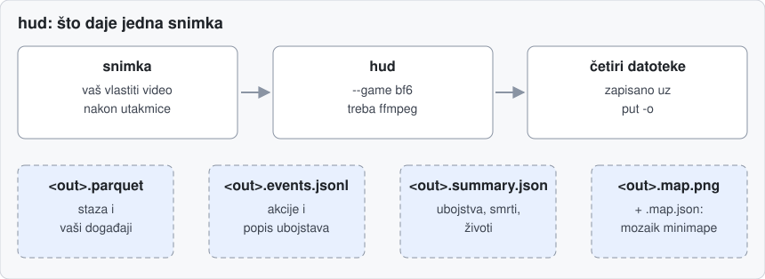

# Čitanje HUD-a iz snimke {#reading-the-hud-from-a-recording}

`hud` čita HUD igre, odnosno zaslonske prikaze, iz **vlastite snimke** igrača, nakon utakmice:
**vlastite** radnje igrača iz skočnog prozora s bodovima koji igra prikazuje ispod nišana (ubojstva,
asistencije, oživljavanja, opskrbe, zauzimanja...), njegove smrti sa zaslona za oborene i zaslona
za raspoređivanje, **vlastiti** trag s mini karte te popis ubojstava uz njih kao vremenski označene
događaje - zapisano kao 3DHeat tablica, a mozaik mini karte kao slika karte koja se postavlja ispod
nje.

Ukratko: gleda vaš snimljeni meč i zapisuje vaša ubojstva, smrti i kamo ste hodali.

```bash
.venv\Scripts\python -m heat3d_capture hud "<recording>.mp4" --game bf6 --player <name> -o out/match
```

Battlefield 6 je prvi profil igre.



## Što radi, a što ne dira {#what-it-does-and-does-not-touch}

- Čita **datoteku videa**: ShadowPlay / Instant Replay isječak, OBS snimku, bilo što što ffmpeg
  dekodira. Nikad ne dira igru, njezinu memoriju, datoteke ni mrežu, a radi nakon što je meč
  završio. Vidi [Pravila](rules.md).
- Izvodi **samo vlastiti položaj igrača**, iz vlastite mini karte. Oznake drugih igrača na mini
  karti su maskirane i nikad se ne čitaju. Popis ubojstava se čuva u cijelosti, ali samo kao ono
  što piše na zaslonu (tko, koga, čime, kada); nijednom igraču osim igraču ne pridružuje se
  pozicija.
- OCR radi lokalno (RapidOCR s PaddleOCR modelima preko ONNX Runtime). Nijedan kadar ni isječak
  ne napušta računalo.
- Snimka pokazuje imena drugih igrača, a mozaik je slika razine. Izlazi su za vlastitu upotrebu
  igrača; čuvajte ih lokalno.

## Zahtjevi {#requirements}

- **ffmpeg i ffprobe** na `PATH`. NVIDIA kartica se koristi za dekodiranje kad postoji
  (`-hwaccel cuda`); inače dekodira procesor, nekoliko puta sporije.
- Paketi iz `requirements.txt`, a OCR bez vlastitih ovisnosti (traži CPU verziju `onnxruntime`,
  koja se sukobljava s DirectML verzijom koju projekt koristi):

```bash
.venv\Scripts\python -m pip install -r requirements.txt
.venv\Scripts\python -m pip install --no-deps rapidocr_onnxruntime==1.2.3
```

`rapidocr_onnxruntime` je čitač teksta (OCR) koji s ekrana čita imena i riječi.
`--no-deps` sprječava da zamijeni DirectML `onnxruntime` projekta.

Za instalaciju ffmpeg na Windowsu: `winget install Gyan.FFmpeg`, zatim otvorite novi terminal i
provjerite s `ffmpeg -version`. Ako ste novi u naredbenom retku, pročitajte [Prije nego što počnete](before-you-start.md).

- Snimka **16:9** bilo koje razlučivosti (1080p, 1440p, 4K). Ostali omjeri se odbijaju, jer bi
  kutije profila pale na krive dijelove ekrana.
- **Zadani raspored HUD-a** igre. Pomaknut ili skaliran element HUD-a čita se na krivom mjestu.

## Opcije {#options}

| Opcija | Zadano | Značenje |
|---|---|---|
| `video` | | Snimka. |
| `-o`, `--out` | naziv videa, u trenutnoj mapi | Putanja izlaza **bez** nastavka; datoteke su `<out>.parquet`, `.events.jsonl`, `.summary.json`, `.map.png`, `.map.json`. |
| `--game` | `bf6` | Čiji HUD se čita. `bf6` (Battlefield 6) je zasad jedini profil. |
| `--player` | nema | Ime igrača kako ga prikazuje popis ubojstava. Uspoređuje se ohlapno (OCR miješa `l`/`I`/`1`, `O`/`0`, `rn`/`m`). Bez njega se ime pogađa (dolje). |
| `--fps` | 5 | Uzoraka mini karte u sekundi. Popis ubojstava uzorkuje se na pola te brzine, skočni prozor s bodovima i zasloni smrti također na pola (na četvrtini dok nijedan skočni prozor nije prikazan), kompas svake 3 s, popis odreda svakih 15 s. |
| `--start` | 0 | Sekunda videa na kojoj počinje. |
| `--seconds` | sve | Koliko videa se čita. |
| `--metres-per-pixel` | nema | Mjerilo mini karte, ako je poznato: metri po pikselu mini karte pri uobičajenom zumu (mini karta je široka 296 piksela na 1080p ekranu). Bez toga su pozicije u tim pikselima; vidi [Jedinice](#north-and-units). |
| `--cpu` | isključeno | Dekodiraj na procesoru čak i kad postoji NVIDIA kartica. |

Napredak se ispisuje svakih pet sekundi; na kraju igrač, ubojstva, smrti, životi i zapisane
datoteke.

## Izlazi {#outputs}

### `<out>.parquet` - trag i događaji igrača {#parquet---the-players-track-and-events}

Jedan redak za svaki uzorak u kojem je igrač bio u igri i mini karta se mogla smjestiti, plus po
jedan za svaki njegov događaj. Podnožje nosi upute za čitanje za preglednik (ključ `heat3d`,
`kind: heat3d-hud`), pa preglednik preslikava svaki stupac bez pitanja.

| Stupac | Značenje |
|---|---|
| `time` | Sekunde od početka videa. |
| `event` | `position`; `start` (video je počeo usred života), `spawn` (ponovno u igri nakon smrti ili duže pauze), `death`, `downed` i `revived` (sa zaslona za oborene, dolje), `end` (život je završio, a ništa ne kaže kako); igračeve vlastite radnje sa skočnog prozora s bodovima (`kill`, `assist`, `reviving`, `resupply`, `capture`... - [tablica događaja](#event-table)); a retci popisa ubojstava o igraču kao `kill_feed`, `death_feed`, `teamkill_feed`, `suicide_feed`, `squadwipe_feed`. |
| `source` | Odakle je događaj retka: `points` (skočni prozor), `screen` (zasloni za oborene i raspoređivanje), `feed` (popis ubojstava); prazno u redcima pozicije. |
| `text` | U redcima `points`: oznaka kako je ispisana (`KILL`, `SQUAD DAMAGE ASSIST`...), ili naslov (`DOUBLE KILL`, naziv vrpce), ili za nepoznatu oznaku ono što je pročitano. |
| `points` | U redcima `points`: za koliko je porasla ukupna vrijednost skočnog prozora u tom trenutku. Kad je više radnji u istom uzorku (ubojstvo i vozilo u kojem je bilo), to je njihov zbroj, zapisan uz svaku, a `shared` kaže koliko ih dijeli. Prazno kad ukupna vrijednost nije pročitana dvaput s obje strane trenutka. |
| `subject`, `subject_side` | U redcima `points`: ime koje je skočni prozor prikazao uz radnju - žrtvu ubojstva, suigrača kojeg je igrač oživio ili opskrbio - i njegova boja (`enemy`, `friendly`, `squad`). |
| `confirmed` | `feed` kad je popis ubojstava imao redak za isto ubojstvo ili smrt (unutar 3 s, ista žrtva). |
| `x`, `y`, `z` | Pozicija na mozaiku: `x` istok, `y` sjever, `z` 0 (podnožje kaže da je `z` gore). Sjever je pravi sjever kad ga je kompas dopustio (vidi `north_up` u sažetku). |
| `player` | Uvijek `me`. Samo igračevi vlastiti redci imaju pozicije. |
| `team` | `own`. |
| `session` | `<video name>#NN`, po jedan za svaki život. Linije toplinske karte nikad ne prelaze preko sesije. |
| `heading` | Stupnjevi u smjeru kazaljke na satu od sjevera (od gornje strane mozaika kad sjever nije poznat): kamo je gledao pogled. |
| `dir_x`, `dir_y`, `dir_z` | Isto kao smjerni vektor, za smjer pogleda u pregledniku. |
| `zoom` | Koliko je mini karta bila udaljena u odnosu na uobičajeni zum (iznad 1 u vozilima). |
| `killer`, `victim`, `weapon`, `headshot`, `marker` | U redcima ubojstva i smrti koji imaju redak s popisa: taj redak (dolje). Ubojstvo sa skočnog prozora bez retka s popisa ima ime sa skočnog prozora kao `victim`; ubojstvo sa skočnog prozora prikazano kao HEADSHOT ima `headshot` true. |

Svaki redak događaja uzima igračevu poziciju u vrijeme događaja (za smrt ili oborenje posljednju
poziciju prije njega, za oživljavanje prvu poslije). Redci se uklapaju izravno u [toplinsku liniju](https://holdi601.github.io/3DHeat/line-heat.html)
preglednika: njegov prijedlog uzima `event`, počinje na `start`, `spawn` i `revived`, završava na
`death`, `downed` i `end`, a `position` redci leže duž rute. Ostali događaji su imenovani tako da
prijedlog ne uzima nijedan za početak ili kraj: oživljavanje drugoga je `reviving` (ne `revive`),
držanje točke `defense`, suigrač koji se pojavljuje na igraču `teammate_arrived`, a redci popisa
`kill_feed` i tako dalje; `kill` nije kraj.

Snimka s dva kruga na dvije karte daje dva mozaika koja se ne mogu povezati. Najveći je
`<out>.parquet`; svaki drugi s barem 30 s traga zapisuje se uz njega kao `<out>.map2.parquet`,
`<out>.map2.map.png` i tako dalje.

### `<out>.events.jsonl` - događaji igrača i popis ubojstava {#eventsjsonl---the-players-events-and-the-kill-feed}

Jedan JSON objekt po retku, po redoslijedu vremena, svaki s `source`:

- `points`: po jedna za svaku radnju igrača: `time`, `event`, `text`, `points`, `shared`,
  `subject`, `subject_side` (kao u tablici), `popup` (sa kojeg skočnog prozora je, numerirano
  kroz cijelo izvođenje), `seen` (koliko čitanja ju je pokazalo), `confirmed`, te `x`, `y` gdje je
  igrač bio.
- `screen`: po jedna za svako oborenje i svako oživljavanje: `event` (`death`, `downed` ili
  `revived`), `time` (kad je igrač pao; za `revived`, kad su zasloni nestali), `until` (posljednje
  viđanje zaslona), `screens` (`down` i/ili `card`), `outcome` (`death`, `revived` ili `unknown`
  kad snimka završi prije), `killer` (iz retka popisa, kad postoji), `x`, `y`.
- `feed`: svaki redak koji je popis prikazao, svačiji:

| Polje | Značenje |
|---|---|
| `time`, `last` | Prvi i posljednji uzorak u kojem je redak pročitan (sekunde od početka videa). `time` je kad se ubojstvo pojavilo, unutar jednog uzorka popisa (0,4 s pri zadanoj brzini). |
| `kind` | S igračeve strane: `kill`, `death`, `teamkill`, `suicide`, `squadwipe`; za retke drugih igrača `kill`, `squadwipe`, ili `death` za redak bez ubojice. |
| `killer`, `victim` | Imena, kao najčešće pročitana kroz sve uzorke koji prikazuju redak (dulje čitanje pobjeđuje kad je uobičajeno njegov početak: ime djelomično skriveno). `killer` je prazan za redak koji je prikazao samo ikonu i žrtvu - smrt od svijeta, ili redak čija je ubojica već nestala. |
| `killer_side`, `victim_side` | Iz boje imena: `friendly` (igračev tim, plava), `enemy` (narančasta), `squad` (blijedo zelena koju igra koristi za igrača i njegov odred), `neutral` (ništa od toga). |
| `weapon` | Razred ikone oružja unutar ovog izvođenja: `icon01`, `icon02`... Redci čije su ikone slične dijele razred. Ikone nisu imenovane; nema popisa iz kojeg bi se imenovale. |
| `marker` | Mala ikona između oružja i žrtve: `skull`, `arrow`, `chevrons`, `crosses` ili prazno. |
| `headshot` | `marker == "skull"` - pretpostavka, vidi [Ograničenja](#limits). |
| `seen` | Koliko je uzoraka popisa prikazalo redak. |
| `me` | `killer`, `victim` ili null. |
| `matched` | Za igračeve vlastite retke: je li za njih pronađena radnja sa skočnog prozora ili zaslon smrti. |
| `x`, `y` (, `map`) | Za igračeve vlastite retke: gdje je bio. |

### `<out>.summary.json` {#summaryjson}

Igrač (i kako je pronađen), odakle su igračevi događaji (`own_events_from`: skočni prozor i
zasloni, ili sam popis ubojstava kad nijedno nije pročitano), ubojstva, smrti, K/D, headshotovi,
asistencije, dana oživljavanja (`revives`) i primljena (`revived`), oborenja, zauzimanja,
neutralizacije, opskrbe, izlječenja, popravci, uništena vozila, rezultat (zbroj ukupnih vrijednosti
skočnih prozora), svaka vrsta radnje s brojem (`actions`), broj skočnih prozora, smrti koje je
pokazao samo popis, vlastiti broj ubojstava i smrti popisa te koliko njegovih ubojstava se podudara
sa skočnim prozorom, ubojstva iz vlastitog tima, samoubojstva, uništenja odreda, životi, sekunde u
igri, prijeđena udaljenost (u jedinicama tablice), redci popisa, za svaku kartu je li sjever gore i
koliko su očitanja kompasa to potvrdila, brojevi traga (uzorci, u igri, smješteni, nesmješteni,
otoci), pretpostavke i vrijeme.

### `<out>.map.png` i `<out>.map.json` - karta ispod traga {#mappng-and-mapjson---the-map-under-the-track}

Mozaik svih mini karti izvođenja, usrednjen, s uklonjenim preklopima, okrenut i skaliran točno kao
tablica. JSON datoteka sadrži dva sidra koja traži postavljanje **Slika karte** u pregledniku
([Slike karata](https://holdi601.github.io/3DHeat/map-images.html) u dokumentaciji preglednika):
učitajte PNG s **Slika karte...**, ostavite uključeno **Zamijeni sjever/jug**, i upišite sidro 1 i
sidro 2 (`px`, `py`, `worldX`, `worldZ`) iz datoteke. Slika tada leži točno ispod traga.

Na slici su samo dijelovi razine koje je mini karta igrača prikazala.

## Metoda {#method}

### Dekodiranje {#decoding}

ffmpeg dekodira na GPU-u, spušta se na brzinu uzorkovanja dok su kadrovi još na kartici, izrezuje
područja profila (mini kartu, popis ubojstava, dvije trake kompasa, popis odreda, skočni prozor s
bodovima, riječi na zaslonu za oborene, donji desni kut), svako skalira na stalnu veličinu i slaže
ih u jednu malu sliku po uzorku. Samo ta slika prelazi u Python kroz cijev. Dekodiranje svakog
kadra H.264 toka je donja granica trajanja.

Dvije radne niti preuzimaju uzorke: jedna poravnava mini karte (OpenCV), druga čita tekst (ONNX
Runtime).

### U igri ili ne {#in-play-or-not}

Kvadrat s tipkom (svijetli kvadrat s ključem karte u njemu, dolje lijevo na mini karti) crta se
uvijek kad i mini karta, a ne na zaslonima smrti, kill-cam, raspoređivanja, izbornika ili tablice
rezultata. Njegova prisutnost - svijetao, bezbojan kvadrat s tamnim slovom u sredini, jasno
svjetliji od okoline - traži se nekoliko piksela oko njegova mjesta, i to je test za igru. Jedan
uzorak koji se ne slaže s oba susjeda se zanemaruje.

Prekid igre je smrt ili promjena runde (sljedeći dio počinje s `spawn`) kad traje najmanje 6 s ili
kad je smrt (sa zaslona, ili redak popisa koji igrača imenuje žrtvom) nastupila unutar 40 s prije
njega; kraći prekid bez smrti (otvorena velika karta) nastavlja život. Mini karta ostaje uključena
dok je igrač oboren, pa je oboren igrač u igri.

### Trag {#the-track}

Mini karta se okreće s pogledom i drži igrača na fiksnoj točki (izmjereno: sredina, 49,7% od
vrha). Svaki uzorak:

1. **Maskiranje** svega što nije razina: jako obojeni ili gotovo bijeli pikseli (oznake ciljeva,
   ikone odreda i vozila, signali, granica područja igre, linije rute, tekst), blijedo žuto-zelena
   boja stošca pogleda, disk oko igračeve oznake, klin stošca iznad nje, tipka karte i tanki rub.
2. **Značajke**: SIFT točke na sivoj mini karti s izjednačenim kontrastom, unutar maske.
3. **Poravnanje s mozaikom**, ne s prethodnim uzorkom: točke se uspoređuju sa značajkama spremljenim
   dosad, u koordinatama mozaika, blizu mjesta gdje je igrač zadnji put bio; sličnost (zaokret,
   zum, pomak) prilagođava se RANSAC-om. Prilagodba treba dovoljno unutarnjih točaka, zum unutar
   trećine posljednjeg, i pomak manji od trećine mini karte po uzorku; prilagodba tražena bilo gdje
   na mozaiku (nakon smrti) treba dvostruko više unutarnjih točaka.
4. **Rast mozaika**: značajke koje mozaik još nema se dodaju (najviše svakih nekoliko desetinki
   sekunde kretanja), a maskirana mini karta se usrednjava u sliku.
5. Igračeva točka, nošena kroz prilagodbu, je njegova **pozicija**; gore mini karte, nošeno kroz
   istu prilagodbu, je njegov **smjer** na mozaiku.

Nakon toga se točka koja skoči više od 10 piksela od obaju prethodnih i obaju sljedećih uzoraka
(koji se slažu među sobom) odbacuje: mini karta ponekad pogodi krivi zum na jedan uzorak. Sažetak
ih broji (`dropped_as_jumps`).

Poravnanje s mozaikom je ono što sprječava zbrajanje grešaka: povratak na mjesto pogađa značajke
spremljene prvi put. Pojava na nevidjenom mjestu započinje zaseban **otok**; svaki deseti
smješteni uzorak isprobava se protiv drugih otoka, a prvo dobro poklapanje ih spaja (manji se
pridružuje većem sa svojim tragom). Otoci koji se nikad ne spoje (druga karta, ili tlo koje nikad
nije bilo zajedničko) zapisuju se zasebno kao gore.

### Sjever i jedinice {#north-and-units}

Traka kompasa čita se svakih 3 s: njezine oznake nalaze se po tinti (svijetle, bezbojne, grupirane
preko malih praznina, oznake-crtice odbačene), svaka se čita zasebno, a dvije ili više oznaka
određuju i mjerilo trake i smjer ispod središnje oznake - jedna oznaka ne određuje ništa. Svako
očitanje kompasa uparuje se sa smjerom mozaika istog uzorka; kružni medijan razlika, među
očitanjima unutar 10 stupnjeva od njega, je zaokret koji stavlja sjever mozaika gore. Primjenjuje
se kad se slažu barem tri očitanja i polovica svih.

<a id="units"></a>Mjerilo tla mini karte nigdje nije ispisano na ekranu, pa su pozicije u
**pikselima mini karte pri uobičajenom zumu**: medijan zuma izvođenja skalira se na jednu jedinicu
tablice po pikselu mini karte od 296 piksela (njezina veličina na 1080p ekranu). Smanjenje zuma u
vozilu uklanja poravnanje, pa je jedinica ista pješke i u vozilu. `--metres-per-pixel` sve pretvara
u metre kad je mjerilo poznato (iz poznate udaljenosti na karti, izmjerene jednom).

### Popis ubojstava {#the-kill-feed}

Popis se čita 2,5 puta u sekundi, ali samo kad su njegovi obojeni pikseli primjetno promijenjeni ili
je prošlo 2 s. Redci teksta nalaze se OCR detektorom; redak čija se slika podudara s onim pročitanim
u prethodnom uzorku (redci se pomiču, pa je možda premješten) preuzima taj tekst umjesto da se
ponovno čita. Redci premali za ime ili s kosom crtom (brojač sličica u tom kutu) se odbacuju.

Redci se grupiraju u retke po visini; u retku je najlijevije ime ubojica, a najdesnije žrtva.
Susjedni dijelovi iste boje spajaju se (ime s razmakom). Jedan redak koji je prešao preko ikone iz
jednog imena u drugo reže se na najširem razmaku kad se polovice razlikuju u boji, i svaka polovica
se ponovno čita. Jedno ime u stupcu žrtava s ikonom odmah lijevo od njega je redak bez ubojice. Dva
dijela iste boje bez ikone među njima su jedno ime čija je ubojica nestala, a ne ubojstvo.

**Strane** dolaze iz boje. Imena su nacrtana s određenom prozirnošću, pa se test radi o tome koliko
je tekst udaljen od vlastite pozadine: predznak crvene minus plave u toj razlici je narančasta
(neprijatelj) ili plava (prijatelj) na bilo kojoj pozadini; ni jedno ni drugo, uz zeleno iznad
ostalih dviju, je boja odreda.

**Ikone**: između imena, pikseli u boji ubojice čine siluetu oružja; mala zasebna ikona odmah prije
žrtve je oznaka, imenovana po obliku (mrlja s rupama za oči je lubanja; mali trokut strelica;
više dijelova križevi).

**Događaji**: redak pročitan ponovno s obama imenima jednakima (sličnost 0,7 nakon ispravljanja
uobičajenih OCR zamjena, jedna od 0,8; skraćeno čitanje se podudara s početkom punog imena) je isti
događaj, sve dok je događaj posljednji put pročitan unutar 5 s i star manje od 14 s - nijedan redak
ne ostaje dulje, pa je isti par kasnije novo ubojstvo. Redak bez ubojice podudara se samo po žrtvi.
Vrijeme događaja je njegovo prvo viđanje; njegova imena, strane i oznaka su većina među viđanjima;
retci pročitani samo jednom se odbacuju.

**Igrač**: `--player`, inače istaknuti (najsvjetliji) redak popisa odreda kad ima barem tri
očitanja i 60% se slaže, inače ime koje je popis najčešće prikazao u boji odreda. Inače sažetak
kaže da je igrač nepoznat, i nijedan redak popisa se ne pripisuje njemu. (Skočni prozor i zasloni
smrti su igračevi vlastiti bez obzira na ime; ne trebaju ime.)

### Skočni prozor s bodovima {#the-points-popup}

Sve što igrač osvoji, Battlefield 6 prikazuje u jednom skočnom prozoru lijevo i ispod nišana - na
istom mjestu pješke, u vozilu i kroz nišan:

```
            [ RIBBON ] (icon)          naslov, povremeno: vrpca ili višestruko ubojstvo
      (icon)(icon)(icon)  300          jedna ikona po radnji; tekuća ukupna vrijednost
                Some_Name              o kome je, na trenutak: narančasto neprijatelj, plavo suigrač
    [ KILL x2 ] [ VEHICLE DESTROYED ]  jedna oznaka u okviru po vrsti radnje, s brojem
```

Skočni prozor raste dok igrač nastavlja bodovati: novo ubojstvo pretvara `KILL` u `KILL x2`, dodaje
ikonu i diže ukupnu vrijednost; nova vrsta radnje dodaje oznaku. Red oznaka pokazuje zadnjih
nekoliko vrsta (stariji klizne van, i nastavlja brojati kad se vrati). Otprilike tri sekunde nakon
posljednje radnje skočni prozor se sklapa u jedan redak (`[KILL x2] 300`) i nestaje. Tekst je
svijetlosiv, oznake u tankim okvirima, ukupna vrijednost velikim znamenkama počevši od x 760 na
ekranu 1920x1080, oznake poravnate udesno do x 750.

Čita se 2,5 puta u sekundi: OCR detektor nalazi retke teksta, čitaju se samo retci u jednom od redaka
skočnog prozora (oznake nišana tenka u istom području se ne čitaju), a redak čija se slika podudara
s onim pročitanim prethodnog uzorka preuzima taj tekst. Redak koji je prešao iz ikone, imena ili
složene oznake u ukupnu vrijednost (`Name10`, `REVIVE185`) reže se tamo gdje ukupna vrijednost
počinje (x 755) i obje polovice se ponovno čitaju. Dok nijedan skočni prozor nije prikazan, svaki
drugi uzorak se drži nepročitan; kad sljedeći prikaže skočni prozor, zadržani se prvo čita, pa se
početak skočnog prozora nalazi točno do uzorka.

**Oznake** se uspoređuju s [tablicom događaja](#event-table) nakon ispravljanja uobičajenih
pogrešaka prepoznavača (Q pročitan kao O, znamenka između slova, I umjesto L, izgubljeno slovo na
rubu): čitanje je oznaka kad je barem 80% slično jednoj (85% za oznake od pet slova ili kraće) i
jasno bliže njoj nego bilo kojoj drugoj. Oznake koje je prepoznavač spojio (`CAPTUREDORDERCOMPLETED`)
rastavljaju se skidanjem poznatih oznaka s početka. Broj je `x2`, `X3`, sitan znak i znamenka, ili
znamenka odmah iza oznake. Svijetlosiva velika linija u redu oznaka koja se ne podudara ni s čim
zadržava se kao radnja `points` s svojim tekstom; linija koja je dio poznate oznake u istom
skočnom prozoru (`DESTROYED` pored `VEHICLE DESTROYED`) nije. Naslovi iznad ukupne vrijednosti
(svijetli okviri, tamni tekst) su `multi_kills` (`DOUBLE KILL` ...) ili `ribbon`. Ime je obojena
linija između ukupne vrijednosti i oznaka; njezina strana dolazi iz boje kao u popisu.

**Skočni prozori i radnje**: čitanja s manje od 0,9 s praznine među njima su jedan skočni prozor.
Skočni prozor koji se čini da završava i vrati se prije nego je mogao nestati (unutar 3,2 s od
posljednjeg rasta), sa svakom oznakom na njezinom broju ili višem i ukupnom vrijednošću ne manjom,
je isti skočni prozor izgubljen na trenutak (mutnoća, svijetla pozadina) - ništa u njemu se ne
broji dvaput. Unutar skočnog prozora, konačni broj oznake je najveći broj pročitan barem dvaput;
njezina k-ta radnja vremenski se određuje prema prvom čitanju koje pokazuje broj k ili više. Broj
pročitan u samo jednom uzorku nije radnja - osim ubojstva koje mu popis ubojstava potvrđuje (redak
igrača unutar 3 s koji nijedno drugo ubojstvo nije uzelo): kratka oznaka KILL je ona koju
prepoznavač najčešće pročita samo jednom. Naslov se broji jednom po skočnom prozoru, kad se pročita
dvaput. `points` je koliko je ukupna vrijednost - brojeći samo ukupne vrijednosti pročitane dvaput
zaredom - porasla od prije uzorka radnje do poslije njega.

Nepoznat redak se broji kao oznaka samo na redu poznatih oznaka u istom čitanju (ili, bez poznate
oznake, kad nema ni imena), pa se ime nacrtano u boji koju test strane ne može razlikovati ne uzima
kao jedno.

### Smrti i oživljavanja {#deaths-and-revives}

Kad igrač padne, igra to kaže ispod središta ekrana (MAN DOWN, REQUEST REVIVE, SKIP (HOLD), NEARBY
MEDICS; kad je oživljavanje zatraženo, REVIVE REQUESTED, CANCEL REQUEST), a kartica u donjem desnom
kutu imenuje tko je to učinio, s DAMAGE LOG ili PLAYER CARD ispod i retkom "YOU n - n FOE" iznad.
Ubijen na mjestu (smrtonosnim headshotom), vidi se samo kartica. Zatim ili suigrač oživljava igrača
- zasloni nestaju i igra se nastavlja - ili igrač iskrvari ili odustane, pa slijedi zaslon za
raspoređivanje, s DEPLOY u donjem desnom kutu.

Ove riječi se čitaju zajedno s skočnim prozorom, u istom prolazu OCR-a (skočni prozor, pojas zaslona
za oborene i donji desni kut složeni u jednu sliku): 2,5 puta u sekundi dok je skočni prozor
prikazan, 1,25 puta inače. Kut je uključen samo kad je igrač izvan igre ili je viđen oboren u
posljednje 3 s; u igri sadrži samo broj municije. Viđanja razmaknuta manje od 4 s čine jednu epizodu
(najmanje dva viđanja). Epizoda je **smrt** kad zaslon za raspoređivanje prikazan unutar 12 s od
njezina kraja, ili kad je igrač izvan igre 3 s nakon nje i ostaje tako 6 s ili dulje; **oživljavanje**
(`downed`, pa `revived`) kad je igrač još u igri 3 s nakon što su zasloni nestali; `unknown` (zapisano
kao samo `downed`) kad snimka završi prije. Vrijeme smrti je kad je igrač pao: redak popisa koji ga
imenuje žrtvom, kad postoji unutar 3 s prije epizode, inače prvo viđanje epizode umanjeno za pola
intervala čitanja. Pozicije nakon smrti izostavljaju se iz rute do zaslona za raspoređivanje.

Smrt s popisa koju nijedna epizoda ne objašnjava (zasloni su promašeni) je i dalje `death`, s
`source` `feed`, i procjenjuje se kao prije: ako igrač ostane u igri dulje od 40 s nakon nje, bio
je oživljen.

### Tablica događaja {#event-table}

Što svaka oznaka, naslov i zaslon postaju. Nekoliko oznaka može biti jedan događaj; `text` čuva koja.

| Događaj | Iz | Značenje |
|---|---|---|
| `kill` | KILL; HEADSHOT | Igrač je nekoga ubio (ime je žrtva). Headshot ubojstvo pokazuje HEADSHOT tamo gdje bi bio KILL: `text` kaže koje, a `headshot` je true. |
| `assist` | ASSIST, KILL ASSIST, DAMAGE ASSIST, SQUAD DAMAGE ASSIST | Šteta nanesena nekome koga je suigrač ubio. |
| `kill_assist` | ASSIST COUNTS AS KILL | Asistencija koju igra broji kao ubojstvo. |
| `suppression`, `suppression_assist` | ENEMY SUPPRESSION; SUPPRESSION ASSIST | Potiskujuća vatra na neprijatelja; na onoga kojeg je suigrač zatim ubio. |
| `smoke_assist` | SMOKE ASSIST, SQUAD SMOKE ASSIST | Dim koji je pokrio suigrača. |
| `spot`, `spot_assist` | SPOT, SPOTTED, ENEMY DESIGNATION; SPOT ASSIST, SPOT BONUS | Otkrivanje neprijatelja; ubojstvo onoga kojeg je igrač otkrio. |
| `driver_assist` | DRIVER ASSIST | Ubojstvo strijelca igračeva vozila. |
| `reviving`, `reviving_bonus` | REVIVE, SQUAD REVIVE; CONCEALED REVIVE | Igrač je oživio suigrača; bonus za to iz zaklona. |
| `heal` | HEAL, SQUAD HEAL | Igrač je izliječio suigrača. |
| `resupply` | SUPPLY, RESUPPLY, SQUAD SUPPLY | Suigrač je uzeo streljivo od igrača. |
| `repair` | REPAIR, VEHICLE REPAIR, SQUAD REPAIR | Igrač je popravio vozilo. |
| `capturing`, `capture` | CAPTURING, RECAPTURING; CAPTURED, OBJECTIVE CAPTURED | Zauzimanje u tijeku; zauzet cilj. |
| `neutralizing`, `neutralize` | NEUTRALIZING; NEUTRALIZED, OBJECTIVE NEUTRALIZED | Isto za neutraliziranje neprijateljskog cilja do neutralnog stanja. |
| `defense` | DEFENDING, OBJECTIVE DEFENDED | Držanje cilja. |
| `offensive`, `defensive` | OFFENSIVE; DEFENSIVE | Bonus za radnju blizu cilja koji se napada; odbranjen. |
| `order` | ORDER COMPLETED | Izvršena zapovijed odreda. |
| `vehicle_damage`, `vehicle_disabled`, `vehicle_destroyed`, `vehicle_destroyed_assist` | VEHICLE DAMAGE; VEHICLE DISABLED; VEHICLE DESTROYED; VEHICLE DESTROYED SUPPORT | Šteta na neprijateljskom vozilu, do uništenja, ili pomoć u tome. |
| `equipment_destroyed` | EQUIPMENT DESTROYED | Uništen neprijateljski uređaj. |
| `forced_bail` | FORCED BAIL | Neprijatelj prisiljen iz vozila. |
| `squad_wipe` | SQUAD WIPE | Posljednji član neprijateljskog odreda ubijen. |
| `savior`, `avenger` | SAVIOR; AVENGER | Ubojstvo neprijatelja koji je ranjavao suigrača; onoga tko je upravo ubio jednog. |
| `teammate_arrived` | SPAWNED ON, SPAWN ASSIST, VEHICLE SPAWN, SQUAD VEHICLE SPAWN | Suigrač se pojavio na igraču ili u njegovu vozilu. |
| `transport` | TEAM TRANSPORT | Prijevoz suigrača u vozilu. |
| `fortify` | DEFENSE DEPLOYED | Obrana koju je igrač izgradio. |
| `points` | sve drugo u redu oznaka | Radnja koju tablica ne poznaje: `text` je ono što je pročitano. |
| `multi_kills` | DOUBLE KILL, TRIPLE KILL, QUAD KILL, MULTI KILL (naslov) | Ubojstva u brzom nizu. |
| `ribbon` | bilo koji drugi naslov | Vrpca, po imenu (BALLISTIC, TANK BUSTER, ENGINEER EXPERT, SPEARHEAD...). |
| `downed` | zaslon za oborene, pa igra | Igrač je pao i bio je oživljen. |
| `revived` | zasloni nestaju, igra se nastavlja | Igrača je oživio suigrač. |
| `death` | zaslon za oborene ili karticu, pa raspoređivanje ili izvan igre | Igrač je umro. |

Tekstovi u tablici viđeni su u testnim snimkama, osim ovih, koji su uobičajena imena serije igara i
u tablici su tu da budu imenovani, a ne zadržani kao `points`: HEADSHOT KILL, ASSIST, KILL ASSIST,
ASSIST COUNTS AS KILL, SPOT, SPOTTED, SPOT ASSIST, SPOT BONUS, SQUAD REVIVE, HEAL, SQUAD HEAL,
RESUPPLY, SQUAD SUPPLY, REPAIR, VEHICLE REPAIR, SQUAD REPAIR, VEHICLE DISABLED, SQUAD WIPE, AVENGER,
oblici OBJECTIVE ..., te naslovi TRIPLE KILL, QUADRUPLE KILL i MULTI KILL. Igra na drugom jeziku
ispisuje druge riječi: njezine oznake dolaze kao `points` s onim što je pročitano - ne pogrešno
kao poznata radnja - sa svojim ukupnim vrijednostima i imenima; a budući da se zasloni smrti
prepoznaju po engleskim riječima, smrti tada dolaze samo s popisa ubojstava, kao redci `death`
s `source` `feed`.

## Što je provjereno {#what-is-verified}

Provjereno očima na testnim snimkama (igračevim vlastitima, nisu dio repozitorija), crtanjem
nasumičnih uzoraka i uspoređivanjem svakog s kadrovima oko njega:

- **Igračevi vlastiti događaji.** Svaka radnja sa skočnog prozora koja je uzorkovana bila je stvarna
  radnja te vrste, pronađena unutar jednog čitanja (0,4 s) svog vremena; većina vrijednosti i imena
  bila je točna (imena u nekim pismima, poput ćirilice, mogu doći iskrivljena). Svaki uzorkovani
  zaslon smrti je pronađen.
- **Popis ubojstava.** Velika većina redaka popisa pronađena je s oba imena točna; male OCR greške
  (veliko I pročitano kao malo l) su dopuštene. Imena nacrtana glifovima koje sama igra prikazuje
  kao kvadrate mogu se propustiti. Strane (boje) su krive za nekoliko posto imena.
- **U igri.** Test tipke s prijedlogom slagao se s kadrom u svakom uzorkovanom trenutku.
- **Trag.** Nema stvarne istine o tome gdje je igrač bio, pa se trag provjerava prema samoj snimci:
  dvije mini karte poravnavaju se **izravno jedna s drugom**, i taj se pomak uspoređuje s pomakom
  između dviju pozicija u tablici. Medijan neslaganja je oko 1-3 piksela mini karte (manje od 1%
  širine mini karte), više na gusto punoj, odzumiranoj mini karti.
- **Vrijeme izvođenja.** Dekodiranje od oko 5 puta u realnom vremenu čini najveći dio, na
  radnoj stanici s GPU-om; čitanje skočnog prozora s bodovima dodaje oko petinu do polovice.

Pregledano očima: svaki mozaik ima neprekinute ceste i zgrade kroz živote koji su ga izgradili, a
rute različitih života duž iste ceste leže jedna na drugoj. Dio na kojem se zum mini karte mijenja
može ispasti predug - vidi [Ograničenja](#limits).

Testovi (`tests/test_hud_*.py`) crtaju sve što čitaju: izmišljenu razinu s cestama, zgradama i
konturama, mini karte hodanja kroz nju s oznakama koje ima stvarna, trake kompasa, redke popisa
ubojstava s izmišljenim imenima. Provjeravaju da se petlja prati unutar dva piksela i zatvara, da
stojeći igrač ostaje na mjestu dok se pogled okreće, da se prate promjene zuma, da se pojava na
drugom mjestu pripaja natrag kad se putovi sretnu, da sjeverni zaokret i okretanje y osi stavljaju
trag tamo gdje je zaista išao, da sidra slike karte poravnavaju trag ispod sebe, te raščlanjivanje
popisa, strane, oznake i uklanjanje duplikata. Za igračeve vlastite događaje crtaju skočne prozore s
bodovima s izmišljenim imenima i oznakama i provjeravaju tablicu oznaka i njezinu toleranciju na
pogreške prepoznavača, oznake spojene u jednu, redove skočnog prozora, ukupnu vrijednost odrezanu
od imena, brojanje dok skočni prozor raste, nastavak nakon trenutka nečitanja, klizanje oznake van i
natrag, ili kraj; da se broj pročitan jednom čuva odvojeno; smrti, oživljavanja i ishode iz riječi
zaslona; te, na izmišljenoj utakmici, da se radnje, smrti i oživljavanja nalaze u tablici tamo gdje
je igrač bio, redci popisa uz njih pod vlastitim imenima, a ruta završava na smrti, a ne na
oživljavanju.

## Ograničenja {#limits}

- **Jedinice su pikseli mini karte**, a ne metri, osim ako je dan `--metres-per-pixel`. Ništa na
  zaslonu igre ne navodi mjerilo tla mini karte.
- **Preslikava se samo ono što je mini karta prikazala.** Mozaik pokriva tlo unutar pola mini karte
  od mjesta gdje je igrač išao; dva mozaika koji nikad nisu dijelili tlo (dva kruga na dvije karte, ili
  dva života u daleko udaljenim kutovima velike karte) ostaju odvojene datoteke s nepovezanim
  koordinatama.
- **Trag je mini karte, na 5 uzoraka u sekundi**, nikakvim glađenjem nije izglađen. Mini karta jako
  odzumirana (helikopter u testnim snimkama ju je odzumirao na 2,3 puta) pokazuje manje detalja po
  pikselu, a izvan područja igre gotovo nimalo, pa je poravnanje tamo grublje. Mlaznjaci i igrač kao
  putnik nisu bili u testnim snimkama.
- **Pogreške poravnanja su lokalne i ne zbrajaju se**, ali mozaik izgrađen dok se istražuje novo tlo
  može nositi malu krivinu koja se ispravi tek kad se tlo ponovno vidi. Gdje se zum mini karte mijenja
  neprekidno (vozilo koje ubrzava) prilagođeni zum može odlutati, a jedan takav dio je viđen s
  udaljenošću oko dvostruko od prave. Mozaik izgrađen iz gusto puna, odzumirane mini karte pješaka je
  najmanje točan (pogreške oko 3 piksela tipično, do 18).
- **Nema optimizacije grafa pozicija.** Petlja se zatvara poravnavanjem spremljenih značajki, a ne
  raspodjelom korekcije kroz petlju.
- **Klase oružja zasad ne rade.** Silueta ikone uzima se iz prozirne ikone preko pokretne pozadine, i
  previše varira od uzorka do uzorka: testne snimke su dale 220 do 340 klasa za 550 do 670 redaka,
  gdje bi se podudaralo nekoliko desetaka oružja. `weapon` tretirajte kao eksperimentalno. Klase su
  u svakom slučaju po izvođenju i nisu imena.
- **Značenja oznaka nisu sva poznata.** Strelica (`▸`) crta se ispred igračeva vlastitog imena, u
  redcima o njemu; nije vrsta ubojstva. Lubanja se uzima kao headshot; to je pretpostavka, a ne
  nešto što igra kaže. `chevrons` i `crosses` (uništenja odreda) su prijavljeni kao viđeni.
- **Imena u pismima koja nisu latinična** (ćirilica, na primjer) dolaze kao najbliža latinična
  slova sličnog izgleda: prepoznavač čita latinicu i kineske znakove. Isti igrač se čita isto svaki
  put, pa se ipak podudara, ali tekst nije njegovo ime.
- **Preklopi u kutu popisa ubojstava** (brojač sličica) mogu sakriti kraj žrtve u gornjem retku.
  Tekst brojača se prepoznaje i odbacuje, a ime skraćeno na kraju se podudara s punim čitanjima, ali
  ime koje je ikad viđeno samo skraćeno ostaje skraćeno.
- **Smrt koju ni zasloni ni popis nisu pokazali** i dalje završava rutu, kao `end`, kad igrač izađe
  iz igre na 6 s ili dulje.
- **Primljena oživljavanja** dolaze sa zaslona za oborene. Samo za smrt s popisa koju su zasloni
  promašili još se zaključuju (u igri dulje od 40 s nakon nje), i brzo oživljavanje se tada ne
  razlikuje.
- **Radnje sa skočnog prozora vremenski se određuju prema čitanju**: unutar 0,4 s od prvog
  prikazivanja oznake; oznaka koja se animira može biti pročitana jedan uzorak prerano ili kasno.
- **Imena u redcima skočnog prozora** čitaju se kao ona s popisa: pisma koja nisu latinična dolaze
  iskrivljena, a ponekad se oznaka imena suigrača koja lebdi u svijetu blizu skočnog prozora pročita
  kao ime radnje. Radnje bez imena (otkucaj zauzimanja, naredba) ga nemaju.
- **`points`** nedostaje gdje ukupna vrijednost nije pročitana dvaput s obje strane radnje, i dijeli
  se među radnjama koje su došle u istom uzorku. `score` u sažetku zbraja konačne ukupne vrijednosti
  skočnih prozora, pa skočni prozor čija ukupna vrijednost nikad nije pročitana dvaput nije u njoj.
- **Red oznaka je prozor**: s četiri ili više vrsta u jednom skočnom prozoru, najstarija oznaka klizne
  ulijevo, preko ruba područja koje se čita. Brojala se dok je bila u vidu; broj koji dobije dok je
  pola izvan ekrana može se propustiti.
- **Skočni prozor izgubljen dulje nego što je mogao trajati** (preko otprilike 4 s nečitljivih
  uzoraka dok je još rastao) uzima se kao dva, pa se oznaka s brojem većim od jedan tada broji
  ponovno. Nije viđeno u provjerama ispod.
- **Drugi jezici sučelja**: oznake dolaze kao `points` s tekstom, a smrti dolaze samo s popisa
  (zasloni smrti se prepoznaju po engleskim riječima).
- **Događaji na kratkom otoku**: život čiji je trag bio prekratak da bi se zapisao kao karta (ispod
  30 s) zadržava svoje događaje u `.events.jsonl` bez `x`, `y`, i ni u jednoj tablici.
- **Raspored HUD-a je zadani za BF6 pri 16:9.** Promijenjeno mjerilo HUD-a, paleta za daltoniste ili
  drukčija veličina mini karte zahtijevali bi vlastiti profil.
