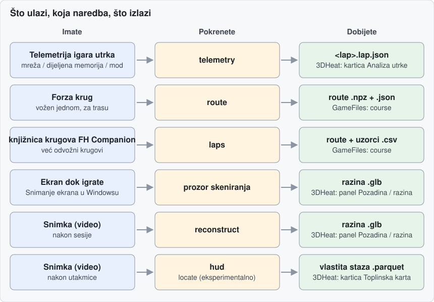

# 3DHeat GameCapture {#dheat-gamecapture}

**Što je to?** Alat koji zapisuje ono što vam igra utrke govori o vašoj vožnji, jedna datoteka
po krugu. Može i iz videa vaše igre rekonstruirati grubi 3D model razine.

**Zašto bih ga koristio?** Da vidite svoje krugove u [pregledniku 3DHeat](https://holdi601.github.io/3DHeat/):
gdje ste kočili, gdje ste bili spori, kako se dva kruga razlikuju. I da imate razinu ispod
toplinske karte kad nitko nema njezin 3D model.

**Primjer:** uključite Forzin Data Out, pokrenite jednu naredbu, odvozite dva kruga. Dvije datoteke kruga pojavljuju se u
`laps\`. Ispustite ih na karticu Analiza utrke preglednika.


Ne znate ništa o naredbenom retku? Prvo pročitajte [Prije nego što počnete](before-you-start.md).

## Tri posla {#the-three-jobs}

1. **Telemetrija kruga.** Bilježi svaki kanal koji igra utrke objavljuje - Forzin Data Out, dijeljenu
   memoriju Assetto Corsa igara, mrežne tokove rally igara, BeamNG mod,
   Trackmania dodatak - i piše jednu datoteku `heat3d-lap` po krugu ili dionici, za karticu
   Analiza utrke preglednika. iRacing ne treba snimač: preglednik čita njegove vlastite `.ibt` datoteke.
2. **Razine iz igranja.** Pretvara ono što je ekran prikazao dok ste hodali ili vozili kroz
   razinu u 3D model `.glb`, koji preglednik polaže ispod toplinske karte.
3. **Vaša vlastita utakmica, nakon nje.** `hud` čita HUD vaše snimke - vaše akcije, smrti,
   trag na minimapi i popis ubojstava. `locate` (eksperimentalno: za sada mjesti malo stvarnih
   kadrova) određuje gdje je svaki kadar snimljen, na 3D modelu razine.

Sva tri slijede jedno pravilo: **ništa se ne ubacuje u igru i ništa se ne kači**. Kadrovi
dolaze iz javnog API-ja za snimanje ekrana, a telemetrija iz sučelja koja igre objavljuju za to.
Vidi [Pravila](../rules.md).



Kod je u Pythonu (paket `heat3d_capture`), licenca MIT. Modeli dubine i položaja koje može
pokrenuti imaju vlastite licence - vidi [Modeli i licence](../models-and-licences.md).

## Brzi početak {#quick-start}

### Snimanje krugova {#record-laps}

Treba vam Python 3.10 ili noviji ([Prije nego što počnete](before-you-start.md)). U PowerShellu:

```powershell
git clone https://github.com/Holdi601/3DHeat-GameCapture
cd 3DHeat-GameCapture
python -m venv .venv
.venv\Scripts\python -m pip install -r requirements.txt

# Forza: Settings -> HUD and Gameplay -> Data Out = ON, IP 127.0.0.1, port 5300
.venv\Scripts\python -m heat3d_capture telemetry -o laps
```

**Trebali biste vidjeti** `listening on port 5300. Laps go to laps. Ctrl+C to stop.`, zatim redak po krugu dok prelazite cilj, kao na
slici iznad. Pritisnite Ctrl+C za zaustavljanje. Ispustite datoteke iz `laps\` na karticu Analiza utrke preglednika.
Svaka druga igra je jedan `--game` daleko:

```powershell
.venv\Scripts\python -m heat3d_capture telemetry --game acc -o laps
.venv\Scripts\python -m heat3d_capture telemetry --game dirtrally2 -o laps
```

Vidi [Snimači telemetrije](../telemetry.md) za svaku igru i opciju.

### Skeniranje razine {#scan-a-level}

Dvaput kliknite **`scan.bat`** u mapi alata. Pronalazi Python (i nudi instalaciju putem
winget ako ga nema), pravi privatni `.venv` i otvara prozor za skeniranje. Prozor kaže
što nedostaje, čemu služi svaki paket i kolika je preuzimanja, a ništa ne instalira bez vašeg da.
Vidi [Izvođenje i ovisnosti](../runtime.md) i
[Prozor skeniranja](../reconstruction-scan-ui.md).

Ručno: `.venv\Scripts\python -m heat3d_capture.ui`.

Za rekonstrukciju snimke izvan mreže, s putanjom kamere riješenom odjednom (treba PyTorch,
paket `vggt` i GPU - vidi [Rekonstrukcija izvan mreže](../reconstruction-offline.md)):

```powershell
.venv\Scripts\python -m heat3d_capture reconstruct lap.mp4 -o lap.glb
```

## Karta dokumentacije {#map-of-the-documentation}

| Stranica | Što obuhvaća |
|---|---|
| [Prije nego što počnete](before-you-start.md) | Python, terminal, prva naredba, česte greške |
| [Pravila](../rules.md) | Bez ubacivanja, samo objavljena sučelja, i što to košta |
| [Snimači telemetrije](../telemetry.md) | Naredba `telemetry` i pregled svake igre |
| [Forza](../telemetry-forza.md) | Data Out, prepoznavanje rasporeda, FH Companion relej i njegov `.tele.gz` |
| [Assetto Corsa igre](../telemetry-assetto-corsa.md) | AC, ACC, AC EVO, AC Rally iz dijeljene memorije |
| [Rally igre](../telemetry-rally.md) | EA SPORTS WRC, DiRT Rally 2.0 / 1 / DiRT 4, Richard Burns Rally |
| [BeamNG.drive](../telemetry-beamng.md) | `heat3d` protokol mod |
| [Trackmania](../telemetry-trackmania.md) | `Heat3dRecorder` Openplanet dodatak |
| [iRacing](../telemetry-iracing.md) | Čitanje `.ibt` datoteka u pregledniku |
| [Dijeljenje krugova i dionica](../lap-splitting.md) | `LapSplitter`, `CounterSplitter`, `LineSplitter`, `StageSplitter` |
| [Proklizavanje, driftanje i izvedeni kanali](../slip-and-drift.md) | Kako se proklizavanje skalira i što preglednik izvodi |
| [Datoteka heat3d-lap](../lap-format.md) | Format datoteke kruga, kanali, jedinice, `meta` |
| [Igre](../games.md) | Po igri: kako snimati, što se šalje, koje staze se mogu izvesti |
| [Naredbe](../commands.md) | `route`, `telemetry`, `laps`, `reconstruct`, `hud`, `locate`, korak po korak |
| [Referenca naredbi](../cli-reference.md) | svaka opcija, generirano iz `--help` |
| [Čitanje HUD-a iz snimke](../hud-video.md) | `hud`: vlastite akcije, smrti, trag na minimapi i popis ubojstava iz snimke |
| [Lociranje kadrova u razini](../locate.md) | `locate`: gdje je svaki kadar snimljen, naspram geometrije razine |
| [Rekonstrukcija razine](../reconstruction.md) | Cjevovod od kadrova do `.glb` |
| [Prozor skeniranja](../reconstruction-scan-ui.md) | Svaka kontrola, tipkovnički prečac i element preklapanja |
| [Snimanje, maske i kvaliteta kadrova](../reconstruction-capture.md) | Windows Graphics Capture, ključni kadrovi, HUD maske, savjeti o kvaliteti |
| [Dubina](../reconstruction-depth.md) | Depth Anything V2, ONNX Runtime, izrada modela |
| [Položaj i mjerilo kamere](../reconstruction-pose.md) | Odometrija, relokalizacija, položaji iz telemetrije, mjerilo tla, bundle adjustment |
| [Spajanje, pokrivenost i boja](../reconstruction-fusion-and-texture.md) | Volumen zauzeća, mreža pokrivenosti, slaba mjesta, boja vrhova |
| [Izlaz `.glb`](../glb-output.md) | Datoteka koju preglednik učitava |
| [Rekonstrukcija izvan mreže](../reconstruction-offline.md) | `reconstruct`, VGGT prozori i spajanje |
| [Modeli i licence](../models-and-licences.md) | Veličine Depth Anything V2, VGGT, paketi |
| [Izvođenje i ovisnosti](../runtime.md) | Provjera prije pokretanja, pozadinski dijelovi, razine performansi |
| [Ograničenja i provjere](../limits.md) | Što nije učinjeno i što nije provjereno |
| [Ažuriranja](../updates.md) | Provjera izdanja i `python -m heat3d_update` |
| [Razvoj](../development.md) | Testovi, virtualno okruženje, raspored repozitorija |
| [Održavanje ovih stranica](../maintaining.md) | Popis za izdavanje koda i dokumentacije |

## Dio 3DHeata {#part-of-3dheat}

Datoteke koje ovaj alat piše učitava **preglednik 3DHeat** -
[izvorni kod](https://github.com/Holdi601/3DHeat), [dokumentacija](https://holdi601.github.io/3DHeat/).
Datoteke krugova idu na njegovu karticu Analiza utrke, `.glb` razine na njegov panel Pozadina / razina, a tablice `hud` i `locate` na
njegovu karticu Toplinska karta; kako preglednik čita tablice i datoteke meča opisano je u
[Jedna datoteka po meču (.3dheat)](https://holdi601.github.io/3DHeat/container.html) i
[Unos podataka](https://holdi601.github.io/3DHeat/getting-data-in.html).

| Alat | Što radi | Dokumentacija |
|---|---|---|
| [preglednik 3DHeat](https://github.com/Holdi601/3DHeat) | prikazuje toplinske karte, utrke i utakmice u 3D, u pregledniku | [dokumentacija](https://holdi601.github.io/3DHeat/) |
| [GameFiles](https://github.com/Holdi601/3DHeat-GameFiles) | staze i razine iz datoteka koje igre isporučuju, kao 3D modeli | [dokumentacija](https://holdi601.github.io/3DHeat-GameFiles/) |
| [GameCapture](https://github.com/Holdi601/3DHeat-GameCapture) | telemetrija krugova iz igara utrka; razine rekonstruirane iz videa igranja | [dokumentacija](https://holdi601.github.io/3DHeat-GameCapture/) |
| [Unreal Exporter](https://github.com/Holdi601/3DHeat-UnrealExporter) | dodatak za Unreal Editor koji izvozi razinu kao 3D model | [dokumentacija](https://holdi601.github.io/3DHeat-UnrealExporter/) |
| [CS2](https://github.com/Holdi601/3DHeat-CS2) | demoi Counter-Strike 2 u datoteke meča; karte u 3D modele | [dokumentacija](https://holdi601.github.io/3DHeat-CS2/) |
| [Watcher](https://github.com/Holdi601/3DHeat-Watcher) | bilježi vaše igranje u pozadini iz onoga što igre objavljuju | [dokumentacija](https://holdi601.github.io/3DHeat-Watcher/) |
| [Ext-WarThunder](https://github.com/Holdi601/3DHeat-Ext-WarThunder) | War Thunder replay-i u datoteke meča | [dokumentacija](https://holdi601.github.io/3DHeat-Ext-WarThunder/) |
| [Ext-WoT](https://github.com/Holdi601/3DHeat-Ext-WoT) | World of Tanks replay-i u datoteke meča | [dokumentacija](https://holdi601.github.io/3DHeat-Ext-WoT/) |
| [Ext-WoWs](https://github.com/Holdi601/3DHeat-Ext-WoWs) | World of Warships replay-i u datoteke meča | [dokumentacija](https://holdi601.github.io/3DHeat-Ext-WoWs/) |
| [Ext-Squad](https://github.com/Holdi601/3DHeat-Ext-Squad) | demoi Squad servera u datoteke meča | [dokumentacija](https://holdi601.github.io/3DHeat-Ext-Squad/) |
| [Ext-DCS](https://github.com/Holdi601/3DHeat-Ext-DCS) | karte DCS Worlda u 3D modele | [dokumentacija](https://holdi601.github.io/3DHeat-Ext-DCS/) |
| [Ext-IL2](https://github.com/Holdi601/3DHeat-Ext-IL2) | karte IL-2 Sturmovik u 3D modele | [dokumentacija](https://holdi601.github.io/3DHeat-Ext-IL2/) |

Razvojni inženjer s otvorenim projektom igre treba koristiti Unreal izvoznik, koji čita stvarnu
geometriju i točan je. Tamo gdje se arhivi igre mogu čitati, GameFiles izvlači točnu
stazu. Rekonstrukcija iz igranja namijenjena je slučaju kad je dostupan samo ekran.
