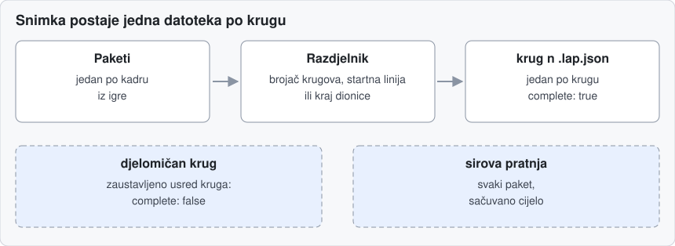

# Kako se krugovi i etape dijele {#how-laps-and-stages-are-split}

Snimač vidi jedan neprekinuti tok uzoraka. Pretvaranje u krugove obavlja jedan od četiri
razdjelnika, odabrana prema tome što igra kaže o krugovima. Svi slijede istu zamisao:
upotrijebiti brojač igre ako ga ima, a inače pronaći krug iz položaja; nikad ne zapisati
odlomak prekratak za usporedbu.

| Razdjelnik | Kod | Koriste ga |
|---|---|---|
| `LapSplitter` | [`fulllap.py`](https://github.com/Holdi601/3DHeat-GameCapture/blob/main/heat3d_capture/telemetry/fulllap.py) | Forza |
| `CounterSplitter` | [`kunos.py`](https://github.com/Holdi601/3DHeat-GameCapture/blob/main/heat3d_capture/telemetry/kunos.py) | Assetto Corsa, ACC |
| `LineSplitter` | [`kunos.py`](https://github.com/Holdi601/3DHeat-GameCapture/blob/main/heat3d_capture/telemetry/kunos.py) | AC EVO, AC Rally, BeamNG |
| `StageSplitter` | [`rally.py`](https://github.com/Holdi601/3DHeat-GameCapture/blob/main/heat3d_capture/telemetry/rally.py) | EA SPORTS WRC, DiRT Rally 2.0, DiRT Rally, DiRT 4, Richard Burns Rally |

Trackmania dijeli vožnje unutar svog dodatka ([Trackmania](telemetry-trackmania.md)), a
datoteke iRacinga dijeli preglednik prema brojaču krugova simulatora ([iRacing](telemetry-iracing.md)).

Pri **Ctrl+C** svaki snimač poziva `flush()` svog razdjelnika, pa se otvoreni krug ili
etapa zapiše ako prolazi iste minimume kao dolje.

## LapSplitter (Forza) {#lapsplitter-forza}

Parametri: `minimum_metres = 400`, `gap_seconds = 2.0`.

Za svaki dekodirani paket:

1. Ako je `timestampMs` igre skočio naprijed za više od 2 sekunde od zadnjeg paketa ili
   otišao unatrag, otvoreni krug se prvo zatvara.
2. Ako je `isRaceOn` 0 (igra nije u utrci), otvoreni krug se zatvara, a paket se odbacuje.
3. Ako nijedan krug nije otvoren, otvara se jedan s `lapNumber` paketa.
4. Ako se `lapNumber` razlikuje od onog otvorenog kruga, otvoreni krug se **zatvara kao
   završen**; njegov `seconds` je `lastLap` igre kad je pozitivan. Krug zatvoren na ovaj
   način zapisuje se bez obzira na duljinu. Otvara se novi krug.
5. Paket se dodaje.

Snimač također zatvara krug kad nijedan paket ne stigne 2 sekunde stvarnog vremena (igra
je pauzirana ili zatvorena usred kruga).

**Zatvaranje** zadržava otvoreni krug samo ako ima najmanje 2 uzorka i najmanje 400 m
`distanceTravelled`; zapisuje se kao nedovršen (`run`). Utrka od točke do točke nikad ne
broji drugi krug, pa se uvijek tako završi.

## CounterSplitter (AC, ACC) {#countersplitter-ac-acc}

Parametar: `minimum_metres = 300`. Svaki uzorak dobiva `completedLaps` i vrijeme zadnjeg
kruga sa stranice grafike.

- Prvi uzorak otvara krug s brojem koji je u tom trenutku u `completedLaps`.
- Kad se `completedLaps` promijeni, otvoreni krug se zatvara. **Završen** je, sa
  `seconds = vrijeme zadnjeg kruga u ms / 1000` (ako je pozitivno), samo ako je brojač
  porastao točno za 1 - skok natrag na 0 (ponovno pokretanje sesije) ili za više od jednog
  zatvara ga kao nedovršen.
- Zatvoreni krug se zapisuje samo ako ima uzorke i najmanje 300 m vožnje.
- Zatvaranje zadržava otvoreni krug ako ima više od jednog uzorka i najmanje 300 m.

## LineSplitter (AC EVO, AC Rally, BeamNG) {#linesplitter-ac-evo-ac-rally-beamng}

Parametri: `radius = 15 m`, `minimum_metres = 300`, `stop_seconds = 8`.

Ove igre ili nemaju brojač krugova na stranici koju snimač čita, ili voze etape. **Linija
je mjesto na kojem je snimanje počelo**:

1. Vodoravni položaj (`x`, `z`) prvog uzorka postaje linija.
2. Kad automobil pređe više od 5 m, smjer od linije do automobila postaje smjer kruga.
3. **Zaustavljanje** završava vožnju: kad `speed` ostane ispod 1 m/s 8 sekundi, otvoreni
   krug se zatvara (tako završava vozačka etapa: automobil stane na cilju).
4. **Prijelaz linije**: nakon više od 300 m vožnje skupljaju se uzorci unutar 15 m od linije.
   Kad automobil ponovno napusti taj polumjer, najbliži skupljeni uzorak je prijelaz. Ako je
   tamo automobil bio okrenut u istom smjeru kao smjer kruga (točkasti umnožak lokalnog
   smjera i smjera kruga je pozitivan), krug se zatvara na tom uzorku; inače se prolazak
   zanemaruje (automobil je prešao start u suprotnom smjeru).
5. `seconds` zatvorenog kruga je vrijeme od njegovog prvog uzorka do prijelaza. Krug je
   **završen samo ako je njegov prvi uzorak bio brži od 5 m/s**: krug koji je počeo iz
   mirovanja je start, a ne krug za usporedbu. Prvi krug snimanja započetog s rešetke je
   stoga uvijek nedovršen; snimanje započeto u brzom krugu daje završen prvi krug pri
   sljedećem prijelazu.
6. Sljedeći krug počinje na uzorku prijelaza (pripada objema krugovima).

Krugovi kraći od 300 m se odbacuju. Zatvaranje (zaustavljanje ili Ctrl+C) zadržava otvoreni
krug ako ima najmanje 2 uzorka i 300 m, kao nedovršen. BeamNG zatvara na isti način kad se
vozilo vrati na početak (njegov sat ide unatrag), prije pokretanja novog razdjelnika, pa se
vožnja prije vraćanja zadrži.

Udaljenosti su vodoravne (`x`, `z`) za brojač prijeđenog puta i test linije, a pune 3D za
test duljine od 300 m.

## StageSplitter (vozačke igre) {#stagesplitter-rally-games}

Parametar: `minimum_metres = 300`. Svaki uzorak dobiva sat etape igre, je li igra javila
da je automobil završio, i po mogućnosti vlastito vrijeme igre za to.

1. Ako je sat 0 ili manje, ili se vratio unatrag za više od 0,5 s, otvorena etapa se
   **napušta**: zadržava se kao djelomična etapa ako nije završena, ima više od 10 uzoraka
   i najmanje 300 m. Sat 0 ili manje također odbacuje uzorak (automobil je na startu).
2. Ako nijedna etapa nije otvorena, otvara se nova (broji se 1, 2, ... za snimanje).
3. Kad je etapa završena, daljnji uzorci se zanemaruju dok sat ne ide unatrag.
4. Svaki uzorak se sprema s `time` postavljenim na sat etape.
5. Kad igra javi da je završeno, etapa je završena; njezin `seconds` je vrijeme igre kad je
   zadano i pozitivno, inače sat. Zapisuje se ako je pokrila najmanje 300 m.

Što znači „završeno” po igri:

| Igra | Završeno kad |
|---|---|
| EA SPORTS WRC | duljina etape > 0 i udaljenost na etapi >= duljina - 0,5 m |
| DiRT igre | broj završenih krugova porastao je iznad početnog broja etape, ili (događaj s jednim krugom) udaljenost po krugu >= 99,9 % duljine staze |
| Richard Burns Rally | sat utrke > 0 i udaljenost do kraja <= 0 |

Za RBR se gore os i brzina određuju kad se etapa zapisuje (vidi
[Vozačke igre](telemetry-rally.md#richard-burns-rally-rsf--ngp)).

## Vrijeme i udaljenost u datoteci kruga {#time-and-distance-in-the-lap-file}

Za svaki snimač osim Forze `time` se preračunava tako da je prvi uzorak kruga 0, a
`distance` je zbrojena 3D udaljenost između uzastopnih položaja. Forza koristi vlastiti sat
kruga i brojač prijeđenog puta igre, preračunate na isti način.
