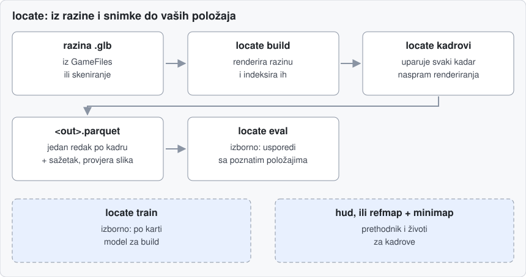

# Traženje kadrova u razini {#locating-frames-in-a-level}

`locate` utvrđuje gdje je uzet svaki kadar snimke igranja - 3D položaj kamere i smjer pogleda - tako
da se slika uspoređuje s prikazima geometrije razine. Namijenjen je igrama koje ne vode zapis o
tome gdje je igrač bio: nema demo datoteke, nema datoteke reprize, nema telemetrije. Battlefield 6
je prva.

> **Eksperimentalno.** Na pravim snimkama zasad smješta samo mali dio kadrova; vidi
> [Pravi kadrovi: eksperimentalno](#real-frames-experimental).

```bash
# Jednom po razini: prikaži je sa svakog mjesta na kojem igrač može stajati, i indeksiraj prikaze.
.venv\Scripts\python -m heat3d_capture locate build level.glb -o level.db

# Po snimci: gdje je uzet svaki kadar?
.venv\Scripts\python -m heat3d_capture locate frames "<recording>.mp4" --db level.db -o out/match
```

Položaj dolazi **iz slike**, u odnosu na cijelu razinu, bez ikakve prethodne pretpostavke. Trag
mini karte iz [čitača HUD-a](hud-video.md) je samo rezerva za kadrove koje slika ne može smjestiti,
a svaki redak kaže iz kojeg od ta dva izvora dolazi.




## Što radi, a što ne dira {#what-it-does-and-does-not-touch}

- Čita **vlastitu snimku** igrača i datoteku razine koju je igrač izvezao iz **vlastite kopije**
  igre. Nikad ne dira igru, njezinu memoriju, njezine datoteke dok radi, niti njezinu mrežu, i radi
  nakon utakmice. Vidi [Pravila](rules.md).
- Smješta **samo kameru igrača**: kadar je vlastiti pogled igrača.
- Razina, baza izgrađena iz nje i sve što je iz nje prikazano pripadaju izdavaču igre. Čuvajte ih
  lokalno.

## Zahtjevi {#requirements}

- Što navodi `requirements.txt`, PyTorch (s pytorch.org, za GPU) i `requirements-locate.txt`:

```bash
.venv\Scripts\python -m pip install -r requirements-locate.txt
```

- GPU s OpenGL 3.3 (4.3 je brži) za prikaze, a po mogućnosti CUDA za modele. Na procesoru radi, ali
  sporo.
- Modeli se preuzimaju pri prvoj upotrebi (oko 450 MB): DINOv2 s Hugging Facea, ALIKED i LightGlue
  preko kornia. Svi su licencirani za komercijalnu upotrebu; vidi [Licence](#licences).
- **Razina** kao `.glb` (ili `.gltf`) u okviru pregledniku, Y gore, **s teksturama osnovne boje**, kako
  je pišu 3DHeat izvoznici (dijelovi `ground:` / `structure:`; imena dijelova nisu potrebna). Jedna
  jedinica je jedan metar osim ako najvišja razina datoteke `extras.unit_metres` kaže drukčije.
  GameCapture skeniranje (`reconstruct`, prozor skeniranja) zapisuje se u **centimetrima** i nosi
  `extras.unit_metres: 0.01`, pa se čita u stvarnoj veličini. Razina bez tekstura radi znatno lošije;
  vidi [Ograničenja](#limits).

## Naredbe {#commands}

### `locate build <level> -o <db>` {#locate-build---o-}

Prikazuje razinu sa svakog mjesta na kojem bi igrač mogao stajati i sprema, za svaki prikaz, njegov
položaj i jedan globalni deskriptor.

| Opcija | Zadano | Značenje |
|---|---|---|
| `level` | | `.glb` / `.gltf` razine. |
| `-o`, `--out` | | Mapa baze koja se zapisuje. |
| `--game` | `bf6` | Profil igre: visine očiju, vidno polje, kutije HUD-a, brzina (dolje). `generic` za bilo koju igru iz prvog lica. |
| `--eye` | iz profila | Visine očiju iznad poda u metrima, prvo stojeće. Jedan prikaz baze po visini. |
| `--fov` / `--vfov` | iz profila | Vodoravno vidno polje snimke, ili okomito (Battlefieldov klizač) za 16:9 snimku. |
| `--spacing` | 2,5 | Metri između mjesta s kojih se uzimaju prikazi. |
| `--yaw-step` | 30 | Stupnjevi između smjerova prikaza. |
| `--pitch` | 0 | Nagibi na kojima se prikazuje, stupnjevi prema gore. |
| `--positions` | nema | Tablica (Parquet ili CSV s `x`, `y`, `z` na stopalima, u okviru razine) iz koje se uzimaju mjesta umjesto svakog poda; na primjer izlaz prethodnog pokretanja. |
| `--shadows` | isključeno | Bacaj sjene sunca u prikazima (sunce razine, kad ga njezina datoteka navodi u `extras.sun`). |
| `--untextured` | isključeno | Prikaži samo oblik i svjetlo. |
| `--box X0 Z0 X1 Z1` | cijela datoteka | Samo mjesta unutar ovog okvira (jedinice razine): područje igre. |
| `--places` | `auto` | Odakle se uzimaju prikazi: `nav` - igrači na visini očiju iznad mreže navigacije razine (dijelovi `nav:`, točno tamo gdje igra dopušta hodanje), kamere vozila na njihovoj visini iznad dijelova `ground:` (teren i ceste) unutar 50 m od njih; `ground` - oboje iznad `ground:`; `floors` - iznad svake površine okrenute prema gore (i krovova i sanduka); `auto` - `nav` kad razina ima mrežu navigacije, inače `floors`. |
| `--head` | nema | Model po karti iz `locate train` za deskriptore. |

Zapisuje `<db>/db.json` (od čega i s čime je izgrađena) i `<db>/views.npz` (položaji, deskriptori).

### `locate frames <recording> --db <db>` {#locate-frames----db-}

| Opcija | Zadano | Značenje |
|---|---|---|
| `source` | | Video, slika ili mapa slika (uzete po redoslijedu imena, `--fps` razmaka). |
| `--db` | | Baza koju je `build` zapisao. Njezina datoteka razine mora još biti tamo gdje je bila (ili `--level`). |
| `-o`, `--out` | `<source>.locate` | Putanja izlaza bez nastavka. |
| `--fps` | 2 | Kadrova lociranih po sekundi videa. |
| `--start`, `--seconds` | sve | Dio videa koji se čita. |
| `--width` | 1280 | Širina na kojoj se kadrovi uspoređuju. |
| `--shortlist` | 8 | Pogledi baze isprobani po kadru blizu prethodne pretpostavke ili fiksiranja. |
| `--search-shortlist` | 16 | Bez prethodne pretpostavke: pogledi baze isprobani po kadru ([traže se zajedno](#with-no-prior-frames-searched-together)). |
| `--no-search` | isključeno | Bez prethodne pretpostavke: traži svaki kadar sam i vjeruj njegovu fiksiranju bez susjeda. |
| `--accept-depth` | 0 (isključeno) | Bez prethodne pretpostavke: vjeruj fiksiranju samo ako je njegova daleka udaljenost njegovih podudaranja ovoliko puta veća od bliske. |
| `--accept-support` | 2 | Bez prethodne pretpostavke: susjedi koji se slažu duž života potrebni da se fiksiranje prihvati. |
| `--checkpoint` | nema | Čuvaj stanje pokretanja ovdje i nastavi od njega ako postoji. |
| `--stop-file`, `--stop-process` | nema | Zaustavi se sam, stanje spremljeno, izlazni kod 75, kad ova datoteka postoji ili proces čiji naziv počinje ovim radi (provjerava se prije svakog kadra; može se ponoviti), tako da dugo pokretanje oslobodi računalo za igru. Ista naredba nastavlja. |
| `--normalise` | nema | Lagana normalizacija prije uspoređivanja: `clahe`, `gray`. |
| `--minimap` | nema | Tablica naredbe `hud`: **rezerva** za kadrove koje slika ne može smjestiti. |
| `--prior-radius` | nema | **Opcionalno ubrzanje**, isključeno po zadanom: traži samo poglede baze do ovoliko metara od položaja mini karte (treba `--minimap`). |
| `--minimap-anchor` | nema | JSON datoteka koja vezuje mini kartu za razinu ([mini karta kao prethodna pretpostavka za pretragu](#the-minimap-as-a-search-prior)): mini karta skraćuje pretragu od prvog kadra; tako nađena fiksiranja su `visual+minimap-prior`. |
| `--no-level-search` | isključeno | S prethodnom pretpostavkom: kad ništa blizu nje ne odgovara, ne pretražuj i cijelu razinu (brže). |
| `--lives` | tablica `--minimap` | Tablica naredbe `hud` čije smrti, raspoređivanja i oživljavanja kažu kada je igrač bio u igri: položaji skaču samo preko smrti ([životi iz snimke](#lives-from-the-footage)). |
| `--no-sequence` | isključeno | Odluči svaki kadar sam, ne duž pokretanja (dolje). |
| `--fit-fov` | isključeno | Nakon pokretanja prilagodi vidno polje najjačim fiksiranjima, po pogledu, i prijavi ga. |
| `--check-every` | 0 | Također svakih N kadrova, smješten ili ne, slika u `<out>.check`. |
| `--no-checks` | isključeno | Ne piši slike provjere vizualnih fiksiranja (dolje). |
| `--no-zoomed` | isključeno | Ne rješavaj zumirane poglede iz fiksiranja susjeda (dolje). |
| `--no-grow` | isključeno | Ne traži ponovo oko svakog fiksiranja kadrove oko njega koji još nemaju fiksiranje. |
| `--game`, `--eye`, `--fov`, `--vfov`, `--mask`, `--no-hud-mask`, `--max-speed` | iz profila | Kao gore; `--mask x,y,w,h` dodaje okvir zaslona (na zaslonu 1920x1080) koji nije razina. |
| `--vehicle-vfov` | iz profila | Okomito vidno polje kamera vozila (Battlefieldov klizač za vozila). |
| `--settings` | najnovija datoteka postavki | `bf6`: datoteka postavki igre iz koje se čitaju vidna polja (samo za čitanje) kad nije dan `--fov`/`--vfov`; po zadanom najnoviji `PROFSAVE*_profile` pod `Documents/Battlefield 6/settings`. Sadrži postavke kakve jesu sada, što možda nisu bile kad je starija snimka napravljena. |

### `locate refmap <level> <deploy screen> -o <refmap>` {#locate-refmap----o-}

Smješta vlastitu kartu igre na razinu: referencu prema kojoj se čita mini karta
([mini karta, čitana prema razini](#the-minimap-read-against-the-level)). `<deploy screen>` je slika
zaslona za raspoređivanje koja prikazuje cijelu kartu, ili snimka s `--at <seconds>` u takvom
trenutku; izrezuje se kutija karte iz profila (`--whole-picture` zadržava sve). Zapisuje
`<refmap>.png` (karta preslikana na vlastiti okvir razine, `--mpp` metara po pikselu, zadano 0,5),
`<refmap>.valid.png` (gdje je to karta, a ne oznaka ili natpis) i `<refmap>.json` (okvir i
kalibracija, s time koliko su pločice karte bile daleko od njega). `--topdown <prefix>` čuva razinu
prikazanu odozgo za sljedeće pokretanje (`--topdown-mpp`, zadano 0,656 m; `--box` ju ograničava).

### `locate minimap <recording> --refmap <refmap> -o <table>.parquet` {#locate-minimap----refmap---o-parquet}

Čita mini kartu snimke prema referentnoj karti, kadar po kadar (`--fps`, zadano 2): položaj, smjer i
zum svake mini karte koja se podudara, u okviru razine, zapisano kao tablica mini karte s sidrom uz
nju (`<table>.anchor.json`) koje `locate frames` prima kao
`--minimap <table>.parquet --minimap-anchor <table>.anchor.json`. S tablicom naredbe `hud` (`--hud`)
prenose se njezini životi; uz sidro za tu tablicu (`--hud-anchor`) prvo traženje je oko mjesta na
kojem ju smješta, a gdje se nijedna mini karta ne podudara, trag HUD-a sam popunjava rupe, pomaknut
na najbliža fiksiranja referentne karte (`--hud-fill`, sekunde, zadano 120; 0 ga isključuje). `source`
u tablici kaže koji je (`refmap`, `hud`).

### `locate eval <out>.parquet --truth <poses>` {#locate-eval-parquet---truth-}

Uspoređuje rezultat s poznatim položajima kamere: tablica s `time`, `x`, `y`, `z` (oko), `yaw`,
`pitch` u okviru razine. `--offset` je pomak sata (stvarno vrijeme = vrijeme videa + pomak); bez
njega se pomak traži. `--unit-metres` pretvara pogreške u metre.

## Profili igre {#game-profiles}

| | `bf6` | `generic` |
|---|---|---|
| Visine očiju | 1,6 m stojeći, 1,05 m čučeći (još nije izmjereno u igri) | 1,65; 1,1 m |
| Vidno polje | 55 stupnjeva okomito, oko 86 vodoravno pri 16:9: **predajte igračevo vlastito** s `--vfov` | 90 vodoravno |
| Maskiran HUD | mini karta i popis odreda, popis ubojstava, kompas, streljivo, igračevo oružje, skočni prozori, nišan | nišan |
| Najbrže pješice | 8 m/s | 8 m/s |
| Pogledi se razlikuju | pješice, vozilo, zumirano (dolje) | svaki kadar pješice |
| Kamere vozila | klizač vozila (iz datoteke postavki), vozilo maskirano, kamera do 8 m iznad poda, 30 m/s | - |

Vidno polje je najvažnije: kadar riješen pogrešnim poljem rješava se pogrešnom žarišnom
duljinom, a njegov položaj klizi duž pogleda.

## Izlazi {#outputs}

### `<out>.parquet` {#parquet}

Jedan redak po smještenom kadru, u **okviru razine** (Y gore, jedinice razine), s uputama za čitanje
za preglednik u podnožju (`kind: heat3d-locate`). Podnožje svaki stupac bez vlastite uloge imenuje
kao dodatni, pa ih preglednik zadržava sve (njegova kartica pregleda ih prikazuje).

| Stupac | Značenje |
|---|---|
| `time` | Sekunde od početka videa. |
| `event` | `start` na prvom retku života, `position` na ostalima. |
| `x`, `y`, `z` | Oko, zaglađeno unutar života. Prazno gdje nijedan izvor nije smjestio kadar. |
| `yaw`, `pitch` | Stupnjevi: yaw oko osi gore (0 uz +X, raste prema -Z, što je igrin vlastiti yaw u okviru pregledniku), pitch prema gore od horizontale. `pitch` je prazan za retke mini karte. |
| `dir_x`, `dir_y`, `dir_z` | Smjer pogleda. |
| `player`, `team`, `session` | `me`, `own`, i `<video>#NN`, po jedan za svaki život. |
| `life` | Život u kojem snimka prikazuje kadar (iz HUD-ovih smrti; 1 = prvi). Prazno kad je izvan igre (mrtav, oboren, raspoređuje se) ili kad životi nisu pročitani. `session` je život traga, koji se može podijeliti i na skoku. |
| `source` | `visual` (iz slike), `visual+minimap-prior` (iz slike, pretraga sužena na prethodnu pretpostavku mini karte), `minimap` (rezerva), `minimap+nav-floor` (u zgradi: mini karta i pod mreže navigacije) ili `none`. |
| `view` | `foot`, `vehicle`, `zoomed` ili `screen` (dolje). |
| `cam_x`, `cam_y`, `cam_z` | Kamera koja je vidjela kadar. Pješice i kroz nišan to je oko, pa su `x`, `y`, `z` isti; u pogledu vozila iz treće osobe `x`, `y`, `z` su vozilo (model pomaka dolje), a kamera jaše iza i iznad njega. |
| `hfov`, `zoom` | Vodoravno vidno polje kojim je kadar riješen, i za zumirani pogled njegov zum prema normalnom. |
| `confidence` | 0..1: koliko se redku može vjerovati (dolje). |
| `uncertainty` | Tipična pogreška retka, u jedinicama razine: za vizualno fiksiranje iz njegovih unutarnjih točaka i susjeda, za redak mini karte iz prilagodbe (dolje). |
| `inliers`, `rmse` | Unutarnje točke PnP-a vizualnog rješenja i pogreška reprojekcije (pikseli pri radnoj širini). |
| `x_raw` ... `pitch_raw` | Vizualno rješenje prije zaglađivanja (i za odstupajuće koji su izglasani). |
| `kept` | Vizualno fiksiranje je preživjelo glasanje o odstupanjima. |
| `note` | Zašto kadar nije smješten ili je izglasan. |

### `<out>.summary.json` {#summaryjson}

Kadrovi, vizualna fiksiranja, odstupanja, životi, redci po izvoru, prilagodba mini karte (parovi,
unutarnje točke, ostatak), vrijeme po kadru.

## Metoda {#method}

### Baza {#the-database}

Mjesta su točke na svakoj površini razine okrenutoj prema gore, raspoređene ravnomjerno (jedna po
`--spacing` na 3D mreži, pa svaki kat zgrade dobije svoje). Svako se provjerava iz oka sa šest
malih dubinskih prikaza: kamera unutar geometrije vidi uglavnom stražnje strane, a puzajući prostor
ima nešto čvrsto iznad oka; oba se odbacuju. S svakog mjesta razina se prikazuje na svakoj visini
oka, na svakom `--yaw-step` i svakom `--pitch`, a svaki prikaz opisuje **DINOv2** (njegovi tokeni
zakrpa sažeti generaliziranim srednjim, spojeni s tokenom klase).

Lokalne značajke i 3D točke prema kojima se kadar na kraju rješava **se ne spremaju**: ponovno se
izrađuju kad treba, prikazivanjem nekoliko pogleda koje je pretraga izabrala, što traje
milisekunde. Zbog toga baza ostaje na nekoliko stotina megabajta, a ne na desecima gigabajta, i to
omogućuje dolje opisano poboljšanje. Cijena je da `frames` treba datoteku razine i GPU, ne samo bazu.

### Jedan kadar {#one-frame}

1. **Maskiranje** svega što nije razina: kutije HUD-a profila i nišan, plus svaki `--mask`.
2. **Pretraga** po **cijeloj razini**: globalni deskriptor kadra protiv svakog pogleda baze; najsličnijih
   nekoliko desetaka, prorijeđenih tako da drže različita mjesta i smjerove, čine kratku listu.
3. **Podudaranje**: svaki pogled s kratke liste ponovno se prikazuje na veličini i vidnom polju
   kadra, s dubinom. ALIKED točke kadra i prikaza uspoređuju se s LightGlue; piksel prikaza i njegova
   dubina daju 3D točku razine, pa je svako podudaranje 2D-3D korespondencija; točke na rubu dubine
   (čija dubina može pripadati onome što je iza njih) se odbacuju.
4. **Položaj**: PnP s RANSAC-om (SQPnP), zatim robusno profinjenje koje drži kameru vodoravno - pogled
   iz prvog lica se ne naginje - i minimizira pogrešku reprojekcije unutarnjih točaka.
5. **Je li moguće?** Položaj mora biti na visini oka igrača iznad poda i izvan geometrije (dubinski
   prikaz ravno dolje). Sličan uzorak teksture negdje drugdje - popločan pod koji se podudara sa zidom
   iste materijale - može dati stotine unutarnjih točaka na položaju koji nijedan igrač nije mogao
   zauzeti; oni se odlažu, koliko god unutarnjih točaka imali.
6. **Prikaži i usporedi**: razina se prikazuje na riješenom položaju i ponovno uspoređuje, čime se
   pogled baze do nekoliko metara i desetaka stupnjeva udaljen zamjenjuje onim koji gotovo
   podudara s kadrom. Ponavlja se dok dobiva unutarnje točke (najviše dva puta).
7. **Biranje**: najjačih triju mjesta (više od oko 3 m razmaka) svako se profinjuje prije nego se
   jedno izabere. Sličan uzorak može voditi prije profinjenja; pravo mjesto dobije mnogo više od
   toga.
8. **Presuda**: `confidence` spaja broj unutarnjih točaka, najbolje drugo mjesto (`runner_up`) i
   pogrešku reprojekcije. Fiksiranje je `ok` uz najmanje 25 unutarnjih točaka, nijedno drugo mjesto
   unutar 80% njezinih unutarnjih točaka i pouzdanost od najmanje 0,85 - prag koji mjerenja ispod
   stavljaju na 97,5-99% točno.

### Pogledi {#views}

Kadar nije uvijek oko igrača. Detektor profila čita iz HUD-a koji je to pogled, i kadar se rješava
u skladu s tim:

- **Pješice**: vidno polje pješaka i visine očiju.
- **Vozilo** (Battlefield 6: tipke na dijagramu sjedala, `C CAMERA` i `E EXIT`, dolje u sredini): vidno
  polje vozila, samo vozilo maskirano (donja srednja strana ekrana u njegovu pogledu iz treće osobe),
  i kamera dopuštena do 8 m iznad poda. Fiksiranje je kamerino.
- **Zaslon** (tamni rubovi oko tamne sredine: zaslon za raspoređivanje karte, izbornik, tablica
  rezultata): nije pogled na razinu; preskače se.
- **Zumirano** (nišan, puškarnica, vlastiti pogled iz prvog lica vozila: jedan rub zaslona crn, oba
  tamna, oko svijetle slike): ne traži se po razini - djelić razine kroz nišan ne liči ni na jedan
  širok pogled iz baze - nego se rješava nakon pokretanja iz najbližeg fiksiranja unutar 6 s, dolje.
  Isključeno s `--no-zoomed`.

### Zumirani pogledi {#zoomed-views}

Uzak pogled loše određuje položaj: korak unatrag s malo više zuma izgleda gotovo isto. Zato zumirani
kadar kreće od onoga što mu susjed kaže za nišan - pješice oko tog fiksiranja, u vozilu 2,5 m iznad
tla pod sredinom vozila (nišan tornja) - i koliko se on mogao pomaknuti od tada: 2 m, plus 4 m u
sekundi pješice ili 8 u vozilu, najviše 12 m (`reach`).

1. **Smjer i zum, položaj zadržan.** Za svaki zum 1, 1,2 (vlastiti pogled vozila, uži od pješačkog),
   1,5, 2, 3, 4, 6 i 8 razina se prikazuje s položaja nišana u smjerovima unutar 30 stupnjeva od
   susjedova (a od 3x i nekoliko nagiba). Točke kadra uparene s prikazom, s točkama razine ispod njih,
   su zrake iz nišana; rotacija se prilagođava na dvije odjednom (RANSAC) za žarišne duljine od 0,75 do
   1,3 puta od zuma tog pogleda, uz točku koja se slaže unutar kuta koji dopušta da je nišan `reach`
   pomaknut na toj udaljenosti. Pobjeđuju zum, smjer i žarišna duljina s kojima se najviše točaka
   slaže.
2. **Namješteno.** Te točke zatim zajedno prilagođavaju položaj, smjer i žarišnu duljinu, po pogrešci
   reprojekcije; položaj je zadržan uz nišan kaznom od dva piksela po `reach` pomaknutih. Ponovno se
   prikazuje na odgovoru i opet prilagođava. Unutarnje točke i pogreška mjere se u pikselima, a
   fiksiranje je `ok` prema istoj pouzdanosti kao svako drugo.

Zapisani zum (`zoom`) je prema vidnom polju pri hodanju za pokretanje; `hfov` je riješeno. U vozilu je
zapisani položaj vozila, 2,5 m ispod nišana, kao i za njegov pogled iz treće osobe.

### Vozila: kamera i vozilo {#vehicles-the-camera-and-the-vehicle}

U pogledu vozila iz treće osobe riješeni položaj je kamera iza vozila, koja jaše iza i iznad njega i
okreće se oko njega dok igrač gleda okolo. Zapisani položaj (`x`, `y`, `z`) je položaj vozila - tlo
pod njegovom sredinom: kamera plus `vehicle_offset` profila, toliko metara ispred duž vodoravnog
smjera pogleda kamere, i toliko dolje. Kamera ostaje u `cam_x`, `cam_y`, `cam_z`. Pretvorba se
radi prije slijeda i traga, pa se kamera koja se okreće oko stojećeg vozila ne uzima za kretanje.
Podnožje tablice nosi pomak koji je korišten i je li izmjeren (`vehicleOffset`). Pješice i kroz nišan
nema pomaka.

Kako je izmjeren pomak za Battlefield 6: na ispravnim fiksiranjima stvarnih kadrova iz treće osobe
tenka, sredina tenka označena je okom na kadru, a razina prikazana na fiksiranju dala je tlo na tom
pikselu. Profil uzima medijan: oko 10 m ispred kamere i oko 4 m ispod nje. Označavanje je dobro na
metar-dva, i to je jedan tip vozila: automobil ili helikopter drukčije jaše svoju kameru.

### Bez prethodne pretpostavke: kadrovi traženi zajedno {#with-no-prior-frames-searched-together}

Deskriptor jednog kadra protiv cijele razine je slab signal, a unutarnje točke jednog kadra ne
razlikuju pravo mjesto od sličnog. Zato se bez prethodne pretpostavke kadrovi snimke najprije opisuju
i traže zajedno (`search.py`), a fiksiranje se prihvaća samo uz kadrove oko njega:

- **Kratka lista.** Sličnosti svakog pogleda mjere se prema vlastitom prosjeku i raspršenju kroz snimku,
  pa pogled koji liči na svaki kadar prestaje pobjeđivati posvuda. Svaki kadar boduje ćelije mreže od
  24 m prema rangu svog najboljeg pogleda; najbolji put kroz ćelije duž svakog života, unutar onoga što
  igrač može prijeći između kadrova, daje vjerovanje po ćeliji, a najbolji pogled svake ćelije, prvo
  najvjerodostojniji, čini jednu listu. Obični dohvat je drugi, i njih dvoje se izmjenjuju: mjerenje
  pogleda prema snimci kažnjava mjesto koje igrač jedva napušta, a tu obični dohvat dobro radi.
- **Vjerovanje.** Kandidat se broji samo ako njegove unutarnje točke pokrivaju barem 12% mreže 8 x 8
  preko kadra: sličan uzorak je ponovljen objekt, gomila kontejnera, sa stotinama unutarnjih točaka na
  nekoliko polja kadra. Fiksiranje se vjeruje kad leži na najboljem putu kroz kandidate koji se broje
  (dolje) uz najmanje dva susjeda unutar 6 s koji se s njim slažu. Kadar izvan igre se uopće ne traži.
- **Rast.** Raste se samo iz onoga čemu se vjeruje, a rasteće fiksiranje mora pokriti kadar na isti
  način.

### Duž pokretanja {#along-the-run}

Svaki kadar zadržava svaki fizički moguć položaj koji je našao, po jedan za svako mjesto (`candidates`),
a ne samo najjači. Pokretanje zatim za svaki kadar bira jedan - ili nijedan - tako da izabrani
položaji čine put kojim bi igrač mogao hodati ili voziti, i da što više unutarnjih točaka leži na
njemu: skriveni Markovljev model, dekodiran odjednom (Viterbi). Sličan uzorak koji sam dobije jedan
kadar gubi od mjesta s kojim se njegovi susjedi slažu; slab kandidat kroz koji put prolazi, uz najmanje
dva slažuća susjeda, postaje fiksiranje (`note`: chosen along the sequence); pouzdano fiksiranje koje
mu svi susjedi proturječe prestaje biti fiksiranje. Susjed se računa kao slažući samo unutar 6 s:
dalje, udaljenost koju bi igrač - a kamoli vozilo - mogao prijeći je toliko velika da slaganje ništa
ne znači. Isključeno s `--no-sequence`.

### Vremena kadrova {#frame-times}

`time` retka je vlastito vremenska oznaka kadra u snimci, a ne njegov broj prema nominalnoj brzini
kadrova. Snimke odstupaju od nominalne brzine (za nekoliko desetinki sekunde unutar isječka, na
izmjerenima), a sve što kadar čita natrag po vremenu - provjerne slike, zumirani prolaz,
`locate train --real`, mini karta iz naredbe `hud` - traži po vremenskoj oznaci. Brojani kadrovi bi
stavili kadar provjerne slike do toliko daleko od onoga koji je lociran.

### Vidno polje, iz kadrova {#the-field-of-view-from-the-frames}

`--fit-fov` zadržava najjača fiksiranja pokretanja (po pogledu) i profinjuje položaj i žarišnu duljinu
svakog zajedno na njegovim unutarnjim točkama; medijan preko njih je vidno polje kojim je snimka
napravljena, prijavljen u sažetku (`hfov_fitted`) za `--fov` sljedećeg pokretanja. Bliske i daleke
točke drukčije se pomiču pod promjenom žarišne duljine nego pod promjenom položaja, što ga učvršćuje; treba
fiksiranja s dubinom u njima, a ne ravni zid.

### Model po karti {#a-per-map-model}

`locate train` trenira mali sloj na vrhu DINOv2 za jednu razinu, na njezinim prikazima, tako da
globalni deskriptor pronalazi prave poglede stvarnih kadrova, a ne samo prikaza:

- **Sloj**: svaki token zakrpe kroz dvoslojnu projekciju, sažet generaliziranim srednjim preko zakrpa
  koje prikazuju razinu, spojen s projiciranim tokenom klase. DINOv2 ostaje zamrznut. Sve ovo je
  napisano ovdje (MIT).
- **Parovi**: mjesto na hodljivom tlu i smjer, prikazani dvaput s položaja do jednog ili dva metra i
  desetak stupnjeva razlike, s vidnim poljima do 10 stupnjeva razlike, pod različitim svjetlom
  (sunce, sjene, ambijentalno), svaki kroz izgled nalik igri: gradacija, izmaglica po dubini, sjaj,
  vinjeta, dim, ljudi na putu, vlastito vozilo igrača u pogledima vozila, mutnoća kretanja, šum, JPEG
  (`augment.py`). Maskirano kao kadar. Mjesta unutar nekoliko metara koja gledaju u isti smjer ne broje
  se kao negativi.
- **Pravi kadrovi**: kadrovi s položajem koji je sam cjevovod našao (pseudooznake: fiksiranja izabrana
  duž slijeda) mogu se pridružiti kao parovi - kadar i prikaz na njegovom položaju - u drugom krugu.
- **Gubitak**: kontrastni (InfoNCE) preko serije.

`locate build --head <head.pt>` gradi bazu s njim; `frames` ga zatim koristi za kadrove.

| Opcija `locate train` | Zadano | Značenje |
|---|---|---|
| `-o`, `--out` | obavezno | Datoteka sloja koja se zapisuje (`.pt`). |
| `--steps` | 600 | Koraci treniranja. |
| `--real TABLE VIDEO` | nema | Tablica `locate frames` i njezina snimka: njezina pouzdana fiksiranja pridružuju se kao pravi parovi. Može se ponoviti. |
| `--real-confidence` | 0.85 | Pouzdanost koju fiksiranje treba da bi se pridružilo kao pravi par. |
| `--spacing`, `--box`, `--places`, i opcije profila | kao `build` | Gdje su mjesta za treniranje i profil igre. |

### Provjera očima {#checking-by-eye}

Svako vizualno fiksiranje dobiva sliku u `<out>.check` - `<time>s_<view>_visual.jpg`: kadar, a pored
njega razina prikazana s kamerom fiksiranja, s rubovima kadra nacrtanim preko prikaza. Gdje se
poravnaju, fiksiranje je točno. Piše se nakon što su slijed i trag odlučili, pa su slike upravo redci
koje tablica zove vizualnima. Isključeno s `--no-checks`.

<a id="the-minimap-read-against-the-level"></a>
### Mini karta, čitana prema razini {#the-minimap-read-against-the-level}

Mini karta složena u jedan mozaik (naredbe `hud`) nije ravna: njezino mjerilo odstupa sa zumom na
kojem je svaka mini karta poravnata, mjesto viđeno dvaput može biti nacrtano dvaput, a mozaik svakog
isječka je svoj. Sličnost prilagođena nekoliko fiksiranja tada vrijedi blizu njih, a desetke metara
je daleko od njih. Zato mini kartu smješta sama razina, u dva koraka, i ništa se ne slaže:

- **Referentna karta** (`locate refmap`). Zaslon za raspoređivanje crta cijelu kartu okrenutu sjeveru,
  ravnu, u jednom mjerilu. Razina prikazana odozgo pokazuje iste stvari kako stoje iznad tla (tenkovi,
  zgrade, zidovi): na razini, njihovu visinu iznad tla 15 m unaokolo; na karti, ono što je nacrtano
  svjetlije od tla oko njih. Karta se stavlja na razinu normaliziranom unakrsnom korelacijom njih
  dvaju po mjerilu i malom zaokretu, profinjuje usklađivanjem pločica karte jednu po jednu, i na kraju
  cijelom kartom odjednom oko tog odgovora (nekoliko desetaka pločica ostavlja mjerilo labavo za
  postotak, metrima na krajevima karte). Rezultat je jedna sličnost: piksel karte u razinu.
- **Mini karta, kadar po kadar** (`locate minimap`). Svaka uzorkovana mini karta - izrez čitača HUD-a i
  maska preklopa - uspoređuje se (SIFT) s referentnom kartom oko mjesta gdje je igrač zadnji put bio,
  ili bilo gdje kad nije poznato gdje, i prilagođava se sličnost (zaokret, zum, pomak). Igračeva točka
  koja se kroz nju nosi je položaj, gore mini karte (stožac pogleda) smjer, a njezino mjerilo zum -
  izmjereno, a ne pretpostavljeno.
- **Gdje se ne podudara.** Zaslon za raspoređivanje ne crta ništa izvan područja igre; mini karta koja
  pokazuje uglavnom ono što je izvan njega - igrač na rubu karte - nema što uskladiti. Tu trag HUD-a
  sam zamjenjuje, pomaknut za pomak koji su izmjerila najbliža fiksiranja referentne karte
  (`--hud-fill`); dobar je koliko je mozaik blizu tih fiksiranja.

Na testnoj razini mini karta očitana ovako bila je nekoliko metara (medijan) od pouzdanih vizualnih
fiksiranja, jednako dobra izvan područja u koje je referentna karta bila prilagođena kao unutra.

### Mini karta kao prethodna pretpostavka za pretragu {#the-minimap-as-a-search-prior}

Trag mini karte naredbe `hud` kaže, za većinu kadrova igre, otprilike gdje je igrač i u kojem smjeru
gleda - u vlastitim jedinicama (pikseli mini karte, sjever gore). Jednom vezan za razinu, sužava
pretragu na mali njezin dio; sam položaj i dalje dolazi iz slike, po istim pravilima.

- **Sidro** (`--minimap-anchor <anchor.json>`): jedna sličnost po karti, od mini karte do razine -
  mjerilo, zaokret (uz zrcaljenje između pikselâ okrenutih sjeveru i osi razine), pomak - prilagođena
  na pouzdana vizualna fiksiranja (pouzdanost 0,7 i više) nekoliko isječaka. Mini karta svakog isječka
  je mozaik koji je čitač HUD-a sam složio, pa svaki sjedi negdje drugdje u jedinicama mini karte; dva
  mozaika jedne karte razlikuju se samo pomakom, nađenim podudaranjem točaka između njih (pomak s
  najviše podudaranja), a svaki mozaik je vezan za jednu referencu kroz sve parove koji se dobro
  slažu. Datoteka sidra nosi sličnost karte, pomak isječka (`clip_shift`) i pogrešku koju je sidro
  pokazalo prema fiksiranjima isječaka izostavljenih iz njegove prilagodbe (`median`, `p90`, metri).
- **Gdje i kojim smjerom.** Smjer mini karte je yaw kamere: na izmjerenim isječcima slagao se s
  riješenim yaw-om unutar 2-5 stupnjeva. Zato se kadar prvo uspoređuje s prikazima izrađenim tamo gdje
  mini karta stavlja kameru - pješice oko oka iznad tla tamo, u vozilu kamera koja jaše iza i iznad
  (pomak vozila) - gledajući duž smjera: točka i 4 m na svaku stranu, na dva nagiba (`seeds`). Tek kad
  nijedno od toga ne da fiksiranje, isprobavaju se vlastiti pogledi baze unutar kruga (30 m plus 90.
  percentil pogreške sidra).
- **Ispravlja se dok pokretanje ide.** Svako pouzdano fiksiranje blizu prethodne pretpostavke kaže koliko
  je sidro tamo netočno; medijan onih unutar 2 minute ispravlja prethodnu pretpostavku, a njihovo
  raspršenje (najmanje 5 m) zamjenjuje pogrešku sidra u polumjeru kruga - najviše 10 m: fiksiranja koja
  se više razilaze kažu da je mini karta netočna mjestom, a ne da bilo što 50 m dalje dobro. Bez
  fiksiranja unutar 2 minute prethodna pretpostavka se uopće ne ispravlja (pogreška drugdje u isječku
  ništa ne govori o ovdje).
- **Sidra s mrežom.** Sidro može nositi i `grid`: x i z razine na pravilnoj mreži preko jedinica mini
  karte isječka, čitano bilinearno; unutar nje mreža smješta točku, izvan nje sličnost. Sidro tablice
  `locate minimap` je identitet (njezina tablica je već u okviru razine).
- **Slaba podudaranja.** Uz prethodnu pretpostavku, podudaranje koje je slabo (25 unutarnjih točaka ili
  više, ali nedovoljno pouzdano samo za sebe) i leži unutar kruga zadržava se - sa svojom nižom
  pouzdanošću - da o njemu odlučuju slijed i trag, a ne da se odbaci: dim, krhotine i srušeni zidovi
  ostavljaju stvarnim kadrovima manje podudaranja.
- **Izvori.** `visual` - slika ga je smjestila, bez prethodne pretpostavke; `visual+minimap-prior` - slika
  ga je smjestila, pretraga sužena na prethodnu pretpostavku; `minimap` - slika nije, mini karta stoji
  umjesto nje; `minimap+nav-floor` - u zgradi, dolje.
- **U zgradama mini karta vodi.** Kadar koji slika nije smjestila, pješice, gdje oko na položaju mini
  karte vidi razinu zatvorenu sa svih strana (medijan udaljenosti ispod 8 m u četiri smjera) i nema neba,
  nalazi se u zgradi: dobiva x i z mini karte i visinu poda mreže navigacije tamo - od nekoliko katova,
  onoga najbližeg zadnjem fiksiranju - s `source = minimap+nav-floor`, pa je jasno da ga slika nije
  fiksirala.

<a id="lives-from-the-footage"></a>
### Životi iz snimke {#lives-from-the-footage}

Položaj smije skočiti samo tamo gdje je igrač umro. Životi se ne pogađaju iz položaja - jedno krivo
fiksiranje otvorilo bi novi - nego se čitaju iz snimke: tablica čitača HUD-a bilježi smrti koje su
pokazali zasloni za oborene i raspoređivanje (`death`), padove koje je suigrač oživio (`downed`,
`revived`), raspoređivanja (`spawn`) i gdje je igra počela i stala (`start`, `end`); `lives.py` ih
pretvara u živote. Smrt zatvara život, a prvi kadar igre nakon zaslona za raspoređivanje otvara
sljedeći; oživljavanje ne reže život (igrač je tamo gdje je pao), a kadrovi dok je oboren se ne
smještaju; zastoj izbornika ili učitavanja duži od 10 s također ga reže. Kadrovi izvan igre (mrtav,
raspoređuje se, oboren) nikad se ne smještaju.

Unutar života kontinuitet je čvrsto pravilo: svaki korak najviše brzina puta vrijeme između, plus
1,5 m. Brzina je kadrova: pješice ona iz profila, u vozilu ona koju je vlastiti pokazatelj vozila
pokazao unutar 3 s (trećina više, i 2 m/s, za ubrzavanje) ili, gdje ne pokazuje ništa, granica njegova
razreda. Duž pokretanja (Viterbi) korak preko smrti je slobodan na bilo kojoj udaljenosti, svaki drugi
korak je ograničen; kadar koji bi zahtijevao skok se izostavlja - slabija strana proturječja gubi
(manje unutarnjih točaka, manje potpore) - i život se nikad ne reže zbog njega. Gdje je izostavljena
strana sama jaka (pouzdanost 0,9 i više, dva ili više fiksiranja koja se slažu međusobno), pokretanje
ne nagađa: zadržavaju se obje strane i označavaju kao `jump without detected death` (propuštena smrt,
ili stvarna teleportacija), i navode se u sažetku. Mini karta kao rezerva prati iste živote.

Battlefield 6: pogled iz prvog lica tenkova pokazuje brzinu (`<n> KPH`, desno od nišana; čita se s
OCR-om čitača HUD-a); pogled iz treće osobe ne. Očitanja na testnim isječcima bila su spora, pa se
kopnenim vozilima dopušta 15 m/s gdje se ništa ne čita. Čamcima, helikopterima i mlaznjacima dane su
velikodušne granice (20, 90 i 280 m/s) koje nisu izmjerene: nijedan isječak ne prikazuje da je neko
vozilo voženo ili letjelo, a klasifikator pogleda ne razlikuje zrak od kopna - dionica brža od
kopnenog vozila pojavljuje se kao skok, označen, a ne pouzdan.

### Uništavanje {#destruction}

Datoteke razine su netaknuta razina; u meču se zidovi, kuće i stijene razbijaju, krhotine i dim
vise unaokolo, i sve je gore kako meč odmiče.

- **Podudaranje vjeruje statičnoj razini.** Dio koji izvoz označi kao uništiv (njegovo ime počinje s
  `destructible:`, ili `extras.destructible` na njegovu čvoru, mreži ili primitivu) crta se u
  `destructible` masku prikaza. Podudaranja čija točka razine leži na njemu odbacuju se kad ostane
  40 ili više podudaranja na statičnim dijelovima - teren, ceste, velike građevine nose rješenje.
- **Treniranje vidi da je nestalo.** Prikazi za treniranje (`locate train`) zamjenjuju zakrpe uništivih
  dijelova šumom boje krhotina, i dodaju prašinu nisko nad tlom, preko dima i ostatka igrina izgleda
  (`augment.py`), pa se model po karti uči ne oslanjati na njih.
- **Nedostajuća geometrija nije kriva mjesta**: uz prethodnu pretpostavku, slaba podudaranja unutar
  njezina kruga zadržavaju se (gore).

Dok izvozi ne nose oznake, ništa nije označeno uništivim i ovo ne radi ništa.

### Pragovi {#the-track}

- **Odstupanja**: fiksiranje se uspoređuje s fiksiranjima u 3 s prije njega i, zasebno, u 3 s poslije
  njega; dosljedno znači da nisu dalje jedno od drugog nego što brzina profila dopušta, plus 1,5 m.
  Fiksiranje koje se ne slaže s većinom svojih susjeda **s obje** strane izglasa se kao odstupajuće
  (zadržava se u stupcima `_raw`, `kept` false). Traženje obiju strana čuva prvo fiksiranje nakon
  ponovnog pojavljivanja.
- **Životi**: uz životi iz snimke (gore) trag ih slijedi, a unutar života odbacuje slabiju stranu koraka
  koji krši brzinu. Bez njih lomi se gdje su dva uzastopna zadržana fiksiranja dalje jedno od drugog
  nego što brzina dopušta, gdje je praznina duža od 8 s, i gdje tablica mini karte počinje novi život.
- **Zaglađivanje**: unutar života svako fiksiranje spaja se s pravcem kroz fiksiranja oko njega
  (težinski lokalni linearni prilagodba, sigma 0,5 s), svako ponderirano svojom nesigurnošću: jako
  fiksiranje - dobro na centimetar - ostaje gdje jest, slabo se povlači prema svojim jakim susjedima.
  Pravac, a ne prosjek, jer prosjek vuče trkača unatrag: prosjek je prvo isproban i pretvorio trag od
  3 mm u trag od 0,3 m pri 2 kadra u sekundi. Kutovi pogleda se ne zaglađuju; zaokret pogleda je
  stvaran, i brz.

### Rezerva mini karte {#the-minimap-fallback}

Tablica mini karte je u vlastitom okviru mozaika (pikseli, x istok, y sjever). Vezana je za razinu
jednom sličnošću - zaokret, mjerilo, pomak, i zrcaljenje ako se bolje uklapa - robusno prilagođenom na
kadrovima gdje oba imaju položaj. Gdje slika nije dala ništa, ili je njezino fiksiranje izglasano,
položaj mini karte stoji umjesto nje, s `source = minimap`, pouzdanošću najviše 0,5 i nesigurnošću
dvostrukog ostatka prilagodbe plus 1,5 m. Mini karta nema visinu: preuzima se od najbližeg vizualnog
fiksiranja. Pokretanje samo s mini kartom (bez vizualnih fiksiranja) ne može se vezati za razinu i ništa
ne smješta.

`--prior-radius` koristi istu prilagodbu obrnuto: kad je osam vizualnih fiksiranja vezalo mini kartu za
razinu, pretraga gleda samo poglede baze unutar tog polumjera od položaja mini karte, a na cijelu
razinu se vraća kad tamo ništa ne nađe. Brže je; i jednako je točna koliko i mini karta, pa je zato
isključena po zadanom.

## Točnost {#accuracy}

Mjereno na **klupi** gdje je istina točna: testna razina izvezena s teksturama, i kadrovi prikazani s
poznatih položaja kamere *da liče na igru, a ne na bazu* - sunce i sjene same razine, oštriji kontrast,
slučajna gradacija boja, vinjeta i sjaj, oblici veličine igrača i dim na putu, HUD nacrtan u maskirane
kutije, mutnoća, šum i JPEG. Svaki kadar lociran je protiv **cijele razine, bez prethodne pretpostavke**.
Točno znači unutar 1 m i 5 stupnjeva. Ništa s klupe (razine, prikazi) nije dio ovog repozitorija.

| Kadrovi bez prethodne pretpostavke | Rezultat |
|---|---|
| smješteno točno | oko 4 od 5 |
| od `ok` fiksiranja (pouzdanost 0,85 i više), točno | oko 97-99% |
| pogreška točnih fiksiranja | milimetri do centimetar; nekoliko stotinki stupnja |
| vrijeme po kadru | oko 1 s na radnoj stanici s GPU-om |

Pouzdanost je upotrebljiva mjera povjerenja: gotovo svako fiksiranje od 0,9 i više bilo je točno, dok su
fiksiranja ispod 0,85 često bila kriva - otud prag 0,85 za `ok`. Gdje zakazuje: nije nađen nijedan
odgovarajući pogled, premalo podudaranja (zid korak dalje, uglavnom nebo, uglavnom zaklon), ili dva
mjesta izgledaju isto.

**Traka.** Testna putanja kamere prikazana kao gore u video od 30 fps, s tablicom mini karte napravljenom
iz iste putanje (njezin vlastiti okrenut, skaliran, zrcaljen okvir, sa šumom), pokrenuta kroz
`locate frames` pri 2 kadra u sekundi i ocijenjena s `locate eval`, koji je također morao naći pomak
sata: svaki kadar u igri bio je smješten, gotovo svi iz slike; pomak sata nađen je unutar stotinki
sekunde; retci slike bili su unutar nekoliko centimetara, retci mini karte unutar oko metra.

**Što čini razliku:**

- **Teksture** su ono na čemu se podudaranje oslanja. Bez njih se smješta samo mali dio kadrova; pod
  svedene na jednu ravnu boju stoji oko trećine pouzdanih fiksiranja.
- **Ispravno vidno polje.** Za 3 stupnja krivo, pogreška točnih fiksiranja raste od milimetara do
  desetaka centimetara i većina fiksiranja više nije `ok`. Predajte stvarni FOV.
- **Sjene** u prikazima baze (`--shadows`): mali dobitak.
- **Duža kratka lista**: mali dobitak, nekoliko puta sporije. Kraća: manje fiksiranja, veća preciznost.
- Lagana normalizacija svjetla (CLAHE) nije donijela dobitak i nije zadana.

Slična mjesta su glavni izvor pouzdanih pogrešaka: položaj točno jedan modul zgrade dalje, uz zid
ponovljenih modula, riješen na isti način kroz nekoliko kadrova igrača koji stoji. Profinjenje tri
najjača mjesta prije biranja i odbacivanje nemogućih položaja uklonili su većinu ostalih.

### Pravi kadrovi: eksperimentalno {#real-frames-experimental}

Na pravim snimkama `locate` **zasad ne radi dobro**: smješta samo mali dio kadrova iz slike, uglavnom
kadrove vozila (kamera iz treće osobe vidi više razine s više visine), i gotovo nijedan kadar pješice
(igrač gleda u zidove i tlo izbliza). Što je naučeno na testnim snimkama:

- **Nalaženje pravog pogleda je ono što ne uspijeva.** Igrina svjetlost, efekti i grube izvozne teksture
  pomiču pravi kadar dalje od prikaza nego što je kopirala klupa, pa pravi pogled rangira blizu, ali
  izvan kratke liste.
- **Model po karti pomaže** (`locate train`): znatno više rangira pravi pogled, a pravi kadrovi dodani kao
  parovi za treniranje pomažu još više na kadrovima oko njih.
- **Kadrovi blizu jedan drugome pomažu jedan drugome**: pri 2 kadra u sekundi, dionica u vozilu imala je
  oko trećine kadrova smještenih; pri jednom kadru svakih 5 s gotovo nijedan.
- **Pravi kadrovi pokazuju pogrešku reprojekcije od 2-3 piksela** naspram 1 na prikazima; profil uzima 3
  kao normalno (`pixel_noise`).
- **Vidno polje** nađeno iz kadrova (`--fit-fov`) može se razlikovati od spremljenih postavki: postavka se
  možda promijenila otkad je snimka napravljena.
- **Slabe fiksacije koje su postale `ok` samo zbog udaljenih susjeda** bile su krive; sada se susjedi
  broje samo unutar 6 s, i svako fiksiranje pouzdanosti 0,7 i više bilo je točno.
- **Datoteka razine je bitna**: neteksturirano tlo i lišće nacrtano kao crne kartice šteti. Iscrtavanje
  poštuje izreze (`alphaMode: MASK`): texel ispod `alphaCutoff` materijala (0,5 kad nije dan) se odbacuje,
  pa pozadina prosijava (`render.py`).

Što treba dalje: mnogo više pravih pseudooznaka iz mnogo isječaka za treniranje i kalibraciju pouzdanosti
(`locate train --real <table> <video>`), razine s teksturiranim tlom i način za rukovanje zumiranim
pogledima.

## Prikazi naspram kadrova {#renders-against-frames}

Prikazi od kojih se baza sastoji nisu igrini kadrovi. Na klupi je razlika bila oponašana (svjetlo, sjene,
gradacija, igrači, dim, HUD) i košta oko 10 bodova točnih fiksiranja pri prikazima rađenim kao baza
(91% naspram 80-89%); točni fiksiranja ostaju na milimetrima. Što je pomoglo: sunce i sjene same karte u
prikazima s kojima se uspoređuje (malo), duža kratka lista (malo, sporo). Što nije: CLAHE normalizacija
svjetla.

Što klupa ne može oponašati je ostatak pravog kadra: pečeno i odbijeno svjetlo, ambijentalna
okluzija, magla, čestice, lišće koje se miče, vlastita post-obrada igre. Da se to izmjeri, snimite
reprodukciju nečega čije su položaje kamere točno poznate - demo ili reprizu igre - i uspoređite s
`locate eval`; sam pronalazi pomak sata između snimke i položaja, ili ga uzme s `--offset`.

## Ograničenja {#limits}

- **Pravi kadrovi se zasad jedva smještaju.** S DINOv2 samim gotovo nijedan pravi kadar nije smješten bez
  prethodne pretpostavke; s modelom po karti nekoliko posto jest, i točni su kad se pogledaju (vidi
  [Pravi kadrovi: eksperimentalno](#real-frames-experimental)). Svaki broj točnosti iznad je na prikazima
  razine, rađenim da liče na igru (njezino sunce, sjene, gradacija, sjaj, šum, igrači, HUD), protiv prikaza
  iste razine. Pravi kadar se razlikuje na načine koje prikaz ne može oponašati: pečeno i odbijeno svjetlo,
  ambijentalna okluzija, magla, čestice, promjenjive oznake, animirano lišće. Koliko to košta je otvoreno
  pitanje; vidi [Prikazi naspram kadrova](#renders-against-frames) za to kako se mjeri.
- **Razina mora biti ona koja je igrana**, u istoj verziji, s teksturama, uključujući pod: vidi
  [Što datoteka razine mora nositi](#accuracy).
- **Slična mjesta.** Razine ponovno koriste zgrade, rekvizite i popločane materijale. Dva mjesta koja izgledaju
  isto daju dva dobra rješenja; drugo se prijavljuje (`runner_up`), fiksiranje nije `ok`, a trag ili mini
  karta mora odlučiti. Fiksiranje koje je točno, ali označeno kao dvosmisleno, je izgubljeno, a ne krivo.
- **Kadrovi s malo razine u sebi**: zid korak dalje, nebo, dimna granata, crni okvir nišana, zaslon smrti ili
  izbornika. Ne daju fiksiranje i kaže se da ga ne daju.
- **Zum.** Ciljanje kroz nišan i puškarnice sužava vidno polje. Zumirani kadrovi rješavaju se samo iz
  susjednog fiksiranja (gore); dugi niz kroz nišan bez fiksiranja oko njega nije.
- **Vozila i kamere iz treće osobe.** Kamera tada nije na visini oka i nije tamo gdje je vozilo; pomak između
  njih (gore) izmjeren je za jedan tip vozila, glavni borbeni tenk. Druga vozila jašu kameru drukčije, i
  njihovi položaji su pomaknuti za tu razliku - nekoliko metara. Samo vozilo je maskirano (`vehicle_hud`
  profila).
- **Što razina ne sadrži**: uništavanje, vozila, igrače, vrata koja su se pomakla. Maskirano gdje je to HUD;
  inače RANSAC mora vidjeti kroz to.
- **Brzina.** Kadar košta oko 0,5-1,5 s na radnoj stanici s GPU-om (više dok drugi posao dijeli GPU): prikazi
  kratke liste, podudaranje, i prikaži-i-usporedi. Dva kadra u sekundi 20-minutnog meča je 2400 kadrova, 20
  minuta do sat. Baza se gradi jednom po razini: oko 20-30 minuta za razinu veličine natjecateljske
  pucačke karte pri razmaku od 2,5 m; područje igre veličine Battlefielda treba `--box` i rjeđi razmak, ili
  nekoliko okvira.
- **Velike razine.** Datoteka razine može sadržavati kilometre pozadine: `--box` ograničava mjesta na područje
  igre. Sjene (`--shadows`) bacaju se iz jedne karte sjena preko cijele datoteke, koja postaje gruba na vrlo
  velikima.

## Licence {#licences}

| Komponenta | Licenca |
|---|---|
| DINOv2 ViT-B/14 težine (`facebook/dinov2-base`) | Apache-2.0 |
| ALIKED (`aliked-n16`) | BSD-3-Clause |
| LightGlue, ALIKED varijanta | Apache-2.0 |
| kornia, kornia-rs | Apache-2.0 |
| moderngl, glcontext | MIT |
| transformers, huggingface_hub, safetensors | Apache-2.0 |

Sve dopuštaju komercijalnu upotrebu. Dvije uobičajene alternative su izostavljene jer bi se njihovi uvjeti
prenijeli na svaki rezultat: težine SuperPoint (nekomercijalne) i kod za regresiju koordinata scene pod
nekomercijalnim licencama. Vidi [Modeli i licence](models-and-licences.md).

## Pokretanje na Battlefieldu 6 {#running-it-on-battlefield-6}

Potrebno je, redom:

1. **Razina, s teksturama**, iz igračeve vlastite instalirane kopije, kao `.glb` u metrima, Y gore, u okviru
   koji koriste tablice čitača HUD-a i preglednika. `extras.unit_metres` (1 za metre; GameCapture skeniranje
   piše 0,01, jer je u centimetrima) i, ako je poznato, `extras.sun` (smjer prema suncu) u najvišem `extras`
   datoteke. Razina bez tekstura se učita i prikaže, ali vidi [Ograničenja](#limits).
2. **Područje igre** kao okvir (`--box X0 Z0 X1 Z1`, metri): datoteke razina Battlefielda nose pozadinu za
   kilometre unaokolo, a baza svega toga su uglavnom pogledi koje nitko ne vidi.
3. **Igračevo vidno polje (FOV)**: Battlefieldov klizač je okomit; predajte ga kao `--vfov` (55 stupnjeva
   profila je zamjenska vrijednost). Snimke pri 16:9.
4. **Visine očiju** (`--eye`, stojeće pa čučeće) - 1,6 i 1,05 m profila nisu izmjereni. Izmjerite ih na prvom
   dobrom pokretanju: `y` fiksiranja igrača koji stoji mirno na ravnom tlu, minus visina poda tamo.
5. **Kutije HUD-a** provjerene su na 4K snimkama sa zadanim rasporedom (mini karta, popis odreda, popis
   ubojstava, kompas i kompas nišana, traka rezultata i zastave ciljeva, chat, streljivo, upiti, oružje). Pomaknut
   ili skaliran HUD treba `--mask`.
6. Izgradite, zatim lociraj s tablicom čitača HUD-a kao rezervom, i pogledajte uzorak fiksiranja:

```bash
.venv\Scripts\python -m heat3d_capture locate build level.glb -o level.db --game bf6 --box X0 Z0 X1 Z1 --shadows
.venv\Scripts\python -m heat3d_capture hud "<recording>.mp4" --game bf6 -o out/match
.venv\Scripts\python -m heat3d_capture locate frames "<recording>.mp4" --db level.db --game bf6 --vfov <yours> --minimap out/match.parquet -o out/match.locate --check-every 20
```

Svako vizualno fiksiranje dobiva sliku provjere (`<out>.check`; `--check-every 20` dodaje svaki 20. kadar,
smješten ili ne): kadar pored razine prikazane na njegovu fiksiranju, s rubovima kadra nacrtanim preko
prikaza. Gdje se poravnaju, fiksiranje je točno. U Battlefieldu nema istine s kojom bi se to usporedilo, pa
su ta slika, udio kadrova smještenih iz slike (`summary.json`) i koliko se prilagodba mini karte slaže s
vizualnim fiksiranjima (njezin `residual`) provjere.
