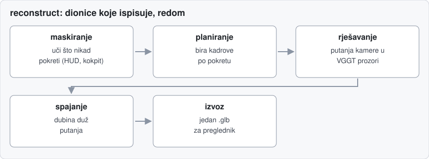

# Izvanmrežna rekonstrukcija {#offline-reconstruction}

```bash
python -m heat3d_capture reconstruct lap.mp4 -o lap.glb [--solve-budget 260] [--fuse-interval 0.4]
```

Kod: [`scan/offline.py`](https://github.com/Holdi601/3DHeat-GameCapture/blob/main/heat3d_capture/scan/offline.py),
[`pose/feedforward.py`](https://github.com/Holdi601/3DHeat-GameCapture/blob/main/heat3d_capture/pose/feedforward.py),
[`pose/vggt_model.py`](https://github.com/Holdi601/3DHeat-GameCapture/blob/main/heat3d_capture/pose/vggt_model.py),
[`pose/feedforward_source.py`](https://github.com/Holdi601/3DHeat-GameCapture/blob/main/heat3d_capture/pose/feedforward_source.py),
[`pose/solveprep.py`](https://github.com/Holdi601/3DHeat-GameCapture/blob/main/heat3d_capture/pose/solveprep.py).
Opcije: [Pregled naredbi](commands.md#reconstruct).

## Zašto drugi put {#why-a-second-path}

Praćenje u hodu je uživo i jeftino i radi tamo gdje ima strukture za oslanjanje: unutrašnjost,
ulica, karta s pokrivačem. **Staza za utrke je njegov najgori slučaj**: cesta je glatka vrpca s
malo teksture, horizont se jedva miče, a kad se nekoliko položaja odmakne, ništa kasnije ih ne
povuče natrag. Krug ispadne kao krivulja koja luta umjesto da se zatvori.

Izvanmrežni put predaje **prozore kadrova** modelu koji predviđa sve njihove kamere zajedno,
pa svaki kadar ograničava svaki drugi izravno, a ne preko lanca. Treba cijelu snimku prije nego
što može odgovoriti, pa nije uživo, i spor je: minute po prozoru na stolnoj GPU-i. Sve nakon
položaja - spajanje, pokrivenost, boja, izvoz - isti je kod kao kod živog skeniranja: riješena
staza predaje se rekonstruktoru kao izvor položaja, upravo tamo gdje ide Forzina telemetrija.

## Zahtjevi {#requirements}

- **PyTorch** usklađen s vašom GPU-om (ovaj projekt ga ne fiksira; instalirajte ga prije
  `requirements.txt`, vidi [Pokretanje](runtime.md)).
- **`vggt`** - kod VGGT modela (`from vggt.models.vggt import VGGT`), iz Metinog GitHub
  repozitorija; nije u indeksu paketa.
- **`transformers`**, jer izvanmrežni put dubinu računa kroz PyTorch `DepthEstimator`
  (Depth Anything V2 Small), a ne kroz ONNX datoteku.
- U praksi CUDA GPU; oba modela padaju na CPU, što nije praktično.

Nijedno od toga nije u `requirements.txt`, jer skeneru ne treba. Nalazi se u
**`requirements-offline.txt`**, uz vlastite ovisnosti VGGT-a (`einops`, `safetensors`,
`huggingface_hub`, `Pillow`):

```bash
.venv\Scripts\python -m pip install -r requirements-offline.txt
.venv\Scripts\python -m pip install --no-deps "vggt @ git+https://github.com/facebookresearch/vggt.git"
```

VGGT se instalira s `--no-deps` jer njegovi metapodaci fiksiraju `numpy<2`, što bi pip
poštovao snižavanjem numpyja koji treba scipy ovdje. `reconstruct` provjerava sve ovo odmah
nakon ispisa retka o licenci (popis `OFFLINE` u
[`runtime/preflight.py`](https://github.com/Holdi601/3DHeat-GameCapture/blob/main/heat3d_capture/runtime/preflight.py)),
navodi što nedostaje s veličinama i instalira samo na potvrdan odgovor - VGGT s `--no-deps`,
kao gore. Odbijanje, ili nema terminala za pitanje, završava s izlaznim kodom 1.

## Model i njegova licenca {#the-model-and-its-licence}

**VGGT**, `facebook/VGGT-1B`: **CC-BY-NC-4.0, samo nekomercijalno, i rekonstrukcija napravljena
njime to nasljeđuje.** Naredba to ispisuje prije nego što počne (`describe_licence`). Postoji
zasebno licencirani `facebook/VGGT-1B-Commercial`, ali je to zaključani repozitorij koji Meta
odobrava po računu, pa ne može biti zadani. `--model vggt-1b-commercial` rješava s njim (i tada
ispisuje svoj redak o licenci); bez odobrenog pristupa preuzimanje ne uspijeva. *Kod* `vggt` je
pod Metinom „VGGT License”, sporazumom o istraživačkim materijalima s pravilima prihvatljive
upotrebe (pročitano iz `LICENSE.txt` paketa). Vidi [Modeli i licence](models-and-licences.md).

## Pokretanje, fazu po fazu {#the-run-stage-by-stage}

Naredba ispisuje faze engleskim nazivima (`masking`, `planning`, `solving`, `fusing`, `exporting`); ovdje su opisane tim redom.



### maskiranje {#masking}

`FlowMask` se uči iz **4 niza po 90 uzastopnih kadrova**, centriranih na 1/8, 3/8, 5/8 i 7/8
videa, na 960 x 540 u sivom (vidi [FlowMask](reconstruction-capture.md#flowmask-what-never-travels)).
Njegova napomena se ispisuje i čuva u sažetku. Video kraći od 90 kadrova ne dobiva masku.

#### Maska kamere se uči, ne primjenjuje {#the-camera-mask-is-learned-not-applied}

Maska se **ne** primjenjuje na kadrove koji se daju rješavaču. Maskiranje kabine izgledalo je
ispravno prema statistici značajki (većina otkrivenih kutova sjedi na pikselima pričvršćenima
uz kameru) - ali to je tvrdnja o detektoru značajki, a rješavač je naučena mreža. Mjereno
prema tome koliko se rekonstruirana putanja okrene između uzastopnih koraka (automobil se
okreće za nekoliko stupnjeva; slučajni hod za devedeset), sirovi kadrovi davali su najmanje
okretanje, kadrovi s pojačanim kontrastom malo više, maskirani kadrovi znatno više, a oboje
zajedno najviše. Zato rješavač dobiva sirove kadrove. Maska se i dalje koristi za planiranje
razmaka kadrova u nastavku, a praćenje u hodu je koristi u živom skeniranju.
(`solveprep.enhance`, koji maskira i lokalno pojačava kontrast pomoću CLAHE, postoji ali ovu
naredbu ne koristi.)

### planiranje: kadrovi razmaknuti prema kretanju {#planning-frames-spaced-by-motion}

`plan_by_motion` bira kadrove rješavača prema **tome koliko se slika pomaknula**, a ne prema
satu: fiksni razmak daje sporim dionicama kadrove koji im ne trebaju i gladuje brze, gdje
uzastopni kadrovi prestaju dovoljno se preklapati da budu povezani.

- Ciljni pomak: **5 % širine od 960 piksela** (48 px) medijanog pomaka ORB značajki između
  uzastopnih odabranih kadrova, mjereno na sivim kadrovima 960 x 540 s CLAHE kontrastom,
  značajke samo na maski.
- Počinje s razmakom od 0,3 s; nakon svakog koraka sljedeći razmak postaje
  `gap x (0.5 + 0.5 x target / measured)`, ograničen na **0,15-2,0 s**, pa jedno bučno mjerenje
  ne ljulja plan.
- Kad se ništa nije podudaralo, razmak se smanjuje na 0,6 trenutačnog razmaka (preveliki razmak između kadrova je
  kvar koji se izbjegava).
- Zaustavlja se na kraju videa ili na `--solve-budget` kadrova (zadano 260).

Manje od 4 planirana kadra je greška.

### rješavanje: prozori i sastavljanje {#solving-windows-and-stitching}

Planirani kadrovi se dekodiraju na 960 px u širini i rješavaju u **preklapajućim prozorima od 16
kadrova, s 6 zajedničkih sa sljedećim** (`plan_windows`; zadnji prozor se povlači tako da završi
na posljednjem kadru, pa kraj snimke ima jednako mnogo susjeda kao sredina). Više od **400**
kadrova u jednom pokretanju se odbija.

Svaki prozor: kadrovi se mijenjaju tako da je duža strana **518**, a obje strane višekratnici
od **14** (omjer stranica sačuvan - stiskanje bi iskrivilo vidno polje), skaliraju na 0..1 i
pokreću kroz VGGT pod bfloat16 autocastom (float16 ostane bez eksponenta na dalekim svjetskim
koordinatama). Vanjske parametre kamere pretvaraju se u rotacije svijet-iz-kamere i središta
kamera. Mape točaka se ne čuvaju po zadanom.

Svaki prozor vraća se u **svoj vlastiti proizvoljni okvir i svoje vlastito proizvoljno mjerilo**,
pa se prozori **sastavljaju** u okvir prvog pomoću sličnosne transformacije (rotacija,
translacija, jedno mjerilo) prilagođene na kamere koje dijele s onim što je već smješteno:

- **Rotacija iz orijentacija kamera**, a ne njihovih položaja: zajedničke kamere leže duž
  putanje i gotovo su kolinearne na ravnom dijelu, pa prilagodba samo po položaju ne vidi
  rotaciju - svaki prozor se savija, a sastavljeni rezultat ispadne ravan. Rotacija je
  srednja vrijednost `target_R x source_R^T` projicirana natrag na pravu rotaciju (sa zaštitom
  od zrcaljenja).
- **Mjerilo i pomak iz položaja**, duž zarotirane izvorne putanje.
- Potrebne su najmanje **4** zajedničke kamere; manje je greška.
- Preklapanje je trećina prozora, da se mjerilo dobro odredi; pogreška mjerila koja se
  zbraja iz prozora u prozor je ono zbog čega se krug spiralizira.

Za svaki šav bilježi se najgori nesklad zajedničkih kamera nakon prilagodbe, u jedinicama
prosječnog razmaka među njima (`seam_error`).

### spajanje {#fusing}

Kadrovi svakih `--fuse-interval` sekundi (zadano 0,4) dekodiraju se na 960 px u širini,
dubinu dobivaju od Depth Anything V2 Small (PyTorch), i spajaju s položajem **interpoliranim** iz
riješene staze u njihovom vremenskom trenutku (linearni položaj, sferna rotacija;
`FeedForwardPoses`). Kadrovi izvan riješenog vremenskog raspona preskaču se, a ne ekstrapoliraju.
Kamera koristi vidno polje od **65 stupnjeva** u vodoravnom smjeru. Položaji iz izravnog
rješavanja nose pouzdanost 0,85 u spajanju i pokrivenosti.

### izvoz {#exporting}

Mreža se zapisuje kao za živo skeniranje ([Izlaz .glb](glb-output.md)), a nazvana je po videu.

## Sažetak {#the-summary}

```text
140 cameras solved over 182s
closure error 3.1% of path length
worst seam 0.42 frame spacings
<mask note>
wrote lap.glb
```

| Redak | Značenje |
|---|---|
| closure error | udaljenost od prve do posljednje kamere podijeljena s duljinom putanje. Za jedan krug to je iskreno mjerilo odmaka. Iznad 10 %: „The lap does not close ... Treat the shape as unreliable.” |
| worst seam | najveći nesklad sastavljanja. Iznad 1,0: „Windows disagreed by up to N frame spacings at a seam, so part of the path is stitched on weak evidence.” |
| no file | „Fusion produced no surface, so nothing was written.” Izlazni kod je tada 1. |

## Mjerilo {#scale}

Sastavljena putanja je u jedinicama prvog prozora, koje su proizvoljne. Dubina se usidrava
trianguliranjem između interpoliranih položaja (kao kod telemetrije), pa je geometrija dosljedna
s putanjom - ali **rezultat nije u metrima**, osim ako to nije putanja. Ova naredba ne određuje
globalno mjerilo; kalibracija tla se ne primjenjuje kad položaji dolaze iz izvora položaja.

## Stanje ovog puta {#state-of-this-path}

S kadrovima na fiksnom razmaku, prozori se rješavaju u koherentnu putanju na nekim dionicama
kruga, a na drugima u čeprkanje; kvarovi su u uskim zavojima, gdje se pogled naglo okreće između
kadrova, a uzorkovanje tih zavoja gušće ih vraća. Nijedna statistika slike isprobana (svjetlina,
detalj, broj značajki, omjer unutarnjih točaka, pomak) nije unaprijed predvidjela koje će
dionice otkazati. Zato se razmak ne može u potpunosti planirati iz slika unaprijed: mora se
odabrati rješavanjem, izmjeriti rezultat i ponovno riješiti gušće tamo gdje putanja nije ona
koju bi automobil mogao proći. Planiranje prema kretanju je izgrađeno; **prilagodljivo ponovno
rješavanje nije**.
