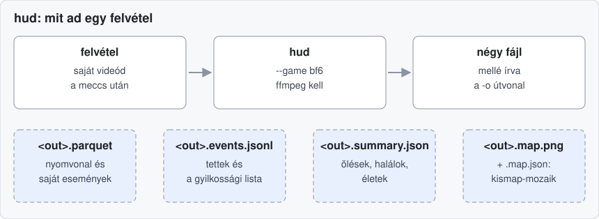

# A HUD olvasása felvételből {#reading-the-hud-from-a-recording}

A `hud` a játék képernyőn lévő HUD-ját olvassa ki a játékos **saját felvételéből**, a meccs után: a játékos **saját** akcióit a pontpopupból, amelyet a játék a célkereszt alatt mutat (ölések, asszisztok, újraélesztések, utánpótlás, elfoglalások...), a halálait a leesési és a bevetési képernyőkről, a **saját** útvonalát a minitérképről, mellette pedig az ölési naplót időzített eseményekként. Mindez egy 3DHeat-táblázatba kerül, a minitérkép mozaikjával térképképként, amelyet alá lehet fektetni.

Röviden: megnézi a meccsvideódat, és feljegyzi az ölés- és halálaidat, valamint azt, hol sétáltál.

```bash
.venv\Scripts\python -m heat3d_capture hud "<recording>.mp4" --game bf6 --player <name> -o out/match
```

A Battlefield 6 az első játékprofil.



## Mihez nyúl, és mihez nem {#what-it-does-and-does-not-touch}

- Egy **videofájlt** olvas: ShadowPlay / Instant Replay klipet, OBS-felvételt, bármit, amit az ffmpeg dekódol. A játékhoz, annak memóriájához, fájljaihoz és hálózatához nem nyúl, és a meccs vége után fut. Lásd [A szabályok](rules.md).
- **Csak a játékos saját pozícióját** származtatja, a játékos saját minitérképéből. A többi játékos jelölőit a minitérképen kitakarja, és soha nem olvassa ki őket. Az ölési napló teljes egészében megmarad, de csak azt tartalmazza, amit a képernyő mutat (ki, kit, mivel, mikor); pozíciót csak a játékoshoz rendel.
- Az OCR helyben fut (RapidOCR a PaddleOCR-modellekkel, ONNX Runtime-on). Egyetlen képkocka vagy kivágás sem hagyja el a gépet.
- A felvételen látszanak más játékosok nevei, a mozaik pedig a pálya képe. A kimenetek a játékos saját használatára valók; tartsd őket helyben.

## Követelmények {#requirements}

- **ffmpeg és ffprobe** a `PATH`-on. Ha van NVIDIA-kártya, a dekódoláshoz azt használja (`-hwaccel cuda`); különben a CPU dekódol, ami többszörösen lassabb.
- A `requirements.txt` csomagjai, és az OCR a saját függőségei nélkül (a CPU-s `onnxruntime`-ot kéri, ami ütközne a projekt DirectML-változatával):

```bash
.venv\Scripts\python -m pip install -r requirements.txt
.venv\Scripts\python -m pip install --no-deps rapidocr_onnxruntime==1.2.3
```

Az `rapidocr_onnxruntime` a szövegolvasó (OCR), amely a képernyőről olvassa a neveket és a szavakat. A `--no-deps` megakadályozza, hogy a projekt DirectML-es `onnxruntime`-ját lecserélje.

Az ffmpeg telepítése Windowsra: `winget install Gyan.FFmpeg`, majd nyiss új terminált, és ellenőrizd: `ffmpeg -version`. Ha új vagy a parancssorban, olvasd el: [Mielőtt elkezdenéd](before-you-start.md).

- **16:9**-es felvétel bármilyen felbontásban (1080p, 1440p, 4K). A más képarányt visszautasítja, mert a profil dobozai rossz képernyőrészre esnének.
- A játék **alapértelmezett HUD-elrendezése**. Egy áthelyezett vagy átméretezett HUD-elemet rossz helyen olvas.

<a id="options"></a>
## Kapcsolók {#options}

| Kapcsoló | Alapérték | Jelentés |
|---|---|---|
| `video` | | A felvétel. |
| `-o`, `--out` | a videó neve, az aktuális mappában | Kimeneti útvonal **kiterjesztés nélkül**; a fájlok: `<out>.parquet`, `.events.jsonl`, `.summary.json`, `.map.png`, `.map.json`. |
| `--game` | `bf6` | Melyik HUD-ot olvassa. A `bf6` (Battlefield 6) az egyetlen eddigi profil. |
| `--player` | nincs | A játékos neve úgy, ahogy az ölési napló mutatja. Lazán hasonlítja össze (az OCR összekeveri az `l`/`I`/`1`, az `O`/`0` és az `rn`/`m` betűket). Enélkül a nevet kitalálja (lent). |
| `--fps` | 5 | Minitérkép-minta másodpercenként. Az ölési napló ennek a felével mintavételez, a pontpopup és a halálképernyők szintén a felével (a negyedével, ha nincs popup), az iránytű 3 másodpercenként, a csapatlista 15 másodpercenként. |
| `--start` | 0 | Hány másodpercnél kezdjen a videóban. |
| `--seconds` | mind | Mennyit olvasson a videóból. |
| `--metres-per-pixel` | nincs | A minitérkép léptéke, ha ismert: méter a minitérkép-pixelenként a szokásos zoomnál (a minitérkép 296 pixel széles 1080p-s képernyőn). Enélkül a pozíciók ezekben a pixelekben vannak; lásd [Északi irány és egységek](#north-and-units). |
| `--cpu` | ki | Akkor is a CPU dekódoljon, ha van NVIDIA-kártya. |

Az előrehaladást ötmásodpercenként írja ki; a végén a játékos, az ölések, halálok, életek és a kiírt fájlok szerepelnek.

## Kimenetek {#outputs}

### `<out>.parquet` - a játékos útvonala és eseményei {#parquet---the-players-track-and-events}

Soronként egy minta, amelyen a játékos játékban volt, és a minitérkép elhelyezhető volt, plusz soronként egy-egy esemény tőle. A lábjegyzet tartalmazza a nézegető olvasási utasításait (`heat3d` kulcs, `kind: heat3d-hud`), így a nézegető kérdés nélkül megfelelteti az összes oszlopot.

| Oszlop | Jelentés |
|---|---|
| `time` | Másodpercek a videó kezdetétől. |
| `event` | `position`; `start` (a videó játékközben kezdődött), `spawn` (vissza a játékban halál vagy hosszabb szünet után), `death`, `downed` és `revived` (a halálképernyőkről, lent), `end` (az élet valamiért véget ért, és nincs jel róla); a játékos saját akciói a pontpopupból (`kill`, `assist`, `reviving`, `resupply`, `capture`... - az [eseménytáblázat](#event-table)); és az ölési napló róla szóló sorai `kill_feed`, `death_feed`, `teamkill_feed`, `suicide_feed`, `squadwipe_feed` néven. |
| `source` | Honnan jött a sor eseménye: `points` (a popup), `screen` (a leesési és bevetési képernyők), `feed` (az ölési napló); pozíciósoroknál üres. |
| `text` | `points` soroknál: a címke úgy, ahogy kiírták (`KILL`, `SQUAD DAMAGE ASSIST`...), vagy a cím (`DOUBLE KILL`, egy szalag neve), vagy ismeretlen címke esetén az, amit olvastak. |
| `points` | `points` soroknál: mennyivel nőtt a popup összege azon a pillanaton. Ha több akció jött ugyanabban a mintában (egy ölés és a jármű, amelyben a játékos volt), ezek összege, mindegyiken megadva, a `shared` pedig megmondja, hány osztozik rajta. Üres, ha az összeget nem olvasták kétszer a pillanat mindkét oldalán. |
| `subject`, `subject_side` | `points` soroknál: a név, amelyet a popup az akcióhoz mutatott (egy ölés áldozata, az újraélesztett vagy utánpótolt csapattárs), és a színe (`enemy`, `friendly`, `squad`). |
| `confirmed` | `feed`, ha az ölési napló ugyanarra az ölésre vagy halálra mutatott sort (3 másodpercen belül, ugyanazzal az áldozattal). |
| `x`, `y`, `z` | Pozíció a mozaikon: `x` kelet, `y` észak, `z` 0 (a lábjegyzet szerint a `z` a felfelé). Az észak valódi észak, ha az iránytű engedte (lásd `north_up` az összefoglalóban). |
| `player` | Mindig `me`. Csak a játékos saját sorainak van pozíciójuk. |
| `team` | `own`. |
| `session` | `<video name>#NN`, életenként egy. A vonalhő-útvonalak sosem lépik át a munkamenetet. |
| `heading` | Fok az óramutató járásának irányában az északtól (ha az észak ismeretlen, a mozaik felfelétől): merre nézett a nézet. |
| `dir_x`, `dir_y`, `dir_z` | Ugyanaz irányvektorként, a nézegető nézési irányához. |
| `zoom` | Mennyire volt kizoomolva a minitérkép a szokásos zoomjához képest (járműben 1 felett). |
| `killer`, `victim`, `weapon`, `headshot`, `marker` | Az ölési és halálsorokon, amelyekhez van ölési napló-sor: a napló sora (lent). Popup-ölésnél, amelyhez nincs napló-sor, a popup nevét kapja `victim`-ként; fejlövésként (HEADSHOT) mutatott popup-ölésnél a `headshot` igaz. |

Minden eseménysor a pillanatban a játékos pozícióját veszi (halálnál vagy leesésnél az utolsó pozíciót a halál előtt, újraélesztésnél az elsőt utána). A sorok közvetlenül illeszkednek a nézegető [vonalhőjéhez](https://holdi601.github.io/3DHeat/line-heat.html): annak javaslata az `event` oszlopot választja, a `start`, `spawn` és `revived` értékekkel kezd, a `death`, `downed` és `end` értékekkel zár, a `position` sorok pedig az útvonal mentén fekszenek. A többi eseményt úgy nevezték el, hogy a javaslat egyiket se vegye kezdésnek vagy végnek: egy újraélesztés adása `reviving` (nem `revive`), egy pont tartása `defense`, egy csapattárs, aki a játékosnál vagy a járművében születik, `teammate_arrived`, az ölési napló sorai `kill_feed` és így tovább. A `kill` nem vég.

Egy klip, amelyen két menet két térképen van, két mozaikot ad, amelyek nem kapcsolhatók össze. A legnagyobb a `<out>.parquet`; minden más, legalább 30 másodperc útvonallal, mellé kerül `<out>.map2.parquet`, `<out>.map2.map.png` néven és így tovább.

### `<out>.events.jsonl` - a játékos eseményei és az ölési napló {#eventsjsonl---the-players-events-and-the-kill-feed}

Egy JSON-objektum soronként, időrendben, mindegyikben egy `source`:

- `points`: a játékos minden akciójához egy: `time`, `event`, `text`, `points`, `shared`, `subject`, `subject_side` (mint a táblázatban), `popup` (melyik popupból jött, a futás során számozva), `seen` (hány olvasás mutatta), `confirmed`, és `x`, `y`, ahol a játékos volt.
- `screen`: lefelé és visszaélesztésenként egy: `event` (`death`, `downed` vagy `revived`), `time` (amikor a játékos leesett; `revived` esetén amikor a képernyők eltűntek), `until` (a képernyők utolsó észlelése), `screens` (`down` és/vagy `card`), `outcome` (`death`, `revived` vagy `unknown`, ha a felvétel hamarabb véget ér), `killer` (a napló sorából, ha van), `x`, `y`.
- `feed`: minden sor, amelyet az ölési napló mutatott, mindenkitől:

| Mező | Jelentés |
|---|---|
| `time`, `last` | Az első és az utolsó minta, amelyen a sort olvasták (másodpercek a videó kezdetétől). A `time` az, amikor az ölés megjelent, egy ölési napló-mintán belül (alapértelmezett sebességnél 0,4 s). |
| `kind` | A játékos oldaláról: `kill`, `death`, `teamkill`, `suicide`, `squadwipe`; más játékosok soraira `kill`, `squadwipe`, vagy `death`, ha nincs gyilkos. |
| `killer`, `victim` | A nevek, a mintákban leggyakrabban olvasott alakban (a hosszabb olvasat nyer, ha a gyakori annak eleje: részben elrejtett név). A `killer` üres, ha a sor csak egy ikont és egy áldozatot mutatott: halál a világnak, vagy olyan sor, amelynek gyilkosa már eltűnt. |
| `killer_side`, `victim_side` | A név színéből: `friendly` (a játékos csapata, kék), `enemy` (narancs), `squad` (a játék halványzöld színe a játékosnak és osztagának), `neutral` (egyik sem). |
| `weapon` | A fegyverikon osztálya a futáson belül: `icon01`, `icon02`... A hasonló ikonok ugyanabba az osztályba kerülnek. Az ikonok nincsenek elnevezve; nincs lista, amelyből el lehetne nevezni őket. |
| `marker` | A fegyver és az áldozat közötti kis ikon: `skull`, `arrow`, `chevrons`, `crosses` vagy üres. |
| `headshot` | `marker == "skull"` - feltételezés, lásd [Korlátok](#limits). |
| `seen` | Hány ölési napló-minta mutatta a sort. |
| `me` | `killer`, `victim` vagy null. |
| `matched` | A játékos saját soraira: találtak-e hozzá popup-akciót vagy halálképernyőt. |
| `x`, `y` (, `map`) | A játékos saját soraira: hol volt. |

### `<out>.summary.json` {#summaryjson}

A játékos (és hogyan találták meg), a játékos eseményeinek forrása (`own_events_from`: a popup és a képernyők, vagy csak az ölési napló, ha egyik sem volt olvasható), ölések, halálok, K/D, fejlövések, asszisztok, adott (`revives`) és kapott (`revived`) újraélesztések, leesések, elfoglalások, semlegesítések, utánpótlások, gyógyítások, javítások, megsemmisített járművek, a pontszám (a popupok összegeinek összeadva), minden akciótípus a darabszámával (`actions`), a popupok száma, a csak az ölési napló által mutatott halálok, az ölési napló saját ölés- és halálszáma, és ebből hány ölés egyezett popup-ölésekkel, csapatölések, öngyilkosságok, osztagirtások, életek, játékban töltött másodpercek, megtett távolság (a táblázat egységeiben), az ölési napló sorai, térképenként, hogy észak-fent van-e és hány iránytű-olvasat egyezett, az útvonal számai (minták, játékban, elhelyezve, el nem helyezve, szigetek), a tett feltételezések és az időzítés.

### `<out>.map.png` és `<out>.map.json` - a térkép az útvonal alatt {#mappng-and-mapjson---the-map-under-the-track}

A futás minden minitérképének mozaikja, átlagolva, a rárakódott jelölők eltávolítva, a táblázattal pontosan azonosan elforgatva és méretezve. A JSON-melléklet tartalmazza a két horgonyt, amelyet a nézegető **Térképkép** elhelyezése kér ([Térképképek](https://holdi601.github.io/3DHeat/map-images.html) a nézegető dokumentációjában): töltsd be a PNG-t a **Térképkép…** gombbal, hagyd bekapcsolva az **Észak/dél tükrözése** opciót, és írd be az 1. és a 2. horgonyt (`px`, `py`, `worldX`, `worldZ`) a melléklet alapján. A kép így pontosan az útvonal alá kerül.

Csak azokat a pályarészeket tartalmazza a kép, amelyeket a játékos minitérképe mutatott.

## Módszer {#method}

### Dekódolás {#decoding}

Az ffmpeg a GPU-n dekódol, még a kártyán belül a mintavételi sebességre csökkent, kivágja a profil területeit (minitérkép, ölési napló, két iránytű-sáv, csapatlista, a pontpopup, a leesési képernyő szövege, a jobb alsó sarok), mindegyiket fix méretre méretezi, és egy kis képpé fűzi össze mintánként. Csak ez a kép jut át a csövön Pythonba. A H.264-folyam minden képkockájának dekódolása a futásidő alsó határa.

Két munkaszál veszi át a mintákat: az egyik minitérképeket illeszt (OpenCV), a másik szöveget olvas (ONNX Runtime).

### Játékban van-e {#in-play-or-not}

A minitérkép billentyűtipp-négyzete (a világos négyzet a térképkulccsal, a minitérkép bal alsó sarkában) mindig látszik, amikor a minitérkép is, és nem látszik halál, gyilkos-kamera, bevetés, menü vagy eredményjelző képernyőn. Ennek jelenléte - egy világos, színtelen négyzet, közepén sötét betűvel, egyértelműen világosabb a környezeténél - a helye körül néhány pixelen belül keresve a játékban-van teszt. Az az egyetlen minta, amely mindkét szomszédjával ellentmond, figyelmen kívül marad.

Egy játékbeli szünet halál vagy körváltás (a következő szakasz `spawn`-nal kezdődik), ha legalább 6 másodpercig tart, vagy ha 40 másodpercen belül megelőzte egy halál (a képernyőkről, vagy egy napló-sor, amely a játékost áldozatként nevezi meg). A rövidebb, halál nélküli szünet (a nagy térkép megnyitása) folytatja az életet. A minitérkép a játékos leesése alatt is látszik, így a leesett játékos játékban van.

### Az útvonal {#the-track}

A minitérkép a nézettel fordul, és a játékost egy rögzített pontban tartja (mérve: a közepén, 49,7%-os lefelé eltolással). Mintánként:

1. **Maszkolás**: ami nem a pálya: az erősen színes vagy majdnem fehér pixelek (célpontjelölők, osztag- és járműikonok, jelzések, a játéktér határa, útvonalvonalak, szöveg), a nézőkúp halvány sárgászöld színe, a játékos jelölője körüli korong, a kúp fölötti éke, a billentyűtipp és egy vékony perem.
2. **Jellemzők**: SIFT-kulcspontok a kontraszt-kiegyenlített szürke minitérképen, a maszkon belül.
3. **Illesztés a mozaikhoz**, nem az előző mintához: a kulcspontokat a mozaikkoordinátákban eddig tárolt jellemzőkhöz párosítják, ott, ahol a játékos utoljára volt. RANSAC-kal egy hasonlóság (fordulás, zoom, eltolás) illeszkedik. Illesztéshez elég belső pont kell, a zoom az utolsó harmadán belül legyen, és mintánként a minitérkép harmadánál kisebb legyen az eltolás. Halál után a mozaik bármely részén keresett illesztéshez kétszer annyi belső pont kell.
4. **A mozaik növelése**: a mozaik még nem tartalmazott jellemzőit hozzáadja (legfeljebb néhány tized másodpercenként mozgás közben), a maszkolt minitérképet pedig átlagolja a képbe.
5. Az illesztésen át vitt játékospont a **pozíció**; az illesztésen át vitt minitérkép-felfelé a **irány** a mozaikon.

Utána: ha egy pont több mint 10 pixelre ugrik mindkét előtte és mindkét utána lévő mintától (amelyek egymással egyeznek), eldobják, mert a minitérkép néha egy mintára rossz zoomon illeszkedik. Az összefoglaló számolja őket (`dropped_as_jumps`).

A mozaikhoz illesztés tartja távol a hibák összeadódását: egy már látott helyre visszatérve az első alkalommal tárolt jellemzőkhöz illeszkedik. Egy még nem látott helyen születés új **szigetet** indít. Minden tizedik elhelyezett mintát megpróbálják a többi szigethez illeszteni, és az első jó illeszkedés egyesíti őket (a kisebb a nagyba olvad, az útvonalával együtt). A soha nem egyesülő szigetek (másik térkép, vagy soha nem közös föld) külön íródnak, ahogy fent.

### Északi irány és egységek {#north-and-units}

Az iránytű-sávot 3 másodpercenként olvassák: a feliratait a tintájuk alapján találják meg (fényes, színtelen, kis hézagokon át csoportosítva, a jelek elvetve), mindegyiket külön olvassák, és két vagy több felirat rögzíti a sáv léptékét és a középső jelölő alatti irányt. Egyetlen felirat semmit sem rögzít. Minden iránytű-olvasatot a minta mozaik-irányával párosítanak; a különbségek körkörös mediánja a 10 fokon belüli olvasatokon adja azt a fordulatot, amely az északot felfelé állítja. Akkor alkalmazzák, ha legalább három olvasat van, és az olvasatok fele egyezik.

<a id="units"></a>A minitérkép földi léptéke nincs kiírva a képernyőn, így a pozíciók **a szokásos zoomnál mért minitérkép-pixelekben** vannak: a futás medián zoomja egy táblázategységnek felel meg a 296 pixeles minitérkép pixelenként (ennyi egy 1080p-s képernyőn). A járműben való kizoomolást az illesztés veszi ki, így az egység gyalog és járműben ugyanaz. A `--metres-per-pixel` mindent méterre szoroz, ha a lépték ismert (egy ismert távolságból a térképen, egyszer lemérve).

### Az ölési napló {#the-kill-feed}

Az ölési naplót másodpercenként 2,5 mintából olvassák, de csak akkor, ha a színes pixelei jelentősen változtak, vagy 2 másodperc telt el. A szövegsorokat az OCR detektora találja meg. Az a sor, amelynek képe egy előző mintában olvasottal egyezik (a sorok görgetnek, így elmozdulhattak), átveszi a szöveget, ahelyett hogy újra olvasnák. A túl kicsi sorok, vagy amelyek perjelet tartalmaznak (fps-számláló a sarokban), eldobásra kerülnek.

A sorokat magasság szerint csoportosítják. Egy sorban a legbaloldalibb név a gyilkos, a legjobboldalibb az áldozat. Az azonos színű szomszédos darabok összeállnak (a szóközös név). Az egy sorban, az ikon fölött egyik névről a másikra átfutó sort a legszélesebb hézagánál vágják ketté, ha a két fél színe különbözik, és mindkét felet újra olvassák. Az áldozatok oszlopában egyetlen név, amelynek közvetlenül a bal oldalán ikon van, olyan sor, amelynek nincs gyilkosa. Két, azonos színű darab ikon nélkül egy név, amelynek gyilkosa eltűnt, nem pedig egy ölés.

**Oldalak** a színből. A nevek bizonyos átlátszósággal vannak rajzolva, így a teszt arról szól, mennyire tér el a szöveg a saját hátterétől: a vörös és a kék különbségének előjele narancs (ellenség) vagy kék (baráti) bármilyen háttéren. Ha egyik sem, és a zöld a másik kettő fölött van, az osztagszín.

**Ikonok**: a nevek között a gyilkos színű pixelek adják a fegyver sziluettjét. Közvetlenül az áldozat előtt álló kis, különálló ikon a jelölő, és az alakja nevezi meg (a szempárás folt koponya; a kis háromszög nyíl; több darab kereszt).

**Események**: az a sor, amelyet újra olvasnak, mindkét névvel azonosan (0,7-es hasonlóság a szokásos OCR-tévesztések után, az egyik 0,8; a félbevágott olvasat a teljes név elejével egyezik) ugyanaz az esemény, feltéve hogy az eseményt 5 másodpercen belül utoljára olvasták, és 14 másodpercnél fiatalabb. Egy sor sem marad fent tovább, így ugyanaz a pár később már új ölés. A gyilkos nélküli sor csak az áldozat alapján párosít. Az esemény ideje az első észlelése; nevei, oldalai és jelölője az észlelések többségéből jön; az egyszer olvasott sorokat eldobják.

**A játékos**: a `--player`, különben a csapatlista kiemelt (legfényesebb) sora, ha legalább három olvasat van és az olvasatok 60%-a egyezik. Egyébként az a név, amelyet az ölési napló a leggyakrabban mutatott osztagszínnel. Ha ez sem ad eredményt, az összefoglaló szerint a játékos ismeretlen, és egyetlen napló-sort sem írnak a nevére. (A popup és a halálképernyők a játékosé, bármi is a nevük; nincs szükségük névre.)

### A pontpopup {#the-points-popup}

A játékos minden pontját a Battlefield 6 egy popupban mutatja, a célkereszttől balra és lefelé, ugyanott gyalog, járműben és céltávcsövön át:

```
            [ RIBBON ] (icon)          a title, now and then: a ribbon or a multi-kill
      (icon)(icon)(icon)  300          one icon per action; the popup's running total
                Some_Name              who it was about, for a moment: orange an enemy, blue a teammate
    [ KILL x2 ] [ VEHICLE DESTROYED ]  one boxed tag per kind of action, with a count
```

A popup nő, amíg a játékos pontot szerez: egy új ölés a `KILL`-t `KILL x2`-vé alakítja, ikont ad hozzá, és emeli az összeget. Egy új fajta akció címkét ad hozzá. A címkesor az utolsó néhány fajtát mutatja (a régebbi kicsúszik, és újra megjelenéskor tovább számol). Az utolsó akció után körülbelül három másodperccel a popup egy sorba csukódik (`[KILL x2] 300`), majd eltűnik. A szöveg világosszürke, a címkék vékony dobozokban, az összeg nagy számjegyekkel, 1920x1080-as képernyőn az x 760-tól kezdve, a címkék jobbra zárva az x 750-hez.

Másodpercenként 2,5-ször olvassák. Az OCR detektora megtalálja a szövegsorokat, csak a popup egyik sorának sorait olvassák (a tanksziget saját feliratait ugyanabban a térségben nem), és az a sor, amelynek képe az előző mintában olvasottal egyezik, átveszi a szöveget. Az ikonról, névről vagy csomózott címkéről az összegbe futó sort (`Name10`, `REVIVE185`) ott vágják el, ahol az összeg kezdődik (x 755), és mindkét felét újra olvassák. Amíg nincs popup, minden második mintát olvasatlanul visszatartanak. Amikor a következő popupot mutat, a visszatartottat előbb olvassák el, így a popup kezdete a mintáig megtalálható.

**Címkék** a [eseménytáblázathoz](#event-table) illeszkednek, miután a felismerő szokásos hibáit kijavították (Q-ként olvasott O, betűk közötti számjegy, I az L helyett, a széleken elveszett betű). Egy olvasat akkor címke, ha legalább 80%-ban hasonló egyhez (5 betűs vagy rövidebb címkéknél 85%), és egyértelműen közelebb van hozzá, mint bármelyik másikhoz. Az összekapcsolt címkéket (`CAPTUREDORDERCOMPLETED`) ismert címkék leválasztásával szedik szét, az elejükről lefejtve. A szám `x2`, `X3`, egy eltévedt jel és számjegy, vagy közvetlenül a címke utáni számjegy. A címkesorban egy világosszürke, nagybetűs sor, amely semmihez sem illeszkedik, `points` akcióként marad meg a szövegével; az, ami ugyanabban a popupban egy ismert címke darabja (a `DESTROYED` a `VEHICLE DESTROYED` mellett), nem. Az összeg fölötti címek (világos dobozok, sötét szöveg) `multi_kills` (`DOUBLE KILL`...) vagy `ribbon`. A név az összeg és a címkék közötti színes sor; az oldala a színéből jön, az ölési naplóhoz hasonlóan.

**Popupok és akciók**: az olyan olvasatok, amelyek között kevesebb mint 0,9 másodperc a szünet, egy popup. Az a popup, amely úgy tűnik, véget ér, és az elcsukódás előtt visszatér (az utolsó növekedéstől számított 3,2 másodpercen belül), minden címkéje a számával vagy annál többel, és az összege nem kisebb, ugyanaz a popup, amelyet egy pillanatra elvesztettek (elmosódás, világos háttér). Benne semmi nem számolódik kétszer. Egy popupban egy címke végső száma a legmagasabb szám, amelyet legalább kétszer olvastak. A k-edik akciót az első olyan olvasáskor időzítik, amely k vagy több számot mutat. Egyszer olvasott szám nem akció, kivéve, ha az ölési napló igazolja (a játékos egy 3 másodpercen belüli sora, amelyet más ölés nem vett el): a rövid KILL címkét a felismerő a legtöbbször csak egyszer olvassa. Egy cím popuponként egyszer számít, ha kétszer olvasták. A `points` az, mennyivel nőtt az összeg, csak a két egymást követő olvasatban kétszer olvasott összegeket figyelembe véve, az akció mintája előtt és után.

Egy ismeretlen sor csak akkor számít címkének, ha az ugyanabban az olvasatban az ismert címkék sorában van (vagy ismert címke hiányában, ha nincs név sem). Így egy olyan név, amelynek színét az oldal-teszt nem tudja megállapítani, nem vehető címkének.

### Halálok és újraélesztések {#deaths-and-revives}

Amikor a játékos leesik, a játék ezt a képernyő közepe alatt jelzi (MAN DOWN, REQUEST REVIVE, SKIP (HOLD), NEARBY MEDICS; ha újraélesztést kértek, REVIVE REQUESTED, CANCEL REQUEST). A jobb alsó sarokban egy kártya nevezi meg, ki tette, alatta a DAMAGE LOG vagy a PLAYER CARD, fölötte egy "YOU n - n FOE" sor. Azonnali halálnál (végzetes fejlövés) csak a kártya látszik. Ezután vagy egy csapattárs újraélesztik a játékost (a képernyők eltűnnek, és a játék folytatódik), vagy a játékos elvérzik, vagy feladja, és jön a bevetési képernyő, jobb alsó sarkában a DEPLOY felirattal.

Ezeket a szavakat a popuppal együtt olvassák, az OCR ugyanazon a menetén (a popup, a leesési sáv és a jobb alsó sarok egy képbe rakva): másodpercenként 2,5-ször, amíg popup van, egyébként 1,25-ször. A sarok csak akkor kerül bele, ha a játékos játékon kívül van, vagy az utolsó 3 másodpercben leesettként látták. Játékban csak a lőszerszámot tartalmazza.

A 4 másodpercnél közelebbi észlelések egy epizódot alkotnak (legalább két észlelés). Az epizód **halál**, ha a bevetési képernyő a vége után 12 másodpercen belül megjelenik, vagy ha a játékos 3 másodperccel utána játékon kívül van, és legalább 6 másodpercig marad ott. **Újraélesztés** (`downed`, majd `revived`), ha a játékos a képernyők eltűnése után 3 másodperccel még játékban van. `unknown` (csak `downed`-ként írva), ha a felvétel hamarabb véget ér. A halál ideje az, amikor a játékos leesett: az az ölési napló-sor, amely őt áldozatként nevezi meg, ha van az epizód előtt 3 másodpercen belül; különben az epizód első észlelése mínusz fél olvasási intervallum. A halál utáni pozíciók kimaradnak az útvonalból a bevetési képernyőig.

Az ölési napló olyan halála, amelyet semmilyen epizód nem magyaráz (a képernyőket kihagyták), attól még `death`, `source` értékkel `feed`, és a fentiek szerint ítélik meg: ha a játékos 40 másodpercnél tovább marad játékban utána, újraélesztették.

<a id="event-table"></a>
### Eseménytáblázat {#event-table}

Mi lesz minden címkéből, címből és képernyőből. Több címke lehet egy esemény; a `text` megőrzi, melyik.

| Esemény | Forrás | Jelentés |
|---|---|---|
| `kill` | KILL; HEADSHOT | A játékos megölt valakit (a név az áldozaté). A fejlövéses ölésnél a KILL helyén HEADSHOT áll: a `text` megmondja, melyik, és a `headshot` igaz. |
| `assist` | ASSIST, KILL ASSIST, DAMAGE ASSIST, SQUAD DAMAGE ASSIST | Sebzés olyanon, akit egy csapattárs ölt meg. |
| `kill_assist` | ASSIST COUNTS AS KILL | Olyan asszisztot, amelyet a játék ölésnek számít. |
| `suppression`, `suppression_assist` | ENEMY SUPPRESSION; SUPPRESSION ASSIST | Elnyomó tűz egy ellenségen; olyanon, akit azután egy csapattárs megölt. |
| `smoke_assist` | SMOKE ASSIST, SQUAD SMOKE ASSIST | Füst, amely egy csapattársat fedezett. |
| `spot`, `spot_assist` | SPOT, SPOTTED, ENEMY DESIGNATION; SPOT ASSIST, SPOT BONUS | Egy ellenség felderítése; olyan ölés, amelyet a játékos derített fel. |
| `driver_assist` | DRIVER ASSIST | A játékos járművének lövészétől származó ölés. |
| `reviving`, `reviving_bonus` | REVIVE, SQUAD REVIVE; CONCEALED REVIVE | A játékos újraélesztett egy csapattársat; a bónusz, ha fedezékből tette. |
| `heal` | HEAL, SQUAD HEAL | A játékos gyógyított egy csapattársat. |
| `resupply` | SUPPLY, RESUPPLY, SQUAD SUPPLY | Egy csapattárs lőszert vett el a játékostól. |
| `repair` | REPAIR, VEHICLE REPAIR, SQUAD REPAIR | A játékos megjavított egy járművet. |
| `capturing`, `capture` | CAPTURING, RECAPTURING; CAPTURED, OBJECTIVE CAPTURED | Egy elfoglalási ütem; a megszerzett célpont. |
| `neutralizing`, `neutralize` | NEUTRALIZING; NEUTRALIZED, OBJECTIVE NEUTRALIZED | Ugyanaz, egy ellenséges célpont semlegessé tételéig. |
| `defense` | DEFENDING, OBJECTIVE DEFENDED | Egy célpont tartása. |
| `offensive`, `defensive` | OFFENSIVE; DEFENSIVE | A bónusz egy támadott célpont közeli akcióért; a védelemért. |
| `order` | ORDER COMPLETED | Végrehajtott osztagparancs. |
| `vehicle_damage`, `vehicle_disabled`, `vehicle_destroyed`, `vehicle_destroyed_assist` | VEHICLE DAMAGE; VEHICLE DISABLED; VEHICLE DESTROYED; VEHICLE DESTROYED SUPPORT | Sebzés egy ellenséges járművön, egészen a megsemmisítésig, vagy abban való segítség. |
| `equipment_destroyed` | EQUIPMENT DESTROYED | Egy ellenséges eszköz megsemmisítve. |
| `forced_bail` | FORCED BAIL | Egy ellenség kényszerítve kiugrott a járművéből. |
| `squad_wipe` | SQUAD WIPE | Egy ellenséges osztag utolsó tagjának megölése. |
| `savior`, `avenger` | SAVIOR; AVENGER | Egy ellenséges megölése, amely egy csapattársat sebzett; annak a megölése, aki az imént ölt meg valakit. |
| `teammate_arrived` | SPAWNED ON, SPAWN ASSIST, VEHICLE SPAWN, SQUAD VEHICLE SPAWN | Egy csapattárs a játékosnál vagy a járművében született. |
| `transport` | TEAM TRANSPORT | Csapattársak szállítása járműben. |
| `fortify` | DEFENSE DEPLOYED | Egy védelem, amelyet a játékos épített. |
| `points` | bármi más a címkesorban | Egy ismeretlen akció: a `text` az, amit olvastak. |
| `multi_kills` | DOUBLE KILL, TRIPLE KILL, QUAD KILL, MULTI KILL (cím) | Gyors egymásutáni ölések. |
| `ribbon` | bármely más cím | Egy szalag a neve szerint (BALLISTIC, TANK BUSTER, ENGINEER EXPERT, SPEARHEAD...). |
| `downed` | leesési képernyő, majd játék | A játékos leesett, és újraélesztették. |
| `revived` | a képernyők eltűnnek, a játék folytatódik | A játékost egy csapattárs újraélesztette. |
| `death` | leesési vagy kártyaképernyő, majd bevetés vagy játékon kívül | A játékos meghalt. |

A táblázat szövegei a teszt-felvételeken lettek látva, kivéve ezeket. Ezek a játéksorozat szokásos nevei, és azért vannak a táblázatban, hogy el legyenek nevezve, ahelyett hogy `points`-ként maradnának: HEADSHOT KILL, ASSIST, KILL ASSIST, ASSIST COUNTS AS KILL, SPOT, SPOTTED, SPOT ASSIST, SPOT BONUS, SQUAD REVIVE, HEAL, SQUAD HEAL, RESUPPLY, SQUAD SUPPLY, REPAIR, VEHICLE REPAIR, SQUAD REPAIR, VEHICLE DISABLED, SQUAD WIPE, AVENGER, az OBJECTIVE ... alakok, és a TRIPLE KILL, QUADRUPLE KILL és MULTI KILL címek. A játék más nyelven más szavakat ír ki: a címkéi `points`-ként jönnek, a kiolvasott szövegükkel - nem tévesztik össze ismert akcióval -, összegeikkel és neveikkel együtt. Mivel a halálképernyőket az angol szavaikról ismerik fel, a halálok csak az ölési naplóból jönnek, `death` sorokként, `source` `feed` értékkel.

## Amit ellenőriztek {#what-is-verified}

Szemmel ellenőrizték a teszt-felvételeken (a játékos sajátjai, nem részei a tárolónak), úgy, hogy véletlenszerű mintákat rajzoltak, és mindegyiket összevetették a körülötte lévő képkockákkal:

- **A játékos saját eseményei.** Minden mintavett popup-akció valódi, ilyen fajtájú akció volt, egy olvasáson (0,4 s) belül megtalálva az idejét. A legtöbb érték és név helyes volt (egyes írásokban, például cirill betűkkel, a nevek összekeveredhetnek). Minden mintavett halálképernyőt megtaláltak.
- **Ölési napló.** Az ölési napló sorainak nagy többségét mindkét nevével megtalálták. Kis OCR-hibák (nagy I kisbetűs l-ként) elfogadhatók. A játék által dobozként mutatott karakterekkel rajzolt nevek kimaradhatnak. Az oldalak (színek) néhány százaléknál tévesek.
- **Játékban.** A billentyűtipp-teszt minden mintavételi pillanatban egyezett a képkockával.
- **Útvonal.** Nincs földi igazság arról, hol volt a játékos, ezért az útvonalat magával a felvétellel vetik össze: két minitérképet **közvetlenül egymáshoz** illesztenek, és azt az eltolást hasonlítják össze a két táblázatbeli pozíció eltolásával. A medián eltérés kb. 1-3 minitérkép-pixel (a minitérkép szélességének 1%-a alatt), zsúfolt, kizoomolt minitérképen több. Az iránytű-olvasatok szinte mindig 10 fokon belül egyeznek a mozaikkal.
- **Futásidő.** A dekódolás a valós idő ötszörösénél fut egy asztali GPU-n, ez teszi ki a legtöbbet. A pontpopup olvasása egyötödével-felével hozzáad.

Szemmel nézve: minden mozaikban folytonosak az utak és az épületek az őket felépítő életek között, és az azonos úton futó különböző életek útvonalai egymásra esnek. Az a szakasz, ahol a minitérkép zoomja változik, túl hosszúnak jöhet ki; lásd [Korlátok](#limits).

A tesztek (`tests/test_hud_*.py`) mindent lerajzolnak, amit olvasnak: egy kitalált pálya utakkal, épületekkel és szintvonalakkal, egy valódihoz hasonló átfedésekkel rendelkező séták minitérképei, iránytű-sávok, kitalált nevekkel rendelkező ölési napló-sorok. Ellenőrzik, hogy egy hurok két pixelen belül követett és bezárul, hogy egy álló játékos helyben marad, miközben a nézet fordul, hogy a zoomváltozásokat követik, hogy egy máshol születés visszakapcsolódik, amikor az utak találkoznak, hogy az észak-fordulás és az y-tükrözés oda teszi az útvonalat, ahová valójában ment, hogy a térképkép horgonyai az útvonal alá igazítják, és az ölési napló elemzését, oldalait, jelöléseit és duplikáció-szűrését. A játékos saját eseményeihez kitalált nevekkel és címkékkel rajzolnak pontpopupokat, és ellenőrzik a címketáblát és a felismerő hibáival szembeni toleranciáját, az összefolyó címkéket, a popup sorait, az összeget egy névből levágva, a popup növekedésének számlálását, azt, hogy egy pillanatnyi olvasatlanság után folytatódik, egy címke ki- és visszacsúszását, és a popup végét. Ellenőrzik, hogy egyszer olvasott számot külön tartanak; a halálokat, újraélesztéseket és kimeneteleket a képernyők szavaiból; és egy kitalált meccsen, hogy az akciók, halálok és újraélesztések oda kerülnek a táblázatba, ahol a játékos volt, az ölési napló soraik mellé a saját nevükön, és az útvonal a halálnál végződik, nem az újraélesztésnél.

<a id="limits"></a>
## Korlátok {#limits}

- **Az egységek minitérkép-pixelek**, nem méterek, hacsak nincs megadva a `--metres-per-pixel`. A játék képernyőjén semmi nem mondja meg a minitérkép földi léptékét.
- **Csak az van leképezve, amit a minitérkép mutatott.** A mozaik a játékos útjától fél minitérképnyi távolságon belüli földet fedi. Két mozaik, amely soha nem osztott földet (két menet két térképen, vagy két élet egy nagy térkép távoli sarkaiban), külön fájl marad, összeilleszthetetlen koordinátákkal.
- **Az útvonal a minitérkép, másodpercenként 5 mintával**, semmivel nincs simítva. Erősen kizoomolt minitérkép (a teszt-felvételeken egy helikopter 2,3-szorosára zoomolta ki) pixelenként kevesebb részletet mutat, a játéktéren kívül pedig szinte semmit, így az illesztés ott durvább. Repülőgépeket és a játékost utasként nem tartalmazták a teszt-felvételek.
- **Az illesztési hibák helyiek, és nem halmozódnak**, de egy friss területek felfedezése közben épített mozaik kis hajlást hordozhat, amelyet csak akkor lehet kijavítani, ha a terület újra látszik. Ahol a minitérkép zoomja folyamatosan változik (egy gyorsuló jármű), az illesztett zoom elcsúszhat. Egy ilyen szakaszt láttak, amelynek a távolsága közel kétszerese volt a valódinak. Egy zsúfolt, kizoomolt gyalogos-minitérképből épített mozaik a legpontatlanabb (a hibák tipikusan 3 pixel körül, legfeljebb 18).
- **Nincs pózgráf-optimalizálás.** A hurok az illesztett jellemzők tárolásával záródik, nem a korrekció szétterítésével a hurkon.
- **A fegyverosztályok még nem működnek.** Az ikon sziluettjét egy átlátszó ikonból veszik egy mozgó háttér felett, és ez túl sokat változik mintáról mintára: a teszt-felvételek 550-670 sorra 220-340 osztályt adtak, ahol az egyezés néhány tucat fegyvert jelent. A `weapon`-t kísérletinek tekintsd. Az osztályok amúgy is futásonként értendők, és nem nevek.
- **A jelölők jelentése nem mind ismert.** A nyíl (`▸`) a játékos saját neve elé kerül, a rá vonatkozó sorokban; nem egyfajta ölés. A koponyát fejlövésnek vesszük; ez feltételezés, nem valami, amit a játék mond. A `chevrons` és a `crosses` (osztagirtások) úgy szerepelnek, ahogy látták.
- **A latintól eltérő írásjelű nevek** (például cirill) a legközelebbi latin hasonló betűként jönnek ki: a felismerő latin és kínai betűket olvas. Ugyanaz a játékos mindig ugyanúgy olvasódik, így összeillenek, de a szöveg nem a nevük.
- **Átfedések az ölési napló sarkában** (egy fps-számláló) elfedhetik a felső sor áldozatának végét. A számláló szövegét felismerik és eldobják, és a levágott nevet a teljes olvasataihoz párosítják. Az a név viszont, amelyet csak levágott formában láttak, levágott marad.
- **Egy halál, amelyet sem a képernyők, sem az ölési napló nem mutatott**, még mindig lezárja az útvonalat `end`-ként, ha a játékos 6 másodpercnél tovább nincs játékban.
- **Kapott újraélesztéseket** a leesési képernyőkről látunk. Csak az olyan napló-halálnál következtetik őket (40 másodpercnél tovább játékban az után), amelyet a képernyők kihagytak, és akkor egy gyors újraélesztés nem különíthető el.
- **A popup-akciókat egy olvasáshoz időzítik**: a címke első megjelenésétől számított 0,4 másodpercen belül. Egy animáltan beúszó címke egy mintával később vagy korábban olvasódhat.
- **A popup-sorok nevei** az ölési napló neveihez hasonlóan olvasódnak. A latintól eltérő írásjelek összekeveredhetnek, és néha egy közeli, a világban lebegő csapattárs-névcímke a popup mellett az akció nevének olvasódik. A név nélküli akciók (egy elfoglalási ütem, egy parancs) nem kapnak nevet.
- **A `points`** hiányzik ott, ahol az összeget nem olvasták kétszer egy akció mindkét oldalán, és az egy mintában jött akciók között megosztott. Az összefoglaló `score`-ja a popupok végső összegeit adja össze, így egy olyan popup, amelynek összegét soha nem olvasták kétszer, nincs benne.
- **A címkesor egy ablak**: négy vagy több fajtájú popupnál a legrégebbi címke balra csúszik ki az olvasott tartomány széléből. Akkor számolták, amikor látszott; egy szám, amelyet félig a képernyőn kívül nyert, kimaradhat.
- **Egy popup, amely hosszabb ideig veszett el, mint amennyi tarthatott** (több mint kb. 4 másodpercnyi olvashatatlan minta alatt, miközben még nőtt), kettőnek számít, és egynél magasabb számú címke újra számolódik. Az alábbi ellenőrzésekben nem láttak ilyet.
- **Más UI-nyelvek**: a címkék szöveggel `points`-ként jönnek ki, a halálok pedig csak az ölési naplóból (a halálképernyőket az angol szavaik alapján illesztik).
- **Események rövid szigeten**: egy olyan élet, amelynek útvonala túl rövid volt ahhoz, hogy térképként legyen kiírva (30 másodperc alatt), az eseményeit a `.events.jsonl`-ben tartja `x`, `y` nélkül, és semmilyen táblában nincsenek.
- **A HUD-elrendezés a BF6 alapértelmezett 16:9-es elrendezése.** A HUD megváltoztatott mérete, a színtévesztőknek szóló paletta vagy más minitérkép-méret saját profilt igényelne.
