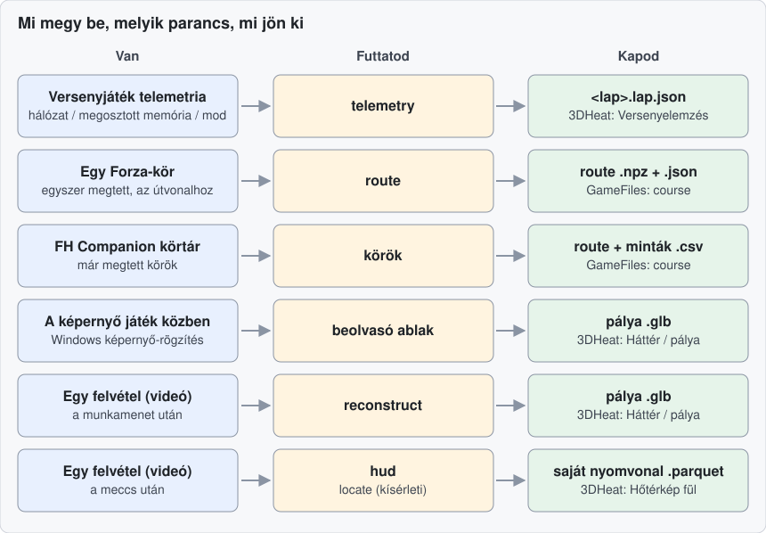

# 3DHeat GameCapture {#dheat-gamecapture}

**Mi ez?** Egy eszköz, amely feljegyzi, amit a versenyjáték a vezetéséről elmond neki, köridként egy
fájlba. Egy játékról készült videóból egy hozzávetőleges 3D-modellt is újjáépíthet.

**Mire jó?** Hogy a köreidet a [3DHeat megjelenítőben](https://holdi601.github.io/3DHeat/) lásd: hol fékezett,
hol volt lassú, miben tér el két kör. És hogy a pálya ott legyen a hőtérképed alatt, ha senkinek nincs róla
3D-modellje.

**Példa:** kapcsold be a Forza Data Out funkcióját, futtass egy parancsot, és vezess két kört. Két
körfájl jelenik meg a `laps\` mappában. Dobd őket a megjelenítő Versenyelemzés fülére.


Még nem használt parancssort? Kezdd a [Mielőtt elkezdi](before-you-start.md) oldallal.

## A három feladat {#the-three-jobs}

1. **Körtelemetria.** Rögzít minden csatornát, amelyet egy versenyjáték közzétesz – a Forza Data Outját,
   az Assetto Corsa-játékok megosztott memóriáját, a rallyjátékok hálózati adatfolyamait, egy BeamNG-modot,
   egy Trackmania-bővítményt –, és játékonként vagy szakaszonként egy `heat3d-lap` fájlt ír a megjelenítő
   Versenyelemzés fülének. Az iRacinghez nincs szükség rögzítőre: a megjelenítő a saját `.ibt` fájljait olvassa.
2. **Pályák a játékmenetből.** Azt, amit a képernyő mutatott, miközben egy pályán sétált vagy vezetett,
   egy `.glb` 3D-modellé alakítja, amelyet a megjelenítő a hőtérkép alá rak.
3. **A saját meccse, utána.** A `hud` a saját felvételének HUD-ját olvassa: a saját tetteit, halálait, a
   kismap-nyomvonalát és a gyilkossági listát. A `locate` (kísérleti: eddig kevés valódi képkockát helyez el)
   megállapítja, hol készült minden képkocka, egy pálya 3D-modelljén.

Mindhárom egy szabályt követ: **semmit nem injektálunk a játékba, és semmibe nem kapcsolódunk bele.**
A képkockák a nyilvános képernyő-rögzítő API-ból jönnek, a telemetria a játékok által erre közzétett
felületekből. Lásd: [A szabályok](../rules.md).



A kód Python (`heat3d_capture` csomag), MIT licenc alatt. Az általa futtatható mélység- és pozemodellek
saját licencekkel rendelkeznek – lásd: [Modellek és licencek](../models-and-licences.md).

## Gyors kezdés {#quick-start}

### Körök rögzítése {#record-laps}

Python 3.10 vagy újabb kell ([Mielőtt elkezdi](before-you-start.md)). PowerShellben:

```powershell
git clone https://github.com/Holdi601/3DHeat-GameCapture
cd 3DHeat-GameCapture
python -m venv .venv
.venv\Scripts\python -m pip install -r requirements.txt

# Forza: Settings -> HUD and Gameplay -> Data Out = ON, IP 127.0.0.1, port 5300
.venv\Scripts\python -m heat3d_capture telemetry -o laps
```

**Ezt kell látnod:** `listening on port 5300. Laps go to laps. Ctrl+C to stop.`, majd soronként egy-egy kört,
ahogy átlépi a célvonalat, ahogy a fenti képen. Leállításhoz nyomd meg a Ctrl+C-t. A `laps\` mappából
származó fájlokat dobd a megjelenítő Versenyelemzés fülére. Minden más játék egy `--game` kapcsolóra van:

```powershell
.venv\Scripts\python -m heat3d_capture telemetry --game acc -o laps
.venv\Scripts\python -m heat3d_capture telemetry --game dirtrally2 -o laps
```

Minden játékról és kapcsolóról lásd: [Telemetriai rögzítők](../telemetry.md).

### Pálya beolvasása {#scan-a-level}

Kattints duplán az eszköz mappájában lévő **`scan.bat`** fájlra. Megkeresi a Pythont (és ha nincs,
felajánlja a telepítését a winget-tel), létrehoz egy saját `.venv` mappát, és megnyitja a beolvasó ablakot.
Az ablak megmondja, mi hiányzik, mire szolgál az egyes csomag, és mekkora a letöltés; jóváhagyás nélkül
semmit nem telepít. Lásd: [Futtatókörnyezet és függőségek](../runtime.md) és
[A beolvasó ablak](../reconstruction-scan-ui.md).

Kézzel: `.venv\Scripts\python -m heat3d_capture.ui`.

Egy felvétel offline újjáépítéséhez, a kamera útvonalát egyszerre megoldva (PyTorch, a `vggt` csomag és GPU
kell – lásd: [Offline újjáépítés](../reconstruction-offline.md)):

```powershell
.venv\Scripts\python -m heat3d_capture reconstruct lap.mp4 -o lap.glb
```

## A dokumentáció térképe {#map-of-the-documentation}

| Oldal | Mit tartalmaz |
|---|---|
| [Mielőtt elkezdi](before-you-start.md) | Python, egy terminál, az első parancs, gyakori hibák |
| [A szabályok](../rules.md) | Nincs injektálás, csak közzétett felületek, és ennek ára |
| [Telemetriai rögzítők](../telemetry.md) | A `telemetry` parancs és minden játék áttekintése |
| [Forza](../telemetry-forza.md) | Data Out, formátumfelismerés, a FH Companion továbbító és annak `.tele.gz` fájlja |
| [Assetto Corsa játékok](../telemetry-assetto-corsa.md) | AC, ACC, AC EVO, AC Rally megosztott memóriából |
| [Rallyjátékok](../telemetry-rally.md) | EA SPORTS WRC, DiRT Rally 2.0 / 1 / DiRT 4, Richard Burns Rally |
| [BeamNG.drive](../telemetry-beamng.md) | A `heat3d` protokoll-mod |
| [Trackmania](../telemetry-trackmania.md) | A `Heat3dRecorder` Openplanet-bővítmény |
| [iRacing](../telemetry-iracing.md) | `.ibt` fájlok olvasása a megjelenítőben |
| [Kör- és szakaszfelosztás](../lap-splitting.md) | `LapSplitter`, `CounterSplitter`, `LineSplitter`, `StageSplitter` |
| [Csúszás, sodródás és származtatott csatornák](../slip-and-drift.md) | Hogyan skálázódik a csúszás, és mit származtat a megjelenítő |
| [A heat3d-lap fájl](../lap-format.md) | A körfájl formátuma, csatornák, mértékegységek, `meta` |
| [Játékok](../games.md) | Játékonként: hogyan rögzítsen, mit küld, mely pályák exportálhatók |
| [Parancsok](../commands.md) | `route`, `telemetry`, `laps`, `reconstruct`, `hud`, `locate`, lépésről lépésre |
| [Parancsleírás](../cli-reference.md) | minden kapcsoló, a `--help` alapján generálva |
| [Olvasás a HUD-ból egy felvételről](../hud-video.md) | `hud`: saját tettek, halálok, kismap-nyomvonal és gyilkossági lista egy felvételből |
| [Képkockák elhelyezése egy pályán](../locate.md) | `locate`: hol készült minden képkocka, a pálya geometriájához mérve |
| [Pályaújjáépítés](../reconstruction.md) | A folyamat a képkockáktól a `.glb`-ig |
| [A beolvasó ablak](../reconstruction-scan-ui.md) | Minden vezérlő, gyorsbillentyű és rávetítés |
| [Felvétel, maszkok és képkockaminőség](../reconstruction-capture.md) | Windows Graphics Capture, kulcskockák, HUD-maszkok, minőségi tanácsok |
| [Mélység](../reconstruction-depth.md) | Depth Anything V2, ONNX Runtime, a modell felépítése |
| [Kamerapozíció és méretarány](../reconstruction-pose.md) | Odometria, újralokalizálás, telemetriai pozíciók, talajméretarány, köteg-kiegyenlítés |
| [Összeolvasztás, lefedettség és szín](../reconstruction-fusion-and-texture.md) | A kitöltési térfogat, a lefedettségi rács, gyenge pontok, csúcsszín |
| [A .glb kimenet](../glb-output.md) | A fájl, amelyet a megjelenítő betölt |
| [Offline újjáépítés](../reconstruction-offline.md) | `reconstruct`, VGGT-ablakok és összefűzés |
| [Modellek és licencek](../models-and-licences.md) | Depth Anything V2 méretek, VGGT, a csomagok |
| [Futtatókörnyezet és függőségek](../runtime.md) | Előellenőrzés, háttérrendszerek, teljesítményszintek |
| [Korlátok és ellenőrzés](../limits.md) | Mi nincs megcsinálva, és mi nincs ellenőrizve |
| [Frissítések](../updates.md) | A kiadás-ellenőrzés és a `python -m heat3d_update` |
| [Fejlesztés](../development.md) | Tesztek, a virtuális környezet, a tároló felépítése |
| [Az oldalak karbantartása](../maintaining.md) | a kiadási ellenőrzőlista a kódhoz és a dokumentációhoz |

## A 3DHeat része {#part-of-3dheat}

A rögzített fájlokat a **3DHeat megjelenítő** tölti be –
[forrás](https://github.com/Holdi601/3DHeat), [dokumentáció](https://holdi601.github.io/3DHeat/).
A körfájlok a Versenyelemzés fülére mennek, a `.glb` pályák a Háttér / pálya panelre, a `hud` és `locate`
táblázatok a Hőtérkép fülére; hogyan olvassa a megjelenítő a táblázatokat és a meccsfájlokat, azt ebben írjuk le:
[Egy fájl meccsenként: `.3dheat`](https://holdi601.github.io/3DHeat/container.html) és
[Adatok betöltése](https://holdi601.github.io/3DHeat/getting-data-in.html).

| Eszköz | Mit csinál | Dokumentáció |
|---|---|---|
| [3DHeat megjelenítő](https://github.com/Holdi601/3DHeat) | 3D hőtérképek, versenyek és meccsek megjelenítése a böngészőben | [dokumentáció](https://holdi601.github.io/3DHeat/) |
| [GameFiles](https://github.com/Holdi601/3DHeat-GameFiles) | pályák és pályaszintek a játékok fájljaiból, 3D-modellként | [dokumentáció](https://holdi601.github.io/3DHeat-GameFiles/) |
| [GameCapture](https://github.com/Holdi601/3DHeat-GameCapture) | körtelemetria versenyjátékokból; pályák rekonstruálva játékvideóból | [dokumentáció](https://holdi601.github.io/3DHeat-GameCapture/) |
| [Unreal Exporter](https://github.com/Holdi601/3DHeat-UnrealExporter) | Unreal Editor bővítmény, amely egy pályát 3D-modellként exportál | [dokumentáció](https://holdi601.github.io/3DHeat-UnrealExporter/) |
| [CS2](https://github.com/Holdi601/3DHeat-CS2) | Counter-Strike 2 demók táblázatokba és meccsdokumentumokba; térképek 3D-modellbe | [dokumentáció](https://holdi601.github.io/3DHeat-CS2/) |
| [Watcher](https://github.com/Holdi601/3DHeat-Watcher) | a játékmenetét rögzíti a háttérben, abból, amit a játékok közzétesznek | [dokumentáció](https://holdi601.github.io/3DHeat-Watcher/) |
| [Ext-WarThunder](https://github.com/Holdi601/3DHeat-Ext-WarThunder) | War Thunder visszajátszások táblázatokba és meccsdokumentumokba | [dokumentáció](https://holdi601.github.io/3DHeat-Ext-WarThunder/) |
| [Ext-WoT](https://github.com/Holdi601/3DHeat-Ext-WoT) | World of Tanks visszajátszások táblázatokba és meccsdokumentumokba | [dokumentáció](https://holdi601.github.io/3DHeat-Ext-WoT/) |
| [Ext-WoWs](https://github.com/Holdi601/3DHeat-Ext-WoWs) | World of Warships visszajátszások táblázatokba és meccsdokumentumokba | [dokumentáció](https://holdi601.github.io/3DHeat-Ext-WoWs/) |
| [Ext-Squad](https://github.com/Holdi601/3DHeat-Ext-Squad) | Squad-szerverdemók táblázatokba és meccsdokumentumokba | [dokumentáció](https://holdi601.github.io/3DHeat-Ext-Squad/) |
| [Ext-DCS](https://github.com/Holdi601/3DHeat-Ext-DCS) | DCS World térképek 3D-modellként | [dokumentáció](https://holdi601.github.io/3DHeat-Ext-DCS/) |
| [Ext-IL2](https://github.com/Holdi601/3DHeat-Ext-IL2) | IL-2 Sturmovik térképek 3D-modellként | [dokumentáció](https://holdi601.github.io/3DHeat-Ext-IL2/) |

Ha egy pálya geometriáját pontosan szeretnéd, és a játék projektjét megnyitva dolgozol, használd
az Unreal exportert, amely a valódi geometriát olvassa, és pontos. Ahol egy játék saját archívumai olvashatók,
a GameFiles a pontos kört kinyeri. A játékmenetből való újjáépítés arra az esetre való, amikor csak a képernyő áll
rendelkezésre.
