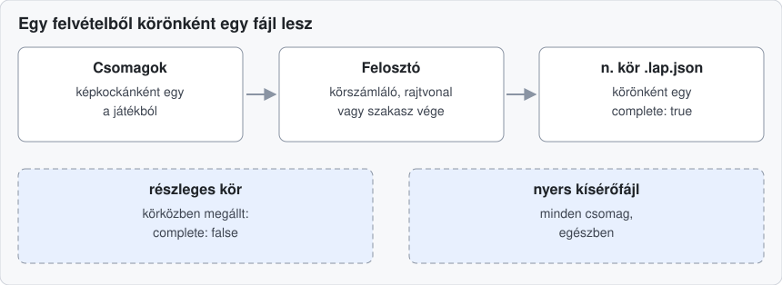

# Hogyan darabolódnak a körök és a szakaszok {#how-laps-and-stages-are-split}

A rögzítő egyetlen, folyamatos mintafolyamot lát. Ezt négy darabolóeszköz egyike alakítja körökké; a játék által a körökről mondottak alapján választják ki. Mindegyikük ugyanazt az elvet követi: ahol a játéknak van saját számlálója, azt használja; máskülönben a kört a pozíciókból találja meg; és soha nem ír ki túl rövid töredéket ahhoz, hogy össze lehessen hasonlítani.

| Darabolóeszköz | Kód | Melyik használja |
|---|---|---|
| `LapSplitter` | [`fulllap.py`](https://github.com/Holdi601/3DHeat-GameCapture/blob/main/heat3d_capture/telemetry/fulllap.py) | Forza |
| `CounterSplitter` | [`kunos.py`](https://github.com/Holdi601/3DHeat-GameCapture/blob/main/heat3d_capture/telemetry/kunos.py) | Assetto Corsa, ACC |
| `LineSplitter` | [`kunos.py`](https://github.com/Holdi601/3DHeat-GameCapture/blob/main/heat3d_capture/telemetry/kunos.py) | AC EVO, AC Rally, BeamNG |
| `StageSplitter` | [`rally.py`](https://github.com/Holdi601/3DHeat-GameCapture/blob/main/heat3d_capture/telemetry/rally.py) | EA SPORTS WRC, DiRT Rally 2.0, DiRT Rally, DiRT 4, Richard Burns Rally |

A Trackmania a futamokat a saját bővítményén belül darabolja ([Trackmania](telemetry-trackmania.md)), az iRacing-fájlokat pedig a nézegető darabolja a szimulátor körszámlálója alapján ([iRacing](telemetry-iracing.md)).

**Ctrl+C**-nél minden rögzítő meghívja a darabolójának `flush()` függvényét, így a nyitva lévő kör vagy szakasz kiíródik, ha megfelel az alábbi minimumoknak.

## LapSplitter (Forza) {#lapsplitter-forza}

Paraméterek: `minimum_metres = 400`, `gap_seconds = 2.0`.

Minden dekódolt csomagnál:

1. Ha a játék `timestampMs` értéke az utolsó csomag óta 2 másodpercnél többet ugrott előre, vagy visszafelé ment, a nyitott kört előbb ki kell üríteni.
2. Ha az `isRaceOn` 0 (a játék nincs versenyben), a nyitott kör kiíródik, a csomag pedig eldobódik.
3. Ha nincs nyitott kör, egy új nyílik a csomag `lapNumber` értékével.
4. Ha a `lapNumber` eltér a nyitott körétől, a nyitott kör **befejezettként zárul le**; az `seconds` értéke a játék `lastLap` értéke, ha az pozitív. Így lezárt kör bármilyen hosszú is, kiíródik. Egy új kör nyílik.
5. A csomag hozzáfűződik.

A rögzítő akkor is üríti a kört, ha 2 másodpercig nem érkezik csomag valós időben (a játék szünetelt, vagy egy kör közepén bezáródott).

**Kiürítéskor** a nyitott kör csak akkor marad meg, ha legalább 2 mintája van és legalább 400 m a `distanceTravelled` értéke; ilyenkor befejezetlenként íródik (egy `run`). Egy pont-pont versenyben soha nem számít második kör, ezért mindig így végződik.

## CounterSplitter (AC, ACC) {#countersplitter-ac-acc}

Paraméter: `minimum_metres = 300`. Minden mintát megkap a grafikai oldal `completedLaps` értékével és az utolsó köridővel.

- Az első minta egy kört nyit, a jelenlegi `completedLaps` számmal.
- Ha a `completedLaps` megváltozik, a nyitott kör lezárul. **Befejezett** lesz, `seconds = utolsó köridő ms / 1000` értékkel (ha pozitív), de csak akkor, ha a számláló pontosan 1-gyel nőtt. Ha visszaugrik 0-ra (a munkamenet újraindítása), vagy több köröt ugrik, befejezetlenként zárul.
- Egy lezárt kör csak akkor íródik ki, ha vannak mintái és legalább 300 m megtett útja van.
- A kiürítés megtartja a nyitott kört, ha egynél több mintája van és legalább 300 m.

## LineSplitter (AC EVO, AC Rally, BeamNG) {#linesplitter-ac-evo-ac-rally-beamng}

Paraméterek: `radius = 15 m`, `minimum_metres = 300`, `stop_seconds = 8`.

Ezek a játékok vagy nem adnak olyan köridő-számlálót egy oldalon, amelyet a rögzítő olvas, vagy szakaszokat futnak. A **vonal ott van, ahol a rögzítés elkezdődött**:

1. Az első minta vízszintes pozíciója (`x`, `z`) lesz a vonal.
2. Miután az autó 5 m-nél többet ment, a vonaltól az autóhoz mutató irány lesz a kör iránya.
3. **Megállás** lezár egy futamot: ha a `speed` 8 másodpercen át 1 m/s alatt marad, a nyitott kör kiíródik (így fejeződik be egy ralisztárószakasz: az autó a célnál megáll).
4. **A vonal átlépése**: több mint 300 m megtétel után a vonal 15 m-es körzetébe eső mintákat gyűjtjük. Amikor az autó újra elhagyja ezt a körzetet, a legközelebbi gyűjtött minta lesz az átlépés. Ha az autó ott ugyanabba az irányba tartott, mint a kör iránya (a helyi irány és a kör iránya skalárszorzata pozitív), a kör ezen a mintán zárul le; különben az áthaladást figyelmen kívül hagyjuk (az autó az ellenkező irányban lépte át a rajtot).
5. Egy lezárt kör `seconds` értéke az első mintától az átlépésig mért idő. **Csak akkor befejezett, ha az első mintája 5 m/s-nál gyorsabb volt**: az álló helyzetből induló kör rajt, nem összehasonlítandó kör. Így egy rácsról indított felvétel első körét mindig befejezetlennek tekintjük; egy repülő körrel indított felvétel a következő átlépésnél ad egy befejezett első kört.
6. A következő kör az átlépő mintával kezdődik (az mindkét körhöz tartozik).

Az 300 m-nél rövidebb köröket eldobjuk. A kiürítés (megállás vagy Ctrl+C) megtartja a nyitott kört, ha legalább 2 mintája és 300 m-e van, befejezetlenként. A BeamNG ugyanígy üríti, amikor a jármű visszaáll (az órája visszamegy), mielőtt új darabolót indítana, így a visszaállítás előtt megtett futam megmarad.

A távolságok vízszintesek (`x`, `z`) a megtett út számlálójánál és a vonalvizsgálatnál, a 300 m-es hosszvizsgálatnál pedig teljes 3D-ben értendők.

## StageSplitter (ralijátékok) {#stagesplitter-rally-games}

Paraméter: `minimum_metres = 300`. Minden mintát megkap a játék szakaszórájával, azzal, hogy a játék szerint az autó befejezte-e, és opcionálisan a játék saját idejével erre.

1. Ha az óra 0 vagy kisebb, vagy több mint 0,5 másodperccel visszament, a nyitott szakasz **elvetésre kerül**: részleges szakaszként megmarad, ha nincs befejezve, 10 mintánál többje van és legalább 300 m. A 0 vagy kisebb óra a mintát is eldobja (az autó a rajtnál van).
2. Ha nincs nyitott szakasz, új nyílik (1, 2, ... számozással a felvételen belül).
3. Miután egy szakasz befejeződött, a további mintákat figyelmen kívül hagyjuk, amíg az óra vissza nem megy.
4. Minden mintát a `time` a szakaszórával tárol.
5. Amikor a játék azt mondja, hogy befejezte, a szakasz befejezett; az `seconds` a játék ideje, ha az megvan és pozitív, egyébként az óra. Csak akkor íródik ki, ha legalább 300 m-t fedett le.

Mit jelent a „befejezett” játékonként:

| Játék | Befejezettnek számít, ha |
|---|---|
| EA SPORTS WRC | a szakaszhossz > 0, és a szakasztávolság >= hossz - 0,5 m |
| DiRT-játékok | a teljesített körök száma a szakasz kezdeti számánál nagyobbra nő, vagy (egykörös eseménynél) a körtávolság >= a pálya hosszának 99,9%-a |
| Richard Burns Rally | a versenyóra > 0, és a végig hátralévő távolság <= 0 |

Az RBR-nél a függőleges tengelyt és a sebességet akkor rögzítjük, amikor egy szakasz kiíródik (lásd a [Ralijátékok](telemetry-rally.md#richard-burns-rally-rsf--ngp) részt).

## Idő és távolság a körfájlban {#time-and-distance-in-the-lap-file}

Minden rögzítőnél a Forza kivételével a `time` úgy van átszámítva, hogy a kör első mintája 0 legyen, a `distance` pedig a egymást követő pozíciók közötti összegzett 3D-távolság. A Forza a játék saját körórát és távolságszámlálóját használja, ugyanígy átszámítva.
