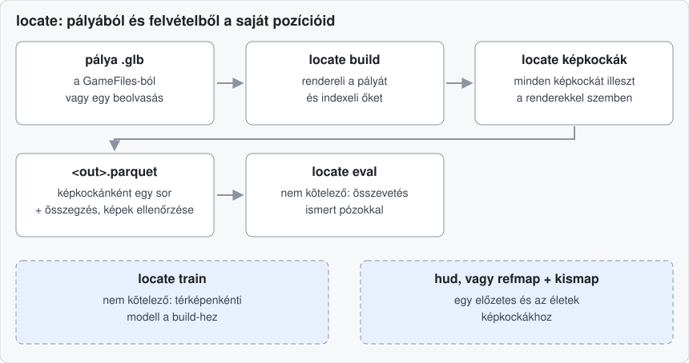

# Képkockák elhelyezése pályán {#locating-frames-in-a-level}

A `locate` azt állapítja meg, hol készült a játékfelvétel minden képkockája - a kamera 3D-s pozícióját és nézési irányát -, azzal, hogy a képet összeveti a pálya saját geometriájának renderjeivel. Olyan játékokhoz való, amelyek nem vezetik nyilván, hol volt a játékos: nincs demó, nincs visszajátszó-fájl, nincs telemetria. Az első a Battlefield 6.

> **Kísérleti.** Valódi felvételeken eddig a képkockák csak kis részét helyezi el; lásd [Valódi képkockák: kísérleti](#real-frames-experimental).

```bash
# Once per level: render it from every place a player can stand, and index the renders.
.venv\Scripts\python -m heat3d_capture locate build level.glb -o level.db

# Per recording: where was each frame taken?
.venv\Scripts\python -m heat3d_capture locate frames "<recording>.mp4" --db level.db -o out/match
```

A pozíciót **a képből** kapja, a teljes pálya ellen, előzetes becslés nélkül. A [HUD-olvasó](hud-video.md) minitérkép-útvonala csak a tartalék azokra a képkockákra, amelyeket a kép nem tud elhelyezni, és minden sor megmondja, melyik forrásból jött.




## Mihez nyúl, és mihez nem {#what-it-does-and-does-not-touch}

- A játékos **saját felvételét** és egy pályafájlt olvas, amelyet a játékos a **saját példányából** exportált. A játékhoz, annak memóriájához, futás közbeni fájljaihoz és hálózatához nem nyúl, és a meccs után fut. Lásd [A szabályok](rules.md).
- **Csak a játékos saját kameráját** helyezi el: a képkocka a játékos saját nézete.
- A pálya, az ebből épített adatbázis és minden belőle renderelt kép a játék kiadójáé. Tartsd őket helyben.

## Követelmények {#requirements}

- Ami a `requirements.txt`-ben van, a PyTorch (a pytorch.org-ról, a GPU-hoz), és a `requirements-locate.txt`:

```bash
.venv\Scripts\python -m pip install -r requirements-locate.txt
```

- Egy GPU OpenGL 3.3-mal (a 4.3 gyorsabb) a renderekhez, és lehetőleg CUDA a modellekhez. CPU-n is működik, csak lassan.
- A modelleket első használatkor letölti (kb. 450 MB): a DINOv2-t a Hugging Face-ről, az ALIKED-et és a LightGlue-t a kornia-n keresztül. Mindegyik kereskedelmi használatra engedélyezett; lásd [Licencek](#licences).
- A **pálya** `.glb` (vagy `.gltf`) formátumban, a nézegető koordinátarendszerében (Y felfelé), **a textúráival együtt** (a 3DHeat exportálói így írják: `ground:` / `structure:` részek; a részek nevére nincs szükség). Egy egység egy méter, hacsak a fájl legfelső szintű `extras.unit_metres` mezője másként nem mondja. A GameCapture szkennelés (`reconstruct`, a szkennelőablak) centiméterben íródik, és `extras.unit_metres: 0.01` van benne, így valódi méretében olvasódik. Textúra nélküli pálya sokkal rosszabbul működik; lásd [Korlátok](#limits).

## Parancsok {#commands}

<a id="locate-build"></a>
### `locate build <level> -o <db>` {#locate-build---o-}

Renderel egy pályát minden olyan helyről, ahol játékos állhatna, és renderenként tárolja a pózát és egy globális leíróját.

| Kapcsoló | Alapérték | Jelentés |
|---|---|---|
| `level` | | A pálya `.glb` / `.gltf` fájlja. |
| `-o`, `--out` | | A kiírandó adatbázismappa. |
| `--game` | `bf6` | A játékprofil: szemmagasságok, látómező, HUD-dobozok, sebesség (lent). `generic` bármely első személyű játékhoz. |
| `--eye` | a profilé | Szemmagasságok a padló fölött méterben, előbb az állóé. Magasságonként egy adatbázis-nézet. |
| `--fov` / `--vfov` | a profilé | A felvétel vízszintes látómezője, vagy a függőleges (a Battlefield csúszkája) 16:9-es felvételhez. |
| `--spacing` | 2,5 | Méterek a helyek között, ahonnan nézeteket veszünk. |
| `--yaw-step` | 30 | Fokok a nézetek irányai között. |
| `--pitch` | 0 | Renderelt dőlésszögek, fokban felfelé. |
| `--positions` | nincs | Egy tábla (Parquet vagy CSV `x`, `y`, `z` mezőkkel, a talpnál, a pálya koordinátarendszerében), ahonnan a helyeket veszi a minden padló helyett: például egy korábbi futás kimenete. |
| `--shadows` | ki | A nap árnyékainak vetítése a renderekben (a pálya saját napja, ha a fájl megnevezi az `extras.sun`-ban). |
| `--untextured` | ki | Csak alak és fény renderelése. |
| `--box X0 Z0 X1 Z1` | a teljes fájl | Csak ezen a dobozon belüli helyek (pályaegységekben): a játéktér. |
| `--places` | `auto` | Honnan vegyen nézeteket: `nav` - játékosok szemmagasságban a pálya navigációs hálóján (`nav:` részek: pontosan ahol a játék engedi a járást), járműkamerák a magasságukban a `ground:` részek fölött (terep és utak) 50 m-en belül; `ground` - mindkettő a `ground:` fölött; `floors` - minden felfelé néző lapon (tetők és ládák is); `auto` - `nav`, ha a pályán van navigációs háló, egyébként `floors`. |
| `--head` | nincs | Egy pályánkénti fej a `locate train`-ből a leírókhoz. |

Ír egy `<db>/db.json` fájlt (mi alapján és mivel épült) és egy `<db>/views.npz` fájlt (pózok, leírók).

### `locate frames <recording> --db <db>` {#locate-frames----db-}

| Kapcsoló | Alapérték | Jelentés |
|---|---|---|
| `source` | | Egy videó, egy kép, vagy egy képmappa (név szerinti sorrendben, `--fps` távolságra). |
| `--db` | | Az adatbázis, amelyet a `build` írt. Pályafájljának ott kell lennie, ahol volt (vagy `--level`). |
| `-o`, `--out` | `<source>.locate` | Kimeneti útvonal kiterjesztés nélkül. |
| `--fps` | 2 | Elhelyezett képkockák másodpercenként a videóban. |
| `--start`, `--seconds` | mind | A videó olvasandó része. |
| `--width` | 1280 | Az a szélesség, amelyen a képkockákat illesztik. |
| `--shortlist` | 8 | Adatbázis-nézetek képkockánként, amelyeket egy előzetes vagy meghatározás közelében próbálnak. |
| `--search-shortlist` | 16 | Előzetes nélkül: adatbázis-nézetek képkockánként ([együtt keresve](#with-no-prior-frames-searched-together)). |
| `--no-search` | ki | Előzetes nélkül: minden képkockát önmagában keres, és a szomszédjai nélkül hisz a meghatározásának. |
| `--accept-depth` | 0 (ki) | Előzetes nélkül: csak akkor hisz egy meghatározásnak, ha az illesztéseinek távoli és közeli távolságának aránya ennyiszeres. |
| `--accept-support` | 2 | Előzetes nélkül: egyező szomszédok az életen belül, amelyek szükségesek egy meghatározás elhitelezéséhez. |
| `--checkpoint` | nincs | Itt tárolja a futás állapotát, és innen folytatja, ha az ott van. |
| `--stop-file`, `--stop-process` | nincs | Magától megáll, az állapotot elmentve, 75-ös kilépési kóddal, ha ez a fájl létezik, vagy ha olyan folyamat fut, amelynek neve ezzel kezdődik (minden képkocka előtt ellenőrzi; többször is megadható), így egy hosszú futás felszabadítja a gépet egy játéknak. Ugyanaz a parancs később folytatja. |
| `--normalise` | nincs | Fényerő-normalizálás illesztés előtt: `clahe`, `gray`. |
| `--minimap` | nincs | A `hud` parancs táblázata: a **tartalék** azokra a képkockákra, amelyeket a kép nem tud elhelyezni. |
| `--prior-radius` | nincs | **Opcionális gyorsítás**, alapértelmezetten ki: csak azokat az adatbázis-nézeteket keresi, amelyek ennyi méterre vannak a minitérkép pozíciójától (`--minimap` kell hozzá). |
| `--minimap-anchor` | nincs | Egy JSON-fájl, amely a minitérképet a pályához köti ([a minitérkép mint keresési előzetes](#the-minimap-as-a-search-prior)): a minitérkép az első képkockától szűkíti a keresést; az így talált meghatározások `visual+minimap-prior` lesznek. |
| `--no-level-search` | ki | Előzetessel: ha a közelében semmi nem illeszkedik, nem keresi a teljes pályát is (gyorsabb). |
| `--lives` | a `--minimap` táblázata | A `hud` parancs táblázata, amelynek halálai, bevetései és újraélesztései megmondják, mikor volt a játékos játékban: a pozíciók csak egy halálnál ugorhatnak ([életek a felvételből](#lives-from-the-footage)). |
| `--no-sequence` | ki | Minden képkockát önmagában dönt el, nem a futás mentén (lent). |
| `--fit-fov` | ki | A futás után a látómezőt a legerősebb meghatározásokhoz illeszti, nézetenként, és jelenti. |
| `--check-every` | 0 | Minden N. képkockánál, elhelyezve vagy nem, egy képet is ír a `<out>.check` mappába. |
| `--no-checks` | ki | Nem írja ki a vizuális meghatározások ellenőrző képeit (lent). |
| `--no-zoomed` | ki | Nem oldja meg a zoomolt nézeteket a szomszédai meghatározásaiból (lent). |
| `--no-grow` | ki | Nem keres újra a meghatározások közelében a körülöttük még meghatározás nélküli képkockákért. |
| `--game`, `--eye`, `--fov`, `--vfov`, `--mask`, `--no-hud-mask`, `--max-speed` | a profilé | Ahogy fent; a `--mask x,y,w,h` egy képernyőszegmenst ad hozzá (1920x1080-as képernyőn), amely nem a pálya. |
| `--vehicle-vfov` | a profilé | A járműkamerák függőleges látómezője (a Battlefield járműcsúszkája). |
| `--settings` | a legújabb beállítási fájl | `bf6`: a játék beállítási fájlja, amelyből a látómezőket olvassa (csak olvasva), ha nincs `--fov`/`--vfov`. Alapértelmezetten a legújabb `PROFSAVE*_profile` fájl a `Documents/Battlefield 6/settings` mappában. Azt tartalmazza, ahogy a beállítások most vannak, ami nem biztos, hogy úgy van, ahogy egy régebbi felvétel készült. |

### `locate refmap <level> <deploy screen> -o <refmap>` {#locate-refmap----o-}

A játék saját térképét helyezi a pályára: ez az a viszonyítási alap, amelyhez a minitérképet olvassák ([a minitérkép a pályához mérve](#the-minimap-read-against-the-level)). A `<deploy screen>` a bevetési képernyő képe, amely az egész térképet mutatja, vagy egy felvétel `--at <seconds>` kapcsolóval, egy ilyen pillanatnál. A profil térképdobozát kivágja belőle (a `--whole-picture` megtartja az egészet). Ír egy `<refmap>.png` fájlt (a térkép a pálya saját keretére átmintázva, `--mpp` méter pixelenként, alapértelmezetten 0,5), egy `<refmap>.valid.png` fájlt (ahol ez a térkép, és nem jelölő vagy felirat) és egy `<refmap>.json` fájlt (a keret és a kalibráció, azzal, hogy a térkép csempéi milyen messze voltak tőle). A `--topdown <prefix>` felülről renderelve megtartja a pályát a következő futásnak (`--topdown-mpp`, alapértelmezetten 0,656 m; a `--box` korlátozza).

### `locate minimap <recording> --refmap <refmap> -o <table>.parquet` {#locate-minimap----refmap---o-parquet}

A felvétel minitérképét a viszonyítási térképhez méri, képkockánként (`--fps`, alapértelmezetten 2): minden illeszkedő minitérkép pozícióját, irányát és zoomját, a pálya keretében, minitérkép-táblázatként, mellette egy horgonnyal (`<table>.anchor.json`), amelyet a `locate frames` így vesz át: `--minimap <table>.parquet --minimap-anchor <table>.anchor.json`. A `hud` parancs táblázatával (`--hud`) az életei átkerülnek; ha ahhoz is van horgony (`--hud-anchor`), az első keresés ott történik, ahol a játékost meghatározza, és ahol egyetlen minitérkép sem illeszkedik, a HUD saját útvonala tölti ki, a legközelebbi viszonyítási térképi meghatározásokra áthelyezve (`--hud-fill`, másodpercben, alapértelmezetten 120; 0 kikapcsolja). A táblázat `source` mezője megmondja, melyik (`refmap`, `hud`).

### `locate eval <out>.parquet --truth <poses>` {#locate-eval-parquet---truth-}

Összehasonlít egy eredményt ismert kamera-pózokkal: egy táblázattal, amelynek mezői `time`, `x`, `y`, `z` (a szem), `yaw`, `pitch` a pálya keretében. Az `--offset` az órakülönbség (a valós idő = a videó ideje + offset). Enélkül az eltolást keresi. Az `--unit-metres` a hibákat métert alakítja.

## Játékprofilok {#game-profiles}

| | `bf6` | `generic` |
|---|---|---|
| Szemmagasságok | 1,6 m állva, 1,05 m guggolva (a játékban még nem mérték) | 1,65, 1,1 m |
| Látómező | 55 fok függőlegesen, kb. 86 vízszintesen 16:9-nél: **a játékosé add meg** a `--vfov`-val | 90 vízszintesen |
| HUD kitakarva | minitérkép és csapatlista, ölési napló, iránytű, lőszer, a játékos fegyvere, a popupok, a célkereszt | a célkereszt |
| Leggyorsabb gyalog | 8 m/s | 8 m/s |
| Megkülönböztetett nézetek | gyalog, jármű, zoomolt (lent) | minden képkocka gyalog |
| Járműkamerák | a jármű csúszkája (a beállítási fájlból), a jármű kitakarva, a kamera legfeljebb 8 m-rel a padló fölött, 30 m/s | - |

A látómező a legfontosabb: a rossz látómezővel megoldott képkocka rossz gyújtótávolságot kap, és a pozíciója a nézet mentén csúszik.

## Kimenetek {#outputs}

### `<out>.parquet` {#parquet}

Soronként egy elhelyezett képkocka, a **pálya keretében** (Y felfelé, a pálya egységeiben), a nézegető olvasási utasításaival a lábjegyzetben (`kind: heat3d-locate`). A lábjegyzet minden olyan oszlopot, amelynek nincs saját szerepe, extraként nevez meg, így a nézegető mindegyiket megtartja (a vizsgálókártyája megmutatja őket).

| Oszlop | Jelentés |
|---|---|
| `time` | Másodpercek a videó kezdetétől. |
| `event` | `start` az élet első során, `position` a többin. |
| `x`, `y`, `z` | A szem, simítva az életen belül. Üres, ahol egyik forrás sem helyezte el a képkockát. |
| `yaw`, `pitch` | Fokok: a yaw a felfelé mutató tengely körül (0 a +X mentén, nő a -Z felé, ami a játék saját yaw-ja a nézegető keretében), a pitch a vízszintesből felfelé. A `pitch` üres a minitérkép-soroknál. |
| `dir_x`, `dir_y`, `dir_z` | A nézési irány. |
| `player`, `team`, `session` | `me`, `own`, és `<video>#NN`, életenként egy. |
| `life` | Az élet, amelyben a felvétel a képkockát mutatta (a HUD halálaiból; 1 = az első). Üres, ha játékon kívül van (halott, leesett, bevetés), vagy ha az életeket nem olvasták. A `session` a pálya élete, amely egy ugrásnál is szétválhat. |
| `source` | `visual` (a képből), `visual+minimap-prior` (a képből, a keresés a minitérkép-előzetesre szűkítve), `minimap` (a tartalék), `minimap+nav-floor` (beltérben: a minitérkép és a navigációs háló padlója) vagy `none`. |
| `view` | `foot`, `vehicle`, `zoomed` vagy `screen` (lent). |
| `cam_x`, `cam_y`, `cam_z` | Az a kamera, amely a képkockát látta. Gyalog és céltávcsőn át ez a szem, és az `x`, `y`, `z` ugyanazok; járműben a harmadik személyű nézetben az `x`, `y`, `z` a jármű (a lenti eltolási modell szerint), a kamera pedig mögötte és fölötte van. |
| `hfov`, `zoom` | A vízszintes látómező, amellyel a képkockát megoldották, és zoomolt nézetnél a zoom a normál nézethez képest. |
| `confidence` | 0..1: mennyire bízhatunk a sorban (lent). |
| `uncertainty` | A sor tipikus hibája, pálya-egységekben: egy vizuális meghatározásnál a belső pontjaiból és szomszédaiból, egy minitérkép-sornál az illesztésből (lent). |
| `inliers`, `rmse` | A vizuális megoldás PnP-belső pontjai és újravetítési hibája (pixelben, a dolgozó szélességen). |
| `x_raw` ... `pitch_raw` | A vizuális megoldás a simítás előtt (a szavazással kiszavazott kiugrókra is). |
| `kept` | A vizuális meghatározás átvészelte a kiugró-szavazást. |
| `note` | Miért nem lett elhelyezve egy képkocka, vagy miért szavazták ki. |

### `<out>.summary.json` {#summaryjson}

Képkockák, vizuális meghatározások, kiugrók, életek, soronkénti források, a minitérkép-illesztés (párok, belső pontok, maradék), és időtartam képkockánként.

## Módszer {#method}

### Az adatbázis {#the-database}

A helyek a level minden felfelé néző háromszögén vannak, egyenletesen szórva (egy `--spacing` távolságonként egy 3D-s rácson, így egy épület minden emelete megkapja a magáét). Mindegyiket a szemükből hat kis mélységrenderrel ellenőrzik: egy geometrián belüli kamera főleg hátoldalakat lát, egy mászókában a szem fölött valami szilárd van. Mindkettőt eldobják. Minden helyről a pálya renderelve van minden szemmagasságban, minden `--yaw-step` és minden `--pitch` szögnél, és minden renderelt képet a **DINOv2** ír le (a foltjainak tokenjeit általánosított átlaggal összevonva, a osztálytokennel együtt).

A helyi jellemzők és 3D-s pontok, amelyekhez egy képkockát végül illesztenek, **nincsenek tárolva**. Ezeket szükség esetén újra előállítják, a visszakeresés által kiválasztott néhány nézet renderelésével, ami ezredmásodpercekig tart. Ez teszi, hogy egy adatbázis néhány száz megabájt legyen, nem tíz gigabájt, és ez teszi lehetővé az alábbi finomítást. Az ár az, hogy a `frames`-hez a pályafájl és egy GPU kell, nem csak az adatbázis.

### Egy képkocka {#one-frame}

1. **Maszkolás**: ami nem a pálya: a profil HUD-dobozai és a célkereszt, plusz minden `--mask`.
2. **Visszakeresés** a **teljes pályán**: a képkocka leírója az összes adatbázis-nézet ellen; a leghasonlóbb néhány tucat, úgy szűrve, hogy különböző helyeket és irányokat tartalmazzanak, alkotják a rövid listát.
3. **Illesztés**: minden rövid listán lévő nézetet újrarenderelnek a képkocka méretében és látómezejében, a mélységgel együtt. A képkocka és a render ALIKED-kulcspontjait LightGlue párosítja. Egy párosított rendermező pixel és a mélysége a pálya egy 3D-s pontja, így minden illesztés egy 2D-3D megfeleltetés; a mélységélen (ahol a mélység a mögötte lévőé lehet) lévő kulcspontokat eldobják.
4. **Póz**: PnP RANSAC-kal (SQPnP), majd robusztus finomítás, amely a kamerát vízszintesen tartja (egy első személyű nézet nem gördül), és a belső pontok újravetítési hibáját minimalizálja.
5. **Lehetséges-e?** Egy póznak a játékos szemmagasságában kell lennie egy padló fölött, és geometrián kívül (egy egyenesen lefelé renderelt mélység szerint). Egy másutt lévő, hasonló textúra - egy csempézett padló, amely egy azonos anyagú falra illeszkedik - több száz belső pontot adhat egy olyan póznál, amelyet egyetlen játékos sem érhetett el; ezeket félreteszik, bármennyi belső pontjuk is van.
6. **Renderelés és összevetés**: a pályát megrenderelik a megoldott póznál, és újra illesztik, ami egy néhány méterre és tíz fokra lévő adatbázis-nézetet egy olyanra cserél, amely szinte egybeesik a képkockával. Ez addig ismétlődik, amíg nyer belső pontokat (legfeljebb kétszer).
7. **Választás**: a három legerősebb hely (egymástól kb. 3 méternél távolabb) mindegyikét finomítják, mielőtt egyet kiválasztanak. Egy hasonló helyet megelőzhet a finomítás előtt; a helyes hely sokkal többet nyer belőle.
8. **Ítélet**: a `confidence` egyesíti a belső pontok számát, a legjobb másik helyet (`runner_up`) és az újravetítési hibát. Egy meghatározás `ok`, ha legalább 25 belső pontja van, nincs más hely a belső pontjai 80%-án belül, és a megbízhatósága legalább 0,85 - ezt a küszöböt a lenti mérések 97,5-99%-ban helyesnek mutatják.

### Nézetek {#views}

Egy képkocka nem mindig a játékos szeme. A profil detektora a HUD-ról olvassa le, melyik nézet ez, és a képkockát ennek megfelelően oldják meg:

- **Gyalog**: a gyalogos látómező és szemmagasságok.
- **Jármű** (Battlefield 6: az ülésdiagram gombtippjei, `C CAMERA` és `E EXIT`, alul középen): a járműlátómező, maga a jármű kitakarva (a harmadik személyű nézetében a képernyő alsó középső része), és a kamera legfeljebb 8 m-rel a padló fölött lehet. A meghatározás a kamerára vonatkozik.
- **Képernyő** (sötét szélek sötét középpel: a bevetési térkép, egy menü, az eredménytábla): nem a pálya nézete; kihagyják.
- **Zoomolt** (egy céltávcső, egy lövész célzója, egy jármű saját első személyű nézete: az egyik képernyőszél fekete, mindkettő sötét, világos kép körül): nem keresik a pályán - egy céltávcső pálya-szelete egyik széles adatbázis-nézethez sem hasonlít -, hanem a futás után oldják meg a legközelebbi meghatározásból, 6 másodpercen belül, lent. A `--no-zoomed` kikapcsolja.

### Zoomolt nézetek {#zoomed-views}

Egy szűk nézet gyengén rögzíti a pozícióját: egy kis zoom-többletű lépés hátra szinte ugyanúgy néz ki. Ezért egy zoomolt képkocka onnan indul, ahol a szomszédja szerint a célzó van - gyalog az a meghatározás szeme, járműben 2,5 m-rel a talaj fölött a jármű közepe alatt (egy torony célzója) -, és attól, hogy mennyit mozdulhatott azóta: 2 m, plusz 4 m másodpercenként gyalog vagy 8 járműben, legfeljebb 12 m (`reach`).

1. **Irány és zoom, a pozíció tartva.** Minden 1, 1,2 (a jármű saját nézete, szűkebb, mint gyalog), 1,5, 2, 3, 4, 6 és 8 zoomhoz a pályát a székben renderelik a szomszéd irányától 30 fokon belüli irányokban (és 3x-tól néhány dőlésszögben). A képkocka kulcspontjai, a renderekhez párosítva, a alattuk lévő pálya-pontokkal, sugarak a székből. Egy forgatást illesztenek rájuk két-két pontonként (RANSAC) 0,75 és 1,3 szoros gyújtótávolságok között az adott zoomhoz képest; egy pont akkor ért egyet, ha egy szögön belül van, amely megengedi, hogy a szék `reach`-nyit tévedjen a távolságánál. A zoom, az irány és a gyújtótávolság, amellyel a legtöbb pont egyezik, nyer.
2. **Véglegesítés.** Ezek a pontok aztán pozíciót, irányt és gyújtótávolságot együtt illesztenek az újravetítési hibájuk szerint, a pozíciót a székhez kötve egy költséggel: 2 pixel minden `reach` mozgásonként. A választ még egyszer újrarenderelik, és újra illesztik. A belső pontokat és a hibát pixelben számolják, a meghatározás pedig ugyanazzal a megbízhatósággal `ok`, mint bármely más.

A kiírt zoom (`zoom`) a futás gyalogos látómezejéhez képest van; a `hfov` a megoldottat jelenti. Járműben a kiírt pozíció a jármű pozíciója, a céltól 2,5 m-rel lejjebb, ahogy a harmadik személyű nézetében.

### Járművek: a kamera és a jármű {#vehicles-the-camera-and-the-vehicle}

Egy jármű harmadik személyű nézetében a megoldott póz a követőkamera pózja, amely a jármű mögött és fölött van, és a játékos nézésével körbefordul. A kiírt pozíció (`x`, `y`, `z`) a jármű pozíciója: a jármű közepe alatti talaj, azaz a kamera pozíciója plusz a profil `vehicle_offset`-je, tehát a kamera vízszintes nézési irányában annyi méterrel előre, és annyival lejjebb. A kamera a `cam_x`, `cam_y`, `cam_z` mezőkben marad. Az átszámítás a sorozat és a útvonal előtt történik, így egy álló jármű körül forgó kamerát nem vesznek mozgásnak. A táblázat lábjegyzete tartalmazza a használt eltolást és azt, hogy mérték-e (`vehicleOffset`). Gyalog és céltávcsőn át nincs eltolás.

A Battlefield 6 eltolását így mérték: valódi harmadik személyű tank-képkockák helyes meghatározásain a tank közepét szemmel megjelölték a képkockán, és a meghatározásnál renderelt pálya adta a talajt annál a pixelnél. A profil a mediánt veszi: kb. 10 m-rel a kamera előtt és kb. 4 m-rel alatta. A megjelölés egy méter körül pontos, és egy járműtípusra vonatkozik: egy autó vagy egy helikopter másképp viszi a kameráját.

### Előzetes nélkül: a képkockák együtt keresve {#with-no-prior-frames-searched-together}

Egy képkocka globális leírója egy egész pályán gyenge jel, és egy képkocka belső pontjai sem mondják meg a helyes helyet egy hasonlótól. Ezért előzetes nélkül a felvétel képkockáit előbb leírják, és együtt keresik (`search.py`), a meghatározást pedig csak a körülötte lévő képkockákkal hiszik el:

- **Rövid lista.** Minden nézet hasonlóságait a saját átlagához és szórásához mérik a felvételen, hogy egy minden képkockához hasonló nézet ne nyerjen mindenhol. Minden képkocka a 24 m-es rács celláit a legjobb nézetük rangja szerint pontozza. A cellákon át, az életenként, amit a játékos két képkocka között be tud járni, a legjobb út ad egy hitet cellánként, és minden cella legjobb nézete, a legjobban hitt elöl, egy listát alkot. A szokásos visszakeresés a másik, és a kettőt felváltva veszik: a nézetek mérése a felvétellel bünteti azt a helyet, amelyet a játékos alig hagy el, és ott a szokásos visszakeresés jó.
- **Elhitelezés.** Egy jelölt csak akkor számít, ha belső pontjai legalább 12%-ban lefedik a képkocka 8 x 8-as rácsát: egy hasonló egy ismétlődő tárgy, egy konténerkupac, amelynek több száz belső pontja van a képkocka néhány celláján. Egy meghatározást akkor hisznek el, ha a számoló jelöltek legjobb útján van (lent), és legalább két, 6 másodpercen belüli szomszédja egyezik vele. Egy játékon kívüli képkockát egyáltalán nem keresnek.
- **Növelés.** Csak az elhitt meghatározásokból növelnek, és egy növelt meghatározásnak ugyanúgy kell lefednie a képkockát.

### A futás mentén {#along-the-run}

Minden képkocka megtart minden fizikailag lehetséges pózt, amit talált, helyenként egyet (`candidates`), nem csak a legerősebbet. A futás ezután képkockánként egyet választ - vagy egyet sem -, úgy, hogy a kiválasztott pózok olyan utat alkossanak, amelyen a játékos járhatott vagy vezethetett, és minél több belső pont feküdjön rajta: egy rejtett Markov-modell, egyszerre dekódolva (Viterbi). Egy hasonló, amely önmagában nyer egy képkockát, veszít a helyhez, amelyet a szomszédai egyeztetnek. Egy gyenge jelölt, amelyen az út átfut, legalább két egyező szomszéddal, meghatározássá lesz (`note`: chosen along the sequence). Egy erős meghatározás, amelyet minden szomszédja ellentmond, megszűnik az lenni. Egy szomszéd csak 6 másodpercen belül számít egyezőnek: ennél távolabb a távolság, amelyet egy játékos - nemhogy egy jármű - megtehetett, olyan nagy, hogy az egyezés semmit sem jelent. A `--no-sequence` kikapcsolja.

### Képkocka-idők {#frame-times}

Egy sor `time` értéke a képkocka saját időbélyege a felvételben, nem a névleges képfrekvenciából számolt száma. A felvételek a névleges sebességüktől eltérnek (a mért példákon néhány tized másodperccel egy klipen belül), és mindent, ami egy képkockát az idejéből olvas vissza - az ellenőrző képeket, a zoomolt menetet, a `locate train --real`-t, a `hud` parancs minitérképét -, időbélyeg szerint keres. A számolt képkockák az ellenőrző képet legfeljebb ennyivel elmozdítanák a megoldottól.

### A látómező a képkockákból {#the-field-of-view-from-the-frames}

A `--fit-fov` megtartja a futás legerősebb meghatározásait (nézetenként), és mindegyiknél a póz és a gyújtótávolság együtt finomodik a belső pontokon. A kapott mediánok a látómező, amellyel a felvétel készült: a futás összefoglalójában (`hfov_fitted`) jelentik, a következő futás `--fov`-jaként. A közeli és a távoli pontok másképp mozdulnak a gyújtótávolság változásánál, mint a pozíció változásánál; ez rögzíti. Olyan meghatározások kellenek hozzá, amelyekben van mélység, nem egy lapos fal.

### Pályánkénti modell {#a-per-map-model}

A `locate train` egy kis fejet tanít a DINOv2-re egy pályához, a pálya renderjein, hogy a globális leíró a valódi képkockák helyes nézeteit találja meg, nem csak a renderekét:

- **Fej**: minden foltok tokenje egy kétrétegű vetítésen át, általánosított átlaggal összevonva azokon a foltokon, amelyek a pályát mutatják, összekapcsolva a vetített osztálytokennel. A DINOv2 befagyott marad. Mindez itt van leírva (MIT).
- **Párok**: egy hely a járható talajon és egy irány, kétszer renderelve, pózokból, amelyek egy-két méterrel és tucatnyi fokkal térnek el, legfeljebb tíz fokkal eltérő látómezőkkel, különböző fényekkel (nap, árnyékok, környezeti fény), és egy játékszerű megjelenéssel: színkezelés, mélység szerinti pára, derengés, vignetta, füst, a útban lévő emberek, a jármű a járműnézetekben, mozgási elmosódás, zaj, JPEG (`augment.py`). Olyan maszkolással, mint a képkocka. Az azonos irányba néző, néhány méteren belüli helyek nem számítanak negatívnak.
- **Valódi képkockák**: a pipeline által maga talált pózú képkockák (álcimkék: a szekvencia mentén választott meghatározások) párokként csatlakozhatnak - a képkocka és a render a pózában -, egy második körben.
- **Veszteség**: kontrasztív (InfoNCE) a kötegen át.

A `locate build --head <head.pt>` ezzel építi az adatbázist; a `frames` ezután ezt használja a képkockákra.

| `locate train` kapcsoló | Alapérték | Jelentés |
|---|---|---|
| `-o`, `--out` | kötelező | A kiírandó fejfájl (`.pt`). |
| `--steps` | 600 | Tanítási lépések. |
| `--real TABLE VIDEO` | nincs | Egy `locate frames` táblázat és a felvétele: a megbízható meghatározásai valódi párokként csatlakoznak. Ismételhető. |
| `--real-confidence` | 0,85 | A megbízhatóság, amely szükséges, hogy egy meghatározás valódi párként csatlakozzon. |
| `--spacing`, `--box`, `--places` és a profilkapcsolók | mint a `build`-nél | Hol vannak a tanítási helyek, és a játék profilja. |

### Szemmel ellenőrzés {#checking-by-eye}

Minden vizuális meghatározás kap egy képet a `<out>.check` mappában - `<time>s_<view>_visual.jpg` -: a képkockát, és mellette a pályát a meghatározás kamerájából renderelve, a képkocka széleivel rárajzolva a renderre. Ahol egybeesnek, a meghatározás helyes. A kép a sorozat és az útvonal döntése után íródik, így a képek pontosan azok a sorok, amelyeket a táblázat vizuálisnak nevez. A `--no-checks` kikapcsolja.

### A minitérkép a pályához mérve {#the-minimap-read-against-the-level}

Egy egyetlen mozaikba fűzött minitérkép (a `hud` parancsé) nem lapos: a léptéke elcsúszik a zoommal, amellyel minden minitérkép regisztrálva lett, egy helyet kétszer is ki lehet rajzolni, és minden klip mozaikja a sajátja. Egy néhány meghatározáshoz illesztett hasonlóság ezért közel tartja magát hozzájuk, de tőlük távol tízméterekre téved. Ezért a minitérképet maga a pálya helyezi el, két lépésben, és semmit sem fűznek össze:

- **A viszonyítási térkép** (`locate refmap`). A bevetési képernyő az egész térképet mutatja, északra fent, laposan, egyetlen léptékben. A pályát felülről renderelve ugyanazok a dolgok látszanak, ahogy felállva állnak a talajból (tankok, épületek, falak): a pályán a talaj fölötti magasságuk 15 m-es körzetben; a térképen az, ami a körülötte lévő talajnál világosabban van rajzolva. A térképet a normalizált keresztkorreláció szerint illesztik a pályára, a léptékre és egy kis fordulatra, finomítva csempénkénti illesztéssel, és végül az egész térképpel egyszerre a válasz körül (néhány tucat csempe a léptéket egy százalékkal lazán hagyja, a térkép végein méterekkel). Az eredmény egyetlen hasonlóság: a térképpixeltől a pályáig.
- **A minitérkép képkockánként** (`locate minimap`). Minden mintavett minitérképet - a HUD-olvasó kivágása és a maszkja - SIFT-tel a viszonyítási térképhez illesztenek ott, ahol a játékos utoljára volt, vagy bárhol, ha sehol nincs tudva, és egy hasonlóságot (fordulás, zoom, eltolás) illesztenek. A játékos pontja, amelyet ezen át visznek, a pozíció; a minitérkép felfelé (a nézőkúp) az irány; a léptéke a zoom - mérve, nem feltételezve.
- **Ahol nem illeszkedik.** A bevetési képernyő a játéktéren kívül semmit nem rajzol; egy minitérkép, amely főleg a játéktéren kívülit mutatja - egy játékos a térkép szélén - nem tud mihez illeszkedni. Ott a HUD saját útvonala helyettesíti, a legközelebbi viszonyítási térképi meghatározások által mért eltolással mozgatva (`--hud-fill`); olyan jó, mint a mozaik azoknál a meghatározásoknál.

A tesztpályán az így olvasott minitérkép néhány méterre volt (medián) a megbízható vizuális meghatározásoktól, ugyanúgy jó volt a területen kívül, mint belül, amelyre a viszonyítási térképet illesztették.

### A minitérkép mint keresési előzetes {#the-minimap-as-a-search-prior}

A `hud` parancs minitérkép-útvonala a játékban lévő képkockák többségéről megmondja nagyjából, hol van a játékos és merre néz - a saját egységeiben (minitérkép-pixel, észak felfelé). A pályához egyszer kötve a keresést a pálya egy kis részére szűkíti; a póz magától a képtől származik, ugyanazon szabályok szerint.

- **A horgony** (`--minimap-anchor <anchor.json>`): egy hasonlóság térképenként, a minitérképtől a pályáig - léptékkel, fordulattal (a észak-fent-pixelek és a pálya tengelyei közötti tükrözéssel), eltolással -, több klip megbízható vizuális meghatározásain (megbízhatóság 0,7 vagy több) illesztve. Minden klip minitérképe egy saját mozaik, amelyet a HUD-olvasó maga fűzött össze, így mindegyik máshol van a minitérkép-egységekben. Egy térkép két mozaikja csak eltolásban különbözik, amit a kulcspontok párosításával találnak meg (az az eltolás, amelyben a legtöbb párosítás egyezik), és minden mozaik egy referenciához kötődik, az összes olyan páron át, amely jól egyezik. A horgonyfájl tartalmazza a térkép hasonlóságát, a klip eltolását (`clip_shift`), és a hibát, amelyet a horgony mutatott a kihagyott klipek meghatározásaival szemben (`median`, `p90`, méter).
- **Hol és merre.** A minitérkép iránya a kamera yaw-ja: a mért klipeken 2-5 fokon belül egyezett a megoldott yaw-val. Így egy képkockát először olyan renderekhez illesztenek, amelyek ott készültek, ahol a minitérkép a kamerát mutatja - gyalog egy szem a talaj fölött ott, járműben a követőkamera mögötte és fölötte (a jármű eltolása) -, a minitérkép irányába nézve: a pont és 4 m mindkét oldalon, két dőlésszögben (`seeds`). Csak akkor próbálják az adatbázis saját nézeteit a körön belül (30 m plusz a horgony 90. percentilisi hibája), ha ezek egyike sem ad meghatározást.
- **Futás közben javítva.** Minden megbízható, az előzetes közelében lévő meghatározás megmondja, mennyire tér el ott a horgony; a 2 percen belüli ezek mediánja javítja az előzetest, szóródásuk (legalább 5 m) pedig a horgony hibáját helyettesíti a kör sugarában - legfeljebb 10 m-ig: ami ennél jobban eltér, az azt jelzi, hogy a minitérkép helyben téves, nem pedig azt, hogy 50 m-re bármi megfelel. Ha 2 percen belül nincs meghatározás, az előzetest egyáltalán nem javítják (a klip többi részén mért hiba itt nem mond semmit).
- **Rácsos horgonyok.** A horgony hordozhat `grid`-et is: a pálya x és z értékei egy szabályos rácson a klip minitérkép-egységei fölött, bilineárisan olvasva. A rácson belül a rács helyezi el a pontot, azon kívül a hasonlóság. A `locate minimap` táblázatának horgonya az identitás (a táblázata már a pálya keretében van).
- **Gyenge illesztések.** Előzetessel egy gyenge illesztés (legalább 25 belső pont, de magára nem elég megbízható), amely a körön belül van, a megtartott, alacsonyabb megbízhatóságával - a szekvenciának és az útvonalnak ítélkezésre -, nem pedig eldobásra kerül: a füst, a törmelék és a lerombolt falak kevesebb illesztést adnak a valódi képkockáknak.
- **Forrás.** `visual` - a kép helyezte el, előzetes nélkül; `visual+minimap-prior` - a kép helyezte el, a keresés az előzetesre szűkítve; `minimap` - a kép nem, a minitérkép helyettesíti; `minimap+nav-floor` - beltérben, lent.
- **Beltérben** a minitérkép vezet. Egy olyan képkockát, amelyet a kép nem helyezett el, gyalog, ahol a minitérkép helyén lévő szem a pályát közelinek látja minden irányból (a medián távolság 8 m alatt, négy irányban), és égbolt nincs, beltérben van: megkapja a minitérkép x és z értékét, és a navigációs háló padlójának magasságát ott - több emelet közül azt, amely a legutolsó meghatározáshoz a legközelebbi -, `source = minimap+nav-floor` értékkel, hogy világos legyen: a kép nem határozta meg.

### Életek a felvételből {#lives-from-the-footage}

Egy pozíció csak ott ugorhat, ahol a játékos meghalt. Az életeket nem a pozíciókból találgatják - egyetlen rossz meghatározás új életet nyitna -, hanem a felvételből olvassák: a HUD-olvasó táblázata rögzíti a halálokat, amelyeket a leesési és bevetési képernyők mutattak (`death`), a csapattárs által újraélesztett leeséseket (`downed`, `revived`), a bevetéseket (`spawn`), és azt, hol kezdődött és állt meg a játék (`start`, `end`); a `lives.py` ezekből életeket készít. Egy halál lezár egy életet, a bevetési képernyő után az első játékban lévő képkocka nyit a következőt. Az újraélesztés nem vágja ketté (a játékos ott van, ahol leesett), és a leesett alatti képkockákat nem helyezik el. Egy menü- vagy töltési szakasz, amely 10 másodpercnél tovább tart, szintén megvágja. A játékon kívüli képkockákat (halott, bevetés, leesés) soha nem helyezik el.

Egy életen belül a folytonosság szigorú szabály: minden lépés legfeljebb a sebesség szorozva az eltelt idővel, plusz 1,5 m. A sebesség a képkockáé: gyalog a profilé, járműben az, amit a jármű saját kijelzője 3 másodpercen belül mutatott (egyharmad többet, és 2 m/s-ot a gyorsulásra), vagy ahol nincs kijelzés, az osztálya határa. A futás mentén (Viterbi) egy halálon átlépés ingyenes, bármekkora távolság, minden más lépés korlátos. Az a képkocka, amelyhez ugrás kellene, kimarad - az ellentmondás gyengébb oldala veszít (kevesebb belső pont, kevesebb támogatás) -, és az életet soha nem vágják ketté miatta. Ahol a kihagyott oldal maga erős (megbízhatóság 0,9 vagy több, és két vagy több meghatározás egyezik egymással), a futás nem találgat: mindkét oldalt megtartja, és `jump without detected death` (`halál nélküli ugrás`) jelöléssel látja el (egy elmaradt halál vagy egy valódi teleportálás), és az összefoglalóban felsorolja. A minitérkép-tartalék ugyanezeket az életeket követi.

Battlefield 6: a tankok első személyű nézete mutatja a sebességet (`<n> KPH`, a céltól jobbra; a HUD-olvasó OCR-jével olvasva); a harmadik személyű nézet nem. A tesztklipek kijelzései lassúak voltak, ezért a földi járműveknél 15 m/s megengedett, ahol nincs olvasat. A csónakok, helikopterek és repülőgépek nagyvonalú határokat kapnak (20, 90 és 280 m/s), amelyek nincsenek mérve: egy klip sem mutatja, hogy ilyet vezetnének vagy repülnének, a nézetosztályozó pedig nem különbözteti meg a levegőt a földtől. Egy szakasz, amely gyorsabb a földi járműnél, ugrásként jelenik meg, megjelölve, de nem megbízhatóan.

### Pusztulás {#destruction}

A pályafájlok a sértetlen pályát mutatják. Egy meccsen falakat, házakat és sziklákat lőnek szét; törmelék és füst lebeg, és a játék előrehaladtával egyre rosszabb.

- **Az illesztés a statikus pályában bízik.** Egy rész, amelyet az exportálás lerombolhatónak jelöl (neve `destructible:`-lal kezdődik, vagy `extras.destructible` van a csomópontján, hálóján vagy primitívjén), a render `destructible` maszkjába kerül. Azok az illesztések, amelyek pályapontja ilyen részen fekszik, eldobásra kerülnek, ha legalább 40 illesztés marad statikus részeken - a terep, az utak, a nagy szerkezetek hordozzák a megoldást.
- **A tanítás látja, hogy elment.** A tanító renderek (`locate train`) a lerombolható részek foltjait törmelékszínű zajjal cserélik, és a föld fölött alacsonyan port adnak hozzá a füst és a játék többi megjelenése fölé (`augment.py`), hogy a pályánkénti modell ne támaszkodjon rájuk.
- **A hiányzó geometria nem rossz hely**: előzetessel a gyenge illesztések a körükben megmaradnak (fent).

Amíg az exportok nem hordozzák a jelöléseket, semmi nincs lerombolhatónak jelölve, és ezek a dolgok nem tesznek semmit.

### Az útvonal {#the-track}

- **Kiugrók**: egy meghatározást összevetnek a előtte lévő 3 másodperc meghatározásaival, és külön az utána lévő 3 másodperccel; egyezőnek számít, ha nincs távolabb, mint amit a profil sebessége enged, plusz 1,5 m. Az a meghatározás, amely a szomszédai többségével ellentmond **mindkét** oldalon, kiszavazódik (megmarad a `_raw` oszlopokban, `kept` hamis). A két oldal megkövetelése megőrzi a respawn utáni első meghatározást.
- **Életek**: a felvétel életeivel (fent) az útvonal ezeket követi, és egy életen belül a gyengébb oldalt eldobja a sebességet megtörő lépésnél. Nélkülük ott törik, ahol két egymást követő megtartott meghatározás távolabb van, mint amit a sebesség enged, ahol 8 másodpercnél hosszabb rés van, és ahol a minitérkép-táblázat új életet kezd.
- **Simítás**: egy életen belül minden meghatározást egy egyenes illeszt a körülötte lévő meghatározásokhoz (súlyozott lokális lineáris illesztés, szigma 0,5 s), mindegyik a saját hibájával súlyozva: egy erős meghatározás - centiméterre jó - a helyén marad, egy gyenge a erős szomszédai felé húzódik. Egy egyenes és nem átlag, mert az átlag hátrahúzza a futó játékost: kipróbálták először, és egy 3 mm-es útvonalból 0,3 m lett 2 képkocka/másodperc mellett. A nézőszögeket nem simítják: a nézet fordulása valódi, és gyors.

### A minitérkép tartaléka {#the-minimap-fallback}

A minitérkép-táblázat a saját mozaikjának keretében van (pixel, x kelet, y észak). Egyetlen hasonlósággal kötik a pályához - fordulás, léptéke, eltolás, és tükrözés, ha úgy illik jobban -, robusztusan illesztve azokra a képkockákra, ahol mindkettőnek van pozíciója. Ahol a kép nem adott semmit, vagy a meghatározását kiszavazták, a minitérkép pozíciója helyettesít `source = minimap` értékkel, legfeljebb 0,5 megbízhatósággal, és a illesztés maradékának kétszeresével plusz 1,5 m hibával. A minitérkép nem tartalmaz magasságot: a legközelebbi vizuális meghatározásból viszik át. Egy csak minitérkép-futás (vizuális meghatározások nélkül) nem köthető a pályához, és nem helyez el semmit.

A `--prior-radius` ugyanezt az illesztést fordítva használja: miután nyolc vizuális meghatározás a minitérképet a pályához kötötte, a visszakeresés csak azokat az adatbázis-nézeteket nézi, amelyek ennyi sugarú körön belül vannak a minitérkép pozíciójától, és ha ez nem talál semmit, az egész pályára esik vissza. Gyorsabb; csak annyira pontos, mint a minitérkép, ezért alapértelmezetten ki van kapcsolva.

## Pontosság {#accuracy}

Egy **mérőpadon** mérték, ahol az igazság pontos: egy tesztpálya, textúrákkal exportálva, és a renderek ismert kamera-pózokból, **úgy, hogy játéknak nézzenek ki, ne az adatbázisnak** - a pálya saját napja és árnyékai, keményebb kontraszt, egy véletlen színkezelés, vignetta és derengés, játékos méretű alakzatok és füst az útban, a HUD a maszkolt dobozokba rajzolva, elmosódás, zaj és JPEG. Minden képkockát a **teljes pályán, előzetes nélkül** helyeznek el. A helyes azt jelenti, hogy 1 m-en és 5 fokon belül van.

| Előzetes nélküli képkockák | Eredmény |
|---|---|
| helyesen elhelyezve | kb. 4 az 5-ből |
| az `ok` meghatározások (megbízhatóság 0,85 vagy több) közül helyes | kb. 97-99% |
| a helyes meghatározások hibája | milliméterek és egy centiméter; néhány század fok |
| idő képkockánként | kb. 1 s egy asztali GPU-n |

A megbízhatóság használható bizalmi mérték: szinte minden 0,9-es vagy magasabb meghatározás helyes volt, míg a 0,85 alatti meghatározások gyakran tévedtek - innen a 0,85-ös küszöb az `ok`-hoz. Ahol elbukik: nincs egyező nézet, túl kevés illesztés (egy fal egy lépésre, főleg égbolt, főleg egy takaró), vagy két hely egyformán néz ki.

**Egy útvonal.** Egy tesztkamera-útvonalat a fentiek szerint rendereltek egy 30 fps-es videóba, egy minitérkép-táblázattal az ugyanabból az útból (a saját, elforgatott, méretezett, tükrözött keretében, zajjal), és futtatták a `locate frames` parancsot 2 képkocka/másodperccel, és a `locate eval` pontozta, amelynek az órakülönbséget is meg kellett találnia: minden játékban lévő képkockát elhelyezett, szinte mindet a képből; az órakülönbséget a századmásodpercen belül találta meg; a képes sorok a néhány centiméteren belül voltak, a minitérkép-sorok kb. egy méteren belül.

**Mi számít:**

- **A textúrák**: az illesztés rajtuk nyugszik. Textúra nélkül csak a képkockák kis részét helyezik el; egy egyszínű padló a megbízható meghatározások egyharmadába kerül.
- **A helyes látómező.** 3 fokkal mellé, a helyes meghatározások hibája tized méterekre nő a milliméterekről, és a legtöbb meghatározás már nem `ok`. Add meg a valódi FOV-ot.
- **Árnyékok** az adatbázis-renderekben (`--shadows`): kis nyereség.
- **Hosszabb rövid lista**: kis nyereség, többszörösen lassabban. Rövidebb: kevesebb meghatározás, nagyobb pontosság.
- A fénynormalizálás (CLAHE) nem hozott nyereséget, és nem az alapértelmezett.

A hasonló helyek a magabiztos tévedések fő forrásai: egy póz pontosan egy épületmodullal arrébb, egy ismétlődő modulokból álló fal mentén, ugyanúgy megoldva több olyan képkockán, amelyen a játékos áll. A három legerősebb helyet a választás előtt finomítani, és a lehetetlen pózokat félretenni, a legtöbbet kiküszöbölte.

### Valódi képkockák: kísérleti {#real-frames-experimental}

Valódi felvételeken a `locate` **még nem működik jól**: a képkockák csak kis részét helyezi el a kép alapján, főleg járműben (a harmadik személyű kamera magasabbról többet lát a pályából), és szinte semmit gyalog (a játékos falakat és talajt néz közelről). A tesztfelvételekből ez derült ki:

- **A helyes nézet megtalálása bukik el.** A játék fénye, effektjei és a durva exportált textúrák a valódi képkockát távolabb viszik a rendertől, mint a mérőpad utánzata, így a helyes nézet a rövid lista közelébe, de azon kívülre rangsorolódik.
- **Egy pályánkénti modell segít** (`locate train`): sokkal feljebb rangsorolja a helyes nézetet, és a valódi képkockák tanítópárként még többet segítenek a körülöttük lévő képkockáknál.
- **Egymáshoz közeli képkockák segítik egymást**: másodpercenként 2 képkockával egy járműben lévő szakasz képkockáinak kb. harmada elhelyezést kapott; 5 másodpercenként egyet, szinte semennyit.
- **A valódi képkockák 2-3 pixel újravetítési hibát mutatnak** a renderek 1 pixeles hibájával szemben; a profil 3-at vesz normálisnak (`pixel_noise`).
- **A képkockákból illesztett látómező** (`--fit-fov`) eltérhet a mentett beállításoktól: a beállítás változhatott a felvétel óta.
- **A gyenge meghatározásokat, amelyeket csak távoli szomszédok tettek `ok`-vá**, rosszak voltak; a szomszédok most csak 6 másodpercen belül számítanak, és minden 0,7 vagy magasabb megbízhatóságú meghatározás helyes volt.
- **A pályafájl számít**: a textúra nélküli talaj és a feketére rajzolt lombozat kártyák rontanak. A renderelő tiszteletben tartja a kivágásokat (`alphaMode: MASK`): egy texel, amely a material `alphaCutoff`-ja alatt van (ha nincs megadva, 0,5), el lesz dobva, így a háttér látszik át (`render.py`).

A következő lépés: sok több valódi pszeudocímke sok klipből a tanításhoz és a megbízhatóság kalibrálásához (`locate train --real <table> <video>`), textúrázott talajú pályák, és egy mód a zoomolt nézetek kezelésére.

## Renderek a képkockákhoz képest {#renders-against-frames}

Az adatbázist alkotó renderek nem a játék képkockái. A mérőpadon az eltérést utánozták (fény, árnyékok, színkezelés, játékosok, füst, HUD), és ez kb. 10 pontba került a helyes illesztésekből (91% a valódi képkockákra, ha az adatbázis-szerű renderekhez hasonlítjuk: 80-89%); a helyes meghatározások milliméterek maradtak. Ami segített: a pálya saját napja és árnyékai az összehasonlított renderekben (kis nyereség), és egy hosszabb rövid lista (kis nyereség, lassú). Ami nem: a CLAHE fénynormalizálás.

Amit a mérőpad nem tud utánozni, az a valódi képkocka többi része: a beépített és visszaverődő fény, a környezeti takarás, a köd, a részecskék, a mozgó lombozat, a játék saját utómunkálatai. Ennek a mérésére játssz le olyasmit, amelynek a kamerapózai pontosak - a játék demóját vagy visszajátszását -, és hasonlítsd a `locate eval`-lal; ez maga találja meg a felvétel és a pózok közötti órakülönbséget, vagy a `--offset` adja meg.

## Korlátok {#limits}

- **A valódi képkockákat még alig helyezik el.** Csak a DINOv2-vel szinte semelyik valódi képkockát nem helyezik el előzetes nélkül; pályánkénti modellel néhány százalékát, és azok helyesek, ha megnézzük (lásd [Valódi képkockák: kísérleti](#real-frames-experimental)). Minden fenti pontossági szám a pálya renderjein van, úgy készítve, hogy játéknak nézzenek ki (a pálya napja, árnyékai, színkezelése, derengése, zaja, játékosai, HUD-ja), ugyanannak a pályának a renderjeivel összevetve. Egy valódi képkocka olyan módon különbözik, amelyet egy render nem tud utánozni: a beépített és visszaverődő fény, a környezeti takarás, a köd, a részecskék, a változó matricák, az animált lombozat. Hogy ez mennyibe kerül, nyitott kérdés; lásd [Renderek a képkockákhoz képest](#renders-against-frames), hogyan mérhető.
- **A pályának azonosnak kell lennie, amelyen játszottak**, azonos verzióban, a textúráival együtt, a talajét is beleértve: lásd [Mit kell a pályafájlnak hordoznia](#accuracy).
- **Hasonló helyek.** A pályák újrahasznosítanak épületeket, díszeket és csempézett anyagokat. Két, egyformán kinéző hely két jó megoldást ad; a második jelentve van (`runner_up`), a meghatározás nem `ok`, és az útvonalnak vagy a minitérképnek kell döntenie. Egy helyes, de kétértelműnek jelölt meghatározás elvész, nem lesz hibás.
- **Kevés pályát tartalmazó képkockák**: egy fal egy lépésre, az égbolt, egy füstgránát, egy céltávcső fekete keretje, egy halál- vagy menü-képernyő. Ezek nem adnak meghatározást, és így is jelentik.
- **Zoom.** A célzás és a céltávcsövek szűkítik a látómezőt. A zoomolt képkockákat csak egy szomszédos meghatározásból oldják meg (fent); egy hosszú, céltávcsövön át tartó szakasz, amely körül nincs meghatározás, nem.
- **Járművek és harmadik személyű kamerák.** A kamera ilyenkor nincs szemmagasságban, és nem ott van, ahol a jármű van; a köztük lévő eltolást (fent) egy járműtípusra mérték, egy főharckocsira. Más járművek másképp viszik a kameráikat, és a pozíciójuk ennyivel eltér - néhány méterrel. A jármű maga kitakarva van (a profil `vehicle_hud`-ja).
- **Amit a pálya nem tartalmaz**: a pusztulás, a járművek, a játékosok, a megmozdult ajtók. Ahol a HUD-dal fedi, kitakarva; különben a RANSAC-nak át kell látnia rajta.
- **Sebesség.** Egy képkocka kb. 0,5-1,5 másodpercbe kerül egy asztali GPU-n (többet, ha más munka osztozik rajta): a rövid lista renderjei, az illesztés, és a renderelés-és-összevetés. Két képkocka másodpercenként egy 20 perces meccsből 2400 képkocka, 20 perctől egy óráig. Az adatbázist pályánként egyszer építik: kb. 20-30 perc egy versenyképes lövöldözős pálya méretű pályára 2,5 m-es távolsággal; egy Battlefield-méretű játéktérhez `--box` és ritkább távolság kell, vagy több doboz.
- **Nagy pályák.** Egy pályafájl kilométernyi háttérképet tartalmazhat: a `--box` a helyeket a játéktérre korlátozza. Az árnyékokat (`--shadows`) egyetlen árnyéktérkép vetíti az egész fájlon, ami nagyon nagyoknál durva lesz.

## Licencek {#licences}

| Komponens | Licenc |
|---|---|
| DINOv2 ViT-B/14 súlyok (`facebook/dinov2-base`) | Apache-2.0 |
| ALIKED (`aliked-n16`) | BSD-3-Clause |
| LightGlue, ALIKED-változat | Apache-2.0 |
| kornia, kornia-rs | Apache-2.0 |
| moderngl, glcontext | MIT |
| transformers, huggingface_hub, safetensors | Apache-2.0 |

Mindegyik engedi a kereskedelmi használatot. Két gyakori alternatívát kihagytak, mert a feltételeik minden eredményre továbbszállnának: a SuperPoint súlyait (nem kereskedelmi) és a nem kereskedelmi licencek alatti jelenetkoordináta-regressziós kódokat. Lásd [Modellek és licencek](models-and-licences.md).

## Futtatás a Battlefield 6-on {#running-it-on-battlefield-6}

Mire van szükség, sorrendben:

1. **A pálya, textúrázva**, a játékos saját telepített példányából, `.glb`-ként, méterben, Y felfelé, abban a keretben, amelyet a HUD-olvasó és a nézegető táblázatai használnak. Az `extras.unit_metres` (1 méterhez; egy GameCapture szkennelés 0,01-et ír, mert centiméterben van), és ha ismert, az `extras.sun` (a nap irányába mutató vektor) a fájl legfelső szintű `extras`-jában. Textúra nélküli pálya betöltődik és renderelődik, de lásd [Korlátok](#limits).
2. **A játéktér** dobozként (`--box X0 Z0 X1 Z1`, méterben): a Battlefield pályafájlok kilométernyi háttért hordoznak körülötte, és az egész róla készült adatbázis nagyrészt olyan nézet, amelyet senki nem lát.
3. **A játékos látómezője**: a Battlefield csúszkája függőleges; `--vfov`-ként add meg (a profil 55 foka helyőrző). 16:9-es felvételek.
4. **A szemmagasságok** (`--eye`, állva, majd guggolva) - a profil 1,6 és 1,05 m-e nincs mérve. Egy jó első futáson mérd meg: egy álló játékos meghatározásainak `y`-ját, mínusz a padló magasságát ott.
5. **A HUD-dobozokat** 4K-s felvételeken ellenőrizték az alapértelmezett elrendezéssel (minitérkép, csapatlista, ölési napló, iránytű és célzó-iránytű, pontszámsáv és célzászlók, csevegés, lőszer, gombtippek, a fegyver). Egy áthelyezett vagy átméretezett HUD-hoz `--mask` kell.
6. Építsd meg, majd helyezd el a képkockákat a HUD-olvasó táblázatával mint tartalékkal, és nézz meg egy mintát a meghatározásokból:

```bash
.venv\Scripts\python -m heat3d_capture locate build level.glb -o level.db --game bf6 --box X0 Z0 X1 Z1 --shadows
.venv\Scripts\python -m heat3d_capture hud "<recording>.mp4" --game bf6 -o out/match
.venv\Scripts\python -m heat3d_capture locate frames "<recording>.mp4" --db level.db --game bf6 --vfov <yours> --minimap out/match.parquet -o out/match.locate --check-every 20
```

Minden vizuális meghatározás kap egy ellenőrző képet (`<out>.check`; a `--check-every 20` minden 20. képkockát is hozzáad, elhelyezve vagy nem): a képkocka mellett a pálya a meghatározásánál renderelve, a képkocka széleivel rárajzolva a renderre. Ahol egybeesnek, a meghatározás helyes. A Battlefieldben nincs igazság, amihez hasonlítani lehetne, ezért ez a kép, a képről elhelyezett képkockák aránya (`summary.json`), és az, hogy a minitérkép illesztése mennyire egyezik a vizuális meghatározásokkal (a `residual`-ja), az ellenőrzések.
