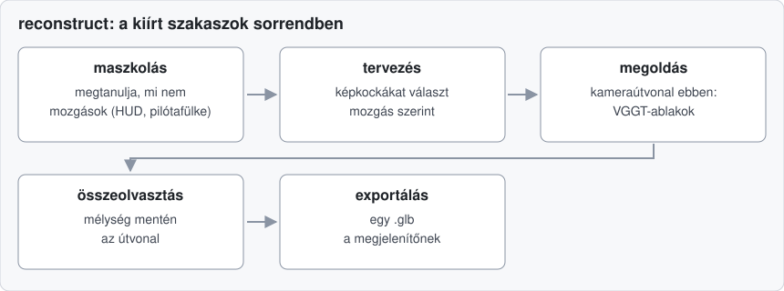

# Offline rekonstrukció {#offline-reconstruction}

```bash
python -m heat3d_capture reconstruct lap.mp4 -o lap.glb [--solve-budget 260] [--fuse-interval 0.4]
```

Kód: [`scan/offline.py`](https://github.com/Holdi601/3DHeat-GameCapture/blob/main/heat3d_capture/scan/offline.py),
[`pose/feedforward.py`](https://github.com/Holdi601/3DHeat-GameCapture/blob/main/heat3d_capture/pose/feedforward.py),
[`pose/vggt_model.py`](https://github.com/Holdi601/3DHeat-GameCapture/blob/main/heat3d_capture/pose/vggt_model.py),
[`pose/feedforward_source.py`](https://github.com/Holdi601/3DHeat-GameCapture/blob/main/heat3d_capture/pose/feedforward_source.py),
[`pose/solveprep.py`](https://github.com/Holdi601/3DHeat-GameCapture/blob/main/heat3d_capture/pose/solveprep.py).
Opciók: [Parancsreferencia](commands.md#reconstruct).

## Miért második út {#why-a-second-path}

Az inkrementális követés élő és olcsó, és ott működik, ahol van mibe kapaszkodni: egy belső tér, egy utca, egy fedezékes térkép. A **versenypálya a legrosszabb esete**: az út sima szalag kevés textúrával, a horizont alig mozog, és amint néhány póz elsodródik, később semmi nem húzza vissza őket. Egy kör így egy kanyargó görbeként jön ki, nem záródik.

Az offline út **képkockák ablakait** adja egy modellnek, amely az összes kamerájukat egyszerre jósolja meg, így minden képkocka közvetlenül korlátozza az összes többit, nem egy láncon keresztül. Ehhez az egész felvétel kell a válaszhoz, ezért nem élő, és lassú: ablakonként percek egy asztali GPU-n. Minden a pózok után – összeillesztés, lefedettség, szín, export – ugyanaz a kód, mint az élő szkennelésnél: a megoldott pályát rekonstruktornak adjuk át póz-forrásként, pontosan ott, ahol a Forza telemetriája megy.

## Követelmények {#requirements}

- **PyTorch**, amely a GPU-hoz illeszkedik (ezt a projekt nem rögzíti; a `requirements.txt` előtt kell telepíteni, lásd [Futtatás](runtime.md)).
- **`vggt`** – a VGGT modellkód (`from vggt.models.vggt import VGGT`), a Meta GitHub-tárolójából; nincs a csomagindexen.
- **`transformers`**, mert az offline út a mélységet a PyTorch `DepthEstimator`-rel futtatja (Depth Anything V2 Small), nem az ONNX-fájllal.
- Gyakorlatban CUDA GPU; mindkét modell visszaáll CPU-ra, de az gyakorlatilag nem használható.

Ezek egyike sincs a `requirements.txt`-ben, mert a szkennernek nincs rájuk szüksége. A **`requirements-offline.txt`**-ben vannak, a `vggt` saját függőségeivel (`einops`, `safetensors`, `huggingface_hub`, `Pillow`):

```bash
.venv\Scripts\python -m pip install -r requirements-offline.txt
.venv\Scripts\python -m pip install --no-deps "vggt @ git+https://github.com/facebookresearch/vggt.git"
```

A VGGT-t `--no-deps` kapcsolóval telepítjük, mert a csomag metaadatai `numpy<2`-t írnak elő, és a pip ezt úgy tartaná be, hogy visszaminősíti a numpy-t, amelyre a scipy itt szükséges. A `reconstruct` mindegyiket ellenőrzi, közvetlenül a licencsor kiírása után (az `OFFLINE` lista a [`runtime/preflight.py`](https://github.com/Holdi601/3DHeat-GameCapture/blob/main/heat3d_capture/runtime/preflight.py) fájlban), kiírja, mi hiányzik méretekkel, és csak igen válaszra telepít – a VGGT-t `--no-deps`-szel, ahogy fent. A nemet, vagy ha nincs terminál, ahol megkérdezhetné, 1-es kilépési kóddal zárja.

## A modell és a licence {#the-model-and-its-licence}

**VGGT**, `facebook/VGGT-1B`: **CC-BY-NC-4.0, csak nem kereskedelmi célra, és az ezzel készült rekonstrukció ezt örökli.** A parancs ezt kiírja, mielőtt elindul (`describe_licence`). Létezik egy külön licencelt `facebook/VGGT-1B-Commercial`, de ez egy korlátozott tárolió, amelyet a Meta fiókonként ad ki, így nem lehet az alapértelmezett. A `--model vggt-1b-commercial` ezzel old meg (és a saját licencsorát írja ki); hozzáférés nélkül a letöltés meghiúsul. A `vggt` *kódja* a Meta saját „VGGT License”-e alatt van, egy kutatási anyagokra vonatkozó megállapodás elfogadható használati szabályzattal (a csomag `LICENSE.txt` fájlja alapján). Lásd [Modellek és licencek](models-and-licences.md).

## A futás szakaszról szakaszra {#the-run-stage-by-stage}

A szakaszok nevei azok, amelyeket a parancs kiír.



### maszkolás {#masking}

Egy `FlowMask`-ot tanulunk **4 futásból, mindegyik 90 egymást követő képkockából**, a videó 1/8, 3/8, 5/8 és 7/8 pontjára középre igazítva, 960 x 540 szürkeárnyalatban (lásd [FlowMask](reconstruction-capture.md#flowmask-what-never-travels)). A megjegyzése kiíródik és az összefoglalóban is megmarad. A 90 képkockánál rövidebb videó nem kap maszkot.

#### A kameramaszk tanult, nem alkalmazott {#the-camera-mask-is-learned-not-applied}

A maszk **nincs** alkalmazva a megoldónak adott képkockákra. A fülke maszkolása a jellemzőstatisztika szerint helyesnek látszott (a felismert sarokpontok többsége kamerához kötött pixeleken ül) – de ez egy jellemzőfelismerőről szóló állítás, a megoldó pedig egy tanított hálózat. A visszakanyarodott út mérete szerint, két egymást követő lépés között (egy autó néhány fokot fordul; egy véletlen bolyongás kilencvenet), a nyers képkockák adták a legkisebb fordulást, a kontraszt-emelt képkockák valamivel többet, a maszkolt képkockák egyértelműen többet, és a kettő együtt a legtöbbet. Ezért a megoldó nyers képkockákat kap. A maszk még mindig használatos a képkockák távolságának tervezéséhez alább, és az inkrementális követő az élő szkennelésben használja. (A `solveprep.enhance`, amely maszkol és CLAHE-vel helyi kontrasztot emel, létezik, de ez a parancs nem használja.)

### tervezés: mozgás szerint elosztott képkockák {#planning-frames-spaced-by-motion}

A `plan_by_motion` a megoldó képkockáit azzal választja ki, **mennyit mozdult a kép**, nem az órával: egy rögzített időköz a lassú szakaszoknak nem kell képkockákat ad, a gyorsakat pedig éhezteti, ahol az egymást követő képkockák már nem fedik eléggé egymást ahhoz, hogy összefüggjenek.

- Célelmozdulás: **a 960 pixeles szélesség 5%-a** (48 px) a medián ORB-jellemző elmozdulása a kiválasztott egymást követő képkockák között, 960 x 540-es szürke képkockákon, CLAHE kontraszttal mérve, a maszkon lévő jellemzőkkel.
- Egy 0,3 másodperces résszel indul; minden lépés után a következő rés `rés x (0,5 + 0,5 x cél / mért)`, a **0,15–2,0 s** tartományba szorítva, hogy egy zajos mérés ne lendítse ki a tervet.
- Ha semmi nem illeszkedett, a rés a saját 0,6-ára zsugorodik (a túl nagy távolság a kerülendő hiba).
- Megáll a videó végénél vagy a `--solve-budget` képkockánál (alapértelmezés 260).

Négynél kevesebb tervezett képkocka hiba.

### megoldás: ablakok és illesztés {#solving-windows-and-stitching}

A tervezett képkockák 960 px szélességben dekódolódnak, és **16 képkockából álló átfedő ablakokban** oldódnak meg, **6 közös képkockával** a következőhöz (`plan_windows`; az utolsó ablakot visszahúzzuk, hogy a végső képkockán érjen véget, így a felvétel vége ugyanannyi szomszédot kap, mint a közepe). Egy futásban **400**-nál több képkockát visszautasít.

Minden ablak: a képkockákat úgy átméretezzük, hogy a hosszú oldaluk **518** legyen, és mindkét oldal **14** többszöröse legyen (az oldalarány megmarad – a nyomás hibásan adná meg a látómezőt), 0..1-re skálázva, VGGT-n futtatva bfloat16 autocasttal (a float16 kifut az exponensből a távoli világkoordinátáknál). A kamera külső paramétereit világ-ből-kamerába forgatásokká és kamera-középpontokká alakítjuk. A ponttérképeket alapértelmezetten nem tartjuk meg.

Minden ablak **a saját önkényes koordinátarendszerében és a saját önkényes skálájában** jön vissza, ezért az ablakokat egy hasonlósági transzformációval (forgatás, eltolás, egy skála) az első ablak keretébe **illesztjük**, a már elhelyezett közös kamerákra illesztve:

- **A forgatás a kamerák orientációjából**, nem a pozíciójából: a közös kamerák az út mentén ülnek, és egy egyenesen szinte egy vonalba esnek, így egy csak pozíción alapuló illesztés nem látja a forgatást – minden ablak görbül, és az illesztett eredmény egyenesnek jön ki. A forgatás a `target_R x source_R^T` átlaga, visszavetítve egy valódi forgatásra (tükrözés-őrrel).
- **A skála és az eltolás a pozíciókból**, a forgatott forrás mentén.
- Legalább **4** közös kamera kell; kevesebb hiba.

Minden varratnál rögzítjük a közös kamerák legrosszabb eltérését az illesztés után, a köztük lévő átlagos távolság egységeiben (`seam_error`).

### összeillesztés {#fusing}

A `--fuse-interval` másodpercenként (alapértelmezés 0,4) megtartott képkockák 960 px szélességben dekódolódnak, mélységet kapnak a Depth Anything V2 Small-tól (PyTorch), és a megoldott pályából az időbélyegüknél **interpolált** pózzal olvadnak össze (lineáris pozíció, gömbi forgatás; `FeedForwardPoses`). A megoldott időtartamon kívüli képkockák kimaradnak, nem extrapolálódnak. A kamera **65 fokos** vízszintes látómezőt használ. Az előrecsatolt pózok 0,85 megbízhatóságot kapnak az összeillesztésnél és a lefedettségnél.

### exportálás {#exporting}

A háló ugyanúgy íródik, mint egy élő szkennelésnél ([A .glb kimenet](glb-output.md)), a videó nevéről elnevezve.

## Az összefoglaló {#the-summary}

```text
140 cameras solved over 182s
closure error 3.1% of path length
worst seam 0.42 frame spacings
<mask note>
wrote lap.glb
```

| Sor | Jelentése |
|---|---|
| closure error | az első és az utolsó kamera távolsága osztva az út hosszával. Egy körnél a sodródás őszinte mértéke. 10% felett: „The lap does not close ... Treat the shape as unreliable.” (A kör nem záródik … A formát megbízhatatlannak tekintsd.) |
| worst seam | a legnagyobb illesztési eltérés. 1,0 felett: „Windows disagreed by up to N frame spacings at a seam, so part of the path is stitched on weak evidence.” (Az ablakok legfeljebb N képkockatávolságnyit tértek el egy varratnál, így az út egy része gyenge bizonyítékon illesztődött.) |
| no file | „Fusion produced no surface, so nothing was written.” (Az összeillesztés nem adott felületet, így semmi nem íródott.) A kilépési kód ilyenkor 1. |

## Skála {#scale}

Az illesztett út az első ablak önkényes egységeiben van. A mélységet a interpolált pózok közötti háromszögeléssel horgonyozzuk (ahogy a telemetriánál), így a geometria összhangban van az úttal – de **az eredmény nem méterben van**, hacsak az út nem az. Ez a parancs nem rögzíti a globális skálát; a talajkalibráció nincs alkalmazva, amikor a pózok póz-forrásból jönnek.

## Ennek az útnak az állapota {#state-of-this-path}

Rögzített időközű képkockáknál az ablakok a kör egyes szakaszain koherens úttá oldódnak meg, másokon firkává; a hibák a szoros kanyaroknál vannak, ahol a nézet két képkocka között erősen elfordul, és ezeknek a kanyaroknak a sűrűbb mintavétele helyreállítja őket. Egyetlen kipróbált képstatisztika (fényerő, részletesség, jellemzőszám, belső pontarány, elmozdulás) sem jósolta meg előre, mely szakaszok fognak hibázni. Ezért a képkockatávolságot a képekből nem lehet teljesen előre megtervezni: meg kell oldani, megmérni az eredményt, és sűrűbben újra megoldani ott, ahol az út nem olyan, amelyen egy autó haladhatott volna. A mozgásalapú tervezés kész; **az adaptív újramegoldás nincs kész**.
