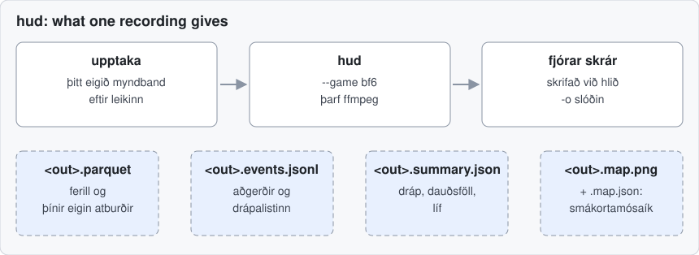

# HUD lesið úr upptöku {#reading-the-hud-from-a-recording}

`hud` les HUD leiks á skjánum úr **eigin upptöku** leikmannsins, eftir leikinn: **eigin**
aðgerðir leikmannsins úr stigaglugganum sem leikurinn sýnir undir hárkrossinum (dráp,
aðstoð, endurlífganir, birgðaáfyllingar, yfirtökur...), dauðsföll hans af niður- og útsetningarskjáunum (down og deploy), **eigin**
slóð hans af smákortinu, og drápslistann við hliðina sem tímasetta atburði - skrifað sem
3DHeat tafla með mósaík smákortsins sem kortamynd til að leggja undir hana.

Í stuttu máli: það horfir á leikmyndbandið þitt og skrifar niður drápin þín, dauðsföllin og hvert þú gekkst.

```bash
.venv\Scripts\python -m heat3d_capture hud "<recording>.mp4" --game bf6 --player <name> -o out/match
```

Battlefield 6 er fyrsta leikjasniðið.



## Hverju það snertir og snertir ekki {#what-it-does-and-does-not-touch}

- Það les **myndbandsskrá**: ShadowPlay / Instant Replay klippu, OBS upptöku, hvað sem
  ffmpeg afkóðar. Það snertir aldrei leikinn, minni hans, skrár hans né net hans, og það keyrir
  eftir að leiknum er lokið. Sjá [Reglurnar](rules.md).
- Það leiðir aðeins út **eigin stöðu leikmannsins**, úr eigin smákorti hans. Merki annarra
  leikmanna á smákortinu eru grímuð út og aldrei lesin. Drápslistinn er geymdur í heild, en aðeins sem
  það sem stendur á skjánum (hver, hvern, með hverju, hvenær); engin staða er tengd neinum nema
  leikmanninum.
- OCR keyrir á staðnum (RapidOCR með PaddleOCR líkönum í gegnum ONNX Runtime). Enginn rammi eða
  útskurður fer af vélinni.
- Upptaka sýnir nöfn annarra leikmanna og mósaíkin er mynd af borðinu. Úttökin
  eru til eigin nota leikmannsins; hafðu þau á staðnum.

## Kröfur {#requirements}

- **ffmpeg og ffprobe** í `PATH`. NVIDIA kort er notað til afkóðunar þegar það er til
  (`-hwaccel cuda`); annars afkóðar örgjörvinn, nokkrum sinnum hægar.
- Pakkarnir í `requirements.txt`, og OCR án eigin háðra pakka (það biður um
  `onnxruntime` fyrir örgjörva, sem rekst á DirectML útgáfuna sem verkefnið notar):

```bash
.venv\Scripts\python -m pip install -r requirements.txt
.venv\Scripts\python -m pip install --no-deps rapidocr_onnxruntime==1.2.3
```

`rapidocr_onnxruntime` er textalesarinn (OCR) sem les nöfn og orð af skjánum.
`--no-deps` kemur í veg fyrir að hann komi í stað DirectML `onnxruntime` verkefnisins.

Til að setja upp ffmpeg á Windows: `winget install Gyan.FFmpeg`, opnaðu svo nýjan Terminal glugga og athugaðu
með `ffmpeg -version`. Nýr á skipanalínunni? Lestu [Áður en þú byrjar](before-you-start.md).

- **16:9** upptaka í hvaða upplausn sem er (1080p, 1440p, 4K). Önnur hlutföll eru afþökkuð,
  því kassar sniðsins myndu lenda á röngum hlutum skjásins.
- **Sjálfgefin HUD uppsetning** leiksins. HUD hlutur sem hefur verið fluttur eða skalaður er lesinn á röngum stað.

## Valkostir {#options}

| Valkostur | Sjálfgefið | Merking |
|---|---|---|
| `video` | | Upptakan. |
| `-o`, `--out` | heiti myndbandsins, í núverandi möppu | Slóð úttaksins **án** endingar; skrárnar eru `<out>.parquet`, `.events.jsonl`, `.summary.json`, `.map.png`, `.map.json`. |
| `--game` | `bf6` | Hvers HUD á að lesa. `bf6` (Battlefield 6) er eina sniðið enn sem komið er. |
| `--player` | enginn | Nafn leikmannsins eins og drápslistinn sýnir það. Borið saman laust (OCR ruglar saman `l`/`I`/`1`, `O`/`0`, `rn`/`m`). Án þess er nafninu giskað (hér á eftir). |
| `--fps` | 5 | Smákortssýni á sekúndu. Drápslistinn er sýnaður á helmingi þess, stigaglugginn og dauðaskjáirnir á helmingi þess líka (fjórðungi meðan enginn gluggi er uppi), áttavitinn á 3 s fresti, hópalistinn á 15 s fresti. |
| `--start` | 0 | Sekúndur inn í myndbandið sem byrjað er á. |
| `--seconds` | allt | Hversu mikið af myndbandinu á að lesa. |
| `--metres-per-pixel` | enginn | Kvarði smákortsins, ef hann er þekktur: metrar á hvern smákortspunkt við venjulega aðdrátt (smákortið er 296 punkta breitt á 1080p skjá). Án hans eru staðsetningar í þessum punktum; sjá [Einingar](#north-and-units). |
| `--cpu` | slökkt | Afkóða á örgjörvanum jafnvel þegar NVIDIA kort er til staðar. |

Framvinda er prentuð á fimm sekúndna fresti; í lokin leikmaðurinn, dráp, dauðsföll, líf og skrárnar
sem voru skrifaðar.

## Úttök {#outputs}

### `<out>.parquet` - slóð og atburðir leikmannsins {#out-parquet-the-players-track-and-events}

Ein röð fyrir hvert sýni þar sem leikmaðurinn var í leik og hægt var að staðsetja smákortið, auk einnar fyrir hvern
atburð hans. Fóturinn ber leiðbeiningar skoðarans um lestur (`heat3d` lykill, `kind: heat3d-hud`), svo
skoðarinn varpar hverjum dálki án þess að spyrja.

| Dálkur | Merking |
|---|---|
| `time` | Sekúndur frá upphafi myndbandsins. |
| `event` | `position`; `start` (myndbandið hófst um mitt líf), `spawn` (aftur í leik eftir dauða eða langt hlé), `death`, `downed` og `revived` (af dauðaskjáunum, hér á eftir), `end` (líf endaði án þess að neitt segði hvernig); eigin aðgerðir leikmannsins úr stigaglugganum (`kill`, `assist`, `reviving`, `resupply`, `capture`... - [atburðataflan](#event-table)); og línur drápslistans um leikmanninn sem `kill_feed`, `death_feed`, `teamkill_feed`, `suicide_feed`, `squadwipe_feed`. |
| `source` | Hvaðan atburður raðarinnar kom: `points` (glugginn), `screen` (niður- og útsetningarskjáirnir), `feed` (drápslistinn); tómt á stöðuröðum. |
| `text` | Á `points` röðum: merkið eins og það er prentað (`KILL`, `SQUAD DAMAGE ASSIST`...), eða titillinn (`DOUBLE KILL`, nafn borða), eða fyrir óþekkt merki það sem var lesið. |
| `points` | Á `points` röðum: hve mikið heildartala gluggans hækkaði á þeirri stundu. Þegar nokkrar aðgerðir komu í sama sýni (dráp og farartækið sem það var í) er það summa þeirra, gefin á hverri, og `shared` segir hve margar deildu því. Tómt þegar heildartalan var ekki lesin tvisvar beggja vegna stundarinnar. |
| `subject`, `subject_side` | Á `points` röðum: nafnið sem glugginn sýndi með aðgerðinni - fórnarlamb dráps, liðsfélaginn sem var endurlífgaður eða fékk birgðir - og litur þess (`enemy`, `friendly`, `squad`). |
| `confirmed` | `feed` þegar drápslistinn hafði línu fyrir sama dráp eða dauða (innan 3 s, sama fórnarlamb). |
| `x`, `y`, `z` | Staða á mósaíkinni: `x` austur, `y` norður, `z` 0 (fóturinn segir að `z` sé upp). Norður er raunverulegt norður þegar áttavitinn leyfði það (sjá `north_up` í samantektinni). |
| `player` | Alltaf `me`. Aðeins raðir leikmannsins sjálfs hafa stöður. |
| `team` | `own`. |
| `session` | `<video name>#NN`, ein fyrir hvert líf. Línuhitaleiðir fara aldrei yfir lotu. |
| `heading` | Gráður réttsælis frá norðri (frá efri brún mósaíkarinnar þegar norður er óþekkt): hvert sjónarhornið vísaði. |
| `dir_x`, `dir_y`, `dir_z` | Það sama sem stefnuvigur, fyrir stefnu sjónarinnar í skoðaranum. |
| `zoom` | Hve langt smákortið var dregið út miðað við venjulegan aðdrátt (yfir 1 í farartækjum). |
| `killer`, `victim`, `weapon`, `headshot`, `marker` | Á dráps- og dauðaröðum sem hafa línu í listanum: lína drápslistans (hér á eftir). Dráp úr glugga án línu í listanum hefur nafn gluggans sem `victim`; dráp úr glugga sem sýnt er sem HEADSHOT hefur `headshot` satt. |

Hver atburðarröð tekur stöðu leikmannsins á tíma atburðarins (fyrir dauða eða niðurfall, síðustu
stöðu á undan; fyrir endurlífgun, þá fyrstu á eftir). Raðirnar passa beint í [línuhita (line heat)](https://holdi601.github.io/3DHeat/line-heat.html) skoðarans: tillaga hans
velur `event`, byrjar á `start`, `spawn` og `revived`, endar á `death`, `downed` og
`end`, og `position` raðir liggja eftir leiðinni. Hinir atburðirnir eru nefndir þannig að
tillagan taki engan þeirra fyrir upphaf eða endi: að endurlífga aðra er `reviving` (ekki
`revive`), að halda punkti `defense`, liðsfélagi sem endurfæðist á leikmanninum `teammate_arrived`,
línur listans `kill_feed` og svo framvegis; `kill` er ekki endir.

Klippa með tveimur umferðum á tveimur kortum gefur tvær mósaíkir sem ekki er hægt að tengja. Sú stærsta er
`<out>.parquet`; hver önnur með að minnsta kosti 30 s af slóð er skrifuð við hliðina sem
`<out>.map2.parquet`, `<out>.map2.map.png`, og svo framvegis.

### `<out>.events.jsonl` - atburðir leikmannsins og drápslistinn {#out-events-jsonl-the-players-events-and-the-kill-feed}

Einn JSON hlutur í hverri línu, í tímaröð, hver með `source`:

- `points`: einn fyrir hverja aðgerð leikmannsins: `time`, `event`, `text`, `points`, `shared`,
  `subject`, `subject_side` (eins og í töflunni), `popup` (úr hvaða glugga hún kom, númeraður í gegnum
  keyrsluna), `seen` (hve margir lestrar sýndu hana), `confirmed`, og `x`, `y` þar sem leikmaðurinn var.
- `screen`: einn fyrir hvert niðurfall og hverja endurlífgun: `event` (`death`, `downed` eða `revived`), `time` (hvenær
  leikmaðurinn féll; fyrir `revived`, hvenær skjáirnir fóru), `until` (síðasta sýn á
  skjáina), `screens` (`down` og/eða `card`), `outcome` (`death`, `revived` eða `unknown` þegar
  upptakan endar fyrst), `killer` (úr línu listans, þegar hún er til), `x`, `y`.
- `feed`: hver lína sem listinn sýndi, allra:

| Reitur | Merking |
|---|---|
| `time`, `last` | Fyrsta og síðasta sýni sem línan var lesin í (sekúndur frá upphafi myndbandsins). `time` er þegar drápið birtist, með nákvæmni eins listasýnis (0,4 s við sjálfgefna tíðni). |
| `kind` | Frá hlið leikmannsins: `kill`, `death`, `teamkill`, `suicide`, `squadwipe`; fyrir línur annarra leikmanna `kill`, `squadwipe`, eða `death` fyrir línu án drápara. |
| `killer`, `victim` | Nöfnin, eins og algengasti lesturinn í öllum sýnunum sem sýna línuna (lengri lestur vinnur þegar sá algengi er upphaf hans: nafn sem er að hluta falið). `killer` er tómt fyrir línu sem sýndi aðeins tákn og fórnarlamb - dauða af völdum heimsins, eða línu þar sem dráparinn var þegar horfinn. |
| `killer_side`, `victim_side` | Eftir lit nafnsins: `friendly` (lið leikmannsins, blátt), `enemy` (appelsínugult), `squad` (fölgræna sem leikurinn notar fyrir leikmanninn og hópinn hans), `neutral` (ekkert af þessu). |
| `weapon` | Flokkur vopnatáknsins innan þessarar keyrslu: `icon01`, `icon02`... Línur með svipuðum táknum deila flokki. Táknin eru ekki nefnd; það er enginn listi til að nefna þau eftir. |
| `marker` | Litla táknið milli vopnsins og fórnarlambsins: `skull`, `arrow`, `chevrons`, `crosses` eða tómt. |
| `headshot` | `marker == "skull"` - forsenda, sjá [Takmarkanir](#limits). |
| `seen` | Hve mörg listasýni sýndu línuna. |
| `me` | `killer`, `victim` eða null. |
| `matched` | Fyrir eigin línur leikmannsins: hvort aðgerð úr glugga eða dauðaskjár fannst fyrir hana. |
| `x`, `y` (, `map`) | Fyrir eigin línur leikmannsins: hvar hann var. |

### `<out>.summary.json` {#out-summary-json}

Leikmaðurinn (og hvernig hann fannst), hvaðan atburðir leikmannsins komu (`own_events_from`: 
glugginn og skjáirnir, eða drápslistinn einn þegar hvorugt var lesið), dráp, dauðsföll, K/D,
skot í höfuðið, aðstoðir, endurlífganir veittar (`revives`) og fengnar (`revived`), niðurföll, yfirtökur,
hlutleysingar, birgðaáfyllingar, læknanir, viðgerðir, farartæki eyðilögð, stigin (heildartölur glugganna lagðar
saman), hver tegund aðgerðar með fjölda sínum (`actions`), fjöldi glugga, dauðsföll sem aðeins listinn
sýndi, eigin talning listans á drápum og dauðsföllum og hve mörg dráp hans pössuðu við dráp úr glugga,
dráp á liðsfélögum, sjálfsvíg, hópeyðingar, líf, sekúndur í leik, vegalengd farin (í einingum töflunnar),
listalínur, fyrir hvert kort hvort það snýr norður upp og hve margir áttavitalestrar voru sammála, talningar slóðarinnar
(sýni, í leik, staðsett, ekki staðsett, eyjar), forsendurnar sem voru gefnar og tímasetningar.

### `<out>.map.png` og `<out>.map.json` - kortið undir slóðinni {#out-map-png-and-out-map-json-the-map-under-the-track}

Mósaíkin af hverju smákorti keyrslunnar, meðaltal, yfirlög fjarlægð, snúin og sköluð nákvæmlega eins og
taflan. JSON hliðarskráin geymir festipunktana tvo sem **Map image** staðsetning skoðarans biður um
([Kortamyndir](https://holdi601.github.io/3DHeat/map-images.html) í skjölum skoðarans): hladdu PNG skránni með
**Map image...**, hafðu **Flip north/south** á, og sláðu inn festipunkt 1 og festipunkt 2 (`px`, `py`,
`worldX`, `worldZ`) úr hliðarskránni. Myndin liggur þá nákvæmlega undir slóðinni.

Aðeins þeir hlutar borðsins sem smákort leikmannsins sýndi eru í myndinni.

## Aðferð {#method}

### Afkóðun {#decoding}

ffmpeg afkóðar á skjákortinu, fer niður í sýnatökutíðnina meðan rammarnir eru enn á kortinu, sker
út svæði sniðsins (smákort, drápslista, tvær áttavitaræmur, hópalista, stigagluggann,
orð niðurskjásins, neðra hægra hornið), skalar hvert í fasta stærð og staflar þeim
í eina litla mynd fyrir hvert sýni. Aðeins sú mynd fer um pípuna
inn í Python. Að afkóða hvern ramma H.264 straumsins er gólfið á keyrslutímanum.

Tveir vinnuþræðir taka sýnin: annar skráir smákort (OpenCV), hinn les texta (ONNX Runtime).

### Í leik eða ekki {#in-play-or-not}

Lykilábendingarferningur smákortsins (ljósi ferningurinn með kortalyklinum í, neðst til vinstri á
smákortinu) er teiknaður hvenær sem smákortið er, og ekki á dauða-, dráparamyndavélar-, útsetningar-, valmynda- eða
stigatöfluskjám. Návist hans - ljós, litlaus ferningur með dökkum staf í miðjunni, greinilega
ljósari en það sem er í kring - leitað nokkra punkta í kringum stað hans, er prófið á því hvort leikur er í gangi. Stakt
sýni sem er ósammála báðum nágrönnum er hunsað.

Hlé í leik er dauði eða umferðarskipti (næsti kafli byrjar á `spawn`) þegar það varir að
minnsta kosti 6 s eða dauði (af skjáunum, eða listalína sem nefnir leikmanninn sem fórnarlamb) kom innan
40 s á undan; styttra hlé án dauða (stóra kortið opnað) heldur lífinu áfram. Smákortið
helst uppi meðan leikmaðurinn er niðri, svo leikmaður sem er niðri er í leik.

### Slóðin {#the-track}

Smákortið snýst með sjónarhorninu og heldur leikmanninum á föstum punkti (mælt: miðjunni, 49,7%
niður). Hvert sýni:

1. **Gríma** það sem er ekki borðið: sterklitaðir eða næstum hvítir punktar (markmiðsmerki, hóp- og
   farartækjatákn, ping, mörk leiksvæðisins, leiðarlínur, texti), daufa gulgræna
   sjónkeilunnar, skífa í kringum merki leikmannsins, fleygur keilunnar fyrir ofan það, lykilábendingin og
   þunn rönd.
2. **Eiginleikar**: SIFT lykilpunktar á kontrastjafnaða gráa smákortinu, innan grímunnar.
3. **Skrá á mósaíkina**, ekki á fyrra sýni: lykilpunktarnir eru paraðir við
   eiginleikana sem hafa verið geymdir hingað til, í hnitum mósaíkarinnar, nálægt því þar sem leikmaðurinn var síðast; samsvörun
   (snúningur, aðdráttur, tilfærsla) er mátuð með RANSAC. Mátun þarf nóg af innliggjandi punktum, aðdrátt innan þriðjungs af
   þeim síðasta og tilfærslu undir þriðjungi smákortsins á sýni; mátun sem er leituð
   hvar sem er á mósaíkinni (eftir dauða) þarf tvöfalt fleiri innliggjandi punkta.
4. **Stækka mósaíkina**: eiginleikum sem mósaíkin hefur ekki enn er bætt við (í mesta lagi á nokkurra tíundu hluta
   úr sekúndu hreyfingar fresti), og grímaða smákortið er meðaltalað inn í myndina.
5. Punktur leikmannsins fluttur í gegnum mátunina er **staða** hans; efri brún smákortsins flutt
   í gegnum hana er **stefna** hans á mósaíkinni.

Á eftir er punktur sem stekkur meira en 10 punkta frá bæði tveimur sýnum á undan og
tveimur á eftir (sem eru sammála sín á milli) felldur niður: smákort passar af og til við rangan
aðdrátt í eitt sýni. Samantektin telur þá (`dropped_as_jumps`).

Að skrá á mósaíkina er það sem kemur í veg fyrir að skekkjur safnist upp: að koma aftur á stað passar við
eiginleikana sem voru geymdir í fyrsta sinn. Endurfæðing einhvers staðar sem ekki hefur sést byrjar sérstaka **eyju**; hvert
tíunda staðsetta sýni er prófað gegn hinum eyjunum, og fyrsta góða samsvörunin sameinar þær (sú
minni flyst inn í þá stærri, með slóð sína). Eyjar sem aldrei sameinuðust (annað kort, eða land sem aldrei
var deilt) eru skrifaðar sér eins og að ofan.

### Norður og einingar {#north-and-units}

Áttavitaræman er lesin á 3 s fresti: merkimiðar hennar finnast eftir bleki sínu (bjart, litlaust,
flokkað yfir lítil bil, strik felld niður), hver er lesinn fyrir sig, og tveir eða fleiri merkimiðar festa bæði
kvarða ræmunnar og stefnuna undir miðmerkinu - einn merkimiði festir ekkert. Hver
áttavitalestur er paraður við stefnu mósaíkarinnar í sama sýni; hringlaga miðgildi
mismunanna, yfir lestra innan 10 gráða frá því, er snúningurinn sem setur mósaíkina með norður upp.
Hann er notaður þegar að minnsta kosti þrír lestrar og helmingur þeirra allra eru sammála.

<a id="units"></a>Kvarði smákortsins á jörðu niðri er hvergi prentaður á skjáinn, svo staðsetningar eru í
**smákortspunktum við venjulegan aðdrátt**: miðgildi aðdráttar keyrslunnar er skalað í eina töflueiningu á
punkt 296 punkta smákorts (stærð þess á 1080p skjá). Útdráttur farartækja er tekinn út með
skráningunni, svo eining er sú sama fótgangandi og í farartæki. `--metres-per-pixel` margfaldar
allt yfir í metra þegar kvarðinn er þekktur (úr þekktri vegalengd á kortinu, mælt einu sinni).

### Drápslistinn {#the-kill-feed}

Listinn er lesinn á 2,5 sýnum á sekúndu, en aðeins þegar litaðir punktar hans breyttust áberandi eða
2 s liðu. Textalínur finnast með greini OCR; lína sem passar við eina sem var lesin í
fyrra sýni (raðir skrolla, svo hún gæti hafa færst) tekur þann texta í stað þess að vera lesin aftur.
Línur sem eru of litlar fyrir nafn, eða með skástriki (fps teljari í því horni), eru felldar niður.

Línur eru flokkaðar í raðir eftir hæð; í röð er vinstra nafnið dráparinn og það hægra
fórnarlambið. Nágrannabútar í sama lit sameinast (nafn með bili). Ein lína sem
náði yfir táknið úr einu nafni í hitt er skorin við breiðasta bilið þegar helmingarnir eru ólíkir að
lit, og hvor helmingur lesinn aftur. Eitt nafn í dálki fórnarlambanna með tákn rétt vinstra megin við það
er lína án drápara. Tveir bútar í sama lit án tákns á milli eru eitt nafn þar sem
dráparinn er horfinn, ekki dráp.

**Hliðar** koma af lit. Nöfn eru teiknuð með nokkru gegnsæi, svo prófið er á því hve langt
textinn er frá eigin bakgrunni: formerki rauðs mínus blás í þeim mun er appelsínugult (óvinur)
eða blátt (vinur) á hvaða bakgrunni sem er; hvorugt, með grænt yfir hinum tveimur, er hópliturinn.

**Tákn**: milli nafnanna mynda punktar í lit drápara útlínu vopnsins; lítið aðskilið
tákn rétt á undan fórnarlambinu er merkið, nefnt eftir lögun sinni (blettur með augnaholum
er höfuðkúpa; lítill þríhyrningur ör; nokkrir bútar kross).

**Atburðir**: röð lesin aftur með bæði nöfn lík (líkindi 0,7 eftir að venjulegum OCR
ruglingi er jafnað, annað þeirra 0,8; stuttur lestur passar við upphaf fulla nafnsins) er sami
atburður, svo lengi sem atburðurinn var síðast lesinn fyrir minna en 5 s og er yngri en 14 s - engin röð helst uppi
lengur, svo sama parið síðar er nýtt dráp. Röð án drápara passar á fórnarlambinu einu.
Tími atburðar er fyrsta sýn á hann; nöfn hans, hliðar og merki eru meirihlutinn í
sýnunum; raðir sem voru aðeins lesnar einu sinni eru felldar niður.

**Leikmaðurinn**: `--player`, annars auðkennda (bjartasta) röð hópalistans þegar að minnsta kosti þrír
lestrar og 60% þeirra eru sammála, annars nafnið sem listinn teiknaði oftast í hóplitnum. Annars
segir samantektin að leikmaðurinn sé óþekktur og engin listalína er eignuð honum. (Glugginn og
dauðaskjáirnir eru eigin skjáir leikmannsins hvað sem hann heitir; þeir þurfa ekkert nafn.)

### Stigaglugginn {#the-points-popup}

Allt sem leikmaðurinn skorar sýnir Battlefield 6 í einum glugga rétt vinstra megin við og fyrir neðan
hárkrossinn - á sama stað fótgangandi, í farartæki og í gegnum sjónauka:

```
            [ RIBBON ] (icon)          a title, now and then: a ribbon or a multi-kill
      (icon)(icon)(icon)  300          one icon per action; the popup's running total
                Some_Name              who it was about, for a moment: orange an enemy, blue a teammate
    [ KILL x2 ] [ VEHICLE DESTROYED ]  one boxed tag per kind of action, with a count
```

Glugginn stækkar meðan leikmaðurinn heldur áfram að skora: nýtt dráp breytir `KILL` í `KILL x2`, bætir við
tákni og hækkar heildartöluna; ný tegund aðgerðar bætir við merki. Merkjaröðin sýnir síðustu
nokkrar tegundirnar (eldri rennur út, og telur áfram þegar hún kemur aftur). Um þrem sekúndum eftir síðustu
aðgerð leggst glugginn saman í eina línu (`[KILL x2] 300`) og hverfur. Textinn er ljósgrár, merkin í
þunnum kössum, heildartalan í stórum tölustöfum frá x 760 á 1920x1080 skjá, merkin
hægrijöfnuð að x 750.

Hann er lesinn 2,5 sinnum á sekúndu: greinir OCR finnur textalínurnar, aðeins línur í einni af
röðum gluggans eru lesnar (eigin merkimiðar skriðdrekasjónaukans á sama svæði eru það ekki), og lína sem passar við
eina sem var lesin í sýninu á undan tekur þann texta. Lína sem náði yfir frá tákni, nafni eða samanbrotnu merki inn í
heildartöluna (`Name10`, `REVIVE185`) er skorin þar sem heildartalan byrjar
(x 755) og báðir helmingar lesnir aftur. Meðan enginn gluggi er uppi er annað hvert sýni haldið til baka
ólesið; þegar það næsta sýnir glugga er það sem var haldið lesið fyrst, svo upphaf glugga finnst
samt upp á sýni.

**Merki** eru pöruð við [atburðatöfluna](#event-table) eftir að venjuleg mistök
lesarans eru jöfnuð (Q lesið sem O, tölustafur milli bókstafa, I fyrir L, bókstafur sem tapast á jaðri): lestur er merki
þegar hann er að minnsta kosti 80% líkur einu (85% fyrir merki með fimm bókstöfum eða færri) og greinilega nær því
en nokkru öðru. Merki sem lesarinn rann saman (`CAPTUREDORDERCOMPLETED`) eru tekin í sundur
með því að flysja þekkt merki framan af. Fjöldi er `x2`, `X3`, villuflekkur og tölustafur, eða tölustafur
rétt á eftir merkinu. Ljósgrá lína með há stafi í merkjaröðinni sem passar við ekkert er geymd sem
aðgerð `points` með texta sínum; lína sem er bútur úr þekktu merki í sama glugga
(`DESTROYED` við hliðina á `VEHICLE DESTROYED`) er það ekki. Titlar fyrir ofan heildartöluna (ljósir kassar, dökkur texti)
eru `multi_kills` (`DOUBLE KILL` ...) eða `ribbon`. Nafnið er litaða línan milli heildartölunnar
og merkjanna; hlið þess kemur af lit eins og í listanum.

**Gluggar og aðgerðir**: lestrar með minna en 0,9 s af engu á milli eru einn gluggi. Gluggi
sem virðist enda og kemur aftur áður en hann gat hafa lagst saman (innan 3,2 s frá síðasta vexti),
með hvert merki í sínum fjölda eða meiri og heildartölu sem er ekki minni, er sami glugginn týndur í stutta stund
(móða, bjartur bakgrunnur) - ekkert í honum er talið tvisvar. Í glugga er lokafjöldi merkis
hæsti fjöldinn sem var lesinn að minnsta kosti tvisvar; k-ta aðgerð þess er tímasett við fyrsta lestur sem sýnir fjölda
k eða meira. Fjöldi lesinn í einu sýni er ekki aðgerð - nema dráp sem
drápslistinn ábyrgist (lína leikmannsins innan 3 s sem ekkert annað dráp tók): stutta KILL merkið er
það sem lesarinn les oftast aðeins einu sinni. Titill telst einu sinni í glugga, þegar hann er lesinn
tvisvar. `points` er hve mikið heildartalan - aðeins talið heildartölur lesnar tvisvar í röð - hækkaði frá
sýninu fyrir aðgerðina til sýnisins eftir hana.

Óþekkt lína telst aðeins merki í röð þekktu merkjanna í sama lestri (eða, án
þekkts merkis, þegar ekkert nafn er heldur), svo nafn teiknað í lit sem hliðarprófið getur ekki greint
er ekki tekið fyrir merki.

### Dauðsföll og endurlífganir {#deaths-and-revives}

Þegar leikmaðurinn fellur segir leikurinn það undir miðju skjásins (MAN DOWN, REQUEST
REVIVE, SKIP (HOLD), NEARBY MEDICS; þegar beðið er um endurlífgun, REVIVE REQUESTED, CANCEL REQUEST),
og spjald neðst til hægri nefnir hver gerði það, með DAMAGE LOG eða PLAYER CARD undir og
línu „YOU n - n FOE“ fyrir ofan. Drepinn beint (banvænt skot í höfuðið) sést aðeins spjaldið. Þá annað hvort
endurlífgar liðsfélagi leikmanninn - skjáirnir hverfa og leikurinn heldur áfram - eða leikmaðurinn blæðir út eða
gefst upp, og útsetningarskjárinn fylgir, með DEPLOY neðst til hægri.

Þessi orð eru lesin með glugganum, í sömu umferð OCR (glugginn, band niðurskjásins og
neðra hægra hornið staflað í eina mynd): 2,5 sinnum á sekúndu meðan gluggi
er uppi, 1,25 sinnum annars. Hornið er aðeins með þegar leikmaðurinn er úr leik eða
sást niðri síðustu 3 s; í leik geymir það aðeins skotfæratöluna.
Sýnir með minna en 4 s á milli mynda einn þátt (tvær sýnir að minnsta kosti). Þáttur er
**dauði** þegar útsetningarskjárinn birtist innan 12 s frá enda hans, eða leikmaðurinn er úr leik 3 s
eftir hann og er áfram úr leik í 6 s eða meira; hann er **endurlífgun** (`downed`, síðan `revived`) þegar
leikmaðurinn er enn í leik 3 s eftir að skjáirnir fóru; `unknown` (skrifað sem `downed` eitt) þegar
upptakan endar fyrst. Tími dauðans er þegar leikmaðurinn féll: listalínan sem nefnir hann sem
fórnarlamb, þegar ein er innan 3 s á undan þættinum, annars fyrsta sýn á þáttinn að frádregnum
hálfu lestrarbili. Staðsetningar eftir dauða eru látnar úr leiðinni fram að útsetningarskjánum.

Listadauði sem enginn þáttur skýrir (skjáirnir fóru fram hjá) er samt `death`, með `source`
`feed`, og metinn eins og áður: ef leikmaðurinn er í leik í yfir 40 s eftir hann var hann
endurlífgaður.

### Atburðatafla {#event-table}

Í hvað hvert merki, titill og skjár verður. Nokkur merki geta verið einn atburður; `text` geymir hvert.

| Atburður | Frá | Merking |
|---|---|---|
| `kill` | KILL; HEADSHOT | Leikmaðurinn drap einhvern (nafnið er fórnarlambið). Dráp með skoti í höfuðið sýnir HEADSHOT þar sem KILL væri: `text` segir hvort, og `headshot` er satt. |
| `assist` | ASSIST, KILL ASSIST, DAMAGE ASSIST, SQUAD DAMAGE ASSIST | Skaði á einhverjum sem liðsfélagi drap. |
| `kill_assist` | ASSIST COUNTS AS KILL | Aðstoð sem leikurinn telur sem dráp. |
| `suppression`, `suppression_assist` | ENEMY SUPPRESSION; SUPPRESSION ASSIST | Bælandi skothríð á óvin; á einn sem liðsfélagi drap síðan. |
| `smoke_assist` | SMOKE ASSIST, SQUAD SMOKE ASSIST | Reykur sem skýldi liðsfélaga. |
| `spot`, `spot_assist` | SPOT, SPOTTED, ENEMY DESIGNATION; SPOT ASSIST, SPOT BONUS | Að koma auga á óvin; dráp á einum sem leikmaðurinn kom auga á. |
| `driver_assist` | DRIVER ASSIST | Dráp skyttu í farartæki leikmannsins. |
| `reviving`, `reviving_bonus` | REVIVE, SQUAD REVIVE; CONCEALED REVIVE | Leikmaðurinn endurlífgaði liðsfélaga; bónusinn fyrir að gera það í skjóli. |
| `heal` | HEAL, SQUAD HEAL | Leikmaðurinn læknaði liðsfélaga. |
| `resupply` | SUPPLY, RESUPPLY, SQUAD SUPPLY | Liðsfélagi tók skotfæri frá leikmanninum. |
| `repair` | REPAIR, VEHICLE REPAIR, SQUAD REPAIR | Leikmaðurinn gerði við farartæki. |
| `capturing`, `capture` | CAPTURING, RECAPTURING; CAPTURED, OBJECTIVE CAPTURED | Yfirtökuslag; markmiðið tekið. |
| `neutralizing`, `neutralize` | NEUTRALIZING; NEUTRALIZED, OBJECTIVE NEUTRALIZED | Það sama fyrir að taka markmið óvinarins niður í hlutlaust. |
| `defense` | DEFENDING, OBJECTIVE DEFENDED | Að halda markmiði. |
| `offensive`, `defensive` | OFFENSIVE; DEFENSIVE | Bónusinn á aðgerð nálægt markmiði sem er ráðist á; varið. |
| `order` | ORDER COMPLETED | Hópskipun framkvæmd. |
| `vehicle_damage`, `vehicle_disabled`, `vehicle_destroyed`, `vehicle_destroyed_assist` | VEHICLE DAMAGE; VEHICLE DISABLED; VEHICLE DESTROYED; VEHICLE DESTROYED SUPPORT | Skaði á farartæki óvinar, allt að því að eyða því, eða hjálp við það. |
| `equipment_destroyed` | EQUIPMENT DESTROYED | Tæki óvinar eytt. |
| `forced_bail` | FORCED BAIL | Óvinur neyddur út úr farartæki sínu. |
| `squad_wipe` | SQUAD WIPE | Síðasti úr hópi óvinar drepinn. |
| `savior`, `avenger` | SAVIOR; AVENGER | Dráp á óvini sem var að skaða liðsfélaga; sem hafði nýlega drepið einn. |
| `teammate_arrived` | SPAWNED ON, SPAWN ASSIST, VEHICLE SPAWN, SQUAD VEHICLE SPAWN | Liðsfélagi endurfæddist á leikmanninum eða í farartæki hans. |
| `transport` | TEAM TRANSPORT | Að flytja liðsfélaga í farartæki. |
| `fortify` | DEFENSE DEPLOYED | Vörn sem leikmaðurinn byggði. |
| `points` | allt annað í merkjaröðinni | Aðgerð sem taflan þekkir ekki: `text` er það sem var lesið. |
| `multi_kills` | DOUBLE KILL, TRIPLE KILL, QUAD KILL, MULTI KILL (titill) | Dráp í hraðri röð. |
| `ribbon` | hver annar titill | Borði, eftir nafni sínu (BALLISTIC, TANK BUSTER, ENGINEER EXPERT, SPEARHEAD...). |
| `downed` | niðurskjár, síðan leikur | Leikmaðurinn féll og var endurlífgaður. |
| `revived` | skjáirnir fara, leikur heldur áfram | Liðsfélagi endurlífgaði leikmanninn. |
| `death` | niður- eða spjaldskjár, síðan útsetning eða úr leik | Leikmaðurinn dó. |

Textarnir í töflunni sáust í prófunarupptökunum, nema þessir, sem eru venjuleg heiti leikjaraðarinnar
og eru í töflunni til að þeir séu nefndir frekar en geymdir sem `points`:
HEADSHOT KILL, ASSIST, KILL ASSIST, ASSIST COUNTS AS KILL, SPOT, SPOTTED, SPOT ASSIST, SPOT BONUS,
SQUAD REVIVE, HEAL, SQUAD HEAL, RESUPPLY, SQUAD SUPPLY, REPAIR, VEHICLE REPAIR, SQUAD REPAIR,
VEHICLE DISABLED, SQUAD WIPE, AVENGER, OBJECTIVE ... formin, og titlarnir TRIPLE KILL,
QUADRUPLE KILL og MULTI KILL. Leikurinn á öðru tungumáli prentar
önnur orð: merki hans koma út sem `points` með því sem var lesið - ekki tekin fyrir þekkta aðgerð -
með heildartölum og nöfnum; og þar sem dauðaskjáirnir eru þekktir á ensku orðunum sínum koma dauðsföll
þá aðeins úr drápslistanum, sem `death` raðir með `source` `feed`.

## Hvað er sannprófað {#what-is-verified}

Athugað með auga gegn prófunarupptökum (eigin leikmannsins, ekki hluti geymslunnar), með því að
draga sýni af handahófi og bera hvert saman við rammana í kring:

- **Eigin atburðir leikmannsins.** Hver aðgerð úr glugga sem var sýnd var raunveruleg aðgerð af þeirri gerð, fundin
  innan eins lestrar (0,4 s) frá tíma sínum; flest gildi og nöfn voru rétt (nöfn í sumum leturgerðum,
  eins og kýrillísku, geta komið brengluð út). Hver dauðaskjár sem var sýndur fannst.
- **Drápslisti.** Stór meirihluti listaraða fannst með bæði nöfn rétt; litlar OCR
  villur (stórt I lesið sem lítið l) eru leyfðar. Nöfn teiknuð með táknum sem leikurinn sjálfur
  sýnir sem kassa geta farið fram hjá. Hliðar (litir) eru rangar fyrir fáein prósent nafna.
- **Í leik.** Lykilábendingarprófið var sammála rammanum á hverri sýndri stundu.
- **Slóð.** Það er enginn sannleikur um hvar leikmaðurinn var, svo slóðin er borin saman við
  upptökuna sjálfa: tvö smákort eru skráð **beint hvort á annað**, og sá munur
  er borinn saman við muninn á stöðunum tveimur í töflunni. Miðgildi ósamræmisins er um
  1-3 smákortspunktar (undir 1% af breidd smákortsins), meira á yfirfullu, útdregnu smákorti.
  Áttavitalestrar eru sammála mósaíkinni innan 10 gráða nær alltaf.
- **Keyrslutími.** Afkóðun á um 5 földum rauntíma er mest af honum, á borðtölvuskjákorti; að lesa
  stigagluggann bætir við um fimmtungi til helmingi.

Skoðað með auga: hver mósaík hefur samfellda vegi og byggingar yfir líf þau sem byggðu hana,
og leiðir ólíkra lífa eftir sama vegi liggja hver ofan á annarri. Kafli þar sem aðdráttur
smákortsins breytist getur komið út of langur - sjá [Takmarkanir](#limits).

Prófin (`tests/test_hud_*.py`) teikna allt sem þau lesa: tilbúið borð með vegum, byggingum og
hæðarlínum, smákort af göngum um það með yfirlögum sem raunverulegt hefur, áttavitaræmur, drápslistaraðir
með tilbúnum nöfnum. Þau athuga að lykkja er rakin innan tveggja punkta og lokast, að
leikmaður sem stendur kyrr helst á sama stað meðan sjónin snýst, að aðdráttarbreytingum er fylgt, að endurfæðing
annars staðar er tengd aftur þegar leiðirnar mætast, að norðursnúningurinn og y-speglunin setja slóðina
þar sem hún fór í raun, að festipunktar kortamyndarinnar stilla henni upp undir slóðinni, og
þáttun drápslistans, hliðar, merki og fjarlæging tvíverknaðar. Fyrir eigin atburði leikmannsins teikna þau stigaglugga
með tilbúnum nöfnum og merkjum og athuga merkjatöfluna og þol hennar gagnvart mistökum lesarans,
merki sem renna saman, raðir gluggans, heildartöluna skorna frá nafni, talningu þegar gluggi stækkar, heldur
áfram eftir stund ólesið, rennur merki út og aftur inn, eða endar; að fjöldi lesinn einu sinni er hafður
sér; dauðsföll, endurlífganir og niðurstöður úr orðum skjánna; og, á tilbúnum leik, að
aðgerðir, dauðsföll og endurlífganir lendi í töflunni þar sem leikmaðurinn var, línur listans við hliðina
undir eigin nöfnum, og leiðin endi við dauðann en ekki við endurlífgunina.

## Takmarkanir {#limits}

- **Einingar eru smákortspunktar**, ekki metrar, nema `--metres-per-pixel` sé gefið. Ekkert á
  skjá leiksins segir kvarða smákortsins á jörðu niðri.
- **Aðeins það sem smákortið sýndi er kortlagt.** Mósaíkin þekur landið innan hálfs smákorts
  frá því sem leikmaðurinn fór; tvær mósaíkir sem aldrei deildu landi (tvær umferðir á tveimur kortum, eða tvö
  líf í fjarlægum hornum stórs korts) haldast sem aðskildar skrár með ótengd hnit.
- **Slóðin er smákortsins, á 5 sýnum á sekúndu**, slétt af engu. Smákort dregið langt
  út (þyrla í prófunarupptökunum dró það út í 2,3 földun) sýnir minni smáatriði á punkt,
  og utan leiksvæðisins sýnir það næstum engin, svo skráning þar er grófari. Þotur, og
  leikmaðurinn sem farþegi, voru ekki í prófunarupptökunum.
- **Skráningarskekkjur eru staðbundnar og safnast ekki upp**, en mósaík byggð meðan nýtt land er kannað
  getur borið litla sveigju sem lagast aðeins þegar landið sést aftur. Þar sem aðdráttur
  smákortsins breytist stöðugt (farartæki að auka hraða) getur mátaður aðdráttur rekið, og einn
  slíkur kafli sást með vegalengd um tvöfalt raunverulega. Mósaík byggð úr yfirfullu,
  útdregnu fótgönguliðssmákorti er ónákvæmust (skekkjur um 3 punktar venjulega, allt að 18).
- **Engin „pose graph“ bestun.** Lykkja lokast með því að para geymda eiginleika, ekki með því að dreifa
  leiðréttingunni yfir lykkjuna.
- **Vopnaflokkar virka ekki enn.** Útlína táknsins er tekin úr hálfgegnsæju tákni yfir
  hreyfanlegum bakgrunni og hún breytist of mikið milli sýna: prófunarupptökurnar komu út
  með 220 til 340 flokkum fyrir 550 til 670 línur, þar sem leikur hefur fáeina tugi vopna. Líttu á
  `weapon` sem tilraunakennt. Flokkar eru í öllum tilvikum fyrir hverja keyrslu og eru ekki nöfn.
- **Merkingar merkjanna eru ekki allar þekktar.** Örin (`▸`) er teiknuð fyrir framan eigið
  nafn leikmannsins, í línum um hann; hún er ekki tegund dráps. Höfuðkúpan er talin þýða skot í höfuðið; það
  er forsenda, ekki eitthvað sem leikurinn segir. `chevrons` og `crosses` (hópeyðingar) eru
  tilkynnt eins og þau sáust.
- **Nöfn í öðrum leturgerðum en latnesku** (kýrillísku, til dæmis) koma út sem næstu latnesku
  líku bókstafirnir: lesarinn les latnesku og kínversku. Sami leikmaður er lesinn eins
  í hvert sinn, svo þau passa enn saman, en textinn er ekki nafn hans.
- **Yfirlög í horni drápslistans** (fps teljari) geta falið enda fórnarlambs efstu raðarinnar.
  Texti teljarans er þekktur og felldur niður, og nafn sem er skorið stutt er parað við fulla
  lestra þess, en nafn sem sést aðeins skorið stutt helst skorið stutt.
- **Dauði sem hvorki skjáirnir né listinn sýndu** endar samt leiðina, sem `end`, þegar
  leikmaðurinn fer úr leik í 6 s eða meira.
- **Endurlífganir fengnar** koma af niðurskjánum. Aðeins fyrir listadauða sem skjáirnir misstu af
  eru þær enn ályktaðar (í leik í yfir 40 s eftir hann), og snögg endurlífgun þekkist þá ekki frá.
- **Gluggaaðgerðir eru tímasettar við lestur**: innan 0,4 s frá því að merkið sást fyrst; merki sem
  hreyfist inn getur verið lesið einu sýni of seint eða snemma.
- **Nöfn á gluggaröðum** eru lesin eins og í listanum: aðrar leturgerðir en latneskar koma brenglaðar út,
  og af og til er nafnmerki liðsfélaga sem svífur í heiminum nálægt glugganum lesið sem nafn
  aðgerðarinnar. Aðgerðir án nafns (yfirtökuslag, skipun) bera ekkert.
- **`points`** vantar þar sem heildartalan var ekki lesin tvisvar beggja vegna aðgerðar, og er
  deilt milli aðgerða sem komu í sama sýni. `score` í samantektinni leggur saman lokaheildartölur
  glugganna, svo gluggi þar sem heildartalan var aldrei lesin tvisvar er ekki í henni.
- **Merkjaröðin er gluggi**: með fjórum eða fleiri tegundum í einum glugga rennur elsta merkið af
  til vinstri, út fyrir jaðar svæðisins sem er lesið. Það var talið meðan það var í sjónmáli; fjöldi
  sem það fær meðan það er hálft utan skjás getur farið fram hjá.
- **Gluggi týndur lengur en hann gat varað** (yfir um 4 s af ólesanlegum sýnum
  meðan hann stækkaði enn) er tekinn fyrir tvo, og merki með fjölda yfir einum er þá talið aftur.
  Ekki sést í athugununum hér að neðan.
- **Önnur viðmótstungumál**: merki koma út sem `points` með texta sínum, og dauðsföll koma úr
  listanum einum (dauðaskjáirnir eru paraðir við ensku orðin sín).
- **Atburðir á stuttri eyju**: líf þar sem slóðin var of stutt til að vera skrifuð sem kort (undir
  30 s) heldur atburðum sínum í `.events.jsonl` án `x`, `y`, og ekki í neinni töflu.
- **HUD uppsetningin er sjálfgefin hjá BF6 í 16:9.** Breytt HUD skala, litblindupalletta eða
  önnur stærð smákorts þyrfti eigið snið.
