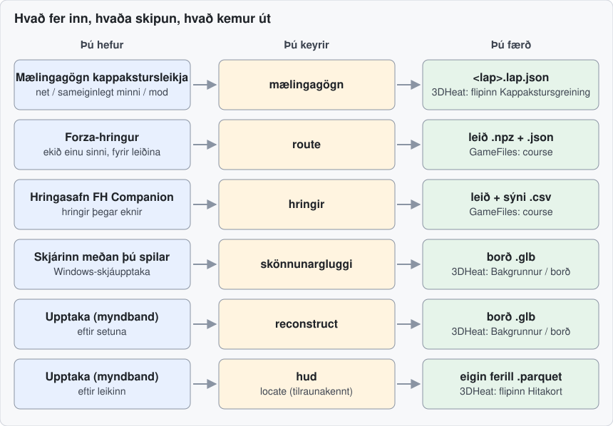

# 3DHeat GameCapture {#dheat-gamecapture}

**Hvað er þetta?** Verkfæri sem skrifar niður það sem kappakstursleikur segir því um aksturinn þinn, ein skrá
fyrir hvern hring. Það getur líka endurbyggt gróft 3D líkan af borði úr myndbandi af þér að spila.

**Hvers vegna ætti ég að nota það?** Til að sjá hringina þína í [3DHeat-skoðaranum](https://holdi601.github.io/3DHeat/):
hvar þú hemlaðir, hvar þú varst hægur, hvernig tveir hringir eru ólíkir. Og til að hafa borðið undir
hitakortinu þínu þegar enginn á 3D líkan af því.

**Dæmi:** kveiktu á Data Out í Forza, keyrðu eina skipun, aktu tvo hringi. Tvær hringskrár birtast í
`laps\`. Slepptu þeim á flipann Kappakstursgreining í skoðaranum.


Hefurðu aldrei notað skipanalínu? Lestu fyrst [Áður en þú byrjar](before-you-start.md).

## Verkefnin þrjú {#the-three-jobs}

1. **Hringmælingagögn.** Það skráir hverja rás sem kappakstursleikur birtir - Data Out í Forza, sameiginlegt
   minni (shared memory) Assetto Corsa leikjanna, netstrauma rallýleikjanna, BeamNG-mod, Trackmania-viðbót - og skrifar eina `heat3d-lap` skrá fyrir hvern hring eða áfanga, fyrir flipann Kappakstursgreining
   í skoðaranum. iRacing þarf engan skráningarhugbúnað: skoðarinn les eigin `.ibt` skrár.
2. **Borð úr leik.** Það breytir því sem skjárinn sýndi meðan þú gekkst eða ókst í gegnum
   borð í `.glb` 3D líkan, sem skoðarinn leggur undir hitakortið.
3. **Þinn eigin leikur, eftir á.** `hud` les HUD þinnar eigin upptöku - aðgerðir þínar, dauðsföll,
   smákortsferil og drápalista. `locate` (tilraunakennt: það staðsetur fáa raunverulega ramma enn sem komið er) finnur
   út hvar hver rammi var tekinn, á 3D líkani borðs.

Allt þrennt fylgir einni reglu: **engu er sprautað inn í leik og ekkert er krækt (hooked)**. Rammar koma
úr opinberu skjáupptöku-API, mælingagögn úr viðmótum sem leikirnir birta til þess. Sjá
[Reglurnar](rules.md).



Kóðinn er Python (pakki `heat3d_capture`), með MIT-leyfi. Dýpt- og stöðulíkönin sem það getur
keyrt hafa sín eigin leyfi - sjá [Líkön og leyfi](models-and-licences.md).

## Fljótleg byrjun {#quick-start}

### Skráðu hringi {#record-laps}

Þú þarft Python 3.10 eða nýrra ([Áður en þú byrjar](before-you-start.md)). Í PowerShell:

```powershell
git clone https://github.com/Holdi601/3DHeat-GameCapture
cd 3DHeat-GameCapture
python -m venv .venv
.venv\Scripts\python -m pip install -r requirements.txt

# Forza: Settings -> HUD and Gameplay -> Data Out = ON, IP 127.0.0.1, port 5300
.venv\Scripts\python -m heat3d_capture telemetry -o laps
```

**Þú ættir að sjá** `listening on port 5300. Laps go to laps. Ctrl+C to stop.`, síðan línu fyrir hvern hring um leið og þú ekur yfir línuna, eins og á
myndinni hér að ofan. Ýttu á Ctrl+C til að stöðva. Slepptu skránum úr `laps\` á flipann Kappakstursgreining í skoðaranum.
Sérhver annar leikur er eitt `--game` í burtu:

```powershell
.venv\Scripts\python -m heat3d_capture telemetry --game acc -o laps
.venv\Scripts\python -m heat3d_capture telemetry --game dirtrally2 -o laps
```

Sjá [Mælingaskráarar](telemetry.md) fyrir hvern leik og valkost.

### Skannaðu borð {#scan-a-level}

Tvísmelltu á **`scan.bat`** í möppu verkfærisins. Það finnur Python (og býðst til að setja það upp með
winget ef ekkert er til), býr til einkarekið `.venv` og opnar skönnunargluggann. Glugginn segir
hvað vantar, til hvers hver pakki er og hversu stórt niðurhalið er, og setur ekkert upp
án þess að þú svarir já. Sjá [Keyrsluumhverfi og ósjálfstæði](runtime.md) og
[Skönnunargluggann](reconstruction-scan-ui.md).

Í höndunum: `.venv\Scripts\python -m heat3d_capture.ui`.

Til að endurbyggja upptöku án nettengingar (offline), með ferli myndavélarinnar leystu í einu lagi (þarf PyTorch, `vggt` pakkann og skjákort - sjá [Endurbygging án nettengingar](reconstruction-offline.md)):

```powershell
.venv\Scripts\python -m heat3d_capture reconstruct lap.mp4 -o lap.glb
```

## Yfirlit yfir skjölin {#map-of-the-documentation}

| Síða | Hvað hún fjallar um |
|---|---|
| [Áður en þú byrjar](before-you-start.md) | Python, skipanalína, fyrsta skipunin, algengar villur |
| [Reglurnar](rules.md) | Engin innspýting, aðeins útgefin viðmót og hvað það kostar |
| [Mælingaskráarar](telemetry.md) | `telemetry` skipunin og yfirlit yfir alla leiki |
| [Forza](telemetry-forza.md) | Data Out, greining á skipulagi, FH Companion sendirinn og `.tele.gz` hans |
| [Assetto Corsa leikir](telemetry-assetto-corsa.md) | AC, ACC, AC EVO, AC Rally úr sameiginlegu minni |
| [Rallýleikir](telemetry-rally.md) | EA SPORTS WRC, DiRT Rally 2.0 / 1 / DiRT 4, Richard Burns Rally |
| [BeamNG.drive](telemetry-beamng.md) | `heat3d` samskiptareglu-modið |
| [Trackmania](telemetry-trackmania.md) | `Heat3dRecorder` Openplanet viðbótin |
| [iRacing](telemetry-iracing.md) | Lestur `.ibt` skráa í skoðaranum |
| [Skipting í hringi og áfanga](lap-splitting.md) | `LapSplitter`, `CounterSplitter`, `LineSplitter`, `StageSplitter` |
| [Slip, skrið og afleiddar rásir](slip-and-drift.md) | Hvernig slip er kvarðað og hvað skoðarinn leiðir af sér |
| [heat3d-lap skráin](lap-format.md) | Snið hringskrárinnar, rásir, einingar, `meta` |
| [Leikir](games.md) | Fyrir hvern leik: hvernig á að skrá, hvað er sent, hvaða brautir má flytja út |
| [Skipanir](commands.md) | `route`, `telemetry`, `laps`, `reconstruct`, `hud`, `locate`, skref fyrir skref |
| [Skipanayfirlit](../cli-reference.md) | hver valkostur, búið til úr `--help` |
| [Að lesa HUD úr upptöku](hud-video.md) | `hud`: eigin aðgerðir, dauðsföll, smákortsferill og drápalisti úr upptöku |
| [Að staðsetja ramma í borði](locate.md) | `locate`: hvar hver rammi var tekinn, miðað við rúmfræði borðsins |
| [Endurbygging borðs](reconstruction.md) | Ferlið frá römmum að `.glb` |
| [Skönnunarglugginn](reconstruction-scan-ui.md) | Allir stjórnhlutar, flýtilyklar og þættir yfirlagsins |
| [Upptaka, grímur og gæði ramma](reconstruction-capture.md) | Windows Graphics Capture, lykilrammar, HUD-grímur, ráð um gæði |
| [Dýpt](reconstruction-depth.md) | Depth Anything V2, ONNX Runtime, að smíða líkanið |
| [Staða og kvarði myndavélar](reconstruction-pose.md) | Odometry, endurstaðsetning, stöður úr mælingagögnum, kvarði jarðar, bundle adjustment |
| [Samruni, þekja og litur](reconstruction-fusion-and-texture.md) | Rúmmálsnetið (occupancy volume), þekjunetið, veikir blettir, hnútalitur |
| [.glb úttakið](glb-output.md) | Skráin sem skoðarinn hleður |
| [Endurbygging án nettengingar](reconstruction-offline.md) | `reconstruct`, VGGT gluggar og samsaumur |
| [Líkön og leyfi](models-and-licences.md) | Stærðir Depth Anything V2, VGGT, pakkarnir |
| [Keyrsluumhverfi og ósjálfstæði](runtime.md) | Forskoðun, bakendar, afkastaþrep |
| [Takmarkanir og sannprófun](limits.md) | Hvað er ekki gert og hvað hefur ekki verið kannað |
| [Uppfærslur](updates.md) | Útgáfuathugunin og `python -m heat3d_update` |
| [Þróun](development.md) | Prófanir, sýndarumhverfið, uppbygging geymslunnar |
| [Viðhald þessara skjala](maintaining.md) | Útgáfulistinn fyrir kóða og skjöl |

## Hluti af 3DHeat {#part-of-3dheat}

Skrárnar sem þetta skrifar eru hlaðnar af **3DHeat-skoðaranum** -
[frumkóði](https://github.com/Holdi601/3DHeat), [skjöl](https://holdi601.github.io/3DHeat/).
Hringskrár fara á flipann Kappakstursgreining, `.glb` borð á spjaldið Bakgrunnur / borð, og `hud` og `locate` töflurnar á
flipann Hitakort; hvernig skoðarinn les töflur og leikjaskrár er útskýrt í
[Ein skrá fyrir hvern leik (.3dheat)](https://holdi601.github.io/3DHeat/container.html) og
[Að koma gögnum inn](https://holdi601.github.io/3DHeat/getting-data-in.html).

| Verkfæri | Hvað það gerir | Skjöl |
|---|---|---|
| [3DHeat viewer](https://github.com/Holdi601/3DHeat) | sýnir hitakort, kappakstra og leiki í 3D, í vafranum | [skjöl](https://holdi601.github.io/3DHeat/) |
| [GameFiles](https://github.com/Holdi601/3DHeat-GameFiles) | brautir og borð úr skrám sem leikir fylgja með, sem 3D líkön | [skjöl](https://holdi601.github.io/3DHeat-GameFiles/) |
| [GameCapture](https://github.com/Holdi601/3DHeat-GameCapture) | hringmælingagögn úr kappakstursleikjum; borð endurbyggð úr leikjamyndbandi | [skjöl](https://holdi601.github.io/3DHeat-GameCapture/) |
| [Unreal Exporter](https://github.com/Holdi601/3DHeat-UnrealExporter) | viðbót fyrir Unreal Editor sem flytur borð út sem 3D líkan | [skjöl](https://holdi601.github.io/3DHeat-UnrealExporter/) |
| [CS2](https://github.com/Holdi601/3DHeat-CS2) | Counter-Strike 2 upptökur í leikjaskrár; kort í 3D líkön | [skjöl](https://holdi601.github.io/3DHeat-CS2/) |
| [Watcher](https://github.com/Holdi601/3DHeat-Watcher) | skráir spilun þína í bakgrunni úr því sem leikir birta | [skjöl](https://holdi601.github.io/3DHeat-Watcher/) |
| [Ext-WarThunder](https://github.com/Holdi601/3DHeat-Ext-WarThunder) | War Thunder upptökur í leikjaskrár | [skjöl](https://holdi601.github.io/3DHeat-Ext-WarThunder/) |
| [Ext-WoT](https://github.com/Holdi601/3DHeat-Ext-WoT) | World of Tanks upptökur í leikjaskrár | [skjöl](https://holdi601.github.io/3DHeat-Ext-WoT/) |
| [Ext-WoWs](https://github.com/Holdi601/3DHeat-Ext-WoWs) | World of Warships upptökur í leikjaskrár | [skjöl](https://holdi601.github.io/3DHeat-Ext-WoWs/) |
| [Ext-Squad](https://github.com/Holdi601/3DHeat-Ext-Squad) | Squad netþjónaupptökur í leikjaskrár | [skjöl](https://holdi601.github.io/3DHeat-Ext-Squad/) |
| [Ext-DCS](https://github.com/Holdi601/3DHeat-Ext-DCS) | DCS World kort í 3D líkön | [skjöl](https://holdi601.github.io/3DHeat-Ext-DCS/) |
| [Ext-IL2](https://github.com/Holdi601/3DHeat-Ext-IL2) | IL-2 Sturmovik kort í 3D líkön | [skjöl](https://holdi601.github.io/3DHeat-Ext-IL2/) |
| [Ext-Dota](https://github.com/Holdi601/3DHeat-Ext-Dota) | Dota 2 kortið úr þinni eigin uppsetningu sem 3D borð | [skjöl](https://holdi601.github.io/3DHeat-Ext-Dota/) |
| [Ext-DotaReplay](https://github.com/Holdi601/3DHeat-Ext-DotaReplay) | Dota 2 upptökur | [skjöl](https://holdi601.github.io/3DHeat-Ext-DotaReplay/) |
| [Ext-Riot](https://github.com/Holdi601/3DHeat-Ext-Riot) | League of Legends og VALORANT upptökur (það sem þær geyma ódulkóðað) | [skjöl](https://holdi601.github.io/3DHeat-Ext-Riot/) |
| [Ext-Forza](https://github.com/Holdi601/3DHeat-Ext-Forza) | Forza brautir, kappakstrar og bílar úr þinni eigin uppsetningu | [skjöl](https://holdi601.github.io/3DHeat-Ext-Forza/) |
| [Ext-Battlefield](https://github.com/Holdi601/3DHeat-Ext-Battlefield) | Battlefield borð (Frostbite) sem 3D borð | [skjöl](https://holdi601.github.io/3DHeat-Ext-Battlefield/) |
| [Ext-BeamNG](https://github.com/Holdi601/3DHeat-Ext-BeamNG) | BeamNG.drive brautir | [skjöl](https://holdi601.github.io/3DHeat-Ext-BeamNG/) |
| [Ext-ACRally](https://github.com/Holdi601/3DHeat-Ext-ACRally) | Assetto Corsa Rally áfangar sem brautir | [skjöl](https://holdi601.github.io/3DHeat-Ext-ACRally/) |
| [Ext-Reforger](https://github.com/Holdi601/3DHeat-Ext-Reforger) | Arma Reforger heimar (Enfusion) sem 3D borð | [skjöl](https://holdi601.github.io/3DHeat-Ext-Reforger/) |
| [Ext-R6](https://github.com/Holdi601/3DHeat-Ext-R6) | Rainbow Six Siege leikjaupptökur | [skjöl](https://holdi601.github.io/3DHeat-Ext-R6/) |

Forritari með verkefni leiksins opið ætti að nota Unreal-útflytjandann, sem les raunverulega
rúmfræði og er nákvæmur. Þar sem hægt er að lesa skjalasöfn leiksins sjálfs dregur GameFiles út
nákvæma braut. Endurbygging úr leik er fyrir tilvikið þar sem aðeins skjárinn er tiltækur.
