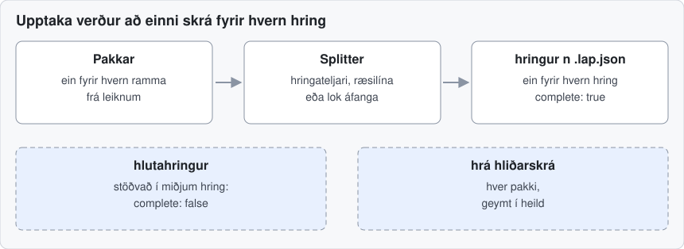

# Hvernig hringjum og leiðum er skipt {#how-laps-and-stages-are-split}

Upptökutæki sér einn samfelldan straum sýna. Að breyta honum í hringi gera fjórir
skiptarar, valdir eftir því hvað leikurinn segir um hringi. Þeir fylgja allir sömu hugmynd: nota
eigin talningu leiksins þar sem hún er til, annars finna hringinn út frá staðsetningum; aldrei
skrifa brot sem er of stutt til að bera saman.

| Skiptari | Kóði | Notaður af |
|---|---|---|
| `LapSplitter` | [`fulllap.py`](https://github.com/Holdi601/3DHeat-GameCapture/blob/main/heat3d_capture/telemetry/fulllap.py) | Forza |
| `CounterSplitter` | [`kunos.py`](https://github.com/Holdi601/3DHeat-GameCapture/blob/main/heat3d_capture/telemetry/kunos.py) | Assetto Corsa, ACC |
| `LineSplitter` | [`kunos.py`](https://github.com/Holdi601/3DHeat-GameCapture/blob/main/heat3d_capture/telemetry/kunos.py) | AC EVO, AC Rally, BeamNG |
| `StageSplitter` | [`rally.py`](https://github.com/Holdi601/3DHeat-GameCapture/blob/main/heat3d_capture/telemetry/rally.py) | EA SPORTS WRC, DiRT Rally 2.0, DiRT Rally, DiRT 4, Richard Burns Rally |

Trackmania skiptir ferðum innan viðbótarinnar sinnar ([Trackmania](telemetry-trackmania.md)), og iRacing
skrám skiptir áhorfandinn eftir hringateljara hermisins ([iRacing](telemetry-iracing.md)).

Við **Ctrl+C** kallar hvert upptökutæki á `flush()` skiptarans síns, svo opinn hringur eða leið er
skrifuð ef hún nær sömu lágmörkum og hér að neðan.

## LapSplitter (Forza) {#lapsplitter-forza}

Færibreytur: `minimum_metres = 400`, `gap_seconds = 2.0`.

Fyrir hvern afkóðaðan pakka:

1. Ef `timestampMs` leiksins stökk fram um meira en 2 sekúndur frá síðasta pakka,
   eða fór afturábak, er opni hringurinn fyrst vistaður (flush).
2. Ef `isRaceOn` er 0 (leikurinn er ekki í keppni) er opni hringurinn vistaður og pakkanum
   hent.
3. Ef enginn hringur er opinn opnast einn með `lapNumber` pakkans.
4. Ef `lapNumber` er annað en opna hringsins er opni hringurinn **lokaður sem kláraður**; `seconds`
   hans er `lastLap` leiksins þegar það er jákvætt. Hringur lokaður á þennan hátt er skrifaður
   hversu langur sem hann er. Nýr hringur opnast.
5. Pakkanum er bætt við.

Upptökutækið vistar líka þegar enginn pakki hefur borist í 2 sekúndur af veggklukku (leikurinn
settur á bið, eða lokað í miðjum hring).

**Vistun (flush)** heldur opna hringnum aðeins ef hann hefur að minnsta kosti 2 sýni og að minnsta kosti 400 m af
`distanceTravelled`; hann er skrifaður sem ókláraður (`run`). Keppni frá punkti til punkts telur aldrei
annan hring, svo hún endar alltaf þannig.

## CounterSplitter (AC, ACC) {#countersplitter-ac-acc}

Færibreyta: `minimum_metres = 300`. Fær hvert sýni með `completedLaps` grafíkblaðsins
og síðasta hringtíma.

- Fyrsta sýnið opnar hring númeraðan með núverandi `completedLaps`.
- Þegar `completedLaps` breytist lokast opni hringurinn. Hann er **kláraður**, með
  `seconds = last lap ms / 1000` (ef jákvætt), aðeins ef teljarinn hækkaði um nákvæmlega 1 - stökk
  aftur í 0 (lota endurræst) eða um fleiri en einn lokar honum sem ókláruðum.
- Lokaður hringur er skrifaður aðeins ef hann hefur sýni og að minnsta kosti 300 m af eknum ferli.
- Vistun heldur opna hringnum ef hann hefur fleiri en eitt sýni og að minnsta kosti 300 m.

## LineSplitter (AC EVO, AC Rally, BeamNG) {#linesplitter-ac-evo-ac-rally-beamng}

Færibreytur: `radius = 15 m`, `minimum_metres = 300`, `stop_seconds = 8`.

Þessir leikir hafa annaðhvort engan hringateljara á blaði sem upptökutækið les, eða keyra leiðir.
**Línan er þar sem upptakan hófst**:

1. Láréttri staðsetningu fyrsta sýnis (`x`, `z`) verður línan.
2. Þegar bíllinn hefur ferðast meira en 5 m verður stefnan frá línunni að bílnum
   stefna hringsins.
3. **Að stoppa** lýkur ferð: þegar `speed` er undir 1 m/s í 8 sekúndur er opni hringurinn
   vistaður (þannig lýkur rallíleið: bíllinn stöðvast í marki).
4. **Að fara yfir línuna**: eftir meira en 300 m ferðalag eru sýni innan 15 m frá línunni
   safnað. Þegar bíllinn yfirgefur þann radíus aftur er næsta safnaða sýnið
   yfirferðin. Ef bíllinn stefndi í sömu átt og stefna hringsins þar (innfeldi
   staðbundinnar stefnu og stefnunnar er jákvætt) lokast hringurinn
   við það sýni; annars er yfirferðin hunsuð (bíllinn fór yfir ráslínuna í gagnstæða átt).
5. `seconds` lokaðs hrings er tíminn frá fyrsta sýni hans að yfirferðinni. Hann er
   **kláraður aðeins ef fyrsta sýni hans var hraðara en 5 m/s**: hringur sem hófst úr
   kyrrstöðu er ræsing, ekki hringur til samanburðar. Fyrsti hringur upptöku sem hófst á
   rásmarki er því alltaf ókláraður; upptaka sem hófst á fljúgandi hring gefur kláraðan
   fyrsta hring við næstu yfirferð.
6. Næsti hringur byrjar á yfirferðarsýninu (það tilheyrir báðum hringjum).

Hringir styttri en 300 m eru felldir niður. Vistun (stopp, eða Ctrl+C) heldur opna hringnum ef hann hefur
að minnsta kosti 2 sýni og 300 m, sem ókláruðum. BeamNG vistar eins þegar ökutækið er
endurstillt (klukkan fer afturábak), áður en nýr skiptari er ræstur, svo ferðin sem ekin var fyrir endurstillingu
er varðveitt.

Vegalengdir eru láréttar (`x`, `z`) fyrir ferðateljarann og línuprófið, og fullar
3D fyrir 300 m lengdarprófið.

## StageSplitter (ralllíleikir) {#stagesplitter-rally-games}

Færibreyta: `minimum_metres = 300`. Fær hvert sýni með leiðarklukku leiksins, hvort
leikurinn segir að bíllinn sé kominn í mark, og valfrjálst eigin tíma leiksins fyrir það.

1. Ef klukkan er 0 eða minni, eða hefur farið afturábak um meira en 0,5 s, er opna leiðin
   **yfirgefin**: geymd sem hlutaleið ef hún er ekki kláruð, hefur fleiri en 10 sýni og
   að minnsta kosti 300 m. Klukka sem er 0 eða minni fellir líka sýnið niður (bíllinn er á rásmarki).
2. Ef engin leið er opin opnast ný (númeruð 1, 2, ... fyrir upptökuna).
3. Þegar leið er kláruð eru frekari sýni hunsuð þar til klukkan fer afturábak.
4. Hvert sýni er geymt með `time` stillt á leiðarklukkuna.
5. Þegar leikurinn segir að bíllinn sé kominn í mark er leiðin kláruð; `seconds` hennar er tími leiksins þegar
   hann er gefinn og jákvæður, annars klukkan. Hún er skrifuð ef hún náði yfir að minnsta kosti 300 m.

Hvað „kominn í mark“ þýðir í hverjum leik:

| Leikur | Kominn í mark þegar |
|---|---|
| EA SPORTS WRC | lengd leiðar > 0 og vegalengd leiðar >= lengd - 0,5 m |
| DiRT leikir | kláraðir hringir fóru yfir upphafstölu leiðarinnar, eða (viðburður með einum hring) hringvegalengd >= 99,9% af lengd brautar |
| Richard Burns Rally | keppnisklukka > 0 og vegalengd að marki <= 0 |

Í RBR eru upp-ásinn og hraðinn festir þegar leið er skrifuð (sjá
[Ralllíleikir](telemetry-rally.md#richard-burns-rally-rsf--ngp)).

## Tími og vegalengd í hringskránni {#time-and-distance-in-the-lap-file}

Fyrir öll upptökutæki nema Forza er `time` endurreiknað svo fyrsta sýni hringsins sé 0 og
`distance` er samanlögð 3D vegalengd milli samliggjandi staðsetninga. Forza notar
eigin hringtímamæli og vegalengdarteljara leiksins, endurreikna á sama hátt.
