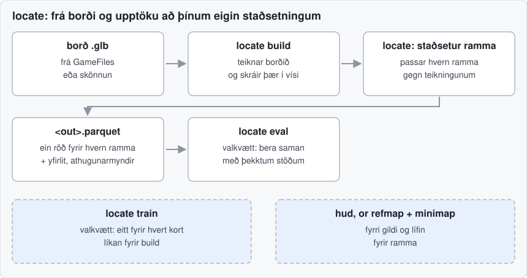

# Að staðsetja ramma í borði {#locating-frames-in-a-level}

`locate` finnur út hvar hver rammi leikjaupptöku var tekinn - 3D staðsetningu myndavélarinnar
og sjónstefnu - með því að para myndina við myndir af eigin rúmfræði borðsins. Það er
fyrir leiki sem halda enga skrá um hvar leikmaðurinn var: engin demo skrá, engin endurspilunarskrá, engin mælingagögn.
Battlefield 6 er sá fyrsti.

> **Tilraunakennt.** Á raunverulegum upptökum staðsetur það enn aðeins lítinn hluta ramma; sjá
> [Raunverulegir rammar: tilraunakennt](#real-frames-experimental).

```bash
# Once per level: render it from every place a player can stand, and index the renders.
.venv\Scripts\python -m heat3d_capture locate build level.glb -o level.db

# Per recording: where was each frame taken?
.venv\Scripts\python -m heat3d_capture locate frames "<recording>.mp4" --db level.db -o out/match
```

Staðan kemur **úr myndinni**, gegn öllu borðinu, án nokkurrar forvitneskju. Smákortsslóðin
úr [HUD lesaranum](hud-video.md) er aðeins varaleið fyrir ramma sem myndin getur ekki staðsett, og hver
röð segir frá hvoru þessara tveggja hún kom.




## Hverju það snertir og snertir ekki {#what-it-does-and-does-not-touch}

- Það les **eigin upptöku** leikmannsins og borðskrá sem leikmaðurinn flutti út úr **eigin
  eintaki** af leiknum. Það snertir aldrei leikinn, minni hans, skrár hans meðan það keyrir, né
  net hans, og það keyrir eftir leikinn. Sjá [Reglurnar](rules.md).
- Það staðsetur **aðeins eigin myndavél leikmannsins**: ramminn er eigin sýn leikmannsins.
- Borðið, gagnagrunnurinn sem er byggður úr því og allt sem er teiknað úr því tilheyrir útgefanda
  leiksins. Hafðu það á staðnum.

## Kröfur {#requirements}

- Það sem `requirements.txt` telur upp, PyTorch (frá pytorch.org, fyrir skjákortið), og
  `requirements-locate.txt`:

```bash
.venv\Scripts\python -m pip install -r requirements-locate.txt
```

- Skjákort með OpenGL 3.3 (4.3 er hraðara) fyrir myndirnar, og helst CUDA fyrir líkönin. Á
  örgjörva virkar það, hægt.
- Líkönin eru sótt við fyrstu notkun (um 450 MB): DINOv2 frá Hugging Face, ALIKED og
  LightGlue í gegnum kornia. Öll eru með leyfi fyrir viðskiptanotkun; sjá [Leyfi](#licences).
- **Borðið** sem `.glb` (eða `.gltf`) í ramma skoðarans, Y upp, **með grunnlitaáferðum
  sínum**, eins og 3DHeat útflytjendurnir skrifa það (`ground:` / `structure:` hlutar; heiti hlutanna eru
  ekki nauðsynleg). Ein eining er einn metri nema `extras.unit_metres` efst í skránni segi annað.
  GameCapture skönnun (`reconstruct`, skönnunarglugginn) er skrifuð í **sentimetrum** og
  ber `extras.unit_metres: 0.01`, svo hún er lesin í sinni réttu stærð. Borð án áferðar virkar
  miklu verr; sjá [Takmarkanir](#limits).

## Skipanir {#commands}

### `locate build <level> -o <db>` {#locate-build-level-o-db}

Teiknar borðið frá hverjum stað þar sem leikmaður gæti staðið og geymir, fyrir hverja mynd, stöðu hennar og einn
altækan lýsanda (descriptor).

| Valkostur | Sjálfgefið | Merking |
|---|---|---|
| `level` | | `.glb` / `.gltf` borðsins. |
| `-o`, `--out` | | Gagnagrunnsmappan sem á að skrifa. |
| `--game` | `bf6` | Leikjasniðið: augnhæðir, sjónsvið, HUD kassar, hraði (hér á eftir). `generic` fyrir hvaða fyrstupersónuleik sem er. |
| `--eye` | sniðsins | Augnhæðir yfir gólfi í metrum, standandi fyrst. Ein gagnagrunnssýn fyrir hverja hæð. |
| `--fov` / `--vfov` | sniðsins | Lárétt sjónsvið upptökunnar, eða það lóðrétta (sleði Battlefield) fyrir 16:9 upptöku. |
| `--spacing` | 2.5 | Metrar milli staðanna sem sýnir eru teknar frá. |
| `--yaw-step` | 30 | Gráður milli stefna sýnanna. |
| `--pitch` | 0 | Hallar sem teiknað er á, gráður upp. |
| `--positions` | enginn | Tafla (Parquet eða CSV með `x`, `y`, `z` við fæturna, í ramma borðsins) til að taka staði úr í stað allra gólfa: úttak fyrri keyrslu, til dæmis. |
| `--shadows` | slökkt | Kasta skuggum sólarinnar í myndunum (eigin sól borðsins þegar skráin nefnir hana í `extras.sun`). |
| `--untextured` | slökkt | Teikna aðeins lögun og ljós. |
| `--box X0 Z0 X1 Z1` | öll skráin | Aðeins staðir innan þessa kassa (einingar borðsins): leiksvæðið. |
| `--places` | `auto` | Hvaðan sýnir eru teknar: `nav` - leikmenn í augnhæð yfir leiðsögunetinu (navigation mesh) (`nav:` hlutar: nákvæmlega þar sem leikurinn leyfir þeim að ganga), myndavélar farartækja í hæð sinni yfir `ground:` hlutunum (landslag og vegir) innan 50 m frá því; `ground` - hvort tveggja yfir `ground:`; `floors` - yfir hverja upp-snúandi flöt (þök og kassa líka); `auto` - `nav` þegar borðið hefur leiðsögunet, annars `floors`. |
| `--head` | enginn | Haus fyrir hvert kort frá `locate train` fyrir lýsendurna. |

Skrifar `<db>/db.json` (úr hverju og með hverju það var byggt) og `<db>/views.npz` (stöður, lýsendur).

### `locate frames <recording> --db <db>` {#locate-frames-recording-db-db}

| Valkostur | Sjálfgefið | Merking |
|---|---|---|
| `source` | | Myndband, mynd, eða mappa með myndum (teknar í nafnaröð, `--fps` á milli). |
| `--db` | | Gagnagrunnurinn sem `build` skrifaði. Borðskrá hans verður enn að vera þar sem hún var (eða `--level`). |
| `-o`, `--out` | `<source>.locate` | Slóð úttaksins án endingar. |
| `--fps` | 2 | Rammar staðsettir á hverja sekúndu myndbands. |
| `--start`, `--seconds` | allt | Sá hluti myndbandsins sem á að lesa. |
| `--width` | 1280 | Breiddin sem rammar eru paraðir í. |
| `--shortlist` | 8 | Gagnagrunnssýnir prófaðar á hvern ramma nálægt forvitneskju eða staðsetningu. |
| `--search-shortlist` | 16 | Án forvitneskju: gagnagrunnssýnir prófaðar á hvern ramma ([leitað saman](#with-no-prior-frames-searched-together)). |
| `--no-search` | slökkt | Án forvitneskju: leita að hverjum ramma fyrir sig og trúa staðsetningu hans án nágranna hans. |
| `--accept-depth` | 0 (slökkt) | Án forvitneskju: trúa staðsetningu aðeins ef fjarlægð fjarlægustu para hennar er svona oft sú nálægasta. |
| `--accept-support` | 2 | Án forvitneskju: samþykkir nágrannar eftir lífinu sem staðsetning þarf til að vera trúað. |
| `--checkpoint` | enginn | Geyma stöðu keyrslunnar hér og halda áfram frá henni ef hún er til staðar. |
| `--stop-file`, `--stop-process` | enginn | Stöðvast sjálft, staða vistuð, skilakóði 75, þegar þessi skrá er til eða ferli keyrir sem heiti byrjar á þessu (athugað fyrir hvern ramma; má endurtaka), svo löng keyrsla losi vélina fyrir leik. Sama skipun heldur áfram. |
| `--normalise` | enginn | Létt stöðlun fyrir pörun: `clahe`, `gray`. |
| `--minimap` | enginn | Tafla `hud` skipunarinnar: **varaleiðin** fyrir ramma sem myndin getur ekki staðsett. |
| `--prior-radius` | enginn | **Valfrjáls hröðun**, slökkt sjálfgefið: leita aðeins í gagnagrunnssýnum svona marga metra frá stöðu smákortsins (þarf `--minimap`). |
| `--minimap-anchor` | enginn | JSON skrá sem tengir smákortið við borðið ([smákortið sem leitarforvitneskja](#the-minimap-as-a-search-prior)): smákortið þrengir leitina frá fyrsta ramma; staðsetningar fundnar þannig eru `visual+minimap-prior`. |
| `--no-level-search` | slökkt | Með forvitneskju: þegar ekkert nálægt henni passar, ekki leita líka í öllu borðinu (hraðara). |
| `--lives` | `--minimap` taflan | Tafla `hud` skipunarinnar þar sem dauðsföll, útsetningar og endurlífganir segja hvenær leikmaðurinn var í leik: staða stekkur aðeins yfir dauða ([líf úr myndefninu](#lives-from-the-footage)). |
| `--no-sequence` | slökkt | Ákveða hvern ramma fyrir sig, ekki eftir keyrslunni (hér á eftir). |
| `--fit-fov` | slökkt | Eftir keyrsluna, máta sjónsviðið við sterkustu staðsetningarnar, fyrir hverja sýn, og tilkynna það. |
| `--check-every` | 0 | Líka á hverja N ramma, staðsetta eða ekki, mynd í `<out>.check`. |
| `--no-checks` | slökkt | Ekki skrifa athugunarmyndir sjónrænna staðsetninga (hér á eftir). |
| `--no-zoomed` | slökkt | Ekki leysa aðdregnar sýnir út frá staðsetningum nágranna þeirra (hér á eftir). |
| `--no-grow` | slökkt | Ekki leita aftur nálægt hverri staðsetningu að römmunum í kring sem enn hafa enga. |
| `--game`, `--eye`, `--fov`, `--vfov`, `--mask`, `--no-hud-mask`, `--max-speed` | sniðsins | Eins og að ofan; `--mask x,y,w,h` bætir við skjákassa (á 1920x1080 skjá) sem er ekki borðið. |
| `--vehicle-vfov` | sniðsins | Lóðrétt sjónsvið myndavéla farartækja (farartækjasleði Battlefield). |
| `--settings` | nýjasta stillingaskráin | `bf6`: stillingaskrá leiksins sem sjónsviðin eru lesin úr (aðeins lesin) þegar ekkert `--fov`/`--vfov` er gefið; sjálfgefið nýjasta `PROFSAVE*_profile` undir `Documents/Battlefield 6/settings`. Hún geymir stillingarnar eins og þær eru núna, sem er kannski ekki hvernig eldri upptaka var gerð. |

### `locate refmap <level> <deploy screen> -o <refmap>` {#locate-refmap-level-deploy-screen-o-refmap}

Setur eigið kort leiksins á borðið: viðmiðið sem smákortið er lesið gegn
([smákortið, lesið gegn borðinu](#the-minimap-read-against-the-level)). `<deploy screen>` er
mynd af útsetningarskjánum sem sýnir allt kortið, eða upptaka með `--at <seconds>` á slíkri
stundu; kortakassi sniðsins er skorinn út úr henni (`--whole-picture` heldur allri myndinni). Skrifar
`<refmap>.png` (kortið endursýnatekið á eigin ramma borðsins, `--mpp` metrar á punkt, sjálfgefið 0,5),
`<refmap>.valid.png` (hvar það er kortið, ekki merki eða merkimiði) og `<refmap>.json` (ramminn og
kvörðunin, með því hve langt flísar kortsins voru frá henni). `--topdown <prefix>` geymir borðið
teiknað að ofan fyrir næstu keyrslu (`--topdown-mpp`, sjálfgefið 0,656 m; `--box` takmarkar það).

### `locate minimap <recording> --refmap <refmap> -o <table>.parquet` {#locate-minimap-recording-refmap-refmap-o-table-parquet}

Les smákort upptökunnar gegn viðmiðskortinu, ramma fyrir ramma (`--fps`, sjálfgefið 2):
stöðu, stefnu og aðdrátt hvers smákorts sem passar, í ramma borðsins, skrifað sem
smákortstafla með festipunkti við hlið sér (`<table>.anchor.json`) sem `locate frames` tekur sem
`--minimap <table>.parquet --minimap-anchor <table>.anchor.json`. Með töflu `hud` skipunarinnar
(`--hud`) eru líf hennar flutt yfir; með festipunkti fyrir þá töflu líka (`--hud-anchor`) er fyrsta
leitin í kringum þar sem hann setur leikmanninn, og þar sem ekkert smákort passar fyllir eigin slóð HUD
upp í, flutt á næstu staðsetningar viðmiðskortsins (`--hud-fill`, sekúndur, sjálfgefið 120; 0 slekkur á því).
`source` töflunnar segir hvort (`refmap`, `hud`).

### `locate eval <out>.parquet --truth <poses>` {#locate-eval-out-parquet-truth-poses}

Ber niðurstöðu saman við þekktar stöður myndavélar: tafla með `time`, `x`, `y`, `z` (augað), `yaw`,
`pitch` í ramma borðsins. `--offset` er klukkufrávikið (sannur tími = tími myndbands + frávik);
án þess er frávikið leitað uppi. `--unit-metres` breytir skekkjunum í metra.

## Leikjasnið {#game-profiles}

| | `bf6` | `generic` |
|---|---|---|
| Augnhæðir | 1,6 m standandi, 1,05 m í hnipri (enn ekki mælt í leiknum) | 1,65, 1,1 m |
| Sjónsvið | 55 gráður lóðrétt, um 86 lárétt í 16:9: **gefðu upp þitt eigið** með `--vfov` | 90 lárétt |
| HUD grímað | smákort og hópalisti, drápslisti, áttaviti, skotfæri, vopn leikmannsins, gluggar, hárkrossinn | hárkrossinn |
| Hraðast fótgangandi | 8 m/s | 8 m/s |
| Sýnir greindar í sundur | fótgangandi, farartæki, aðdregið (hér á eftir) | hver rammi fótgangandi |
| Myndavélar farartækja | farartækjasleðinn (úr stillingaskránni), farartækið grímað, myndavélin allt að 8 m yfir gólfi, 30 m/s | - |

Sjónsviðið skiptir mestu máli: rammi leystur með röngu er leystur með rangri brennivídd, og staða hans
rennur eftir sjónlínunni.

## Úttök {#outputs}

### `<out>.parquet` {#out-parquet}

Ein röð fyrir hvern staðsettan ramma, í **ramma borðsins** (Y upp, einingar borðsins), með
leiðbeiningum skoðarans um lestur í fætinum (`kind: heat3d-locate`). Fóturinn nefnir hvern dálk sem hefur
ekkert eigið hlutverk sem aukadálk, svo skoðarinn geymir þá alla (skoðunarspjald hans sýnir þá).

| Dálkur | Merking |
|---|---|
| `time` | Sekúndur frá upphafi myndbandsins. |
| `event` | `start` á fyrstu röð lífs, `position` á hinum. |
| `x`, `y`, `z` | Augað, slétt innan lífsins. Tómt þar sem hvorug uppspretta staðsetti rammann. |
| `yaw`, `pitch` | Gráður: yaw um upp-ásinn (0 eftir +X, vex í átt að -Z, sem er eigið yaw leiks í ramma skoðarans), pitch upp frá láréttu. `pitch` er tómt fyrir smákortsraðir. |
| `dir_x`, `dir_y`, `dir_z` | Sjónstefnan. |
| `player`, `team`, `session` | `me`, `own`, og `<video>#NN`, ein fyrir hvert líf. |
| `life` | Lífið sem myndefnið sýndi rammann í (úr dauðsföllum HUD; 1 = fyrsta). Tómt þegar úr leik (dauður, niðri, að útsetja) eða þegar lífin voru ekki lesin. `session` er líf slóðarinnar, sem getur líka skipst við stökk. |
| `source` | `visual` (úr myndinni), `visual+minimap-prior` (úr myndinni, leitin þrengd að smákortsforvitneskjunni), `minimap` (varaleiðin), `minimap+nav-floor` (innandyra: smákortið og gólf leiðsögunetsins) eða `none`. |
| `view` | `foot`, `vehicle`, `zoomed` eða `screen` (hér á eftir). |
| `cam_x`, `cam_y`, `cam_z` | Myndavélin sem sá rammann. Fótgangandi og í gegnum sjónauka er það augað, og `x`, `y`, `z` eru þau sömu; í þriðju persónu sýn farartækis eru `x`, `y`, `z` farartækið (frávikslíkanið hér á eftir) og myndavélin ríður fyrir aftan það og ofan. |
| `hfov`, `zoom` | Lárétta sjónsviðið sem rammi var leystur með, og fyrir aðdregna sýn aðdráttur hennar miðað við venjulega sýn. |
| `confidence` | 0..1: hve langt á að treysta röðinni (hér á eftir). |
| `uncertainty` | Dæmigerð skekkja raðarinnar, einingar borðsins: fyrir sjónræna staðsetningu út frá innliggjandi punktum og nágrönnum, fyrir smákortsröð út frá mátun (hér á eftir). |
| `inliers`, `rmse` | PnP innliggjandi punktar sjónrænu lausnarinnar og vörpunarskekkja (punktar í vinnslubreidd). |
| `x_raw` ... `pitch_raw` | Sjónræna lausnin fyrir sléttun (líka fyrir útlaga sem voru kosnir út). |
| `kept` | Sjónræna staðsetningin lifði af útlagakosninguna. |
| `note` | Hvers vegna rammi var ekki staðsettur, eða var kosinn út. |

### `<out>.summary.json` {#out-summary-json}

Rammar, sjónrænar staðsetningar, útlagar, líf, raðir eftir uppsprettu, smákortsmátun (pör, innliggjandi punktar, leif),
tími á ramma.

## Aðferð {#method}

### Gagnagrunnurinn {#the-database}

Staðir eru punktar á hverjum upp-snúandi þríhyrningi borðsins, dreift jafnt (einn á hvert `--spacing`
á þrívíddarneti, svo hver hæð byggingar fær sinn eigin). Hver er athugaður frá auga sínu með sex
litlum dýptarmyndum: myndavél inni í rúmfræði sér aðallega bakhliðar, skriðrými hefur eitthvað
fast yfir auganu; hvort tveggja er fellt niður. Frá hverjum stað er borðið teiknað í hverri augnhæð,
hverri `--yaw-step` og hverjum `--pitch`, og hver mynd er lýst af **DINOv2** (bútamerki hennar
sameinuð með almennu meðaltali, tengd við flokksmerkið).

Staðbundnu eiginleikarnir og 3D punktarnir sem rammi er að lokum leystur gegn eru **ekki geymdir**: þeir eru
búnir til aftur þegar þeirra er þörf með því að teikna sýnirnar fáu sem sóknin valdi, sem tekur millisekúndur. Það
heldur gagnagrunni í nokkur hundruð megabætum frekar en tugum gígabæta, og það leyfir
fínstillinguna hér á eftir. Verðið er að `frames` þarf borðskrána og skjákort, ekki aðeins gagnagrunninn.

### Einn rammi {#one-frame}

1. **Gríma** það sem er ekki borðið: HUD kassa sniðsins og hárkrossinn, auk allra `--mask`.
2. **Sókn** yfir **allt borðið**: lýsandi rammans gegn hverri gagnagrunnssýn; þær
   líkustu, nokkrir tugir, þynntar svo þær haldi mismunandi stöðum og stefnum, eru stuttlistinn.
3. **Pörun**: hver sýn á stuttlistanum er teiknuð aftur í stærð og sjónsviði rammans, með
   dýpt sinni. ALIKED lykilpunktar rammans og myndarinnar eru paraðir með LightGlue. Paraður
   punktur myndar auk dýptar hans er 3D punktur borðsins, svo hver pörun er 2D-3D samsvörun;
   lykilpunktar á dýptarbrún (þar sem dýptin gæti tilheyrt því sem er fyrir aftan) eru felldir niður.
4. **Staða**: PnP með RANSAC (SQPnP), síðan öflug fínstilling sem heldur myndavélinni láréttri - fyrstupersónusýn
   veltur ekki - og lágmarkar vörpunarskekkju innliggjandi punkta.
5. **Er það mögulegt?** Staða verður að vera í augnhæð leikmanns yfir gólfi og utan rúmfræði
   (dýptarmynd beint niður). Áferð sem líkist annarri annars staðar - flísalagt gólf parað við vegg
   úr sama efni - getur gefið hundruð innliggjandi punkta í stöðu sem enginn leikmaður gæti haft; þær eru lagðar
   til hliðar, hversu marga innliggjandi punkta sem þær hafa.
6. **Teikna og bera saman**: borðið er teiknað í leystri stöðu og parað aftur, sem
   kemur í stað gagnagrunnssýnar allt að nokkra metra og tugi gráða í burtu með einni sem nær því
   fellur að rammanum. Endurtekið meðan innliggjandi punktum fjölgar (í mesta lagi tvisvar).
7. **Val**: þrír sterkustu staðirnir (meira en um 3 m hver frá öðrum) eru hver fínstilltir áður en einn
   er valinn. Eftirlíking getur leitt fyrir fínstillingu; réttur staður græðir miklu meira á henni.
8. **Úrskurður**: `confidence` sameinar fjölda innliggjandi punkta, besta annan stað (`runner_up`) og
   vörpunarskekkjuna. Staðsetning er `ok` með að minnsta kosti 25 innliggjandi punkta, engan annan stað innan 80% af
   innliggjandi punktum hennar, og öryggi (confidence) að minnsta kosti 0,85 - þröskuldurinn sem mælingarnar hér á eftir setja við 97,5-99%
   rétt.

### Sýnir {#views}

Rammi er ekki alltaf augu leikmannsins. Greinir sniðsins les úr HUD hvaða sýn það er,
og ramminn er leystur samkvæmt því:

- **Fótgangandi**: sjónsvið og augnhæðir fótgönguliðs.
- **Farartæki** (Battlefield 6: lyklaábendingar sætismyndarinnar, `C CAMERA` og `E EXIT`, neðst
  í miðjunni): sjónsvið farartækja, farartækið sjálft grímað (neðri miðja skjásins í
  þriðju persónu sýn þess), og myndavél leyfð allt að 8 m yfir gólfi. Staðsetningin er myndavélarinnar.
- **Skjár** (dökkar brúnir í kringum dökka miðju: útsetningarkortið, valmynd, stigataflan): ekki sýn
  af borðinu; sleppt.
- **Aðdregið** (sjónauki, sjónauki skyttu, eigin fyrstupersónusýn farartækis: ein skjábrún svört,
  báðar dökkar, í kringum bjarta mynd): ekki leitað að yfir borðinu - ræma sjónauka af
  borðinu líkist engri af víðu sýnum gagnagrunnsins - en leyst eftir keyrsluna út frá næstu staðsetningu
  innan 6 s, hér á eftir. Slökkt með `--no-zoomed`.

### Aðdregnar sýnir {#zoomed-views}

Þröng sýn festir stöðu sína illa: skref aftur á bak með örlítið meiri aðdrátt lítur næstum eins út.
Svo aðdreginn rammi byrjar þar sem nágranni hans segir sjónaukann vera - fótgangandi auga þeirrar staðsetningar, í
farartæki 2,5 m yfir jörðinni undir miðju farartækisins (sjónauki virkisturns) - og hve langt hann getur
hafa færst síðan: 2 m, auk 4 m á sekúndu fótgangandi eða 8 í farartæki, í mesta lagi 12 m (`reach`).

1. **Stefna og aðdráttur, staðan haldin.** Fyrir hvern aðdrátt af 1, 1,2 (eigin sýn farartækis,
   þrengri en fótgangandi), 1,5, 2, 3, 4, 6 og 8 er borðið teiknað í sætinu í stefnum
   innan 30 gráða frá stefnu nágrannans (og, frá 3x, nokkrum hallahornum). Lykilpunktar rammans paraðir
   við mynd, með borðpunktunum undir þeim, eru geislar frá sætinu; snúningur er mátaður við
   þá tvo í einu (RANSAC) fyrir brennivíddir frá 0,75 til 1,3 sinnum brennivídd þess aðdráttar, punktur
   sem er sammála innan horns sem gerir ráð fyrir að sætið sé `reach` frá í fjarlægð sinni. Aðdrátturinn,
   stefnan og brennivíddin sem flestir punktar eru sammála vinna.
2. **Fest.** Þessir punktar máta þá stöðu, stefnu og brennivídd saman, eftir
   vörpunarskekkju sinni, staðan haldin við sætið með kostnaði upp á tvo punkta á hvern `reach` fluttan;
   teiknað einu sinni enn í svarinu og mátað aftur. Innliggjandi punktar og skekkja eru talin í punktum, og
   staðsetningin er `ok` með sama öryggi og hver önnur.

Aðdrátturinn sem er skrifaður (`zoom`) er miðað við sjónsvið keyrslunnar fótgangandi; `hfov` er það leysta. Í
farartæki er staðan sem er skrifuð farartækisins, 2,5 m neðan við sjónaukann, eins og fyrir þriðju persónu
sýn þess.

### Farartæki: myndavélin og farartækið {#vehicles-the-camera-and-the-vehicle}

Í þriðju persónu sýn farartækis er leysta staðan staða eltimyndavélarinnar, sem ríður fyrir aftan og
ofan farartækið og sveiflast í kringum það þegar leikmaðurinn lítur í kring. Staðan sem er skrifuð (`x`, `y`,
`z`) er farartækisins - jörðin undir miðju þess: staða myndavélarinnar auk `vehicle_offset`
sniðsins, svo og svo marga metra fram eftir láréttri sjónstefnu myndavélarinnar og svo og svo marga
niður. Myndavélin helst í `cam_x`, `cam_y`, `cam_z`. Umbreytingin er gerð á undan röðinni og
slóðinni, svo myndavél sem sveiflast í kringum kyrrstætt farartæki er ekki tekin fyrir hreyfingu. Fótur töflunnar
ber frávikið sem var notað og hvort það var mælt (`vehicleOffset`). Fótgangandi og í gegnum
sjónauka er ekkert frávik.

Hvernig frávik Battlefield 6 var mælt: á réttum staðsetningum raunverulegra þriðju persónu ramma af skriðdreka
var miðja skriðdrekans merkt með auga á rammanum, og borðið teiknað í staðsetningunni gaf
jörðina á þeim punkti. Sniðið tekur miðgildið: um 10 m fram fyrir myndavélina og um 4 m
fyrir neðan hana. Merkingin er góð upp á metra eða svo, og þetta er ein gerð farartækis: bíll eða þyrla
ber myndavél sína öðruvísi.

### Án forvitneskju: rammar leitaðir saman {#with-no-prior-frames-searched-together}

Altækur lýsandi eins ramma gegn heilu borði er veikt merki, og innliggjandi punktar eins ramma
greina ekki réttan stað frá eftirlíkingu. Svo án forvitneskju eru rammar upptöku lýstir
fyrst og leitað að þeim saman (`search.py`), og staðsetningu er aðeins trúað með römmunum í kringum hana:

- **Stuttlisti.** Líkindi hverrar sýnar eru mæld gegn eigin meðaltali og dreifingu yfir
  upptökuna, svo sýn sem líkist hverjum ramma hættir að vinna alls staðar. Hver rammi gefur
  reitum 24 m nets stig eftir röð bestu sýnar þeirra; besta leiðin um reitina eftir hverju
  lífi, innan þess sem leikmaðurinn kemst á milli ramma, gefur trú á hvern reit, og besta sýn
  hvers reits, best trúaða fyrst, er einn listi. Venjuleg sókn er hinn, og þeir tveir eru
  teknir til skiptis: að mæla sýnir gegn upptökunni refsar stað sem leikmaðurinn fer varla frá,
  en þar gengur venjulegri sókn vel.
- **Trú.** Frambjóðandi telst aðeins ef innliggjandi punktar hans þekja að minnsta kosti 12% af 8 x 8 neti yfir
  rammanum: eftirlíking er endurtekinn hlutur, stafli af gámum, með hundruð innliggjandi punkta á fáum
  reitum rammans. Staðsetningu er trúað þegar hún liggur á bestu leið um frambjóðendurna sem telja
  (hér á eftir) með að minnsta kosti tveimur nágrönnum innan 6 s sem eru sammála henni. Rammi úr leik
  er alls ekki leitað að.
- **Vöxtur.** Aðeins því sem er trúað er vaxið út frá, og vaxin staðsetning verður að þekja rammann á sama hátt.

### Eftir keyrslunni {#along-the-run}

Hver rammi geymir hverja líkamlega mögulega stöðu sem hann fann, eina fyrir hvern stað (`candidates`), ekki aðeins
þá sterkustu. Keyrslan velur síðan eina fyrir hvern ramma - eða enga - þannig að valdar stöður myndi leið sem
leikmaður gæti hafa gengið eða ekið, og sem flestir innliggjandi punktar liggi á henni: falið Markov
líkan (hidden Markov model), afkóðað í einu (Viterbi). Eftirlíking sem vinnur einn ramma á eigin spýtur tapar fyrir stað
sem nágrannar hennar eru sammála um; veikur frambjóðandi sem leiðin liggur um, með að minnsta kosti tvo samþykka
nágranna, verður staðsetning (`note`: valin eftir röðinni); örugg staðsetning sem allir nágrannar hennar
mótmæla hættir að vera það. Nágranni telst samþykkur aðeins innan 6 s: lengra í sundur er
vegalengdin sem leikmaður - hvað þá farartæki - gæti hafa farið svo mikil að samþykki segir
ekkert. Slökkt með `--no-sequence`.

### Rammatímar {#frame-times}

`time` raðar er eigin tímastimpill rammans í upptökunni, ekki fjöldi hans yfir uppgefna ramma-
tíðni. Upptökur reka frá uppgefinni tíðni sinni (um nokkra tíundu hluta úr sekúndu innan klippu, á þeim sem
voru mældar), og allt sem les ramma til baka eftir tíma sínum -
athugunarmyndirnar, aðdregna umferðin, `locate train --real`, smákortið úr `hud` skipuninni - leitar
eftir tímastimpli. Taldir rammar myndu setja ramma athugunarmyndarinnar svo langt frá þeim sem
var staðsettur.

### Sjónsviðið, úr römmunum {#the-field-of-view-from-the-frames}

`--fit-fov` geymir sterkustu staðsetningar keyrslu (fyrir hverja sýn) og fínstillir stöðu hverrar og brennivídd
saman á innliggjandi punktum hennar; miðgildið yfir þær er sjónsviðið sem upptakan var gerð
með, tilkynnt í samantektinni (`hfov_fitted`) fyrir `--fov` næstu keyrslu. Nálægir og fjarlægir punktar hreyfast
öðruvísi við breytingu á brennivídd en við breytingu á stöðu, og það festir
það niður; það þarf staðsetningar með dýpt í sér, ekki flatan vegg.

### Líkan fyrir hvert kort {#a-per-map-model}

`locate train` þjálfar lítinn haus ofan á DINOv2 fyrir eitt borð, á myndum af því, svo að
altæki lýsandinn finni réttu sýnir raunverulegra ramma en ekki aðeins mynda:

- **Haus**: hvert bútamerki gegnum tveggja laga vörpun, sameinað með almennu meðaltali yfir
  bútana sem sýna borðið, tengt við varpaða flokksmerkið. DINOv2 er áfram fryst. Allt
  skrifað hér (MIT).
- **Pör**: staður á gönguhæfu undirlagi og stefna, teiknað tvisvar frá stöðum allt að
  metra eða tvo og tylft gráða í sundur, við sjónsvið allt að 10 gráður í sundur, undir
  mismunandi ljósi (sól, skuggar, umhverfisljós), hvert í gegnum leikjalegt útlit: litgreining, móða eftir dýpt,
  blómi (bloom), jaðardökknun, reykur, fólk í veginum, eigið farartæki leikmannsins í farartækjasýnum, hreyfi-
  móða, suð, JPEG (`augment.py`). Grímað eins og rammi. Staðir innan fárra metra sem snúa í sömu
  átt teljast ekki neikvæð dæmi.
- **Raunverulegir rammar**: rammar með stöðu sem keðjan fann sjálf (gervimerki: staðsetningar valdar eftir
  röð) geta orðið pör - ramminn og mynd í stöðu hans - í annarri umferð.
- **Tap**: samanburðartap (InfoNCE) yfir lotuna.

`locate build --head <head.pt>` byggir gagnagrunninn með honum; `frames` notar hann þá fyrir rammana.

| `locate train` valkostur | Sjálfgefið | Merking |
|---|---|---|
| `-o`, `--out` | nauðsynlegt | Hausskráin sem á að skrifa (`.pt`). |
| `--steps` | 600 | Þjálfunarskref. |
| `--real TABLE VIDEO` | enginn | Tafla frá `locate frames` og upptakan hennar: öruggar staðsetningar hennar verða raunveruleg pör. Má endurtaka. |
| `--real-confidence` | 0.85 | Öryggið sem staðsetning þarf til að verða raunverulegt par. |
| `--spacing`, `--box`, `--places`, og sniðsvalkostirnir | eins og `build` | Hvar þjálfunarstaðirnir eru, og snið leiksins. |

### Athugun með auga {#checking-by-eye}

Hver sjónræn staðsetning fær mynd í `<out>.check` - `<time>s_<view>_visual.jpg`: ramminn, og
við hlið hans borðið teiknað í myndavél staðsetningarinnar með brúnir rammans teiknaðar yfir myndina.
Þar sem þær falla saman er staðsetningin rétt. Skrifað eftir að röðin og slóðin hafa ákveðið,
svo myndirnar eru nákvæmlega raðirnar sem taflan kallar visual. Slökkt með `--no-checks`.

### Smákortið, lesið gegn borðinu {#the-minimap-read-against-the-level}

Smákort saumað í eina mósaík (sú úr `hud` skipuninni) er ekki flatt: kvarði þess rekur með aðdrættinum
sem hvert smákort var skráð í, stað sem sést tvisvar getur verið teiknaður tvisvar, og mósaík hverrar klippu er
sín eigin. Samsvörun mátuð við fáeinar staðsetningar heldur þá nálægt þeim og er tugi metra frá
fjarri þeim. Svo smákortið er staðsett af borðinu sjálfu, í tveimur skrefum, og ekkert er saumað:

- **Viðmiðskortið** (`locate refmap`). Útsetningarskjárinn teiknar allt kortið með norður upp, flatt, í
  einum kvarða. Borðið teiknað beint að ofan sýnir sömu hluti standa upp úr
  jörðinni (skriðdreka, byggingar, veggi): á borðinu hæð þeirra yfir jörðinni 15 m í kring; á
  kortinu það sem er teiknað ljósara en jörðin í kring. Kortið er lagt á borðið með staðlaðri
  víxlfylgni (normalised cross-correlation) þeirra tveggja yfir kvarða og lítinn snúning, fínstillt með því að para flísar þess
  eina af annarri, og síðast öllu kortinu í einu í kringum það svar (fáeinir tugir flísa skilja kvarðann
  eftir lausan um prósent, metra við enda kortsins). Niðurstaðan er ein samsvörun, kortapunktur yfir í borð.
- **Smákortið, ramma fyrir ramma** (`locate minimap`). Hvert sýnatekið smákort - útskurður HUD lesarans
  og yfirlagsgríma - er parað (SIFT) við viðmiðskortið í kringum þar sem leikmaðurinn var síðast, eða
  hvar sem er þegar hvergi er vitað, og samsvörun (snúningur, aðdráttur, tilfærsla) er mátuð. Punktur leikmannsins
  fluttur í gegnum hana er staðan, efri brún smákortsins (sjónkeilan) stefnan, kvarði þess
  aðdrátturinn - mældur, ekki gefinn sér.
- **Þar sem það passar ekki.** Útsetningarskjárinn teiknar ekkert utan leiksvæðisins; smákort
  sem sýnir aðallega það sem liggur utan þess - leikmaður á jaðri kortsins - hefur ekkert til að para við.
  Þar tekur eigin slóð HUD við, flutt um frávikið sem næstu staðsetningar viðmiðskortsins mældu
  (`--hud-fill`); hún er jafngóð og mósaíkin er nálægt þeim staðsetningum.

Á prófunarborðinu var smákortið lesið svona nokkra metra (miðgildi) frá öruggum myndstaðsetningum, jafngott utan
svæðisins sem viðmiðskortið var mátað á og innan þess.

### Smákortið sem leitarforvitneskja {#the-minimap-as-a-search-prior}

Smákortsslóð `hud` skipunarinnar segir, fyrir flesta ramma í leik, nokkurn veginn hvar leikmaðurinn er og hvert
hann lítur - í eigin einingum (smákortspunktar, norður upp). Bundin við borðið einu sinni þrengir hún
leitina að litlum hluta þess; staðan sjálf kemur enn úr myndinni, eftir sömu reglum.

- **Festipunkturinn** (`--minimap-anchor <anchor.json>`): ein samsvörun fyrir hvert kort, smákort yfir í borð -
  kvarði, snúningur (með speglun milli norður-upp punkta og ása borðsins), tilfærsla - mátuð á
  öruggar sjónrænar staðsetningar (öryggi 0,7 og upp) nokkurra klippa. Smákort hverrar klippu er mósaík sem
  HUD lesarinn saumaði sjálfur, svo hver er einhvers staðar annars staðar í smákortseiningum; tvær mósaíkir af
  einu korti eru aðeins ólíkar um tilfærslu, fundna með því að para lykilpunkta á milli þeirra (tilfærslan sem flestar
  pörun eru sammála um), og hver mósaík er bundin einu viðmiði í gegnum öll pörin sem eru vel sammála. Festi-
  punktaskráin ber samsvörun kortsins, tilfærslu klippunnar (`clip_shift`), og skekkjuna sem
  festipunkturinn sýndi gegn staðsetningum klippa sem voru skildar eftir úr mátun hans (`median`, `p90`, metrar).
- **Hvar og í hvaða átt.** Stefna smákortsins er yaw myndavélarinnar: á klippunum sem voru mældar var það
  sammála leystu yaw innan 2-5 gráða. Svo rammi er fyrst paraður við myndir teiknaðar
  þar sem smákortið setur myndavélina - fótgangandi auga yfir jörðinni þar, í farartæki eltimyndavélin
  fyrir aftan það og ofan (farartækjafrávikið) - lítandi eftir stefnunni: punkturinn og 4 m til
  hvorrar hliðar, í tveimur hallahornum (`seeds`). Aðeins þegar engin þeirra gefur staðsetningu eru eigin
  sýnir gagnagrunnsins innan skífunnar prófaðar (30 m auk 90. hundraðshluta skekkju festipunktsins).
- **Leiðrétt eftir því sem keyrslan líður.** Hver örugg staðsetning nálægt forvitneskjunni segir hve langt festipunkturinn er
  frá þar; miðgildi þeirra innan 2 mínútna leiðréttir forvitneskjuna, og dreifing þeirra (að minnsta kosti 5 m)
  kemur í stað skekkju festipunktsins í radíus skífunnar - allt að 10 m: staðsetningar sem eru meira ósammála segja
  að smákortið sé rangt eftir stað, ekki að eitthvað 50 m í burtu dugi. Án staðsetningar innan 2 mínútna er
  forvitneskjan alls ekki leiðrétt (skekkjan annars staðar í klippunni segir ekkert um hér).
- **Festipunktar með neti.** Festipunktur getur líka borið `grid`: x og z borðsins á reglulegu neti yfir
  smákortseiningar klippunnar, lesið tvílínulega (bilinearly); innan þess setur netið punktinn, utan þess
  samsvörunin. Festipunktur `locate minimap` töflu er samsemd (taflan er þegar í ramma borðsins).
- **Veikar mátanir.** Með forvitneskju er veik mátun (25 innliggjandi punktar eða fleiri, en ekki nógu örugg
  ein og sér) sem liggur innan skífunnar geymd - með lægra öryggi sínu - fyrir röðina og
  slóðina að dæma, ekki felld niður: reykur, brak og eyðilagðir veggir skilja raunverulega ramma eftir með færri pörun.
- **Uppsprettur.** `visual` - myndin staðsetti, engin forvitneskja; `visual+minimap-prior` - myndin
  staðsetti, leitin þrengd að forvitneskjunni; `minimap` - myndin gerði það ekki, smákortið tekur við;
  `minimap+nav-floor` - innandyra, hér á eftir.
- **Innandyra** leiðir smákortið. Rammi sem myndin staðsetti ekki, fótgangandi, þar sem auga á stöðu
  smákortsins sér borðið loka að allan hringinn (miðgildi fjarlægðar undir 8 m í fjórar áttir) og engan
  himin, er innandyra: hann fær x og z smákortsins og hæð gólfs leiðsögunetsins
  þar - af nokkrum gólfum það sem er næst síðustu staðsetningu - með `source = minimap+nav-floor`, svo
  það sé ljóst að myndin staðsetti hann ekki.

### Líf úr myndefninu {#lives-from-the-footage}

Staða má aðeins stökkva þar sem leikmaðurinn dó. Lífin eru ekki ágiskuð út frá stöðunum - ein
röng staðsetning myndi opna nýtt - heldur lesin úr myndefninu: tafla HUD lesarans skráir
dauðsföllin sem niður- og útsetningarskjáirnir sýndu (`death`), niðurföllin sem liðsfélagi endurlífgaði (`downed`,
`revived`), útsetningarnar (`spawn`) og hvar leikur hófst og stöðvaðist (`start`, `end`); `lives.py`
breytir þeim í líf. Dauði lokar lífi, fyrsti rammi leiks eftir útsetningarskjáinn
opnar það næsta; endurlífgun klippir það ekki (leikmaðurinn er þar sem hann féll), og rammarnir
meðan niðri eru ekki staðsettir; kafli af valmyndum eða hleðslu lengri en 10 s klippir það líka. Rammar úr
leik (dauður, að útsetja, niðri) eru aldrei staðsettir.

Innan lífs er samfella hörð regla: hvert skref í mesta lagi hraðinn sinnum tíminn á milli, auk
1,5 m. Hraðinn er hraði rammans: fótgangandi sniðsins, í farartæki hraðinn sem eigin mælir farartækisins
sýndi innan 3 s (þriðjungi meira, og 2 m/s, fyrir að auka hraða) eða, þar sem hann sýnir engan, hámark
flokks þess. Eftir keyrslunni (Viterbi) er skref yfir dauða ókeypis í hvaða fjarlægð sem er, hvert annað
skref takmarkað; rammi sem þyrfti stökk er skilinn eftir - veikari hlið mótsagnar
tapar (færri innliggjandi punktar, minni stuðningur) - og lífinu er aldrei skipt vegna þess. Þar sem hliðin sem var skilin eftir
er sjálf sterk (öryggi 0,9 og upp, tvær eða fleiri staðsetningar sammála hver annarri) giskar keyrslan
ekki: báðar hliðar eru geymdar og merktar `jump without detected death` (dauði sem fór fram hjá, eða raunveruleg
fjarflutningur), og taldar upp í samantektinni. Smákortsvaraleiðin fylgir sömu lífum.

Battlefield 6: fyrstupersónusýn skriðdreka sýnir hraðann (`<n> KPH`, hægra megin við sjónaukann; lesið
með OCR HUD lesarans); þriðju persónu sýnin gerir það ekki. Lestrarnir á prófunarklippunum voru
hægir, svo landfarartækjum eru leyfðir 15 m/s þar sem ekkert er lesið. Bátar, þyrlur og þotur
fá rúm mörk (20, 90 og 280 m/s) sem eru ekki mæld: engin klippa sýnir slíkt ekið eða
flogið, og sýnaflokkarinn greinir ekki loft frá landi - kafli hraðari en landfarartæki
birtist sem stökk, merkt, ekki treyst.

### Eyðilegging {#destruction}

Borðskrárnar eru heilt borðið; í leik eru veggir, hús og klettar skotnir burt, brak
og reykur hanga uppi, og það versnar eftir því sem líður á leikinn.

- **Pörun treystir kyrrstæða borðinu.** Hluti sem útflutningurinn merkir sem eyðanlegan (heiti hans byrjar á
  `destructible:`, eða `extras.destructible` á hnút hans, neti eða frumeind) er teiknaður inn í
  `destructible` grímu myndarinnar. Pörun þar sem borðpunktur liggur á honum er felld niður þegar 40 eða fleiri
  pörun á kyrrstæðum hlutum eru eftir - landslag, vegir, stóru mannvirkin bera lausnina.
- **Þjálfun sér það horfið.** Þjálfunarmyndirnar (`locate train`) skipta út blettum eyðanlegu
  hlutanna fyrir brakslitað suð, og bæta við ryki lágt yfir jörðinni, ofan á
  reykinn og annað leikjalegt útlit (`augment.py`), svo líkanið fyrir hvert kort læri að reiða sig ekki á
  þá.
- **Rúmfræði sem vantar er ekki rangur staður**: með forvitneskju eru veikar mátanir innan skífunnar geymdar (hér að ofan).

Þar til útflutningarnir bera merkin er ekkert merkt eyðanlegt, og þetta gerir ekkert.

### Slóðin {#the-track}

- **Útlagar**: staðsetning er borin saman við staðsetningarnar 3 s á undan henni og, sérstaklega, 3 s eftir
  henni; samkvæm þýðir ekki lengra í sundur en hraði sniðsins leyfir, auk 1,5 m. Staðsetning sem
  er ósammála flestum nágrönnum sínum á **báðum** hliðum er kosin út (geymd í `_raw` dálkunum,
  `kept` ósatt). Að krefjast beggja hliða heldur fyrstu staðsetningu eftir endurfæðingu.
- **Líf**: með lífum myndefnisins (hér að ofan) fylgir slóðin þeim, og innan lífs fellir veikari
  hlið skrefs sem brýtur hraðann niður. Án þeirra brotnar hún þar sem tvær samliggjandi geymdar
  staðsetningar eru lengra í sundur en hraðinn leyfir, þar sem er hlé lengra en 8 s, og þar sem
  smákortstaflan byrjar nýtt líf.
- **Sléttun**: innan lífs er hver staðsetning sameinuð beinni línu gegnum staðsetningarnar í kring
  (vegin staðbundin línuleg mátun, sigma 0,5 s), hver vegin eftir óvissu sinni: sterk staðsetning - góð
  upp á sentimetra - helst þar sem hún er, veik er dregin í átt að sterkum nágrönnum sínum. Lína
  frekar en meðaltal, því meðaltal dregur hlaupandi leikmann aftur á bak: meðaltal var reynt
  fyrst og breytti 3 mm slóð í 0,3 m slóð við 2 ramma á sekúndu. Sjónhornin eru ekki
  slétt; snúningur sjónarinnar er raunverulegur, og hraður.

### Smákortsvaraleiðin {#the-minimap-fallback}

Smákortstaflan er í ramma eigin mósaíkur (punktar, x austur, y norður). Hún er bundin við borðið með
einni samsvörun - snúningur, kvarði, tilfærsla, og speglun ef það passar betur - mátaðri á öflugan hátt á
römmunum þar sem bæði hafa stöðu. Þar sem myndin gaf ekkert, eða staðsetning hennar var kosin út,
tekur staða smákortsins við með `source = minimap`, öryggi að hámarki 0,5 og óvissu
sem er tvöföld leif mátunarinnar auk 1,5 m. Smákortið hefur enga hæð: hún er flutt yfir frá
næstu sjónrænu staðsetningu. Keyrsla með smákorti eingöngu (engar sjónrænar staðsetningar) er ekki hægt að binda við borðið og staðsetur
ekkert.

`--prior-radius` notar sömu mátun á hinn veginn: þegar átta sjónrænar staðsetningar hafa bundið
smákortið við borðið horfir sóknin aðeins á gagnagrunnssýnir innan þess radíuss frá stöðu
smákortsins, og fellur aftur á allt borðið þegar það finnur ekkert. Það er hraðara; það er líka aðeins
jafn rétt og smákortið, og þess vegna er það slökkt sjálfgefið.

## Nákvæmni {#accuracy}

Mælt á **bekk** þar sem sannleikurinn er nákvæmur: prófunarborð flutt út með áferð sinni, og
rammar teiknaðir úr þekktum myndavélarstöðum *til að líta út eins og leikur, ekki eins og gagnagrunnurinn* - eigin sól
borðsins og skuggar, harðari birtuskil, handahófskennd litgreining, jaðardökknun og blómi (bloom), form í stærð leikmanna
og reykur í veginum, HUD teiknað inn í grímuðu kassana, móða, suð og JPEG. Hver rammi er
staðsettur gegn **öllu borðinu, án forvitneskju**. Rétt þýðir innan 1 m og 5 gráða. Ekkert
af bekknum (borð, myndir) er hluti af þessari geymslu.

| Rammar án forvitneskju | Niðurstaða |
|---|---|
| staðsettir rétt | um 4 af hverjum 5 |
| af `ok` staðsetningunum (öryggi 0,85 og upp), réttar | um 97-99% |
| skekkja réttu staðsetninganna | millimetrar til sentimetri; fáeinir hundruðustu úr gráðu |
| tími á ramma | um 1 s á borðtölvuskjákorti |

Öryggi er nothæfur mælikvarði á traust: næstum hver staðsetning af 0,9 og upp var rétt, en staðsetningar
undir 0,85 voru oft rangar - þess vegna 0,85 þröskuldurinn fyrir `ok`. Þar sem það bregst: engin samsvarandi sýn
finnst, of fáar pörun (veggur eitt skref í burtu, aðallega himinn, aðallega eitthvað sem skyggir), eða tveir staðir líta
eins út.

**Slóð.** Prófunarmyndavélaleið teiknuð eins og að ofan í 30 fps myndband, með smákortstöflu gerða
úr sömu leið (eigin snúinn, skalaður, spegluðum rammi, með suði), keyrð í gegnum
`locate frames` á 2 römmum á sekúndu og metin með `locate eval`, sem þurfti líka að finna
klukkufrávikið: hver rammi í leik var staðsettur, næstum allir úr myndinni; klukkufrávikið var
fundið innan hundraðshluta úr sekúndu; myndraðirnar voru innan fárra sentimetra, smákortsraðirnar
innan um metra.

**Hvað skiptir máli:**

- **Áferðir** eru það sem pörunin lifir á. Án þeirra er aðeins lítill hluti ramma staðsettur;
  gólf minnkað í einn flatan lit kostar um þriðjung öruggu staðsetninganna.
- **Rétt sjónsvið.** 3 gráðum frá vex skekkja réttra staðsetninga úr millimetrum í
  tugi sentimetra og flestar staðsetningar eru ekki lengur `ok`. Gefðu upp raunverulegt FOV.
- **Skuggar** í gagnagrunnsmyndunum (`--shadows`): lítill ávinningur.
- **Lengri stuttlisti**: lítill ávinningur, nokkrum sinnum hægara. Styttri: færri staðsetningar, meiri
  nákvæmni.
- Létt stöðlun (CLAHE) gaf engan ávinning og er ekki sjálfgefin.

Staðir sem líkjast hver öðrum eru helsta uppspretta öruggra mistaka: staða nákvæmlega einni byggingareiningu
til hliðar, eftir vegg úr endurteknum einingum, leyst eins yfir nokkra ramma af leikmanni sem
stendur kyrr. Að fínstilla þrjá sterkustu staðina áður en valið er, og að leggja ómögulegar stöður
til hliðar, fjarlægði flest hin.

### Raunverulegir rammar: tilraunakennt {#real-frames-experimental}

Á raunverulegum upptökum **virkar `locate` ekki vel enn**: það staðsetur aðeins lítinn hluta ramma
úr myndinni, aðallega farartækjaramma (þriðju persónu myndavélin sér meira af borðinu úr
meiri hæð), og næstum enga ramma fótgangandi (leikmaðurinn horfir á veggi og jörðina úr návígi).
Það sem var lært á prófunarupptökum:

- **Að finna réttu sýnina er það sem bregst.** Ljós leiksins, brellur og grófar útflutningsáferðir
  færa raunverulegan ramma lengra frá myndunum en eftirlíking bekkjarins gerði, svo rétta sýnin
  raðast nálægt stuttlistanum, en utan hans.
- **Líkan fyrir hvert kort hjálpar** (`locate train`): það raðar réttu sýninni miklu ofar, og raunverulegir rammar
  bættir við sem þjálfunarpör hjálpa meira á römmunum í kringum þá.
- **Rammar nálægt hver öðrum hjálpa hver öðrum**: á 2 römmum á sekúndu hafði kafli í farartæki um
  þriðjung ramma sinna staðsetta; á einum ramma á 5 s fresti næstum engan.
- **Raunverulegir rammar sýna 2-3 punkta vörpunarskekkju** á móti 1 á myndum; sniðið tekur 3
  sem eðlilegt (`pixel_noise`).
- **Sjónsviðið** mátað úr römmunum (`--fit-fov`) getur verið ólíkt vistuðu stillingunum:
  stillingin kann að hafa breyst síðan upptakan var gerð.
- **Veikar staðsetningar gerðar `ok` aðeins af fjarlægum nágrönnum** voru þær röngu; nágrannar telja nú aðeins
  innan 6 s, og hver staðsetning með öryggi 0,7 og upp var rétt.
- **Borðskráin skiptir máli**: undirlag án áferðar og lauf teiknað sem svört spjöld skaða. Teiknarinn
  virðir útskurð (`alphaMode: MASK`): texel undir `alphaCutoff` efnisins (0,5 þegar ekki er
  gefið) er felldur niður, svo bakgrunnurinn sést í gegn (`render.py`).

Það sem það þarf næst: mörg fleiri raunveruleg gervimerki úr mörgum klippum til að þjálfa á og kvarða
öryggið á (`locate train --real <table> <video>`), borð með áferðarundirlagi, og leið til að
meðhöndla aðdregnar sýnir.

## Myndir á móti römmum {#renders-against-frames}

Myndirnar sem gagnagrunnurinn er gerður úr eru ekki rammar leiksins. Á bekknum var bilið líkt eftir
(ljós, skuggar, litgreining, leikmenn, reykur, HUD) og kostar um 10 stig af réttum staðsetningum miðað við
ramma teikna eins og gagnagrunnurinn (91% í 80-89%); réttu staðsetningarnar haldast í millimetrum. Það sem hjálpaði:
eigin sól og skuggar kortsins í myndunum sem er parað við (lítið), lengri stuttlisti (lítið,
hægt). Það sem hjálpaði ekki: CLAHE ljósstöðlun.

Það sem bekkurinn getur ekki líkt eftir er afgangurinn af raunverulegum ramma: bakað og endurkastað ljós, umhverfis-
byrging (ambient occlusion), þoka, agnir, lauf sem hreyfist, eigin eftirvinnsla leiksins. Til að mæla það,
taktu upp afspilun á einhverju þar sem myndavélarstöður eru nákvæmar - demo eða endurspilun leiks - og
berðu saman með `locate eval`; það finnur klukkufrávikið milli upptökunnar og staðanna sjálft,
eða tekur það með `--offset`.

## Takmarkanir {#limits}

- **Raunverulegir rammar eru varla staðsettir enn.** Með DINOv2 einu og sér er næstum enginn raunverulegur rammi staðsettur
  án forvitneskju; með líkani fyrir hvert kort eru nokkur prósent það, rétt þegar skoðað er (sjá
  [Raunverulegir rammar: tilraunakennt](#real-frames-experimental)). Hver
  nákvæmnitala hér að ofan er á myndum af borðinu, gerðum til að líta út eins og leikurinn (sól hans, skuggar,
  litgreining, blómi, suð, leikmenn, HUD), gegn myndum af sama borði. Raunverulegur rammi er ólíkur á vegu sem mynd getur ekki líkt eftir: bakað og endurkastað ljós,
  umhverfisbyrging, þoka, agnir, límmiðar sem breytast, hreyfanlegt lauf. Hve miklu það kostar er
  opna spurningin; sjá [Myndir á móti römmum](#renders-against-frames) um hvernig á að mæla það.
- **Borðið verður að vera það sem var spilað**, í sömu útgáfu, með áferðum sínum,
  þar með talið gólfsins: sjá [Hvað borðskráin þarf að bera](#accuracy).
- **Staðir sem líkjast hver öðrum.** Borð endurnýta byggingar, hluti og flísalögð efni. Tveir staðir sem líta
  eins út gefa tvær góðar lausnir; sú seinni er tilkynnt (`runner_up`), staðsetningin er ekki `ok`, og
  slóðin eða smákortið verður að ákveða. Staðsetning sem er rétt en merkt tvíræð er töpuð, ekki
  röng.
- **Rammar með lítið af borðinu í sér**: veggur eitt skref í burtu, himinninn, reyksprengja, svört
  umgjörð sjónauka, dauða- eða valmyndarskjár. Þeir gefa enga staðsetningu og eru sagðir gefa enga.
- **Aðdráttur.** Að miða yfir sigti og sjónauka þrengir sjónsviðið. Aðdregnir rammar eru aðeins leystir
  út frá nágrannastaðsetningu (hér að ofan); langur kafli í gegnum sjónauka án staðsetningar í kring er það ekki.
- **Farartæki og þriðju persónu myndavélar.** Myndavélin er þá ekki í augnhæð og ekki þar sem
  farartækið er; frávikið milli þeirra (hér að ofan) var mælt fyrir eina gerð farartækis, orrustuskriðdreka.
  Önnur farartæki bera myndavél sína öðruvísi, og stöður þeirra eru rangar um
  muninn - nokkra metra. Farartækið sjálft er grímað (`vehicle_hud` sniðsins).
- **Það sem borðið geymir ekki**: eyðilegging, farartæki, leikmenn, hurðir sem hreyfðust. Grímað þar sem
  það er HUD; annars þarf RANSAC að sjá framhjá því.
- **Hraði.** Rammi kostar um 0,5-1,5 s á borðtölvuskjákorti (meira meðan önnur vinna deilir því): myndir
  stuttlista, pörunin og teikna-og-bera-saman. Tveir rammar á sekúndu af 20 mínútna
  leik eru 2.400 rammar, 20 mínútur til klukkustund. Gagnagrunnurinn er byggður einu sinni fyrir hvert borð:
  um 20-30 mínútur fyrir borð á stærð við keppnisskotleikjakort við 2,5 m bil; leiksvæði
  á stærð við Battlefield þarf `--box` og grófara bil, eða nokkra kassa.
- **Stór borð.** Borðskrá getur geymt kílómetra af bakgrunni: `--box` takmarkar staðina við
  leiksvæðið. Skuggar (`--shadows`) eru kastaðir úr einu skuggakorti yfir alla skrána, sem verður
  gróft á mjög stórum.

## Leyfi {#licences}

| Íhlutur | Leyfi |
|---|---|
| DINOv2 ViT-B/14 þyngdir (`facebook/dinov2-base`) | Apache-2.0 |
| ALIKED (`aliked-n16`) | BSD-3-Clause |
| LightGlue, ALIKED útgáfa | Apache-2.0 |
| kornia, kornia-rs | Apache-2.0 |
| moderngl, glcontext | MIT |
| transformers, huggingface_hub, safetensors | Apache-2.0 |

Öll leyfa viðskiptanotkun. Tveimur algengum valkostum var sleppt því skilmálar þeirra myndu færast
yfir á hverja niðurstöðu: þyngdir SuperPoint (óviðskiptalegar) og kóði fyrir afturför á hnitum senu (scene-coordinate regression) undir
óviðskiptalegum leyfum. Sjá [Líkön og leyfi](models-and-licences.md).

## Að keyra það á Battlefield 6 {#running-it-on-battlefield-6}

Það sem þarf, í röð:

1. **Borðið, með áferð**, úr eigin uppsettu eintaki leikmannsins, sem `.glb` í metrum, Y upp, í
   rammanum sem töflur HUD lesarans og skoðarans nota. `extras.unit_metres` (1 fyrir metra; GameCapture
   skönnun skrifar 0,01, því hún er í sentimetrum) og, ef það er þekkt,
   `extras.sun` (stefnan í átt að sólinni) í `extras` efst í skránni. Borð án
   áferða hleðst og teiknast, en sjá [Takmarkanir](#limits).
2. **Leiksvæðið** sem kassi (`--box X0 Z0 X1 Z1`, metrar): borðskrár Battlefield bera
   bakgrunninn kílómetra í kring, og gagnagrunnur af honum öllum er aðallega sýnir sem enginn sér.
3. **FOV leikmannsins**: sleði Battlefield er lóðréttur; gefðu hann upp sem `--vfov` (55
   gráður sniðsins er staðgengill). Upptökur í 16:9.
4. **Augnhæðirnar** (`--eye`, standandi síðan í hnipri) - 1,6 og 1,05 m sniðsins eru ekki
   mældar. Mældu þær í fyrstu góðu keyrslu: `y` staðsetninga leikmanns sem stendur kyrr á
   sléttu undirlagi, mínus hæð gólfsins þar.
5. **HUD kassarnir** voru athugaðir á 4K upptökum með sjálfgefinni uppsetningu (smákort, hópalisti,
   drápslisti, áttaviti og sjónaukaáttaviti, stigastika og markmiðsfánar, spjall, skotfæri, ábendingar,
   vopnið). HUD sem er fluttur eða skalaður þarf `--mask`.
6. Byggðu, staðsettu síðan með töflu HUD lesarans sem varaleið, og skoðaðu sýnishorn af staðsetningunum:

```bash
.venv\Scripts\python -m heat3d_capture locate build level.glb -o level.db --game bf6 --box X0 Z0 X1 Z1 --shadows
.venv\Scripts\python -m heat3d_capture hud "<recording>.mp4" --game bf6 -o out/match
.venv\Scripts\python -m heat3d_capture locate frames "<recording>.mp4" --db level.db --game bf6 --vfov <yours> --minimap out/match.parquet -o out/match.locate --check-every 20
```

Hver sjónræn staðsetning fær athugunarmynd (`<out>.check`; `--check-every 20` bætir við hverjum 20. ramma,
staðsettum eða ekki): ramminn við hlið borðsins teiknaðs í staðsetningu hans, með brúnir rammans teiknaðar yfir
myndina. Þar sem þær falla saman er staðsetningin rétt. Það er enginn sannleikur til að bera saman
við í Battlefield, svo sú mynd, hlutfall ramma staðsettra úr myndinni
(`summary.json`), og hve vel mátun smákortsins er sammála sjónrænu staðsetningunum (`residual` hennar)
eru athuganirnar.
