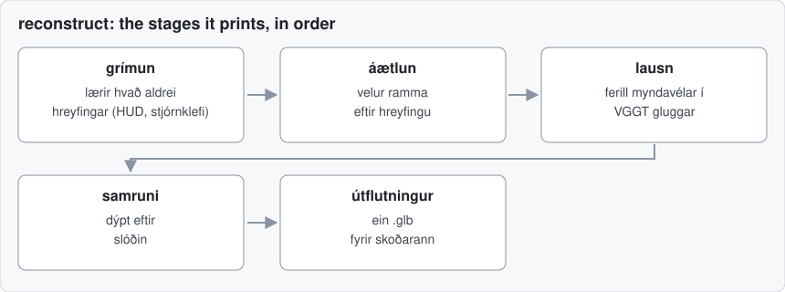

# Offline endurgerð {#offline-reconstruction}

```bash
python -m heat3d_capture reconstruct lap.mp4 -o lap.glb [--solve-budget 260] [--fuse-interval 0.4]
```

Kóði: [`scan/offline.py`](https://github.com/Holdi601/3DHeat-GameCapture/blob/main/heat3d_capture/scan/offline.py),
[`pose/feedforward.py`](https://github.com/Holdi601/3DHeat-GameCapture/blob/main/heat3d_capture/pose/feedforward.py),
[`pose/vggt_model.py`](https://github.com/Holdi601/3DHeat-GameCapture/blob/main/heat3d_capture/pose/vggt_model.py),
[`pose/feedforward_source.py`](https://github.com/Holdi601/3DHeat-GameCapture/blob/main/heat3d_capture/pose/feedforward_source.py),
[`pose/solveprep.py`](https://github.com/Holdi601/3DHeat-GameCapture/blob/main/heat3d_capture/pose/solveprep.py).
Valkostir: [Skipanayfirlit](commands.md#reconstruct).

## Hvers vegna önnur leið {#why-a-second-path}

Stigvaxandi rakning er lifandi og ódýr og virkar þar sem er bygging til að halda sér í: innirými,
gata, kort með skjóli. **Kappakstursbraut er versta tilvikið**: vegurinn er slétt
borði með lítilli áferð, sjóndeildarhringurinn hreyfist varla, og þegar nokkrar stöður reka af leið dregur ekkert síðar
þær til baka. Hringur kemur út sem ferill sem reikar í stað þess að lokast.

Offline leiðin gefur **glugga af römmum** til líkans sem spáir öllum myndavélum þeirra saman,
svo hver rammi takmarkar alla aðra beint en ekki í gegnum keðju. Hún þarf alla
upptökuna áður en hún getur svarað, svo hún er ekki lifandi, og hún er hæg: mínútur á glugga á skjáborðs-
skjákorti. Allt eftir stöðurnar - samruni, þekja, litur, útflutningur - er sami kóði og í lifandi
skönnun: leystur ferill er afhentur endurgerðaranum sem stöðuuppspretta, nákvæmlega þar sem Forza
mælingagögn fara.

## Kröfur {#requirements}

- **PyTorch** sem passar við skjákortið þitt (ekki fest af þessu verkefni; settu það upp á undan
  `requirements.txt`, sjá [Keyrsluumhverfi](runtime.md)).
- **`vggt`** - VGGT líkankóðinn (`from vggt.models.vggt import VGGT`), úr GitHub geymslu
  Meta; hann er ekki í pakkaskránni.
- **`transformers`**, því offline leiðin keyrir dýpt í gegnum PyTorch
  `DepthEstimator` (Depth Anything V2 Small), ekki í gegnum ONNX skrána.
- CUDA skjákort í reynd; bæði líkön falla aftur á CPU, sem er ekki praktískt.

Ekkert af þessu er í `requirements.txt`, því skanninn þarf það ekki. Þau eru í
**`requirements-offline.txt`**, með eigin ósjálfstæðum VGGT (`einops`, `safetensors`,
`huggingface_hub`, `Pillow`):

```bash
.venv\Scripts\python -m pip install -r requirements-offline.txt
.venv\Scripts\python -m pip install --no-deps "vggt @ git+https://github.com/facebookresearch/vggt.git"
```

VGGT er sett upp með `--no-deps` því lýsigögn pakkans festa `numpy<2`, sem pip myndi
virða með því að lækka útgáfu numpy sem scipy þarf hér. `reconstruct` athugar allt þetta
strax eftir að leyfislínan er prentuð (`OFFLINE` listinn í
[`runtime/preflight.py`](https://github.com/Holdi601/3DHeat-GameCapture/blob/main/heat3d_capture/runtime/preflight.py)),
telur upp það sem vantar með stærðum, og setur aðeins upp ef svarað er já - VGGT með `--no-deps`, eins og að ofan.
Ef því er hafnað, eða ekkert Terminal er til að spyrja í, lýkur það með kóða 1.

## Líkanið og leyfi þess {#the-model-and-its-licence}

**VGGT**, `facebook/VGGT-1B`: **CC-BY-NC-4.0, aðeins ekki-viðskiptaleg notkun, og endurgerð gerð með
því erfir það.** Skipunin prentar þetta áður en hún byrjar (`describe_licence`). Sérstaklega
leyfisbundið `facebook/VGGT-1B-Commercial` er til en er lokuð geymsla sem Meta veitir aðgang að fyrir hvern reikning, svo það getur
ekki verið sjálfgefið. `--model vggt-1b-commercial` leysir með því (og prentar leyfislínu þess
í staðinn); án veitts aðgangs mistekst niðurhalið. *Kóði* `vggt` er undir
„VGGT License“ Meta, rannsóknarefnissamningi með notkunarstefnu (lesið úr
`LICENSE.txt` pakkans). Sjá [Líkön og leyfi](models-and-licences.md).

## Keyrslan, stig fyrir stig {#the-run-stage-by-stage}

Stigaheitin eru það sem skipunin prentar.



### masking {#masking}

`FlowMask` er lært af **4 keyrslum með 90 samfelldum römmum**, miðjuðum við 1/8, 3/8, 5/8 og 7/8
af myndbandinu, í 960 x 540 gráu (sjá [FlowMask](reconstruction-capture.md#flowmask-what-never-travels)).
Athugasemd þess er prentuð og geymd í samantektinni. Myndband styttra en 90 rammar fær engan maska.

#### Myndavélarmaskinn er lærður, ekki notaður {#the-camera-mask-is-learned-not-applied}

Maskinn er **ekki** notaður á rammana sem gefnir eru lausnaranum. Að maska stjórnklefann leit rétt út eftir
tölfræði eiginleika (flest greind horn sitja á punktum sem festir eru við myndavélina) - en það er
fullyrðing um eiginleikaskynjara, og lausnarinn er þjálfað tauganet. Mælt eftir því hversu mikið
endurheimta leiðin beygir milli samliggjandi skrefa (bíll beygir nokkrar gráður; handahófsganga níutíu),
gáfu óunnir rammar minnstu beygjuna, rammar með lyftu birtuskilum aðeins meiri, maskaðir rammar greinilega
meiri, og hvort tveggja saman mest. Því fær lausnarinn óunna ramma. Maskinn er samt notaður til að
skipuleggja rammabilið hér að neðan, og stigvaxandi rekjarinn notar hann í lifandi skönnun.
(`solveprep.enhance`, sem maskar og lyftir staðbundnum birtuskilum með CLAHE, er til en er ekki notað af
þessari skipun.)

### planning: rammar með bili eftir hreyfingu {#planning-frames-spaced-by-motion}

`plan_by_motion` velur ramma lausnarans eftir því **hversu langt myndin hreyfðist**, ekki eftir klukku: fast
bil gefur hægum köflum ramma sem þeir þurfa ekki og sveltir hraða, þar sem
samliggjandi rammar skarast ekki nóg til að tengjast.

- Markfærsla: **5% af 960 punkta breidd** (48 px) miðgildisfærsla ORB eiginleika milli
  samliggjandi valinna ramma, mæld á 960 x 540 gráum römmum með CLAHE birtuskilum, eiginleikar aðeins á
  maskanum.
- Byrjað á 0,3 s bili; eftir hvert skref verður næsta bil
  `gap x (0.5 + 0.5 x target / measured)`, klemmt við **0,15-2,0 s**, svo ein suðandi mæling
  sveiflar ekki áætluninni.
- Þegar ekkert passaði minnkar bilið í 0,6 af sjálfu sér (of langt á milli er bilunin sem forðast er).
- Stoppar við lok myndbands eða við `--solve-budget` ramma (sjálfgefið 260).

Færri en 4 áætlaðir rammar er villa.

### solving: gluggar og samsaumur {#solving-windows-and-stitching}

Áætluðu rammarnir eru afkóðaðir í 960 px breidd og leystir í **skarast gluggum með 16 römmum,
6 sameiginlegum** með þeim næsta (`plan_windows`; síðasti glugginn er dreginn til baka svo hann endi á síðasta ramma,
svo endir upptöku hafi jafn marga nágranna og miðjan). Fleiri en **400** rammar í einni keyrslu
er hafnað.

Hver gluggi: rammar með stærð breytt svo löng hliðin sé **518** og báðar hliðar margfeldi af **14**
(hlutföllum haldið - að kremja myndi rangfæra sjónsviðið), skalaðir í 0..1, keyrðir í gegnum VGGT
undir bfloat16 autocast (float16 klárar veldisvísinn á fjarlægum heimshnitum). Ytri stikar (extrinsics)
myndavélanna eru umbreyttir í snúninga heims-frá-myndavél og myndavélamiðjur. Punktakort eru
ekki geymd sjálfgefið.

Hver gluggi kemur til baka í **sínum eigin handahófskennda ramma og sínum eigin handahófskennda kvarða**, svo gluggar eru
**saumaðir** inn í ramma þess fyrsta með líkindavörpun (snúningur, tilfærsla, einn
kvarði) aðlagaðri á myndavélunum sem þeir deila með því sem þegar er sett:

- **Snúningur úr stefnu myndavélanna**, ekki staðsetningu þeirra: sameiginlegu myndavélarnar liggja eftir
  leiðinni og eru nær því á einni línu á beinum kafla, sem skilur eftir aðlögun eftir staðsetningu eingöngu sem getur ekki séð
  snúninginn - hver gluggi sveigist og samsaumaða niðurstaðan kemur út bein. Snúningurinn er
  meðaltal `target_R x source_R^T` varpað aftur á sannan snúning (með speglunarvörn).
- **Kvarði og hliðrun úr staðsetningum**, eftir snúna upprunanum.
- Að minnsta kosti **4** sameiginlegar myndavélar eru nauðsynlegar; færri er villa.
- Skörunin er þriðjungur gluggans svo kvarðinn sé vel ákvarðaður; kvarðaskekkja sem safnast upp
  glugga eftir glugga er það sem lætur hring spíralast.

Fyrir hvern saum er versta ósamræmi sameiginlegu myndavélanna eftir aðlögun skráð, í einingum
meðalbils milli þeirra (`seam_error`).

### fusing {#fusing}

Rammar á `--fuse-interval` sekúndna fresti (sjálfgefið 0,4) eru afkóðaðir í 960 px breidd, fá dýpt frá
Depth Anything V2 Small (PyTorch), og eru samrunnir með stöðu **innskotinni** úr leysta ferlinum á
tímastimpli þeirra (línuleg staðsetning, kúlulaga snúningur; `FeedForwardPoses`). Rammar utan
leysta tímabilsins eru sleppt en ekki framlengdir. Myndavélin notar **65 gráðna** lárétt
sjónsvið. Stöður úr feed-forward bera öryggið 0,85 í samruna og þekju.

### exporting {#exporting}

Möskvinn er skrifaður eins og fyrir lifandi skönnun ([.glb úttakið](glb-output.md)), nefndur eftir myndbandinu.

## Samantektin {#the-summary}

```text
140 cameras solved over 182s
closure error 3.1% of path length
worst seam 0.42 frame spacings
<mask note>
wrote lap.glb
```

| Lína | Merking |
|---|---|
| closure error | fjarlægð frá fyrstu til síðustu myndavélar yfir lengd leiðar. Fyrir einn hring heiðarlegi mælikvarðinn á rek. Yfir 10%: „The lap does not close ... Treat the shape as unreliable.“ |
| worst seam | mesta samsaumsósamræmið. Yfir 1,0: „Windows disagreed by up to N frame spacings at a seam, so part of the path is stitched on weak evidence.“ |
| engin skrá | „Fusion produced no surface, so nothing was written.“ Útgönguköðinn er þá 1. |

## Kvarði {#scale}

Samsaumaða leiðin er í handahófskenndum einingum fyrsta gluggans. Dýpt er fest með þríhyrningsmælingu
milli innskotnu staðnanna (eins og fyrir mælingagögn), svo rúmfræðin er í samræmi við leiðina -
en **niðurstaðan er ekki í metrum** nema leiðin sé það. Ekkert í þessari skipun festir altæka
kvarðann; jarðkvörðunin er ekki notuð þegar stöður koma úr stöðuuppsprettu.

## Staða þessarar leiðar {#state-of-this-path}

Með römmum á föstu bili leysast gluggar í samfellda leið á sumum köflum hrings og í
krass á öðrum; bilanirnar eru krappar beygjur, þar sem sýnin sveiflast harkalega milli
ramma, og að taka sýni þéttar í þeim beygjum bjargar þeim. Engin myndtölfræði sem reynd var
(birta, smáatriði, fjöldi eiginleika, hlutfall innlagagilda, færsla) spáði fyrirfram hvaða
kaflar myndu bregðast. Því er ekki hægt að skipuleggja bilið að fullu
út frá myndunum fyrirfram: það þarf að velja með því að leysa, mæla niðurstöðuna og leysa aftur
þéttar þar sem leiðin er ekki ein sem bíll gæti hafa ekið. Hreyfingarmiðuð áætlun er smíðuð; **aðlögunarhæf
endurlausn er það ekki**.
