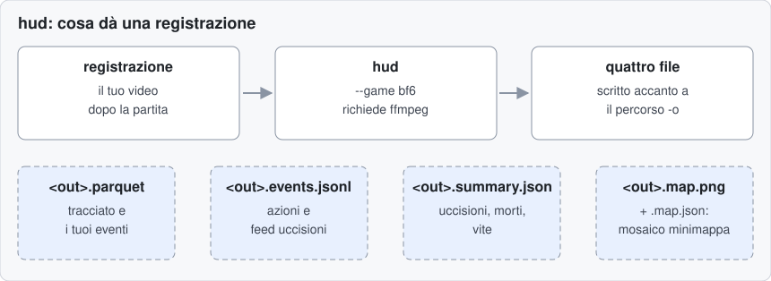

# Leggere la HUD da una registrazione {#reading-the-hud-from-a-recording}

`hud` legge la HUD a schermo di un gioco dalla **registrazione del giocatore stesso**, dopo la partita: le
**proprie** azioni del giocatore dal popup dei punti che il gioco mostra sotto il mirino (uccisioni, assist,
rianimazioni, rifornimenti, catture...), le sue morti dalle schermate di caduta e di schieramento, il **proprio**
percorso dalla minimappa, e il feed delle uccisioni accanto, come eventi con l'orario - il tutto scritto come
tabella 3DHeat, con il mosaico della minimappa come immagine della mappa da mettere sotto.

In breve: guarda il video della tua partita e annota le tue uccisioni, le morti e dove hai camminato.

```bash
.venv\Scripts\python -m heat3d_capture hud "<recording>.mp4" --game bf6 --player <name> -o out/match
```

Battlefield 6 è il primo profilo di gioco.



## Cosa tocca e cosa non tocca {#what-it-does-and-does-not-touch}

- Legge un **file video**: un clip di ShadowPlay / Instant Replay, una registrazione OBS, qualunque cosa che
  ffmpeg sappia decodificare. Non tocca mai il gioco, la sua memoria, i suoi file o la sua rete, e viene eseguito
  dopo la fine della partita. Vedi [Le regole](rules.md).
- Ricava **solo la posizione del giocatore**, dalla sua minimappa. I marcatori degli altri giocatori sulla
  minimappa vengono mascherati e non letti. Il feed delle uccisioni è conservato per intero, ma solo come ciò che
  dice a schermo (chi, contro chi, con cosa, quando); a nessuno tranne il giocatore viene associata una posizione.
- L'OCR gira in locale (RapidOCR con i modelli PaddleOCR tramite ONNX Runtime). Nessun fotogramma e nessun
  ritaglio lascia la macchina.
- Una registrazione mostra i nomi degli altri giocatori, e il mosaico è un'immagine del livello. Gli output sono
  per uso personale del giocatore: tienili in locale.

## Requisiti {#requirements}

- **ffmpeg e ffprobe** nel `PATH`. Una scheda NVIDIA viene usata per decodificare quando c'è (`-hwaccel cuda`);
  altrimenti decodifica la CPU, diverse volte più lenta.
- I pacchetti in `requirements.txt`, e l'OCR senza le sue dipendenze (chiede la `onnxruntime` per CPU, che è in
  conflitto con quella DirectML usata dal progetto):

```bash
.venv\Scripts\python -m pip install -r requirements.txt
.venv\Scripts\python -m pip install --no-deps rapidocr_onnxruntime==1.2.3
```

`rapidocr_onnxruntime` è il lettore di testo (OCR) che legge nomi e parole dallo schermo. `--no-deps` evita che
sostituisca la `onnxruntime` DirectML del progetto.

Per installare ffmpeg su Windows: `winget install Gyan.FFmpeg`, poi apri un nuovo terminale e verifica con
`ffmpeg -version`. Non hai mai usato la riga di comando? Leggi [Prima di iniziare](before-you-start.md).

- Una registrazione **16:9** di qualunque risoluzione (1080p, 1440p, 4K). Gli altri rapporti vengono rifiutati,
  perché i riquadri del profilo finirebbero sulle parti sbagliate dello schermo.
- La **disposizione predefinita della HUD** del gioco. Un elemento della HUD spostato o ridimensionato viene letto
  nel punto sbagliato.

## Opzioni {#options}

| Opzione | Default | Significato |
|---|---|---|
| `video` | | La registrazione. |
| `-o`, `--out` | il nome del video, nella cartella corrente | Percorso di output **senza** estensione; i file sono `<out>.parquet`, `.events.jsonl`, `.summary.json`, `.map.png`, `.map.json`. |
| `--game` | `bf6` | Di quale HUD leggere. `bf6` (Battlefield 6) è per ora l'unico profilo. |
| `--player` | nessuno | Il nome del giocatore come lo mostra il feed delle uccisioni. Confrontato in modo approssimativo (l'OCR confonde `l`/`I`/`1`, `O`/`0`, `rn`/`m`). Senza, il nome viene indovinato (vedi sotto). |
| `--fps` | 5 | Campioni della minimappa al secondo. Il feed delle uccisioni viene campionato a metà di questa frequenza, il popup dei punti e le schermate di morte pure a metà (a un quarto mentre nessun popup è visibile), la bussola ogni 3 s, la lista della squadra ogni 15 s. |
| `--start` | 0 | Secondi nel video da cui iniziare. |
| `--seconds` | tutto | Quanto del video leggere. |
| `--metres-per-pixel` | nessuno | La scala della minimappa, se nota: metri per pixel della minimappa allo zoom abituale (la minimappa è larga 296 pixel su uno schermo 1080p). Senza, le posizioni sono in quei pixel; vedi [Unità](#north-and-units). |
| `--cpu` | disattivo | Decodifica sulla CPU anche quando c'è una scheda NVIDIA. |

L'avanzamento viene stampato ogni cinque secondi; alla fine: il giocatore, uccisioni, morti, vite e i file
scritti.

## Output {#outputs}

### `<out>.parquet` - percorso ed eventi del giocatore {#parquet---the-players-track-and-events}

Una riga per ogni campione in cui il giocatore era in gioco e la minimappa poteva essere collocata, più una per
ogni evento suo. Il piè di pagina contiene le istruzioni di lettura del visualizzatore (chiave `heat3d`,
`kind: heat3d-hud`), così il visualizzatore associa ogni colonna senza chiedere.

| Colonna | Significato |
|---|---|
| `time` | Secondi dall'inizio del video. |
| `event` | `position`; `start` (il video è iniziato a metà vita), `spawn` (di nuovo in gioco dopo una morte o una lunga pausa), `death`, `downed` e `revived` (dalle schermate di caduta, qui sotto), `end` (una vita è finita senza che si sappia come); le azioni del giocatore dal popup dei punti (`kill`, `assist`, `reviving`, `resupply`, `capture`... - la [tabella degli eventi](#event-table)); e le righe del feed delle uccisioni che riguardano il giocatore come `kill_feed`, `death_feed`, `teamkill_feed`, `suicide_feed`, `squadwipe_feed`. |
| `source` | Da dove viene l'evento della riga: `points` (il popup), `screen` (le schermate di caduta e di schieramento), `feed` (il feed delle uccisioni); vuoto sulle righe di posizione. |
| `text` | Sulle righe `points`: l'etichetta come stampata (`KILL`, `SQUAD DAMAGE ASSIST`...), oppure il titolo (`DOUBLE KILL`, il nome di un nastro), o, per un'etichetta sconosciuta, quello che è stato letto. |
| `points` | Sulle righe `points`: di quanto è cresciuto il totale del popup in quel momento. Quando più azioni arrivano nello stesso campione (un'uccisione e il veicolo in cui si trovava) è la loro somma, riportata su ciascuna, e `shared` dice quante la condividono. Vuoto quando il totale non è stato letto due volte prima e dopo il momento. |
| `subject`, `subject_side` | Sulle righe `points`: il nome mostrato dal popup insieme all'azione - la vittima di un'uccisione, il compagno rianimato o rifornito - e il suo colore (`enemy`, `friendly`, `squad`). |
| `confirmed` | `feed` quando il feed delle uccisioni aveva una riga per la stessa uccisione o morte (entro 3 s, stessa vittima). |
| `x`, `y`, `z` | Posizione sul mosaico: `x` est, `y` nord, `z` 0 (il piè di pagina dice che `z` è in alto). Il nord è il vero nord quando la bussola lo ha permesso (vedi `north_up` nel riepilogo). |
| `player` | Sempre `me`. Solo le righe del giocatore hanno posizioni. |
| `team` | `own`. |
| `session` | `<nome del video>#NN`, una per vita. Le rotte della line heat non attraversano mai una sessione. |
| `heading` | Gradi in senso orario dal nord (dall'alto del mosaico quando il nord è ignoto): dove puntava la vista. |
| `dir_x`, `dir_y`, `dir_z` | Lo stesso come vettore di direzione, per la direzione di sguardo del visualizzatore. |
| `zoom` | Quanto la minimappa era rimpicciolita rispetto al suo zoom abituale (sopra 1 sui veicoli). |
| `killer`, `victim`, `weapon`, `headshot`, `marker` | Sulle righe di uccisione e di morte che hanno una riga del feed: la riga del feed (sotto). Un'uccisione dal popup senza riga del feed ha il nome del popup come `victim`; un'uccisione dal popup mostrata come HEADSHOT ha `headshot` vero. |

Ogni riga di evento prende la posizione del giocatore al momento dell'evento (per una morte o una caduta, l'ultima
posizione prima; per una rianimazione, la prima dopo). Le righe si adattano direttamente alla
[line heat](https://holdi601.github.io/3DHeat/line-heat.html) del visualizzatore: il suo suggerimento sceglie
`event`, inizia da `start`, `spawn` e `revived`, termina su `death`, `downed` e `end`, e le righe `position` si
dispongono lungo il percorso. Gli altri eventi hanno nomi tali che il suggerimento non ne prenda nessuno come
inizio o fine: dare una rianimazione è `reviving` (non `revive`), tenere un punto `defense`, un compagno che
compare sul giocatore `teammate_arrived`, le righe del feed `kill_feed` e così via; `kill` non è una fine.

Un clip con due round su due mappe dà due mosaici che non si possono mettere in relazione. Il più grande è
`<out>.parquet`; ciascun altro con almeno 30 s di percorso viene scritto accanto come `<out>.map2.parquet`,
`<out>.map2.map.png`, e così via.

### `<out>.events.jsonl` - eventi del giocatore e feed delle uccisioni {#eventsjsonl---the-players-events-and-the-kill-feed}

Un oggetto JSON per riga, in ordine di tempo, ciascuno con un `source`:

- `points`: uno per ogni azione del giocatore: `time`, `event`, `text`, `points`, `shared`, `subject`,
  `subject_side` (come nella tabella), `popup` (da quale popup viene, numerato lungo tutta la run), `seen`
  (quante letture l'hanno mostrato), `confirmed`, e `x`, `y` dove si trovava il giocatore.
- `screen`: uno per ogni caduta e per ogni rianimazione: `event` (`death`, `downed` o `revived`), `time` (quando il
  giocatore è caduto; per `revived`, quando le schermate sono scomparse), `until` (l'ultimo avvistamento delle
  schermate), `screens` (`down` e/o `card`), `outcome` (`death`, `revived` oppure `unknown` quando la
  registrazione finisce prima), `killer` (dalla riga del feed, quando c'è), `x`, `y`.
- `feed`: ogni riga mostrata dal feed, di tutti:

| Campo | Significato |
|---|---|
| `time`, `last` | Primo e ultimo campione in cui la riga è stata letta (secondi dall'inizio del video). `time` è quando l'uccisione è comparsa, con una precisione di un campione del feed (0,4 s alla frequenza predefinita). |
| `kind` | Dal lato del giocatore: `kill`, `death`, `teamkill`, `suicide`, `squadwipe`; per le righe degli altri giocatori `kill`, `squadwipe`, oppure `death` per una riga senza assassino. |
| `killer`, `victim` | I nomi, come lettura più frequente su tutti i campioni che mostrano la riga (una lettura più lunga vince quando quella comune ne è l'inizio: un nome in parte nascosto). `killer` è vuoto per una riga che mostrava solo un'icona e una vittima - una morte per il mondo, o una riga il cui assassino era già sparito. |
| `killer_side`, `victim_side` | Dal colore del nome: `friendly` (la squadra del giocatore, blu), `enemy` (arancione), `squad` (il verde pallido che il gioco usa per il giocatore e la sua squadra), `neutral` (nessuno di questi). |
| `weapon` | La classe dell'icona dell'arma in questa run: `icon01`, `icon02`... Le righe con icone simili condividono la classe. Le icone non hanno nome; non c'è una lista da cui ricavarne uno. |
| `marker` | La piccola icona tra l'arma e la vittima: `skull`, `arrow`, `chevrons`, `crosses` o vuoto. |
| `headshot` | `marker == "skull"` - un'ipotesi, vedi [Limiti](#limits). |
| `seen` | Quanti campioni del feed hanno mostrato la riga. |
| `me` | `killer`, `victim` oppure null. |
| `matched` | Per le righe proprie del giocatore: se è stata trovata un'azione del popup o una schermata di morte per esse. |
| `x`, `y` (, `map`) | Per le righe proprie del giocatore: dove si trovava. |

### `<out>.summary.json` {#summaryjson}

Giocatore (e come è stato trovato), da dove vengono gli eventi del giocatore (`own_events_from`: il popup e le
schermate, oppure il solo feed delle uccisioni quando non se ne è letto nessuno), uccisioni, morti, K/D,
headshot, assist, rianimazioni date (`revives`) e ricevute (`revived`), cadute, catture, neutralizzazioni,
rifornimenti, guarigioni, riparazioni, veicoli distrutti, il punteggio (la somma dei totali dei popup), ogni tipo
di azione con il suo conteggio (`actions`), il numero di popup, le morti che ha mostrato solo il feed, il conteggio
di uccisioni e morti del feed e quante delle sue uccisioni corrispondono a un'uccisione del popup, uccisioni di
compagni, suicidi, eliminazioni di squadra, vite, secondi in gioco, distanza percorsa (nelle unità della tabella),
righe del feed, per mappa se il nord è in alto e quante letture della bussola concordano, i conteggi del percorso
(campioni, in gioco, collocati, non collocati, isole), le ipotesi fatte, e i tempi.

### `<out>.map.png` e `<out>.map.json` - la mappa sotto il percorso {#mappng-and-mapjson---the-map-under-the-track}

Il mosaico di tutte le minimappe della run, mediato, con i sovrapposti rimossi, ruotato e scalato esattamente come
la tabella. Il file JSON accanto contiene i due ancoraggi che la posizione **Immagine della mappa** del
visualizzatore richiede ([Immagini della mappa](https://holdi601.github.io/3DHeat/map-images.html) nella
documentazione del visualizzatore): carica il PNG con **Immagine della mappa…**, lascia attivo **Inverti
nord/sud**, e inserisci l'ancora 1 e l'ancora 2 (`px`, `py`, `worldX`, `worldZ`) dal file accanto. L'immagine
si trova allora esattamente sotto il percorso.

Nell'immagine ci sono solo le parti del livello che la minimappa del giocatore ha mostrato.

## Metodo {#method}

### Decodifica {#decoding}

ffmpeg decodifica sulla GPU, riduce alla frequenza di campionamento mentre i fotogrammi sono ancora sulla scheda,
ritaglia le regioni del profilo (minimappa, feed delle uccisioni, due strisce della bussola, lista della squadra,
il popup dei punti, le parole della schermata di caduta, l'angolo in basso a destra), scala ciascuna a una
dimensione fissa e le impila in un'unica piccola immagine per campione. Solo quell'immagine attraversa la pipe
verso Python. Decodificare ogni fotogramma del flusso H.264 è il minimo del tempo di esecuzione.

Due thread di lavoro prendono i campioni: uno registra le minimappe (OpenCV), l'altro legge il testo (ONNX Runtime).

### In gioco o no {#in-play-or-not}

Il quadrato del suggerimento dei tasti della minimappa (il quadrato chiaro con la lettera della mappa al centro, in
basso a sinistra della minimappa) è disegnato ogni volta che c'è la minimappa, e non nelle schermate di morte,
di ripresa dell'uccisione, di schieramento, di menu o del tabellone. La sua presenza - una luce senza colore, con
una lettera scura al centro, chiaramente più chiara di ciò che lo circonda - cercata a pochi pixel dal suo posto,
è il test del gioco in corso. Un singolo campione che non concorda con entrambi i vicini viene ignorato.

Una pausa nel gioco è una morte o un cambio di round (il tratto successivo inizia con `spawn`) quando dura almeno
6 s, oppure quando una morte (dalle schermate, o una riga del feed che indica il giocatore come vittima) è
avvenuta entro 40 s prima; una pausa più breve senza morte (la grande mappa aperta) prosegue la vita. La
minimappa resta visibile mentre il giocatore è a terra, quindi un giocatore a terra è in gioco.

### Il percorso {#the-track}

La minimappa ruota con la vista e tiene il giocatore in un punto fisso (misurato: il centro, 49,7% dall'alto). Per
ogni campione:

1. **Maschera** ciò che non è il livello: pixel fortemente colorati o quasi bianchi (marcatori degli obiettivi,
   icone di squadra e veicoli, segnali, il bordo dell'area di gioco, linee del percorso, testo), il giallo-verde
   tenue del cono di vista, un disco attorno al marcatore del giocatore, il cuneo del cono sopra di esso, il
   suggerimento dei tasti e un sottile bordo.
2. **Caratteristiche**: punti chiave SIFT sulla minimappa in grigio con contrasto equalizzato, dentro la maschera.
3. **Registrazione sul mosaico**, non sul campione precedente: i punti chiave vengono confrontati con le
   caratteristiche finora memorizzate, in coordinate del mosaico, vicino a dove il giocatore era l'ultima volta;
   una similarità (rotazione, zoom, spostamento) viene adattata con RANSAC. Un adattamento richiede abbastanza
   inlier, uno zoom entro un terzo di quello precedente e uno spostamento inferiore a un terzo della minimappa per
   campione; un adattamento cercato in qualunque punto del mosaico (dopo una morte) richiede il doppio degli inlier.
4. **Far crescere il mosaico**: le caratteristiche che il mosaico non ha ancora vengono aggiunte (al massimo ogni
   pochi decimi di secondo di movimento), e la minimappa mascherata viene mediata nell'immagine.
5. Il punto del giocatore portato attraverso l'adattamento è la sua **posizione**; l'alto della minimappa portato
   attraverso lo stesso è il suo **orientamento** sul mosaico.

Dopo, un punto che salta più di 10 pixel lontano sia dai due campioni prima sia dai due dopo (che concordano tra
loro) viene scartato: una minimappa ogni tanto corrisponde con uno zoom sbagliato per un campione. Il riepilogo
ne conta il numero (`dropped_as_jumps`).

Registrarsi sul mosaico è ciò che impedisce agli errori di accumularsi: tornare in un luogo corrisponde alle
caratteristiche memorizzate la prima volta. Una comparsa in un punto non ancora visto avvia un'**isola** separata;
ogni decimo campione collocato viene provato contro le altre isole, e la prima buona corrispondenza le unisce (la
più piccola entra nella più grande, con il suo percorso). Le isole che non si uniscono mai (un'altra mappa, o
terreno mai condiviso) vengono scritte separatamente come sopra.

### Nord e unità {#north-and-units}

La striscia della bussola viene letta ogni 3 s: le sue etichette vengono trovate dal loro inchiostro (chiaro,
senza colore, raggruppato attraverso piccoli spazi, senza tacche), ciascuna viene letta da sola, e due o più
etichette fissano sia la scala della striscia sia l'orientamento sotto il segno centrale - una sola etichetta non
fissa nulla. Ogni lettura della bussola è accoppiata con l'orientamento del mosaico dello stesso campione; la
mediana circolare delle differenze, sulle letture entro 10 gradi da essa, è la rotazione che mette il nord in alto
sul mosaico. Viene applicata quando almeno tre letture e metà di tutte concordano.

<a id="units"></a>La scala reale della minimappa non è scritta da nessuna parte sullo schermo, quindi le posizioni
sono in **pixel della minimappa allo zoom abituale**: lo zoom mediano della run è scalato a un'unità della tabella
per pixel di una minimappa di 296 pixel (la sua dimensione su uno schermo 1080p). Lo zoom in uscita dei veicoli è
tolto dalla registrazione, quindi un'unità è la stessa a piedi e in veicolo. `--metres-per-pixel` moltiplica tutto
in metri quando la scala è nota (da una distanza nota sulla mappa, misurata una volta).

### Il feed delle uccisioni {#the-kill-feed}

Il feed viene letto a 2,5 campioni al secondo, ma solo quando i suoi pixel colorati sono cambiati in modo
apprezzabile o sono passati 2 s. Le righe di testo vengono trovate dal rilevatore dell'OCR; una riga la cui
immagine corrisponde a una letta nel campione precedente (le righe scorrono, quindi possono essersi spostate)
prende quel testo invece di essere letta di nuovo. Le righe troppo piccole per un nome, o con una barra (un
contatore fps in quell'angolo), vengono scartate.

Le righe vengono raggruppate in file per altezza; in una riga l'assassino è il nome più a sinistra e la vittima
quello più a destra. I pezzi vicini dello stesso colore si uniscono (un nome con uno spazio). Una singola riga che
attraversa l'icona da un nome all'altro viene tagliata nel punto più largo quando le due metà differiscono di
colore, e ciascuna metà viene riletta. Un solo nome nella colonna delle vittime con un'icona appena a sinistra è
una riga senza assassino. Due pezzi dello stesso colore senza icona in mezzo sono un solo nome il cui assassino è
sparito, non un'uccisione.

**I lati** vengono dal colore. I nomi sono disegnati con una certa trasparenza, quindi il test riguarda quanto il
testo si distingue dal proprio sfondo: il segno di rosso meno blu in quella differenza è arancione (nemico) o blu
(amico) su qualunque sfondo; né l'uno né l'altro, con il verde sopra gli altri due, è il colore della squadra.

**Le icone**: tra i nomi, i pixel del colore dell'assassino formano la sagoma dell'arma; una piccola icona separata
subito prima della vittima è il marcatore, riconosciuto dalla forma (una macchia con buchi per gli occhi è un
teschio; un piccolo triangolo una freccia; più pezzi, croci).

**Eventi**: una riga letta di nuovo con entrambi i nomi uguali (somiglianza 0,7 dopo aver normalizzato i soliti
errori dell'OCR, uno dei quali 0,8; una lettura tagliata corta corrisponde all'inizio del nome completo) è lo stesso
evento, finché l'evento è stato letto l'ultima volta meno di 5 s prima ed ha meno di 14 s - nessuna riga resta a
schermo più a lungo, quindi la stessa coppia più tardi è una nuova uccisione. Una riga senza assassino corrisponde
solo sulla vittima. L'orario di un evento è il suo primo avvistamento; i suoi nomi, lati e marcatore sono la
maggioranza tra gli avvistamenti; le righe lette una sola volta vengono scartate.

**Il giocatore**: `--player`, altrimenti la riga evidenziata (più chiara) dell'elenco della squadra quando ci sono
almeno tre letture e il 60% concorda, altrimenti il nome che il feed ha disegnato più spesso nel colore della
squadra. Altrimenti il riepilogo dice che il giocatore è ignoto, e nessuna riga del feed viene attribuita a lui.
(Il popup e le schermate di morte sono del giocatore qualunque sia il suo nome; non hanno bisogno di un nome.)

### Il popup dei punti {#the-points-popup}

Tutto ciò che il giocatore fa punti, Battlefield 6 lo mostra in un unico popup appena a sinistra e sotto il mirino -
nello stesso posto a piedi, in veicolo e attraverso un mirino:

```
            [ RIBBON ] (icon)          a title, now and then: a ribbon or a multi-kill
      (icon)(icon)(icon)  300          one icon per action; the popup's running total
                Some_Name              who it was about, for a moment: orange an enemy, blue a teammate
    [ KILL x2 ] [ VEHICLE DESTROYED ]  one boxed tag per kind of action, with a count
```

Il popup cresce mentre il giocatore continua a fare punti: una nuova uccisione trasforma `KILL` in `KILL x2`,
aggiunge un'icona e alza il totale; un nuovo tipo di azione aggiunge un'etichetta. La riga delle etichette mostra gli
ultimi tipi (uno più vecchio scivola fuori, e continua a contare quando ritorna). Circa tre secondi dopo l'ultima
azione il popup si ripiega in una sola riga (`[KILL x2] 300`) e scompare. Il testo è grigio chiaro, le etichette
in riquadri sottili, il totale in cifre grandi che partono da x 760 su uno schermo 1920x1080, le etichette
allineate a destra a x 750.

Viene letto 2,5 volte al secondo: il rilevatore dell'OCR trova le righe di testo, si leggono solo le righe su una
delle righe del popup (le etichette proprie del mirino del carro nella stessa zona non lo sono), e una riga la cui
immagine corrisponde a una letta il campione prima prende quel testo. Una riga che si estende da un'icona, da un
nome o da un'etichetta ripiegata fino al totale (`Name10`, `REVIVE185`) viene tagliata dove comincia il totale
(x 755) e le due metà vengono rilette. Mentre nessun popup è visibile, ogni altro campione viene trattenuto non
letto; quando il successivo mostra un popup, quello trattenuto viene letto per primo, così l'inizio di un popup si
trova fino al campione.

**Le etichette** vengono confrontate con la [tabella degli eventi](#event-table) dopo aver normalizzato i soliti
errori del riconoscitore (Q letta come O, una cifra tra lettere, I al posto di L, una lettera persa al bordo): una
lettura è un'etichetta quando è almeno all'80% simile a una di esse (85% per etichette di cinque lettere o meno) e
chiaramente più vicina a quella che a qualunque altra. Le etichette che il riconoscitore ha attaccate insieme
(`CAPTUREDORDERCOMPLETED`) vengono separate staccando dall'inizio le etichette note. Un conteggio è `x2`, `X3`, un
segno isolato e una cifra, oppure una cifra subito dopo l'etichetta. Una riga in grigio chiaro, maiuscola, nella
riga delle etichette che non corrisponde a nulla viene conservata come azione `points` con il suo testo; una riga
che è un pezzo di un'etichetta nota nello stesso popup (`DESTROYED` accanto a `VEHICLE DESTROYED`) no. I titoli
sopra il totale (riquadri chiari, testo scuro) sono `multi_kills` (`DOUBLE KILL` ...) o `ribbon`. Il nome è la
riga colorata tra il totale e le etichette; il suo lato viene dal colore, come nel feed.

**Popup e azioni**: letture con meno di 0,9 s di vuoto tra loro formano un solo popup. Un popup che sembra finire e
ritorna prima che avrebbe potuto ripiegarsi (entro 3,2 s dall'ultima crescita), con ogni etichetta al suo conteggio
o più e un totale non inferiore, è lo stesso popup perso per un momento (sfocatura, sfondo chiaro) - nulla in esso
viene contato due volte. In un popup, il conteggio finale di un'etichetta è il conteggio più alto letto almeno
due volte; la sua k-esima azione viene datata alla prima lettura che mostra un conteggio di k o più. Un conteggio
letto in un solo campione non è un'azione - tranne un'uccisione che il feed delle uccisioni conferma (una riga del
giocatore entro 3 s che nessun'altra uccisione ha preso): l'etichetta corta KILL è quella che il riconoscitore
legge più spesso una sola volta. Un titolo conta una volta per popup, quando è letto due volte. `points` è quanto
il totale - contando solo i totali letti due volte di seguito - è cresciuto da prima del campione dell'azione a
dopo di esso.

Una riga sconosciuta conta come etichetta solo sulla riga delle etichette note nella stessa lettura (o, senza
etichette note, quando non c'è neanche un nome), così un nome disegnato in un colore che il test dei lati non sa
distinguere non viene preso per una.

### Morti e rianimazioni {#deaths-and-revives}

Quando il giocatore cade, il gioco lo dice sotto il centro dello schermo (MAN DOWN, REQUEST REVIVE, SKIP (HOLD),
NEARBY MEDICS; una volta richiesta una rianimazione, REVIVE REQUESTED, CANCEL REQUEST), e una scheda in basso a
destra indica chi l'ha fatto, con DAMAGE LOG o PLAYER CARD sotto e una riga "YOU n - n FOE" sopra. Ucciso sul colpo
(un colpo di testa fatale), si vede solo la scheda. Poi o un compagno rianima il giocatore - le schermate spariscono
e il gioco prosegue - oppure il giocatore si dissangua o rinuncia, e segue la schermata di schieramento, con
DEPLOY in basso a destra.

Queste parole vengono lette insieme al popup, nello stesso passaggio dell'OCR (il popup, la fascia della schermata
di caduta e l'angolo in basso a destra impilati in un'unica immagine): 2,5 volte al secondo mentre un popup è
visibile, 1,25 volte altrimenti. L'angolo è incluso solo quando il giocatore è fuori gioco o è stato visto a terra
negli ultimi 3 s; in gioco contiene solo il conteggio delle munizioni. Avvistamenti a meno di 4 s l'uno dall'altro
formano un solo episodio (almeno due avvistamenti). Un episodio è una **morte** quando la schermata di
schieramento compare entro 12 s dalla sua fine, o quando il giocatore è fuori gioco 3 s dopo di esso e vi resta per
6 s o più; è una **rianimazione** (`downed`, poi `revived`) quando il giocatore è ancora in gioco 3 s dopo che le
schermate sono sparite; `unknown` (scritto come `downed` da solo) quando la registrazione finisce prima. L'orario
della morte è quando il giocatore è caduto: la riga del feed che lo indica come vittima, quando c'è, entro 3 s
prima dell'episodio, altrimenti il primo avvistamento dell'episodio meno metà dell'intervallo di lettura. Le
posizioni dopo una morte vengono lasciate fuori dal percorso fino alla schermata di schieramento.

Una morte dal feed che nessun episodio spiega (le schermate sono state perse) è comunque una `death`, con
`source` `feed`, e giudicata come sopra: se il giocatore resta in gioco per più di 40 s dopo, è stato rianimato.

### Tabella degli eventi {#event-table}

Che cosa diventa ogni etichetta, titolo e schermata. Più etichette possono essere lo stesso evento; `text` conserva
quale.

| Evento | Da | Significato |
|---|---|---|
| `kill` | KILL; HEADSHOT | Il giocatore ha ucciso qualcuno (il nome è la vittima). Un'uccisione con colpo di testa mostra HEADSHOT dove ci sarebbe KILL: `text` dice quale, e `headshot` è vero. |
| `assist` | ASSIST, KILL ASSIST, DAMAGE ASSIST, SQUAD DAMAGE ASSIST | Danno inflitto a qualcuno che un compagno ha ucciso. |
| `kill_assist` | ASSIST COUNTS AS KILL | Un assist che il gioco conta come uccisione. |
| `suppression`, `suppression_assist` | ENEMY SUPPRESSION; SUPPRESSION ASSIST | Fuoco di soppressione su un nemico; su uno che un compagno ha poi ucciso. |
| `smoke_assist` | SMOKE ASSIST, SQUAD SMOKE ASSIST | Fumo che ha coperto un compagno. |
| `spot`, `spot_assist` | SPOT, SPOTTED, ENEMY DESIGNATION; SPOT ASSIST, SPOT BONUS | Individuare un nemico; un'uccisione su uno che il giocatore aveva individuato. |
| `driver_assist` | DRIVER ASSIST | Un'uccisione da parte del cannoniere del veicolo del giocatore. |
| `reviving`, `reviving_bonus` | REVIVE, SQUAD REVIVE; CONCEALED REVIVE | Il giocatore ha rianimato un compagno; il bonus per averlo fatto da una posizione coperta. |
| `heal` | HEAL, SQUAD HEAL | Il giocatore ha curato un compagno. |
| `resupply` | SUPPLY, RESUPPLY, SQUAD SUPPLY | Un compagno ha preso munizioni dal giocatore. |
| `repair` | REPAIR, VEHICLE REPAIR, SQUAD REPAIR | Il giocatore ha riparato un veicolo. |
| `capturing`, `capture` | CAPTURING, RECAPTURING; CAPTURED, OBJECTIVE CAPTURED | Un passo di cattura; l'obiettivo conquistato. |
| `neutralizing`, `neutralize` | NEUTRALIZING; NEUTRALIZED, OBJECTIVE NEUTRALIZED | Lo stesso per portare un obiettivo nemico allo stato neutro. |
| `defense` | DEFENDING, OBJECTIVE DEFENDED | Difendere un obiettivo. |
| `offensive`, `defensive` | OFFENSIVE; DEFENSIVE | Il bonus per un'azione vicino a un obiettivo attaccato; difeso. |
| `order` | ORDER COMPLETED | Un ordine di squadra eseguito. |
| `vehicle_damage`, `vehicle_disabled`, `vehicle_destroyed`, `vehicle_destroyed_assist` | VEHICLE DAMAGE; VEHICLE DISABLED; VEHICLE DESTROYED; VEHICLE DESTROYED SUPPORT | Danno a un veicolo nemico, fino a distruggerlo, o aiutare a farlo. |
| `equipment_destroyed` | EQUIPMENT DESTROYED | Un gadget nemico distrutto. |
| `forced_bail` | FORCED BAIL | Un nemico costretto a scendere dal proprio veicolo. |
| `squad_wipe` | SQUAD WIPE | L'ultimo di una squadra nemica ucciso. |
| `savior`, `avenger` | SAVIOR; AVENGER | Un'uccisione su un nemico che stava ferendo un compagno; su chi aveva appena ucciso un compagno. |
| `teammate_arrived` | SPAWNED ON, SPAWN ASSIST, VEHICLE SPAWN, SQUAD VEHICLE SPAWN | Un compagno è comparso sul giocatore o nel suo veicolo. |
| `transport` | TEAM TRANSPORT | Trasportare compagni in un veicolo. |
| `fortify` | DEFENSE DEPLOYED | Una difesa costruita dal giocatore. |
| `points` | qualunque altra cosa nella riga delle etichette | Un'azione che la tabella non conosce: `text` è quello che è stato letto. |
| `multi_kills` | DOUBLE KILL, TRIPLE KILL, QUAD KILL, MULTI KILL (titolo) | Uccisioni in rapida successione. |
| `ribbon` | qualunque altro titolo | Un nastro, dal suo nome (BALLISTIC, TANK BUSTER, ENGINEER EXPERT, SPEARHEAD...). |
| `downed` | schermata di caduta, poi di nuovo in gioco | Il giocatore è caduto ed è stato rianimato. |
| `revived` | le schermate spariscono, il gioco prosegue | Il giocatore è stato rianimato da un compagno. |
| `death` | schermata di caduta o di scheda, poi di schieramento o fuori gioco | Il giocatore è morto. |

I testi della tabella sono stati visti nelle registrazioni di prova, tranne questi, che sono i nomi abituali della
serie di giochi e sono nella tabella perché siano chiamati per nome invece di essere conservati come `points`:
HEADSHOT KILL, ASSIST, KILL ASSIST, ASSIST COUNTS AS KILL, SPOT, SPOTTED, SPOT ASSIST, SPOT BONUS, SQUAD REVIVE,
HEAL, SQUAD HEAL, RESUPPLY, SQUAD SUPPLY, REPAIR, VEHICLE REPAIR, SQUAD REPAIR, VEHICLE DISABLED, SQUAD WIPE,
AVENGER, le forme OBJECTIVE ..., e i titoli TRIPLE KILL, QUADRUPLE KILL e MULTI KILL. Il gioco in un'altra lingua
stampa altre parole: le sue etichette escono come `points` con quello che è stato letto - non confuse con un'azione
nota - con i loro totali e nomi; e poiché le schermate di morte sono riconosciute dalle loro parole inglesi, le morti
vengono allora dal solo feed delle uccisioni, come righe `death` con `source` `feed`.

## Verificato {#what-is-verified}

Controllato a occhio sulle registrazioni di prova (quelle del giocatore stesso, non parte del repository),
disegnando campioni a caso e confrontando ciascuno con i fotogrammi attorno:

- **Gli eventi propri del giocatore.** Ogni azione del popup campionata era una vera azione di quel tipo, trovata
  entro una lettura (0,4 s) dal suo orario; la maggior parte dei valori e dei nomi era giusta (i nomi in alcuni
  alfabeti, come il cirillico, possono uscire storpiati). Ogni schermata di morte campionata è stata trovata.
- **Feed delle uccisioni.** La grande maggioranza delle righe del feed è stata trovata con entrambi i nomi giusti;
  sono ammessi piccoli errori dell'OCR (una I maiuscola letta come l minuscola). I nomi scritti con glifi che lo
  stesso gioco mostra come riquadri possono essere mancati. I lati (colori) sono sbagliati per qualche punto
  percentuale dei nomi.
- **In gioco.** Il test del suggerimento dei tasti è coinciso con il fotogramma in ogni momento campionato.
- **Percorso.** Non esiste una verità di riferimento su dove si trovasse il giocatore, quindi il percorso viene
  controllato con la registrazione stessa: due minimappe vengono registrate **direttamente l'una sull'altra**, e
  quello scostamento viene confrontato con lo scostamento tra le due posizioni in tabella. Il disaccordo mediano è
  di circa 1-3 pixel della minimappa (meno dell'1% della sua larghezza), di più su una minimappa affollata e
  rimpicciolita.
- **Tempo di esecuzione.** La decodifica a circa cinque volte il tempo reale è la parte principale, su una GPU da
  desktop; la lettura del popup dei punti aggiunge da un quinto alla metà.

Guardato a occhio: ogni mosaico ha strade ed edifici continui attraverso le vite che lo hanno costruito, e i
percorsi di vite diverse lungo la stessa strada si sovrappongono. Un tratto in cui lo zoom della minimappa cambia
può risultare troppo lungo - vedi [Limiti](#limits).

I test (`tests/test_hud_*.py`) disegnano tutto ciò che leggono: un livello inventato di strade, edifici e curve di
livello, minimappe di camminate attraverso di esso con i sovrapposti che ha una minimappa reale, strisce di bussola,
righe del feed con nomi inventati. Verificano che un anello sia seguito entro due pixel e si chiuda, che un giocatore
fermo resti fermo mentre la vista gira, che i cambi di zoom siano seguiti, che una comparsa altrove venga ricongiunta
quando i percorsi si incontrano, che la rotazione verso il nord e il capovolgimento dell'asse y mettano il percorso
dove è davvero andato, che gli ancoraggi dell'immagine della mappa la allineino sotto il percorso, e l'analisi, i
lati, i marcatori e la deduplicazione delle righe del feed. Per gli eventi propri del giocatore disegnano popup dei
punti con nomi ed etichette inventati, e verificano la tabella delle etichette e la sua tolleranza agli errori del
riconoscitore, le etichette attaccate insieme, le righe del popup, il totale tagliato da un nome, il conteggio
mentre un popup cresce, il proseguire dopo un momento non letto, un'etichetta che scivola fuori e ritorna, o che
finisce; che un conteggio letto una sola volta sia tenuto a parte; le morti, le rianimazioni e gli esiti dalle
parole delle schermate; e, su una partita inventata, che le azioni, le morti e le rianimazioni finiscano nella
tabella dove si trovava il giocatore, le righe del feed accanto con i loro nomi, e il percorso finisca alla morte e
non alla rianimazione.

## Limiti {#limits}

- **Le unità sono pixel della minimappa**, non metri, a meno che non sia dato `--metres-per-pixel`. Nulla sullo
  schermo del gioco dichiara la scala reale della minimappa.
- **Viene mappato solo ciò che la minimappa ha mostrato.** Il mosaico copre il terreno entro mezza minimappa da dove
  il giocatore è andato; due mosaici che non hanno mai condiviso terreno (due round su due mappe, o due vite in
  angoli molto lontani di una mappa grande) restano file separati con coordinate non correlate.
- **Il percorso è quello della minimappa, a 5 campioni al secondo**, non smussato da nulla. Una minimappa molto
  rimpicciolita (un elicottero nelle registrazioni di prova l'ha rimpicciolita fino a 2,3 volte) mostra meno dettagli
  per pixel, e fuori dall'area di gioco ne mostra quasi nessuno, quindi la registrazione lì è più grossolana. Jet e
  il giocatore come passeggero non erano nelle registrazioni di prova.
- **Gli errori di registrazione sono locali e non si accumulano**, ma un mosaico costruito mentre si esplora terreno
  nuovo può avere una piccola curvatura che viene corretta solo quando il terreno viene rivisto. Dove lo zoom della
  minimappa cambia in modo continuo (un veicolo che accelera) lo zoom adattato può derivare, e un tratto del genere è
  stato visto con la distanza circa doppia di quella vera. Un mosaico costruito da una minimappa di fanteria affollata
  e rimpicciolita è il meno preciso (errori tipici intorno a 3 pixel, fino a 18).
- **Nessuna ottimizzazione del grafo di pose.** Un anello si chiude abbinando caratteristiche memorizzate, non
  distribuendo la correzione lungo l'anello.
- **Le classi delle armi non funzionano ancora.** La sagoma dell'icona è presa da un'icona traslucida su uno sfondo
  in movimento, e varia troppo da campione a campione: le registrazioni di prova sono uscite con da 220 a 340 classi
  per 550 a 670 righe, dove una partita ha qualche decina di armi. Tratta `weapon` come sperimentale. Le classi sono
  comunque per run, e non sono nomi.
- **I significati dei marcatori non sono tutti noti.** La freccia (`▸`) viene disegnata prima del nome del giocatore
  stesso, nelle righe che lo riguardano; non è un tipo di uccisione. Il teschio è inteso come colpo di testa; è
  un'ipotesi, non qualcosa che dice il gioco. `chevrons` e `crosses` (eliminazioni di squadra) sono riportati così
  come visti.
- **I nomi in alfabeti diversi da quello latino** (il cirillico, per esempio) escono come le lettere latine più simili:
  il riconoscitore legge il latino e il cinese. Lo stesso giocatore viene letto allo stesso modo ogni volta, quindi
  corrispondono comunque, ma il testo non è il suo nome.
- **I contatori sovrapposti nell'angolo del feed delle uccisioni** (un contatore fps) possono nascondere la fine della
  vittima della riga in alto. Il testo del contatore viene riconosciuto e scartato, e un nome tagliato corto viene
  abbinato alle sue letture complete, ma un nome visto solo tagliato resta tagliato.
- **Una morte che né le schermate né il feed hanno mostrato** chiude comunque il percorso, come `end`, quando il
  giocatore esce dal gioco per 6 s o più.
- **Le rianimazioni ricevute** vengono dalle schermate di caduta. Solo per una morte dal feed che le schermate hanno
  perso vengono ancora dedotte (in gioco per più di 40 s dopo), e una rianimazione rapida non viene allora
  distinta.
- **Le azioni del popup sono datate a una lettura**: entro 0,4 s dalla comparsa dell'etichetta; un'etichetta che
  appare con un'animazione può essere letta un campione in ritardo o in anticipo.
- **I nomi sulle righe del popup** sono letti come quelli del feed: gli alfabeti diversi dal latino escono storpiati, e
  ogni tanto il cartellino del nome di un compagno che galleggia nel mondo vicino al popup viene letto come nome
  dell'azione. Le azioni senza nome (un passo di cattura, un ordine) non ne hanno.
- **`points`** manca dove il totale non è stato letto due volte prima e dopo un'azione, ed è condiviso tra le azioni
  arrivate nello stesso campione. Il `score` del riepilogo somma i totali finali dei popup, quindi un popup il cui
  totale non è mai stato letto due volte non vi rientra.
- **La riga delle etichette è una finestra**: con quattro o più tipi in un popup, l'etichetta più vecchia scivola via
  a sinistra, oltre il bordo della zona letta. È stata contata finché era visibile; un conteggio che guadagna mentre è
  mezza fuori schermo può essere perso.
- **Un popup perso per più tempo di quanto avrebbe potuto durare** (oltre circa 4 s di campioni illeggibili mentre
  cresceva ancora) viene preso per due, e un'etichetta con conteggio superiore a uno viene allora contata di nuovo.
  Non visto nei controlli sotto.
- **Altre lingue dell'interfaccia**: le etichette escono come `points` con il loro testo, e le morti vengono dal solo
  feed (le schermate di morte vengono riconosciute dalle loro parole inglesi).
- **Eventi su un'isola corta**: una vita il cui percorso era troppo breve per essere scritto come mappa (sotto 30 s)
  conserva i suoi eventi in `.events.jsonl` senza `x`, `y`, e non in alcuna tabella.
- **La disposizione della HUD è quella predefinita di BF6 a 16:9.** Una scala della HUD cambiata, una tavolozza per
  daltonici o una dimensione diversa della minimappa richiederebbero un profilo proprio.
