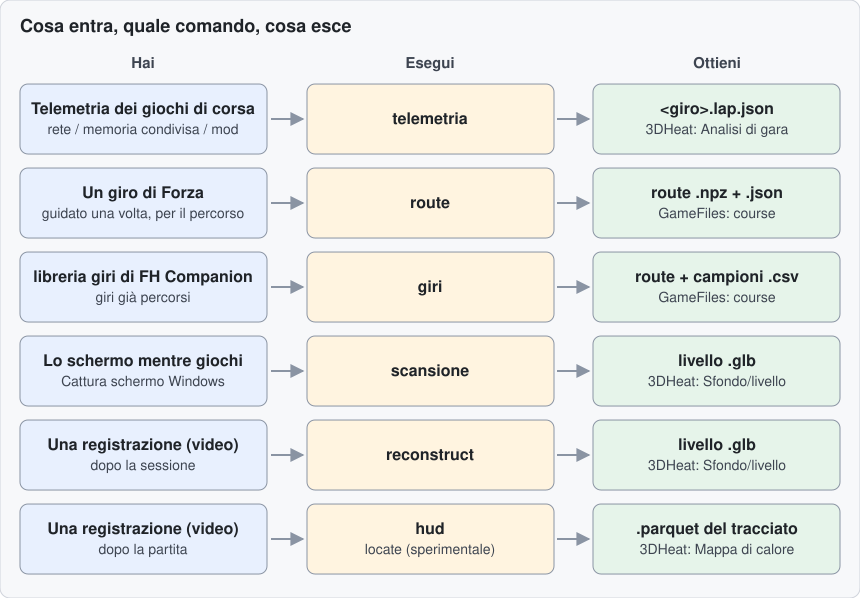

# 3DHeat GameCapture {#dheat-gamecapture}

**Che cos'è?** Uno strumento che annota ciò che un gioco di corse gli dice sulla tua guida, un file
per giro. Può anche ricostruire un modello 3D approssimativo di un livello a partire da un video di
te che giochi.

**A cosa serve?** Per vedere i tuoi giri nel [visualizzatore 3DHeat](https://holdi601.github.io/3DHeat/):
dove frenavi, dove andavi piano, in che cosa differiscono due giri. E per avere il livello sotto la
tua mappa di calore quando nessuno ne ha un modello 3D.

**Esempio:** attiva il Data Out di Forza, esegui un comando, guida due giri. Compaiono due file di
giro in `laps\`. Trascinali nella scheda Analisi di gara del visualizzatore.


Non hai mai usato la riga di comando? Leggi prima [Prima di iniziare](before-you-start.md).

## I tre compiti {#the-three-jobs}

1. **Telemetria dei giri.** Registra ogni canale che un gioco di corse pubblica - il Data Out di Forza,
   la memoria condivisa dei giochi Assetto Corsa, i flussi di rete dei giochi rally, una mod di BeamNG,
   un plugin di Trackmania - e scrive un file `heat3d-lap` per giro o tappa, per la scheda Analisi di gara del
   visualizzatore. iRacing non richiede alcun registratore: il visualizzatore legge i suoi file `.ibt`.
2. **Livelli dal gioco.** Trasforma ciò che lo schermo ha mostrato mentre camminavi o guidavi attraverso
   un livello in un modello 3D `.glb`, che il visualizzatore stende sotto la mappa di calore.
3. **La tua partita, dopo.** `hud` legge l'HUD della tua registrazione - le tue azioni, le morti, il
   tracciato della minimappa e il registro delle uccisioni. `locate` (sperimentale: per ora posiziona
   pochi fotogrammi reali) stabilisce dove è stato ripreso ogni fotogramma, sul modello 3D di un livello.

Tutti e tre seguono una regola: **non si inietta nulla in un gioco e non si aggancia nulla**. I
fotogrammi arrivano dall'API pubblica di cattura dello schermo, la telemetria dalle interfacce che i
giochi pubblicano per questo scopo. Vedi [Le regole](../rules.md).



Il codice è Python (pacchetto `heat3d_capture`), con licenza MIT. I modelli di profondità e di posa che
può eseguire hanno le loro licenze - vedi [Modelli e licenze](../models-and-licences.md).

## Avvio rapido {#quick-start}

### Registrare i giri {#record-laps}

Ti servono Python 3.10 o successivo ([Prima di iniziare](before-you-start.md)). In PowerShell:

```powershell
git clone https://github.com/Holdi601/3DHeat-GameCapture
cd 3DHeat-GameCapture
python -m venv .venv
.venv\Scripts\python -m pip install -r requirements.txt

# Forza: Impostazioni -> HUD e gioco -> Data Out = ON, IP 127.0.0.1, porta 5300
.venv\Scripts\python -m heat3d_capture telemetry -o laps
```

**Dovresti vedere** `listening on port 5300. Laps go to laps. Ctrl+C to stop.`, poi una riga per giro
ogni volta che tagli il traguardo, come nell'immagine sopra. Premi Ctrl+C per fermarti. Trascina i file
da `laps\` nella scheda Analisi di gara del visualizzatore. Ogni altro gioco è a un `--game` di distanza:

```powershell
.venv\Scripts\python -m heat3d_capture telemetry --game acc -o laps
.venv\Scripts\python -m heat3d_capture telemetry --game dirtrally2 -o laps
```

Vedi [Registratori di telemetria](../telemetry.md) per ogni gioco e ogni opzione.

### Scansionare un livello {#scan-a-level}

Fai doppio clic su **`scan.bat`** nella cartella dello strumento. Trova Python (e, se non c'è, propone di
installarlo con winget), crea una `.venv` privata e apre la finestra di scansione. La finestra dice cosa
manca, a cosa serve ogni pacchetto e quanto è grande il download, e non installa nulla senza un sì. Vedi
[Runtime e dipendenze](../runtime.md) e [La finestra di scansione](../reconstruction-scan-ui.md).

A mano: `.venv\Scripts\python -m heat3d_capture.ui`.

Per ricostruire una registrazione offline, con il percorso della camera risolto tutto in una volta (servono
PyTorch, il pacchetto `vggt` e una GPU - vedi [Ricostruzione offline](../reconstruction-offline.md)):

```powershell
.venv\Scripts\python -m heat3d_capture reconstruct lap.mp4 -o lap.glb
```

## Mappa della documentazione {#map-of-the-documentation}

| Pagina | Cosa contiene |
|---|---|
| [Prima di iniziare](before-you-start.md) | Python, un terminale, il primo comando, gli errori comuni |
| [Le regole](../rules.md) | Nessuna iniezione, solo interfacce pubblicate, e cosa costa |
| [Registratori di telemetria](../telemetry.md) | Il comando `telemetry` e una panoramica di ogni gioco |
| [Forza](../telemetry-forza.md) | Data Out, rilevamento del layout, il relay di FH Companion e il suo `.tele.gz` |
| [Giochi Assetto Corsa](../telemetry-assetto-corsa.md) | AC, ACC, AC EVO, AC Rally dalla memoria condivisa |
| [Giochi rally](../telemetry-rally.md) | EA SPORTS WRC, DiRT Rally 2.0 / 1 / DiRT 4, Richard Burns Rally |
| [BeamNG.drive](../telemetry-beamng.md) | La mod del protocollo `heat3d` |
| [Trackmania](../telemetry-trackmania.md) | Il plugin Openplanet `Heat3dRecorder` |
| [iRacing](../telemetry-iracing.md) | Lettura dei file `.ibt` nel visualizzatore |
| [Divisione di giri e tappe](../lap-splitting.md) | `LapSplitter`, `CounterSplitter`, `LineSplitter`, `StageSplitter` |
| [Slittamento, deriva e canali derivati](../slip-and-drift.md) | Come viene scalato lo slittamento, e cosa deriva il visualizzatore |
| [Il file heat3d-lap](../lap-format.md) | Il formato del file di giro, i canali, le unità, `meta` |
| [Giochi](../games.md) | Per gioco: come registrare, cosa viene inviato, quali percorsi si possono esportare |
| [Comandi](../commands.md) | `route`, `telemetry`, `laps`, `reconstruct`, `hud`, `locate`, passo per passo |
| [Riferimento dei comandi](../cli-reference.md) | ogni opzione, generata dal `--help` |
| [Leggere l'HUD da una registrazione](../hud-video.md) | `hud`: azioni proprie, morti, tracciato della minimappa e registro delle uccisioni da una registrazione |
| [Localizzare i fotogrammi in un livello](../locate.md) | `locate`: dove è stato ripreso ogni fotogramma, rispetto alla geometria del livello |
| [Ricostruzione del livello](../reconstruction.md) | La pipeline dai fotogrammi a un `.glb` |
| [La finestra di scansione](../reconstruction-scan-ui.md) | Ogni comando, scorciatoia ed elemento di sovrapposizione |
| [Cattura, maschere e qualità dei fotogrammi](../reconstruction-capture.md) | Windows Graphics Capture, fotogrammi chiave, maschere dell'HUD, consigli sulla qualità |
| [Profondità](../reconstruction-depth.md) | Depth Anything V2, ONNX Runtime, costruzione del modello |
| [Posa della camera e scala](../reconstruction-pose.md) | Odometria, rilocalizzazione, pose dalla telemetria, scala del terreno, bundle adjustment |
| [Fusione, copertura e colore](../reconstruction-fusion-and-texture.md) | Il volume di occupazione, la griglia di copertura, i punti deboli, il colore dei vertici |
| [L'output .glb](../glb-output.md) | Il file che carica il visualizzatore |
| [Ricostruzione offline](../reconstruction-offline.md) | `reconstruct`, finestre VGGT e unione |
| [Modelli e licenze](../models-and-licences.md) | Dimensioni di Depth Anything V2, VGGT, i pacchetti |
| [Runtime e dipendenze](../runtime.md) | Verifica preliminare, backend, livelli di prestazione |
| [Limiti e verifiche](../limits.md) | Cosa non è fatto, e cosa non è stato verificato |
| [Aggiornamenti](../updates.md) | Il controllo delle release e `python -m heat3d_update` |
| [Sviluppo](../development.md) | Test, ambiente virtuale, struttura del repository |
| [Manutenzione di questa documentazione](../maintaining.md) | La lista di controllo del rilascio per codice e documentazione |

## Parte di 3DHeat {#part-of-3dheat}

I file che questo strumento scrive sono caricati dal **visualizzatore 3DHeat** -
[sorgente](https://github.com/Holdi601/3DHeat), [documentazione](https://holdi601.github.io/3DHeat/).
I file di giro vanno nella sua scheda Analisi di gara, i livelli `.glb` nel suo pannello Sfondo / livello, le tabelle di
`hud` e `locate` nella sua scheda Mappa di calore; come il visualizzatore legge le tabelle e i file di
partita è spiegato in [Una partita in un file (.3dheat)](https://holdi601.github.io/3DHeat/container.html)
e in [Come caricare i dati](https://holdi601.github.io/3DHeat/getting-data-in.html).

| Strumento | Cosa fa | Documentazione |
|---|---|---|
| [Visualizzatore 3DHeat](https://github.com/Holdi601/3DHeat) | mostra mappe di calore, gare e partite in 3D, nel browser | [documentazione](https://holdi601.github.io/3DHeat/) |
| [GameFiles](https://github.com/Holdi601/3DHeat-GameFiles) | percorsi e livelli dai file che i giochi distribuiscono, come modelli 3D | [documentazione](https://holdi601.github.io/3DHeat-GameFiles/) |
| [GameCapture](https://github.com/Holdi601/3DHeat-GameCapture) | telemetria dei giri dai giochi di corsa; livelli ricostruiti dal video di gioco | [documentazione](https://holdi601.github.io/3DHeat-GameCapture/) |
| [Unreal Exporter](https://github.com/Holdi601/3DHeat-UnrealExporter) | un plugin dell'editor Unreal che esporta un livello come modello 3D | [documentazione](https://holdi601.github.io/3DHeat-UnrealExporter/) |
| [CS2](https://github.com/Holdi601/3DHeat-CS2) | demo di Counter-Strike 2 in file di partita; mappe in modelli 3D | [documentazione](https://holdi601.github.io/3DHeat-CS2/) |
| [Watcher](https://github.com/Holdi601/3DHeat-Watcher) | registra il tuo gioco in background da ciò che i giochi pubblicano | [documentazione](https://holdi601.github.io/3DHeat-Watcher/) |
| [Ext-WarThunder](https://github.com/Holdi601/3DHeat-Ext-WarThunder) | replay di War Thunder in file di partita | [documentazione](https://holdi601.github.io/3DHeat-Ext-WarThunder/) |
| [Ext-WoT](https://github.com/Holdi601/3DHeat-Ext-WoT) | replay di World of Tanks in file di partita | [documentazione](https://holdi601.github.io/3DHeat-Ext-WoT/) |
| [Ext-WoWs](https://github.com/Holdi601/3DHeat-Ext-WoWs) | replay di World of Warships in file di partita | [documentazione](https://holdi601.github.io/3DHeat-Ext-WoWs/) |
| [Ext-Squad](https://github.com/Holdi601/3DHeat-Ext-Squad) | demo dei server di Squad in file di partita | [documentazione](https://holdi601.github.io/3DHeat-Ext-Squad/) |
| [Ext-DCS](https://github.com/Holdi601/3DHeat-Ext-DCS) | mappe di DCS World in modelli 3D | [documentazione](https://holdi601.github.io/3DHeat-Ext-DCS/) |
| [Ext-IL2](https://github.com/Holdi601/3DHeat-Ext-IL2) | mappe di IL-2 Sturmovik in modelli 3D | [documentazione](https://holdi601.github.io/3DHeat-Ext-IL2/) |

Uno sviluppatore che ha aperto il progetto del gioco dovrebbe usare l'exporter Unreal, che legge la
geometria reale ed è esatto. Dove si possono leggere gli archivi del gioco stesso, GameFiles estrae il
percorso esatto. La ricostruzione dal gioco serve per il caso in cui sia disponibile solo lo schermo.
