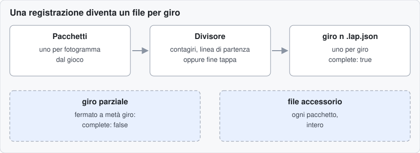

# Come vengono divisi i giri e le tappe {#how-laps-and-stages-are-split}

Un registratore vede un flusso continuo di campioni. Trasformarlo in giri avviene con
uno di quattro divisori, scelto in base a ciò che il gioco dice sui giri. Tutti seguono
la stessa idea: usare il conteggio del gioco quando ce n'è uno, altrimenti trovare il
giro dalle posizioni; non scrivere mai un frammento troppo corto per essere confrontato.

| Divisore | Codice | Usato da |
|---|---|---|
| `LapSplitter` | [`fulllap.py`](https://github.com/Holdi601/3DHeat-GameCapture/blob/main/heat3d_capture/telemetry/fulllap.py) | Forza |
| `CounterSplitter` | [`kunos.py`](https://github.com/Holdi601/3DHeat-GameCapture/blob/main/heat3d_capture/telemetry/kunos.py) | Assetto Corsa, ACC |
| `LineSplitter` | [`kunos.py`](https://github.com/Holdi601/3DHeat-GameCapture/blob/main/heat3d_capture/telemetry/kunos.py) | AC EVO, AC Rally, BeamNG |
| `StageSplitter` | [`rally.py`](https://github.com/Holdi601/3DHeat-GameCapture/blob/main/heat3d_capture/telemetry/rally.py) | EA SPORTS WRC, DiRT Rally 2.0, DiRT Rally, DiRT 4, Richard Burns Rally |

Trackmania divide le corse dentro il suo plugin ([Trackmania](telemetry-trackmania.md)),
e i file iRacing vengono divisi dal visualizzatore in base al contatore di giri del
simulatore ([iRacing](telemetry-iracing.md)).

Con **Ctrl+C** ogni registratore chiama il `flush()` del suo divisore, così un giro o una
tappa aperti vengono scritti se superano gli stessi minimi descritti qui sotto.

## LapSplitter (Forza) {#lapsplitter-forza}

Parametri: `minimum_metres = 400`, `gap_seconds = 2.0`.

Per ogni pacchetto decodificato:

1. Se il `timestampMs` del gioco è saltato in avanti di più di 2 secondi dall'ultimo
   pacchetto, oppure è tornato indietro, il giro aperto viene prima chiuso (flush).
2. Se `isRaceOn` è 0 (il gioco non è in gara), il giro aperto viene chiuso e il
   pacchetto viene scartato.
3. Se nessun giro è aperto, ne viene aperto uno con il `lapNumber` del pacchetto.
4. Se `lapNumber` è diverso da quello del giro aperto, il giro aperto viene **chiuso come
   completo**; il suo `seconds` è il `lastLap` del gioco quando è positivo. Un giro chiuso
   in questo modo viene scritto qualunque sia la sua lunghezza. Ne viene aperto uno nuovo.
5. Il pacchetto viene aggiunto.

Il registratore chiude anche il giro quando per 2 secondi di tempo reale non arriva alcun
pacchetto (il gioco è in pausa, oppure è stato chiuso a metà giro).

Il **flush** mantiene il giro aperto solo se ha almeno 2 campioni e almeno 400 m di
`distanceTravelled`; viene scritto come incompleto (una `run`). Una gara da punto a punto
non conta mai un secondo giro, quindi finisce sempre così.

## CounterSplitter (AC, ACC) {#countersplitter-ac-acc}

Parametro: `minimum_metres = 300`. Riceve ogni campione con `completedLaps` e il tempo
dell'ultimo giro dalla pagina grafica.

- Il primo campione apre un giro numerato con il `completedLaps` corrente.
- Quando `completedLaps` cambia, il giro aperto si chiude. È **completo**, con
  `seconds = tempo dell'ultimo giro in ms / 1000` (se positivo), solo se il contatore è
  salito esattamente di 1 - un ritorno a 0 (un riavvio della sessione) o un salto di più
  giri lo chiudono come incompleto.
- Un giro chiuso viene scritto solo se ha campioni e almeno 300 m di percorso.
- Il flush mantiene il giro aperto se ha più di un campione e almeno 300 m.

## LineSplitter (AC EVO, AC Rally, BeamNG) {#linesplitter-ac-evo-ac-rally-beamng}

Parametri: `radius = 15 m`, `minimum_metres = 300`, `stop_seconds = 8`.

Questi giochi o non hanno un contatore di giri in una pagina che il registratore legge,
oppure corrono tappe. La **linea è il punto dove è iniziata la registrazione**:

1. La posizione orizzontale (`x`, `z`) del primo campione diventa la linea.
2. Una volta che l'auto ha percorso più di 5 m, la direzione dalla linea all'auto diventa
   la direzione del giro.
3. **Fermarsi** conclude una corsa: quando `speed` resta sotto 1 m/s per 8 secondi, il giro
   aperto viene chiuso (è così che finisce una tappa rally: l'auto si ferma all'arrivo).
4. **Attraversare la linea**: dopo più di 300 m di percorso, si raccolgono i campioni entro
   15 m dalla linea. Quando l'auto esce di nuovo da quel raggio, il campione raccolto più
   vicino è l'attraversamento. Se in quel punto l'auto andava nella stessa direzione del
   giro (il prodotto scalare tra la direzione locale e quella del giro è positivo), il giro
   si chiude su quel campione; altrimenti il passaggio viene ignorato (l'auto ha attraversato
   il traguardo nel senso opposto).
5. Il `seconds` di un giro chiuso è il tempo dal suo primo campione all'attraversamento. È
   **completo solo se il suo primo campione era più veloce di 5 m/s**: un giro partito da
   fermo è una partenza, non un giro da confrontare. Il primo giro di una registrazione
   iniziata sulla griglia è quindi sempre incompleto; una registrazione iniziata in un giro
   lanciato dà un primo giro completo al passaggio successivo.
6. Il giro successivo parte dal campione di attraversamento (che appartiene a entrambi i giri).

I giri più corti di 300 m vengono scartati. Il flush (una sosta, oppure Ctrl+C) mantiene il
giro aperto se ha almeno 2 campioni e 300 m, come incompleto. BeamNG fa il flush allo stesso
modo quando il veicolo viene resettato (il suo orologio torna indietro), prima di avviare un
nuovo divisore, così la corsa fatta prima del reset viene conservata.

Le distanze sono orizzontali (`x`, `z`) per il contatore di percorso e per il test della
linea, e 3D complete per il test della lunghezza di 300 m.

## StageSplitter (giochi rally) {#stagesplitter-rally-games}

Parametro: `minimum_metres = 300`. Riceve ogni campione con l'orologio di tappa del gioco,
se il gioco dice che l'auto ha finito, e facoltativamente il tempo del gioco per essa.

1. Se l'orologio è 0 o meno, oppure è tornato indietro di più di 0,5 s, la tappa aperta
   viene **abbandonata**: conservata come tappa parziale se non è completa, ha più di 10
   campioni e almeno 300 m. Un orologio a 0 o meno scarta anche il campione (l'auto è alla
   partenza).
2. Se nessuna tappa è aperta, ne viene aperta una nuova (numerata 1, 2, ... per la
   registrazione).
3. Una volta che una tappa è completa, i campioni successivi vengono ignorati finché
   l'orologio non torna indietro.
4. Ogni campione viene memorizzato con `time` impostato sull'orologio di tappa.
5. Quando il gioco dice che è finita, la tappa è completa; il suo `seconds` è il tempo del
   gioco quando è dato e positivo, altrimenti l'orologio. Viene scritta se ha coperto almeno
   300 m.

Cosa significa "finita" per ogni gioco:

| Gioco | Finita quando |
|---|---|
| EA SPORTS WRC | lunghezza della tappa > 0 e distanza percorsa nella tappa >= lunghezza - 0,5 m |
| Giochi DiRT | i giri completati sono saliti sopra il conteggio iniziale della tappa, oppure (evento a giro singolo) la distanza percorsa nel giro >= 99,9% della lunghezza del tracciato |
| Richard Burns Rally | orologio di gara > 0 e distanza dalla fine <= 0 |

Per RBR l'asse verticale e la velocità vengono fissati quando una tappa viene scritta (vedi
[Giochi rally](telemetry-rally.md#richard-burns-rally-rsf--ngp)).

## Tempo e distanza nel file del giro {#time-and-distance-in-the-lap-file}

Per ogni registratore tranne Forza, `time` viene riportato a 0 nel primo campione del giro e
`distance` è la distanza 3D cumulativa tra posizioni consecutive. Forza usa il cronometro
del giro del gioco e il suo contatore di distanza, riportati allo stesso modo.
