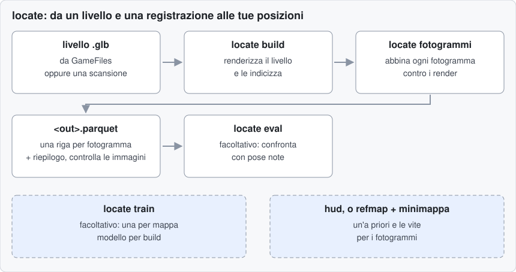

# Localizzare i fotogrammi in un livello {#locating-frames-in-a-level}

`locate` stabilisce dove è stato ripreso ogni fotogramma di una registrazione di gioco - la posizione 3D della camera
e la direzione di vista - confrontando l'immagine con i render della geometria del livello. Serve per i giochi che non
conservano alcuna traccia di dove si trovava il giocatore: nessuna demo, nessun file di replay, nessuna telemetria.
Battlefield 6 è il primo.

> **Sperimentale.** Su registrazioni reali per ora colloca solo una piccola parte dei fotogrammi; vedi
> [Fotogrammi reali: sperimentale](#real-frames-experimental).

```bash
# Una volta per livello: renderizza da ogni punto in cui un giocatore può stare, e indicizza i render.
.venv\Scripts\python -m heat3d_capture locate build level.glb -o level.db

# Per registrazione: dove è stato ripreso ogni fotogramma?
.venv\Scripts\python -m heat3d_capture locate frames "<recording>.mp4" --db level.db -o out/match
```

La posizione viene **dall'immagine**, rispetto all'intero livello, senza alcun punto di partenza. Il percorso sulla
minimappa del [lettore della HUD](hud-video.md) serve solo come riserva per i fotogrammi che l'immagine non riesce a
collocare, e ogni riga dice da quale delle due viene.




## Cosa tocca e cosa non tocca {#what-it-does-and-does-not-touch}

- Legge la **registrazione del giocatore** e un file di livello che il giocatore ha esportato dalla **sua copia** del
  gioco. Non tocca mai il gioco, la sua memoria, i suoi file mentre gira, o la sua rete, e viene eseguito dopo la
  partita. Vedi [Le regole](rules.md).
- Colloca **solo la camera del giocatore**: il fotogramma è la vista propria del giocatore.
- Il livello, il database costruito da esso e tutto ciò che viene renderizzato a partire da esso appartengono
  all'editore del gioco. Tienili in locale.

## Requisiti {#requirements}

- Quanto elencato in `requirements.txt`, PyTorch (da pytorch.org, per la GPU), e `requirements-locate.txt`:

```bash
.venv\Scripts\python -m pip install -r requirements-locate.txt
```

- Una GPU con OpenGL 3.3 (4.3 è più veloce) per i render, e preferibilmente CUDA per i modelli. Su una CPU funziona,
  ma lentamente.
- I modelli vengono scaricati al primo uso (circa 450 MB): DINOv2 da Hugging Face, ALIKED e LightGlue tramite kornia.
  Sono tutti concessi in licenza per uso commerciale; vedi [Licenze](#licences).
- Il **livello** come `.glb` (o `.gltf`) nel sistema di riferimento del visualizzatore, Y in alto, **con le sue texture
  di colore base**, come lo scrivono gli esportatori 3DHeat (parti `ground:` / `structure:`; i nomi delle parti non
  servono). Un'unità è un metro, a meno che `extras.unit_metres` nel livello superiore del file non dica altro. Una
  scansione di GameCapture (`reconstruct`, la finestra di scansione) viene scritta in **centimetri** e porta
  `extras.unit_metres: 0.01`, quindi viene letta alla sua dimensione reale. Un livello senza texture funziona molto
  peggio; vedi [Limiti](#limits).

## Comandi {#commands}

### `locate build <level> -o <db>` {#locate-build---o-}

Renderizza il livello da ogni punto in cui un giocatore potrebbe stare, e memorizza, per ogni render, la sua posa e un
descrittore globale.

| Opzione | Predefinito | Significato |
|---|---|---|
| `level` | | Il `.glb` / `.gltf` del livello. |
| `-o`, `--out` | | La cartella del database da scrivere. |
| `--game` | `bf6` | Il profilo di gioco: altezze degli occhi, campo visivo, riquadri della HUD, velocità (sotto). `generic` per qualunque gioco in prima persona. |
| `--eye` | quello del profilo | Altezze degli occhi sul pavimento in metri, prima quella da in piedi. Una vista del database per ogni altezza. |
| `--fov` / `--vfov` | quello del profilo | Il campo visivo orizzontale della registrazione, o quello verticale (lo slider di Battlefield) per una registrazione 16:9. |
| `--spacing` | 2,5 | Metri tra i punti da cui vengono prese le viste. |
| `--yaw-step` | 30 | Gradi tra le direzioni delle viste. |
| `--pitch` | 0 | Inclinazioni a cui renderizzare, in gradi verso l'alto. |
| `--positions` | nessuno | Una tabella (Parquet o CSV con `x`, `y`, `z` alla base dei piedi, nel sistema del livello) da cui prendere i punti invece di ogni pavimento: per esempio l'output di una run precedente. |
| `--shadows` | disattivo | Proietta le ombre del sole nei render (il sole del livello stesso quando il suo file ne indica uno in `extras.sun`). |
| `--untextured` | disattivo | Renderizza solo forma e luce. |
| `--box X0 Z0 X1 Z1` | l'intero file | Solo punti dentro questo riquadro (unità del livello): l'area di gioco. |
| `--places` | `auto` | Da dove vengono prese le viste: `nav` - giocatori all'altezza degli occhi sulla mesh di navigazione del livello (parti `nav:`: esattamente dove il gioco permette di camminare), camere dei veicoli alla loro altezza sulle parti `ground:` (terreno e strade) entro 50 m da essa; `ground` - entrambe sopra `ground:`; `floors` - sopra ogni faccia rivolta verso l'alto (anche tetti e casse); `auto` - `nav` quando il livello ha una mesh di navigazione, altrimenti `floors`. |
| `--head` | nessuno | Una testa per mappa da `locate train` per i descrittori. |

Scrive `<db>/db.json` (da cosa è stato costruito e con cosa) e `<db>/views.npz` (pose, descrittori).

### `locate frames <recording> --db <db>` {#locate-frames----db-}

| Opzione | Predefinito | Significato |
|---|---|---|
| `source` | | Un video, un'immagine, o una cartella di immagini (prese in ordine di nome, a `--fps` di distanza). |
| `--db` | | Il database scritto da `build`. Il suo file di livello deve trovarsi ancora dov'era (o `--level`). |
| `-o`, `--out` | `<source>.locate` | Percorso di output senza estensione. |
| `--fps` | 2 | Fotogrammi localizzati per secondo di video. |
| `--start`, `--seconds` | tutto | La parte del video da leggere. |
| `--width` | 1280 | La larghezza a cui vengono confrontati i fotogrammi. |
| `--shortlist` | 8 | Viste del database provate per fotogramma vicino a un punto di partenza o a una correzione. |
| `--search-shortlist` | 16 | Senza punto di partenza: viste del database provate per fotogramma ([cercate insieme](#with-no-prior-frames-searched-together)). |
| `--no-search` | disattivo | Senza punto di partenza: cerca ogni fotogramma da solo e crede alla sua correzione senza i vicini. |
| `--accept-depth` | 0 (disattivo) | Senza punto di partenza: crede a una correzione solo se la distanza lontana dei suoi abbinamenti è questo multiplo di quella vicina. |
| `--accept-support` | 2 | Senza punto di partenza: vicini concordi lungo la vita necessari perché una correzione sia creduta. |
| `--checkpoint` | nessuno | Conserva qui lo stato della run e riprende da esso se c'è. |
| `--stop-file`, `--stop-process` | nessuno | Si ferma da solo, con lo stato salvato, codice di uscita 75, quando esiste questo file o gira un processo il cui nome inizia così (controllato prima di ogni fotogramma; può essere ripetuto), così una run lunga libera la macchina per un gioco. Lo stesso comando riprende. |
| `--normalise` | nessuno | Normalizzazione leggera prima del confronto: `clahe`, `gray`. |
| `--minimap` | nessuno | La tabella del comando `hud`: la **riserva** per i fotogrammi che l'immagine non riesce a collocare. |
| `--prior-radius` | nessuno | **Accelerazione opzionale**, disattivata per impostazione predefinita: cerca solo le viste del database entro questo numero di metri dalla posizione della minimappa (richiede `--minimap`). |
| `--minimap-anchor` | nessuno | Un file JSON che lega la minimappa al livello ([la minimappa come punto di partenza della ricerca](#the-minimap-as-a-search-prior)): la minimappa riduce la ricerca dal primo fotogramma; le correzioni trovate così sono `visual+minimap-prior`. |
| `--no-level-search` | disattivo | Con un punto di partenza: quando niente vicino ad esso corrisponde, non cerca anche in tutto il livello (più veloce). |
| `--lives` | la tabella di `--minimap` | La tabella del comando `hud` le cui morti, schieramenti e rianimazioni dicono quando il giocatore era in gioco: le posizioni saltano solo attraverso una morte ([vite dal filmato](#lives-from-the-footage)). |
| `--no-sequence` | disattivo | Decide ogni fotogramma da solo, non lungo la run (sotto). |
| `--fit-fov` | disattivo | Dopo la run, adatta il campo visivo alle correzioni più forti, per vista, e lo riporta. |
| `--check-every` | 0 | Anche ogni N fotogrammi, collocati o no, un'immagine in `<out>.check`. |
| `--no-checks` | disattivo | Non scrive le immagini di controllo delle correzioni visive (sotto). |
| `--no-zoomed` | disattivo | Non risolve le viste ingrandite a partire dalle correzioni dei vicini (sotto). |
| `--no-grow` | disattivo | Non cerca di nuovo vicino a ogni correzione i fotogrammi attorno a essa che ne sono ancora privi. |
| `--game`, `--eye`, `--fov`, `--vfov`, `--mask`, `--no-hud-mask`, `--max-speed` | quelli del profilo | Come sopra; `--mask x,y,w,h` aggiunge un riquadro dello schermo (su uno schermo 1920x1080) che non è il livello. |
| `--vehicle-vfov` | quello del profilo | Il campo visivo verticale delle camere dei veicoli (lo slider dei veicoli di Battlefield). |
| `--settings` | il file di impostazioni più recente | `bf6`: il file delle impostazioni del gioco da cui si leggono i campi visivi (in sola lettura) quando non è dato `--fov`/`--vfov`; per impostazione predefinita l'ultimo `PROFSAVE*_profile` sotto `Documents/Battlefield 6/settings`. Contiene le impostazioni così come sono adesso, che potrebbero non essere come era fatta una registrazione più vecchia. |

### `locate refmap <level> <deploy screen> -o <refmap>` {#locate-refmap----o-}

Colloca la mappa del gioco sul livello: il riferimento con cui viene letta la minimappa
([la minimappa, letta rispetto al livello](#the-minimap-read-against-the-level)). `<deploy screen>` è un'immagine della
schermata di schieramento che mostra l'intera mappa, oppure una registrazione con `--at <seconds>` su un momento del
genere; il riquadro della mappa del profilo viene ritagliato da essa (`--whole-picture` conserva tutto). Scrive
`<refmap>.png` (la mappa ricampionata sul sistema del livello, `--mpp` metri per pixel, predefinito 0,5),
`<refmap>.valid.png` (dove c'è la mappa, non un marcatore o un'etichetta) e `<refmap>.json` (il sistema di riferimento
e la calibrazione, con quanto distavano le piastrelle della mappa da esso). `--topdown <prefix>` conserva il livello
renderizzato dall'alto per la run successiva (`--topdown-mpp`, predefinito 0,656 m; `--box` lo limita).

### `locate minimap <recording> --refmap <refmap> -o <table>.parquet` {#locate-minimap----refmap---o-parquet}

Legge la minimappa della registrazione rispetto alla mappa di riferimento, fotogramma per fotogramma (`--fps`,
predefinito 2): posizione, orientamento e zoom di ogni minimappa che corrisponde, nel sistema del livello, scritti come
una tabella della minimappa con un ancoraggio accanto (`<table>.anchor.json`) che `locate frames` accetta come
`--minimap <table>.parquet --minimap-anchor <table>.anchor.json`. Con la tabella del comando `hud` (`--hud`) le sue
vite vengono riportate; con un ancoraggio anche per quella tabella (`--hud-anchor`) la prima ricerca avviene attorno a
dove la mette il giocatore, e dove nessuna minimappa corrisponde, il percorso della HUD riempie i vuoti, spostato sulle
correzioni più vicine della mappa di riferimento (`--hud-fill`, secondi, predefinito 120; 0 lo disattiva). Il `source`
della tabella dice quale (`refmap`, `hud`).

### `locate eval <out>.parquet --truth <poses>` {#locate-eval-parquet---truth-}

Confronta un risultato con pose note della camera: una tabella con `time`, `x`, `y`, `z` (l'occhio), `yaw`, `pitch`
nel sistema del livello. `--offset` è lo scostamento dell'orologio (tempo vero = tempo del video + offset); senza, lo
scostamento viene cercato. `--unit-metres` trasforma gli errori in metri.

## Profili di gioco {#game-profiles}

| | `bf6` | `generic` |
|---|---|---|
| Altezze degli occhi | 1,6 m in piedi, 1,05 m accovacciato (non ancora misurate nel gioco) | 1,65, 1,1 m |
| Campo visivo | 55 gradi verticali, circa 86 orizzontali a 16:9: **passa quello del giocatore** con `--vfov` | 90 orizzontali |
| HUD mascherata | minimappa e lista della squadra, feed delle uccisioni, bussola, munizioni, l'arma del giocatore, i popup, il mirino | il mirino |
| Più veloce a piedi | 8 m/s | 8 m/s |
| Viste distinte | a piedi, in veicolo, ingrandita (sotto) | ogni fotogramma a piedi |
| Camere dei veicoli | lo slider del veicolo (dal file delle impostazioni), il veicolo mascherato, la camera fino a 8 m sopra il pavimento, 30 m/s | - |

Il campo visivo conta più di tutto: un fotogramma risolto con quello sbagliato viene risolto con la lunghezza focale
sbagliata, e la sua posizione scivola lungo la vista.

## Output {#outputs}

### `<out>.parquet` {#parquet}

Una riga per ogni fotogramma localizzato, nel **sistema del livello** (Y in alto, unità del livello), con le istruzioni
di lettura del visualizzatore nel piè di pagina (`kind: heat3d-locate`). Il piè di pagina indica ogni colonna che non
ha un ruolo proprio come extra, così il visualizzatore le conserva tutte (la sua scheda di ispezione le mostra).

| Colonna | Significato |
|---|---|
| `time` | Secondi dall'inizio del video. |
| `event` | `start` sulla prima riga di una vita, `position` sulle altre. |
| `x`, `y`, `z` | L'occhio, smussato all'interno della vita. Vuoto dove nessuna delle due fonti ha collocato il fotogramma. |
| `yaw`, `pitch` | Gradi: imbardata attorno all'asse verticale (0 lungo +X, crescente verso -Z, che è l'imbardata propria di un gioco nel sistema del visualizzatore), beccheggio verso l'alto dall'orizzontale. `pitch` è vuoto sulle righe della minimappa. |
| `dir_x`, `dir_y`, `dir_z` | La direzione di vista. |
| `player`, `team`, `session` | `me`, `own`, e `<video>#NN`, uno per vita. |
| `life` | La vita in cui il filmato mostra il fotogramma (dalle morti della HUD; 1 = la prima). Vuoto quando è fuori gioco (morto, a terra, in schieramento) o quando le vite non sono state lette. `session` è la vita del percorso, che può anche dividersi in un salto. |
| `source` | `visual` (dall'immagine), `visual+minimap-prior` (dall'immagine, la ricerca ridotta al punto di partenza della minimappa), `minimap` (la riserva), `minimap+nav-floor` (al chiuso: la minimappa e il pavimento della mesh di navigazione) oppure `none`. |
| `view` | `foot`, `vehicle`, `zoomed` o `screen` (sotto). |
| `cam_x`, `cam_y`, `cam_z` | La camera che ha visto il fotogramma. A piedi e attraverso un mirino è l'occhio, e `x`, `y`, `z` sono gli stessi; nella vista in terza persona di un veicolo `x`, `y`, `z` sono il veicolo (il modello di offset sotto) e la camera sta dietro e sopra di esso. |
| `hfov`, `zoom` | Il campo visivo orizzontale con cui è stato risolto il fotogramma, e per una vista ingrandita il suo zoom rispetto alla vista normale. |
| `confidence` | 0..1: quanto fidarsi della riga (sotto). |
| `uncertainty` | L'errore tipico della riga, in unità del livello: per una correzione visiva dai suoi inlier e dai vicini, per una riga della minimappa dall'adattamento (sotto). |
| `inliers`, `rmse` | Gli inlier PnP della risoluzione visiva e l'errore di riproiezione (pixel alla larghezza di lavoro). |
| `x_raw` ... `pitch_raw` | La risoluzione visiva prima dello smussamento (anche per gli outlier scartati dal voto). |
| `kept` | La correzione visiva ha superato il voto sugli outlier. |
| `note` | Perché un fotogramma non è stato collocato, o è stato scartato dal voto. |

### `<out>.summary.json` {#summaryjson}

Fotogrammi, correzioni visive, outlier, vite, righe per fonte, l'adattamento della minimappa (coppie, inlier, residuo),
tempo per fotogramma.

## Metodo {#method}

### Il database {#the-database}

I punti sono posti su ogni triangolo rivolto verso l'alto del livello, distribuiti in modo uniforme (uno per
`--spacing` su una griglia 3D, così i piani di un edificio ne ricevono ciascuno). Ognuno viene controllato dal suo
occhio con sei piccoli render di profondità: una camera dentro la geometria vede soprattutto facce posteriori, uno
spazio strisciante ha qualcosa di solido sopra l'occhio; entrambi vengono scartati. Da ogni punto il livello viene
renderizzato a ogni altezza degli occhi, ogni `--yaw-step` e ogni `--pitch`, e ogni render viene descritto da
**DINOv2** (i suoi token di patch raggruppati per media generalizzata, uniti al token di classe).

I punti caratteristici locali e i punti 3D con cui un fotogramma viene infine risolto **non vengono memorizzati**: si
ricreano quando servono, renderizzando le poche viste scelte dal recupero, cosa che richiede millisecondi. Così un
database resta a qualche centinaio di megabyte invece che decine di gigabyte, ed è ciò che permette il perfezionamento
qui sotto. Il costo è che `frames` richiede il file del livello e una GPU, non solo il database.

### Un fotogramma {#one-frame}

1. **Maschera** ciò che non è il livello: i riquadri della HUD del profilo e il mirino, più ogni `--mask`.
2. **Recupero** sull'**intero livello**: il descrittore del fotogramma contro ogni vista del database; le poche decine più
   simili, sfoltite perché abbiano luoghi e direzioni diversi, formano la lista breve.
3. **Abbinamento**: ogni vista della lista viene renderizzata di nuovo alla dimensione e al campo visivo del fotogramma,
   con la sua profondità. I punti chiave ALIKED del fotogramma e del render vengono abbinati con LightGlue. Un pixel del
   render abbinato più la sua profondità è un punto 3D del livello, quindi ogni abbinamento è una corrispondenza
   2D-3D; i punti chiave su un bordo di profondità (la cui profondità può appartenere a ciò che sta dietro) vengono
   scartati.
4. **Posa**: PnP con RANSAC (SQPnP), poi un perfezionamento robusto che mantiene la camera orizzontale - una vista in
   prima persona non si inclina di lato - e minimizza l'errore di riproiezione degli inlier.
5. **È possibile?** Una posa deve essere all'altezza degli occhi di un giocatore sopra un pavimento e fuori dalla
   geometria (un render di profondità dritto verso il basso). Una texture simile altrove - un pavimento a piastrelle
   abbinato a un muro dello stesso materiale - può dare centinaia di inlier in una posa che nessun giocatore potrebbe
   avere; quelle vengono messe da parte, qualunque sia il loro numero di inlier.
6. **Render e confronto**: il livello viene renderizzato nella posa risolta e confrontato di nuovo, il che sostituisce
   una vista del database lontana fino a qualche metro e decine di gradi con una che quasi coincide con il fotogramma.
   Ripetuto finché guadagna inlier (al massimo due volte).
7. **Scelta**: i tre luoghi più forti (più di circa 3 m l'uno dall'altro) vengono ciascuno perfezionati prima di sceglierne
   uno. Una corrispondenza ingannevole può essere in testa prima del perfezionamento; il luogo giusto ne guadagna molto
   di più.
8. **Verdetto**: `confidence` combina il numero di inlier, il miglior altro luogo (`runner_up`) e l'errore di
   riproiezione. Una correzione è `ok` con almeno 25 inlier, nessun altro luogo entro l'80% dei suoi inlier, e una
   confidenza di almeno 0,85 - la soglia che le misure qui sotto collocano al 97,5-99% di correttezza.

### Viste {#views}

Un fotogramma non è sempre l'occhio del giocatore. Il rilevatore del profilo legge dalla HUD quale vista sia, e il
fotogramma viene risolto di conseguenza:

- **A piedi**: il campo visivo della fanteria e le altezze degli occhi.
- **Veicolo** (Battlefield 6: i tasti del diagramma del posto, `C CAMERA` ed `E EXIT`, in basso al centro): il campo
  visivo del veicolo, il veicolo stesso mascherato (la parte centrale bassa dello schermo nella sua vista in terza
  persona), e una camera ammessa fino a 8 m sopra il pavimento. La correzione è quella della camera.
- **Schermo** (bordi scuri attorno a un centro scuro: la mappa di schieramento, un menu, il tabellone): non è una vista
  del livello; viene saltato.
- **Ingrandito** (un mirino, il mirino di un cannoniere, la vista in prima persona di un veicolo: un bordo dello schermo
  nero, entrambi scuri, attorno a un'immagine luminosa): non viene cercato sul livello - la fetta di livello visibile da
  un mirino non assomiglia a nessuna delle viste ampie del database - ma viene risolto dopo la run dalla correzione più
  vicina entro 6 s, sotto. Disattivabile con `--no-zoomed`.

### Viste ingrandite {#zoomed-views}

Una vista stretta fissa male la posizione: un passo indietro con un po' più di zoom sembra quasi lo stesso. Quindi un
fotogramma ingrandito parte da dove il suo vicino dice che sta il mirino - a piedi l'occhio di quella correzione, in
veicolo 2,5 m sopra il terreno sotto il centro del veicolo (il mirino di una torretta) - e da quanto può essersi spostato
da lì: 2 m, più 4 m al secondo a piedi o 8 in veicolo, al massimo 12 m (`reach`).

1. **Direzione e zoom, posizione tenuta.** Per ogni zoom di 1, 1,2 (la vista propria di un veicolo, più stretta di
   quella a piedi), 1,5, 2, 3, 4, 6 e 8, il livello viene renderizzato dal punto di vista nelle direzioni entro 30
   gradi da quelle del vicino (e, da 3x in su, qualche inclinazione). I punti chiave del fotogramma abbinati a un render,
   con i punti del livello sotto di essi, sono raggi dal punto di vista; una rotazione viene adattata a coppie (RANSAC)
   per lunghezze focali da 0,75 a 1,3 volte quella dello zoom, con un punto che concorda entro un angolo che tiene conto
   del fatto che il punto di vista può essere `reach` lontano alla sua distanza. Vince lo zoom, la direzione e la
   lunghezza focale con cui concorda il maggior numero di punti.
2. **Assestato.** Quei punti vengono poi adattati insieme a posizione, direzione e lunghezza focale, sul loro errore di
   riproiezione, con la posizione tenuta al punto di vista da un costo di due pixel per ogni `reach` spostato; renderizzato
   ancora una volta alla risposta e adattato di nuovo. Inlier ed errore si contano in pixel, e la correzione è `ok` con la
   stessa confidenza di ogni altra.

Lo zoom scritto (`zoom`) è rispetto al campo visivo della run a piedi; `hfov` è quello risolto. In un veicolo la
posizione scritta è quella del veicolo, 2,5 m sotto il mirino, come per la sua vista in terza persona.

### Veicoli: la camera e il veicolo {#vehicles-the-camera-and-the-vehicle}

Nella vista in terza persona di un veicolo la posa risolta è quella della camera inseguitrice, che sta dietro e sopra il
veicolo e gli gira attorno quando il giocatore guarda intorno. La posizione scritta (`x`, `y`, `z`) è quella del veicolo
- il terreno sotto il suo centro: la camera più l'`vehicle_offset` del profilo, tanti metri avanti lungo la direzione
orizzontale di vista della camera e tanti in basso. La camera resta in `cam_x`, `cam_y`, `cam_z`. La conversione viene
fatta prima della sequenza e del percorso, così una camera che ruota attorno a un veicolo fermo non viene presa per un
movimento. Il piè di pagina della tabella riporta l'offset usato e se è stato misurato (`vehicleOffset`). A piedi e
attraverso un mirino non c'è alcun offset.

Come è stato misurato l'offset di Battlefield 6: su correzioni giuste di fotogrammi reali in terza persona di un carro,
il centro del carro è stato segnato a occhio sul fotogramma, e il livello renderizzato nella correzione ha dato il
terreno in quel pixel. Il profilo prende la mediana: circa 10 m avanti alla camera e circa 4 m sotto di essa. La
segnatura è buona a un metro circa, ed è un tipo di veicolo solo: un'auto o un elicottero cavalca la sua camera in modo
diverso.

### Senza punto di partenza: fotogrammi cercati insieme {#with-no-prior-frames-searched-together}

La descrizione globale di un fotogramma contro un intero livello è un segnale debole, e gli inlier di un solo fotogramma
non distinguono un luogo giusto da una corrispondenza ingannevole. Quindi senza punto di partenza i fotogrammi di una
registrazione vengono prima descritti e cercati insieme (`search.py`), e una correzione viene creduta solo con i
fotogrammi attorno ad essa:

- **Lista breve.** La similarità di ogni vista viene misurata rispetto alla propria media e dispersione sull'intera
  registrazione, così che una vista simile a ogni fotogramma smette di vincere ovunque. Ogni fotogramma assegna alle celle
  di una griglia da 24 m il rango della loro vista migliore; il percorso migliore attraverso le celle lungo ogni vita,
  entro ciò che il giocatore può coprire tra i fotogrammi, dà una fiducia per cella, e la vista migliore di ogni cella,
  la più creduta per prima, forma un'unica lista. Il recupero semplice è l'altra, e le due si alternano: misurare le
  viste rispetto alla registrazione penalizza un luogo che il giocatore lascia appena, ed è dove il recupero semplice va
  bene.
- **Credere.** Un candidato conta solo se i suoi inlier coprono almeno il 12% di una griglia 8 x 8 sul fotogramma: una
  corrispondenza ingannevole è un oggetto ripetuto, una pila di container, con centinaia di inlier su poche celle del
  fotogramma. Una correzione viene creduta quando si trova sul percorso migliore tra i candidati che contano (sotto) con
  almeno due vicini entro 6 s che concordano con essa. Un fotogramma fuori gioco non viene affatto cercato.
- **Crescita.** Si cresce solo da ciò che è creduto, e una correzione cresciuta deve coprire il fotogramma nello stesso
  modo.

### Lungo la run {#along-the-run}

Ogni fotogramma conserva ogni posa fisicamente possibile che ha trovato, una per luogo (`candidates`), non solo la più
forte. La run poi sceglie una posa per fotogramma - o nessuna - in modo che le pose scelte formino un percorso che un
giocatore avrebbe potuto percorrere a piedi o in veicolo, e che il maggior numero possibile di inlier si trovi su di
esso: un modello di Markov nascosto, decodificato in una volta sola (Viterbi). Una corrispondenza ingannevole che vince
un fotogramma da sola perde contro il luogo con cui concordano i vicini; un candidato debole su cui passa il percorso,
con almeno due vicini concordi, diventa una correzione (`note`: chosen along the sequence); una correzione sicura che
tutti i suoi vicini contraddicono smette di esserlo. Un vicino conta come concorde solo entro 6 s: più lontano, la
distanza che un giocatore - e a maggior ragione un veicolo - avrebbe potuto coprire è così grande che concordare non
dice nulla. Disattivabile con `--no-sequence`.

### Orari dei fotogrammi {#frame-times}

Il `time` di una riga è l'orario del fotogramma nella registrazione stessa, non il suo conteggio sulla frequenza nominale.
Le registrazioni si discostano dalla loro frequenza nominale (di pochi decimi di secondo all'interno di un clip, su quelle
misurate), e tutto ciò che rilegge un fotogramma tramite il suo orario - le immagini di controllo, il passaggio dello
zoom, `locate train --real`, la minimappa del comando `hud` - cerca per timestamp. I fotogrammi contati sposterebbero
l'immagine di controllo di fino a quel tanto rispetto a quello localizzato.

### Il campo visivo, dai fotogrammi {#the-field-of-view-from-the-frames}

`--fit-fov` conserva le correzioni più forti di una run (per vista) e raffina la posa e la lunghezza focale di ciascuna
insieme sui suoi inlier; la mediana su di esse è il campo visivo con cui è stata fatta la registrazione, riportato nel
riepilogo (`hfov_fitted`) per il prossimo `--fov`. I punti vicini e lontani si muovono in modo diverso sotto un cambio di
lunghezza focale rispetto a un cambio di posizione, ed è ciò che lo fissa; servono correzioni con profondità dentro, non
un muro piatto.

### Un modello per mappa {#a-per-map-model}

`locate train` addestra una piccola testa sopra DINOv2 per un livello, sui suoi render, così che il descrittore globale
trovi le viste giuste dei fotogrammi reali e non solo dei render:

- **Testa**: ogni token di patch attraverso una proiezione a due strati, raggruppato per media generalizzata sulle patch
  che mostrano il livello, unito al token di classe proiettato. DINOv2 resta congelato. Tutto questo è scritto qui (MIT).
- **Coppie**: un punto sul terreno percorribile e una direzione, renderizzati due volte da pose distanti fino a un metro
  o due e una dozzina di gradi, con campi visivi distanti fino a 10 gradi, sotto luci diverse (sole, ombre, luce
  ambientale), ciascuno attraverso un aspetto da gioco: gradazione, foschia con la profondità, bloom, vignettatura,
  fumo, persone di mezzo, il veicolo del giocatore nelle viste da veicolo, sfocatura del movimento, rumore, JPEG
  (`augment.py`). Mascherate come un fotogramma. I punti entro pochi metri che guardano nella stessa direzione non
  contano come negativi.
- **Fotogrammi reali**: fotogrammi con una posa che la pipeline ha trovato da sola (pseudo-etichette: correzioni scelte
  lungo una sequenza) possono entrare come coppie - il fotogramma e un render alla sua posa - in un secondo giro.
- **Perdita**: contrastiva (InfoNCE) sul batch.

`locate build --head <head.pt>` costruisce il database con essa; `frames` la usa poi per i fotogrammi.

| Opzione di `locate train` | Predefinito | Significato |
|---|---|---|
| `-o`, `--out` | obbligatoria | Il file della testa da scrivere (`.pt`). |
| `--steps` | 600 | Passi di addestramento. |
| `--real TABLE VIDEO` | nessuno | Una tabella di `locate frames` e la sua registrazione: le sue correzioni sicure entrano come coppie reali. Ripetibile. |
| `--real-confidence` | 0,85 | La confidenza che una correzione deve avere per entrare come coppia reale. |
| `--spacing`, `--box`, `--places`, e le opzioni del profilo | come `build` | Dove sono i punti di addestramento, e il profilo del gioco. |

### Controllo a occhio {#checking-by-eye}

Ogni correzione visiva ottiene un'immagine in `<out>.check` - `<time>s_<view>_visual.jpg`: il fotogramma, e accanto il
livello renderizzato alla camera della correzione con i bordi del fotogramma disegnati sopra il render. Dove si
allineano, la correzione è giusta. Scritte dopo che la sequenza e il percorso hanno deciso, così le immagini sono
esattamente le righe che la tabella chiama visive. Disattivabili con `--no-checks`.

### La minimappa, letta rispetto al livello {#the-minimap-read-against-the-level}

Una minimappa unita in un unico mosaico (quella del comando `hud`) non è piatta: la sua scala deriva con lo zoom a cui è
stata registrata ciascuna minimappa, un luogo visto due volte può essere disegnato due volte, e il mosaico di ogni clip è
il suo. Una similarità adattata a poche correzioni tiene vicino a esse e sbaglia di decine di metri lontano da esse.
Quindi la minimappa viene collocata dal livello stesso, in due passi, e nulla viene unito:

- **La mappa di riferimento** (`locate refmap`). La schermata di schieramento disegna l'intera mappa con il nord in alto,
  piatta, a una sola scala. Il livello renderizzato dall'alto mostra le stesse cose ritte sul terreno (carri, edifici,
  muri): sul livello, la loro altezza sopra il terreno entro 15 m; sulla mappa, ciò che è disegnato più chiaro del terreno
  intorno. La mappa viene posta sul livello per correlazione incrociata normalizzata dei due su scala e una piccola
  rotazione, raffinata confrontando una piastrella alla volta, e infine con tutta la mappa insieme attorno a quella
  risposta (poche decine di piastrelle lasciano la scala libera di un percento, metri alle estremità della mappa). Il
  risultato è una sola similarità, da pixel della mappa a livello.
- **La minimappa, fotogramma per fotogramma** (`locate minimap`). Ogni minimappa campionata - il ritaglio e la maschera
  di overlay del lettore della HUD - viene abbinata (SIFT) alla mappa di riferimento vicino a dove il giocatore era
  l'ultima volta, o ovunque quando non si sa dove sia, e viene adattata una similarità (rotazione, zoom, spostamento). Il
  punto del giocatore portato attraverso di essa è la posizione, l'alto della minimappa (il cono di vista) l'orientamento,
  la sua scala lo zoom - misurato, non presunto.
- **Dove non corrisponde.** La schermata di schieramento non disegna nulla fuori dall'area di gioco; una minimappa che
  mostra per lo più ciò che sta fuori da essa - un giocatore al bordo della mappa - non ha nulla da abbinare. Lì il
  percorso della HUD stesso fa da supplente, spostato dallo scostamento misurato dalle correzioni più vicine della mappa
  di riferimento (`--hud-fill`); vale quanto il mosaico vicino a quelle correzioni.

Sul livello di prova la minimappa letta così era a qualche metro (mediana) dalle correzioni visive sicure, buona fuori
dall'area in cui era stata adattata la mappa di riferimento come dentro di essa.

### La minimappa come punto di partenza della ricerca {#the-minimap-as-a-search-prior}

Il percorso della minimappa del comando `hud` dice, per la maggior parte dei fotogrammi di gioco, più o meno dove si trova
il giocatore e in che direzione guarda - nelle sue unità (pixel della minimappa, nord in alto). Legato una volta al
livello, riduce la ricerca a una parte piccola di esso; la posa stessa viene comunque dall'immagine, con le stesse regole.

- **L'ancoraggio** (`--minimap-anchor <anchor.json>`): una similarità per mappa, dalla minimappa al livello - scala,
  rotazione (con lo specchio tra i pixel con il nord in alto e gli assi del livello), spostamento - adattata sulle
  correzioni visive sicure (confidenza 0,7 e oltre) di più clip. La minimappa di ciascun clip è un mosaico che il lettore
  della HUD ha unito da solo, quindi ognuno sta da qualche altra parte nelle unità della minimappa; due mosaici della
  stessa mappa differiscono solo per uno spostamento, trovato abbinando i punti chiave tra di essi (lo spostamento su cui
  concordano di più gli abbinamenti), e ogni mosaico viene legato a un riferimento attraverso tutte le coppie che
  concordano bene. Il file di ancoraggio riporta la similarità della mappa, lo spostamento del clip (`clip_shift`), e
  l'errore che l'ancoraggio ha mostrato contro le correzioni dei clip lasciati fuori dal suo adattamento (`median`,
  `p90`, metri).
- **Dove e in che direzione.** L'orientamento della minimappa è l'imbardata della camera: sui clip misurati concordava con
  l'imbardata risolta entro 2-5 gradi. Quindi un fotogramma viene prima confrontato con i render fatti dove la minimappa
  mette la camera - a piedi un occhio sul terreno lì, in veicolo la camera inseguitrice dietro e sopra di esso (l'offset
  del veicolo) - guardando lungo l'orientamento: il punto e 4 m per lato, a due inclinazioni (`seeds`). Solo quando nessuno
  di quelli dà una correzione si provano le viste proprie del database entro il disco (30 m più l'errore al 90° percentile
  dell'ancoraggio).
- **Corretto mentre la run procede.** Ogni correzione sicura vicino al punto di partenza dice quanto l'ancoraggio sbaglia
  lì; la mediana di quelle entro 2 minuti corregge il punto di partenza, e la loro dispersione (almeno 5 m) sostituisce
  l'errore dell'ancoraggio nel raggio del disco - fino a 10 m: correzioni che non concordano più di così dicono che la
  minimappa è sbagliata di posto, non che qualcosa a 50 m andrà bene. Senza una correzione entro 2 minuti il punto di
  partenza non viene affatto corretto (l'errore altrove nel clip non dice nulla su qui).
- **Ancoraggi con una griglia.** Un ancoraggio può anche portare una `grid`: x e z del livello su una griglia regolare
  sull'unità della minimappa del clip, letta bilinearmente; dentro di essa la griglia colloca il punto, fuori la
  similarità. L'ancoraggio di una tabella di `locate minimap` è l'identità (la sua tabella è già nel sistema del livello).
- **Adattamenti deboli.** Con un punto di partenza, un adattamento debole (25 inlier o più, ma non abbastanza sicuro da
  solo) che cade dentro il disco viene conservato - con la sua confidenza più bassa - perché la sequenza e il percorso lo
  giudichino, non scartato: il fumo, le macerie e i muri distrutti lasciano ai fotogrammi reali meno corrispondenze.
- **Fonti.** `visual` - l'immagine l'ha collocato, senza punto di partenza; `visual+minimap-prior` - l'immagine l'ha
  collocato, la ricerca ridotta al punto di partenza; `minimap` - l'immagine non l'ha fatto, la minimappa fa da
  supplente; `minimap+nav-floor` - al chiuso, sotto.
- **Al chiuso** la minimappa guida. Un fotogramma che l'immagine non ha collocato, a piedi, dove un occhio nella posizione
  della minimappa vede il livello vicino da ogni lato (distanza mediana sotto 8 m in quattro direzioni) e nessun cielo,
  è al chiuso: riceve la x e la z della minimappa e l'altezza del pavimento della mesh di navigazione lì - di più piani, quello
  più vicino all'ultima correzione - con `source = minimap+nav-floor`, così che sia chiaro che l'immagine non l'ha fissato.

### Vite dal filmato {#lives-from-the-footage}

Una posizione può saltare solo dove il giocatore è morto. Le vite non vengono indovinate dalle posizioni - una sola
correzione sbagliata aprirebbe una vita nuova - ma lette dal filmato: la tabella del lettore della HUD registra le morti
che mostrano le schermate di caduta e di schieramento (`death`), le cadute da cui un compagno ha rianimato (`downed`,
`revived`), gli schieramenti (`spawn`) e dove il gioco è iniziato e finito (`start`, `end`); `lives.py` le trasforma in
vite. Una morte chiude una vita, il primo fotogramma di gioco dopo la schermata di schieramento ne apre una nuova; una
rianimazione non la taglia (il giocatore è dove è caduto), e i fotogrammi mentre si è a terra non vengono collocati; un
tratto di menu o di caricamento più lungo di 10 s taglia anche lui. I fotogrammi fuori gioco (morto, in schieramento, a
terra) non vengono mai collocati.

Dentro una vita la continuità è una regola ferrea: ogni passo al massimo la velocità per il tempo trascorso più 1,5 m. La
velocità è quella del fotogramma: a piedi quella del profilo, in veicolo la velocità che il contatore del veicolo mostrava
entro 3 s (un terzo in più, e 2 m/s, per l'accelerazione), oppure, dove non ne mostra, il limite della sua classe. Nella
run (Viterbi) un passo attraverso una morte è libero a qualunque distanza, ogni altro passo è limitato; un fotogramma che
richiederebbe un salto viene lasciato fuori - il lato più debole di una contraddizione perde (meno inlier, meno sostegno) - e
la vita non viene mai divisa per esso. Quando il lato lasciato fuori è esso stesso forte (confidenza 0,9 e oltre, due o più
correzioni che concordano tra loro), la run non indovina: entrambi i lati vengono conservati e segnati come `jump without
detected death` (una morte mancata, o un vero teletrasporto), ed elencati nel riepilogo. La riserva della minimappa segue
le stesse vite.

Battlefield 6: la vista in prima persona dei carri mostra la velocità (`<n> KPH`, a destra del mirino; letta con l'OCR del
lettore della HUD); la vista in terza persona no. Le letture sui clip di prova erano lente, quindi i veicoli terrestri sono
ammessi a 15 m/s dove non viene letto nulla. Battelli, elicotteri e jet hanno limiti generosi (20, 90 e 280 m/s) che non
sono misurati: nessun clip ne mostra uno guidato o pilotato, e il classificatore di vista non distingue aria da terra - un
tratto più veloce di un veicolo terrestre appare come un salto, segnalato, non affidabile.

### Distruzione {#destruction}

I file del livello sono il livello intatto; in una partita muri, case e rocce vengono distrutti a colpi, macerie e fumo
restano sospesi, e la situazione peggiora con il procedere della partita.

- **L'abbinamento si fida del livello statico.** Una parte che l'esportazione marca come distruttibile (il suo nome inizia
  con `destructible:`, oppure `extras.destructible` sul suo nodo, mesh o primitiva) viene disegnata nella maschera
  `destructible` del render. Gli abbinamenti il cui punto del livello cade su di essa vengono scartati quando ne restano 40
  o più su parti statiche - il terreno, le strade, le grandi strutture reggono la risoluzione.
- **L'addestramento vede le parti sparite.** I render di addestramento (`locate train`) sostituiscono pezzi delle parti
  distruttibili con rumore color macerie, e aggiungono polvere bassa sopra il terreno, sopra il fumo e il resto dell'aspetto
  di gioco (`augment.py`), così che il modello per mappa impari a non appoggiarsi su di esse.
- **Una geometria mancante non è un luogo sbagliato**: con un punto di partenza, gli adattamenti deboli nel suo disco vengono
  conservati (sopra).

Finché le esportazioni non portano i marcatori, nulla è segnato come distruttibile, e queste cose non fanno nulla.

### Il percorso {#the-track}

- **Valori anomali**: una correzione viene confrontata con le correzioni nei 3 s prima e, separatamente, nei 3 s dopo; è
  coerente se non è più lontana di quanto consente la velocità del profilo, più 1,5 m. Una correzione che non concorda con
  la maggior parte dei vicini su **entrambi** i lati viene scartata dal voto (conservata nelle colonne `_raw`, `kept` falso).
  Richiedere entrambi i lati conserva la prima correzione dopo una rinascita.
- **Vite**: con le vite del filmato (sopra) il percorso le segue, e dentro una vita elimina il lato più debole di un passo che
  rompe la velocità. Senza di esse si spezza dove due correzioni consecutive tenute sono più lontane di quanto consenta la
  velocità, dove c'è un vuoto di più di 8 s, e dove la tabella della minimappa inizia una nuova vita.
- **Lisciatura**: dentro una vita, ogni correzione viene fusa con una retta tracciata attraverso le correzioni attorno ad
  essa (un adattamento lineare locale pesato, sigma 0,5 s), ciascuna pesata per la sua incertezza: una correzione forte -
  buona al centimetro - resta dov'è, una debole viene tirata verso i suoi vicini forti. Una retta e non una media, perché
  una media trascina indietro un giocatore che corre: la media è stata provata per prima e ha trasformato un percorso di 3
  mm in uno di 0,3 m a 2 fotogrammi al secondo. Gli angoli di vista non vengono lisciati; una svolta della vista è reale,
  e veloce.

### La riserva della minimappa {#the-minimap-fallback}

La tabella della minimappa è nel suo mosaico (pixel, x est, y nord). Viene legata al livello da una sola similarità -
rotazione, scala, spostamento, e uno specchio se si adatta meglio - adattata in modo robusto sui fotogrammi in cui entrambi
hanno una posizione. Dove l'immagine non ha dato nulla, o la sua correzione è stata scartata dal voto, la posizione della
minimappa fa da supplente con `source = minimap`, una confidenza di al massimo 0,5 e un'incertezza pari al doppio del residuo
dell'adattamento più 1,5 m. La minimappa non ha altezza: viene ripresa dalla correzione visiva più vicina. Una run solo con
la minimappa (senza correzioni visive) non può essere legata al livello e non colloca nulla.

`--prior-radius` usa lo stesso adattamento in senso inverso: una volta che otto correzioni visive hanno legato la minimappa
al livello, il recupero guarda solo le viste del database entro quel raggio dalla posizione della minimappa, e ricorre a
tutto il livello quando non trova nulla. È più veloce; è anche giusto solo quanto la minimappa, ed è per questo che è
disattivato per impostazione predefinita.

## Precisione {#accuracy}

Misurata su un **banco** dove la verità è esatta: un livello di prova esportato con le sue texture, e fotogrammi renderizzati
da pose di camera note *per sembrare un gioco, non il database* - il sole e le ombre del livello, un contrasto più duro,
una gradazione di colore casuale, vignettatura e bloom, forme delle dimensioni di un giocatore e fumo di mezzo, la HUD
disegnata nei riquadri mascherati, sfocatura, rumore e JPEG. Ogni fotogramma viene localizzato contro l'**intero livello,
senza punto di partenza**. Giusto significa entro 1 m e 5 gradi. Nulla del banco (livelli, render) fa parte di questo
repository.

| Fotogrammi senza punto di partenza | Risultato |
|---|---|
| collocati correttamente | circa 4 su 5 |
| delle correzioni `ok` (confidenza 0,85 e oltre), giuste | circa 97-99% |
| errore delle correzioni giuste | da millimetri a un centimetro; qualche centesimo di grado |
| tempo per fotogramma | circa 1 s su una GPU da desktop |

La confidenza è una misura utile della fiducia: quasi ogni correzione di 0,9 e oltre era giusta, mentre quelle sotto 0,85
erano spesso sbagliate - da qui la soglia di 0,85 per `ok`. Dove fallisce: nessuna vista corrispondente trovata, troppe poche
corrispondenze (un muro a un passo, per lo più cielo, per lo più un ostacolo), oppure due luoghi che sembrano uguali.

**Un percorso.** Un percorso di camera di prova renderizzato come sopra in un video a 30 fps, con una tabella della minimappa
ricavata dallo stesso percorso (nel suo fotogramma, ruotato, scalato, specchiato, con rumore), passato attraverso
`locate frames` a 2 fotogrammi al secondo e valutato con `locate eval`, che doveva anche trovare lo scostamento dell'orologio:
ogni fotogramma in gioco è stato collocato, quasi tutti dall'immagine; lo scostamento dell'orologio è stato trovato entro
centesimi di secondo; le righe dell'immagine erano entro pochi centimetri, quelle della minimappa entro circa un metro.

**Cosa fa la differenza:**

- **Le texture** sono ciò su cui poggia l'abbinamento. Senza di esse viene collocata solo una piccola parte dei fotogrammi;
  un pavimento ridotto a un solo colore piatto costa circa un terzo delle correzioni sicure.
- **Il campo visivo giusto.** Di 3 gradi fuori, l'errore delle correzioni giuste cresce da millimetri a decine di centimetri, e
  la maggior parte delle correzioni non è più `ok`. Passa il FOV reale.
- **Le ombre** nei render del database (`--shadows`): un piccolo guadagno.
- **Una lista breve più lunga**: un piccolo guadagno, diverse volte più lento. Una più corta: meno correzioni, maggiore
  precisione.
- La normalizzazione della luce (CLAHE) non ha dato guadagno e non è il predefinito.

I luoghi che si somigliano sono la principale fonte di errori sicuri: una posa esattamente un modulo di edificio più in là, lungo
un muro di moduli ripetuti, risolta allo stesso modo su più fotogrammi di un giocatore fermo. Perfezionare i tre luoghi più
forti prima di scegliere, e mettere da parte le pose impossibili, ne ha eliminati la maggior parte degli altri.

### Fotogrammi reali: sperimentale {#real-frames-experimental}

Su registrazioni reali `locate` **non funziona ancora bene**: colloca dall'immagine solo una piccola parte dei fotogrammi,
soprattutto fotogrammi di veicolo (la camera in terza persona vede più livello dall'alto), e quasi nessun fotogramma a piedi
(il giocatore guarda muri e terreno da vicino). Ciò che si è imparato sulle registrazioni di prova:

- **Trovare la vista giusta è ciò che fallisce.** La luce del gioco, gli effetti e le texture grossolane dell'esportazione
  allontanano un fotogramma reale dai render più di quanto facesse l'imitazione del banco, quindi la vista giusta si classifica
  vicino alla lista breve, ma fuori.
- **Un modello per mappa aiuta** (`locate train`): classifica la vista giusta molto più in alto, e i fotogrammi reali aggiunti
  come coppie di addestramento aiutano di più sui fotogrammi attorno ad essi.
- **I fotogrammi vicini si aiutano a vicenda**: a 2 fotogrammi al secondo un tratto in veicolo aveva circa un terzo dei fotogrammi
  collocati; uno ogni 5 s quasi nessuno.
- **I fotogrammi reali mostrano 2-3 pixel di errore di riproiezione** contro 1 sui render; il profilo considera 3 come normale
  (`pixel_noise`).
- **Il campo visivo** adattato dai fotogrammi (`--fit-fov`) può differire dalle impostazioni salvate: l'impostazione potrebbe essere
  cambiata dalla registrazione.
- **Le correzioni deboli rese `ok` solo da vicini lontani** erano quelle sbagliate; ora i vicini contano solo entro 6 s, e ogni
  correzione di confidenza 0,7 e oltre era giusta.
- **Il file del livello conta**: il terreno senza texture e il fogliame disegnato come schede nere fanno danno. Il renderer
  rispetta i ritagli (`alphaMode: MASK`): un texel sotto il `alphaCutoff` del materiale (0,5 se non indicato) viene scartato, così
  lo sfondo traspare (`render.py`).

Cosa serve ora: molte più pseudo-etichette reali da molti clip su cui addestrare e calibrare la confidenza (`locate train --real
<table> <video>`), livelli con terreno testurizzato, e un modo di gestire le viste ingrandite.

## Render contro fotogrammi {#renders-against-frames}

I render di cui è fatto il database non sono i fotogrammi del gioco. Sul banco il divario è stato imitato (luce, ombre, gradazione,
giocatori, fumo, HUD) e costa circa 10 punti di correzioni giuste (dal 91% all'80-89%); le correzioni giuste restano a
millimetri. Ha aiutato: le ombre e il sole della mappa stessa nei render confrontati (poco), una lista breve più lunga (poco,
lento). Non ha aiutato: la normalizzazione della luce CLAHE.

Ciò che il banco non può imitare è il resto di un fotogramma reale: la luce cotta e rimbalzata, l'occlusione ambientale, la
nebbia, le particelle, il fogliame che si muove, la post-elaborazione propria del gioco. Per misurarlo, registra la riproduzione
di qualcosa le cui pose di camera sono esatte - una demo o un replay del gioco - e confronta con `locate eval`; trova da sé lo
scostamento dell'orologio tra la registrazione e le pose, oppure lo si prende con `--offset`.

## Limiti {#limits}

- **I fotogrammi reali sono collocati appena.** Con il solo DINOv2 quasi nessun fotogramma reale viene collocato senza un punto
  di partenza; con un modello per mappa ne viene collocata una piccola percentuale, giusta a guardarla (vedi
  [Fotogrammi reali: sperimentale](#real-frames-experimental)). Ogni numero di precisione sopra è su render del livello, fatti per
  sembrare il gioco (il suo sole, le ombre, la gradazione, il bloom, il rumore, i giocatori, la HUD), contro render dello stesso
  livello. Un fotogramma reale differisce in modi che un render non può imitare: luce cotta e rimbalzata, occlusione
  ambientale, nebbia, particelle, decalcomanie che cambiano, fogliame animato. Quanto costi è la questione aperta; vedi
  [Render contro fotogrammi](#renders-against-frames) per come misurarlo.
- **Il livello deve essere quello che è stato giocato**, alla stessa versione, con le sue texture, compreso il pavimento: vedi
  [Cosa deve contenere il file del livello](#accuracy).
- **Luoghi-somiglianza.** I livelli riusano edifici, oggetti e materiali a piastrelle. Due luoghi che sembrano uguali danno due
  buone risoluzioni; la seconda viene segnalata (`runner_up`), la correzione non è `ok`, e il percorso o la minimappa devono
  decidere. Una correzione giusta ma marcata come ambigua viene persa, non sbagliata.
- **Fotogrammi con poco livello dentro**: un muro a un passo, il cielo, una granata fumogena, il contorno nero di un mirino, una
  schermata di morte o di menu. Non danno alcuna correzione e si dice che non ne danno.
- **Zoom.** Mirare con la mira e i mirini restringe il campo visivo. I fotogrammi ingranditi vengono risolti solo da una
  correzione vicina (sopra); un lungo tratto attraverso un mirino senza correzione attorno non lo è.
- **Veicoli e camere in terza persona.** La camera non è allora all'altezza degli occhi né dove si trova il veicolo; lo scostamento
  tra loro (sopra) è stato misurato per un tipo di veicolo, un carro armato da battaglia. Gli altri veicoli cavalcano la loro
  camera in modo diverso, e le loro posizioni sono sbagliate della differenza - qualche metro. Il veicolo stesso è mascherato
  (`vehicle_hud` del profilo).
- **Ciò che il livello non contiene**: distruzione, veicoli, giocatori, porte che si sono mosse. Mascherato dove è la HUD;
  altrove RANSAC deve vedere oltre.
- **Velocità.** Un fotogramma costa circa 0,5-1,5 s su una GPU da desktop (di più mentre altro lavoro condivide la GPU): i render
  della lista breve, l'abbinamento e il render-e-confronto. Due fotogrammi al secondo di una partita di 20 minuti sono 2.400
  fotogrammi, da 20 minuti a un'ora. Il database si costruisce una volta per livello: circa 20-30 minuti per un livello della
  dimensione di una mappa di uno sparatutto competitivo a 2,5 m di spaziatura; un'area di gioco di dimensioni Battlefield richiede
  `--box` e una spaziatura più grossolana, o più riquadri.
- **Livelli grandi.** Un file di livello può contenere chilometri di sfondo: `--box` limita i punti all'area di gioco. Le ombre
  (`--shadows`) vengono proiettate da una sola mappa d'ombra sull'intero file, che diventa grossolana su quelli molto grandi.

## Licenze {#licences}

| Componente | Licenza |
|---|---|
| Pesi DINOv2 ViT-B/14 (`facebook/dinov2-base`) | Apache-2.0 |
| ALIKED (`aliked-n16`) | BSD-3-Clause |
| LightGlue, variante ALIKED | Apache-2.0 |
| kornia, kornia-rs | Apache-2.0 |
| moderngl, glcontext | MIT |
| transformers, huggingface_hub, safetensors | Apache-2.0 |

Tutte permettono l'uso commerciale. Due alternative comuni sono state lasciate fuori perché i loro termini si
estenderebbero a ogni risultato: i pesi di SuperPoint (non commerciali) e il codice di regressione delle coordinate di scena
sotto licenze non commerciali. Vedi [Modelli e licenze](models-and-licences.md).

## Far funzionare su Battlefield 6 {#running-it-on-battlefield-6}

Cosa serve, in ordine:

1. **Il livello, con texture**, dalla copia installata del giocatore, come `.glb` in metri, Y in alto, nel sistema di riferimento
   che usano le tabelle del lettore della HUD e del visualizzatore. `extras.unit_metres` (1 per metri; una scansione di GameCapture
   scrive 0.01, perché è in centimetri) e, se noto, `extras.sun` (la direzione verso il sole) nel livello superiore di `extras`
   del file. Un livello senza texture si carica e si renderizza, ma vedi [Limiti](#limits).
2. **L'area di gioco** come riquadro (`--box X0 Z0 X1 Z1`, metri): i file di livello di Battlefield portano lo sfondo per
   chilometri attorno, e un database di tutto è per lo più viste che nessuno vede.
3. **Il campo visivo del giocatore**: lo slider di Battlefield è verticale; passalo come `--vfov` (i 55 gradi del profilo sono un
   segnaposto). Registrazioni a 16:9.
4. **Le altezze degli occhi** (`--eye`, in piedi poi accovacciato) - i 1,6 e 1,05 m del profilo non sono misurati. Misurali sulla
   prima buona run: `y` delle correzioni di un giocatore fermo su un terreno piano, meno l'altezza del pavimento lì.
5. **I riquadri della HUD** sono stati controllati su registrazioni 4K con la disposizione predefinita (minimappa, lista della
   squadra, feed delle uccisioni, bussola e bussola del mirino, barra del punteggio e bandierine degli obiettivi, chat, munizioni,
   richieste, l'arma). Una HUD spostata o ridimensionata richiede `--mask`.
6. Costruisci, poi localizza con la tabella del lettore della HUD come riserva, e guarda un campione delle correzioni:

```bash
.venv\Scripts\python -m heat3d_capture locate build level.glb -o level.db --game bf6 --box X0 Z0 X1 Z1 --shadows
.venv\Scripts\python -m heat3d_capture hud "<recording>.mp4" --game bf6 -o out/match
.venv\Scripts\python -m heat3d_capture locate frames "<recording>.mp4" --db level.db --game bf6 --vfov <yours> --minimap out/match.parquet -o out/match.locate --check-every 20
```

Ogni correzione visiva ottiene un'immagine di controllo (`<out>.check`; `--check-every 20` aggiunge ogni 20º fotogramma, collocato
o no): il fotogramma accanto al livello renderizzato alla sua correzione, con i bordi del fotogramma disegnati sopra il render.
Dove si allineano, la correzione è giusta. Non c'è una verità con cui confrontarsi in Battlefield, quindi quell'immagine, la quota
di fotogrammi collocati dall'immagine (`summary.json`), e quanto l'adattamento della minimappa concorda con le correzioni visive
(il suo `residual`) sono i controlli.
