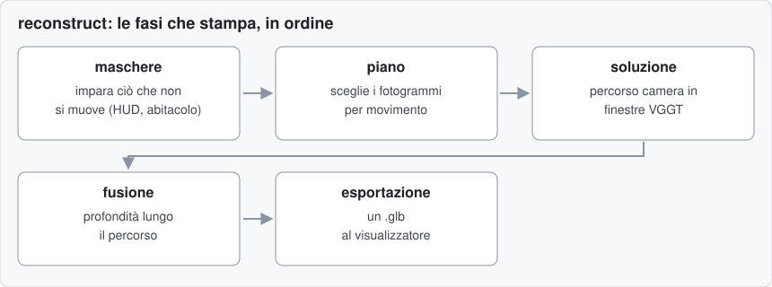

# Ricostruzione offline {#offline-reconstruction}

```bash
python -m heat3d_capture reconstruct lap.mp4 -o lap.glb [--solve-budget 260] [--fuse-interval 0.4]
```

Codice: [`scan/offline.py`](https://github.com/Holdi601/3DHeat-GameCapture/blob/main/heat3d_capture/scan/offline.py),
[`pose/feedforward.py`](https://github.com/Holdi601/3DHeat-GameCapture/blob/main/heat3d_capture/pose/feedforward.py),
[`pose/vggt_model.py`](https://github.com/Holdi601/3DHeat-GameCapture/blob/main/heat3d_capture/pose/vggt_model.py),
[`pose/feedforward_source.py`](https://github.com/Holdi601/3DHeat-GameCapture/blob/main/heat3d_capture/pose/feedforward_source.py),
[`pose/solveprep.py`](https://github.com/Holdi601/3DHeat-GameCapture/blob/main/heat3d_capture/pose/solveprep.py).
Opzioni: [Riferimento dei comandi](commands.md#reconstruct).

## Perché un secondo percorso {#why-a-second-path}

Il tracciamento incrementale è in diretta, economico e funziona dove c'è struttura a cui
aggrapparsi: un interno, una strada, una mappa con ripari. Un **circuito automobilistico è il suo caso
peggiore**: la strada è un nastro liscio con poca texture, l'orizzonte si muove appena, e una volta che
alcune pose derivano, nulla di successivo le riporta indietro. Un giro esce come una curva che vaga
invece di chiudersi.

Il percorso offline consegna **finestre di fotogrammi** a un modello che prevede tutte le loro camere
insieme, quindi ogni fotogramma vincola direttamente ogni altro invece che attraverso una catena. Ha
bisogno dell'intera registrazione prima di poter rispondere, quindi non è in diretta, ed è lento: minuti
per finestra su una GPU da desktop. Tutto ciò che viene dopo le pose - fusione, copertura, colore,
esportazione - è lo stesso codice della scansione in diretta: il percorso risolto viene passato al
ricostruttore come sorgente di pose, esattamente dove arriva la telemetria di Forza.

## Requisiti {#requirements}

- **PyTorch** adatto alla propria GPU (non fissato da questo progetto; va installato prima di
  `requirements.txt`, vedi [Runtime](runtime.md)).
- **`vggt`** - il codice del modello VGGT (`from vggt.models.vggt import VGGT`), dal repository GitHub di
  Meta; non è nell'indice dei pacchetti.
- **`transformers`**, perché il percorso offline esegue la profondità tramite il `DepthEstimator` di
  PyTorch (Depth Anything V2 Small), non tramite il file ONNX.
- Nella pratica una GPU CUDA; entrambi i modelli ripiegano sulla CPU, che però non è pratica.

Nessuno di questi è in `requirements.txt`, perché lo scanner non ne ha bisogno. Sono in
**`requirements-offline.txt`**, con le dipendenze di VGGT (`einops`, `safetensors`,
`huggingface_hub`, `Pillow`):

```bash
.venv\Scripts\python -m pip install -r requirements-offline.txt
.venv\Scripts\python -m pip install --no-deps "vggt @ git+https://github.com/facebookresearch/vggt.git"
```

VGGT si installa con `--no-deps` perché i suoi metadati fissano `numpy<2`, che pip rispetterebbe
declassando il numpy di cui ha bisogno scipy. `reconstruct` controlla tutti questi requisiti subito dopo
aver stampato la riga della licenza (la lista `OFFLINE` in
[`runtime/preflight.py`](https://github.com/Holdi601/3DHeat-GameCapture/blob/main/heat3d_capture/runtime/preflight.py)),
elenca cosa manca con le dimensioni, e installa solo con un sì - VGGT con `--no-deps`, come sopra.
Rifiutando, o senza un terminale a cui chiedere, esce con codice 1.

## Il modello e la sua licenza {#the-model-and-its-licence}

**VGGT**, `facebook/VGGT-1B`: **CC-BY-NC-4.0, solo non commerciale, e una ricostruzione fatta con esso ne
eredita la licenza.** Il comando lo stampa prima di partire (`describe_licence`). Esiste un
`facebook/VGGT-1B-Commercial` con licenza separata, ma è un repository riservato, concesso per account da
Meta, quindi non può essere il predefinito. `--model vggt-1b-commercial` risolve con esso (e stampa invece
la sua riga di licenza); senza un accesso concesso il download fallisce. Il *codice* di `vggt` è sotto la
"VGGT License" di Meta, un accordo sui materiali di ricerca con una politica d'uso accettabile (letto dal
file `LICENSE.txt` del pacchetto). Vedi [Modelli e licenze](models-and-licences.md).

## L'esecuzione, fase per fase {#the-run-stage-by-stage}

I nomi delle fasi sono quelli che stampa il comando.



### masking {#masking}

Un `FlowMask` viene appreso da **4 serie di 90 fotogrammi consecutivi**, centrate a 1/8, 3/8, 5/8 e 7/8
del video, a 960 x 540 in grigio (vedi [FlowMask](reconstruction-capture.md#flowmask-what-never-travels)).
La sua nota viene stampata e conservata nel riepilogo. Un video più corto di 90 fotogrammi non riceve
alcuna maschera.

#### La maschera della camera viene appresa, non applicata {#the-camera-mask-is-learned-not-applied}

La maschera **non** viene applicata ai fotogrammi dati al solutore. Mascherare l'abitacolo sembrava giusto
per le statistiche delle caratteristiche (la maggior parte degli angoli rilevati cade su pixel fissati alla
camera) - ma è un'affermazione su un rilevatore di caratteristiche, e il solutore è una rete addestrata.
Misurato da quanto il percorso recuperato gira tra passi consecutivi (un'auto gira di pochi gradi; una
passeggiata casuale di novanta), i fotogrammi grezzi davano la svolta più piccola, quelli con contrasto
alzato un po' di più, quelli mascherati chiaramente di più, e entrambi insieme la più grande. Quindi il
solutore riceve fotogrammi grezzi. La maschera viene comunque usata per pianificare la spaziatura dei
fotogrammi qui sotto, e il tracciatore incrementale la usa nella scansione in diretta.
(`solveprep.enhance`, che maschera e alza il contrasto locale con CLAHE, esiste ma questo comando non lo
usa.)

### pianificazione: fotogrammi spaziati dal movimento {#planning-frames-spaced-by-motion}

`plan_by_motion` sceglie i fotogrammi del solutore in base a **quanto si è mosso il quadro**, non
all'orologio: un intervallo fisso dà alle sezioni lente fotogrammi di cui non hanno bisogno, e affama
quelle veloci, dove fotogrammi consecutivi smettono di sovrapporsi abbastanza da essere collegati.

- Spostamento target: **5% di una larghezza di 960 pixel** (48 px) di spostamento mediano delle
  caratteristiche ORB tra fotogrammi scelti consecutivi, misurato su fotogrammi 960 x 540 in grigio con
  contrasto CLAHE, caratteristiche solo sulla maschera.
- Si parte da un intervallo di 0,3 s; dopo ogni passo il prossimo intervallo diventa
  `intervallo x (0,5 + 0,5 x target / misurato)`, limitato a **0,15-2,0 s**, così una misura rumorosa
  non fa oscillare il piano.
- Quando nulla ha combaciato, l'intervallo si riduce a 0,6 di sé stesso (troppo distanti è l'errore da
  evitare).
- Si ferma alla fine del video o a `--solve-budget` fotogrammi (predefinito 260).

Meno di 4 fotogrammi pianificati è un errore.

### risoluzione: finestre e cucitura {#solving-windows-and-stitching}

I fotogrammi pianificati vengono decodificati a 960 px di larghezza e risolti in **finestre sovrapposte di
16 fotogrammi, 6 condivisi** con la successiva (`plan_windows`; l'ultima finestra viene riportata indietro
per terminare sull'ultimo fotogramma, così la fine di una cattura ha tanti vicini quanti il centro). Più di
**400** fotogrammi in una sola esecuzione vengono rifiutati.

Ogni finestra: i fotogrammi vengono ridimensionati in modo che il lato lungo sia **518** e che entrambi i
lati siano multipli di **14** (rapporto d'aspetto mantenuto - schiacciare falserebbe il campo visivo),
portati a 0..1, passati a VGGT in autocast bfloat16 (il float16 esaurisce l'esponente sulle coordinate
lontane del mondo). Le estrinseche della camera vengono convertite in rotazioni mondo-da-camera e centri
camera. Le mappe dei punti non vengono conservate per impostazione predefinita.

Ogni finestra torna nel **proprio sistema di coordinate arbitrario e nella propria scala arbitraria**, quindi
le finestre vengono **cucite** nel sistema della prima tramite una trasformazione di similarità (rotazione,
traslazione, una scala) adattata alle camere che condividono con ciò che è già posizionato:

- **Rotazione dagli orientamenti delle camere**, non dalle posizioni: le camere condivise stanno lungo il
  percorso e sono quasi allineate su un rettilineo, il che lascia un adattamento basato solo sulle posizioni
  incapace di vedere la rotazione - ogni finestra si curva e il risultato cucito esce dritto. La rotazione è
  la media di `target_R x source_R^T` riportata su una vera rotazione (con una protezione dalle riflessioni).
- **Scala e offset dalle posizioni**, lungo la sorgente ruotata.
- Servono almeno **4** camere condivise; meno è un errore.
- La sovrapposizione è un terzo della finestra, così la scala è ben determinata; l'errore di scala che si
  accumula finestra dopo finestra è ciò che fa avvolgere un giro a spirale.

Per ogni giuntura viene registrato il peggior disaccordo tra le camere condivise dopo l'adattamento, in
unità della spaziatura media tra di esse (`seam_error`).

### fusione {#fusing}

I fotogrammi ogni `--fuse-interval` secondi (predefinito 0,4) vengono decodificati a 960 px di larghezza,
ricevono la profondità da Depth Anything V2 Small (PyTorch) e vengono fusi con una posa **interpolata**
dal percorso risolto al loro istante (posizione lineare, rotazione sferica; `FeedForwardPoses`). I
fotogrammi fuori dall'intervallo di tempo risolto vengono saltati invece di essere estrapolati. La camera
usa un campo visivo orizzontale di **65 gradi**. Le pose feed-forward hanno confidenza 0,85 nella fusione e
nella copertura.

### esportazione {#exporting}

La mesh viene scritta come per una scansione in diretta ([L'output .glb](glb-output.md)), con il nome del
video.

## Il riepilogo {#the-summary}

```text
140 cameras solved over 182s
closure error 3.1% of path length
worst seam 0.42 frame spacings
<mask note>
wrote lap.glb
```

| Riga | Significato |
|---|---|
| closure error | distanza tra la prima e l'ultima camera divisa per la lunghezza del percorso. Per un solo giro è la misura onesta della deriva. Sopra il 10%: "The lap does not close ... Treat the shape as unreliable." |
| worst seam | il più grande disaccordo di cucitura. Sopra 1,0: "Windows disagreed by up to N frame spacings at a seam, so part of the path is stitched on weak evidence." |
| nessun file | "Fusion produced no surface, so nothing was written." Il codice di uscita è allora 1. |

## Scala {#scale}

Il percorso cucito è nelle unità arbitrarie della prima finestra. La profondità viene ancorata triangolando
tra le pose interpolate (come per la telemetria), quindi la geometria è coerente con il percorso - ma il
risultato **non è in metri** a meno che non lo sia il percorso. Nulla in questo comando fissa la scala
globale; la calibrazione a terra non viene applicata quando le pose vengono da una sorgente di pose.

## Stato di questo percorso {#state-of-this-path}

Con fotogrammi a intervallo fisso, le finestre si risolvono in un percorso coerente su alcune sezioni di un
giro e in uno scarabocchio su altre; i fallimenti sono nelle curve strette, dove la vista oscilla
violentemente tra fotogrammi, e campionare quelle curve più fittamente le recupera. Nessuna statistica
dell'immagine provata (luminosità, dettaglio, numero di caratteristiche, rapporto di inlier, spostamento)
ha previsto in anticipo quali sezioni sarebbero fallite. Quindi la spaziatura non può essere pianificata
del tutto dalle immagini in anticipo: va scelta risolvendo, misurando il risultato e risolvendo di nuovo
più fitto dove il percorso non è uno che un'auto potrebbe aver percorso. La pianificazione basata sul moto
è costruita; **la ri-risoluzione adattiva non lo è**.
