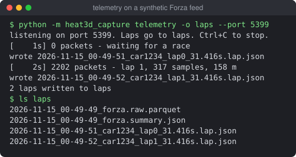
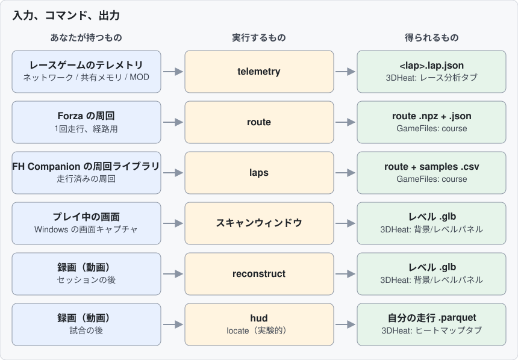

# 3DHeat GameCapture {#dheat-gamecapture}

**これは何？** レースゲームがあなたの運転について伝えてくることを書き留めるツールです。周回ごとに1ファイルになります。画面に映ったプレイの動画から、レベルのおおよその3Dモデルを作り直すこともできます。

**何に使うの？** [3DHeat ビューア](https://holdi601.github.io/3DHeat/) で周回を見るためです。どこでブレーキを踏んだか、どこで遅かったか、2つの周回がどう違うかが分かります。また、誰も3Dモデルを持っていないとき、ヒートマップの下にレベルを置くためです。

**例:** Forza の Data Out をオンにし、1つのコマンドを実行して、2周走ります。`laps\` に2つの周回ファイルができます。それらをビューアのレース分析 タブにドロップしてください。



コマンドラインは初めてですか？ まず [始める前に](before-you-start.md) を読んでください。

## 3つの仕事 {#the-three-jobs}

1. **周回のテレメトリ。** レースゲームが公開するすべてのチャンネルを記録します。Forza の Data Out、Assetto Corsa 系ゲームの共有メモリ、ラリーゲームのネットワークのフィード、BeamNG のMOD、Trackmania のプラグインなどです。そして、周回またはステージごとに1つの `heat3d-lap` ファイルを、ビューアのレース分析 タブ用に書き出します。iRacing は記録ツールが要りません。ビューアが iRacing 自身の `.ibt` ファイルを読みます。
2. **プレイからのレベル。** 歩いたり運転したりしながら画面に映ったものを、`.glb` の3Dモデルにします。ビューアはそれをヒートマップの下に敷きます。
3. **あとで、あなた自身の試合。** `hud` は、あなた自身の録画のHUDを読みます。あなたの行動、死亡、ミニマップの軌跡、キルフィードです。`locate`（実験的。今のところ、本物のフレームはわずかしか配置できません）は、各フレームがレベルの3Dモデル上のどこで撮られたかを割り出します。

3つの仕事はすべて、1つの規則に従います: **ゲームに何も注入せず、何もフックしない**。フレームは公開されている画面キャプチャのAPIから、テレメトリはゲームが公開のために提供するインターフェースから得ます。[ルール](../rules.md) を参照してください。



コードはPython（パッケージ `heat3d_capture`）で、MITライセンスです。実行できる深度とポーズのモデルには、それぞれ独自のライセンスがあります。[モデルとライセンス](../models-and-licences.md) を参照してください。

## クイックスタート {#quick-start}

### 周回を記録する {#record-laps}

Python 3.10 以降が必要です（[始める前に](before-you-start.md)）。PowerShell で:

```powershell
git clone https://github.com/Holdi601/3DHeat-GameCapture
cd 3DHeat-GameCapture
python -m venv .venv
.venv\Scripts\python -m pip install -r requirements.txt

# Forza: 設定 -> HUDとゲームプレイ -> Data Out = ON、IP 127.0.0.1、ポート 5300
.venv\Scripts\python -m heat3d_capture telemetry -o laps
```

**次のような表示が出るはずです** `listening on port 5300. Laps go to laps. Ctrl+C to stop.`。その後、ゴールラインを通過するたびに周回ごとの行が出ます（上の図の通りです）。止めるには Ctrl+C を押します。`laps\` のファイルをビューアのレース分析 タブにドロップしてください。ほかのゲームも `--game` 1つで使えます:

```powershell
.venv\Scripts\python -m heat3d_capture telemetry --game acc -o laps
.venv\Scripts\python -m heat3d_capture telemetry --game dirtrally2 -o laps
```

すべてのゲームとオプションは [テレメトリの記録ツール](../telemetry.md) を参照してください。

### レベルをスキャンする {#scan-a-level}

ツールのフォルダーにある **`scan.bat`** をダブルクリックします。Python を探し（なければ winget でのインストールを提案します）、専用の `.venv` を作り、スキャンのウィンドウを開きます。ウィンドウには、何が足りないか、各パッケージが何のためか、ダウンロードがどれくらいの大きさかが表示されます。同意なしには何もインストールしません。[実行環境と依存関係](../runtime.md) と [スキャンのウィンドウ](../reconstruction-scan-ui.md) を参照してください。

手動で行う場合: `.venv\Scripts\python -m heat3d_capture.ui`。

録画をオフラインで再構築するには、カメラの経路を一度にすべて解きます（PyTorch、`vggt` パッケージ、GPU が必要です。[オフラインの再構築](../reconstruction-offline.md) を参照）:

```powershell
.venv\Scripts\python -m heat3d_capture reconstruct lap.mp4 -o lap.glb
```

## ドキュメントの見取り図 {#map-of-the-documentation}

| ページ | 内容 |
|---|---|
| [始める前に](before-you-start.md) | Python、ターミナル、最初のコマンド、よくあるエラー |
| [ルール](../rules.md) | 注入なし、公開されたインターフェースだけ、そしてそれが何を犠牲にするか |
| [テレメトリの記録ツール](../telemetry.md) | `telemetry` コマンドと、すべてのゲームの概要 |
| [Forza](../telemetry-forza.md) | Data Out、レイアウトの検出、FH Companion の中継とその `.tele.gz` |
| [Assetto Corsa 系のゲーム](../telemetry-assetto-corsa.md) | AC、ACC、AC EVO、AC Rally の共有メモリから |
| [ラリーゲーム](../telemetry-rally.md) | EA SPORTS WRC、DiRT Rally 2.0 / 1 / DiRT 4、Richard Burns Rally |
| [BeamNG.drive](../telemetry-beamng.md) | `heat3d` プロトコルのMOD |
| [Trackmania](../telemetry-trackmania.md) | `Heat3dRecorder` の Openplanet プラグイン |
| [iRacing](../telemetry-iracing.md) | ビューアで `.ibt` ファイルを読む |
| [周回とステージの分割](../lap-splitting.md) | `LapSplitter`、`CounterSplitter`、`LineSplitter`、`StageSplitter` |
| [スリップ、ドリフト、派生チャンネル](../slip-and-drift.md) | スリップの尺度、ビューアが導くもの |
| [heat3d-lap ファイル](../lap-format.md) | 周回ファイルの形式、チャンネル、単位、`meta` |
| [ゲーム](../games.md) | ゲームごとに: 記録の仕方、送られるもの、書き出せるコース |
| [コマンド](../commands.md) | `route`、`telemetry`、`laps`、`reconstruct`、`hud`、`locate` を手順ごとに |
| [コマンドリファレンス](../cli-reference.md) | すべてのオプション。`--help` から生成 |
| [録画からのHUDの読み取り](../hud-video.md) | `hud`: 録画から、あなた自身の行動、死亡、ミニマップの軌跡、キルフィード |
| [レベル内でのフレームの位置特定](../locate.md) | `locate`: 各フレームがレベルの形状のどこで撮られたか |
| [レベルの再構築](../reconstruction.md) | フレームから `.glb` までのパイプライン |
| [スキャンのウィンドウ](../reconstruction-scan-ui.md) | すべての操作、ホットキー、オーバーレイの要素 |
| [キャプチャ、マスク、フレームの品質](../reconstruction-capture.md) | Windows Graphics Capture、キーフレーム、HUDのマスク、品質の助言 |
| [深度](../reconstruction-depth.md) | Depth Anything V2、ONNX Runtime、モデルの構築 |
| [カメラのポーズと尺度](../reconstruction-pose.md) | オドメトリ、再ローカライズ、テレメトリのポーズ、地面の尺度、バンドル調整 |
| [融合、被覆、色](../reconstruction-fusion-and-texture.md) | 占有ボリューム、被覆の格子、弱い箇所、頂点の色 |
| [.glb の出力](../glb-output.md) | ビューアが読み込むファイル |
| [オフラインの再構築](../reconstruction-offline.md) | `reconstruct`、VGGT のウィンドウとつなぎ合わせ |
| [モデルとライセンス](../models-and-licences.md) | Depth Anything V2 のサイズ、VGGT、パッケージ |
| [実行環境と依存関係](../runtime.md) | 事前チェック、バックエンド、性能の段階 |
| [制限と検証](../limits.md) | 行っていないこと、確認していないこと |
| [アップデート](../updates.md) | リリースの確認と `python -m heat3d_update` |
| [開発](../development.md) | テスト、仮想環境、リポジトリの構成 |
| [保守](../maintaining.md) | コードとドキュメントのリリースチェックリスト |

## 3DHeatの一部 {#part-of-3dheat}

このツールが書くファイルは、**3DHeat ビューア** が読み込みます（[ソース](https://github.com/Holdi601/3DHeat)、[ドキュメント](https://holdi601.github.io/3DHeat/)）。周回ファイルはそのレース分析 タブへ、`.glb` のレベルは背景/レベルパネルへ、`hud` と `locate` のテーブルはヒートマップ タブへ入ります。ビューアがテーブルとマッチファイルをどう読むかは、[1 マッチを 1 ファイルに（.3dheat）](https://holdi601.github.io/3DHeat/container.html) と [データの取り込み](https://holdi601.github.io/3DHeat/getting-data-in.html) にあります。

| ツール | 内容 | ドキュメント |
|---|---|---|
| [3DHeat ビューア](https://github.com/Holdi601/3DHeat) | ブラウザで、ヒートマップ、レース分析、マッチを3D表示 | [ドキュメント](https://holdi601.github.io/3DHeat/) |
| [GameFiles](https://github.com/Holdi601/3DHeat-GameFiles) | ゲームが同梱するファイルから、コースとレベルを3Dモデルとして | [ドキュメント](https://holdi601.github.io/3DHeat-GameFiles/) |
| [GameCapture](https://github.com/Holdi601/3DHeat-GameCapture) | レースゲームの周回テレメトリ。ゲーム映像から再構築したレベル | [ドキュメント](https://holdi601.github.io/3DHeat-GameCapture/) |
| [Unreal Exporter](https://github.com/Holdi601/3DHeat-UnrealExporter) | レベルを3Dモデルとして書き出す Unreal Editor のプラグイン | [ドキュメント](https://holdi601.github.io/3DHeat-UnrealExporter/) |
| [CS2](https://github.com/Holdi601/3DHeat-CS2) | Counter-Strike 2 のデモをテーブルとマッチドキュメントに。マップを3Dモデルに | [ドキュメント](https://holdi601.github.io/3DHeat-CS2/) |
| [Watcher](https://github.com/Holdi601/3DHeat-Watcher) | ゲームが公開する情報から、あなたのプレイをバックグラウンドで記録 | [ドキュメント](https://holdi601.github.io/3DHeat-Watcher/) |
| [Ext-WarThunder](https://github.com/Holdi601/3DHeat-Ext-WarThunder) | War Thunder のリプレイをテーブルとマッチドキュメントに | [ドキュメント](https://holdi601.github.io/3DHeat-Ext-WarThunder/) |
| [Ext-WoT](https://github.com/Holdi601/3DHeat-Ext-WoT) | World of Tanks のリプレイをテーブルとマッチドキュメントに | [ドキュメント](https://holdi601.github.io/3DHeat-Ext-WoT/) |
| [Ext-WoWs](https://github.com/Holdi601/3DHeat-Ext-WoWs) | World of Warships のリプレイをテーブルとマッチドキュメントに | [ドキュメント](https://holdi601.github.io/3DHeat-Ext-WoWs/) |
| [Ext-Squad](https://github.com/Holdi601/3DHeat-Ext-Squad) | Squad のサーバーのデモをテーブルとマッチドキュメントに | [ドキュメント](https://holdi601.github.io/3DHeat-Ext-Squad/) |
| [Ext-DCS](https://github.com/Holdi601/3DHeat-Ext-DCS) | DCS World のマップを3Dモデルに | [ドキュメント](https://holdi601.github.io/3DHeat-Ext-DCS/) |
| [Ext-IL2](https://github.com/Holdi601/3DHeat-Ext-IL2) | IL-2 Sturmovik のマップを3Dモデルに | [ドキュメント](https://holdi601.github.io/3DHeat-Ext-IL2/) |

Unreal のプロジェクトをエディターで開いている開発者は、Unreal Exporter を使うべきです。実際の形状を読むので、正確です。ゲーム自身のアーカイブが読める場合は、GameFiles が正確なコースを取り出します。ゲームプレイからの再構築は、画面しか手元にない場合のためのものです。
