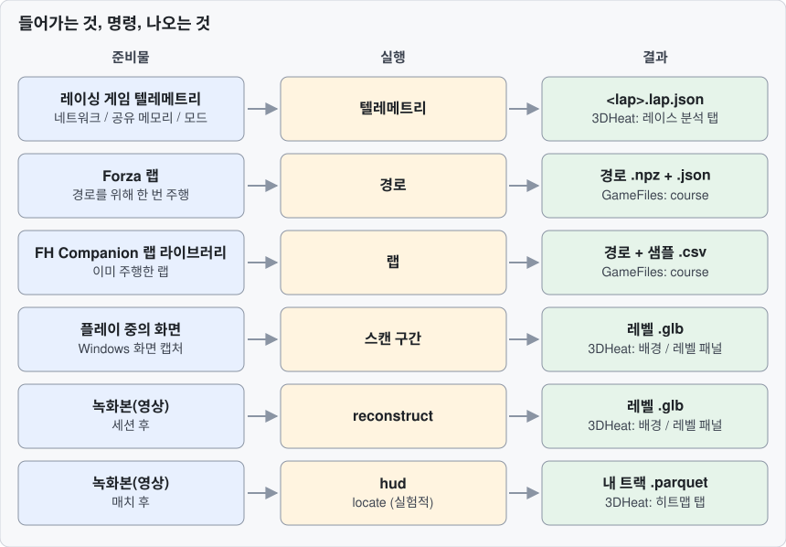

# 3DHeat GameCapture {#dheat-gamecapture}

**무엇입니까?** 레이싱 게임이 여러분의 운전에 대해 알려 주는 내용을 기록하는 도구입니다. 랩마다 파일 하나씩 씁니다. 여러분이 플레이하는 영상으로 레벨의 대략적인 3D 모델을 다시 만들 수도 있습니다.

**왜 씁니까?** [3DHeat 뷰어](https://holdi601.github.io/3DHeat/)에서 랩을 보기 위해서입니다. 어디서 브레이크를 밟았는지, 어디서 느렸는지, 두 랩이 어떻게 다른지 볼 수 있습니다. 그리고 아무도 3D 모델을 가지고 있지 않은 레벨이라도, 히트맵 아래에 그 레벨을 깔 수 있습니다.

**예시:** Forza의 Data Out을 켜고, 명령 하나를 실행한 뒤, 랩 두 개를 달리세요. `laps\` 폴더에 랩 파일 두 개가 생깁니다. 이것을 뷰어의 레이스 분석 탭에 끌어다 놓으세요.


명령줄이 처음입니까? 먼저 [시작하기 전에](before-you-start.md)를 읽으세요.

## 세 가지 일 {#the-three-jobs}

1. **랩 텔레메트리.** 레이싱 게임이 공개하는 모든 채널을 기록합니다. Forza의 Data Out, Assetto Corsa 게임들의 공유 메모리, 랠리 게임들의 네트워크 피드, BeamNG 모드, Trackmania 플러그인 등입니다. 랩 또는 스테이지마다 `heat3d-lap` 파일 하나를 쓰며, 이것은 뷰어의 레이스 분석 탭용입니다. iRacing은 기록 도구가 필요 없습니다. 뷰어가 iRacing 자체의 `.ibt` 파일을 읽습니다.
2. **플레이에서 얻은 레벨.** 여러분이 레벨을 걷거나 달리는 동안 화면에 보인 것을 `.glb` 3D 모델로 바꿉니다. 뷰어는 이것을 히트맵 아래에 깝니다.
3. **매치가 끝난 뒤의 여러분의 매치.** `hud`는 여러분 자신의 녹화에서 HUD를 읽습니다. 여러분의 행동, 사망, 미니맵의 주행 선, 킬 피드입니다. `locate`(실험적: 지금은 실제 프레임을 적게 배치합니다)는 각 프레임이 레벨의 3D 모델의 어디에서 찍혔는지 알아냅니다.

세 가지 모두 한 가지 규칙을 따릅니다. **게임에 아무것도 주입하지 않으며, 아무것도 후킹하지 않습니다.** 프레임은 공개된 화면 캡처 API에서, 텔레메트리는 게임이 그 목적으로 공개한 인터페이스에서 가져옵니다. [규칙](../rules.md)을 보세요.



코드는 Python(패키지 `heat3d_capture`)이며 MIT 라이선스입니다. 이 도구가 실행할 수 있는 깊이 모델과 자세 모델에는 각각 자기 라이선스가 있습니다. [모델과 라이선스](../models-and-licences.md)를 보세요.

## 빠른 시작 {#quick-start}

Python 3.10 이상이 필요합니다([시작하기 전에](before-you-start.md)). PowerShell에서:

### 랩 기록하기 {#record-laps}

```powershell
git clone https://github.com/Holdi601/3DHeat-GameCapture
cd 3DHeat-GameCapture
python -m venv .venv
.venv\Scripts\python -m pip install -r requirements.txt

# Forza: 설정 -> HUD 및 게임플레이 -> Data Out = ON, IP 127.0.0.1, 포트 5300
.venv\Scripts\python -m heat3d_capture telemetry -o laps
```

**이렇게 보여야 합니다** `listening on port 5300. Laps go to laps. Ctrl+C to stop.`, 그다음 위 그림처럼 결승선을 지날 때마다 랩 한 줄씩이 나옵니다. 멈추려면 Ctrl+C를 누르세요. `laps\`의 파일들을 뷰어의 레이스 분석 탭에 끌어다 놓으세요.
다른 모든 게임은 `--game` 옵션 하나면 됩니다:

```powershell
.venv\Scripts\python -m heat3d_capture telemetry --game acc -o laps
.venv\Scripts\python -m heat3d_capture telemetry --game dirtrally2 -o laps
```

모든 게임과 옵션은 [텔레메트리 기록기](../telemetry.md)를 보세요.

### 레벨 스캔하기 {#scan-a-level}

도구의 폴더에 있는 **`scan.bat`**을 두 번 누르세요. Python을 찾고(없으면 winget으로 설치할지 묻습니다), 전용 `.venv`를 만들고, 스캔 창을 엽니다. 창은 무엇이 없는지, 각 패키지가 무엇을 위한 것인지, 다운로드가 얼마나 큰지 보여 주며, 허락 없이는 아무것도 설치하지 않습니다. [런타임과 의존성](../runtime.md)과 [스캔 창](../reconstruction-scan-ui.md)을 보세요.

직접 실행한다면: `.venv\Scripts\python -m heat3d_capture.ui`.

기록을 오프라인으로 다시 만들려면, 카메라 경로를 한꺼번에 풀어 내는 방식입니다(PyTorch, `vggt` 패키지, GPU가 필요합니다. [오프라인 재구성](../reconstruction-offline.md)을 보세요):

```powershell
.venv\Scripts\python -m heat3d_capture reconstruct lap.mp4 -o lap.glb
```

## 이 문서의 목차 {#map-of-the-documentation}

| 페이지 | 내용 |
|---|---|
| [시작하기 전에](before-you-start.md) | Python, 터미널, 첫 명령, 흔한 오류 |
| [규칙](../rules.md) | 주입 없음, 공개된 인터페이스만, 그리고 그 대가 |
| [텔레메트리 기록기](../telemetry.md) | `telemetry` 명령과 모든 게임의 개요 |
| [Forza](../telemetry-forza.md) | Data Out, 레이아웃 감지, FH Companion 릴레이와 `.tele.gz` |
| [Assetto Corsa 게임들](../telemetry-assetto-corsa.md) | 공유 메모리에서 읽는 AC, ACC, AC EVO, AC Rally |
| [랠리 게임들](../telemetry-rally.md) | EA SPORTS WRC, DiRT Rally 2.0 / 1 / DiRT 4, Richard Burns Rally |
| [BeamNG.drive](../telemetry-beamng.md) | `heat3d` 프로토콜 모드 |
| [Trackmania](../telemetry-trackmania.md) | `Heat3dRecorder` Openplanet 플러그인 |
| [iRacing](../telemetry-iracing.md) | 뷰어에서 `.ibt` 파일 읽기 |
| [랩과 스테이지 나누기](../lap-splitting.md) | `LapSplitter`, `CounterSplitter`, `LineSplitter`, `StageSplitter` |
| [미끄러짐, 드리프트, 파생 채널](../slip-and-drift.md) | 미끄러짐을 어떻게 맞추는지, 뷰어가 무엇을 계산하는지 |
| [heat3d-lap 파일](../lap-format.md) | 랩 파일 형식, 채널, 단위, `meta` |
| [게임들](../games.md) | 게임마다: 기록 방법, 보내지는 것, 내보낼 수 있는 코스 |
| [명령](../commands.md) | `route`, `telemetry`, `laps`, `reconstruct`, `hud`, `locate`를 단계별로 |
| [명령 참조](../cli-reference.md) | 모든 옵션, `--help`에서 생성 |
| [기록에서 HUD 읽기](../hud-video.md) | `hud`: 녹화에서 본인의 행동, 사망, 미니맵 주행 선, 킬 피드 |
| [레벨에서 프레임 찾기](../locate.md) | `locate`: 각 프레임이 레벨의 기하에 비추어 어디에서 찍혔는지 |
| [레벨 재구성](../reconstruction.md) | 프레임에서 `.glb`까지의 파이프라인 |
| [스캔 창](../reconstruction-scan-ui.md) | 모든 조작 장치, 단축키, 오버레이 요소 |
| [캡처, 마스크, 프레임 품질](../reconstruction-capture.md) | Windows Graphics Capture, 키프레임, HUD 마스크, 품질 조언 |
| [깊이](../reconstruction-depth.md) | Depth Anything V2, ONNX Runtime, 모델 만들기 |
| [카메라 자세와 축척](../reconstruction-pose.md) | 주행 기록계, 재위치 추정, 텔레메트리 자세, 지면 축척, 번들 조정 |
| [융합, 커버리지, 색](../reconstruction-fusion-and-texture.md) | 점유 부피, 커버리지 격자, 약한 부분, 정점 색 |
| [.glb 출력](../glb-output.md) | 뷰어가 불러오는 파일 |
| [오프라인 재구성](../reconstruction-offline.md) | `reconstruct`, VGGT 창과 이어 붙이기 |
| [모델과 라이선스](../models-and-licences.md) | Depth Anything V2 크기, VGGT, 패키지들 |
| [런타임과 의존성](../runtime.md) | 사전 점검, 백엔드, 성능 단계 |
| [한계와 검증](../limits.md) | 하지 않은 것, 확인하지 않은 것 |
| [업데이트](../updates.md) | 릴리스 확인과 `python -m heat3d_update` |
| [개발](../development.md) | 테스트, 가상 환경, 저장소 구조 |
| [문서 관리](../maintaining.md) | 코드와 문서의 릴리스 체크리스트 |

## 3DHeat의 일부 {#part-of-3dheat}

이 도구가 쓰는 파일은 **3DHeat 뷰어**가 불러옵니다([소스](https://github.com/Holdi601/3DHeat), [문서](https://holdi601.github.io/3DHeat/)). 랩 파일은 뷰어의 레이스 분석 탭으로, `.glb` 레벨은 배경 / 레벨 패널로, `hud`와 `locate` 표는 히트맵 탭으로 갑니다. 뷰어가 표와 매치 파일을 읽는 방법은 [매치 하나를 파일 하나로 `.3dheat`](https://holdi601.github.io/3DHeat/container.html)와 [데이터 넣기](https://holdi601.github.io/3DHeat/getting-data-in.html)에 있습니다.

| 도구 | 하는 일 | 문서 |
|---|---|---|
| [3DHeat 뷰어](https://github.com/Holdi601/3DHeat) | 브라우저에서 히트맵, 레이스, 매치를 3D로 보여 줍니다 | [문서](https://holdi601.github.io/3DHeat/) |
| [GameFiles](https://github.com/Holdi601/3DHeat-GameFiles) | 게임이 배포하는 파일에서 코스와 레벨을 3D 모델로 | [문서](https://holdi601.github.io/3DHeat-GameFiles/) |
| [GameCapture](https://github.com/Holdi601/3DHeat-GameCapture) | 레이싱 게임의 랩 텔레메트리. 게임플레이 영상에서 다시 만든 레벨 | [문서](https://holdi601.github.io/3DHeat-GameCapture/) |
| [Unreal Exporter](https://github.com/Holdi601/3DHeat-UnrealExporter) | 레벨을 3D 모델로 내보내는 Unreal 에디터 플러그인 | [문서](https://holdi601.github.io/3DHeat-UnrealExporter/) |
| [CS2](https://github.com/Holdi601/3DHeat-CS2) | Counter-Strike 2 데모를 매치 파일로, 맵을 3D 모델로 | [문서](https://holdi601.github.io/3DHeat-CS2/) |
| [Watcher](https://github.com/Holdi601/3DHeat-Watcher) | 게임이 공개하는 것을 바탕으로 백그라운드에서 플레이를 기록 | [문서](https://holdi601.github.io/3DHeat-Watcher/) |
| [Ext-WarThunder](https://github.com/Holdi601/3DHeat-Ext-WarThunder) | 워 썬더 리플레이를 매치 파일로 | [문서](https://holdi601.github.io/3DHeat-Ext-WarThunder/) |
| [Ext-WoT](https://github.com/Holdi601/3DHeat-Ext-WoT) | 월드 오브 탱크 리플레이를 매치 파일로 | [문서](https://holdi601.github.io/3DHeat-Ext-WoT/) |
| [Ext-WoWs](https://github.com/Holdi601/3DHeat-Ext-WoWs) | 월드 오브 워십 리플레이를 매치 파일로 | [문서](https://holdi601.github.io/3DHeat-Ext-WoWs/) |
| [Ext-Squad](https://github.com/Holdi601/3DHeat-Ext-Squad) | Squad 서버 데모를 매치 파일로 | [문서](https://holdi601.github.io/3DHeat-Ext-Squad/) |
| [Ext-DCS](https://github.com/Holdi601/3DHeat-Ext-DCS) | DCS World 맵을 3D 모델로 | [문서](https://holdi601.github.io/3DHeat-Ext-DCS/) |
| [Ext-IL2](https://github.com/Holdi601/3DHeat-Ext-IL2) | IL-2 Sturmovik 맵을 3D 모델로 | [문서](https://holdi601.github.io/3DHeat-Ext-IL2/) |

Unreal 프로젝트를 열어 둔 개발자라면 Unreal 내보내기를 쓰세요. 실제 기하를 읽으므로 정확합니다. 게임의 자체 아카이브를 읽을 수 있는 곳에서는 GameFiles가 정확한 코스를 추출합니다. 게임플레이로 재구성하는 것은 화면만 쓸 수 있는 경우를 위한 것입니다.
