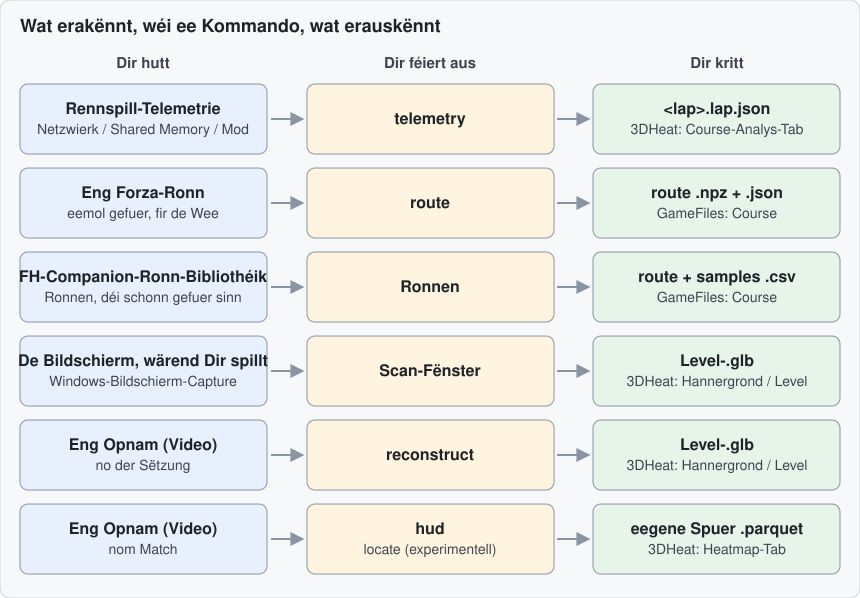

# 3DHeat GameCapture {#dheat-gamecapture}

**Wat ass et?** E Tool, dat opschreift, wat e Rennspill iwwer Äert Fuere verréit, eng Datei pro Ronn.
Et kann och e grobt 3D-Modell vun engem Level aus engem Video nei opbauen, wou Dir spillt.

**Firwat sollt ech et benotzen?** Fir Är Ronnen am [3DHeat-Viewer](https://holdi601.github.io/3DHeat/) ze gesinn:
wou Dir gebremst hutt, wou Dir lues waart, wéi zwou Ronnen sech ënnerscheeden. An fir d'Level ënner
Ärer Heatmap ze hunn, wann keen en 3D-Modell dovunner huet.

**Beispill:** Schalt dem Forza säin Data Out un, féiert ee Kommando aus, fuert zwou Ronnen. Zwou Ronn-Dateie erschéngen an
`laps\`. Zitt se op den Course-Analys-Tab vum Viewer.


Nei op der Kommandozeil? Liest fir d'éischt [Ier Dir ufänkt](before-you-start.md).

## Déi dräi Aarbechten {#the-three-jobs}

1. **Ronn-Telemetrie.** Et zeechent all Kanal op, deen e Rennspill publizéiert - dem Forza säin Data Out, d'
   Shared Memory vun den Assetto-Corsa-Spiller, d'Netzwierk-Feeds vun de Rallye-Spiller, e BeamNG-Mod, e
   Trackmania-Plugin - a schreift eng `heat3d-lap`-Datei pro Ronn oder Etapp, fir den Race-
   Tab vum Viewer. iRacing brauch keen Recorder: de Viewer liest seng eege `.ibt`-Dateien.
2. **Levelen aus Gameplay.** Et verwandelt, wat de Bildschierm gewisen huet, wärend Dir duerch e
   Level gaange sidd oder gefuer sidd, an e `.glb`-3D-Modell, dat de Viewer ënner d'Heatmap leet.
3. **Äre eegene Match, duerno.** `hud` liest d'HUD vun Ärer eegener Opnam - Är Aktiounen, Doudesfäll,
   Minimap-Spuer a Kill-Feed. `locate` (experimentell: et placéiert bis elo wéineg richteg Frames) fënnt eraus,
   wou all Frame opgeholl gouf, op dem 3D-Modell vun engem Level.

All dräi follegen eng Regel: **näischt gëtt an e Spill injizéiert an näischt gehookt**. D'Frames kommen
vun der ëffentlecher Screen-Capture-API, d'Telemetrie vun Interfaces, déi d'Spiller dofir publizéieren. Kuckt
[D'Reegelen](../rules.md).



De Code ass Python (Package `heat3d_capture`), MIT-lizenzéiert. D'Depth- an Pose-Modeller, déi et
kann lafe loossen, hu hir eege Lizenzen - kuckt [Modeller a Lizenzen](../models-and-licences.md).

## Séier Start {#quick-start}

### Ronnen opzeechnen {#record-laps}

Dir braucht Python 3.10 oder méi nei ([Ier Dir ufänkt](before-you-start.md)). An der PowerShell:

```powershell
git clone https://github.com/Holdi601/3DHeat-GameCapture
cd 3DHeat-GameCapture
python -m venv .venv
.venv\Scripts\python -m pip install -r requirements.txt

# Forza: Settings -> HUD and Gameplay -> Data Out = ON, IP 127.0.0.1, port 5300
.venv\Scripts\python -m heat3d_capture telemetry -o laps
```

**Dir sollt** `listening on port 5300. Laps go to laps. Ctrl+C to stop.` **gesinn**, dann eng Zeil pro Ronn, wann Dir d'Linn kräizt, wéi
um Bild hei uewen. Dréckt Ctrl+C, fir opzehalen. Zitt d'Dateien aus `laps\` op den Course-Analys-Tab vum Viewer.
All anert Spill ass ee `--game` ewech:

```powershell
.venv\Scripts\python -m heat3d_capture telemetry --game acc -o laps
.venv\Scripts\python -m heat3d_capture telemetry --game dirtrally2 -o laps
```

Kuckt [Telemetrie-Recorder](../telemetry.md) fir all Spill an Optioun.

### E Level scannen {#scan-a-level}

Duebelklickt op **`scan.bat`** am Dossier vum Tool. Et fënnt Python (a bitt un, et mat
winget ze installéieren, wann et keen gëtt), mécht e private `.venv` an mécht d'Scan-Fënster op. D'Fënster seet,
wat feelt, wofir all Package gebraucht gëtt a wéi grouss den Download ass, an installéiert näischt
ouni e Jo. Kuckt [Runtime an Ofhängegkeeten](../runtime.md) an
[D'Scan-Fënster](../reconstruction-scan-ui.md).

Vun Hand: `.venv\Scripts\python -m heat3d_capture.ui`.

Fir eng Opnam offline nei opzebauen, mam Kamerawee op eemol geléist (brauch PyTorch, de
`vggt`-Package an eng GPU - kuckt [Offline-Rekonstruktioun](../reconstruction-offline.md)):

```powershell
.venv\Scripts\python -m heat3d_capture reconstruct lap.mp4 -o lap.glb
```

## Kaart vun der Dokumentatioun {#map-of-the-documentation}

| Säit | Wat se ofdeckt |
|---|---|
| [Ier Dir ufänkt](before-you-start.md) | Python, e Terminal, dee éischte Kommando, heefeg Feeler |
| [D'Reegelen](../rules.md) | Keng Injektioun, nëmmen publizéiert Interfaces, a wat dat kascht |
| [Telemetrie-Recorder](../telemetry.md) | De Kommando `telemetry` an en Iwwerbléck iwwer all Spill |
| [Forza](../telemetry-forza.md) | Data Out, Layout-Erkennung, dem FH Companion säi Relay a seng `.tele.gz` |
| [Assetto-Corsa-Spiller](../telemetry-assetto-corsa.md) | AC, ACC, AC EVO, AC Rally aus der Shared Memory |
| [Rallye-Spiller](../telemetry-rally.md) | EA SPORTS WRC, DiRT Rally 2.0 / 1 / DiRT 4, Richard Burns Rally |
| [BeamNG.drive](../telemetry-beamng.md) | De `heat3d`-Protokoll-Mod |
| [Trackmania](../telemetry-trackmania.md) | Dat `Heat3dRecorder`-Openplanet-Plugin |
| [iRacing](../telemetry-iracing.md) | `.ibt`-Dateien am Viewer liesen |
| [Ronn- an Etappe-Opdeelung](../lap-splitting.md) | `LapSplitter`, `CounterSplitter`, `LineSplitter`, `StageSplitter` |
| [Slip, Drift an ofgeleet Kanäl](../slip-and-drift.md) | Wéi de Slip skaléiert gëtt, a wat de Viewer ofleet |
| [D'heat3d-lap-Datei](../lap-format.md) | D'Format vun der Ronn-Datei, Kanäl, Eenheeten, `meta` |
| [Spiller](../games.md) | Pro Spill: wéi opzeechnen, wat geschéckt gëtt, wéi eng Course exportéiert kënne ginn |
| [Kommandoen](../commands.md) | `route`, `telemetry`, `laps`, `reconstruct`, `hud`, `locate`, Schrëtt fir Schrëtt |
| [Kommando-Referenz](../cli-reference.md) | all Optioun, aus `--help` generéiert |
| [D'HUD aus enger Opnam liesen](../hud-video.md) | `hud`: eege Aktiounen, Doudesfäll, Minimap-Spuer a Kill-Feed aus enger Opnam |
| [Frames an engem Level fannen](../locate.md) | `locate`: wou all Frame opgeholl gouf, géint d'Geometrie vum Level |
| [Level-Rekonstruktioun](../reconstruction.md) | D'Pipeline vun de Frames bis bei eng `.glb` |
| [D'Scan-Fënster](../reconstruction-scan-ui.md) | All Kontroll, Hotkey an Overlay-Element |
| [Capture, Masken a Frame-Qualitéit](../reconstruction-capture.md) | Windows Graphics Capture, Keyframes, HUD-Masken, Qualitéitsrot |
| [Depth](../reconstruction-depth.md) | Depth Anything V2, ONNX Runtime, d'Modell bauen |
| [Kamerapose a Skala](../reconstruction-pose.md) | Odometrie, Relokalisatioun, Telemetrie-Posen, Buedemskala, Bundle Adjustment |
| [Fusioun, Ofdeckung a Faarf](../reconstruction-fusion-and-texture.md) | Den Occupancy-Volume, d'Ofdeckungsgitter, schwaach Plazen, Vertex-Faarf |
| [D'.glb-Ausgab](../glb-output.md) | D'Datei, déi de Viewer lued |
| [Offline-Rekonstruktioun](../reconstruction-offline.md) | `reconstruct`, VGGT-Fënsteren a Verbannung |
| [Modeller a Lizenzen](../models-and-licences.md) | Depth-Anything-V2-Gréissten, VGGT, d'Packagen |
| [Runtime an Ofhängegkeeten](../runtime.md) | Preflight, Backends, Performance-Stufen |
| [Grenzen a Verifikatioun](../limits.md) | Wat net gemaach ass, a wat net gepréift gouf |
| [Updates](../updates.md) | De Release-Check an `python -m heat3d_update` |
| [Entwécklung](../development.md) | Tester, déi virtuell Ëmgéigung, Repository-Layout |
| [Dës Dokumentatioun ënnerhalen](../maintaining.md) | D'Release-Checklëscht fir Code an Dokumentatioun |

## Deel vun 3DHeat {#part-of-3dheat}

D'Dateien, déi dëst schreift, gi vum **3DHeat-Viewer** gelueden -
[Quell](https://github.com/Holdi601/3DHeat), [Dokumentatioun](https://holdi601.github.io/3DHeat/).
Ronn-Dateie ginn op säi Course-Analys-Tab, `.glb`-Levelen an säi Panel „Hannergrond / Level“, d'`hud`- an `locate`-Tabellen an
säi Heatmap-Tab; wéi de Viewer Tabellen a Match-Dateien liest, steet an
[Eng Datei pro Match (.3dheat)](https://holdi601.github.io/3DHeat/container.html) an
[Daten eran kréien](https://holdi601.github.io/3DHeat/getting-data-in.html).

| Tool | Wat et mécht | Docs |
|---|---|---|
| [3DHeat-Viewer](https://github.com/Holdi601/3DHeat) | weist Heatmaps, Rennen a Matcher an 3D, am Browser | [Docs](https://holdi601.github.io/3DHeat/) |
| [GameFiles](https://github.com/Holdi601/3DHeat-GameFiles) | Course a Levelen aus de Dateie vu Spiller, als 3D-Modeller | [Docs](https://holdi601.github.io/3DHeat-GameFiles/) |
| [GameCapture](https://github.com/Holdi601/3DHeat-GameCapture) | Ronn-Telemetrie vu Rennspiller; Levelen aus Gameplay-Video nei opgebaut | [Docs](https://holdi601.github.io/3DHeat-GameCapture/) |
| [Unreal Exporter](https://github.com/Holdi601/3DHeat-UnrealExporter) | en Unreal-Editor-Plugin, dat e Level als 3D-Modell exportéiert | [Docs](https://holdi601.github.io/3DHeat-UnrealExporter/) |
| [CS2](https://github.com/Holdi601/3DHeat-CS2) | Counter-Strike-2-Demoen a Match-Dateien; Mappen a 3D-Modeller | [Docs](https://holdi601.github.io/3DHeat-CS2/) |
| [Watcher](https://github.com/Holdi601/3DHeat-Watcher) | hält Äert Spill am Hannergrond fest, aus deem, wat Spiller publizéieren | [Docs](https://holdi601.github.io/3DHeat-Watcher/) |
| [Ext-WarThunder](https://github.com/Holdi601/3DHeat-Ext-WarThunder) | War-Thunder-Replays a Match-Dateien | [Docs](https://holdi601.github.io/3DHeat-Ext-WarThunder/) |
| [Ext-WoT](https://github.com/Holdi601/3DHeat-Ext-WoT) | World-of-Tanks-Replays a Match-Dateien | [Docs](https://holdi601.github.io/3DHeat-Ext-WoT/) |
| [Ext-WoWs](https://github.com/Holdi601/3DHeat-Ext-WoWs) | World-of-Warships-Replays a Match-Dateien | [Docs](https://holdi601.github.io/3DHeat-Ext-WoWs/) |
| [Ext-Squad](https://github.com/Holdi601/3DHeat-Ext-Squad) | Squad-Server-Demoen a Match-Dateien | [Docs](https://holdi601.github.io/3DHeat-Ext-Squad/) |
| [Ext-DCS](https://github.com/Holdi601/3DHeat-Ext-DCS) | DCS-World-Mappen a 3D-Modeller | [Docs](https://holdi601.github.io/3DHeat-Ext-DCS/) |
| [Ext-IL2](https://github.com/Holdi601/3DHeat-Ext-IL2) | IL-2-Sturmovik-Mappen a 3D-Modeller | [Docs](https://holdi601.github.io/3DHeat-Ext-IL2/) |

E Entwéckler mat dem Projet vum Spill oppen soll den Unreal-Exporter benotzen, dee richteg
Geometrie liest an exakt ass. Wou d'Archiver vun engem Spill gelies kënne ginn, extrahéiert GameFiles de exakte
Course. D'Rekonstruktioun aus Gameplay ass fir de Fall, wou nëmmen de Bildschierm verfügbar ass.
