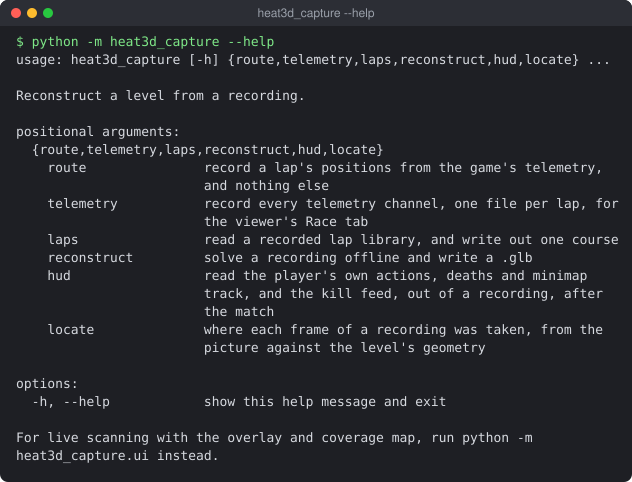

# Prieš pradedant

Nesate įpratę prie komandinės eilutės? Šis puslapis padės nuo nieko iki pirmos veikiančios komandos maždaug per dešimt minučių, vieną kartą.

GameCapture yra Python programa. Jums reikia **Python 3.10 ar naujesnės versijos**.

1. Eikite į [python.org/downloads](https://www.python.org/downloads/) ir atsisiųskite naujausią
   Python, skirtą Windows.
2. Paleiskite diegimo programą. Pirmame ekrane **pažymėkite „Add python.exe to PATH“**. Be šios žymės
   terminalas Python nerras.
3. Spustelėkite *Install Now*.

Arba terminale: `winget install Python.Python.3.12`.

## 2. Įdiekite Git

Git atsisiunčia įrankį. Gaukite jį iš [git-scm.com](https://git-scm.com/download/win) arba įrašykite
`winget install Git.Git`. Jei nenorite Git, [GitHub puslapyje](https://github.com/Holdi601/3DHeat-GameCapture)
naudokite *Code > Download ZIP* ir išskleiskite.

## 3. Atidarykite terminalą aplanke

Terminalas – tai langas, kuriame rašote komandas. Šiuose puslapiuose naudojamas **PowerShell**, kuris yra kiekviename
Windows kompiuteryje.

- Atidarykite aplanką Failų naršyklėje, spustelėkite adresų juostą, įrašykite `powershell` ir paspauskite Enter.
  PowerShell atsidaro **tame aplanke**.
- Arba atidarykite PowerShell iš Start meniu ir pereikite į aplanką su `cd`:

```powershell
cd "C:\Games\Tools"
```

## 4. Skaitykite komandas šiuose puslapiuose

- Įrašykite kiekvieną komandos eilutę ir paspauskite Enter.
- Tekstas kampiniuose skliaustuose yra **vietos žymeklis**: įrašykite ten savo reikšmę, be skliaustų.
  `<recording>.mp4` reiškia failo vardą, pavyzdžiui, `match1.mp4`.
- Tekstas laužtiniuose skliaustuose, pavyzdžiui, `[--fps 5]`, yra **neprivalomas**.
- Kelias su tarpais reikalauja kabučių: `"C:\My Videos\match1.mp4"`.
- Eilutės, prasidedančios `#`, yra komentarai. Jų nerašote.

## 5. Gaukite įrankį ir jo paketus

```powershell
git clone https://github.com/Holdi601/3DHeat-GameCapture
cd 3DHeat-GameCapture
python -m venv .venv
.venv\Scripts\python -m pip install -r requirements.txt
```

`python -m venv .venv` sukuria privatų aplanką įrankio paketams, kad jie nesimaišytų su niekuo kitu jūsų kompiuteryje. Tada kiekviena
komanda prasideda `.venv\Scripts\python`.

**Turėtumėte matyti**, kad paskutinėje eilutėje parašyta `Successfully installed ...`. Patikrinkite, ar įrankis veikia:

```powershell
.venv\Scripts\python -m heat3d_capture --help
```

**Turėtumėte matyti** komandų sąrašą, prasidedantį `usage: heat3d_capture`.



Taip pat galite *aktyvuoti* aplanką vieną kartą ir tada rašyti tik `python`:

| Terminalas | Aktyvuoti | Tada |
|---|---|---|
| PowerShell | `.venv\Scripts\Activate.ps1` | `python -m heat3d_capture --help` |
| cmd | `.venv\Scripts\activate.bat` | `python -m heat3d_capture --help` |

Jei PowerShell sako *running scripts is disabled*, vieną kartą įrašykite
`Set-ExecutionPolicy -Scope CurrentUser RemoteSigned`, arba praleiskite aktyvavimą.

## 6. Papildomos programos, kurių kai kurioms komandoms reikia

| Komanda | Reikia | Įdiegimas |
|---|---|---|
| `hud` | **ffmpeg** ir **ffprobe** (vaizdo failams skaityti) | `winget install Gyan.FFmpeg`, tada atidarykite naują terminalą. Patikrinkite su `ffmpeg -version`. |
| `reconstruct`, `locate` | **PyTorch**, įdiegtas prieš kitus paketus | komanda iš [pytorch.org](https://pytorch.org/get-started/locally/) jūsų GPU |

## Kai kas nors neveikia

| Matote | Tai reiškia | Ką daryti |
|---|---|---|
| `'python' is not recognized` | Python nėra PATH | Įdiekite Python iš naujo su PATH žymėjimu, tada atidarykite naują terminalą. |
| `No module named heat3d_capture` | terminalas nėra įrankio aplanke | `cd` į aplanką `3DHeat-GameCapture`. |
| `No module named numpy` (ar kitas paketas) | paketai neįdiegti arba naudojote kitą Python | Vėl paleiskite eilutę `pip install -r requirements.txt`, su `.venv\Scripts\python`. |
| `'.venv' is not recognized` | cmd įrašėte `/` | Naudokite atgalinius brūkšnius: `.venv\Scripts\python`. |
| `ffmpeg was not found on PATH` | ffmpeg trūksta | Žr. 6 žingsnį, tada atidarykite naują terminalą. |

Toliau: [Pradžia](index.md) turi pirmą pavyzdį kiekvienam darbui.
