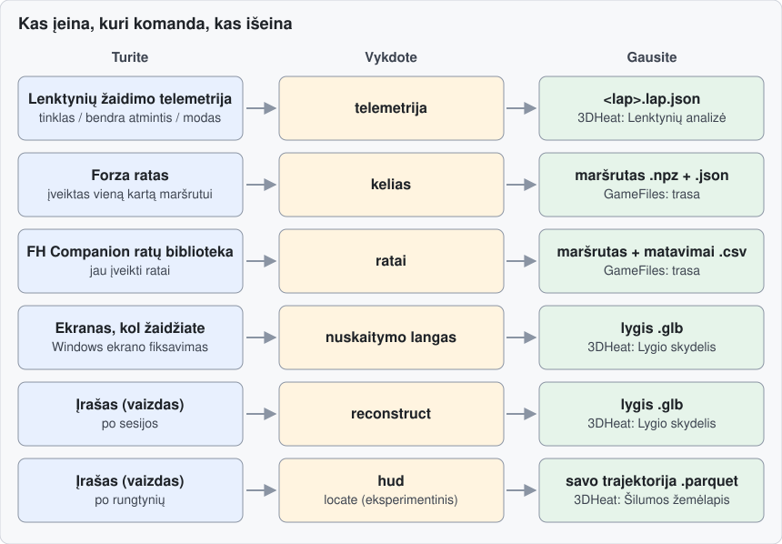

# 3DHeat GameCapture {#dheat-gamecapture}

**Kas tai?** Įrankis, kuris įrašo, ką lenktynių žaidimas jam pasakoja apie jūsų vairavimą, po vieną failą kiekvienam ratui.
Jis taip pat gali atkurti apytikslį 3D žaidimo lygio modelį iš jūsų žaidimo vaizdo įrašo.

**Kam tai naudoti?** Norint matyti savo ratus [3DHeat žiūryklėje](https://holdi601.github.io/3DHeat/):
kur stabdėte, kur buvote lėtesni, kuo du ratai skiriasi. Ir turėti lygį po savo šilumos žemėlapiu, kai niekas neturi jo 3D modelio.

**Pavyzdys:** įjunkite Forza Data Out, paleiskite vieną komandą ir įveikite du ratus. Failai su ratais atsiranda aplanke
`laps\`. Įmeskite juos į žiūryklės Lenktynių analizės skirtuką.


Nesate įpratę prie komandinės eilutės? Pirmiausia perskaitykite [Prieš pradedant](before-you-start.md).

## Trys darbai {#the-three-jobs}

1. **Ratų telemetrija.** Įrašo kiekvieną kanalą, kurį skelbia lenktynių žaidimas – Forza Data Out, Assetto Corsa žaidimų
   bendroji atmintis, ralio žaidimų tinklo srautai, BeamNG modas, Trackmania papildinys – ir kiekvienam ratui ar etapui
   įrašo vieną `heat3d-lap` failą žiūryklės Lenktynių analizės skirtukui. iRacing nereikia įrašymo įrankio: žiūryklė
   skaito pats savo `.ibt` failus.
2. **Lygiai iš žaidimo.** Paverčia tai, ką ekranas rodė, kol vaikščiojote ar važiavote per lygį, į `.glb` 3D modelį,
   kurį žiūryklė padeda po šilumos žemėlapiu.
3. **Jūsų rungtynės po jų.** `hud` skaito jūsų įrašo HUD – jūsų veiksmus, mirtis, mini žemėlapio trasą ir žudynių sąrašą.
   `locate` (eksperimentinis: kol kas vietą nustato nedaugeliui tikrų kadrų) išsiaiškina, kur buvo įrašytas kiekvienas kadras,
   ant lygio 3D modelio.

Visi trys seka vieną taisyklę: **į žaidimą nieko neįterpiama ir nieko neprijungiama**. Kadrai ateina iš viešos ekrano įrašymo API,
telemetrija – iš sąsajų, kurias žaidimai skelbia tam tikslui. Žr. [Taisyklės](../rules.md).



Kodas yra Python (paketas `heat3d_capture`), licencijuotas pagal MIT. Gylio ir pozos modeliai, kuriuos jis gali paleisti, turi savo
licencijas – žr. [Modeliai ir licencijos](../models-and-licences.md).

## Greita pradžia {#quick-start}

### Įrašykite ratus {#record-laps}

Jums reikia Python 3.10 ar naujesnės versijos ([Prieš pradedant](before-you-start.md)). PowerShell lange:

```powershell
git clone https://github.com/Holdi601/3DHeat-GameCapture
cd 3DHeat-GameCapture
python -m venv .venv
.venv\Scripts\python -m pip install -r requirements.txt

# Forza: Settings -> HUD and Gameplay -> Data Out = ON, IP 127.0.0.1, port 5300
.venv\Scripts\python -m heat3d_capture telemetry -o laps
```

**Turėtumėte matyti** `listening on port 5300. Laps go to laps. Ctrl+C to stop.`, o tada po eilutę kiekvienam ratui, kai kertate
finišo liniją, kaip paveikslėlyje aukščiau. Norėdami sustabdyti, spauskite Ctrl+C. Failus iš `laps\` įmeskite į žiūryklės
Lenktynių analizės skirtuką. Kiekvienas kitas žaidimas – tik vienas `--game` žingsnis toliau:

```powershell
.venv\Scripts\python -m heat3d_capture telemetry --game acc -o laps
.venv\Scripts\python -m heat3d_capture telemetry --game dirtrally2 -o laps
```

Visus žaidimus ir parinktis rasite [Telemetrijos įrašymo įrankiai](../telemetry.md).

### Nuskaitykite lygį {#scan-a-level}

Du kartus spustelėkite **`scan.bat`** įrankio aplanke. Jis suranda Python (ir, jei jo nėra, siūlo įdiegti per winget),
sukuria privatų `.venv` ir atidaro nuskaitymo langą. Langas parodo, kas trūksta, kam skirtas kiekvienas paketas ir koks didelis atsisiuntimas,
ir nieko neįdiegia be jūsų patvirtinimo. Žr. [Veikimo laikas ir priklausomybės](../runtime.md) ir
[Nuskaitymo langas](../reconstruction-scan-ui.md).

Rankiniu būdu: `.venv\Scripts\python -m heat3d_capture.ui`.

Norėdami atkurti įrašą neprisijungus, su kameros keliu išspręstu visu iš karto (reikia PyTorch, `vggt` paketo ir GPU –
žr. [Atkūrimas neprisijungus](../reconstruction-offline.md)):

```powershell
.venv\Scripts\python -m heat3d_capture reconstruct lap.mp4 -o lap.glb
```

## Dokumentacijos žemėlapis {#map-of-the-documentation}

| Puslapis | Ką jame rasite |
|---|---|
| [Prieš pradedant](before-you-start.md) | Python, terminalas, pirmoji komanda, dažnos klaidos |
| [Taisyklės](../rules.md) | jokio įterpimo, tik skelbiamos sąsajos ir tai, ką tai kainuoja |
| [Telemetrijos įrašymo įrankiai](../telemetry.md) | komanda `telemetry` ir kiekvieno žaidimo apžvalga |
| [Forza](../telemetry-forza.md) | Data Out, išdėstymo aptikimas, FH Companion relė ir jos `.tele.gz` |
| [Assetto Corsa žaidimai](../telemetry-assetto-corsa.md) | AC, ACC, AC EVO, AC Rally iš bendrosios atminties |
| [Ralio žaidimai](../telemetry-rally.md) | EA SPORTS WRC, DiRT Rally 2.0 / 1 / DiRT 4, Richard Burns Rally |
| [BeamNG.drive](../telemetry-beamng.md) | `heat3d` protokolo modas |
| [Trackmania](../telemetry-trackmania.md) | `Heat3dRecorder` Openplanet papildinys |
| [iRacing](../telemetry-iracing.md) | `.ibt` failų skaitymas žiūryklėje |
| [Rato ir etapo skaidymas](../lap-splitting.md) | `LapSplitter`, `CounterSplitter`, `LineSplitter`, `StageSplitter` |
| [Slydimas, dreifas ir išvestiniai kanalai](../slip-and-drift.md) | kaip skaliuojamas slydimas ir ką išveda žiūryklė |
| [heat3d-lap failas](../lap-format.md) | rato failo formatas, kanalai, vienetai, `meta` |
| [Žaidimai](../games.md) | kiekvienam žaidimui: kaip įrašyti, kas siunčiama, kurias trasas galima eksportuoti |
| [Komandos](../commands.md) | `route`, `telemetry`, `laps`, `reconstruct`, `hud`, `locate`, žingsnis po žingsnio |
| [Komandų nuoroda](../cli-reference.md) | kiekviena parinktis, sugeneruota iš `--help` |
| [Įrašo HUD skaitymas](../hud-video.md) | `hud`: jūsų veiksmai, mirtys, mini žemėlapio trasa ir žudynių sąrašas iš įrašo |
| [Kadrų vietos nustatymas lygyje](../locate.md) | `locate`: kur buvo įrašytas kiekvienas kadras, pagal lygio geometriją |
| [Lygio atkūrimas](../reconstruction.md) | procesas nuo kadrų iki `.glb` |
| [Nuskaitymo langas](../reconstruction-scan-ui.md) | kiekvienas valdiklis, klavišas ir perdangos elementas |
| [Fiksavimas, kaukės ir kadrų kokybė](../reconstruction-capture.md) | Windows Graphics Capture, pagrindiniai kadrai, HUD kaukės, kokybės patarimai |
| [Gylis](../reconstruction-depth.md) | Depth Anything V2, ONNX Runtime, modelio kūrimas |
| [Kameros poza ir mastelis](../reconstruction-pose.md) | odometrija, relokalizavimas, telemetrijos pozos, žemės mastelis, bendras koregavimas |
| [Sulydymas, aprėptis ir spalva](../reconstruction-fusion-and-texture.md) | tūrio okupacija, aprėpties tinklelis, silpnos vietos, viršūnių spalva |
| [.glb išvestis](../glb-output.md) | failas, kurį įkelia žiūryklė |
| [Atkūrimas neprisijungus](../reconstruction-offline.md) | `reconstruct`, VGGT langai ir sujungimas |
| [Modeliai ir licencijos](../models-and-licences.md) | Depth Anything V2 dydžiai, VGGT, paketai |
| [Veikimo laikas ir priklausomybės](../runtime.md) | patikra prieš paleidimą, varikliai, našumo lygiai |
| [Apribojimai ir patikrinimas](../limits.md) | kas nedaroma ir kas nepatikrinta |
| [Atnaujinimai](../updates.md) | išleidimo patikra ir `python -m heat3d_update` |
| [Kūrimas](../development.md) | testai, virtuali aplinka, saugyklos struktūra |
| [Šių dokumentų priežiūra](../maintaining.md) | kodo ir dokumentacijos išleidimo kontrolinis sąrašas |

## Dalis 3DHeat {#part-of-3dheat}

Šio įrankio failus įkelia **3DHeat žiūryklė** –
[šaltinis](https://github.com/Holdi601/3DHeat), [dokumentacija](https://holdi601.github.io/3DHeat/).
Ratų failai eina į jo Lenktynių analizės skirtuką, `.glb` lygiai – į Lygio skydelį, `hud` ir `locate` lentelės –
į Šilumos žemėlapio skirtuką; kaip žiūryklė skaito lenteles ir rungtynių failus, aprašyta
[Vienas failas rungtynėms: `.3dheat`](https://holdi601.github.io/3DHeat/container.html) ir
[Duomenų įkėlimas](https://holdi601.github.io/3DHeat/getting-data-in.html).

| Įrankis | Ką daro | Dokumentacija |
|---|---|---|
| [3DHeat žiūryklė](https://github.com/Holdi601/3DHeat) | rodo šilumos žemėlapius, lenktynes ir rungtynes 3D naršyklėje | [dokumentacija](https://holdi601.github.io/3DHeat/) |
| [GameFiles](https://github.com/Holdi601/3DHeat-GameFiles) | trasos ir lygiai iš žaidimų pristatomų failų kaip 3D modeliai | [dokumentacija](https://holdi601.github.io/3DHeat-GameFiles/) |
| [GameCapture](https://github.com/Holdi601/3DHeat-GameCapture) | ratų telemetrija iš lenktynių žaidimų; lygiai, atkurti iš žaidimo vaizdo | [dokumentacija](https://holdi601.github.io/3DHeat-GameCapture/) |
| [Unreal Exporter](https://github.com/Holdi601/3DHeat-UnrealExporter) | Unreal Editor papildinys, eksportuojantis lygį kaip 3D modelį | [dokumentacija](https://holdi601.github.io/3DHeat-UnrealExporter/) |
| [CS2](https://github.com/Holdi601/3DHeat-CS2) | Counter-Strike 2 demo į rungtynių failus; žemėlapiai į 3D modelius | [dokumentacija](https://holdi601.github.io/3DHeat-CS2/) |
| [Watcher](https://github.com/Holdi601/3DHeat-Watcher) | fone įrašo jūsų žaidimą iš to, ką skelbia žaidimai | [dokumentacija](https://holdi601.github.io/3DHeat-Watcher/) |
| [Ext-WarThunder](https://github.com/Holdi601/3DHeat-Ext-WarThunder) | War Thunder įrašai į rungtynių failus | [dokumentacija](https://holdi601.github.io/3DHeat-Ext-WarThunder/) |
| [Ext-WoT](https://github.com/Holdi601/3DHeat-Ext-WoT) | World of Tanks įrašai į rungtynių failus | [dokumentacija](https://holdi601.github.io/3DHeat-Ext-WoT/) |
| [Ext-WoWs](https://github.com/Holdi601/3DHeat-Ext-WoWs) | World of Warships įrašai į rungtynių failus | [dokumentacija](https://holdi601.github.io/3DHeat-Ext-WoWs/) |
| [Ext-Squad](https://github.com/Holdi601/3DHeat-Ext-Squad) | Squad serverių demo į rungtynių failus | [dokumentacija](https://holdi601.github.io/3DHeat-Ext-Squad/) |
| [Ext-DCS](https://github.com/Holdi601/3DHeat-Ext-DCS) | DCS World žemėlapiai į 3D modelius | [dokumentacija](https://holdi601.github.io/3DHeat-Ext-DCS/) |
| [Ext-IL2](https://github.com/Holdi601/3DHeat-Ext-IL2) | IL-2 Sturmovik žemėlapiai į 3D modelius | [dokumentacija](https://holdi601.github.io/3DHeat-Ext-IL2/) |

Tas, kas turi atidarytą žaidimo projektą, turėtų naudoti Unreal eksportuotoją: jis nuskaito tikrą geometriją ir yra tikslus.
Kai žaidimo archyvus galima nuskaityti, GameFiles išgauna tikslią trasą. Atkūrimas iš žaidimo skirtas tam atvejui, kai yra tik ekranas.
