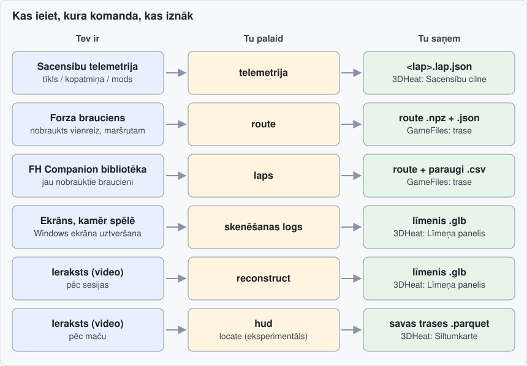

# 3DHeat GameCapture {#dheat-gamecapture}

**Kas tas ir?** Rīks, kas ieraksta to, ko sacensību spēle stāsta par tavu braukšanu, pa vienam failam uz braucienu. Tas var arī atjaunot aptuvenu līmeņa 3D modeli no tava spēles video.

**Kāpēc to lietot?** Lai redzētu savus braucienus [3DHeat skatītājā](https://holdi601.github.io/3DHeat/): kur bremzēji, kur biji lēns, kā atšķiras divi braucieni. Un lai līmenis būtu zem tavas siltumkartes, kad neviens nav to modelējis 3D.

**Piemērs:** ieslēdz Forza Data Out, palaid vienu komandu un nobrauc divus braucienus. Mapē `laps\` parādās divi braucienu faili. Ieliec tos skatītāja Sacensību cilnē.


Nekad nav strādāts ar komandrindu? Vispirms izlasi [Pirms sākat](before-you-start.md).

## Trīs darbi {#the-three-jobs}

1. **Braucienu telemetrija.** Tas ieraksta katru kanālu, ko sacensību spēle publicē - Forza Data Out, Assetto Corsa spēļu koplietotā atmiņa, rallija spēļu tīkla plūsmas, BeamNG modifikācija, Trackmania spraudnis - un raksta vienu `heat3d-lap` failu katram braucienam vai posmam skatītāja Sacensību cilnei. iRacing nevajag ierakstītāju: skatītājs lasa pašus `.ibt` failus.
2. **Līmeņi no spēles.** Tas pārvērš to, ko ekrānā redzēja, kamēr staigāji vai brauci pa līmeni, par `.glb` 3D modeli, ko skatītājs novieto zem siltumkartes.
3. **Tavs pats maču, pēc tam.** `hud` lasa tava ieraksta HUD - tavas darbības, nāves, mini kartes trasi un nogalinājumu sarakstu. `locate` (eksperimentāls: tas līdz šim novieto nedaudzus reālus kadrus) nosaka, kur katrs kadrs uzņemts, uz līmeņa 3D modeļa.

Visi trīs ievēro vienu noteikumu: **nekas netiek ievadīts spēlē un nekas netiek aizķerts**. Kadri nāk no publiskā ekrāna uztveres API, telemetrija - no saskarnēm, ko spēles publicē šim nolūkam. Skat. [Noteikumi](../rules.md).



Kods ir Python (pakotne `heat3d_capture`), MIT licence. Dziļuma un pozas modeļiem, ko tas var palaist, ir savas licences - skat. [Modeļi un licences](../models-and-licences.md).

## Ātrais sākums {#quick-start}

### Ieraksti braucienus {#record-laps}

Vajag Python 3.10 vai jaunāku ([Pirms sākat](before-you-start.md)). PowerShell:

```powershell
git clone https://github.com/Holdi601/3DHeat-GameCapture
cd 3DHeat-GameCapture
python -m venv .venv
.venv\Scripts\python -m pip install -r requirements.txt

# Forza: Settings -> HUD and Gameplay -> Data Out = ON, IP 127.0.0.1, port 5300
.venv\Scripts\python -m heat3d_capture telemetry -o laps
```

**Tev vajadzētu redzēt** `listening on port 5300. Laps go to laps. Ctrl+C to stop.`, tad rindu katram braucienam, kad šķērso finišu, kā iepriekš redzamajā attēlā. Lai apturētu, nospied Ctrl+C. Ieliec failus no `laps\` skatītāja Sacensību cilnē.
Katra cita spēle ir viena `--game` opcija attālumā:

```powershell
.venv\Scripts\python -m heat3d_capture telemetry --game acc -o laps
.venv\Scripts\python -m heat3d_capture telemetry --game dirtrally2 -o laps
```

Katrai spēlei un iespējai skat. [Telemetrijas ierakstītāji](../telemetry.md).

### Skenē līmeni {#scan-a-level}

Divreiz noklikšķini uz **`scan.bat`** rīka mapē. Tas atrod Python (un, ja tā nav, piedāvā uzstādīt to ar winget), izveido privātu `.venv` un atver skenēšanas logu. Logs pasaka, kas trūkst, kam kalpo katra pakotne un cik liela ir lejupielāde, un neuzstāda neko bez apstiprinājuma. Skat. [Izpildlaiks un atkarības](../runtime.md) un [Skenēšanas logs](../reconstruction-scan-ui.md).

Ar roku: `.venv\Scripts\python -m heat3d_capture.ui`.

Lai atjaunotu ierakstu bezsaistē, ar kameras ceļu atrisinātu vienlaikus (vajag PyTorch, pakotni `vggt` un GPU - skat. [Bezsaistes rekonstrukcija](../reconstruction-offline.md)):

```powershell
.venv\Scripts\python -m heat3d_capture reconstruct lap.mp4 -o lap.glb
```

## Dokumentācijas karte {#map-of-the-documentation}

| Lapa | Ko tā aptver |
|---|---|
| [Pirms sākat](before-you-start.md) | Python, terminālis, pirmā komanda, biežākās kļūdas |
| [Noteikumi](../rules.md) | Nav ievadīšanas, tikai publicētas saskarnes, un ko tas maksā |
| [Telemetrijas ierakstītāji](../telemetry.md) | Komanda `telemetry` un pārskats par katru spēli |
| [Forza](../telemetry-forza.md) | Data Out, izkārtojuma noteikšana, FH Companion relejs un tā `.tele.gz` |
| [Assetto Corsa spēles](../telemetry-assetto-corsa.md) | AC, ACC, AC EVO, AC Rally no koplietotās atmiņas |
| [Rallija spēles](../telemetry-rally.md) | EA SPORTS WRC, DiRT Rally 2.0 / 1 / DiRT 4, Richard Burns Rally |
| [BeamNG.drive](../telemetry-beamng.md) | `heat3d` protokola modifikācija |
| [Trackmania](../telemetry-trackmania.md) | `Heat3dRecorder` Openplanet spraudnis |
| [iRacing](../telemetry-iracing.md) | `.ibt` failu lasīšana skatītājā |
| [Braucienu un posmu sadalīšana](../lap-splitting.md) | `LapSplitter`, `CounterSplitter`, `LineSplitter`, `StageSplitter` |
| [Slīdējums, drifts un atvasinātie kanāli](../slip-and-drift.md) | Kā slīdējums tiek mērogots un ko skatītājs atvasina |
| [Fails heat3d-lap](../lap-format.md) | Braucienu failu formāts, kanāli, mērvienības, `meta` |
| [Spēles](../games.md) | Katrai spēlei: kā ierakstīt, kas tiek sūtīts, kuras trases var eksportēt |
| [Komandas](../commands.md) | `route`, `telemetry`, `laps`, `reconstruct`, `hud`, `locate`, soli pa solim |
| [Komandu atsauce](../cli-reference.md) | katra iespēja, ģenerēta no `--help` |
| [Lasīt HUD no ieraksta](../hud-video.md) | `hud`: tavas darbības, nāves, mini kartes trase un nogalinājumu saraksts no ieraksta |
| [Kadru atrašana līmenī](../locate.md) | `locate`: kur uzņemts katrs kadrs, pret līmeņa ģeometriju |
| [Līmeņa rekonstrukcija](../reconstruction.md) | Cauruļvads no kadriem līdz `.glb` |
| [Skenēšanas logs](../reconstruction-scan-ui.md) | Katra vadība, karsttaustiņš un pārklājuma elements |
| [Uztveršana, maskas un kadru kvalitāte](../reconstruction-capture.md) | Windows Graphics Capture, atslēgkadri, HUD maskas, kvalitātes padomi |
| [Dziļums](../reconstruction-depth.md) | Depth Anything V2, ONNX Runtime, modeļa veidošana |
| [Kameras poza un mērogs](../reconstruction-pose.md) | Odometrija, relokalizācija, telemetrijas pozas, zemes mērogs, kopējā korekcija |
| [Saplūšana, pārklājums un krāsa](../reconstruction-fusion-and-texture.md) | Aizņemtības tilpums, pārklājuma režģis, vājās vietas, virsotņu krāsa |
| [.glb izvade](../glb-output.md) | Fails, ko ielādē skatītājs |
| [Bezsaistes rekonstrukcija](../reconstruction-offline.md) | `reconstruct`, VGGT logi un savienošana |
| [Modeļi un licences](../models-and-licences.md) | Depth Anything V2 izmēri, VGGT, pakotnes |
| [Izpildlaiks un atkarības](../runtime.md) | Pārbaude pirms palaišanas, aizmugures, veiktspējas līmeņi |
| [Ierobežojumi un pārbaude](../limits.md) | Kas nav izdarīts un kas nav pārbaudīts |
| [Atjauninājumi](../updates.md) | Izlaides pārbaude un `python -m heat3d_update` |
| [Izstrāde](../development.md) | Testi, virtuālā vide, repozitorija izkārtojums |
| [Šo dokumentu uzturēšana](../maintaining.md) | Izlaides kontrolsaraksts kodam un dokumentācijai |

## Daļa no 3DHeat {#part-of-3dheat}

Faili, ko šis raksta, tiek ielādēti **3DHeat skatītājā** -
[avots](https://github.com/Holdi601/3DHeat), [dokumentācija](https://holdi601.github.io/3DHeat/).
Braucienu faili iet uz tā Sacensību cilni, `.glb` līmeņi uz tā Līmeņa paneli, `hud` un `locate` tabulas uz
tā Siltumkartes cilni; kā skatītājs lasa tabulas un maču failus, aprakstīts lapās
[Viens fails vienam maču: `.3dheat`](https://holdi601.github.io/3DHeat/container.html) un
[Datu ievade](https://holdi601.github.io/3DHeat/getting-data-in.html).

| Rīks | Ko tas dara | Dokumentācija |
|---|---|---|
| [3DHeat skatītājs](https://github.com/Holdi601/3DHeat) | rāda siltumkartes, sacensības un maču 3D, pārlūkā | [dokumentācija](https://holdi601.github.io/3DHeat/) |
| [GameFiles](https://github.com/Holdi601/3DHeat-GameFiles) | trases un līmeņi no spēlu piegādātajiem failiem kā 3D modeļi | [dokumentācija](https://holdi601.github.io/3DHeat-GameFiles/) |
| [GameCapture](https://github.com/Holdi601/3DHeat-GameCapture) | braucienu telemetrija no sacensību spēlēm; līmeņi, atjaunoti no spēles video | [dokumentācija](https://holdi601.github.io/3DHeat-GameCapture/) |
| [Unreal Exporter](https://github.com/Holdi601/3DHeat-UnrealExporter) | Unreal Editor spraudnis, kas eksportē līmeni kā 3D modeli | [dokumentācija](https://holdi601.github.io/3DHeat-UnrealExporter/) |
| [CS2](https://github.com/Holdi601/3DHeat-CS2) | Counter-Strike 2 demo maču failos; kartes 3D modeļos | [dokumentācija](https://holdi601.github.io/3DHeat-CS2/) |
| [Watcher](https://github.com/Holdi601/3DHeat-Watcher) | fona režīmā ieraksta tavu spēli no tā, ko spēles publicē | [dokumentācija](https://holdi601.github.io/3DHeat-Watcher/) |
| [Ext-WarThunder](https://github.com/Holdi601/3DHeat-Ext-WarThunder) | War Thunder ieraksti maču failos | [dokumentācija](https://holdi601.github.io/3DHeat-Ext-WarThunder/) |
| [Ext-WoT](https://github.com/Holdi601/3DHeat-Ext-WoT) | World of Tanks ieraksti maču failos | [dokumentācija](https://holdi601.github.io/3DHeat-Ext-WoT/) |
| [Ext-WoWs](https://github.com/Holdi601/3DHeat-Ext-WoWs) | World of Warships ieraksti maču failos | [dokumentācija](https://holdi601.github.io/3DHeat-Ext-WoWs/) |
| [Ext-Squad](https://github.com/Holdi601/3DHeat-Ext-Squad) | Squad servera demo maču failos | [dokumentācija](https://holdi601.github.io/3DHeat-Ext-Squad/) |
| [Ext-DCS](https://github.com/Holdi601/3DHeat-Ext-DCS) | DCS World kartes 3D modeļos | [dokumentācija](https://holdi601.github.io/3DHeat-Ext-DCS/) |
| [Ext-IL2](https://github.com/Holdi601/3DHeat-Ext-IL2) | IL-2 Sturmovik kartes 3D modeļos | [dokumentācija](https://holdi601.github.io/3DHeat-Ext-IL2/) |

Izstrādātājs, kuram atvērts spēles projekts, vajadzētu izmantot Unreal eksportētāju, kas nolasa īsto
ģeometriju un ir precīzs. Ja spēles pašas arhīvus var nolasīt, GameFiles izgūst precīzu trasi. Rekonstrukcija no
spēles ir paredzēta gadījumam, kad ir pieejams tikai ekrāns.
