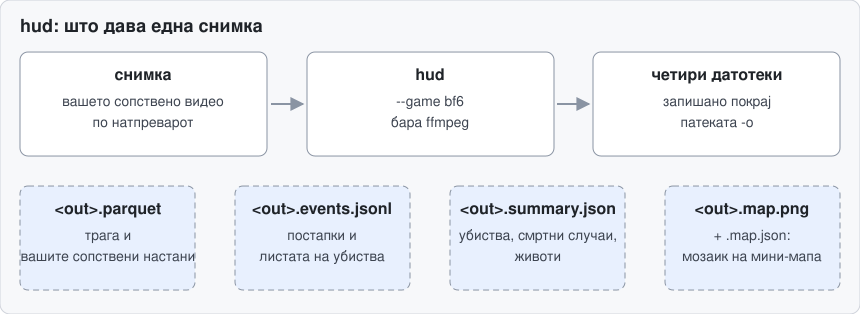

# Читање на HUD од снимка {#reading-the-hud-from-a-recording}

`hud` го чита HUD-от на екранот на играта од **сопствената снимка** на играчот, по натпреварот: **сопствените**
дејства на играчот од скокачкиот прозорец со поени што играта го покажува под нишанот (убиства,
асистенции, оживувања, дополнувања на залиха, освојувања...), неговите смртни случаи од екраните за паѓање и распоредување, неговата
**сопствена** трага од минимапата, и kill feed покрај нив како настани со време - запишано како
табела на 3DHeat, со мозаикот на минимапата како слика на мапа што се става под неа.

Накратко: го гледа видеото од вашиот натпревар и ги запишува вашите убиства, смрти и каде сте оделе.

```bash
.venv\Scripts\python -m heat3d_capture hud "<recording>.mp4" --game bf6 --player <name> -o out/match
```

Battlefield 6 е првиот профил на игра.



## Што допира и што не допира {#what-it-does-and-does-not-touch}

- Чита **видео датотека**: клип од ShadowPlay / Instant Replay, снимка од OBS, сѐ што
  ffmpeg го декодира. Никогаш не ја допира играта, нејзината меморија, датотеки или мрежа, и работи
  откако натпреварот ќе заврши. Видете [Правилата](rules.md).
- Ја добива **само сопствената позиција на играчот**, од сопствената минимапа на играчот. Ознаките на другите играчи
  на минимапата се маскирани и никогаш не се читаат. Kill feed се чува во целост, но само како
  она што го пишува на екранот (кој, кого, со што, кога); на никого освен на
  играчот не му се закачува позиција.
- OCR работи локално (RapidOCR со моделите на PaddleOCR преку ONNX Runtime). Ниту една слика или
  исечок не го напушта компјутерот.
- Снимката ги покажува имињата на другите играчи, а мозаикот е слика на нивото. Излезите
  се за сопствена употреба на играчот; чувајте ги локално.

## Барања {#requirements}

- **ffmpeg и ffprobe** во `PATH`. NVIDIA картичка се користи за декодирање кога има (`-hwaccel cuda`);
  инаку декодира процесорот, неколку пати побавно.
- Пакетите од `requirements.txt`, а OCR без сопствените зависности (бара
  `onnxruntime` за процесор, што се судира со DirectML верзијата што ја користи проектот):

```bash
.venv\Scripts\python -m pip install -r requirements.txt
.venv\Scripts\python -m pip install --no-deps rapidocr_onnxruntime==1.2.3
```

`rapidocr_onnxruntime` е читачот на текст (OCR) што чита имиња и зборови од екранот.
`--no-deps` спречува да го замени `onnxruntime` со DirectML на проектот.

За инсталирање на ffmpeg на Windows: `winget install Gyan.FFmpeg`, потоа отворете нов терминал и проверете
со `ffmpeg -version`. Нови сте со командната линија? Прочитајте [Пред да започнете](before-you-start.md).

- Снимка во **16:9** во која било резолуција (1080p, 1440p, 4K). Другите односи на страните се одбиваат,
  затоа што кутиите на профилот би паднале на погрешни делови од екранот.
- **Основниот распоред на HUD** на играта. Поместен или променет по големина елемент на HUD се чита на погрешно место.

## Опции {#options}

| Опција | По основно | Значење |
|---|---|---|
| `video` | | Снимката. |
| `-o`, `--out` | името на видеото, во тековната папка | Излезна патека **без** наставка; датотеките се `<out>.parquet`, `.events.jsonl`, `.summary.json`, `.map.png`, `.map.json`. |
| `--game` | `bf6` | Чиј HUD да се чита. `bf6` (Battlefield 6) е засега единствениот профил. |
| `--player` | нема | Името на играчот како што го покажува kill feed. Се споредува слободно (OCR ги меша `l`/`I`/`1`, `O`/`0`, `rn`/`m`). Без него името се погодува (подолу). |
| `--fps` | 5 | Примероци од минимапата во секунда. Kill feed се зема на половина од тоа, скокачкиот прозорец со поени и екраните за смрт исто на половина од тоа (четвртина додека нема прозорец), компасот на секои 3 s, листата на одредот на секои 15 s. |
| `--start` | 0 | Секунди во видеото од каде да почне. |
| `--seconds` | сè | Колку од видеото да се чита. |
| `--metres-per-pixel` | нема | Размерот на минимапата, ако е познат: метри по пиксел на минимапата при вообичаеното зумирање (минимапата е широка 296 пиксели на екран од 1080p). Без него позициите се во тие пиксели; видете [Единици](#north-and-units). |
| `--cpu` | исклучено | Декодира на процесорот дури и кога има NVIDIA картичка. |

Напредокот се печати на секои пет секунди; на крај играчот, убиствата, смртите, животите и датотеките што се
запишани.

## Излези {#outputs}

### `<out>.parquet` - трагата и настаните на играчот {#parquet---the-players-track-and-events}

Еден ред за секој примерок во кој играчот бил во игра и минимапата можела да се смести, плус еден за секој негов
настан. Подножјето ги носи упатствата за читање на прегледувачот (клуч `heat3d`, `kind: heat3d-hud`), така што
прегледувачот ја мапира секоја колона без да праша.

| Колона | Значење |
|---|---|
| `time` | Секунди од почетокот на видеото. |
| `event` | `position`; `start` (видеото почнало среде живот), `spawn` (повторно во игра по смрт или долга пауза), `death`, `downed` и `revived` (од екраните за смрт, подолу), `end` (животот завршил без нешто што кажува како); сопствените дејства на играчот од скокачкиот прозорец со поени (`kill`, `assist`, `reviving`, `resupply`, `capture`... - [табелата на настани](#event-table)); и линиите на kill feed за играчот како `kill_feed`, `death_feed`, `teamkill_feed`, `suicide_feed`, `squadwipe_feed`. |
| `source` | Од каде дошол настанот на редот: `points` (скокачкиот прозорец), `screen` (екраните за паѓање и распоредување), `feed` (kill feed); празно на редови со позиција. |
| `text` | На редови `points`: ознаката како што е испечатена (`KILL`, `SQUAD DAMAGE ASSIST`...), или насловот (`DOUBLE KILL`, името на лента), или за непозната ознака она што е прочитано. |
| `points` | На редови `points`: за колку порасна вкупниот збир на скокачкиот прозорец во тој момент. Кога повеќе дејства дошле во истиот примерок (убиство и возилото во кое било) тоа е нивниот збир, даден на секое, а `shared` кажува колку го делеле. Празно кога збирот не бил прочитан двапати од двете страни на моментот. |
| `subject`, `subject_side` | На редови `points`: името што го покажал прозорецот со дејството - жртвата на убиство, оживениот или снабдениот соиграч - и неговата боја (`enemy`, `friendly`, `squad`). |
| `confirmed` | `feed` кога kill feed имал линија за истото убиство или смрт (во рок од 3 s, истата жртва). |
| `x`, `y`, `z` | Позиција на мозаикот: `x` исток, `y` север, `z` 0 (подножјето кажува дека `z` е нагоре). Северот е вистински север кога компасот дозволил (видете `north_up` во резимето). |
| `player` | Секогаш `me`. Само сопствените редови на играчот имаат позиции. |
| `team` | `own`. |
| `session` | `<video name>#NN`, по една за секој живот. Рутите на line heat никогаш не преминуваат сесија. |
| `heading` | Степени во насока на стрелките на часовникот од север (од горниот раб на мозаикот кога северот е непознат): каде гледал погледот. |
| `dir_x`, `dir_y`, `dir_z` | Истото како вектор на насока, за насоката на погледот во прегледувачот. |
| `zoom` | Колку е минимапата одзумирана во однос на вообичаеното зумирање (над 1 во возила). |
| `killer`, `victim`, `weapon`, `headshot`, `marker` | На редови за убиство и смрт што имаат линија од feed: линијата од feed (подолу). Убиство од прозорецот без линија од feed го има името од прозорецот како `victim`; убиство од прозорецот покажано како HEADSHOT има `headshot` вистинито. |

Секој ред со настан ја зема позицијата на играчот во времето на настанот (за смрт или паѓање, последната
позиција пред него; за оживување, првата по него). Редовите одговараат директно на [line heat](https://holdi601.github.io/3DHeat/line-heat.html) на прегледувачот: неговиот
предлог избира `event`, започнува на `start`, `spawn` и `revived`, завршува на `death`, `downed` и
`end`, а редовите `position` лежат по рутата. Другите настани се именувани така што
предлогот не зема ниту еден за почеток или крај: давањето оживување е `reviving` (не
`revive`), држењето точка е `defense`, соиграч што се појавува кај играчот е `teammate_arrived`,
линиите од feed се `kill_feed` и така натаму; `kill` не е крај.

Клип со две рунди на две мапи дава два мозаика што не можат да се поврзат. Најголемиот е
`<out>.parquet`; секој друг со најмалку 30 s трага се пишува покрај него како
`<out>.map2.parquet`, `<out>.map2.map.png` и така натаму.

### `<out>.events.jsonl` - настаните на играчот и kill feed {#eventsjsonl---the-players-events-and-the-kill-feed}

Еден JSON објект по линија, по редослед на времето, секој со `source`:

- `points`: еден за секое дејство на играчот: `time`, `event`, `text`, `points`, `shared`,
  `subject`, `subject_side` (како во табелата), `popup` (од кој прозорец дошло, нумерирано низ
  пуштањето), `seen` (колку читања го покажале), `confirmed`, и `x`, `y` каде бил играчот.
- `screen`: еден за секое паѓање и секое оживување: `event` (`death`, `downed` или `revived`), `time` (кога
  играчот паднал; за `revived`, кога исчезнале екраните), `until` (последното гледање на
  екраните), `screens` (`down` и/или `card`), `outcome` (`death`, `revived` или `unknown` кога
  снимката завршува прва), `killer` (од линијата од feed, кога има), `x`, `y`.
- `feed`: секоја линија што ја покажал feed, од сите:

| Поле | Значење |
|---|---|
| `time`, `last` | Првиот и последниот примерок во кој е прочитана линијата (секунди од почетокот на видеото). `time` е кога се појавило убиството, до еден примерок од feed (0,4 s при основната стапка). |
| `kind` | Од страната на играчот: `kill`, `death`, `teamkill`, `suicide`, `squadwipe`; за линиите на другите играчи `kill`, `squadwipe`, или `death` за линија без убиец. |
| `killer`, `victim` | Имињата, како најчестото читање низ сите примероци што ја покажуваат линијата (подолгото читање победува кога вообичаеното е негов почеток: делумно скриено име). `killer` е празно за линија што покажала само икона и жртва - смрт од светот, или линија чиј убиец веќе исчезнал. |
| `killer_side`, `victim_side` | Според бојата на името: `friendly` (тимот на играчот, сино), `enemy` (портокалово), `squad` (бледозелената што играта ја користи за играчот и неговиот одред), `neutral` (ниту една од овие). |
| `weapon` | Класата на иконата на оружјето во ова пуштање: `icon01`, `icon02`... Линиите чии икони личат делат класа. Иконите не се именувани; нема листа од која би се именувале. |
| `marker` | Малата икона меѓу оружјето и жртвата: `skull`, `arrow`, `chevrons`, `crosses` или празно. |
| `headshot` | `marker == "skull"` - претпоставка, видете [Ограничувања](#limits). |
| `seen` | Колку примероци од feed ја покажале линијата. |
| `me` | `killer`, `victim` или null. |
| `matched` | За сопствените линии на играчот: дали е најдено дејство од прозорецот или екран за смрт за неа. |
| `x`, `y` (, `map`) | За сопствените линии на играчот: каде бил. |

### `<out>.summary.json` {#summaryjson}

Играчот (и како е најден), од каде дошле настаните на играчот (`own_events_from`: прозорецот
и екраните, или само kill feed кога ниту едно не е прочитано), убиства, смрти, K/D,
хедшотови, асистенции, дадени (`revives`) и добиени (`revived`) оживувања, паѓања, освојувања,
неутрализации, дополнувања на залиха, лекувања, поправки, уништени возила, резултатот (збировите од прозорците
собрани), секој вид дејство со својот број (`actions`), бројот на прозорци, смрти што ги покажал само feed,
сопствениот број на убиства и смрти на feed и колку од неговите убиства се совпаднале со убиство од прозорец,
убиства на свои, самоубиства, збришани одреди, животи, секунди во игра, поминато растојание (во единиците на табелата),
линии од feed, по мапа дали е север нагоре и колку читања на компасот се согласиле, броевите на трагата
(примероци, во игра, сместени, несместени, острови), направените претпоставки и времињата.

### `<out>.map.png` и `<out>.map.json` - мапата под трагата {#mappng-and-mapjson---the-map-under-the-track}

Мозаикот од секоја минимапа на пуштањето, усреднет, со отстранети преклопи, завртен и скалиран точно како
табелата. JSON датотеката до неа ги содржи двете сидришта што ги бара поставувањето на **Map image** на прегледувачот
([Слики на мапи](https://holdi601.github.io/3DHeat/map-images.html) во документацијата на прегледувачот): вчитајте го PNG со
**Map image...**, оставете **Flip north/south** вклучено и внесете сидро 1 и сидро 2 (`px`, `py`,
`worldX`, `worldZ`) од датотеката. Сликата тогаш лежи точно под трагата.

Во сликата има само делови од нивото што ги покажала минимапата на играчот.

## Метод {#method}

### Декодирање {#decoding}

ffmpeg декодира на GPU, паѓа на стапката на земање примероци додека сликите се уште се на картичката, ги сече
областите на профилот (минимапа, kill feed, две ленти на компасот, листа на одредот, скокачкиот прозорец со поени,
зборовите на екранот за паѓање, долниот десен агол), ја скалира секоја на фиксна големина и ги редува
во една мала слика по примерок. Само таа слика поминува низ цевката
во Python. Декодирањето на секоја слика од H.264 текот е дното на времето на работа.

Две работни нишки ги земаат примероците: едната регистрира минимапи (OpenCV), другата чита текст (ONNX Runtime).

### Во игра или не {#in-play-or-not}

Квадратот со совет за копче на минимапата (светлиот квадрат со копчето за мапа во него, долу лево од
минимапата) е нацртан секогаш кога е минимапата, а не на екраните за смрт, kill-cam, распоредување, мени или резултати.
Неговото присуство - светол квадрат без боја, со темна буква во средина, јасно
посветол од она околу него - барано неколку пиксели околу неговото место, е тестот за „во игра“. Еден
примерок што не се согласува со двата соседи се игнорира.

Пауза во играта е смрт или промена на рунда (следниот дел почнува со `spawn`) кога трае најмалку 6 s или
смрт (од екраните, или линија од feed што го именува играчот како жртва) дошла во рок од
40 s пред неа; пократка пауза без смрт (отворена голема мапа) го продолжува животот. Минимапата
останува на екран додека играчот е паднат, па паднат играч е во игра.

### Трагата {#the-track}

Минимапата се врти со погледот и го држи играчот на фиксна точка (измерено: средина, 49,7% надолу).
Секој примерок:

1. **Маскира** што не е ниво: силно обоени или скоро бели пиксели (ознаки на цели, икони на одред
   и возила, пингови, границата на просторот за игра, линии на рута, текст), бледата жолто-зелена боја на
   конусот на погледот, диск околу ознаката на играчот, клинот на конусот над неа, советот за копче и
   тенок раб.
2. **Одлики**: SIFT клучни точки на сивата минимапа со израмнет контраст, во рамките на маската.
3. **Регистрира на мозаикот**, не на претходниот примерок: клучните точки се совпаѓаат со
   одликите зачувани досега, во координати на мозаикот, близу до местото каде што играчот бил последен пат; се
   прилагодува сличност (вртење, зум, поместување) со RANSAC. За прилагодувањето треба доволно согласни точки (inliers), зум во рамки на
   една третина од претходниот и поместување помало од третина од минимапата по примерок; прилагодување
   барано насекаде на мозаикот (по смрт) бара двојно повеќе согласни точки.
4. **Го расте мозаикот**: одликите што мозаикот сѐ уште ги нема се додаваат (најмногу на секои неколку десетинки
   секунда движење), а маскираната минимапа се усреднува во сликата.
5. Точката на играчот пренесена низ прилагодувањето е неговата **позиција**; горниот раб на минимапата пренесен
   низ него е неговата **насока** (heading) на мозаикот.

Потоа точка што скока повеќе од 10 пиксели настрана и од двата примерока пред неа и од
двата по неа (што се согласуваат меѓу себе) се отфрла: минимапа од време на време се совпаѓа со погрешен
зум за еден примерок. Резимето ги брои (`dropped_as_jumps`).

Регистрирањето на мозаикот е она што спречува грешките да се собираат: враќањето на место се совпаѓа со
одликите зачувани првпат. Појавување на место што сѐ уште не е видено започнува посебен **остров**; секој
десетти сместен примерок се пробува спрема другите острови, а првото добро совпаѓање ги спојува
(помалиот се преселува во поголемиот, со својата трага). Острови што никогаш не се споиле (друга мапа, или земја што никогаш
не била делена) се пишуваат одделно како погоре.

### Север и единици {#north-and-units}

Лентата на компасот се чита на секои 3 s: нејзините ознаки се наоѓаат по мастилото (светло, без боја,
групирани преку мали празнини, цртичките отфрлени), секоја се чита сама, а две или повеќе ознаки ги фиксираат и
размерот на лентата и правецот под средишната ознака - една ознака не фиксира ништо. Секое
читање на компасот се спојува со насоката на мозаикот од истиот примерок; кружната медијана на
разликите, над читањата во рамки на 10 степени од неа, е вртењето што го става мозаикот со север нагоре.
Се применува кога најмалку три читања и половина од сите се согласуваат.

<a id="units"></a>Размерот на земјата на минимапата не е испечатен никаде на екранот, па позициите се во
**пиксели на минимапата при вообичаеното зумирање**: медијаната на зумот на пуштањето се скалира на една единица од табелата по
пиксел на минимапа од 296 пиксели (нејзината големина на екран од 1080p). Одзумирањето кај возилата го отстранува
регистрацијата, па единицата е иста пешки и во возило. `--metres-per-pixel` множи
сè во метри кога размерот е познат (од познато растојание на мапата, измерено еднаш).

### Kill feed {#the-kill-feed}

Feed се чита со 2,5 примероци во секунда, но само кога неговите обоени пиксели забележливо се промениле или
поминале 2 s. Линиите текст ги наоѓа детекторот на OCR; линија чија слика се совпаѓа со една прочитана во
претходниот примерок (редовите се лизгаат, па можеби се поместила) го зема тој текст наместо повторно да се чита.
Линиите премали за име, или со коса црта (бројач на fps во тој агол), се отфрлаат.

Линиите се групираат во редови по висина; во ред најлевото име е убиецот, а најдесното
жртвата. Соседните парчиња со иста боја се спојуваат (име со празно место). Една линија што
минала преку иконата од едно име во другото се сече на својата најширока празнина кога половините се разликуваат по
боја, и секоја половина се чита повторно. Едно име во колоната на жртвите со икона веднаш лево од него
е линија без убиец. Две парчиња во една боја без икона меѓу нив се едно име чиј
убиец исчезнал, а не убиство.

**Страните** доаѓаат од бојата. Имињата се цртаат со некаква провидност, па тестот е колку далеку
е текстот од својата позадина: знакот на црвено минус сино во таа разлика е портокалово (непријател)
или сино (пријател) на која било позадина; ниту едното, со зелено над другите две, е бојата на одредот.

**Икони**: меѓу имињата, пикселите во бојата на убиецот ја даваат силуетата на оружјето; мала
одделна икона веднаш пред жртвата е ознаката, именувана по својата форма (дамка со дупки за очи
е череп; мал триаголник стрела; неколку парчиња крстови).

**Настани**: ред прочитан повторно со слични имиња (сличност 0,7 откако ќе се
свијат вообичаените OCR конфузии, една од нив 0,8; скратено читање се совпаѓа со почетокот на целото име) е истиот
настан, додека настанот бил последен пат прочитан пред помалку од 5 s и е постар од 14 s - ниту еден ред не остава
подолго, па истиот пар подоцна е ново убиство. Ред без убиец се совпаѓа само според жртвата.
Времето на настанот е неговото прво виде; неговите имиња, страни и ознака се мнозинството низ
видувањата; редовите прочитани само еднаш се отфрлаат.

**Играчот**: `--player`, инаку означениот (најсветол) ред од листата на одредот кога најмалку три
читања и 60% од нив се согласуваат, инаку името што feed најчесто го нацртал во бојата на одредот. Инаку
резимето кажува дека играчот е непознат, и ниту една линија од feed не му се припишува. (Прозорецот и
екраните за смрт се на самиот играч без разлика на името; не им треба име.)

### Скокачкиот прозорец со поени {#the-points-popup}

Сè што играчот го освојува, Battlefield 6 го покажува во еден прозорец веднаш лево и под
нишанот - на исто место пешки, во возило и преку нишан:

```
            [ RIBBON ] (icon)          a title, now and then: a ribbon or a multi-kill
      (icon)(icon)(icon)  300          one icon per action; the popup's running total
                Some_Name              who it was about, for a moment: orange an enemy, blue a teammate
    [ KILL x2 ] [ VEHICLE DESTROYED ]  one boxed tag per kind of action, with a count
```

Прозорецот расте додека играчот продолжува да освојува: ново убиство го претвора `KILL` во `KILL x2`, додава
икона и го крева збирот; нов вид дејство додава ознака. Редот со ознаки ги покажува последните неколку видови
(постара се лизга надвор, а броењето продолжува кога ќе се врати). Околу три секунди по последното
дејство прозорецот се свиткува во една линија (`[KILL x2] 300`) и исчезнува. Текстот е светлосив, ознаките во
тенки кутии, збирот со големи цифри што започнуваат на x 760 на екран од 1920x1080, ознаките
порамнети десно до x 750.

Се чита 2,5 пати во секунда: детекторот на OCR ги наоѓа линиите текст, се читаат само линии на еден од
редовите на прозорецот (сопствените ознаки на нишанот на тенкот во истата област не се), а линија чија
слика се совпаѓа со една прочитана претходниот примерок го зема тој текст. Линија што се протегнала од икона, име
или свиткана ознака во збирот (`Name10`, `REVIVE185`) се сече каде што почнува збирот
(x 755) и двете половини се читаат повторно. Додека нема прозорец, секој втор примерок се задржува
непрочитан; кога следниот покажува прозорец, задржаниот се чита први, па почетокот на прозорецот сепак
се наоѓа до примерок.

**Ознаките** се совпаѓаат со [табелата на настани](#event-table) откако ќе се свијат вообичаените
грешки на препознавачот (Q прочитано како O, цифра меѓу букви, I за L, буква изгубена на раб): читањето е ознака
кога е најмалку 80% слично на една (85% за ознаки од пет букви или помалку) и јасно поблиску до
неа отколку до која било друга. Ознаки што препознавачот ги слепил (`CAPTUREDORDERCOMPLETED`) се раздвојуваат
со кинење на познати ознаки од напред. Бројот е `x2`, `X3`, залутан знак и цифра, или цифра
веднаш по ознаката. Светлосива линија со големи букви во редот со ознаки што не се совпаѓа со ништо се чува како
дејство `points` со својот текст; линија што е парче од позната ознака во истиот прозорец
(`DESTROYED` покрај `VEHICLE DESTROYED`) не се чува. Насловите над збирот (светли кутии, темен текст)
се `multi_kills` (`DOUBLE KILL` ...) или `ribbon`. Името е обоената линија меѓу збирот
и ознаките; неговата страна доаѓа од бојата како во feed.

**Прозорци и дејства**: читања со помалку од 0,9 s ништо меѓу нив се еден прозорец. Прозорец
што изгледа дека завршува и се враќа пред да можел да се свитка (во рок од 3,2 s од последното растење),
со секоја ознака на својот број или повеќе и збир не помал, е истиот прозорец изгубен за момент
(замаглување, светла позадина) - ништо во него не се брои двапати. Во прозорец, конечниот број на ознаката е
највисокиот број прочитан најмалку двапати; нејзиното k-то дејство е со време на првото читање што покажува број
k или повеќе. Број прочитан во само еден примерок не е дејство - освен убиство за кое kill feed
гарантира (линија на играчот во рок од 3 s што ниедно друго убиство не ја зело): кратката ознака KILL е
онаа што препознавачот најчесто ја чита само еднаш. Насловот се брои еднаш по прозорец, кога е прочитан
двапати. `points` е колку порасна збирот - броејќи само збирови прочитани двапати по ред - од
пред примерокот на дејството до по него.

Непозната линија се брои како ознака само на редот на познатите ознаки во истото читање (или, без
позната ознака, кога нема ни име), па име нацртано во боја што тестот за страна не може да ја разликува не се зема за ознака.

### Смрти и оживувања {#deaths-and-revives}

Кога играчот паѓа, играта го кажува тоа под средината на екранот (MAN DOWN, REQUEST
REVIVE, SKIP (HOLD), NEARBY MEDICS; кога ќе се побара оживување, REVIVE REQUESTED, CANCEL REQUEST),
а картичка долу десно именува кој го направил тоа, со DAMAGE LOG или PLAYER CARD под неа и
линија „YOU n - n FOE“ над неа. Убиен на место (смртоносен хедшот), се покажува само картичката. Потоа или
соиграч го оживува играчот - екраните исчезнуваат и играта продолжува - или играчот искрвавува или
се предава, и следи екранот за распоредување, со DEPLOY долу десно.

Овие зборови се читаат заедно со прозорецот, во истиот премин на OCR (прозорецот, лентата на екранот за паѓање
и долниот десен агол редени во една слика): 2,5 пати во секунда додека има прозорец,
1,25 пати инаку. Аголот е вклучен само кога играчот е надвор од игра или
бил виден паднат во последните 3 s; во игра содржи само бројач на муниција.
Видувања на помалку од 4 s едно од друго прават еден епизод (најмалку две видувања). Епизодот е
**смрт** кога екранот за распоредување се покажува во рок од 12 s од неговиот крај, или играчот е надвор од игра 3 s
по него и останува надвор 6 s или повеќе; тој е **оживување** (`downed`, потоа `revived`) кога
играчот е сѐ уште во игра 3 s откако исчезнале екраните; `unknown` (запишано само како `downed`) кога
снимката завршува прва. Времето на смртта е кога играчот паднал: линијата од feed што го именува како
жртва, кога има една во рок од 3 s пред епизодот, инаку првото видување на епизодот минус
половина интервал на читање. Позициите по смрт се изоставени од рутата до екранот за
распоредување.

Смрт од feed што ниту еден епизод не ја објаснува (екраните се пропуштени) е сепак `death`, со `source`
`feed`, и се суди како претходно: ако играчот остане во игра повеќе од 40 s по неа, бил
оживен.

### Табела на настани {#event-table}

Во што се претвора секоја ознака, наслов и екран. Повеќе ознаки може да се еден настан; `text` чува која.

| Настан | Од | Значење |
|---|---|---|
| `kill` | KILL; HEADSHOT | Играчот убил некого (името е жртвата). Убиство со хедшот покажува HEADSHOT каде што би стоел KILL: `text` кажува кое, а `headshot` е вистинито. |
| `assist` | ASSIST, KILL ASSIST, DAMAGE ASSIST, SQUAD DAMAGE ASSIST | Штета на некој кого го убил соиграч. |
| `kill_assist` | ASSIST COUNTS AS KILL | Асистенција што играта ја брои како убиство. |
| `suppression`, `suppression_assist` | ENEMY SUPPRESSION; SUPPRESSION ASSIST | Потиснувачки оган врз непријател; врз таков кого потоа го убил соиграч. |
| `smoke_assist` | SMOKE ASSIST, SQUAD SMOKE ASSIST | Чад што покрил соиграч. |
| `spot`, `spot_assist` | SPOT, SPOTTED, ENEMY DESIGNATION; SPOT ASSIST, SPOT BONUS | Забележување непријател; убиство на таков што го забележал играчот. |
| `driver_assist` | DRIVER ASSIST | Убиство од топџијата на возилото на играчот. |
| `reviving`, `reviving_bonus` | REVIVE, SQUAD REVIVE; CONCEALED REVIVE | Играчот оживел соиграч; бонусот за тоа под заклон. |
| `heal` | HEAL, SQUAD HEAL | Играчот излечил соиграч. |
| `resupply` | SUPPLY, RESUPPLY, SQUAD SUPPLY | Соиграч зел муниција од играчот. |
| `repair` | REPAIR, VEHICLE REPAIR, SQUAD REPAIR | Играчот поправил возило. |
| `capturing`, `capture` | CAPTURING, RECAPTURING; CAPTURED, OBJECTIVE CAPTURED | Отчукување на освојување; целта освоена. |
| `neutralizing`, `neutralize` | NEUTRALIZING; NEUTRALIZED, OBJECTIVE NEUTRALIZED | Истото за соборување на непријателска цел до неутрална. |
| `defense` | DEFENDING, OBJECTIVE DEFENDED | Држење на цел. |
| `offensive`, `defensive` | OFFENSIVE; DEFENSIVE | Бонусот на дејство близу цел што се напаѓа; се брани. |
| `order` | ORDER COMPLETED | Извршена наредба на одредот. |
| `vehicle_damage`, `vehicle_disabled`, `vehicle_destroyed`, `vehicle_destroyed_assist` | VEHICLE DAMAGE; VEHICLE DISABLED; VEHICLE DESTROYED; VEHICLE DESTROYED SUPPORT | Штета на непријателско возило, до негово уништување, или помагање во тоа. |
| `equipment_destroyed` | EQUIPMENT DESTROYED | Уништен непријателски гаџет. |
| `forced_bail` | FORCED BAIL | Непријател принуден да излезе од возилото. |
| `squad_wipe` | SQUAD WIPE | Убиен последниот од непријателски одред. |
| `savior`, `avenger` | SAVIOR; AVENGER | Убиство на непријател што повредувал соиграч; што штотуку убил еден. |
| `teammate_arrived` | SPAWNED ON, SPAWN ASSIST, VEHICLE SPAWN, SQUAD VEHICLE SPAWN | Соиграч се појавил кај играчот или во неговото возило. |
| `transport` | TEAM TRANSPORT | Превезување соиграчи во возило. |
| `fortify` | DEFENSE DEPLOYED | Одбрана што ја изградил играчот. |
| `points` | сè друго во редот со ознаки | Дејство што табелата не го знае: `text` е она што е прочитано. |
| `multi_kills` | DOUBLE KILL, TRIPLE KILL, QUAD KILL, MULTI KILL (наслов) | Убиства во брза низа. |
| `ribbon` | кој било друг наслов | Лента, по своето име (BALLISTIC, TANK BUSTER, ENGINEER EXPERT, SPEARHEAD...). |
| `downed` | екран за паѓање, потоа игра | Играчот паднал и бил оживен. |
| `revived` | екраните исчезнуваат, играта продолжува | Играчот бил оживен од соиграч. |
| `death` | екран за паѓање или картичка, потоа распоредување или надвор од игра | Играчот умрел. |

Текстовите во табелата се виделе во пробните снимки, освен овие, што се вообичаени имиња од
серијата игри и се во табелата за да бидат именувани наместо да се чуваат како `points`:
HEADSHOT KILL, ASSIST, KILL ASSIST, ASSIST COUNTS AS KILL, SPOT, SPOTTED, SPOT ASSIST, SPOT BONUS,
SQUAD REVIVE, HEAL, SQUAD HEAL, RESUPPLY, SQUAD SUPPLY, REPAIR, VEHICLE REPAIR, SQUAD REPAIR,
VEHICLE DISABLED, SQUAD WIPE, AVENGER, формите OBJECTIVE ..., и насловите TRIPLE KILL,
QUADRUPLE KILL и MULTI KILL. Играта на друг јазик печати
други зборови: нејзините ознаки излегуваат како `points` со она што е прочитано - не се мешаат со познато дејство -
со нивните збирови и имиња; а бидејќи екраните за смрт се познати по своите англиски зборови, смртите
тогаш доаѓаат само од kill feed, како редови `death` со `source` `feed`.

## Што е проверено {#what-is-verified}

Проверено со око спрема пробни снимки (сопствени на играчот, не дел од складиштето), со
извлекување случајни примероци и споредба на секој со сликите околу него:

- **Сопствените настани на играчот.** Секое земено дејство од прозорецот било вистинско дејство од тој вид, најдено
  во рок од едно читање (0,4 s) од неговото време; повеќето вредности и имиња биле точни (имиња во некои писма,
  како кирилицата, може да излезат изобличени). Секој земен екран за смрт бил најден.
- **Kill feed.** Огромното мнозинство редови од feed биле најдени со точни двата имиња; мали OCR
  грешки (голема I прочитана како мала l) се дозволени. Имиња нацртани со знаци што самата игра
  ги покажува како кутии може да се пропуштат. Страните (боите) се погрешни кај неколку проценти од имињата.
- **Во игра.** Тестот со совет за копче се согласувал со сликата во секој земен момент.
- **Трага.** Нема вистинска референца за тоа каде бил играчот, па трагата се проверува спрема
  самата снимка: две минимапи се регистрираат **директно една на друга**, а тоа поместување
  се споредува со поместувањето меѓу двете позиции од табелата. Медијаната на несогласување е околу
  1-3 пиксели на минимапата (под 1% од ширината на минимапата), повеќе на преполна, одзумирана минимапа.
  Читањата на компасот се согласуваат со мозаикот во рамки на 10 степени речиси секогаш.
- **Време на работа.** Декодирањето со околу 5 пати реално време е најголемиот дел, на десктоп GPU; читањето на
  прозорецот со поени додава од една петтина до половина.

Погледнато со око: секој мозаик има непрекинати патишта и згради низ животите што го изградиле,
а рутите на различни животи по истиот пат лежат една врз друга. Дел каде што зумот на
минимапата се менува може да излезе предолг - видете [Ограничувања](#limits).

Тестовите (`tests/test_hud_*.py`) цртаат сè што читаат: измислено ниво од патишта, згради и
контури, минимапи од одење низ него со преклопите што ги има вистинска, ленти на компас, редови
од kill feed со измислени имиња. Проверуваат дека јамка се следи до два пиксела и се затвора, дека
играч што стои останува на место додека погледот се врти, дека промените на зумот се следат, дека појавување
на друго место се спојува назад кога патеките се среќаваат, дека вртењето на северот и превртувањето на y ја ставаат трагата
каде што навистина одела, дека сидрата на сликата на мапата ја порамнуваат под трагата, и парсирањето,
страните, ознаките и отстранувањето дупликати на feed. За сопствените настани на играчот цртаат прозорци со поени
со измислени имиња и ознаки и ја проверуваат табелата на ознаки и нејзината толеранција на грешките на препознавачот,
слепени ознаки, редовите на прозорецот, збирот одсечен од име, броењето додека прозорецот расте, продолжува
по момент непрочитан, лизга ознака надвор и назад, или завршува; дека број прочитан еднаш се држи
одделно; смртите, оживувањата и исходите од зборовите на екраните; и, на измислен натпревар, дека
дејствата, смртите и оживувањата завршуваат во табелата каде што бил играчот, линиите од feed покрај нив
под нивните имиња, а рутата завршува на смртта, а не на оживувањето.

## Ограничувања {#limits}

- **Единиците се пиксели на минимапата**, не метри, освен ако е дадено `--metres-per-pixel`. Ништо на
  екранот на играта не го кажува размерот на земјата на минимапата.
- **Мапирано е само она што го покажала минимапата.** Мозаикот ја покрива земјата во рамки на половина минимапа од
  местото каде што одел играчот; два мозаика што никогаш не делеле земја (две рунди на две мапи, или два
  живота во далечни агли на голема мапа) остануваат одделни датотеки со неповрзани координати.
- **Трагата е на минимапата, со 5 примероци во секунда**, измазнета со ништо. Минимапа зумирана далеку
  надвор (хеликоптер во пробните снимки ја одзумирал до 2,3 пати) покажува помалку детали по пиксел,
  а надвор од просторот за игра речиси ништо, па регистрацијата таму е погруба. Авиони, и
  играчот како патник, ги немало во пробните снимки.
- **Грешките на регистрацијата се локални и не се собираат**, но мозаик изграден додека се истражува ново
  земјиште може да носи мала кривина што се поправа само кога земјата ќе се види повторно. Каде што зумот на
  минимапата се менува непрекинато (возило што забрзува) прилагодениот зум може да отстапи, а еден
  таков дел бил видено со растојание околу двојно од вистинското. Мозаик изграден од преполна,
  одзумирана минимапа на пешадија е најмалку точен (грешки од околу 3 пиксели вообичаено, до 18).
- **Нема оптимизација на граф на позиции.** Јамката се затвора со совпаѓање на зачувани одлики, а не со ширење
  на корекцијата низ јамката.
- **Класите на оружје сè уште не работат.** Силуетата на иконата се зема од провидна икона над
  подвижна позадина и премногу варира од примерок до примерок: пробните снимки излегоа
  со 220 до 340 класи за 550 до 670 линии, а натпревар има неколку десетици оружја. Третирајте го
  `weapon` како експериментално. Класите се по пуштање во секој случај и не се имиња.
- **Значењата на ознаките не се сите познати.** Стрелката (`▸`) се црта пред сопственото име
  на играчот, во линии за него; не е вид убиство. Се зема дека черепот значи хедшот; тоа
  е претпоставка, не нешто што го кажува играта. `chevrons` и `crosses` (збришани одреди) се
  пријавуваат како виделе.
- **Имиња во писма различни од латиница** (на пример кирилица) излегуваат како најблиски латински
  букви што личат: препознавачот чита латиница и кинески. Истиот играч се чита исто
  секој пат, па сепак се совпаѓаат, но текстот не е неговото име.
- **Преклопи во аголот на kill feed** (бројач на fps) може да го сокријат крајот на жртвата
  во горниот ред. Текстот на бројачот се препознава и се отфрла, а скратено име се совпаѓа со своите целосни
  читања, но име видено само скратено останува скратено.
- **Смрт што ја покажале ни екраните ни feed** сепак ја завршува рутата, како `end`, кога
  играчот излегува од игра за 6 s или повеќе.
- **Добиените оживувања** доаѓаат од екраните за паѓање. Само за смрт од feed што ја пропуштиле екраните
  тие сепак се заклучуваат (во игра повеќе од 40 s по неа), а брзо оживување тогаш не се разликува.
- **Дејствата од прозорецот се датираат на читање**: во рамки на 0,4 s од првото појавување на ознаката; ознака што
  се анимира може да се прочита еден примерок доцна или рано.
- **Имињата на редовите од прозорецот** се читаат како на feed: писма различни од латиница излегуваат изобличени,
  а од време на време име над глава на соиграч што лебди во светот близу до прозорецот се чита како
  име на дејството. Дејства без име (отчукување на освојување, наредба) не носат.
- **`points`** недостасува каде што збирот не бил прочитан двапати од двете страни на дејство, и
  се дели меѓу дејства што дошле во истиот примерок. `score` во резимето ги собира
  конечните збирови на прозорците, па прозорец чиј збир никогаш не бил прочитан двапати не е во него.
- **Редот со ознаки е прозорец**: со четири или повеќе вида во еден прозорец, најстарата ознака се лизга
  налево, надвор од работ на областа што се чита. Била изброена додека била на виде; број
  што го добива додека е половина надвор од екранот може да се пропушти.
- **Прозорец изгубен подолго отколку што можел да трае** (над околу 4 s нечитливи примероци
  додека сè уште растел) се зема за два, а ознака со број над еден тогаш се брои повторно.
  Не е видено во проверките подолу.
- **Други јазици на интерфејсот**: ознаките излегуваат како `points` со својот текст, а смртите доаѓаат само од
  feed (екраните за смрт се совпаѓаат по своите англиски зборови).
- **Настани на краток остров**: живот чија трага била прекратка за да се запише како мапа (под
  30 s) ги чува своите настани во `.events.jsonl` без `x`, `y`, и не во ниедна табела.
- **Распоредот на HUD е основниот на BF6 во 16:9.** Променета големина на HUD, палета за далтонисти или
  друга големина на минимапата би барале сопствен профил.
