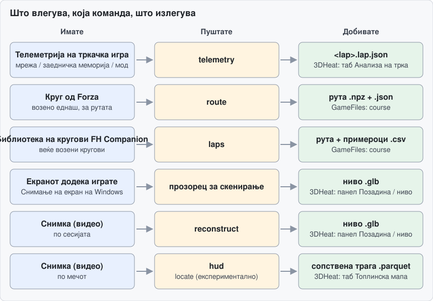

# 3DHeat GameCapture {#dheat-gamecapture}

**Што е тоа?** Алатка што запишува што тркачка игра ѝ кажува за вашето возење, по една датотека
за круг. Може и да обнови груб 3D модел на ниво од видео на кое играте.

**Зошто би ја користел?** За да ги видите вашите кругови во [прегледувачот 3DHeat](https://holdi601.github.io/3DHeat/):
каде сте сопирале, каде сте биле бавни, како се разликуваат два круга. И да го имате нивото под вашата
топлинска мапа кога никој нема 3D модел за него.

**Пример:** вклучете Data Out на Forza, пуштете една команда, возете два круга. Две датотеки со круг се појавуваат во
`laps\`. Спуштете ги врз табот Анализа на трка на прегледувачот.


Нови сте со командната линија? Прво прочитајте [Пред да започнете](before-you-start.md).

## Трите задачи {#the-three-jobs}

1. **Телеметрија на кругови.** Го снима секој канал што го објавува тркачка игра - Data Out на Forza,
   заедничката меморија (shared memory) на игрите Assetto Corsa, мрежните емисии на рели игрите, мод за BeamNG, приклучок
   за Trackmania - и пишува по една датотека `heat3d-lap` за круг или етапа, за табот Анализа на
   трка на прегледувачот. iRacing не бара снимач: прегледувачот ги чита сопствените `.ibt` датотеки.
2. **Нивоа од играње.** Го претвора она што екранот го покажал додека одите или возите низ
   ниво во 3D модел `.glb`, што прегледувачот го става под топлинската мапа.
3. **Вашиот сопствен меч, по него.** `hud` го чита HUD-от од вашата сопствена снимка - вашите постапки, смртни случаи,
   трага на мини-мапата и листата на убиства. `locate` (експериментално: засега поставува малку вистински рамки) открива
   каде е снимена секоја рамка, на 3D моделот на ниво.

Сите три го следат едно правило: **ништо не се инјектира во игра и ништо не се закачува (hook)**. Рамките доаѓаат
од јавниот API за снимање на екранот, телеметријата од интерфејси што играта ги објавува за таа цел. Видете
[Правилата](../rules.md).



Кодот е Python (пакет `heat3d_capture`), со лиценца MIT. Моделите за длабочина и поза што може да ги
пушта имаат свои лиценци - видете [Модели и лиценци](../models-and-licences.md).

## Брз почеток {#quick-start}

### Снимање кругови {#record-laps}

Потребен ви е Python 3.10 или понов ([Пред да започнете](before-you-start.md)). Во PowerShell:

```powershell
git clone https://github.com/Holdi601/3DHeat-GameCapture
cd 3DHeat-GameCapture
python -m venv .venv
.venv\Scripts\python -m pip install -r requirements.txt

# Forza: Settings -> HUD and Gameplay -> Data Out = ON, IP 127.0.0.1, port 5300
.venv\Scripts\python -m heat3d_capture telemetry -o laps
```

**Треба да видите** `listening on port 5300. Laps go to laps. Ctrl+C to stop.`, потоа линија за секој круг кога ја минувате линијата, како
на сликата погоре. Притиснете Ctrl+C за да запрете. Спуштете ги датотеките од `laps\` врз табот Анализа на трка на прегледувачот.
Секоја друга игра е само еден `--game` подалеку:

```powershell
.venv\Scripts\python -m heat3d_capture telemetry --game acc -o laps
.venv\Scripts\python -m heat3d_capture telemetry --game dirtrally2 -o laps
```

Видете [Снимачи на телеметрија](../telemetry.md) за секоја игра и опција.

### Скенирање ниво {#scan-a-level}

Кликнете двапати на **`scan.bat`** во папката на алатката. Го наоѓа Python (и нуди да го инсталира со
winget ако нема), прави приватна `.venv` и го отвора прозорецот за скенирање. Прозорецот кажува
што недостасува, за што служи секој пакет и колку е големо преземањето, и не инсталира ништо
без ваше „да“. Видете [Извршна околина и зависности](../runtime.md) и
[Прозорецот за скенирање](../reconstruction-scan-ui.md).

Рачно: `.venv\Scripts\python -m heat3d_capture.ui`.

За да обновите снимка офлајн, со патеката на камерата решена одеднаш (бара PyTorch, пакетот
`vggt` и GPU - видете [Офлајн реконструкција](../reconstruction-offline.md)):

```powershell
.venv\Scripts\python -m heat3d_capture reconstruct lap.mp4 -o lap.glb
```

## Карта на документацијата {#map-of-the-documentation}

| Страница | Што опфаќа |
|---|---|
| [Пред да започнете](before-you-start.md) | Python, терминал, првата команда, чести грешки |
| [Правилата](../rules.md) | Без инјектирање, само јавни интерфејси, и што тоа чини |
| [Снимачи на телеметрија](../telemetry.md) | Командата `telemetry` и преглед на секоја игра |
| [Forza](../telemetry-forza.md) | Data Out, откривање на распоред, релето FH Companion и неговата `.tele.gz` |
| [Игри Assetto Corsa](../telemetry-assetto-corsa.md) | AC, ACC, AC EVO, AC Rally од заедничка меморија |
| [Рели игри](../telemetry-rally.md) | EA SPORTS WRC, DiRT Rally 2.0 / 1 / DiRT 4, Richard Burns Rally |
| [BeamNG.drive](../telemetry-beamng.md) | Модот за протоколот `heat3d` |
| [Trackmania](../telemetry-trackmania.md) | Приклучокот `Heat3dRecorder` за Openplanet |
| [iRacing](../telemetry-iracing.md) | Читање на `.ibt` датотеки во прегледувачот |
| [Делење на кругови и етапи](../lap-splitting.md) | `LapSplitter`, `CounterSplitter`, `LineSplitter`, `StageSplitter` |
| [Лизгање, дрифт и изведени канали](../slip-and-drift.md) | Како се скалира лизгањето, и што изведува прегледувачот |
| [Датотеката heat3d-lap](../lap-format.md) | Форматот на датотеката со круг, каналите, единиците, `meta` |
| [Игри](../games.md) | По игра: како да се снима, што се испраќа, кои патеки може да се извезат |
| [Команди](../commands.md) | `route`, `telemetry`, `laps`, `reconstruct`, `hud`, `locate`, чекор по чекор |
| [Упатство за команди](../cli-reference.md) | секоја опција, генерирано од `--help` |
| [Читање на HUD од снимка](../hud-video.md) | `hud`: сопствени постапки, смртни случаи, трага на мини-мапата и листа на убиства од снимка |
| [Лоцирање рамки во ниво](../locate.md) | `locate`: каде е снимена секоја рамка, наспроти геометријата на нивото |
| [Реконструкција на ниво](../reconstruction.md) | Процесот од рамки до `.glb` |
| [Прозорецот за скенирање](../reconstruction-scan-ui.md) | Секоја контрола, кратенка и елемент на преклопот |
| [Снимање, маски и квалитет на рамки](../reconstruction-capture.md) | Windows Graphics Capture, клучни рамки, маски за HUD, совети за квалитет |
| [Длабочина](../reconstruction-depth.md) | Depth Anything V2, ONNX Runtime, градење на моделот |
| [Поза и скала на камерата](../reconstruction-pose.md) | Одометрија, повторно лоцирање, пози од телеметрија, скала на земја, bundle adjustment |
| [Фузија, покриеност и боја](../reconstruction-fusion-and-texture.md) | Волуменот на зафатеност, мрежата на покриеност, слаби места, боја на темиња |
| [Излезот .glb](../glb-output.md) | Датотеката што ја вчитува прегледувачот |
| [Офлајн реконструкција](../reconstruction-offline.md) | `reconstruct`, прозорци на VGGT и спојување |
| [Модели и лиценци](../models-and-licences.md) | Големини на Depth Anything V2, VGGT, пакетите |
| [Извршна околина и зависности](../runtime.md) | Прелетна проверка (preflight), бекенди, нивоа на перформанси |
| [Ограничувања и верификација](../limits.md) | Што не е направено, и што не е проверено |
| [Ажурирања](../updates.md) | Проверката за издание и `python -m heat3d_update` |
| [Развој](../development.md) | Тестови, виртуелната околина, распоредот на складиштето |
| [Одржување на оваа документација](../maintaining.md) | Списокот за проверка при издание за код и документација |

## Дел од 3DHeat {#part-of-3dheat}

Датотеките што ги пишува ги вчитува **прегледувачот 3DHeat** -
[изворен код](https://github.com/Holdi601/3DHeat), [документација](https://holdi601.github.io/3DHeat/).
Датотеките со круг одат во неговиот таб Анализа на трка, нивоата `.glb` во неговиот панел Позадина / ниво, табелите од `hud` и `locate` во
неговиот таб Топлинска мапа; како прегледувачот чита табели и датотеки за мечеви е објаснето во
[Една датотека по меч (.3dheat)](https://holdi601.github.io/3DHeat/container.html) и
[Внесување податоци](https://holdi601.github.io/3DHeat/getting-data-in.html).

| Алатка | Што прави | Документација |
|---|---|---|
| [3DHeat viewer](https://github.com/Holdi601/3DHeat) | прикажува топлински мапи, трки и мечеви во 3D, во прелистувачот | [docs](https://holdi601.github.io/3DHeat/) |
| [GameFiles](https://github.com/Holdi601/3DHeat-GameFiles) | патеки и нивоа од датотеките што ги испорачуваат игрите, како 3D модели | [docs](https://holdi601.github.io/3DHeat-GameFiles/) |
| [GameCapture](https://github.com/Holdi601/3DHeat-GameCapture) | телеметрија на кругови од тркачки игри; нивоа обновени од видео од игра | [docs](https://holdi601.github.io/3DHeat-GameCapture/) |
| [Unreal Exporter](https://github.com/Holdi601/3DHeat-UnrealExporter) | приклучок за Unreal Editor што извезува ниво како 3D модел | [docs](https://holdi601.github.io/3DHeat-UnrealExporter/) |
| [CS2](https://github.com/Holdi601/3DHeat-CS2) | демоа од Counter-Strike 2 во датотеки за мечеви; мапи во 3D модели | [docs](https://holdi601.github.io/3DHeat-CS2/) |
| [Watcher](https://github.com/Holdi601/3DHeat-Watcher) | ја снима вашата игра во заднина од она што играта го објавува | [docs](https://holdi601.github.io/3DHeat-Watcher/) |
| [Ext-WarThunder](https://github.com/Holdi601/3DHeat-Ext-WarThunder) | снимки од War Thunder во датотеки за мечеви | [docs](https://holdi601.github.io/3DHeat-Ext-WarThunder/) |
| [Ext-WoT](https://github.com/Holdi601/3DHeat-Ext-WoT) | снимки од World of Tanks во датотеки за мечеви | [docs](https://holdi601.github.io/3DHeat-Ext-WoT/) |
| [Ext-WoWs](https://github.com/Holdi601/3DHeat-Ext-WoWs) | снимки од World of Warships во датотеки за мечеви | [docs](https://holdi601.github.io/3DHeat-Ext-WoWs/) |
| [Ext-Squad](https://github.com/Holdi601/3DHeat-Ext-Squad) | демоа од Squad сервери во датотеки за мечеви | [docs](https://holdi601.github.io/3DHeat-Ext-Squad/) |
| [Ext-DCS](https://github.com/Holdi601/3DHeat-Ext-DCS) | мапи од DCS World во 3D модели | [docs](https://holdi601.github.io/3DHeat-Ext-DCS/) |
| [Ext-IL2](https://github.com/Holdi601/3DHeat-Ext-IL2) | мапи од IL-2 Sturmovik во 3D модели | [docs](https://holdi601.github.io/3DHeat-Ext-IL2/) |

Програмер со отворен проект на играта треба да го користи извозникот за Unreal, кој ја чита вистинската
геометрија и е точен. Таму каде што архивите на играта може да се читаат, GameFiles ја извлекува точната
патека. Реконструкцијата од играње е за случајот кога е достапен само екранот.
