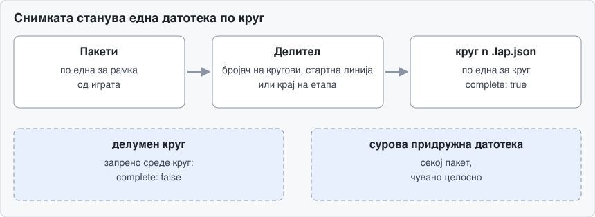

# Како се делат круговите и етапите {#how-laps-and-stages-are-split}

Снимачот гледа еден континуиран тек од примероци. Тој се претвора во кругови со еден од четири
делители, избран според тоа што играта кажува за круговите. Сите ја следат истата идеја: се користи
сопственото броење на играта таму каде што го има, а инаку кругот се наоѓа од позициите; никогаш
не се пишува фрагмент прекраток за споредба.

| Делител | Код | Го користат |
|---|---|---|
| `LapSplitter` | [`fulllap.py`](https://github.com/Holdi601/3DHeat-GameCapture/blob/main/heat3d_capture/telemetry/fulllap.py) | Forza |
| `CounterSplitter` | [`kunos.py`](https://github.com/Holdi601/3DHeat-GameCapture/blob/main/heat3d_capture/telemetry/kunos.py) | Assetto Corsa, ACC |
| `LineSplitter` | [`kunos.py`](https://github.com/Holdi601/3DHeat-GameCapture/blob/main/heat3d_capture/telemetry/kunos.py) | AC EVO, AC Rally, BeamNG |
| `StageSplitter` | [`rally.py`](https://github.com/Holdi601/3DHeat-GameCapture/blob/main/heat3d_capture/telemetry/rally.py) | EA SPORTS WRC, DiRT Rally 2.0, DiRT Rally, DiRT 4, Richard Burns Rally |

Trackmania ги дели возењата во својот додаток ([Trackmania](telemetry-trackmania.md)), а
датотеките на iRacing ги дели прегледувачот според бројачот на кругови на симулаторот ([iRacing](telemetry-iracing.md)).

На **Ctrl+C** секој снимач го повикува `flush()` на својот делител, па отворениот круг или етапа
се пишува ако ги помине истите минимуми како подолу.

## LapSplitter (Forza) {#lapsplitter-forza}

Параметри: `minimum_metres = 400`, `gap_seconds = 2.0`.

За секој декодиран пакет:

1. Ако `timestampMs` на играта скокнал напред за повеќе од 2 секунди од претходниот пакет,
   или одел наназад, отворениот круг најпрво се испишува.
2. Ако `isRaceOn` е 0 (играта не е во трка), отворениот круг се испишува, а пакетот се
   отфрла.
3. Ако нема отворен круг, се отвора еден со `lapNumber` од пакетот.
4. Ако `lapNumber` се разликува од оној на отворениот круг, отворениот круг се **затвора како
   завршен**; неговите `seconds` се `lastLap` на играта кога тој е позитивен. Круг затворен на
   овој начин се пишува без оглед на должината. Се отвора нов круг.
5. Пакетот се додава.

Снимачот исто така испишува кога 2 секунди (по ѕиден часовник) не пристигнал пакет (играта била
паузирана или затворена среде круг).

**Испишувањето** го задржува отворениот круг само ако има најмалку 2 примероци и најмалку 400 m
`distanceTravelled`; се пишува како незавршен (`run`). Трка од точка до точка никогаш не брои
втор круг, па секогаш завршува вака.

## CounterSplitter (AC, ACC) {#countersplitter-ac-acc}

Параметар: `minimum_metres = 300`. Се храни со секој примерок заедно со `completedLaps` од
графичката страница и времето на последниот круг.

- Првиот примерок отвора круг означен со тековниот `completedLaps`.
- Кога `completedLaps` се менува, отворениот круг се затвора. Тој е **завршен**, со
  `seconds = last lap ms / 1000` (ако е позитивно), само ако бројачот пораснал точно за 1 -
  скок назад на 0 (рестарт на сесијата) или за повеќе од еден го затвора како незавршен.
- Затворениот круг се пишува само ако има примероци и најмалку 300 m возена патека.
- Испишувањето го задржува отворениот круг ако има повеќе од еден примерок и најмалку 300 m.

## LineSplitter (AC EVO, AC Rally, BeamNG) {#linesplitter-ac-evo-ac-rally-beamng}

Параметри: `radius = 15 m`, `minimum_metres = 300`, `stop_seconds = 8`.

Овие игри или немаат бројач на кругови на страница што снимачот ја чита, или возат етапи.
**Линијата е таму каде што почнало снимањето**:

1. Хоризонталната позиција на првиот примерок (`x`, `z`) станува линија.
2. Откако возилото поминало повеќе од 5 m, насоката од линијата до возилото станува
   насока на кругот.
3. **Запирањето** го завршува возењето: кога `speed` останува под 1 m/s 8 секунди, отворениот
   круг се испишува (така завршува рели етапа: возилото запира на целта).
4. **Преминување на линијата**: по повеќе од 300 m пат, се собираат примероците во рамките на
   15 m од линијата. Кога возилото повторно ќе го напушти тој радиус, најблискиот собран примерок
   е преминот. Ако возилото таму се движело во иста насока како насоката на кругот (скаларниот
   производ на локалната насока со насоката на кругот е позитивен), кругот се затвора на тој
   примерок; инаку поминувањето се игнорира (возилото го преминало стартот во спротивна насока).
5. `seconds` на затворениот круг е времето од неговиот прв примерок до преминот. Тој е
   **завршен само ако неговиот прв примерок бил побрз од 5 m/s**: круг што почнал од
   мирување е старт, а не круг за споредба. Првиот круг на снимка почната на стартната мрежа
   затоа е секогаш незавршен; снимка почната на лет круг дава завршен прв круг на следниот премин.
6. Следниот круг почнува на примерокот на преминот (тој им припаѓа на двата круга).

Кругови пократки од 300 m се отфрлаат. Испишувањето (запирање или Ctrl+C) го задржува отворениот
круг ако има најмалку 2 примероци и 300 m, како незавршен. BeamNG испишува на ист начин кога
возилото се ресетира (неговиот часовник оди наназад), пред да се започне нов делител, па
возењето пред ресетирањето се зачувува.

Растојанијата се хоризонтални (`x`, `z`) за бројачот на патот и тестот на линијата, а целосно 3D
за тестот на должината од 300 m.

## StageSplitter (рели игри) {#stagesplitter-rally-games}

Параметар: `minimum_metres = 300`. Се храни со секој примерок заедно со часовникот на етапата на
играта, дали играта вели дека возилото завршило, и по избор со сопственото време на играта за тоа.

1. Ако часовникот е 0 или помал, или се вратил за повеќе од 0,5 s, отворената етапа се
   **напушта**: се задржува како делумна етапа ако не е завршена, има повеќе од 10 примероци и
   најмалку 300 m. Часовник од 0 или помал го отфрла и примерокот (возилото е на стартот).
2. Ако нема отворена етапа, се отвора нова (нумерирана 1, 2, ... за снимката).
3. Откако етапата е завршена, понатамошните примероци се игнорираат додека часовникот не оди наназад.
4. Секој примерок се чува со `time` поставено на часовникот на етапата.
5. Кога играта вели завршено, етапата е завршена; нејзините `seconds` се времето на играта кога е
   дадено и позитивно, инаку часовникот. Се пишува ако покрила најмалку 300 m.

Што значи „завршено“ по игра:

| Игра | Завршено кога |
|---|---|
| EA SPORTS WRC | должина на етапата > 0 и растојание на етапата >= должина - 0,5 m |
| Игри DiRT | завршените кругови пораснале над почетниот број на етапата, или (настан со еден круг) растојанието на кругот >= 99,9% од должината на патеката |
| Richard Burns Rally | часовникот на трката > 0 и растојанието до крајот <= 0 |

Кај RBR горната оска и брзината се утврдуваат кога се пишува етапата (видете
[Рели игри](telemetry-rally.md#richard-burns-rally-rsf--ngp)).

## Време и растојание во датотеката за круг {#time-and-distance-in-the-lap-file}

Кај секој снимач освен Forza, `time` се поместува така што првиот примерок на кругот е 0, а
`distance` е кумулативното 3D растојание меѓу последователни позиции. Forza ги користи
сопствениот тајмер на кругот и бројач на растојание на играта, поместени на ист начин.
