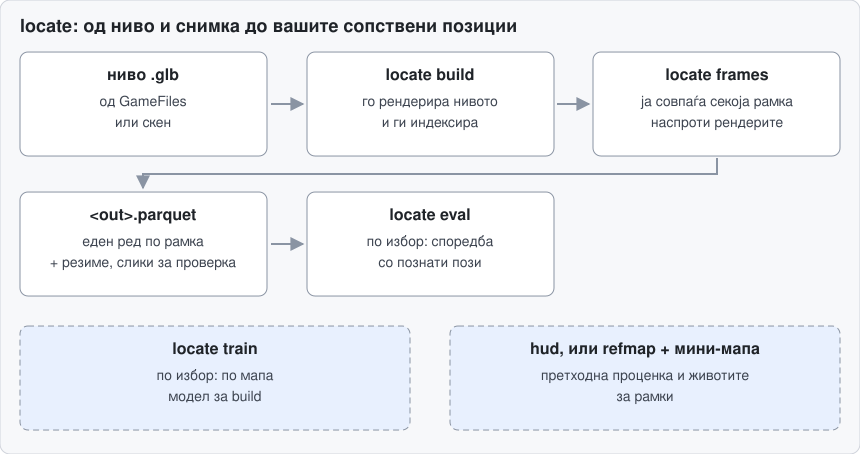

# Лоцирање слики во ниво {#locating-frames-in-a-level}

`locate` пресметува каде е земена секоја слика од снимка од играње - 3D позицијата на камерата
и насоката на погледот - со совпаѓање на сликата со рендери на геометријата на самото ниво. Е
за игри што не чуваат запис за тоа каде бил играчот: без демо, без датотека за реприза, без телеметрија.
Battlefield 6 е првата.

> **Експериментално.** На вистински снимки засега сместува само мал дел од сликите; видете
> [Вистински слики: експериментално](#real-frames-experimental).

```bash
# Once per level: render it from every place a player can stand, and index the renders.
.venv\Scripts\python -m heat3d_capture locate build level.glb -o level.db

# Per recording: where was each frame taken?
.venv\Scripts\python -m heat3d_capture locate frames "<recording>.mp4" --db level.db -o out/match
```

Позицијата доаѓа **од сликата**, спрема целото ниво, без претходна претпоставка. Трагата од минимапата
на [HUD читачот](hud-video.md) е само резерва за слики што сликата не може да ги смести, а секој
ред кажува од кое од двете дошол.




## Што допира и што не допира {#what-it-does-and-does-not-touch}

- Ја чита **сопствената снимка** на играчот и датотека со ниво што играчот ја извезол од **сопствениот
  примерок** на играта. Никогаш не ја допира играта, нејзината меморија, нејзините датотеки додека работи, ниту нејзината
  мрежа, и работи по натпреварот. Видете [Правилата](rules.md).
- Сместува **само сопствената камера на играчот**: сликата е сопствениот поглед на играчот.
- Нивото, базата изградена од него и сè што е рендерирано од него му припаѓаат на издавачот на играта.
  Чувајте ги локално.

## Барања {#requirements}

- Она што го листа `requirements.txt`, PyTorch (од pytorch.org, за GPU), и
  `requirements-locate.txt`:

```bash
.venv\Scripts\python -m pip install -r requirements-locate.txt
```

- GPU со OpenGL 3.3 (4.3 е побрз) за рендерите, а по можност CUDA за моделите. На
  процесор работи, бавно.
- Моделите се преземаат при првата употреба (околу 450 MB): DINOv2 од Hugging Face, ALIKED и
  LightGlue преку kornia. Сите се лиценцирани за комерцијална употреба; видете [Лиценци](#licences).
- **Нивото** како `.glb` (или `.gltf`) во рамката на прегледувачот, Y нагоре, **со неговите текстури за основна боја**,
  како што го пишуваат извозниците на 3DHeat (делови `ground:` / `structure:`; имињата на деловите
  не се потребни). Една единица е еден метар освен ако `extras.unit_metres` на највисоко ниво на датотеката
  не каже поинаку. Скен од GameCapture (`reconstruct`, прозорецот за скенирање) се пишува во **сантиметри** и
  носи `extras.unit_metres: 0.01`, па се чита во вистинска големина. Ниво без текстури работи
  многу полошо; видете [Ограничувања](#limits).

## Команди {#commands}

### `locate build <level> -o <db>` {#locate-build---o-}

Го рендерира нивото од секое место каде што може да стои играч и чува, по рендер, неговата поза и еден
глобален дескриптор.

| Опција | По основно | Значење |
|---|---|---|
| `level` | | `.glb` / `.gltf` на нивото. |
| `-o`, `--out` | | Папката на базата што се пишува. |
| `--game` | `bf6` | Профилот на играта: висини на очите, видно поле, кутии на HUD, брзина (подолу). `generic` за која било игра од прво лице. |
| `--eye` | на профилот | Висини на очите над подот во метри, прво стоечка. Еден поглед од базата за секоја висина. |
| `--fov` / `--vfov` | на профилот | Хоризонталното видно поле на снимката, или вертикалното (лизгачот на Battlefield) за снимка во 16:9. |
| `--spacing` | 2.5 | Метри меѓу местата од кои се земаат погледите. |
| `--yaw-step` | 30 | Степени меѓу насоките на погледите. |
| `--pitch` | 0 | Навалувања (pitch) за рендерирање, степени нагоре. |
| `--positions` | нема | Табела (Parquet или CSV со `x`, `y`, `z` на нозете, во рамката на нивото) од која се земаат места наместо од секој под: на пример излез од претходно пуштање. |
| `--shadows` | исклучено | Фрла сенки од сонцето во рендерите (сонцето на самото ниво кога неговата датотека го именува во `extras.sun`). |
| `--untextured` | исклучено | Рендерира само облик и светлина. |
| `--box X0 Z0 X1 Z1` | целата датотека | Само места во оваа кутија (единици на нивото): просторот за игра. |
| `--places` | `auto` | Од каде се земаат погледите: `nav` - играчи на висина на очите над навигациската мрежа на нивото (делови `nav:`: точно каде играта ги пушта да одат), камери на возила на нивната висина над деловите `ground:` (терен и патишта) во рамки на 50 m од неа; `ground` - двете над `ground:`; `floors` - над секое лице свртено нагоре (покриви и сандаци исто); `auto` - `nav` кога нивото има навигациска мрежа, инаку `floors`. |
| `--head` | нема | Глава по мапа од `locate train` за дескрипторите. |

Пишува `<db>/db.json` (од што и со што е изградено) и `<db>/views.npz` (позите, дескрипторите).

### `locate frames <recording> --db <db>` {#locate-frames----db-}

| Опција | По основно | Значење |
|---|---|---|
| `source` | | Видео, слика или папка со слики (земани по редослед на имињата, `--fps` одвоено). |
| `--db` | | Базата што ја напишал `build`. Нејзината датотека со ниво мора да е сè уште каде што била (или `--level`). |
| `-o`, `--out` | `<source>.locate` | Излезна патека без наставка. |
| `--fps` | 2 | Лоцирани слики во секунда од видеото. |
| `--start`, `--seconds` | сè | Делот од видеото што се чита. |
| `--width` | 1280 | Ширината на која се совпаѓаат сликите. |
| `--shortlist` | 8 | Погледи од базата пробани по слика близу претпоставка или фиксирање. |
| `--search-shortlist` | 16 | Без претпоставка: погледи од базата пробани по слика ([пребарувани заедно](#with-no-prior-frames-searched-together)). |
| `--no-search` | исклучено | Без претпоставка: пребарува секоја слика сама и верува во нејзиното фиксирање без нејзините соседи. |
| `--accept-depth` | 0 (исклучено) | Без претпоставка: верува во фиксирање само ако далечното растојание на неговите совпаѓања е толку пати поголемо од блиското. |
| `--accept-support` | 2 | Без претпоставка: согласни соседи по животот што му се потребни на фиксирањето за да му се верува. |
| `--checkpoint` | нема | Ја чува состојбата на пуштањето тука и продолжува од неа ако е таму. |
| `--stop-file`, `--stop-process` | нема | Запира сам, состојбата зачувана, излезен код 75, кога оваа датотека постои или работи процес чие име почнува вака (се проверува пред секоја слика; може да се повтори), така што долго пуштање го ослободува компјутерот за игра. Истата команда продолжува. |
| `--normalise` | нема | Лесна нормализација пред совпаѓањето: `clahe`, `gray`. |
| `--minimap` | нема | Табелата на командата `hud`: **резервата** за слики што сликата не може да ги смести. |
| `--prior-radius` | нема | **Незадолжително забрзување**, по основно исклучено: пребарува само погледи од базата на толку метри од позицијата на минимапата (бара `--minimap`). |
| `--minimap-anchor` | нема | JSON датотека што ја врзува минимапата за нивото ([минимапата како претпоставка за пребарување](#the-minimap-as-a-search-prior)): минимапата го скратува пребарувањето од првата слика; така најдените фиксирања се `visual+minimap-prior`. |
| `--no-level-search` | исклучено | Со претпоставка: кога ништо близу до неа не одговара, не го пребарува и целото ниво (побрзо). |
| `--lives` | табелата на `--minimap` | Табелата на командата `hud` чии смрти, распоредувања и оживувања кажуваат кога играчот бил во игра: позициите скокаат само преку смрт ([животи од снимката](#lives-from-the-footage)). |
| `--no-sequence` | исклучено | Одлучува за секоја слика сама, не по текот на пуштањето (подолу). |
| `--fit-fov` | исклучено | По пуштањето, го прилагодува видното поле на најсилните фиксирања, по поглед, и го пријавува. |
| `--check-every` | 0 | Исто на секои N слики, сместени или не, слика во `<out>.check`. |
| `--no-checks` | исклучено | Не пишува проверувачки слики за визуелните фиксирања (подолу). |
| `--no-zoomed` | исклучено | Не решава зумирани погледи од фиксирањата на нивните соседи (подолу). |
| `--no-grow` | исклучено | Не пребарува повторно близу до секое фиксирање за сликите околу него што сè уште немаат. |
| `--game`, `--eye`, `--fov`, `--vfov`, `--mask`, `--no-hud-mask`, `--max-speed` | на профилот | Како погоре; `--mask x,y,w,h` додава кутија на екранот (на екран од 1920x1080) што не е ниво. |
| `--vehicle-vfov` | на профилот | Вертикалното видно поле на камерите на возила (лизгачот за возила на Battlefield). |
| `--settings` | најновата датотека со поставки | `bf6`: датотеката со поставки на играта од која се читаат видните полиња (само за читање) кога не е дадено `--fov`/`--vfov`; по основно најновиот `PROFSAVE*_profile` под `Documents/Battlefield 6/settings`. Ги содржи поставките како што се сега, кои можеби не се такви какви што биле кога е направена постара снимка. |

### `locate refmap <level> <deploy screen> -o <refmap>` {#locate-refmap----o-}

Ја става сопствената мапа на играта врз нивото: референцата спрема која се чита минимапата
([минимапата, читана спрема нивото](#the-minimap-read-against-the-level)). `<deploy screen>` е
слика од екранот за распоредување што ја покажува целата мапа, или снимка со `--at <seconds>` на таков
момент; кутијата на профилот за мапа се сече од неа (`--whole-picture` ја чува целата). Пишува
`<refmap>.png` (мапата препримерена на рамката на самото ниво, `--mpp` метри на пиксел, по основно 0.5),
`<refmap>.valid.png` (каде е мапа, а не ознака или натпис) и `<refmap>.json` (рамката и
калибрацијата, со тоа колку далеку биле плочките на мапата од неа). `--topdown <prefix>` го чува нивото
рендерирано одозгора за следното пуштање (`--topdown-mpp`, по основно 0.656 m; `--box` го ограничува).

### `locate minimap <recording> --refmap <refmap> -o <table>.parquet` {#locate-minimap----refmap---o-parquet}

Ја чита минимапата на снимката спрема референтната мапа, слика по слика (`--fps`, по основно 2):
позиција, насока и зум на секоја минимапа што се совпаѓа, во рамката на нивото, запишано како
табела на минимапа со сидро покрај неа (`<table>.anchor.json`) што `locate frames` го зема како
`--minimap <table>.parquet --minimap-anchor <table>.anchor.json`. Со табелата на командата `hud`
(`--hud`) се пренесуваат нејзините животи; со сидро и за таа табела (`--hud-anchor`) првото
пребарување е околу местото каде што го става играчот, а каде ниедна минимапа не се совпаѓа, сопствената трага на HUD
пополнува, поместена на најблиските фиксирања на референтната мапа (`--hud-fill`, секунди, по основно 120; 0 го исклучува).
`source` во табелата кажува кое (`refmap`, `hud`).

### `locate eval <out>.parquet --truth <poses>` {#locate-eval-parquet---truth-}

Го споредува резултатот со познати позиции на камерата: табела од `time`, `x`, `y`, `z` (окото), `yaw`,
`pitch` во рамката на нивото. `--offset` е поместувањето на часовникот (време на вистината = време на видеото + offset);
без него поместувањето се бара. `--unit-metres` ги претвора грешките во метри.

## Профили на игри {#game-profiles}

| | `bf6` | `generic` |
|---|---|---|
| Висини на очите | 1,6 m стоечки, 1,05 m чучнат (сè уште не измерено во играта) | 1,65, 1,1 m |
| Видно поле | 55 степени вертикално, околу 86 хоризонтално на 16:9: **ставете го сопственото на играчот** со `--vfov` | 90 хоризонтално |
| Маскиран HUD | минимапа и листа на одред, kill feed, компас, муниција, оружјето на играчот, скокачките прозорци, нишанот | нишанот |
| Најбрзо пешки | 8 m/s | 8 m/s |
| Погледи што се разликуваат | пешки, возило, зумиран (подолу) | секоја слика пешки |
| Камери на возила | лизгачот за возила (од датотеката со поставки), возилото маскирано, камерата до 8 m над подот, 30 m/s | - |

Видното поле е најважно: слика решена со погрешно е решена со погрешна фокусна
далечина, а нејзината позиција се лизга по погледот.

## Излези {#outputs}

### `<out>.parquet` {#parquet}

Еден ред за секоја лоцирана слика, во **рамката на нивото** (Y нагоре, единиците на нивото), со
упатствата за читање на прегледувачот во подножјето (`kind: heat3d-locate`). Подножјето ја именува секоја колона што нема
своја улога како додаток (extra), така што прегледувачот ги чува сите (неговата картичка за преглед ги покажува).

| Колона | Значење |
|---|---|
| `time` | Секунди од почетокот на видеото. |
| `event` | `start` на првиот ред на живот, `position` на останатите. |
| `x`, `y`, `z` | Окото, измазнето во рамките на животот. Празно каде што ниту еден извор не ја сместил сликата. |
| `yaw`, `pitch` | Степени: yaw околу оската нагоре (0 по +X, расте кон -Z, што е сопствениот yaw на играта во рамката на прегледувачот), pitch нагоре од хоризонталата. `pitch` е празно за редови од минимапа. |
| `dir_x`, `dir_y`, `dir_z` | Насоката на погледот. |
| `player`, `team`, `session` | `me`, `own`, и `<video>#NN`, по една за секој живот. |
| `life` | Животот во кој снимката ја покажала сликата (од смртите на HUD; 1 = првиот). Празно кога е надвор од игра (мртов, паднат, распоредување) или кога животите не биле прочитани. `session` е животот на трагата, што може да се подели и на скок. |
| `source` | `visual` (од сликата), `visual+minimap-prior` (од сликата, пребарувањето скратено на претпоставката од минимапата), `minimap` (резервата), `minimap+nav-floor` (внатре: минимапата и подот на навигациската мрежа) или `none`. |
| `view` | `foot`, `vehicle`, `zoomed` или `screen` (подолу). |
| `cam_x`, `cam_y`, `cam_z` | Камерата што ја видела сликата. Пешки и преку нишан е окото, а `x`, `y`, `z` се исти; во поглед од трето лице на возило `x`, `y`, `z` се возилото (моделот на отстапување подолу), а камерата јава зад него и над него. |
| `hfov`, `zoom` | Хоризонталното видно поле со кое е решена сликата, а за зумиран поглед неговиот зум спрема нормалниот поглед. |
| `confidence` | 0..1: колку да му се верува на редот (подолу). |
| `uncertainty` | Типичната грешка на редот, единици на нивото: за визуелно фиксирање од неговите inliers и неговите соседи, за ред од минимапа од прилагодувањето (подолу). |
| `inliers`, `rmse` | PnP inliers на визуелното решавање и грешката на репроекција (пиксели при работната ширина). |
| `x_raw` ... `pitch_raw` | Визуелното решавање пред измазнувањето (исто за отстапувачи што биле исклучени со гласање). |
| `kept` | Визуелното фиксирање го преживеало гласањето за отстапувачи. |
| `note` | Зошто сликата не била сместена, или била исклучена со гласање. |

### `<out>.summary.json` {#summaryjson}

Слики, визуелни фиксирања, отстапувачи, животи, редови по извор, прилагодувањето на минимапата (парови, inliers, остаток),
време по слика.

## Метод {#method}

### Базата {#the-database}

Местата се точки на секој триаголник на нивото свртен нагоре, рамномерно распоредени (по една на `--spacing`
на 3D мрежа, така што подовите на зграда добиваат по свое). Секое се проверува од своето око со шест
мали рендери на длабочина: камера внатре во геометрија гледа претежно задни лица, простор за лазење има нешто
цврсто над окото; и двете се отфрлаат. Од секое место нивото се рендерира на секоја висина на око,
на секој `--yaw-step` и секој `--pitch`, а секој рендер го опишува **DINOv2** (неговите patch токени
здружени со генерализирана средина, споени со класниот токен).

Локалните одлики и 3D точки спрема кои сликата конечно се решава **не се чуваат**: се
прават повторно кога се потребни со рендерирање на неколкуте погледи што ги избрало пребарувањето, што трае милисекунди. Тоа
ја држи базата на неколку стотини мегабајти наместо десетици гигабајти, и тоа го овозможува
усовршувањето подолу. Цената е што `frames` му треба датотеката со ниво и GPU, не само базата.

### Една слика {#one-frame}

1. **Маска** на она што не е ниво: кутиите на HUD од профилот и нишанот, плус кој било `--mask`.
2. **Пребарување** над **целото ниво**: дескрипторот на сликата спрема секој поглед од базата; најсличните
   неколку десетици, проредени така што држат различни места и насоки, се кратката листа.
3. **Совпаѓање**: секој поглед од кратката листа повторно се рендерира на големината и видното поле на сликата, со
   неговата длабочина. ALIKED клучните точки на сликата и рендерот се совпаѓаат со LightGlue. Совпаднат пиксел од рендерот
   плус неговата длабочина е 3D точка на нивото, па секое совпаѓање е 2D-3D кореспонденција;
   клучни точки на раб на длабочина (чија длабочина може да припаѓа на она зад нив) се отфрлаат.
4. **Поза**: PnP со RANSAC (SQPnP), потоа робусно усовршување што ја држи камерата рамна - поглед од прво
   лице не се превртува - и ја минимизира грешката на репроекција на inliers.
5. **Дали е можно?** Позата мора да е на висина на око на играч над под и надвор од геометрија
   (рендер на длабочина право надолу). Текстура што личи некаде другаде - плочест под совпаднат со ѕид
   од ист материјал - може да даде стотици inliers на поза што ниту еден играч не можел да ја има; тие се
   оставаат настрана, колку и да имаат inliers.
6. **Рендерирање и споредба**: нивото се рендерира на решената поза и повторно се совпаѓа, што
   заменува поглед од базата до неколку метри и десетици степени далеку со таков што речиси
   се поклопува со сликата. Се повторува додека добива inliers (најмногу двапати).
7. **Избирање**: најсилните три места (на повеќе од околу 3 m едно од друго) се усовршуваат секое пред да се избере едно.
   Она што личи може да води пред усовршувањето; вистинското место добива многу повеќе од него.
8. **Пресуда**: `confidence` ги комбинира бројот на inliers, најдоброто друго место (`runner_up`) и
   грешката на репроекција. Фиксирањето е `ok` со најмалку 25 inliers, без друго место во рамки на 80% од неговите
   inliers, и со confidence од најмалку 0,85 - прагот што мерењата подолу го ставаат на 97,5-99%
   точност.

### Погледи {#views}

Сликата не е секогаш очите на играчот. Детекторот на профилот чита кој поглед е од
HUD, а сликата се решава соодветно:

- **Пешки**: видното поле и висините на очите за пешадија.
- **Возило** (Battlefield 6: барањата за копчиња на дијаграмот на седиштето, `C CAMERA` и `E EXIT`, долу
  во средина): видното поле на возило, самото возило маскирано (долната средина на екранот во
  неговиот поглед од трето лице), и камера дозволена до 8 m над подот. Фиксирањето е на камерата.
- **Екран** (темни рабови околу темна средина: мапата за распоредување, мени, резултати): не е поглед
  на нивото; се прескокнува.
- **Зумиран** (нишан, нишан на топџија, сопствен поглед од прво лице на возило: еден раб на екранот црн,
  двата темни, околу светла слика): не се пребарува над нивото - парчето ниво на нишан не личи
  на ниту еден од широките погледи од базата - туку се решава по пуштањето од најблиското фиксирање
  во рамки на 6 s, подолу. Исклучено со `--no-zoomed`.

### Зумирани погледи {#zoomed-views}

Тесен поглед лошо ја фиксира позицијата: чекор назад со малку повеќе зум изгледа речиси исто.
Затоа зумирана слика почнува од каде што соседот вели дека е нишанот - пешки окото од тоа фиксирање, во
возило 2,5 m над земјата под средината на возилото (нишан на купола) - и колку далеку можело да
се придвижи оттогаш: 2 m, плус 4 m во секунда пешки или 8 во возило, најмногу 12 m (`reach`).

1. **Насока и зум, позицијата држена.** За секој зум од 1, 1,2 (сопствен поглед на возило,
   потесен од пешки), 1,5, 2, 3, 4, 6 и 8, нивото се рендерира на седиштето во насоки
   во рамки на 30 степени од соседовата (а од 3x, неколку навалувања). Клучните точки на сликата совпаднати
   со рендер, со точките на нивото под нив, се зраци од седиштето; ротација се прилагодува на
   нив по две (RANSAC) за фокусни далечини од 0,75 до 1,3 пати од таа на зумот, точка
   што се согласува во агол што дозволува седиштето да е `reach` настрана на нејзиното растојание. Победуваат зумот,
   насоката и фокусната далечина со кои се согласуваат најмногу точки.
2. **Смирено.** Тие точки потоа ги прилагодуваат позицијата, насоката и фокусната далечина заедно, по нивната
   грешка на репроекција, позицијата држена до седиштето со цена од два пиксела по поместен `reach`;
   рендерирано уште еднаш на одговорот и прилагодено повторно. Inliers и грешката се бројат во пиксели, а
   фиксирањето е `ok` со истата confidence како кое било друго.

Запишаниот зум (`zoom`) е спрема видното поле на пуштањето пешки; `hfov` е решеното. Во
возило запишаната позиција е на возилото, 2,5 m под нишанот, како за неговиот поглед од трето лице.

### Возила: камерата и возилото {#vehicles-the-camera-and-the-vehicle}

Во поглед од трето лице на возило решената поза е на камерата што го следи, која јава зад и
над возилото и се врти околу него додека играчот гледа наоколу. Запишаната позиција (`x`, `y`,
`z`) е на возилото - земјата под неговата средина: на камерата плус `vehicle_offset` од профилот,
толку метри напред по хоризонталната насока на погледот на камерата и толку
надолу. Камерата останува во `cam_x`, `cam_y`, `cam_z`. Претворањето се прави пред низата и
трагата, така што камера што се врти околу возило што стои не се зема за движење. Подножјето на
табелата го носи користеното отстапување и дали е измерено (`vehicleOffset`). Пешки и преку
нишан нема отстапување.

Како е измерено отстапувањето за Battlefield 6: на точни фиксирања на вистински слики од трето лице на тенк,
средината на тенкот била означена со око на сликата, а нивото рендерирано на фиксирањето ја дало
земјата на тој пиксел. Профилот ја зема медијаната: околу 10 m пред камерата и околу 4 m
под неа. Означувањето е добро до метар, и тоа е еден тип возило: автомобил или хеликоптер
ја носи камерата поинаку.

### Без претпоставка: слики пребарувани заедно {#with-no-prior-frames-searched-together}

Глобалниот дескриптор на една слика спрема цело ниво е слаб сигнал, а inliers на една слика не
разликуваат вистинско место од она што личи. Затоа без претпоставка сликите на снимката се опишуваат
прво и се пребаруваат заедно (`search.py`), а на фиксирање му се верува само со сликите околу него:

- **Кратка листа.** Сличностите на секој поглед се мерат спрема неговата сопствена средина и распрснување над
  снимката, така што поглед што личи на секоја слика престанува да победува насекаде. Секоја слика ги оценува
  клетките на мрежа од 24 m според рангот на нивниот најдобар поглед; најдобрата патека низ клетките по секој
  живот, во рамки на тоа што играчот може да го помине меѓу сликите, дава верување по клетка, а најдобриот поглед
  од секоја клетка, најдобро верувани први, е една листа. Обичното пребарување е другата, и двете
  се земаат наизменично: мерењето на погледите спрема снимката го казнува местото што играчот едвај го напушта,
  каде што обичното пребарување е добро.
- **Верување.** Кандидатот се брои само ако неговите inliers покриваат најмалку 12% од мрежа 8 x 8 над
  сликата: тоа што личи е повторен предмет, куп контејнери, со стотици inliers на неколку
  клетки од сликата. На фиксирање му се верува кога лежи на најдобрата патека низ кандидатите што се бројат
  (подолу) со најмалку двајца соседи во рамки на 6 s што се согласуваат со него. Слика надвор
  од игра воопшто не се пребарува.
- **Раст.** Расте само од она на што му се верува, а нараснато фиксирање мора да ја покрива сликата на ист начин.

### По текот на пуштањето {#along-the-run}

Секоја слика ја чува секоја физички можна поза што ја нашла, по една за место (`candidates`), не само
најсилната. Пуштањето потоа избира по една за слика - или никаква - така што избраните позиции формираат патека што
играч можел да ја помине пешки или со возило, и колку што е можно повеќе inliers лежат на неа: скриен Марков
модел, декодиран одеднаш (Viterbi). Нешто што личи, а победува една слика само, губи од местото
со кое се согласуваат нејзините соседи; слаб кандидат низ кој минува патеката, со најмалку двајца согласни
соседи, станува фиксирање (`note`: избрано по низата); сигурно фиксирање на кое му противречат сите негови соседи
престанува да биде такво. Соседот се брои како согласен само во рамки на 6 s: подалеку, растојанието што
играч - а камоли возило - можел да го помине е толку големо што согласувањето не
кажува ништо. Исклучено со `--no-sequence`.

### Времиња на слики {#frame-times}

`time` на редот е сопствената временска ознака на сликата во снимката, не нејзиното броење преку номиналната
стапка на слики. Снимките отстапуваат од својата номинална стапка (за неколку десетинки од секундата во клип, на измерените),
а сè што чита слика назад по нејзиното време -
проверувачките слики, зумираниот премин, `locate train --real`, минимапата од командата `hud` - бара
по временска ознака. Избројани слики би ја ставиле сликата за проверка толку далеку од лоцираната.

### Видното поле, од сликите {#the-field-of-view-from-the-frames}

`--fit-fov` ги чува најсилните фиксирања на пуштањето (по поглед) и ги усовршува позата и фокусната
далечина на секое заедно на нивните inliers; медијаната над нив е видното поле со кое е направена снимката,
пријавено во резимето (`hfov_fitted`) за `--fov` на следното пуштање. Блиските и далечните точки се движат
поинаку при промена на фокусната далечина отколку при промена на позицијата, што го фиксира;
му требаат фиксирања со длабочина, не рамен ѕид.

### Модел по мапа {#a-per-map-model}

`locate train` тренира мала глава врз DINOv2 за едно ниво, на рендери од него, така што
глобалниот дескриптор ги наоѓа вистинските погледи на вистински слики, а не само на рендери:

- **Глава**: секој patch токен низ проекција од два слоја, здружен со генерализирана средина над
  деловите што го покажуваат нивото, споен со проектираниот класен токен. DINOv2 останува замрзнат. Сето
  тоа напишано тука (MIT).
- **Парови**: место на проодната земја и насока, рендерирани двапати од позиции до метар-два и десетина
  степени одвоено, при видни полиња до 10 степени одвоено, под различна светлина (сонце, сенки, амбиент), секое низ изглед како на игра: корекција на бои, магла по длабочина,
  bloom, вињета, чад, луѓе на патот, возилото на самиот играч во погледи од возило, замаглување од движење,
  шум, JPEG (`augment.py`). Маскирано како слика. Места во рамки на неколку метри што гледаат во истата
  насока не се бројат како негативи.
- **Вистински слики**: слики со поза што ја нашла самата низа (псевдо-ознаки: фиксирања избрани по
  низа) можат да се придружат како парови - сликата и рендер на нејзината поза - во втор круг.
- **Загуба**: контрастивна (InfoNCE) над серијата.

`locate build --head <head.pt>` ја гради базата со неа; `frames` потоа ја користи за сликите.

| Опција на `locate train` | По основно | Значење |
|---|---|---|
| `-o`, `--out` | задолжително | Датотеката со глава што се пишува (`.pt`). |
| `--steps` | 600 | Чекори на тренирање. |
| `--real TABLE VIDEO` | нема | Табела од `locate frames` и нејзината снимка: нејзините сигурни фиксирања се придружуваат како вистински парови. Може да се повтори. |
| `--real-confidence` | 0.85 | Confidence што му треба на фиксирање за да се придружи како вистински пар. |
| `--spacing`, `--box`, `--places`, и опциите на профилот | како `build` | Каде се местата за тренирање, и профилот на играта. |

### Проверка со око {#checking-by-eye}

Секое визуелно фиксирање добива слика во `<out>.check` - `<time>s_<view>_visual.jpg`: сликата, и
покрај неа нивото рендерирано на камерата на фиксирањето со рабовите на сликата нацртани врз рендерот.
Каде што се поклопуваат, фиксирањето е точно. Се пишува откако низата и трагата ќе одлучат, така што
сликите се точно редовите што табелата ги нарекува визуелни. Исклучено со `--no-checks`.

### Минимапата, читана спрема нивото {#the-minimap-read-against-the-level}

Минимапа споена во еден мозаик (на командата `hud`) не е рамна: нејзиниот размер отстапува со зумот
при кој била регистрирана секоја минимапа, место видено двапати може да се нацрта двапати, а мозаикот на секој клип
е сопствен. Сличност прилагодена на неколку фиксирања тогаш држи близу до нив, а е десетици метри настрана
далеку од нив. Затоа минимапата се става од самото ниво, во два чекора, и ништо не се спојува:

- **Референтната мапа** (`locate refmap`). Екранот за распоредување ја црта целата мапа север нагоре, рамно, на
  еден размер. Нивото рендерирано право одозгора ги покажува истите работи што стојат од
  земјата (тенкови, згради, ѕидови): на нивото, нивната висина над земјата 15 m наоколу; на
  мапата, она што е нацртано посветло од земјата околу него. Мапата се става на нивото со нормализирана
  вкрстена корелација на двете над размер и мало вртење, усовршена со совпаѓање на плочки од неа
  една по една, и на крај со целата мапа одеднаш околу тој одговор (неколку десетици плочки го оставаат размерот
  лабав за процент, метри на краевите на мапата). Резултатот е една сличност, пиксел на мапата во ниво.
- **Минимапата, слика по слика** (`locate minimap`). Секоја земена минимапа - исечокот на HUD читачот
  и маската на преклопите - се совпаѓа (SIFT) со референтната мапа околу местото каде што играчот бил последен пат, или
  насекаде кога никаде не е познато, и се прилагодува сличност (вртење, зум, поместување). Точката на играчот
  пренесена низ неа е позицијата, горниот раб на минимапата (конусот на погледот) насоката, нејзиниот размер
  зумот - измерен, не претпоставен.
- **Каде не се совпаѓа.** Екранот за распоредување не црта ништо надвор од просторот за игра; минимапа
  што покажува претежно она што лежи надвор од него - играч на работ на мапата - нема со што да се совпадне.
  Таму стапува сопствената трага на HUD, поместена за отстапувањето што го измериле најблиските фиксирања на референтната мапа
  (`--hud-fill`); добра е колку што е мозаикот близу до тие фиксирања.

На пробното ниво минимапата читана вака била на неколку метри (медијана) од сигурни фиксирања од сликата,
исто добра надвор од просторот во кој е прилагодена референтната мапа како и внатре во него.

### Минимапата како претпоставка за пребарување {#the-minimap-as-a-search-prior}

Трагата од минимапата на командата `hud` кажува, за повеќето слики од играта, приближно каде е играчот и на која
страна гледа - во свои единици (пиксели на минимапа, север нагоре). Врзана за нивото еднаш, го скратува
пребарувањето на мал дел од него; самата поза сè уште доаѓа од сликата, по истите правила.

- **Сидрото** (`--minimap-anchor <anchor.json>`): една сличност по мапа, минимапа во ниво -
  размер, вртење (со огледалото меѓу пикселите север-нагоре и оските на нивото), поместување - прилагодена на
  сигурните визуелни фиксирања (confidence 0,7 и повеќе) од неколку клипови. Минимапата на секој клип е мозаик
  што HUD читачот го споил сам, па секоја седи на друго место во единиците на минимапа; два мозаика од
  една мапа се разликуваат само за поместување, најдено со совпаѓање на клучни точки меѓу нив (поместувањето
  со кое се согласуваат најмногу совпаѓања), а секој мозаик е врзан за една референца низ сите парови што се согласуваат добро. Датотеката
  со сидро ја носи сличноста на мапата, поместувањето на клипот (`clip_shift`), и грешката што
  сидрото ја покажало спрема фиксирања од клипови оставени надвор од неговото прилагодување (`median`, `p90`, метри).
- **Каде и на која страна.** Насоката на минимапата е yaw на камерата: на измерените клипови
  се согласувала со решениот yaw во рамки на 2-5 степени. Затоа сликата прво се совпаѓа со рендери направени
  таму каде што минимапата ја става камерата - пешки око над земјата таму, во возило
  камерата што следи зад и над него (отстапувањето на возилото) - гледајќи по насоката: точката и 4 m на
  секоја страна, на два навалувања (`seeds`). Дури кога ниту една од овие не дава фиксирање се пробуваат
  сопствените погледи од базата во рамки на дискот (30 m плус грешката на 90-тиот перцентил на сидрото).
- **Коригирано додека трае пуштањето.** Секое сигурно фиксирање близу претпоставката кажува колку е сидрото
  погрешно таму; медијаната на оние во рамки на 2 минути ја коригира претпоставката, а нивното распрснување (најмалку 5 m)
  ја заменува грешката на сидрото во радиусот на дискот - до 10 m: фиксирања што повеќе се разминуваат кажуваат
  дека минимапата греши со местото, а не дека ќе одговара нешто на 50 m. Без фиксирање во рамки на 2 минути
  претпоставката воопшто не се коригира (грешката на друго место во клипот не кажува ништо за овде).
- **Сидра со мрежа.** Сидро може да носи и `grid`: x и z на нивото на правилна мрежа над
  единиците на минимапата на клипот, читана билинеарно; внатре во неа мрежата ја става точката,
  надвор сличноста. Сидрото на табела од `locate minimap` е идентитет (нејзината табела е веќе во рамката на нивото).
- **Слаби прилагодувања.** Со претпоставка, слабо прилагодување (25 inliers или повеќе, но не доволно сигурно
  само по себе) што лежи во дискот се чува - со својата пониска confidence - за низата и
  трагата да пресудат, не се отфрла: чад, урнатини и урнати ѕидови оставаат вистинските слики со помалку совпаѓања.
- **Извори.** `visual` - сликата го сместила, без претпоставка; `visual+minimap-prior` - сликата
  го сместила, пребарувањето скратено на претпоставката; `minimap` - сликата не, минимапата стапува;
  `minimap+nav-floor` - внатре, подолу.
- **Внатре** води минимапата. Слика што сликата не ја сместила, пешки, каде око на позицијата
  на минимапата гледа нивото блиску наоколу (медијана на растојание под 8 m на четири страни) и без небо,
  е внатре: добива x и z од минимапата и висината на подот на навигациската мрежа
  таму - од повеќе подови, најблискиот до последното фиксирање - со `source = minimap+nav-floor`, така
  што е јасно дека сликата не го фиксирала.

### Животи од снимката {#lives-from-the-footage}

Позицијата може да скокне само каде што играчот умрел. Животите не се погодуваат од позициите - едно
погрешно фиксирање би отворило нов - туку се читаат од снимката: табелата на HUD читачот ги запишува
смртите што ги покажале екраните за паѓање и распоредување (`death`), паѓањата што соиграч ги оживел (`downed`,
`revived`), распоредувањата (`spawn`) и каде играта почнала и запрела (`start`, `end`); `lives.py`
ги претвора во животи. Смрт затвора живот, првата слика од играта по отворањето на екранот за распоредување
го отвора следниот; оживување не го сече (играчот е каде што паднал), а сликите
додека е паднат не се сместуваат; дел од менија или вчитување подолг од 10 s го сече исто така. Слики надвор
од игра (мртов, распоредување, паднат) никогаш не се сместуваат.

Во рамки на живот континуитетот е тврдо правило: секој чекор најмногу брзината пати времето меѓу, плус
1,5 m. Брзината е на сликата: пешки на профилот, во возило брзината што ја покажал сопствениот
показател на возилото во рамки на 3 s (уште една третина, и 2 m/s, за забрзување) или, каде не покажува ниеден, границата на
неговата класа. По пуштањето (Viterbi) чекор преку смрт е бесплатен на кое било растојание, секој друг
чекор е ограничен; слика на која би ѝ требал скок се остава надвор - послабата страна на противречноста
губи (помалку inliers, помалку поддршка) - и животот никогаш не се дели на тоа. Каде што оставената надвор страна
е сама силна (confidence 0,9 и повеќе, две или повеќе фиксирања што се согласуваат меѓу себе), пуштањето
не погодува: двете страни се чуваат и означуваат `jump without detected death` (пропуштена смрт, или вистинска
телепортација), и се листаат во резимето. Резервата од минимапата ги следи истите животи.

Battlefield 6: погледот од прво лице на тенковите ја покажува брзината (`<n> KPH`, десно од нишанот; чита се
со OCR на HUD читачот); погледот од трето лице не. Читањата на пробните клипови биле
бавни, па на копнените возила им е дозволено 15 m/s каде ништо не се чита. Бродовите, хеликоптерите и авионите
добиваат широки граници (20, 90 и 280 m/s) што не се измерени: ниту еден клип не покажува такво возење или
летање, а класификаторот на погледи не разликува воздух од земја - дел побрз од копнено
возило се појавува како скок, означен, на кој не му се верува.

### Уништување {#destruction}

Датотеките со ниво се целото ниво; во натпревар ѕидови, куќи и камења се растурени, урнатини
и чад висат наоколу, и станува полошо како што напредува натпреварот.

- **Совпаѓањето му верува на статичното ниво.** Дел што извозот го означува како уништлив (неговото име почнува
  со `destructible:`, или `extras.destructible` на неговиот јазол, мрежа или примитив) се црта во
  маската `destructible` на рендерот. Совпаѓања чија точка на нивото лежи на него се отфрлаат кога остануваат 40 или повеќе
  совпаѓања на статични делови - теренот, патиштата, големите структури го носат решавањето.
- **Тренирањето го гледа отсутно.** Рендерите за тренирање (`locate train`) заменуваат делови од
  уништливите делови со шум во боја на урнатини, и додаваат прашина ниско над земјата, врз
  чадот и остатокот од изгледот на играта (`augment.py`), така што моделот по мапа учи да не се потпира на
  нив.
- **Недостасувачката геометрија не е погрешно место**: со претпоставка, слаби прилагодувања во нејзиниот диск се чуваат (погоре).

Додека извозите не ги носат ознаките, ништо не е означено како уништливо, и ова не прави ништо.

### Трагата {#the-track}

- **Отстапувачи**: фиксирање се споредува со фиксирањата во 3 s пред него и, посебно, 3 s по него;
  конзистентно значи не подалеку од тоа што го дозволува брзината на профилот, плус 1,5 m. Фиксирање што
  не се согласува со повеќето свои соседи од **двете** страни се исклучува со гласање (чува се во колоните `_raw`,
  `kept` лажно). Барањето на двете страни го чува првото фиксирање по повторното појавување.
- **Животи**: со животите од снимката (погоре) трагата ги следи, а во рамки на живот ја отфрла
  послабата страна на чекор што ја прекршува брзината. Без нив се прекинува каде што две последователни зачувани
  фиксирања се подалеку од тоа што го дозволува брзината, каде што има пауза од повеќе од 8 s, и каде
  табелата на минимапата започнува нов живот.
- **Измазнување**: во рамки на живот, секое фиксирање се спојува со права низ фиксирањата околу него
  (тежинско локално линеарно прилагодување, sigma 0,5 s), секое тежинско според неговата неизвесност: силно фиксирање - добро
  до сантиметри - останува каде е, слабо се влече кон своите силни соседи. Права
  наместо просек, бидејќи просекот го влече тркачкиот играч позади: просекот прво бил пробан
  и претворил трага од 3 mm во трага од 0,3 m при 2 слики во секунда. Аглите на погледот не се
  измазнуваат; вртењето на погледот е вистинско и брзо.

### Резервата од минимапата {#the-minimap-fallback}

Табелата на минимапата е во рамката на својот мозаик (пиксели, x исток, y север). Врзана е за нивото со
една сличност - вртење, размер, поместување, и огледало ако тоа подобро одговара - робусно прилагодена на
сликите каде и двете имаат позиција. Каде сликата не дала ништо, или нејзиното фиксирање било исклучено со гласање,
позицијата на минимапата стапува со `source = minimap`, confidence од најмногу 0,5 и неизвесност
од двојниот остаток на прилагодувањето плус 1,5 m. Минимапата нема висина: се пренесува од
најблиското визуелно фиксирање. Пуштање само со минимапа (без визуелни фиксирања) не може да се врзе за нивото и
не сместува ништо.

`--prior-radius` го користи истото прилагодување обратно: откако осум визуелни фиксирања ќе ја врзат
минимапата за нивото, пребарувањето гледа само погледи од базата во тој радиус од позицијата на
минимапата, и се враќа на целото ниво кога тоа не наоѓа ништо. Побрзо е; исто така е точно само
колку минимапата, поради што по основно е исклучено.

## Точност {#accuracy}

Измерено на **клупа** каде вистината е точна: пробно ниво извезено со текстури, и
слики рендерирани од познати позиции на камерата *за да личат на игра, а не на базата* - сонцето
и сенките на нивото, поостар контраст, случајна корекција на бои, вињета и bloom, форми со големина на играч
и чад на патот, HUD нацртан во маскираните кутии, замаглување, шум и JPEG. Секоја слика се
лоцира спрема **целото ниво, без претпоставка**. Точно значи во рамки на 1 m и 5 степени. Ништо
од клупата (нивоа, рендери) не е дел од ова складиште.

| Слики без претпоставка | Резултат |
|---|---|
| сместени точно | околу 4 од 5 |
| од фиксирањата `ok` (confidence 0,85 и повеќе), точни | околу 97-99% |
| грешка на точните фиксирања | милиметри до сантиметар; неколку стотинки од степен |
| време по слика | околу 1 s на десктоп GPU |

Confidence е употребива мерка на доверба: речиси секое фиксирање од 0,9 и повеќе било точно, додека фиксирањата
под 0,85 често биле погрешни - оттука прагот 0,85 за `ok`. Каде не успева: не се наоѓа соодветен поглед,
премалку совпаѓања (ѕид на еден чекор, претежно небо, претежно закривач), или две места изгледаат
исто.

**Трага.** Пробна патека на камера рендерирана како погоре во видео од 30 fps, со табела на минимапа направена
од истата патека (сопствена завртена, скалирана, огледална рамка, со шум), пуштена низ
`locate frames` со 2 слики во секунда и оценета со `locate eval`, што исто така требало да го најде
поместувањето на часовникот: секоја слика во игра била сместена, речиси сите од сликата; поместувањето на часовникот било
најдено во рамки на стотинки од секундата; редовите од сликата биле во рамки на неколку сантиметри, редовите од минимапата
во рамки на околу метар.

**Што прави разлика:**

- **Текстурите** се она на што живее совпаѓањето. Без нив се сместува само мал дел од сликите;
  под сведен на една рамна боја чини околу третина од сигурните фиксирања.
- **Вистинското видно поле.** Со 3 степени грешка, грешката на точните фиксирања расте од милиметри до
  десетици сантиметри и повеќето фиксирања веќе не се `ok`. Ставете го вистинското FOV.
- **Сенки** во рендерите на базата (`--shadows`): мала добивка.
- **Подолга кратка листа**: мала добивка, неколку пати побавно. Пократка: помалку фиксирања, поголема
  прецизност.
- Лесната нормализација (CLAHE) не дала добивка и не е по основно.

Местата што личат се главниот извор на сигурни грешки: поза точно еден модул на зграда
настрана, по ѕид од повторени модули, решена на ист начин низ неколку слики на играч
што стои на место. Усовршувањето на најсилните три места пред изборот и оставањето настрана на невозможните позиции ги отстрани повеќето од другите.

### Вистински слики: експериментално {#real-frames-experimental}

На вистински снимки `locate` **сè уште не работи добро**: сместува само мал дел од сликите
од сликата, претежно слики од возила (камерата од трето лице гледа повеќе од нивото од
повисоко), и речиси никакви слики пешки (играчот гледа ѕидови и земја од блиску).
Што е научено на пробни снимки:

- **Наоѓањето на вистинскиот поглед е она што не успева.** Светлината, ефектите и грубите текстури од извозот на играта
  ја поместуваат вистинската слика подалеку од рендерите отколку што тоа го правела имитацијата на клупата, па вистинскиот поглед
  се рангира близу до кратката листа, но надвор од неа.
- **Модел по мапа помага** (`locate train`): го рангира вистинскиот поглед многу повисоко, а вистинските слики
  додадени како парови за тренирање повеќе помагаат на сликите околу нив.
- **Слики блиску една до друга си помагаат**: при 2 слики во секунда дел во возило имал околу
  третина од сликите сместени; при една слика на секои 5 s речиси ниедна.
- **Вистинските слики покажуваат 2-3 пиксела грешка на репроекција** спрема 1 на рендери; профилот зема 3
  како нормално (`pixel_noise`).
- **Видното поле** прилагодено од сликите (`--fit-fov`) може да се разликува од зачуваните поставки:
  поставката можеби се променила од снимањето.
- **Слаби фиксирања направени `ok` само од далечни соседи** биле погрешните; соседите сега се бројат само
  во рамки на 6 s, а секое фиксирање со confidence 0,7 и повеќе било точно.
- **Датотеката со ниво е важна**: земја без текстури и лисје нацртано како црни картички пречат. Рендерерот
  ги почитува исечоците (`alphaMode: MASK`): тексел под `alphaCutoff` на материјалот (0,5 кога не е
  даден) се отфрла, па позадината се гледа низ него (`render.py`).

Што му треба следно: многу повеќе вистински псевдо-ознаки од многу клипови за тренирање и калибрирање на
confidence (`locate train --real <table> <video>`), нивоа со текстурирана земја, и начин за
справување со зумирани погледи.

## Рендери спрема слики {#renders-against-frames}

Рендерите од кои е направена базата не се сликите на играта. На клупата јазот бил имитиран
(светлина, сенки, корекција, играчи, чад, HUD) и чини околу 10 поени точни фиксирања спрема
слики рендерирани како базата (91% на 80-89%); точните фиксирања остануваат на милиметри. Што помогна:
сопственото сонце и сенки на мапата во рендерите спрема кои се совпаѓа (мало), подолга кратка листа (мало,
бавно). Што не: CLAHE нормализација на светлината.

Она што клупата не може да го имитира е остатокот од вистинската слика: испечена и одбиена светлина, амбиентна
оклузија, магла, честички, лисје што се движи, сопствената постобработка на играта. За да се измери,
снимете го пуштањето на нешто чии позиции на камерата се точни - демо или реприза на игра - и
споредете со `locate eval`; тој самиот го наоѓа поместувањето на часовникот меѓу снимката и позициите,
или го зема со `--offset`.

## Ограничувања {#limits}

- **Вистинските слики се едвај сместени засега.** Само со DINOv2 речиси ниту една вистинска слика не е сместена
  без претпоставка; со модел по мапа неколку проценти се, точни кога се погледнати (видете
  [Вистински слики: експериментално](#real-frames-experimental)). Секој
  број за точност погоре е на рендери од нивото, направени да личат на играта (нејзиното сонце, сенки,
  корекција, bloom, шум, играчи, HUD), спрема рендери од истото ниво. Вистинската слика се разликува на начини што рендерот не може да ги имитира: испечена и одбиена светлина,
  амбиентна оклузија, магла, честички, decals што се менуваат, анимирано лисје. Колку тоа чини е
  отвореното прашање; видете [Рендери спрема слики](#renders-against-frames) како да се измери.
- **Нивото мора да е она што е играно**, на иста верзија, со неговите текстури,
  вклучително и на подот: видете [Што мора да носи датотеката со ниво](#accuracy).
- **Места што личат.** Нивоата повторно користат згради, реквизити и плочести материјали. Две места што изгледаат
  исто даваат две добри решенија; второто се пријавува (`runner_up`), фиксирањето не е `ok`, а
  трагата или минимапата мора да одлучат. Фиксирање што е точно, но означено како двосмислено, е изгубено, а не
  погрешно.
- **Слики со малку ниво во нив**: ѕид на еден чекор, небото, чадна граната, црната околина на нишан,
  екран за смрт или мени. Не даваат фиксирање и се означени дека не даваат.
- **Зум.** Нишанењето преку мерник и нишани го стеснува видното поле. Зумираните слики се решаваат само
  од соседно фиксирање (погоре); долг дел низ нишан без фиксирање околу него не се.
- **Возила и камери од трето лице.** Камерата тогаш не е на висина на око и не е каде што е
  возилото; отстапувањето меѓу нив (погоре) е измерено за еден тип возило, главен борбен
  тенк. Другите возила ја носат камерата поинаку, а нивните позиции отстапуваат за
  разликата - неколку метри. Самото возило е маскирано (`vehicle_hud` на профилот).
- **Она што нивото не го содржи**: уништување, возила, играчи, врати што се поместиле. Маскирано каде што
  е HUD; инаку RANSAC мора да види покрај тоа.
- **Брзина.** Слика чини околу 0,5-1,5 s на десктоп GPU (повеќе додека друга работа го дели): рендерите на
  кратка листа, совпаѓањето и рендерирање и споредба. Две слики во секунда од натпревар од
  20 минути се 2.400 слики, од 20 минути до еден час. Базата се гради еднаш по ниво:
  околу 20-30 минути за ниво со големина на мапа од натпреварувачка пукачка при растојание од 2,5 m; простор за игра
  со големина на Battlefield бара `--box` и погрубо растојание, или неколку кутии.
- **Големи нивоа.** Датотека со ниво може да држи километри позадина: `--box` ги ограничува местата на
  просторот за игра. Сенките (`--shadows`) се фрлаат од една мапа на сенки над целата датотека, што станува
  груба на многу големи.

## Лиценци {#licences}

| Компонента | Лиценца |
|---|---|
| Тежини на DINOv2 ViT-B/14 (`facebook/dinov2-base`) | Apache-2.0 |
| ALIKED (`aliked-n16`) | BSD-3-Clause |
| LightGlue, варијанта ALIKED | Apache-2.0 |
| kornia, kornia-rs | Apache-2.0 |
| moderngl, glcontext | MIT |
| transformers, huggingface_hub, safetensors | Apache-2.0 |

Сите дозволуваат комерцијална употреба. Две вообичаени алтернативи се оставени надвор бидејќи нивните услови би се пренеле
на секој резултат: тежините на SuperPoint (некомерцијални) и кодот за регресија на сценски координати под
некомерцијални лиценци. Видете [Модели и лиценци](models-and-licences.md).

## Пуштање на Battlefield 6 {#running-it-on-battlefield-6}

Што е потребно, по ред:

1. **Нивото, со текстури**, од сопствениот инсталиран примерок на играчот, како `.glb` во метри, Y нагоре, во
   рамката што ја користат табелите на HUD читачот и прегледувачот. `extras.unit_metres` (1 за метри; скен од
   GameCapture пишува 0,01, бидејќи е во сантиметри) и, ако е познато,
   `extras.sun` (насоката кон сонцето) во `extras` на највисоко ниво на датотеката. Ниво без
   текстури се вчитува и рендерира, но видете [Ограничувања](#limits).
2. **Просторот за игра** како кутија (`--box X0 Z0 X1 Z1`, метри): датотеките со ниво на Battlefield ја носат
   позадината километри наоколу, а база од сето тоа се претежно погледи што никој не ги гледа.
3. **FOV на играчот**: лизгачот на Battlefield е вертикален; ставете го како `--vfov` (55-те
   степени на профилот се привремена вредност). Снимки во 16:9.
4. **Висините на очите** (`--eye`, стоечка потоа чучната) - 1,6 и 1,05 m на профилот не се
   измерени. Измерете ги на првото добро пуштање: `y` на фиксирањата на играч што стои на рамна
   земја, минус висината на подот таму.
5. **Кутиите на HUD** биле проверени на 4K снимки со основниот распоред (минимапа, листа на одред,
   kill feed, компас и компас на нишан, лента со резултат и знамиња на цели, чет, муниција, барања,
   оружјето). Поместен или променет по големина HUD бара `--mask`.
6. Изградете, потоа лоцирајте со табелата на HUD читачот како резерва, и погледнете примерок од фиксирањата:

```bash
.venv\Scripts\python -m heat3d_capture locate build level.glb -o level.db --game bf6 --box X0 Z0 X1 Z1 --shadows
.venv\Scripts\python -m heat3d_capture hud "<recording>.mp4" --game bf6 -o out/match
.venv\Scripts\python -m heat3d_capture locate frames "<recording>.mp4" --db level.db --game bf6 --vfov <yours> --minimap out/match.parquet -o out/match.locate --check-every 20
```

Секое визуелно фиксирање добива слика за проверка (`<out>.check`; `--check-every 20` додава секоја 20-та слика,
сместена или не): сликата покрај нивото рендерирано на нејзиното фиксирање, со рабовите на сликата нацртани врз
рендерот. Каде што се поклопуваат, фиксирањето е точно. Во Battlefield нема вистина за споредба,
па таа слика, уделот на слики сместени од сликата
(`summary.json`), и колку добро прилагодувањето на минимапата се согласува со визуелните фиксирања (нејзиниот `residual`)
се проверките.
