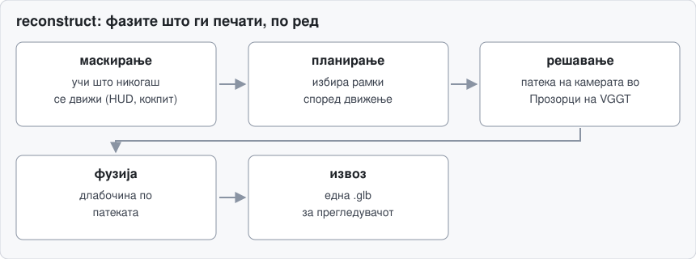

# Офлајн реконструкција {#offline-reconstruction}

```bash
python -m heat3d_capture reconstruct lap.mp4 -o lap.glb [--solve-budget 260] [--fuse-interval 0.4]
```

Код: [`scan/offline.py`](https://github.com/Holdi601/3DHeat-GameCapture/blob/main/heat3d_capture/scan/offline.py),
[`pose/feedforward.py`](https://github.com/Holdi601/3DHeat-GameCapture/blob/main/heat3d_capture/pose/feedforward.py),
[`pose/vggt_model.py`](https://github.com/Holdi601/3DHeat-GameCapture/blob/main/heat3d_capture/pose/vggt_model.py),
[`pose/feedforward_source.py`](https://github.com/Holdi601/3DHeat-GameCapture/blob/main/heat3d_capture/pose/feedforward_source.py),
[`pose/solveprep.py`](https://github.com/Holdi601/3DHeat-GameCapture/blob/main/heat3d_capture/pose/solveprep.py).
Опции: [Референца на командите](commands.md#reconstruct).

## Зошто втора патека {#why-a-second-path}

Инкременталното следење е во живо, евтино и работи таму каде има структура за која да се фатиш:
ентериер, улица, мапа со заклон. **Тркачката патека е неговиот најлош случај**: патот е мазна лента
со малку текстура, хоризонтот едвај се движи, и откако неколку положби ќе се лизнат ништо подоцна
не ги враќа назад. Кругот излегува како крива што талка наместо да се затвори.

Офлајн патеката предава **прозорци од слики** на модел што ги предвидува сите нивни камери заедно,
па секоја слика директно ја ограничува секоја друга наместо преку верига. Му треба целото снимање
пред да одговори, па не е во живо, и е бавна: минути по прозорец на десктоп GPU. Сè по положбите -
спојување, покриеност, боја, извоз - е истиот код како во скенирањето во живо: решената патека му
се предава на реконструкторот како извор на положби, точно таму каде оди телеметријата на Forza.

## Барања {#requirements}

- **PyTorch** усогласен со вашиот GPU (не е фиксиран од овој проект; инсталирајте го пред
  `requirements.txt`, видете [Извршување](runtime.md)).
- **`vggt`** - кодот на моделот VGGT (`from vggt.models.vggt import VGGT`), од GitHub
  складиштето на Meta; не е на индексот на пакети.
- **`transformers`**, бидејќи офлајн патеката ја пушта длабочината преку PyTorch
  `DepthEstimator` (Depth Anything V2 Small), не преку ONNX датотеката.
- Во пракса CUDA GPU; двата модела се враќаат на CPU, што не е практично.

Ниту едно од овие не е во `requirements.txt`, бидејќи скенерот не ги бара. Тие се во
**`requirements-offline.txt`**, со сопствените зависности на VGGT (`einops`, `safetensors`,
`huggingface_hub`, `Pillow`):

```bash
.venv\Scripts\python -m pip install -r requirements-offline.txt
.venv\Scripts\python -m pip install --no-deps "vggt @ git+https://github.com/facebookresearch/vggt.git"
```

VGGT се става со `--no-deps` бидејќи метаподатоците на неговиот пакет фиксираат `numpy<2`, што
pip би го почитувал со намалување на numpy што му треба на scipy тука. `reconstruct` проверува за
сите овие веднаш по печатењето на линијата за лиценцата (списокот `OFFLINE` во
[`runtime/preflight.py`](https://github.com/Holdi601/3DHeat-GameCapture/blob/main/heat3d_capture/runtime/preflight.py)),
го наведува она што недостасува со големини и инсталира само на да - VGGT со `--no-deps`, како
погоре. Одбивање, или без терминал за прашување, излегува со код 1.

## Моделот и неговата лиценца {#the-model-and-its-licence}

**VGGT**, `facebook/VGGT-1B`: **CC-BY-NC-4.0, само некомерцијално, и реконструкцијата направена со
него го наследува тоа.** Командата го печати ова пред да почне (`describe_licence`). Постои
посебно лиценциран `facebook/VGGT-1B-Commercial`, но тоа е заклучено складиште што Meta го
доделува по сметка, па не може да е стандарден. `--model vggt-1b-commercial` решава со него (и ја
печати неговата линија за лиценца наместо тоа); без доделен пристап преземањето не успева. *Кодот*
`vggt` е под сопствената „VGGT License“ на Meta, договор за истражувачки материјали со политика за
прифатлива употреба (прочитано од `LICENSE.txt` на пакетот). Видете [Модели и лиценци](models-and-licences.md).

## Извршувањето, фаза по фаза {#the-run-stage-by-stage}

Имињата на фазите се она што го печати командата.



### masking {#masking}

`FlowMask` се учи од **4 серии по 90 последователни слики**, центрирани на 1/8, 3/8, 5/8 и 7/8 од
видеото, на сиво 960 x 540 (видете [FlowMask](reconstruction-capture.md#flowmask-what-never-travels)).
Нејзината белешка се печати и се чува во резимето. Видео пократко од 90 слики нема маска.

#### Маската на камерата се учи, не се применува {#the-camera-mask-is-learned-not-applied}

Маската **не** се применува на сликите дадени на решавачот. Маскирањето на кокпитот изгледаше
точно според статистиката на карактеристиките (повеќето откриени агли седат на пиксели прицврстени
на камерата) - но тоа е тврдење за детектор на карактеристики, а решавачот е истрениран мрежа.
Мерено според тоа колку се врти повратената патека меѓу последователни чекори (возилото се врти
неколку степени; случајно талкање деведесет), суровите слики го дадоа најмалото вртење, сликите
со подигнат контраст малку повеќе, маскираните јасно повеќе, а двете заедно најмногу. Затоа
решавачот добива сурови слики. Маската сепак се користи за планирање на растојанието меѓу сликите
подолу, а инкременталниот следач ја користи во скенирањето во живо.
(`solveprep.enhance`, што маскира и го подига локалниот контраст со CLAHE, постои, но не се
користи од оваа команда.)

### planning: слики распоредени по движење {#planning-frames-spaced-by-motion}

`plan_by_motion` ги избира сликите на решавачот според **колку се поместила сликата**, не според
часовникот: фиксен интервал им дава на бавните делови слики што не им требаат, а ги гладува брзите,
каде последователните слики престануваат доволно да се преклопуваат за да се поврзат.

- Целно поместување: **5% од ширина од 960 пиксели** (48 px) медијално поместување на ORB
  карактеристики меѓу последователни избрани слики, мерено на сиви слики 960 x 540 со CLAHE
  контраст, карактеристики само на маската.
- Почнува со разлика од 0,3 s; по секој чекор следната разлика станува
  `gap x (0.5 + 0.5 x target / measured)`, ограничена на **0,15-2,0 s**, за едно бучно мерење да
  не го заниша планот.
- Кога ништо не се совпаднало, разликата се собира на 0,6 од себе (премногу далеку еден од друг е
  неуспехот што се избегнува).
- Запира на крајот на видеото или на `--solve-budget` слики (стандардно 260).

Помалку од 4 планирани слики е грешка.

### solving: прозорци и шиење {#solving-windows-and-stitching}

Планираните слики се декодираат на ширина од 960 px и се решаваат во **преклопени прозорци од 16
слики, 6 споделени** со следниот (`plan_windows`; последниот прозорец се повлекува да заврши на
последната слика, па крајот на снимањето има исто толку соседи како средината). Повеќе од **400**
слики во едно извршување се одбива.

Секој прозорец: сликите се менуваат така што долгата страна е **518**, а двете страни се множители
на **14** (односот зачуван - притиснувањето би го погрешило видното поле), скалирани на 0..1, пуштени
низ VGGT под bfloat16 autocast (float16 останува без експонент на далечни светски координати).
Екстринзиките на камерата се претвораат во ротации од камера во свет и центри на камерата. Мапите
на точки не се чуваат по стандард.

Секој прозорец се враќа **во својата произволна рамка и својата произволна скала**, па прозорците се
**шијат** во рамката на првиот со трансформација на сличност (ротација, транслација, една скала)
прилагодена на камерите што ги делат со веќе поставеното:

- **Ротација од ориентациите на камерите**, не од нивните позиции: споделените камери седат по
  патеката и се речиси колинеарни на права, што го остава прилагодувањето само по позиции неспособно
  да ја види ротацијата - секој прозорец свиткува, а споениот резултат излегува прав. Ротацијата е
  средната вредност на `target_R x source_R^T` проектирана назад на вистинска ротација (со заштита
  од рефлексија).
- **Скала и поместување од позициите**, по ротираниот извор.
- Потребни се најмалку **4** споделени камери; помалку е грешка.
- Преклопот е третина од прозорецот за скалата да е добро одредена; грешката на скалата што се
  натрупува од прозорец до прозорец е она што прави круг да се извива во спирала.

За секој шев се бележи најлошото несогласување на споделените камери по прилагодувањето, во единици
на средното растојание меѓу нив (`seam_error`).

### fusing {#fusing}

Слики на секои `--fuse-interval` секунди (стандардно 0,4) се декодираат на ширина од 960 px, добиваат
длабочина од Depth Anything V2 Small (PyTorch) и се спојуваат со положба **интерполирана** од
решената патека на нивната временска ознака (линеарна позиција, сферна ротација; `FeedForwardPoses`).
Сликите надвор од решениот временски опсег се прескокнуваат наместо екстраполирани. Камерата
користи хоризонтално видно поле од **65 степени**. Feed-forward положбите носат доверба 0,85 во
спојувањето и покриеноста.

### exporting {#exporting}

Мрежата се пишува како за скенирање во живо ([Излезот .glb](glb-output.md)), именувана по видеото.

## Резимето {#the-summary}

```text
140 cameras solved over 182s
closure error 3.1% of path length
worst seam 0.42 frame spacings
<mask note>
wrote lap.glb
```

| Линија | Значење |
|---|---|
| closure error | растојанието од првата до последната камера над должината на патеката. За еден круг, искрената мерка на лизгањето. Над 10%: „The lap does not close ... Treat the shape as unreliable.“ |
| worst seam | најголемото несогласување на шиењето. Над 1,0: „Windows disagreed by up to N frame spacings at a seam, so part of the path is stitched on weak evidence.“ |
| no file | „Fusion produced no surface, so nothing was written.“ Излезниот код тогаш е 1. |

## Скала {#scale}

Споената патека е во произволните единици на првиот прозорец. Длабочината се закотвува со
триангулација меѓу интерполираните положби (како кај телеметријата), па геометријата е
конзистентна со патеката - но **резултатот не е во метри** освен ако патеката не е. Ништо во оваа
команда не ја утврдува глобалната скала; калибрацијата на земјата не се применува кога положбите
доаѓаат од извор на положби.

## Состојба на оваа патека {#state-of-this-path}

Со слики на фиксен интервал, прозорците се решаваат во кохерентна патека на некои делови од кругот
и во шарање на други; неуспесите се тесните свиоци, каде погледот силно се замавнува меѓу сликите,
а погусто семплирање на тие свиоци ги враќа. Ниту една статистика на слика што е пробана
(осветленост, детали, број на карактеристики, однос на вредности во рамки, поместување) не
предвиде однапред кои делови ќе пропаднат. Затоа растојанието не може целосно да се планира однапред
од сликите: мора да се избере со решавање, мерење на резултатот и повторно решавање погусто таму
каде патеката не е таква што можел да ја вози автомобил. Планирањето според движење е изградено;
**адаптивното повторно решавање не е**.
