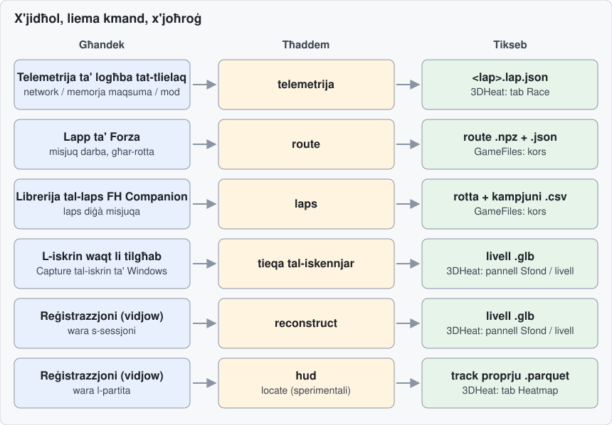

# 3DHeat GameCapture {#dheat-gamecapture}

**X'inhi?** Għodda li tniżżel dak li logħba tat-tlielaq tgħidilha dwar is-sewqan tiegħek, fajl wieħed
għal kull lapp. Tista' wkoll terġa' tibni mudell 3D mhux perfett ta' livell minn vidjo tiegħek tilgħab.

**Għaliex nużaha?** Biex tara l-laps tiegħek fil-[viewer ta' 3DHeat](https://holdi601.github.io/3DHeat/):
fejn ibbrejkjajt, fejn kont bil-mod, kif jiddiffru żewġ laps. U biex ikollok il-livell taħt
il-heatmap tiegħek meta ħadd m'għandu mudell 3D tiegħu.

**Eżempju:** ixgħel Data Out ta' Forza, ħaddem kmand wieħed, saq żewġ laps. Jidhru żewġ fajls tal-laps f'
`laps\`. Itfagħhom fuq it-tab Analiżi tat-tellieqa tal-viewer.


Ġdid mal-linja tal-kmandi? Aqra [Qabel ma tibda](before-you-start.md) l-ewwel.

## It-tliet xogħlijiet {#the-three-jobs}

1. **Telemetrija tal-laps.** Tirrekordja kull kanal li logħba tat-tlielaq tippubblika - Data Out ta' Forza, il-
   memorja maqsuma tal-logħob ta' Assetto Corsa, il-feeds tan-network tal-logħob tar-rally, mod ta' BeamNG, plugin ta'
   Trackmania - u tikteb fajl `heat3d-lap` wieħed għal kull lapp jew stage, għat-tab Analiżi tat-tellieqa
   tal-viewer. iRacing ma jeħtieġ ebda recorder: il-viewer jaqra l-fajls `.ibt` tiegħu stess.
2. **Livelli mill-gameplay.** Tibdel dak li wriet l-iskrin waqt li mxejt jew saqt f'
   livell f'mudell 3D `.glb`, li l-viewer iqiegħed taħt il-heatmap.
3. **Il-partita tiegħek stess, wara.** `hud` jaqra l-HUD tar-reġistrazzjoni tiegħek stess - l-azzjonijiet, il-mwiet,
   it-track tal-minimap u l-kill feed tiegħek. `locate` (sperimentali: sa issa jqiegħed ftit frames veri) isib
   fejn ttieħdet kull frame, fuq il-mudell 3D ta' livell.

It-tlieta jsegwu regola waħda: **xejn ma jiġi injettat f'logħba u xejn ma jiġi hooked**. Il-frames jiġu
mill-API pubblika tal-iscreen-capture, it-telemetrija minn interfaces li l-logħob jippubblikaw għaliha. Ara
[Ir-regoli](../rules.md).



Il-kodiċi huwa Python (pakkett `heat3d_capture`), liċenzja MIT. Il-mudelli tal-fond u tal-pose li jista'
iħaddem għandhom il-liċenzji tagħhom - ara [Mudelli u liċenzji](../models-and-licences.md).

## Bidu veloċi {#quick-start}

### Irrekordja laps {#record-laps}

Teħtieġ Python 3.10 jew aktar ġdid ([Qabel ma tibda](before-you-start.md)). F'PowerShell:

```powershell
git clone https://github.com/Holdi601/3DHeat-GameCapture
cd 3DHeat-GameCapture
python -m venv .venv
.venv\Scripts\python -m pip install -r requirements.txt

# Forza: Settings -> HUD and Gameplay -> Data Out = ON, IP 127.0.0.1, port 5300
.venv\Scripts\python -m heat3d_capture telemetry -o laps
```

**Għandek tara** `listening on port 5300. Laps go to laps. Ctrl+C to stop.`, imbagħad linja għal kull lapp meta taqsam il-linja, bħal
fl-istampa ta' hawn fuq. Agħfas Ctrl+C biex tieqaf. Itfa' l-fajls minn `laps\` fuq it-tab Analiżi tat-tellieqa tal-viewer.
Kull logħba oħra hija `--game` bogħod:

```powershell
.venv\Scripts\python -m heat3d_capture telemetry --game acc -o laps
.venv\Scripts\python -m heat3d_capture telemetry --game dirtrally2 -o laps
```

Ara [Recorders tat-telemetrija](../telemetry.md) għal kull logħba u għażla.

### Skennja livell {#scan-a-level}

Ikklikkja darbtejn fuq **`scan.bat`** fil-folder tal-għodda. Isib Python (u joffri li jinstallah b'
winget jekk ma hemm ebda), jagħmel `.venv` privat, u jiftaħ it-tieqa tal-iskennjar. It-tieqa tgħid
x'inhu nieqes, għal xiex hu kull pakkett u kemm hu kbir id-download, u ma jinstalla xejn
mingħajr iva. Ara [Runtime u dipendenzi](../runtime.md) u
[It-tieqa tal-iskennjar](../reconstruction-scan-ui.md).

B'idejk: `.venv\Scripts\python -m heat3d_capture.ui`.

Biex terġa' tibni reġistrazzjoni offline, bil-mogħdija tal-kamera solvuta kollha f'daqqa (jeħtieġ PyTorch, il-
pakkett `vggt` u GPU - ara [Rikostruzzjoni offline](../reconstruction-offline.md)):

```powershell
.venv\Scripts\python -m heat3d_capture reconstruct lap.mp4 -o lap.glb
```

## Mappa tad-dokumentazzjoni {#map-of-the-documentation}

| Paġna | X'tkopri |
|---|---|
| [Qabel ma tibda](before-you-start.md) | Python, terminal, l-ewwel kmand, żbalji komuni |
| [Ir-regoli](../rules.md) | Ebda injection, interfaces ippubblikati biss, u x'jiswa dan |
| [Recorders tat-telemetrija](../telemetry.md) | Il-kmand `telemetry` u ħarsa ġenerali lejn kull logħba |
| [Forza](../telemetry-forza.md) | Data Out, detezzjoni tal-layout, ir-relay FH Companion u l-`.tele.gz` tiegħu |
| [Logħob ta' Assetto Corsa](../telemetry-assetto-corsa.md) | AC, ACC, AC EVO, AC Rally mill-memorja maqsuma |
| [Logħob tar-rally](../telemetry-rally.md) | EA SPORTS WRC, DiRT Rally 2.0 / 1 / DiRT 4, Richard Burns Rally |
| [BeamNG.drive](../telemetry-beamng.md) | Il-mod tal-protokoll `heat3d` |
| [Trackmania](../telemetry-trackmania.md) | Il-plugin Openplanet `Heat3dRecorder` |
| [iRacing](../telemetry-iracing.md) | Il-qari ta' fajls `.ibt` fil-viewer |
| [Qsim tal-laps u l-istages](../lap-splitting.md) | `LapSplitter`, `CounterSplitter`, `LineSplitter`, `StageSplitter` |
| [Slip, drift u kanali derivati](../slip-and-drift.md) | Kif jiġi skalat is-slip, u x'jiddeduċi l-viewer |
| [Il-fajl heat3d-lap](../lap-format.md) | Il-format tal-fajl tal-lapp, kanali, unitajiet, `meta` |
| [Logħob](../games.md) | Għal kull logħba: kif tirrekordja, x'jintbagħat, liema korsijiet jistgħu jiġu esportati |
| [Kmandi](../commands.md) | `route`, `telemetry`, `laps`, `reconstruct`, `hud`, `locate`, pass b'pass |
| [Referenza tal-kmandi](../cli-reference.md) | kull għażla, iġġenerata minn `--help` |
| [Qari tal-HUD minn reġistrazzjoni](../hud-video.md) | `hud`: azzjonijiet proprji, mwiet, track tal-minimap u kill feed minn reġistrazzjoni |
| [Insibu l-frames f'livell](../locate.md) | `locate`: fejn ttieħdet kull frame, kontra l-ġeometrija tal-livell |
| [Rikostruzzjoni tal-livell](../reconstruction.md) | Il-pipeline minn frames għal `.glb` |
| [It-tieqa tal-iskennjar](../reconstruction-scan-ui.md) | Kull kontroll, hotkey u element tal-overlay |
| [Capture, maskri u kwalità tal-frames](../reconstruction-capture.md) | Windows Graphics Capture, keyframes, maskri tal-HUD, parir dwar il-kwalità |
| [Fond](../reconstruction-depth.md) | Depth Anything V2, ONNX Runtime, kif tibni l-mudell |
| [Pose u skala tal-kamera](../reconstruction-pose.md) | Odometrija, relokalizzazzjoni, poses tat-telemetrija, skala tal-art, bundle adjustment |
| [Fużjoni, kopertura u kulur](../reconstruction-fusion-and-texture.md) | Il-volum ta' okkupazzjoni, il-grilja tal-kopertura, punti dgħajfa, kulur tal-vertiċi |
| [L-output `.glb`](../glb-output.md) | Il-fajl li jgħabbi l-viewer |
| [Rikostruzzjoni offline](../reconstruction-offline.md) | `reconstruct`, twieqi VGGT u tqabbil |
| [Mudelli u liċenzji](../models-and-licences.md) | Daqsijiet ta' Depth Anything V2, VGGT, il-pakketti |
| [Runtime u dipendenzi](../runtime.md) | Preflight, backends, livelli ta' prestazzjoni |
| [Limiti u verifika](../limits.md) | X'mhux magħmul, u x'ma ġiex ikkontrollat |
| [Aġġornamenti](../updates.md) | Il-kontroll tar-rilaxx u `python -m heat3d_update` |
| [Żvilupp](../development.md) | Testijiet, l-ambjent virtwali, layout tar-repożitorju |
| [Iżżomm dawn id-dokumenti](../maintaining.md) | Il-lista ta' kontroll tar-rilaxx għall-kodiċi u d-dokumentazzjoni |

## Parti minn 3DHeat {#part-of-3dheat}

Il-fajls li tikteb din jitgħabbew mill-**viewer ta' 3DHeat** -
[sors](https://github.com/Holdi601/3DHeat), [dokumentazzjoni](https://holdi601.github.io/3DHeat/).
Il-fajls tal-laps imorru fit-tab Analiżi tat-tellieqa tiegħu, livelli `.glb` fil-pannell Sfond / livell, it-tabelli `hud` u `locate` fit-tab
Heatmap tiegħu; kif jaqra l-viewer it-tabelli u l-fajls tal-partiti hu f'
[Fajl wieħed għal kull partita (.3dheat)](https://holdi601.github.io/3DHeat/container.html) u
[Kif iddaħħal id-dejta](https://holdi601.github.io/3DHeat/getting-data-in.html).

| Għodda | X'tagħmel | Dokumenti |
| --- | --- | --- |
| [3DHeat viewer](https://github.com/Holdi601/3DHeat) | juri heatmaps, tlielaq u partiti f'3D, fil-browser | [dokumenti](https://holdi601.github.io/3DHeat/) |
| [GameFiles](https://github.com/Holdi601/3DHeat-GameFiles) | korsijiet u livelli mill-fajls li jipprovdu l-logħob, bħala mudelli 3D | [dokumenti](https://holdi601.github.io/3DHeat-GameFiles/) |
| [GameCapture](https://github.com/Holdi601/3DHeat-GameCapture) | telemetrija tal-laps minn logħob tat-tlielaq; livelli mibnija mill-ġdid minn vidjo tal-logħba | [dokumenti](https://holdi601.github.io/3DHeat-GameCapture/) |
| [Unreal Exporter](https://github.com/Holdi601/3DHeat-UnrealExporter) | plugin ta' Unreal Editor li jesporta livell bħala mudell 3D | [dokumenti](https://holdi601.github.io/3DHeat-UnrealExporter/) |
| [CS2](https://github.com/Holdi601/3DHeat-CS2) | demos ta' Counter-Strike 2 f'fajls tal-partiti; mapep f'mudelli 3D | [dokumenti](https://holdi601.github.io/3DHeat-CS2/) |
| [Watcher](https://github.com/Holdi601/3DHeat-Watcher) | jirrekordja l-logħob tiegħek fl-isfond minn dak li jippubblikaw il-logħob | [dokumenti](https://holdi601.github.io/3DHeat-Watcher/) |
| [Ext-WarThunder](https://github.com/Holdi601/3DHeat-Ext-WarThunder) | replays ta' War Thunder f'fajls tal-partiti | [dokumenti](https://holdi601.github.io/3DHeat-Ext-WarThunder/) |
| [Ext-WoT](https://github.com/Holdi601/3DHeat-Ext-WoT) | replays ta' World of Tanks f'fajls tal-partiti | [dokumenti](https://holdi601.github.io/3DHeat-Ext-WoT/) |
| [Ext-WoWs](https://github.com/Holdi601/3DHeat-Ext-WoWs) | replays ta' World of Warships f'fajls tal-partiti | [dokumenti](https://holdi601.github.io/3DHeat-Ext-WoWs/) |
| [Ext-Squad](https://github.com/Holdi601/3DHeat-Ext-Squad) | demos tas-server ta' Squad f'fajls tal-partiti | [dokumenti](https://holdi601.github.io/3DHeat-Ext-Squad/) |
| [Ext-DCS](https://github.com/Holdi601/3DHeat-Ext-DCS) | mapep ta' DCS World f'mudelli 3D | [dokumenti](https://holdi601.github.io/3DHeat-Ext-DCS/) |
| [Ext-IL2](https://github.com/Holdi601/3DHeat-Ext-IL2) | mapep ta' IL-2 Sturmovik f'mudelli 3D | [dokumenti](https://holdi601.github.io/3DHeat-Ext-IL2/) |

Żviluppatur bil-proġett tal-logħba miftuħ għandu juża l-esportatur ta' Unreal, li jaqra l-
ġeometrija vera u hu eżatt. Fejn l-arkivji proprji ta' logħba jistgħu jinqraw, GameFiles jiestratta l-kors
eżatt. Ir-rikostruzzjoni mill-gameplay hija għall-każ meta biss l-iskrin huwa disponibbli.
