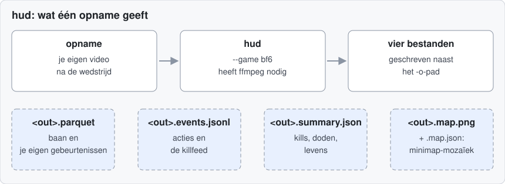

# De HUD uit een opname lezen {#reading-the-hud-from-a-recording}

`hud` leest de on-screen HUD van een spel uit de **eigen opname** van de speler, na de wedstrijd:
de **eigen** acties van de speler uit het puntenpopupje dat het spel onder het vizier toont (kills,
assists, revives, bevoorradingen, veroveringen...), hun doden uit de down- en deploy-schermen, hun
**eigen** spoor uit de minimap, en de killfeed ernaast als gebeurtenissen met tijdstippen - geschreven
als 3DHeat-tabel, met het mozaïek van de minimap als kaartafbeelding om onder het spoor te leggen.

Kort gezegd: het bekijkt je wedstrijdvideo en schrijft je kills, doden en je wandelroute op.

```bash
.venv\Scripts\python -m heat3d_capture hud "<recording>.mp4" --game bf6 --player <name> -o out/match
```

Battlefield 6 is het eerste spelprofiel.



## Wat het wel en niet aanraakt {#what-it-does-and-does-not-touch}

- Het leest een **videobestand**: een ShadowPlay- / Instant Replay-clip, een OBS-opname, alles wat
  ffmpeg decodeert. Het raakt het spel, zijn geheugen, zijn bestanden of zijn netwerk nooit aan, en
  het draait pas nadat de wedstrijd voorbij is. Zie [De regels](rules.md).
- Het leidt **alleen de eigen positie van de speler** af, uit de eigen minimap van de speler. Markers
  van andere spelers op de minimap worden afgedekt en nooit gelezen. De killfeed wordt volledig
  bewaard, maar alleen als wat er op het scherm staat (wie de kill maakte, het slachtoffer, waarmee, wanneer); aan niemand
  behalve de speler wordt een positie gekoppeld.
- De OCR draait lokaal (RapidOCR met de PaddleOCR-modellen via ONNX Runtime). Geen beeld en geen
  uitsnede verlaat de computer.
- Een opname laat namen van andere spelers zien, en het mozaïek is een beeld van het level. De
  uitvoer is bedoeld voor het eigen gebruik van de speler; houd die lokaal.

## Vereisten {#requirements}

- **ffmpeg en ffprobe** op `PATH`. Een NVIDIA-kaart wordt voor decoderen gebruikt als die er is
  (`-hwaccel cuda`); anders decodeert de CPU, meerdere keren trager.
- De pakketten in `requirements.txt`, en de OCR zonder zijn eigen afhankelijkheden (die vraagt om de
  CPU-versie van `onnxruntime`, die botst met de DirectML-versie die het project gebruikt):

```bash
.venv\Scripts\python -m pip install -r requirements.txt
.venv\Scripts\python -m pip install --no-deps rapidocr_onnxruntime==1.2.3
```

`rapidocr_onnxruntime` is de tekstlezer (OCR) die namen en woorden van het scherm leest.
`--no-deps` zorgt dat die de DirectML-`onnxruntime` van het project niet vervangt.

Om ffmpeg op Windows te installeren: `winget install Gyan.FFmpeg`, open daarna een nieuwe terminal en
controleer dat met `ffmpeg -version`. Nieuw met de opdrachtregel? Lees [Voordat je begint](before-you-start.md).

- Een opname van **16:9** in elke resolutie (1080p, 1440p, 4K). Andere beeldverhoudingen worden
  geweigerd, omdat de vakjes van het profiel dan op de verkeerde delen van het scherm zouden vallen.
- De **standaard HUD-indeling** van het spel. Een verschoven of geschaald HUD-element wordt op de
  verkeerde plek gelezen.

## Opties {#options}

| Optie | Standaard | Betekenis |
|---|---|---|
| `video` | | De opname. |
| `-o`, `--out` | de naam van de video, in de huidige map | Uitvoerpad **zonder** extensie; de bestanden zijn `<out>.parquet`, `.events.jsonl`, `.summary.json`, `.map.png`, `.map.json`. |
| `--game` | `bf6` | Wiens HUD er gelezen wordt. `bf6` (Battlefield 6) is tot nu toe het enige profiel. |
| `--player` | geen | De naam van de speler zoals de killfeed die toont. Wordt losjes vergeleken (de OCR verwart `l`/`I`/`1`, `O`/`0`, `rn`/`m`). Zonder deze optie wordt de naam geraden (hieronder). |
| `--fps` | 5 | Minimap-samples per seconde. De killfeed wordt op de helft daarvan bemonsterd, het puntenpopupje en de doodschermen ook op de helft (een kwart zolang geen popup te zien is), het kompas elke 3 s, de squadlijst elke 15 s. |
| `--start` | 0 | Seconden in de video waar het begint. |
| `--seconds` | alles | Hoeveel van de video er gelezen wordt. |
| `--metres-per-pixel` | geen | De schaal van de minimap, als die bekend is: meter per minimappixel bij het gebruikelijke zoomniveau (de minimap is 296 pixels breed op een 1080p-scherm). Zonder deze optie staan posities in die pixels; zie [Eenheden](#north-and-units). |
| `--cpu` | uit | Decodeer op de CPU, ook als er een NVIDIA-kaart is. |

Bij elke vijf seconden wordt de voortgang getoond; aan het eind de speler, kills, doden, levens en de
geschreven bestanden.

## Uitvoer {#outputs}

### `<out>.parquet` - het spoor en de gebeurtenissen van de speler {#parquet---the-players-track-and-events}

Eén rij per sample waarin de speler in het spel was en de minimap geplaatst kon worden, plus één per
gebeurtenis van de speler. De footer bevat de leesinstructies van de viewer (`heat3d`-sleutel,
`kind: heat3d-hud`), zodat de viewer elke kolom indeelt zonder te vragen.

| Kolom | Betekenis |
|---|---|
| `time` | Seconden vanaf het begin van de video. |
| `event` | `position`; `start` (de video begon midden in een leven), `spawn` (weer in het spel na een dood of een lange pauze), `death`, `downed` en `revived` (uit de doodschermen, hieronder), `end` (een leven eindigde zonder verklaring); de eigen acties van de speler uit het puntenpopupje (`kill`, `assist`, `reviving`, `resupply`, `capture`... - de [gebeurtenistabel](#event-table)); en de regels van de killfeed over de speler als `kill_feed`, `death_feed`, `teamkill_feed`, `suicide_feed`, `squadwipe_feed`. |
| `source` | Waar de gebeurtenis van de rij vandaan komt: `points` (het popupje), `screen` (de down- en deploy-schermen), `feed` (de killfeed); leeg op positierijen. |
| `text` | Op `points`-rijen: de tag zoals die is afgedrukt (`KILL`, `SQUAD DAMAGE ASSIST`...), of de titel (`DOUBLE KILL`, de naam van een lint), of voor een onbekende tag wat er gelezen is. |
| `points` | Op `points`-rijen: hoeveel het totaal van het popupje op dat moment is gestegen. Komen er in hetzelfde sample meerdere acties binnen (een kill en het voertuig waarin die plaatsvond), dan is het de som, op elke rij, en `shared` zegt met hoeveel ze die deelden. Leeg wanneer het totaal niet twee keer voor en twee keer na het moment werd gelezen. |
| `subject`, `subject_side` | Op `points`-rijen: de naam die het popupje bij de actie toonde - het slachtoffer van een kill, de teamgenoot die werd opgewekt of bevoorraad - en de kleur ervan (`enemy`, `friendly`, `squad`). |
| `confirmed` | `feed` wanneer de killfeed een regel had voor dezelfde kill of dezelfde dood (binnen 3 s, hetzelfde slachtoffer). |
| `x`, `y`, `z` | Positie op het mozaïek: `x` oost, `y` noord, `z` 0 (de footer zegt dat `z` omhoog is). Noord is echt noord wanneer het kompas dat toeliet (zie `north_up` in de samenvatting). |
| `player` | Altijd `me`. Alleen de rijen van de speler zelf hebben posities. |
| `team` | `own`. |
| `session` | `<video name>#NN`, één per leven. Lijnwarmteroutes kruisen nooit een sessie. |
| `heading` | Graden met de klok mee vanaf noord (vanaf de boven-kant van het mozaïek wanneer noord onbekend is): waar de blik heen wees. |
| `dir_x`, `dir_y`, `dir_z` | Hetzelfde als een richtingsvector, voor de kijkrichting in de viewer. |
| `zoom` | Hoe ver de minimap uitgezoomd was ten opzichte van het gebruikelijke zoomniveau (boven 1 in voertuigen). |
| `killer`, `victim`, `weapon`, `headshot`, `marker` | Op kill- en doodrijen die een killfeed-regel hebben: de killfeed-regel (hieronder). Een kill uit het popupje zonder killfeed-regel heeft de naam uit het popupje als `victim`; een popupkill die als HEADSHOT werd getoond heeft `headshot` op waar. |

Elke gebeurtenisrij neemt de positie van de speler op het tijdstip van de gebeurtenis (bij een dood of
een down de laatste positie ervoor; bij een opwekking de eerste erna). De rijen passen direct in de
[lijnwarmte](https://holdi601.github.io/3DHeat/line-heat.html) van de viewer: die suggestie kiest
`event`, begint bij `start`, `spawn` en `revived`, eindigt bij `death`, `downed` en `end`, en
`position`-rijen liggen langs de route. De andere gebeurtenissen heten zo dat de suggestie er geen
als begin of einde neemt: iemand opwekken is `reviving` (niet `revive`), een punt verdedigen
`defense`, een teamgenoot die op de speler verschijnt `teammate_arrived`, en de regels van de
killfeed `kill_feed` enzovoort; `kill` is geen einde.

Een opname met twee rondes op twee kaarten geeft twee mozaïeken die niet aan elkaar gerelateerd kunnen
worden. Het grootste is `<out>.parquet`; elk ander met minstens 30 s spoor wordt ernaast geschreven
als `<out>.map2.parquet`, `<out>.map2.map.png`, enzovoort.

### `<out>.events.jsonl` - de gebeurtenissen van de speler en de killfeed {#eventsjsonl---the-players-events-and-the-kill-feed}

Eén JSON-object per regel, in tijdvolgorde, elk met een `source`:

- `points`: één per actie van de speler: `time`, `event`, `text`, `points`, `shared`,
  `subject`, `subject_side` (zoals in de tabel), `popup` (uit welk popupje het kwam, doorlopend genummerd
  over de run), `seen` (hoeveel keer het gelezen werd), `confirmed`, en `x`, `y` waar de speler was.
- `screen`: één per down en per opwekking: `event` (`death`, `downed` of `revived`), `time` (wanneer
  de speler neerging; bij `revived` wanneer de schermen verdwenen), `until` (de laatste keer dat de
  schermen werden gezien), `screens` (`down` en/of `card`), `outcome` (`death`, `revived`, of
  `unknown` wanneer de opname eerder eindigt), `killer` (uit de killfeed-regel, als die er is), `x`, `y`.
- `feed`: elke regel die de killfeed toonde, van iedereen:

| Veld | Betekenis |
|---|---|
| `time`, `last` | Eerste en laatste sample waarin de regel werd gelezen (seconden vanaf het begin van de video). `time` is wanneer de kill verscheen, binnen één killfeed-sample (0,4 s bij de standaardsnelheid). |
| `kind` | Vanuit de kant van de speler: `kill`, `death`, `teamkill`, `suicide`, `squadwipe`; voor regels van andere spelers `kill`, `squadwipe`, of `death` voor een regel zonder killer. |
| `killer`, `victim` | De namen, als de meest voorkomende lezing over alle samples waarin de regel stond (een langere lezing wint wanneer de veelvoorkomende het begin ervan is: een naam die deels verborgen was). `killer` is leeg bij een regel die alleen een icoon en een slachtoffer toonde - een dood door de wereld, of een regel waarvan de killer al was verdwenen. |
| `killer_side`, `victim_side` | Uit de kleur van de naam: `friendly` (het team van de speler, blauw), `enemy` (oranje), `squad` (het bleke groen dat het spel gebruikt voor de speler en zijn squad), `neutral` (geen van deze). |
| `weapon` | De klasse van het wapenicoon binnen deze run: `icon01`, `icon02`... Regels waarvan de iconen op elkaar lijken delen een klasse. De iconen zijn niet benoemd; er is geen lijst om ze uit te noemen. |
| `marker` | Het kleine icoon tussen het wapen en het slachtoffer: `skull`, `arrow`, `chevrons`, `crosses` of leeg. |
| `headshot` | `marker == "skull"` - een aanname, zie [Beperkingen](#limits). |
| `seen` | Hoeveel killfeed-samples de regel toonden. |
| `me` | `killer`, `victim` of null. |
| `matched` | Voor de eigen regels van de speler: of er een popupactie of een doodscherm voor werd gevonden. |
| `x`, `y` (, `map`) | Voor de eigen regels van de speler: waar de speler was. |

### `<out>.summary.json` {#summaryjson}

De speler (en hoe die gevonden werd), waar de gebeurtenissen van de speler vandaan kwamen
(`own_events_from`: het popupje en de schermen, of de killfeed alleen wanneer geen van beide werd
gelezen), kills, doden, K/D, headshots, assists, gegeven opwekkingen (`revives`) en ontvangen
(`revived`), downs, veroveringen, neutraliseringen, bevoorradingen, genezingen, reparaties, vernietigde
voertuigen, de score (de totalen van de popupjes opgeteld), elk actietype met zijn aantal
(`actions`), het aantal popupjes, doden die alleen de killfeed toonde, het eigen aantal kills en doden
van de killfeed en hoeveel van zijn kills met een popupkill overeenkwamen, teamkills, zelfdoding,
squadwipes, levens, seconden in het spel, afgelegde afstand (in de eenheden van de tabel),
killfeed-regels, per kaart of die noord-boven is en hoeveel kompaslezingen het eens waren, de tellingen
van het spoor (samples, in het spel, geplaatst, niet geplaatst, eilanden), de gemaakte aannames en de
tijdsduur.

### `<out>.map.png` en `<out>.map.json` - de kaart onder het spoor {#mappng-and-mapjson---the-map-under-the-track}

Het mozaïek van elke minimap van de run, gemiddeld, met overlays verwijderd, gedraaid en geschaald
precies zoals de tabel. Het JSON-zijbestand bevat de twee ankers die de viewer nodig heeft voor de
plaatsing **Kaartafbeelding** ([Kaartafbeeldingen](https://holdi601.github.io/3DHeat/map-images.html)
in de documentatie van de viewer): laad de PNG met **Kaartafbeelding...**, laat **Noord/zuid spiegelen**
aan staan, en typ anker 1 en anker 2 (`px`, `py`, `worldX`, `worldZ`) uit het zijbestand over. De
afbeelding ligt dan precies onder het spoor.

Alleen de delen van het level die de minimap van de speler toonde, staan op de afbeelding.

## Methode {#method}

### Decoderen {#decoding}

ffmpeg decodeert op de GPU, zakt naar de samplefrequentie terwijl de beelden nog op de kaart staan,
knipt de regio's van het profiel uit (minimap, killfeed, twee kompasstroken, squadlijst, het
puntenpopupje, de tekst van het down-scherm, de rechtsonder-hoek), schaalt elk naar een vaste maat en
stapelt ze tot één klein beeld per sample. Alleen dat beeld gaat via de pijp naar Python. Elk frame van
de H.264-stream decoderen is de ondergrens van de looptijd.

Twee werkthreads nemen de samples over: één registreert de minimaps (OpenCV), één leest de tekst
(ONNX Runtime).

### In het spel of niet {#in-play-or-not}

Het sleutelvakje van de minimap (het lichte vierkant met de kaartsleutel erin, linksonder op de
minimap) wordt getekend zolang de minimap er is, en niet op dood-, killcam-, deploy-, menu- of
scorebordschermen. De aanwezigheid ervan - een licht, kleurloos vierkant, met een donkere letter in
het midden, duidelijk lichter dan wat eromheen ligt - gezocht een paar pixels rond de plek ervan, is de
test of de speler in het spel is. Een enkel sample dat het niet eens is met beide buren wordt genegeerd.

Een gat in het spel is een dood of een rondewissel (het volgende stuk begint met `spawn`) wanneer het
minstens 6 s duurt, of wanneer een dood (uit de schermen, of een killfeed-regel die de speler als
slachtoffer noemt) binnen 40 s ervoor kwam; een kortere pauze zonder dood (de grote kaart ging open)
zet het leven voort. De minimap blijft zichtbaar terwijl de speler down is, dus een down speler is in
het spel.

### Het spoor {#the-track}

De minimap draait met de blik en houdt de speler op een vast punt (gemeten: het midden, 49,7% naar
beneden). Elk sample:

1. **Afdekken** van wat niet het level is: sterk gekleurde of bijna witte pixels (doelmarkers, squad-
   en voertuigiconen, pings, de grens van het speelgebied, routelijnen, tekst), het zwakke geel-groen
   van de kijkkegel, een schijf rond het markeerpunt van de speler, de wig van de kegel erboven, het
   sleutelvakje en een dunne rand.
2. **Kenmerken**: SIFT-keypoints op de contrast-gelijkgemaakte grijze minimap, binnen het afgedekte
   gebied.
3. **Registreren op het mozaïek**, niet op het vorige sample: de keypoints worden gematcht met de tot
   dan toe opgeslagen kenmerken, in mozaïekcoördinaten, dicht bij waar de speler laatst was; een
   gelijkvormigheid (draai, zoom, verschuiving) wordt gefit met RANSAC. Een fit heeft genoeg inliers
   nodig, een zoom binnen een derde van de laatste en een verschuiving van minder dan een derde van de
   minimap per sample; een fit die overal op het mozaïek wordt gezocht (na een dood) heeft het dubbele
   aantal inliers nodig.
4. **Het mozaïek laten groeien**: kenmerken die het mozaïek nog niet heeft, worden toegevoegd (hooguit
   om de paar tiende seconden beweging), en de afgedekte minimap wordt in het beeld gemiddeld.
5. Het punt van de speler dat door de fit wordt meegenomen is zijn **positie**; het omhoog van de
   minimap dat door de fit wordt meegenomen is zijn **richting** op het mozaïek.

Daarna wordt een punt dat meer dan 10 pixels springt weg van zowel de twee samples ervoor als de twee
erna (die onderling overeenstemmen) weggelaten: een minimap past soms één sample lang op een verkeerd
zoomniveau. De samenvatting telt ze (`dropped_as_jumps`).

Registreren op het mozaïek houdt fouten tegen dat ze zich opstapelen: terugkomen op een plek past op de
kenmerken die de eerste keer zijn opgeslagen. Een spawn ergens die nog niet gezien is, begint een apart
**eiland**; elke tiende geplaatste sample wordt geprobeerd tegen de andere eilanden, en de eerste goede
match voegt ze samen (de kleinere gaat in de grotere op, met zijn spoor). Eilanden die nooit zijn
samengevoegd (een andere kaart, of grond die nooit gedeeld werd) worden apart geschreven, zoals
hierboven.

### Noord en eenheden {#north-and-units}

Het kompas wordt elke 3 s gelezen: de labels worden gevonden aan hun inkt (helder, kleurloos, gegroepeerd
over kleine openingen, streepjes weggelaten), elk wordt apart gelezen, en twee of meer labels bepalen
zowel de schaal van de strook als de peiling onder het middenmerkteken - een enkel label bepaalt niets.
Elke kompaslezing wordt gekoppeld aan de mozaïekrichting van hetzelfde sample; de circulaire mediaan van
de verschillen, over de lezingen binnen 10 graden ervan, is de draai die het mozaïek noord-boven zet.
Die wordt toegepast wanneer er minstens drie lezingen zijn en de helft van alle lezingen het eens is.

<a id="units"></a>De grondschaal van de minimap staat nergens op het scherm, dus posities staan in
**minimappixels bij het gebruikelijke zoomniveau**: de mediane zoom van de run wordt geschaald naar één
tabeleenheid per pixel van een minimap van 296 pixels (zijn grootte op een 1080p-scherm). Het uitzoomen
van voertuigen wordt door de registratie weggehaald, dus een eenheid is dezelfde te voet en in een
voertuig. `--metres-per-pixel` vermenigvuldigt alles naar meters wanneer de schaal bekend is (uit een
bekende afstand op de kaart, één keer gemeten).

### De killfeed {#the-kill-feed}

De killfeed wordt 2,5 keer per seconde gelezen, maar alleen wanneer zijn gekleurde pixels merkbaar
veranderd zijn of er 2 s voorbij zijn. Tekstregels worden gevonden door de detector van de OCR; een
regel waarvan het beeld overeenkomt met een regel die in het vorige sample gelezen werd (regels
schuiven, dus ze kunnen verschoven zijn) krijgt die tekst in plaats van opnieuw gelezen te worden.
Regels die te klein zijn voor een naam, of met een schuine streep (een fps-teller in die hoek), vallen
af.

Regels worden per hoogte in rijen gegroepeerd; in een rij is de meest linkse naam de killer en de meest
rechtse het slachtoffer. Naast elkaar liggende stukken van dezelfde kleur worden samengevoegd (een naam
met een spatie). Een enkele regel die van de ene naam naar de andere over het icoon liep, wordt bij zijn
breedste opening doorgeknipt wanneer de helften in kleur verschillen, en elke helft wordt opnieuw
gelezen. Een enkele naam in de slachtofferkolom met een icoon net links ervan is een regel zonder killer.
Twee stukken in één kleur zonder icoon ertussen zijn één naam waarvan de killer is verdwenen, geen kill.

**Kanten** komen uit de kleur. Namen worden met enige doorzichtigheid getekend, dus de test kijkt hoe ver
de tekst van zijn eigen achtergrond afligt: het teken van rood min blauw in dat verschil is oranje
(vijand) of blauw (vriendelijk) op elke achtergrond; geen van beide, met groen boven de andere twee, is
de squadkleur.

**Iconen**: tussen de namen vormen de pixels in de kleur van de killer de silhouet van het wapen; een
klein apart icoon vlak voor het slachtoffer is de marker, genoemd naar zijn vorm (een vlek met oogholtes
is een schedel; een kleine driehoek een pijl; meerdere stukken kruisen).

**Gebeurtenissen**: een rij die opnieuw gelezen wordt met beide namen gelijk (gelijkenis 0,7 na het
terugbrengen van de gebruikelijke OCR-verwarringen, één van 0,8; een afgekapte lezing komt overeen met
het begin van de volledige naam) is dezelfde gebeurtenis, zolang de gebeurtenis het laatst minder dan
5 s geleden werd gelezen en minder dan 14 s oud is - geen rij blijft langer staan, dus hetzelfde paar
later is een nieuwe kill. Een rij zonder killer komt alleen op het slachtoffer overeen. Het tijdstip van
een gebeurtenis is haar eerste waarneming; haar namen, kanten en marker zijn de meerderheid over de
waarnemingen; rijen die maar één keer gelezen werden, vallen af.

**De speler**: `--player`, anders de meest oplichtende (helderste) rij van de squadlijst wanneer er
minstens drie lezingen en 60% ervan het eens zijn, anders de naam die de killfeed het vaakst in de
squadkleur tekende. Anders zegt de samenvatting dat de speler onbekend is, en wordt geen killfeed-regel
aan hem toegeschreven. (Het popupje en de doodschermen zijn van de speler zelf, welke naam die ook
heeft; ze hebben geen naam nodig.)

### Het puntenpopupje {#the-points-popup}

Alles wat de speler scoort, toont Battlefield 6 in één popupje links van en onder het vizier - op
dezelfde plek te voet, in een voertuig en door een vizier:

```
            [ RIBBON ] (icon)          a title, now and then: a ribbon or a multi-kill
      (icon)(icon)(icon)  300          one icon per action; the popup's running total
                Some_Name              who it was about, for a moment: orange an enemy, blue a teammate
    [ KILL x2 ] [ VEHICLE DESTROYED ]  one boxed tag per kind of action, with a count
```

Het popupje groeit terwijl de speler blijft scoren: een nieuwe kill maakt `KILL` tot `KILL x2`, voegt
een icoon toe en verhoogt het totaal; een nieuw soort actie voegt een tag toe. De tagrij toont de laatste
paar soorten (een oudere schuift eruit en telt door wanneer hij terugkomt). Ongeveer drie seconden na de
laatste actie klapt het popupje in één regel op (`[KILL x2] 300`) en verdwijnt het. Tekst is lichtgrijs,
de tags staan in dunne vakjes, het totaal in grote cijfers vanaf x 760 van een scherm van 1920x1080, de
tags rechts uitgelijnd op x 750.

Het wordt 2,5 keer per seconde gelezen: de detector van de OCR vindt de tekstregels, alleen regels op
een van de rijen van het popupje worden gelezen (de eigen labels van het tankvizier in hetzelfde gebied
niet), en een regel waarvan het beeld overeenkomt met een regel die het sample ervoor gelezen werd,
krijgt die tekst. Een regel die van een icoon, een naam of een opgevouwen tag het totaal in loopt
(`Name10`, `REVIVE185`) wordt doorgeknipt waar het totaal begint (x 755) en beide helften worden opnieuw
gelezen. Zolang geen popupje te zien is, wordt elk tweede sample ongelezen opzijgezet; wanneer het
volgende een popupje toont, wordt het opzijgezette eerst gelezen, zodat het begin van een popupje tot op
het sample gevonden wordt.

**Tags** worden aan de [gebeurtenistabel](#event-table) gekoppeld, na het terugbrengen van de gebruikelijke
fouten van de herkenner (Q gelezen als O, een cijfer tussen letters, I voor L, een letter verloren aan een
rand): een lezing is een tag wanneer ze minstens 80% gelijk is aan een tag (85% voor tags van vijf letters
of minder) en duidelijk dichter bij die ligt dan bij elke andere. Tags die de herkenner aan elkaar
vastplakte (`CAPTUREDORDERCOMPLETED`) worden uit elkaar gehaald door bekende tags van de voorkant af
te pellen. Een telling is `x2`, `X3`, een los teken en een cijfer, of een cijfer direct na de tag. Een
lichtgrijze, hoofdletterregel in de tagrij die nergens op lijkt, wordt bewaard als actie `points` met
zijn tekst; een regel die een stuk is van een bekende tag in hetzelfde popupje (`DESTROYED` naast
`VEHICLE DESTROYED`) niet. Titels boven het totaal (lichte vakjes, donkere tekst) zijn `multi_kills`
(`DOUBLE KILL` ...) of `ribbon`. De naam is de gekleurde regel tussen het totaal en de tags; zijn kant
komt uit zijn kleur, zoals bij de killfeed.

**Popupjes en acties**: lezingen met minder dan 0,9 s niets ertussen zijn één popupje. Een popupje dat
lijkt te eindigen en terugkomt voordat het had kunnen opvouwen (binnen 3,2 s na het laatste groeien),
met elke tag op zijn telling of hoger en een totaal dat niet kleiner is, is hetzelfde popupje dat even
kwijt was (wazig, een heldere achtergrond) - niets erin wordt twee keer geteld. In een popupje is de
eindtelling van een tag de hoogste telling die minstens twee keer gelezen werd; zijn k-de actie wordt
getimed op de eerste lezing die een telling van k of hoger toont. Een telling die maar in één sample
gelezen werd, is geen actie - behalve een kill die de killfeed bevestigt (een regel van de speler binnen
3 s die geen andere kill heeft opgeëist): de korte KILL-tag is degene die de herkenner het vaakst maar
één keer leest. Een titel telt één keer per popupje, wanneer hij twee keer gelezen wordt. `points` is
hoeveel het totaal - alleen totalen die twee keer achter elkaar gelezen werden - groeide van vóór het
sample van de actie tot erna.

Een onbekende regel telt alleen als tag op de rij van de bekende tags in dezelfde lezing (of, zonder
bekende tag, wanneer er ook geen naam is), zodat een naam in een kleur die de kantentest niet kan
herkennen niet als zodanig wordt aangezien.

### Doden en opwekkingen {#deaths-and-revives}

Wanneer de speler neervalt, zegt het spel dat onder het midden van het scherm (MAN DOWN, REQUEST REVIVE,
SKIP (HOLD), NEARBY MEDICS; zodra om een opwekking is gevraagd, REVIVE REQUESTED, CANCEL REQUEST), en een
kaartje rechtsonder noemt wie het deed, met DAMAGE LOG of PLAYER CARD eronder en een regel "YOU n - n
FOE" erboven. Bij een directe dood (een fatale headshot) toont alleen het kaartje iets. Daarna wordt de
speler ofwel door een teamgenoot opgewekt - de schermen verdwijnen en het spel gaat door - of de speler
verliest al zijn bloed of geeft op, en het deploy-scherm volgt, met DEPLOY rechtsonder.

Deze woorden worden samen met het popupje gelezen, in dezelfde ronde van de OCR (het popupje, de band van
het down-scherm en de rechterbenedenhoek op één beeld gestapeld): 2,5 keer per seconde terwijl een
popupje te zien is, 1,25 keer anders. De hoek wordt alleen meegenomen wanneer de speler buiten het spel is
of in de laatste 3 s down werd gezien; in het spel toont hij alleen de munitieteller.
Waarnemingen minder dan 4 s uit elkaar vormen één episode (minstens twee waarnemingen). Een episode is een
**dood** wanneer het deploy-scherm binnen 12 s na het einde ervan verschijnt, of wanneer de speler 3 s
erna buiten het spel is en 6 s of langer buiten blijft; het is een **opwekking** (`downed`, en dan
`revived`) wanneer de speler 3 s nadat de schermen verdwenen nog in het spel is; `unknown` (geschreven als
alleen `downed`) wanneer de opname eerder eindigt. Het tijdstip van de dood is wanneer de speler neerging:
de killfeed-regel die hem als slachtoffer noemt, wanneer die er is binnen 3 s vóór de episode, anders de
eerste waarneming van de episode min een halve leesinterval. Posities na een dood worden uit de route
gelaten tot het deploy-scherm.

Een doodmelding uit de killfeed waar geen episode bij hoort (de schermen werden gemist) is nog steeds een
`death`, met `source` `feed`, en wordt zoals voorheen beoordeeld: blijft de speler langer dan 40 s na die
dood in het spel, dan is hij opgewekt.

### Gebeurtenistabel {#event-table}

Wat elke tag, titel en elk scherm wordt. Meerdere tags kunnen één gebeurtenis zijn; `text` houdt bij welke.

| Gebeurtenis | Uit | Betekenis |
|---|---|---|
| `kill` | KILL; HEADSHOT | De speler heeft iemand gedood (de naam is het slachtoffer). Een headshot-kill toont HEADSHOT waar KILL zou staan: `text` zegt welke, en `headshot` is waar. |
| `assist` | ASSIST, KILL ASSIST, DAMAGE ASSIST, SQUAD DAMAGE ASSIST | Schade aan iemand die een teamgenoot doodde. |
| `kill_assist` | ASSIST COUNTS AS KILL | Een assist die het spel als kill telt. |
| `suppression`, `suppression_assist` | ENEMY SUPPRESSION; SUPPRESSION ASSIST | Onderdrukkend vuur op een vijand; op iemand die een teamgenoot daarna doodde. |
| `smoke_assist` | SMOKE ASSIST, SQUAD SMOKE ASSIST | Rook die een teamgenoot dekte. |
| `spot`, `spot_assist` | SPOT, SPOTTED, ENEMY DESIGNATION; SPOT ASSIST, SPOT BONUS | Een vijand spotten; een kill op iemand die de speler had gespot. |
| `driver_assist` | DRIVER ASSIST | Een kill door de kanonnier van het voertuig van de speler. |
| `reviving`, `reviving_bonus` | REVIVE, SQUAD REVIVE; CONCEALED REVIVE | De speler heeft een teamgenoot opgewekt; de bonus voor het doen onder dekking. |
| `heal` | HEAL, SQUAD HEAL | De speler heeft een teamgenoot genezen. |
| `resupply` | SUPPLY, RESUPPLY, SQUAD SUPPLY | Een teamgenoot nam munitie van de speler. |
| `repair` | REPAIR, VEHICLE REPAIR, SQUAD REPAIR | De speler heeft een voertuig gerepareerd. |
| `capturing`, `capture` | CAPTURING, RECAPTURING; CAPTURED, OBJECTIVE CAPTURED | Een veroveringstik; het doel ingenomen. |
| `neutralizing`, `neutralize` | NEUTRALIZING; NEUTRALIZED, OBJECTIVE NEUTRALIZED | Hetzelfde voor het neutraliseren van een vijandelijk doel. |
| `defense` | DEFENDING, OBJECTIVE DEFENDED | Een doel verdedigen. |
| `offensive`, `defensive` | OFFENSIVE; DEFENSIVE | De bonus op een actie bij een doel dat wordt aangevallen; verdedigd. |
| `order` | ORDER COMPLETED | Een squadbevel uitgevoerd. |
| `vehicle_damage`, `vehicle_disabled`, `vehicle_destroyed`, `vehicle_destroyed_assist` | VEHICLE DAMAGE; VEHICLE DISABLED; VEHICLE DESTROYED; VEHICLE DESTROYED SUPPORT | Schade aan een vijandelijk voertuig, tot het vernietigd is, of het helpen daarbij. |
| `equipment_destroyed` | EQUIPMENT DESTROYED | Een vijandelijk hulpmiddel vernietigd. |
| `forced_bail` | FORCED BAIL | Een vijand die uit zijn voertuig werd gedwongen. |
| `squad_wipe` | SQUAD WIPE | De laatste van een vijandelijke squad gedood. |
| `savior`, `avenger` | SAVIOR; AVENGER | Een kill op een vijand die een teamgenoot pijn deed; op wie er net een had gedood. |
| `teammate_arrived` | SPAWNED ON, SPAWN ASSIST, VEHICLE SPAWN, SQUAD VEHICLE SPAWN | Een teamgenoot spawnde op de speler of in zijn voertuig. |
| `transport` | TEAM TRANSPORT | Teamgenoten vervoeren in een voertuig. |
| `fortify` | DEFENSE DEPLOYED | Een verdediging die de speler bouwde. |
| `points` | al het andere in de tagrij | Een actie die de tabel niet kent: `text` is wat er gelezen werd. |
| `multi_kills` | DOUBLE KILL, TRIPLE KILL, QUAD KILL, MULTI KILL (titel) | Kills in snelle opeenvolging. |
| `ribbon` | elke andere titel | Een lint, op zijn naam (BALLISTIC, TANK BUSTER, ENGINEER EXPERT, SPEARHEAD...). |
| `downed` | down-scherm, dan spel | De speler ging neer en werd opgewekt. |
| `revived` | de schermen verdwijnen, het spel gaat door | De speler werd door een teamgenoot opgewekt. |
| `death` | down- of kaartscherm, dan deploy of buiten het spel | De speler is gestorven. |

De teksten in de tabel zijn gezien in de testopnames, behalve deze, die de gebruikelijke namen van de
spelserie zijn en in de tabel staan zodat ze benoemd worden in plaats van als `points` bewaard:
HEADSHOT KILL, ASSIST, KILL ASSIST, ASSIST COUNTS AS KILL, SPOT, SPOTTED, SPOT ASSIST, SPOT BONUS,
SQUAD REVIVE, HEAL, SQUAD HEAL, RESUPPLY, SQUAD SUPPLY, REPAIR, VEHICLE REPAIR, SQUAD REPAIR,
VEHICLE DISABLED, SQUAD WIPE, AVENGER, de OBJECTIVE ...-vormen, en de titels TRIPLE KILL,
QUADRUPLE KILL en MULTI KILL. Het spel in een andere taal drukt andere woorden af: de tags ervan komen
als `points` met wat er gelezen werd - niet verward met een bekende actie - met hun totalen en namen; en
omdat de doodschermen aan hun Engelse woorden herkend worden, komen doden dan alleen uit de killfeed, als
`death`-rijen met `source` `feed`.

## Wat is gecontroleerd {#what-is-verified}

Met het oog nagekeken aan testopnames (van de speler zelf, niet onderdeel van de repository), door
willekeurig samples te tekenen en elk te vergelijken met de frames eromheen:

- **De eigen gebeurtenissen van de speler.** Elke popupactie die bemonsterd werd was een echte actie van
  die soort, binnen één lezing (0,4 s) van zijn tijdstip gevonden; de meeste waarden en namen klopten
  (namen in sommige schriften, zoals Cyrillisch, kunnen door elkaar komen te staan). Elk doodscherm dat
  bemonsterd werd, werd gevonden.
- **Killfeed.** Het overgrote deel van de feedregels werd gevonden met beide namen goed; kleine
  OCR-slipjes (een hoofdletter I gelezen als kleine l) zijn toegestaan. Namen die in letters getekend
  zijn die het spel zelf als vakjes toont, kunnen worden gemist. Kanten (kleuren) zijn bij een paar
  procent van de namen fout.
- **In het spel.** De test met het sleutelvakje kwam op elk bemonsterd moment overeen met het frame.
- **Spoor.** Er is geen grondwaarheid voor waar de speler was, dus het spoor wordt gecontroleerd aan de
  opname zelf: twee minimaps worden **rechtstreeks op elkaar** geregistreerd, en die verschuiving wordt
  vergeleken met de verschuiving tussen de twee tabelposities. Het mediane verschil is ongeveer 1-3
  minimappixels (minder dan 1% van de breedte van de minimap), meer op een drukke, uitgezoomde minimap.
  Kompaslezingen komen bijna altijd binnen 10 graden met het mozaïek overeen.
- **Looptijd.** Decoderen op ongeveer 5 keer realtime is het grootste deel ervan, op een desktop-GPU;
  het lezen van het puntenpopupje komt er ongeveer een vijfde tot de helft bij.

Met het oog bekeken: elk mozaïek heeft doorlopende wegen en gebouwen over de levens die het bouwden, en
routes van verschillende levens langs dezelfde weg liggen op elkaar. Een stuk waar de zoom van de minimap
verandert, kan te lang uitkomen - zie [Beperkingen](#limits).

De tests (`tests/test_hud_*.py`) tekenen alles wat ze lezen: een verzonnen level van wegen, gebouwen en
contourlijnen, minimaps van wandelingen erdoorheen met de overlays die een echte heeft, kompasstroken,
killfeed-rijen met verzonnen namen. Ze controleren dat een lus binnen twee pixels wordt gevolgd en sluit,
dat een stilstaande speler op zijn plek blijft terwijl de blik draait, dat zoomwisselingen worden gevolgd,
dat een spawn elders weer aan de rest wordt gekoppeld wanneer de paden elkaar kruisen, dat de noordwending
en de y-spiegeling het spoor op de werkelijke route zetten, dat de ankers van de kaartafbeelding die onder
het spoor uitlijnen, en de verwerking, kleuren, markers en ontdubbeling van de killfeed. Voor de eigen
gebeurtenissen van de speler tekenen ze puntenpopupjes met verzonnen namen en tags, en controleren ze de
tagtabel en de tolerantie voor de slipjes van de herkenner, tags die aan elkaar vastzitten, de rijen van
het popupje, het totaal dat uit een naam wordt geknipt, het tellen terwijl een popupje groeit, doorgaan na
een moment zonder lezing, een tag die uit en weer in beeld schuift, of eindigt; dat een telling die één
keer gelezen werd apart blijft; doden, opwekkingen en uitkomsten uit de woorden van de schermen; en, op een
verzonnen wedstrijd, dat de acties, doden en opwekkingen in de tabel terechtkomen waar de speler was, de
killfeed-regels ernaast onder hun eigen namen, en de route eindigt bij de dood en niet bij de opwekking.

## Beperkingen {#limits}

- **Eenheden zijn minimappixels**, geen meters, tenzij `--metres-per-pixel` is opgegeven. Niets op het
  scherm van het spel zegt welke grondschaal de minimap heeft.
- **Alleen wat de minimap toonde, wordt in kaart gebracht.** Het mozaïek bestrijkt de grond binnen een
  halve minimap van waar de speler kwam; twee mozaïeken die nooit grond deelden (twee rondes op twee
  kaarten, of twee levens in ver uit elkaar liggende hoeken van een grote kaart) blijven aparte bestanden
  met niet-verwante coördinaten.
- **Het spoor is dat van de minimap, op 5 samples per seconde**, en wordt door niets gladgestreken. Een
  minimap die ver uitgezoomd is (een helikopter in de testopnames zoomde hem uit tot 2,3 keer) toont minder
  detail per pixel, en buiten het speelgebied toont hij bijna niets, dus de registratie daar is grover.
  Straaljagers, en de speler als passagier, zaten niet in de testopnames.
- **Registratiefouten zijn lokaal en stapelen zich niet op**, maar een mozaïek dat tijdens het verkennen
  van nieuwe grond wordt gebouwd kan een kleine buiging dragen die pas wordt rechtgezet wanneer de grond
  opnieuw gezien wordt. Waar de zoom van de minimap doorlopend verandert (een voertuig dat versnelt), kan
  de gefitte zoom afdrijven, en één zo'n stuk werd gezien met zijn afstand ongeveer twee keer de echte.
  Een mozaïek dat is gebouwd van een drukke, uitgezoomde infanterie-minimap is het minst nauwkeurig (fouten
  rond 3 pixels typisch, tot 18).
- **Geen optimalisatie van de pose-graaf.** Een lus sluit door opgeslagen kenmerken te matchen, niet door
  de correctie over de lus uit te smeren.
- **Wapenklassen werken nog niet.** De silhouet van het icoon komt van een doorzichtig icoon over een
  bewegende achtergrond, en het varieert van sample tot sample te veel: de testopnames kwamen uit op 220
  tot 340 klassen voor 550 tot 670 regels, waar een match een paar tientallen wapens heeft. Behandel
  `weapon` als experimenteel. Klassen gelden hoe dan ook per run, en het zijn geen namen.
- **De betekenis van de markers is niet allemaal bekend.** De pijl (`▸`) wordt getekend vóór de eigen naam
  van de speler, in regels over hemzelf; het is geen soort kill. De schedel wordt opgevat als een
  headshot; dat is een aanname, niet iets wat het spel zegt. `chevrons` en `crosses` (squadwipes) worden
  gemeld zoals gezien.
- **Namen in andere schriften dan Latijns** (Cyrillisch, bijvoorbeeld) komen naar de dichtstbijzijnde
  Latijnse look-alike-letters: de herkenner leest Latijns en Chinees. Dezelfde speler wordt elke keer op
  dezelfde manier gelezen, dus ze komen nog steeds overeen, maar de tekst is niet zijn naam.
- **Overlays in de hoek van de killfeed** (een fps-teller) kunnen het eind van het slachtoffer in de
  bovenste rij verbergen. Tekst van een teller wordt herkend en weggelaten, en een afgekapte naam wordt
  gekoppeld aan haar volledige lezingen, maar een naam die alleen afgekapt is gezien, blijft afgekapt.
- **Een dood die noch de schermen noch de killfeed toonden** beëindigt de route nog steeds, als `end`,
  wanneer de speler 6 s of langer het spel verlaat.
- **Ontvangen opwekkingen** komen uit de down-schermen. Alleen voor een killfeed-dood die de schermen
  misten, worden ze nog steeds afgeleid (meer dan 40 s in het spel na de dood), en dan wordt een
  snelle opwekking niet onderscheiden.
- **Popupacties worden getimed op een lezing**: binnen 0,4 s van het moment dat de tag voor het eerst
  verscheen; een tag die inbeweegt kan één sample te laat of te vroeg gelezen zijn.
- **Namen op popuprijen** worden gelezen zoals die van de killfeed: schriften die niet Latijns zijn komen
  door elkaar te staan, en af en toe wordt een naamtag van een teamgenoot die zwevend in de wereld bij het
  popupje hangt gelezen als de naam van de actie. Acties zonder naam (een veroveringstik, een bevel) krijgen
  er geen.
- **`points`** ontbreekt waar het totaal niet twee keer voor en twee keer na een actie werd gelezen, en
  wordt gedeeld tussen acties die in hetzelfde sample kwamen. De `score` van de samenvatting telt de
  eindtotalen van de popupjes op, dus een popupje waarvan het totaal nooit twee keer gelezen werd, zit er
  niet in.
- **De tagrij is een venster**: bij vier of meer soorten in één popupje schuift de oudste tag naar links,
  voorbij de rand van het gebied dat gelezen wordt. Hij werd geteld terwijl hij in beeld was; een telling
  die hij krijgt terwijl hij half van het scherm is, kan gemist worden.
- **Een popupje dat langer kwijt was dan het had kunnen duren** (meer dan ongeveer 4 s onleesbare samples
  terwijl het nog groeide) wordt voor twee gehouden, en een tag met een telling boven één wordt dan opnieuw
  geteld. Niet gezien in de controles hieronder.
- **Andere UI-talen**: tags komen als `points` met hun tekst, en doden komen alleen uit de killfeed (de
  doodschermen worden op hun Engelse woorden herkend).
- **Gebeurtenissen op een kort eiland**: een leven waarvan het spoor te kort was om als kaart te worden
  geschreven (minder dan 30 s), houdt zijn gebeurtenissen in `.events.jsonl` zonder `x`, `y`, en niet in
  een tabel.
- **De HUD-indeling is de standaard van BF6 bij 16:9.** Een gewijzigde HUD-schaal, een kleurenblind-palet
  of een andere minimapgrootte vraagt om een eigen profiel.
