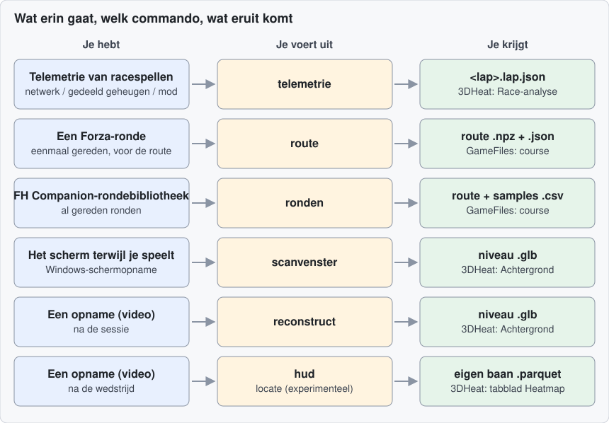

# 3DHeat GameCapture {#dheat-gamecapture}

**Wat is het?** Een hulpmiddel dat opschrijft wat een racespel je vertelt over je rijgedrag, één
bestand per ronde. Het kan ook een ruw 3D-model van een niveau opbouwen uit een video van jou die speelt.

**Waarom zou ik het gebruiken?** Om je ronden te zien in de [3DHeat-viewer](https://holdi601.github.io/3DHeat/):
waar je remde, waar je traag was, hoe twee ronden verschillen. En om het niveau onder je heatmap te hebben
wanneer niemand er een 3D-model van heeft.

**Voorbeeld:** zet Forza's Data Out aan, voer één commando uit en rijd twee ronden. Er verschijnen twee rondebestanden in
`laps\`. Zet ze op het tabblad Race-analyse van de viewer.


Nog nooit met de opdrachtregel gewerkt? Lees eerst [Voordat je begint](before-you-start.md).

## De drie taken {#the-three-jobs}

1. **Rondetelemetrie.** Het legt elk kanaal vast dat een racespel publiceert - Forza's Data Out, de
   gedeelde geheugenruimte van de Assetto Corsa-spellen, de netwerkfeeds van de rallyspellen, een BeamNG-mod, een
   Trackmania-plugin - en schrijft per ronde of etappe één `heat3d-lap`-bestand, voor het tabblad Race-analyse
   van de viewer. iRacing heeft geen opnemer nodig: de viewer leest zijn eigen `.ibt`-bestanden.
2. **Niveaus uit gameplay.** Het zet wat het scherm toonde terwijl je door een niveau liep of reed om in een
   `.glb` 3D-model, dat de viewer onder de heatmap legt.
3. **Je eigen wedstrijd, achteraf.** `hud` leest de HUD van je eigen opname - je acties, doden,
   minimapspoor en killfeed. `locate` (experimenteel: het plaatst tot nu toe weinig echte frames) bepaalt
   waar elk frame is genomen, op het 3D-model van een niveau.

Alle drie volgen één regel: **niets wordt in een spel geïnjecteerd en niets wordt gehookt**. Frames komen
van de openbare schermopname-API, telemetrie van interfaces die de spellen daarvoor publiceren. Zie
[De regels](../rules.md).



De code is Python (pakket `heat3d_capture`), MIT-gelicentieerd. De dieptemodellen en poseermodellen die het
kan draaien hebben hun eigen licenties - zie [Modellen en licenties](../models-and-licences.md).

## Snelstart {#quick-start}

### Ronden opnemen {#record-laps}

Je hebt Python 3.10 of later nodig ([Voordat je begint](before-you-start.md)). In PowerShell:

```powershell
git clone https://github.com/Holdi601/3DHeat-GameCapture
cd 3DHeat-GameCapture
python -m venv .venv
.venv\Scripts\python -m pip install -r requirements.txt

# Forza: Instellingen -> HUD en gameplay -> Data Out = AAN, IP 127.0.0.1, poort 5300
.venv\Scripts\python -m heat3d_capture telemetry -o laps
```

**Je ziet** `listening on port 5300. Laps go to laps. Ctrl+C to stop.`, daarna een regel per ronde zodra je de
finish passeert, zoals in de afbeelding hierboven. Druk op Ctrl+C om te stoppen. Zet de bestanden uit `laps\`
op het tabblad Race-analyse van de viewer. Elk ander spel is één `--game` verder:

```powershell
.venv\Scripts\python -m heat3d_capture telemetry --game acc -o laps
.venv\Scripts\python -m heat3d_capture telemetry --game dirtrally2 -o laps
```

Zie [Telemetrie-opnemers](../telemetry.md) voor elk spel en elke optie.

### Een niveau scannen {#scan-a-level}

Dubbelklik op **`scan.bat`** in de map van het hulpmiddel. Het zoekt Python (en biedt aan het via winget te
installeren als er geen is), maakt een eigen `.venv`, en opent het scanvenster. Het venster zegt
wat ontbreekt, waarvoor elk pakket dient en hoe groot de download is, en installeert niets zonder
een ja. Zie [Runtime en afhankelijkheden](../runtime.md) en
[Het scanvenster](../reconstruction-scan-ui.md).

Met de hand: `.venv\Scripts\python -m heat3d_capture.ui`.

Om een opname offline opnieuw op te bouwen, met het cameratraject in één keer opgelost (heeft PyTorch, het
pakket `vggt` en een GPU nodig - zie [Offline reconstructie](../reconstruction-offline.md)):

```powershell
.venv\Scripts\python -m heat3d_capture reconstruct lap.mp4 -o lap.glb
```

## Overzicht van de documentatie {#map-of-the-documentation}

| Pagina | Wat die behandelt |
|---|---|
| [Voordat je begint](before-you-start.md) | Python, een terminal, het eerste commando, veelvoorkomende fouten |
| [De regels](../rules.md) | Geen injectie, alleen gepubliceerde interfaces, en wat dat kost |
| [Telemetrie-opnemers](../telemetry.md) | Het commando `telemetry` en een overzicht van elk spel |
| [Forza](../telemetry-forza.md) | Data Out, herkenning van de indeling, de FH Companion-relay en zijn `.tele.gz` |
| [Assetto Corsa-spellen](../telemetry-assetto-corsa.md) | AC, ACC, AC EVO, AC Rally uit de gedeelde geheugenruimte |
| [Rallyspellen](../telemetry-rally.md) | EA SPORTS WRC, DiRT Rally 2.0 / 1 / DiRT 4, Richard Burns Rally |
| [BeamNG.drive](../telemetry-beamng.md) | De `heat3d`-protocolmod |
| [Trackmania](../telemetry-trackmania.md) | De `Heat3dRecorder`-Openplanet-plugin |
| [iRacing](../telemetry-iracing.md) | `.ibt`-bestanden lezen in de viewer |
| [Ronde- en etappesplitsing](../lap-splitting.md) | `LapSplitter`, `CounterSplitter`, `LineSplitter`, `StageSplitter` |
| [Slip, drift en afgeleide kanalen](../slip-and-drift.md) | Hoe slip wordt geschaald, en wat de viewer afleidt |
| [Het heat3d-lap-bestand](../lap-format.md) | Het rondebestandsformaat, kanalen, eenheden, `meta` |
| [Spellen](../games.md) | Per spel: hoe op te nemen, wat wordt verstuurd, welke banen kunnen worden geëxporteerd |
| [Commando's](../commands.md) | `route`, `telemetry`, `laps`, `reconstruct`, `hud`, `locate`, stap voor stap |
| [Commandoreferentie](../cli-reference.md) | elke optie, gegenereerd uit `--help` |
| [De HUD uit een opname lezen](../hud-video.md) | `hud`: eigen acties, doden, minimapspoor en killfeed uit een opname |
| [Frames in een niveau plaatsen](../locate.md) | `locate`: waar elk frame is genomen, tegen de geometrie van het niveau |
| [Niveaureconstructie](../reconstruction.md) | De pijplijn van frames naar een `.glb` |
| [Het scanvenster](../reconstruction-scan-ui.md) | Elke knop, sneltoets en overlay |
| [Opname, maskers en framekwaliteit](../reconstruction-capture.md) | Windows Graphics Capture, keyframes, HUD-maskers, kwaliteitsadvies |
| [Diepte](../reconstruction-depth.md) | Depth Anything V2, ONNX Runtime, het bouwen van het model |
| [Cameratoestand en schaal](../reconstruction-pose.md) | Odometrie, herlokalisatie, telemetrieposities, grondschaal, bundle adjustment |
| [Samensmelting, dekking en kleur](../reconstruction-fusion-and-texture.md) | Het bezettingsvolume, het dekkingsraster, zwakke plekken, vertexkleur |
| [De .glb-uitvoer](../glb-output.md) | Het bestand dat de viewer laadt |
| [Offline reconstructie](../reconstruction-offline.md) | `reconstruct`, VGGT-vensters en samenvoegen |
| [Modellen en licenties](../models-and-licences.md) | Groottes van Depth Anything V2, VGGT, de pakketten |
| [Runtime en afhankelijkheden](../runtime.md) | Preflight, backends, prestatieniveaus |
| [Beperkingen en verificatie](../limits.md) | Wat niet is gedaan, en wat niet is gecontroleerd |
| [Updates](../updates.md) | De releasecontrole en `python -m heat3d_update` |
| [Ontwikkeling](../development.md) | Tests, de virtuele omgeving, indeling van de repository |
| [Onderhoud van deze documentatie](../maintaining.md) | De checklist voor code en documentatie |

## Onderdeel van 3DHeat {#part-of-3dheat}

De bestanden die dit schrijft, worden geladen door de **3DHeat-viewer** -
[bron](https://github.com/Holdi601/3DHeat), [documentatie](https://holdi601.github.io/3DHeat/).
Rondebestanden gaan naar het tabblad Race-analyse, `.glb`-niveaus naar het paneel Achtergrond / level, de `hud`- en `locate`-tabellen naar
het tabblad Heatmap; hoe de viewer tabellen en wedstrijdbestanden leest, staat in
[Eén bestand per wedstrijd (.3dheat)](https://holdi601.github.io/3DHeat/container.html) en
[Gegevens binnenhalen](https://holdi601.github.io/3DHeat/getting-data-in.html).

| Tool | Wat die doet | Documentatie |
|---|---|---|
| [3DHeat-viewer](https://github.com/Holdi601/3DHeat) | toont heatmaps, races en wedstrijden in 3D, in de browser | [documentatie](https://holdi601.github.io/3DHeat/) |
| [GameFiles](https://github.com/Holdi601/3DHeat-GameFiles) | banen en niveaus uit de bestanden die spellen meeleveren, als 3D-modellen | [documentatie](https://holdi601.github.io/3DHeat-GameFiles/) |
| [GameCapture](https://github.com/Holdi601/3DHeat-GameCapture) | rondetelemetrie uit racespellen; niveaus opnieuw opgebouwd uit gameplayvideo | [documentatie](https://holdi601.github.io/3DHeat-GameCapture/) |
| [Unreal Exporter](https://github.com/Holdi601/3DHeat-UnrealExporter) | een plug-in voor de Unreal Editor die een niveau als 3D-model exporteert | [documentatie](https://holdi601.github.io/3DHeat-UnrealExporter/) |
| [CS2](https://github.com/Holdi601/3DHeat-CS2) | Counter-Strike 2-demo's naar wedstrijdbestanden; kaarten naar 3D-modellen | [documentatie](https://holdi601.github.io/3DHeat-CS2/) |
| [Watcher](https://github.com/Holdi601/3DHeat-Watcher) | legt je spel op de achtergrond vast uit wat spellen publiceren | [documentatie](https://holdi601.github.io/3DHeat-Watcher/) |
| [Ext-WarThunder](https://github.com/Holdi601/3DHeat-Ext-WarThunder) | War Thunder-replays naar wedstrijdbestanden | [documentatie](https://holdi601.github.io/3DHeat-Ext-WarThunder/) |
| [Ext-WoT](https://github.com/Holdi601/3DHeat-Ext-WoT) | World of Tanks-replays naar wedstrijdbestanden | [documentatie](https://holdi601.github.io/3DHeat-Ext-WoT/) |
| [Ext-WoWs](https://github.com/Holdi601/3DHeat-Ext-WoWs) | World of Warships-replays naar wedstrijdbestanden | [documentatie](https://holdi601.github.io/3DHeat-Ext-WoWs/) |
| [Ext-Squad](https://github.com/Holdi601/3DHeat-Ext-Squad) | Squad-serverdemo's naar wedstrijdbestanden | [documentatie](https://holdi601.github.io/3DHeat-Ext-Squad/) |
| [Ext-DCS](https://github.com/Holdi601/3DHeat-Ext-DCS) | DCS World-kaarten naar 3D-modellen | [documentatie](https://holdi601.github.io/3DHeat-Ext-DCS/) |
| [Ext-IL2](https://github.com/Holdi601/3DHeat-Ext-IL2) | IL-2 Sturmovik-kaarten naar 3D-modellen | [documentatie](https://holdi601.github.io/3DHeat-Ext-IL2/) |

Een ontwikkelaar met het project van het spel geopend kan de Unreal-exporter gebruiken, die de echte geometrie
leest en exact is. Waar de eigen archieven van een spel gelezen kunnen worden, haalt GameFiles de exacte baan eruit.
Reconstructie uit gameplay is voor het geval dat alleen het scherm beschikbaar is.
