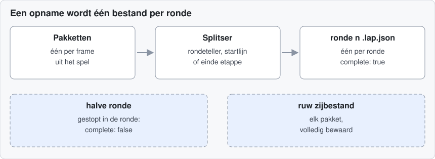

# Hoe ronden en etappes worden gesplitst {#how-laps-and-stages-are-split}

Een opnemer ziet één doorlopende stroom metingen. Die wordt in ronden gesplitst door een van vier splitsers, gekozen naar wat het spel over ronden zegt. Ze volgen allemaal hetzelfde idee: gebruik de eigen telling van het spel waar die er is, en vind anders de ronde uit de posities; schrijf nooit een fragment dat te kort is om mee te vergelijken.

| Splitser | Code | Gebruikt door |
|---|---|---|
| `LapSplitter` | [`fulllap.py`](https://github.com/Holdi601/3DHeat-GameCapture/blob/main/heat3d_capture/telemetry/fulllap.py) | Forza |
| `CounterSplitter` | [`kunos.py`](https://github.com/Holdi601/3DHeat-GameCapture/blob/main/heat3d_capture/telemetry/kunos.py) | Assetto Corsa, ACC |
| `LineSplitter` | [`kunos.py`](https://github.com/Holdi601/3DHeat-GameCapture/blob/main/heat3d_capture/telemetry/kunos.py) | AC EVO, AC Rally, BeamNG |
| `StageSplitter` | [`rally.py`](https://github.com/Holdi601/3DHeat-GameCapture/blob/main/heat3d_capture/telemetry/rally.py) | EA SPORTS WRC, DiRT Rally 2.0, DiRT Rally, DiRT 4, Richard Burns Rally |

Trackmania splitst runs binnen zijn plugin ([Trackmania](telemetry-trackmania.md)), en iRacing-bestanden worden door de viewer gesplitst op de rondenteller van de sim ([iRacing](telemetry-iracing.md)).

Bij **Ctrl+C** roept elke opnemer de `flush()` van zijn splitser aan, zodat een open ronde of etappe wordt geschreven als die dezelfde minimumwaarden haalt als hieronder.

## LapSplitter (Forza) {#lapsplitter-forza}

Parameters: `minimum_metres = 400`, `gap_seconds = 2.0`.

Voor elk gedecodeerd pakket:

1. Als de `timestampMs` van het spel vooruit is gesprongen met meer dan 2 seconden sinds het vorige pakket, of achteruit is gegaan, wordt de open ronde eerst afgesloten.
2. Als `isRaceOn` 0 is (het spel is niet in een race), wordt de open ronde afgesloten en het pakket weggegooid.
3. Als geen ronde open is, opent er één met het `lapNumber` van het pakket.
4. Als `lapNumber` verschilt van dat van de open ronde, wordt de open ronde **als voltooid afgesloten**; de `seconds` is het `lastLap` van het spel als dat positief is. Een ronde die zo wordt afgesloten, wordt geschreven wat de lengte ook is. Er opent een nieuwe ronde.
5. Het pakket wordt toegevoegd.

De opnemer sluit ook af als er twee seconden wandkloktijd geen pakket is gekomen (het spel is gepauzeerd of gesloten midden in een ronde).

**Afsluiten** houdt de open ronde alleen als die minstens 2 metingen en minstens 400 m `distanceTravelled` heeft; ze wordt dan geschreven als onvoltooid (een `run`). Een punt-tot-puntrace telt nooit een tweede ronde, dus die eindigt altijd zo.

## CounterSplitter (AC, ACC) {#countersplitter-ac-acc}

Parameter: `minimum_metres = 300`. Krijgt bij elke meting de `completedLaps` en de laatste rondetijd van de grafiekpagina.

- De eerste meting opent een ronde met het huidige `completedLaps`.
- Als `completedLaps` verandert, sluit de open ronde. Ze is **voltooid**, met `seconds = laatste rondetijd in ms / 1000` (als die positief is), alleen als de teller precies 1 omhoog ging - een sprong terug naar 0 (een herstart van de sessie) of met meerdere sluit ze als onvoltooid.
- Een afgesloten ronde wordt alleen geschreven als ze metingen heeft en minstens 300 m gereden pad.
- Afsluiten houdt de open ronde als ze meer dan één meting heeft en minstens 300 m.

## LineSplitter (AC EVO, AC Rally, BeamNG) {#linesplitter-ac-evo-ac-rally-beamng}

Parameters: `radius = 15 m`, `minimum_metres = 300`, `stop_seconds = 8`.

Deze spellen hebben ofwel geen rondenteller op een pagina die de opnemer leest, ofwel rijden ze etappes. **De lijn is waar de opname begon**:

1. De horizontale positie (`x`, `z`) van de eerste meting wordt de lijn.
2. Zodra de auto meer dan 5 m heeft afgelegd, wordt de richting van de lijn naar de auto de richting van de ronde.
3. **Stilstaan** beëindigt een run: als `speed` 8 seconden onder 1 m/s blijft, wordt de open ronde afgesloten (zo eindigt een rallyetappe: de auto stopt bij de finish).
4. **Over de lijn gaan**: na meer dan 300 m afstand worden metingen binnen 15 m van de lijn verzameld. Zodra de auto die straal weer verlaat, is de dichtstbijzijnde verzamelde meting de overgang. Als de auto daar dezelfde kant op reed als de richting van de ronde (puntproduct van de lokale koers met de richting is positief), sluit de ronde bij die meting; anders wordt de passage genegeerd (de auto kruiste de start de andere kant op).
5. De `seconds` van een afgesloten ronde is de tijd van haar eerste meting tot de overgang. Ze is **alleen voltooid als haar eerste meting sneller was dan 5 m/s**: een ronde die vanuit stilstand begon is een start, geen ronde om mee te vergelijken. De eerste ronde van een opname die op de grid begon, is dus altijd onvoltooid; een opname die op een vliegende ronde begon, geeft bij de volgende overgang een voltooide eerste ronde.
6. De volgende ronde begint bij de overgangsmeting (die bij beide rondes hoort).

Ronden korter dan 300 m vallen weg. Afsluiten (een stop, of Ctrl+C) houdt de open ronde als ze minstens 2 metingen en 300 m heeft, als onvoltooid. BeamNG sluit op dezelfde manier af als het voertuig wordt gereset (zijn klok gaat terug), vóór een nieuwe splitser start, zodat de run die voor de reset gereden is wordt bewaard.

Afstanden zijn horizontaal (`x`, `z`) voor de afstandsteller en de lijntest, en volledig 3D voor de lengtetest van 300 m.

## StageSplitter (rallyspellen) {#stagesplitter-rally-games}

Parameter: `minimum_metres = 300`. Krijgt bij elke meting de etappeklok van het spel, of het spel zegt dat de auto klaar is, en optioneel de eigen tijd van het spel daarvoor.

1. Als de klok 0 of minder is, of met meer dan 0,5 s is teruggegaan, wordt de open etappe **opgegeven**: bewaard als gedeeltelijke etappe als ze niet voltooid is, meer dan 10 metingen en minstens 300 m heeft. Een klok van 0 of minder laat de meting ook vallen (de auto staat aan de start).
2. Als geen etappe open is, opent er een nieuwe (genummerd 1, 2, ... voor de opname).
3. Zodra een etappe voltooid is, worden verdere metingen genegeerd tot de klok teruggaat.
4. Elke meting wordt opgeslagen met `time` gelijk aan de etappeklok.
5. Als het spel zegt dat het klaar is, is de etappe voltooid; haar `seconds` is de tijd van het spel als die wordt gegeven en positief is, anders de klok. Ze wordt geschreven als ze minstens 300 m besloeg.

Wat "klaar" per spel betekent:

| Spel | Klaar wanneer |
|---|---|
| EA SPORTS WRC | lengte van de etappe > 0 en afstand in de etappe >= lengte - 0,5 m |
| DiRT-spellen | het aantal voltooide ronden is hoger geworden dan het startaantal van de etappe, of (eenrondig evenement) afstand van de ronde >= 99,9% van de lengte van de baan |
| Richard Burns Rally | racetijd > 0 en afstand tot het einde <= 0 |

Voor RBR worden de verticale as en de snelheid vastgelegd op het moment dat een etappe wordt geschreven (zie [Rallyspellen](telemetry-rally.md#richard-burns-rally-rsf--ngp)).

## Tijd en afstand in het rondenbestand {#time-and-distance-in-the-lap-file}

Voor elke opnemer behalve Forza wordt `time` zo verschoven dat de eerste meting van de ronde 0 is, en is `distance` de opgetelde 3D-afstand tussen opeenvolgende posities. Forza gebruikt de eigen rondetimer en afstandsteller van het spel, op dezelfde manier verschoven.
