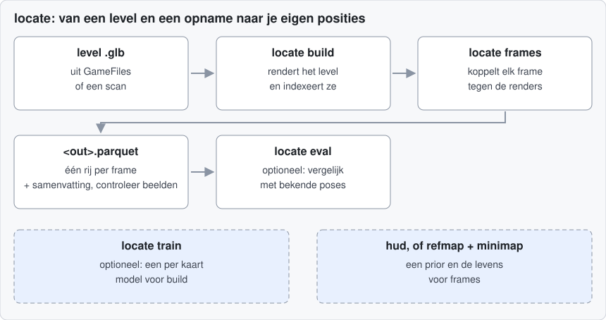

# Beelden in een level lokaliseren {#locating-frames-in-a-level}

`locate` bepaalt waar elk beeld van een speelopname is genomen - de 3D-positie van de camera en de
kijkrichting - door het beeld te vergelijken met renders van de eigen geometrie van het level. Het is
bedoeld voor spellen die geen overzicht bijhouden van waar de speler was: geen demo, geen replay-bestand,
geen telemetrie. Battlefield 6 is de eerste.

> **Experimenteel.** Op echte opnames plaatst het tot nu toe maar een klein deel van de beelden; zie
> [Echte beelden: experimenteel](#real-frames-experimental).

```bash
# Once per level: render it from every place a player can stand, and index the renders.
.venv\Scripts\python -m heat3d_capture locate build level.glb -o level.db

# Per recording: where was each frame taken?
.venv\Scripts\python -m heat3d_capture locate frames "<recording>.mp4" --db level.db -o out/match
```

De positie komt **uit het beeld**, tegen het hele level, zonder voorkennis. Het minimapspoor van de
[HUD-lezer](hud-video.md) is alleen een terugval voor beelden die het beeld niet kan plaatsen, en elke
rij zegt welke van de twee het was.




## Wat het wel en niet aanraakt {#what-it-does-and-does-not-touch}

- Het leest de **eigen opname** van de speler en een levelbestand dat de speler exporteerde uit de **eigen
  kopie** van het spel. Het raakt het spel, zijn geheugen, zijn bestanden terwijl het draait, of zijn
  netwerk nooit aan, en het draait na de wedstrijd. Zie [De regels](rules.md).
- Het plaatst **alleen de eigen camera van de speler**: het beeld is het eigen gezichtsveld van de speler.
- Het level, de database die ervan is gebouwd en alles wat ervan is gerenderd, horen toe aan de uitgever
  van het spel. Houd ze lokaal.

## Vereisten {#requirements}

- Wat `requirements.txt` vermeldt, PyTorch (van pytorch.org, voor de GPU), en
  `requirements-locate.txt`:

```bash
.venv\Scripts\python -m pip install -r requirements-locate.txt
```

- Een GPU met OpenGL 3.3 (4.3 is sneller) voor de renders, en bij voorkeur CUDA voor de modellen. Op een
  CPU werkt het ook, langzaam.
- De modellen worden bij het eerste gebruik opgehaald (ongeveer 450 MB): DINOv2 van Hugging Face, ALIKED en
  LightGlue via kornia. Ze zijn allemaal gelicentieerd voor commercieel gebruik; zie [Licenties](#licences).
- Het **level** als `.glb` (of `.gltf`) in het frame van de viewer, Y omhoog, **met zijn basiskleurtexturen**,
  zoals de 3DHeat-exporters het schrijven (onderdelen `ground:` / `structure:`; de namen van de onderdelen
  zijn niet nodig). Eén eenheid is één meter, tenzij het bovenste `extras.unit_metres` van het bestand
  anders zegt. Een GameCapture-scan (`reconstruct`, het scanvenster) wordt in **centimeters** geschreven en
  heeft `extras.unit_metres: 0.01`, dus die wordt op zijn echte grootte ingelezen. Een level zonder texturen
  werkt veel minder goed; zie [Beperkingen](#limits).

## Opdrachten {#commands}

### `locate build <level> -o <db>` {#locate-build---o-}

Rendert het level vanaf elke plek waar een speler kon staan en bewaart, per render, zijn positie en één
globale descriptor.

| Optie | Standaard | Betekenis |
|---|---|---|
| `level` | | Het `.glb` / `.gltf` van het level. |
| `-o`, `--out` | | De databasemap die geschreven wordt. |
| `--game` | `bf6` | Het spelprofiel: ooghoogtes, gezichtsveld, HUD-vakjes, snelheid (hieronder). `generic` voor elk eerstepersoonsspel. |
| `--eye` | die van het profiel | Ooghoogtes boven de vloer in meters, eerst staand. Eén databaseaanzicht per hoogte. |
| `--fov` / `--vfov` | die van het profiel | Het horizontale gezichtsveld van de opname, of het verticale (Battlefields schuifregelaar) voor een 16:9-opname. |
| `--spacing` | 2,5 | Meters tussen de plekken waar aanzichten worden genomen. |
| `--yaw-step` | 30 | Graden tussen de richtingen van de aanzichten. |
| `--pitch` | 0 | Hellingen om bij te renderen, graden omhoog. |
| `--positions` | geen | Een tabel (Parquet of CSV met `x`, `y`, `z` bij de voeten, in het frame van het level) waaruit plekken worden genomen in plaats van elke vloer: bijvoorbeeld de uitvoer van een vorige run. |
| `--shadows` | uit | De schaduwen van de zon in de renders werpen (de zon van het level zelf, als het bestand die noemt in `extras.sun`). |
| `--untextured` | uit | Alleen vorm en licht renderen. |
| `--box X0 Z0 X1 Z1` | het hele bestand | Alleen plekken binnen dit kader (eenheden van het level): het speelgebied. |
| `--places` | `auto` | Waar aanzichten worden genomen: `nav` - spelers op ooghoogte over het navigatiemesh van het level (`nav:`-onderdelen: precies waar het spel je laat lopen), voertuigcamera's op hun hoogte over de `ground:`-onderdelen (terrein en wegen) binnen 50 m ervan; `ground` - beide over `ground:`; `floors` - over elk opwaarts vlak (ook daken en kratten); `auto` - `nav` wanneer het level een navigatiemesh heeft, anders `floors`. |
| `--head` | geen | Een kaartspecifiek hoofd uit `locate train` voor de descriptors. |

Schrijft `<db>/db.json` (waarmee en waaruit het is gebouwd) en `<db>/views.npz` (posities, descriptors).

### `locate frames <recording> --db <db>` {#locate-frames----db-}

| Optie | Standaard | Betekenis |
|---|---|---|
| `source` | | Een video, een afbeelding, of een map met afbeeldingen (in naamvolgorde genomen, `--fps` uit elkaar). |
| `--db` | | De database die `build` schreef. Het levelbestand moet nog op zijn plek staan (of `--level`). |
| `-o`, `--out` | `<source>.locate` | Uitvoerpad zonder extensie. |
| `--fps` | 2 | Beelden gelokaliseerd per seconde video. |
| `--start`, `--seconds` | alles | Het deel van de video dat gelezen wordt. |
| `--width` | 1280 | De breedte waarop beelden gematcht worden. |
| `--shortlist` | 8 | Databaseaanzichten die per beeld worden geprobeerd bij een voorkennis of een vaste plek. |
| `--search-shortlist` | 16 | Zonder voorkennis: databaseaanzichten die per beeld worden geprobeerd ([samen doorzocht](#with-no-prior-frames-searched-together)). |
| `--no-search` | uit | Zonder voorkennis: elk beeld op zichzelf zoeken en zijn vaste plek geloven zonder zijn buren. |
| `--accept-depth` | 0 (uit) | Zonder voorkennis: een vaste plek alleen geloven als de verre afstand van zijn matches dit aantal keer de nabije is. |
| `--accept-support` | 2 | Zonder voorkennis: overeenkomende buren langs het leven die een vaste plek nodig heeft om geloofd te worden. |
| `--checkpoint` | geen | Bewaar de staat van de run hier en ga verder vanaf daar als die er is. |
| `--stop-file`, `--stop-process` | geen | Stopt zelf, staat bewaard, exitcode 75, wanneer dit bestand bestaat of een proces draait waarvan de naam met dit begint (vóór elk beeld gecontroleerd; mag herhaald worden), zodat een lange run de machine vrijmaakt voor een spel. Hetzelfde commando gaat verder waar het bleef. |
| `--normalise` | geen | Lichte normalisatie vóór het matchen: `clahe`, `gray`. |
| `--minimap` | geen | De tabel van de `hud`-opdracht: de **terugval** voor beelden die het beeld niet kan plaatsen. |
| `--prior-radius` | geen | **Optionele versnelling**, standaard uit: alleen databaseaanzichten zoeken binnen zoveel meter van de positie op de minimap (vereist `--minimap`). |
| `--minimap-anchor` | geen | Een JSON-bestand dat de minimap aan het level koppelt ([de minimap als zoekvoorkennis](#the-minimap-as-a-search-prior)): de minimap beperkt de zoektocht vanaf het eerste beeld; zo gevonden vaste plekken zijn `visual+minimap-prior`. |
| `--no-level-search` | uit | Met een voorkennis: wanneer niets in de buurt past, het hele level niet ook doorzoeken (sneller). |
| `--lives` | de tabel van `--minimap` | De tabel van de `hud`-opdracht waarvan de doden, deploys en opwekkingen zeggen wanneer de speler in het spel was: posities springen alleen over een dood ([levens uit het beeldmateriaal](#lives-from-the-footage)). |
| `--no-sequence` | uit | Elk beeld op zichzelf beslissen, niet langs de run (hieronder). |
| `--fit-fov` | uit | Na de run het gezichtsveld fitten op de sterkste vaste plekken, per aanzicht, en het melden. |
| `--check-every` | 0 | Ook elke N beelden, geplaatst of niet, een beeld naar `<out>.check`. |
| `--no-checks` | uit | De controlebeelden van de visuele vaste plekken niet schrijven (hieronder). |
| `--no-zoomed` | uit | Ingezoomde aanzichten niet oplossen uit de vaste plekken van hun buren (hieronder). |
| `--no-grow` | uit | Niet opnieuw zoeken dicht bij elke vaste plek naar de beelden eromheen die er nog geen hebben. |
| `--game`, `--eye`, `--fov`, `--vfov`, `--mask`, `--no-hud-mask`, `--max-speed` | die van het profiel | Zoals hierboven; `--mask x,y,w,h` voegt een schermkader toe (op een scherm van 1920x1080) dat niet het level is. |
| `--vehicle-vfov` | die van het profiel | Het verticale gezichtsveld van voertuigcamera's (Battlefields voertuigschuifregelaar). |
| `--settings` | het nieuwste instellingenbestand | `bf6`: het instellingenbestand van het spel waaruit de gezichtsvelden worden gelezen (alleen lezen) wanneer geen `--fov`/`--vfov` is opgegeven; standaard de nieuwste `PROFSAVE*_profile` onder `Documents/Battlefield 6/settings`. Het bevat de instellingen zoals ze nu zijn, wat niet hoeft te zijn hoe een oudere opname gemaakt werd. |

### `locate refmap <level> <deploy screen> -o <refmap>` {#locate-refmap----o-}

Plaatst de eigen kaart van het spel op het level: de referentie waartegen de minimap wordt gelezen
([de minimap, gelezen tegen het level](#the-minimap-read-against-the-level)). `<deploy screen>` is een
afbeelding van het deploy-scherm dat de hele kaart toont, of een opname met `--at <seconds>` op zo'n
moment; het profielvak van de kaart wordt eruit geknipt (`--whole-picture` houdt alles). Schrijft
`<refmap>.png` (de kaart hersampled op het eigen frame van het level, `--mpp` meter per pixel, standaard
0,5), `<refmap>.valid.png` (waar het de kaart is, niet een markering of label) en `<refmap>.json` (het frame
en de kalibratie, met hoe ver de tegels van de kaart ervan af lagen). `--topdown <prefix>` houdt het level
van bovenaf gerenderd voor de volgende run (`--topdown-mpp`, standaard 0,656 m; `--box` beperkt het).

### `locate minimap <recording> --refmap <refmap> -o <table>.parquet` {#locate-minimap----refmap---o-parquet}

Leest de minimap van de opname tegen de referentiekaart, beeld voor beeld (`--fps`, standaard 2): positie,
richting en zoom van elke minimap die matcht, in het frame van het level, geschreven als een minimaptabel
met een anker ernaast (`<table>.anchor.json`) dat `locate frames` neemt als
`--minimap <table>.parquet --minimap-anchor <table>.anchor.json`. Met de tabel van de `hud`-opdracht
(`--hud`) worden de levens ervan overgenomen; met een anker voor die tabel ook (`--hud-anchor`) is de eerste
zoektocht rond waar die de speler plaatst, en waar geen minimap matcht, vult het eigen spoor van de HUD de
gaten, verplaatst naar de dichtstbijzijnde vaste plekken van de referentiekaart (`--hud-fill`, seconden,
standaard 120; 0 zet het uit). De `source` van de tabel zegt welke (`refmap`, `hud`).

### `locate eval <out>.parquet --truth <poses>` {#locate-eval-parquet---truth-}

Vergelijkt een resultaat met bekende cameraposities: een tabel van `time`, `x`, `y`, `z` (het oog), `yaw`,
`pitch` in het frame van het level. `--offset` is de klokverschuiving (tijd van de waarheid = videotijd +
offset); zonder die optie wordt de verschuiving gezocht. `--unit-metres` zet de fouten om in meters.

## Spelprofielen {#game-profiles}

| | `bf6` | `generic` |
|---|---|---|
| Ooghoogtes | 1,6 m staand, 1,05 m gehurkt (nog niet in het spel gemeten) | 1,65, 1,1 m |
| Gezichtsveld | 55 graden verticaal, ongeveer 86 horizontaal bij 16:9: **geef dat van de speler zelf op** met `--vfov` | 90 horizontaal |
| HUD afgedekt | minimap en squadlijst, killfeed, kompas, munitie, het wapen van de speler, de popups, het vizier | het vizier |
| Snelst te voet | 8 m/s | 8 m/s |
| Aanzichten uit elkaar gehouden | te voet, voertuig, ingezoomd (hieronder) | elk beeld te voet |
| Voertuigcamera's | de voertuigschuifregelaar (uit het instellingenbestand), het voertuig afgedekt, de camera tot 8 m boven de vloer, 30 m/s | - |

Het gezichtsveld is het belangrijkst: een beeld dat met het verkeerde gezichtsveld is opgelost, krijgt de
verkeerde brandpuntsafstand, en de positie schuift langs de kijkrichting.

## Uitvoer {#outputs}

### `<out>.parquet` {#parquet}

Eén rij per gelokaliseerd beeld, in het **frame van het level** (Y omhoog, de eenheden van het level), met
de leesinstructies van de viewer in de footer (`kind: heat3d-locate`). De footer noemt elke kolom die geen
eigen rol heeft als extra, zodat de viewer ze allemaal bewaart (zijn inspectiekaart toont ze).

| Kolom | Betekenis |
|---|---|
| `time` | Seconden vanaf het begin van de video. |
| `event` | `start` op de eerste rij van een leven, `position` op de rest. |
| `x`, `y`, `z` | Het oog, afgevlakt binnen het leven. Leeg waar geen van beide bronnen het beeld plaatste. |
| `yaw`, `pitch` | Graden: yaw om de opwaartse as (0 langs +X, groeiend richting -Z, wat de eigen yaw van een spel is in het frame van de viewer), pitch omhoog vanaf de horizontaal. `pitch` is leeg op minimaprijen. |
| `dir_x`, `dir_y`, `dir_z` | De kijkrichting. |
| `player`, `team`, `session` | `me`, `own`, en `<video>#NN`, één per leven. |
| `life` | Het leven waarin het beeldmateriaal het beeld toonde (uit de doden van de HUD; 1 = het eerste). Leeg wanneer buiten het spel (dood, down, deploy) of wanneer de levens niet gelezen werden. `session` is het leven van het spoor, dat ook bij een sprong kan splitsen. |
| `source` | `visual` (uit het beeld), `visual+minimap-prior` (uit het beeld, de zoektocht beperkt tot de voorkennis van de minimap), `minimap` (de terugval), `minimap+nav-floor` (binnenshuis: de minimap en de vloer van het navigatiemesh) of `none`. |
| `view` | `foot`, `vehicle`, `zoomed` of `screen` (hieronder). |
| `cam_x`, `cam_y`, `cam_z` | De camera die het beeld zag. Te voet en door een vizier is het het oog, en `x`, `y`, `z` zijn hetzelfde; in het derdepersoonsaanzicht van een voertuig zijn `x`, `y`, `z` het voertuig (het verschuivingsmodel hieronder) en rijdt de camera erachter en erboven. |
| `hfov`, `zoom` | Het horizontale gezichtsveld waarmee het beeld is opgelost, en voor een ingezoomd aanzicht de zoom ten opzichte van het gewone aanzicht. |
| `confidence` | 0..1: hoeveel de rij te vertrouwen is (hieronder). |
| `uncertainty` | De typische fout van de rij, eenheden van het level: voor een visuele vaste plek uit de inliers en de buren, voor een minimaprij uit de fit (hieronder). |
| `inliers`, `rmse` | De PnP-inliers en reprojectiefout van de visuele oplossing (pixels bij de werkbreedte). |
| `x_raw` ... `pitch_raw` | De visuele oplossing vóór het afvlakken (ook voor uitschieters die door de stem zijn weggestemd). |
| `kept` | De visuele vaste plek heeft de uitschieterstemming overleefd. |
| `note` | Waarom een beeld niet geplaatst of weggestemd werd. |

### `<out>.summary.json` {#summaryjson}

Beelden, visuele vaste plekken, uitschieters, levens, rijen per bron, de minimapfit (paren, inliers,
residu), tijd per beeld.

## Methode {#method}

### De database {#the-database}

Plekken liggen op elk opwaarts gericht driehoekje van het level, gelijkmatig verspreid (één per `--spacing`
op een 3D-raster, zodat de verdiepingen van een gebouw elk de hunne krijgen). Elke plek wordt vanuit het oog
gecontroleerd met zes kleine renders van de diepte: een camera binnen geometrie ziet vooral achterkanten, een
kruipruimte heeft iets massiefs boven het oog; beide vallen af. Vanaf elke plek wordt het level gerenderd op
elke ooghoogte, elke `--yaw-step` en elke `--pitch`, en elke render wordt beschreven door **DINOv2** (zijn
patch-tokens samengevoegd via een veralgemeende gemiddelde, gekoppeld aan het class-token).

De lokale kenmerken en 3D-punten waartegen een beeld uiteindelijk wordt opgelost, worden **niet bewaard**:
ze worden opnieuw gemaakt wanneer nodig, door de paar aanzichten die het ophalen koos opnieuw te renderen,
wat milliseconden kost. Zo blijft een database enkele honderden megabytes in plaats van tientallen gigabytes,
en dat maakt de verfijning hieronder mogelijk. Het nadeel is dat `frames` het levelbestand en een GPU nodig
heeft, niet alleen de database.

### Eén beeld {#one-frame}

1. **Afdekken** van wat niet het level is: de HUD-vakjes van het profiel en het vizier, plus elke `--mask`.
2. **Ophalen** over het **hele level**: de descriptor van het beeld tegen elk databaseaanzicht; de meest
   gelijkende paar tientallen, uitgedund zodat ze verschillende plekken en richtingen bevatten, vormen de
   shortlist.
3. **Matchen**: elk aanzicht op de shortlist wordt opnieuw gerenderd op de grootte en het gezichtsveld van
   het beeld, met zijn diepte. ALIKED-keypoints van beeld en render worden gematcht met LightGlue. Een
   gematchte renderpixel plus zijn diepte is een 3D-punt van het level, dus elke match is een 2D-3D-
   correspondentie; keypoints op een dieptekant (wier diepte bij wat erachter ligt kan horen) vallen af.
4. **Pose**: PnP met RANSAC (SQPnP), daarna een robuuste verfijning die de camera waterpas houdt - een
   eerstepersoonsaanzicht rolt niet - en de reprojectiefout van de inliers minimaliseert.
5. **Kan dit?** Een pose moet op de ooghoogte van een speler boven een vloer liggen en buiten geometrie
   (een render van de diepte recht naar beneden). Een look-alike-textuur elders - een betegelde vloer die gematcht
   wordt op een muur van hetzelfde materiaal - kan honderden inliers geven op een pose die geen speler ooit
   kon innemen; die worden opzijgezet, hoeveel inliers ze ook hebben.
6. **Renderen en vergelijken**: het level wordt op de opgeloste pose gerenderd en opnieuw gematcht, wat een
   databaseaanzicht tot een paar meter en tientallen graden verderop vervangt door een dat bijna samenvalt
   met het beeld. Herhaald zolang het inliers wint (hooguit twee keer).
7. **Kiezen**: de sterkste drie plekken (meer dan ongeveer 3 m uit elkaar) worden elk verfijnd voordat er
   één gekozen wordt. Een look-alike kan voor de verfijning voorop lopen; de juiste plek wint er veel meer
   van.
8. **Oordeel**: `confidence` combineert het aantal inliers, de beste andere plek (`runner_up`) en de
   reprojectiefout. Een vaste plek is `ok` met minstens 25 inliers, geen andere plek binnen 80% van zijn
   inliers, en een confidence van minstens 0,85 - de drempel die de metingen hieronder op 97,5-99% juist
   zetten.

### Aanzichten {#views}

Een beeld is niet altijd de ogen van de speler. De detector van het profiel leest uit de HUD welk aanzicht
het is, en het beeld wordt dienovereenkomstig opgelost:

- **Te voet**: het gezichtsveld en de ooghoogtes van de infanterie.
- **Voertuig** (Battlefield 6: de zitplaatsdiagram-toetsen, `C CAMERA` en `E EXIT`, onderaan in het midden):
  het gezichtsveld van het voertuig, het voertuig zelf afgedekt (het midden onderaan het scherm in zijn
  derdepersoonsaanzicht), en een camera tot 8 m boven de vloer. De vaste plek is die van de camera.
- **Scherm** (donkere randen rond een donker midden: het deploy-kaartje, een menu, het scorebord): geen
  aanzicht van het level; overgeslagen.
- **Ingezoomd** (een vizier, een kanonniersvizier, het eerstepersoonsaanzicht van een voertuig: één schermrand
  zwart, beide donker, rond een helder beeld): niet over het level gezocht - een slivertje van het level door
  een vizier lijkt op geen enkel breed aanzicht van de database - maar na de run opgelost uit de dichtstbijzijnde
  vaste plek binnen 6 s, hieronder. Uit met `--no-zoomed`.

### Ingezoomde aanzichten {#zoomed-views}

Een smal aanzicht legt de positie slecht vast: een stap terug met iets meer zoom ziet er bijna hetzelfde uit.
Dus een ingezoomd beeld begint waar zijn buur zegt dat het vizier is - te voet de oogpositie van die vaste
plek, in een voertuig 2,5 m boven de grond onder het midden van het voertuig (het vizier van een toren) - en
hoe ver het mogelijk verplaatst is sindsdien: 2 m, plus 4 m per seconde te voet of 8 in een voertuig, hoogstens
12 m (`reach`).

1. **Richting en zoom, de positie vastgehouden.** Voor elke zoom van 1, 1,2 (het eigen aanzicht van een
   voertuig, smaller dan te voet), 1,5, 2, 3, 4, 6 en 8 wordt het level vanaf de zitplaats gerenderd in
   richtingen binnen 30 graden van die van de buur (en, vanaf 3x, een paar hellingen). De keypoints van het
   beeld die gematcht zijn met een render, met de punten van het level eronder, zijn stralen vanaf de
   zitplaats; er wordt een rotatie op gefit, twee tegelijk (RANSAC), voor brandpuntsafstanden van 0,75 tot
   1,3 keer die van die zoom, waarbij een punt meestemt binnen een hoek die toestaat dat de zitplaats
   `reach` ernaast ligt op die afstand. De zoom, richting en brandpuntsafstand waarop de meeste punten
   overeenkomen, winnen.
2. **Vastgelegd.** Die punten fitten dan positie, richting en brandpuntsafstand samen, op hun
   reprojectiefout, de positie vastgehouden aan de zitplaats door een kost van twee pixels per `reach`
   verplaatst; eenmaal opnieuw gerenderd op het antwoord en opnieuw gefit. Inliers en fout worden in pixels
   geteld, en de vaste plek is `ok` volgens dezelfde confidence als elke andere.

De geschreven zoom (`zoom`) is ten opzichte van het gezichtsveld van de run te voet; `hfov` is het opgeloste.
In een voertuig is de geschreven positie die van het voertuig, 2,5 m onder het vizier, zoals bij zijn
derdepersoonsaanzicht.

### Voertuigen: de camera en het voertuig {#vehicles-the-camera-and-the-vehicle}

In het derdepersoonsaanzicht van een voertuig is de opgeloste pose die van de achtervolgingscamera, die
achter en boven het voertuig rijdt en eromheen zwenkt wanneer de speler rondkijkt. De geschreven positie
(`x`, `y`, `z`) is die van het voertuig - de grond onder het midden ervan: de camera plus de
`vehicle_offset` van het profiel, zoveel meter vooruit langs de horizontale kijkrichting van de camera en
zoveel naar beneden. De camera blijft in `cam_x`, `cam_y`, `cam_z`. De omzetting gebeurt vóór de volgorde
en het spoor, zodat een camera die om een stilstaand voertuig zwenkt niet voor beweging wordt aangezien. De
voet van de tabel bevat de gebruikte verschuiving en of die gemeten was (`vehicleOffset`). Te voet en door
een vizier is er geen verschuiving.

Hoe de verschuiving van Battlefield 6 gemeten is: op juiste vaste plekken van echte derdepersoonsbeelden van
een tank werd het midden van de tank met het oog op het beeld aangegeven, en het op die vaste plek
gerenderde level gaf de grond bij die pixel. Het profiel neemt de mediaan: ongeveer 10 m vooruit van de
camera en ongeveer 4 m eronder. De aanwijzing is goed tot een meter of zo, en het gaat om één type voertuig:
een auto of een helikopter rijdt anders met zijn camera.

### Zonder voorkennis: beelden samen doorzocht {#with-no-prior-frames-searched-together}

De globale descriptor van één beeld tegen een heel level is een zwak signaal, en de inliers van één beeld
vertellen een juiste plek niet van een look-alike. Dus zonder voorkennis worden de beelden van een opname
eerst beschreven en samen doorzocht (`search.py`), en een vaste plek wordt alleen geloofd met de beelden
eromheen:

- **Shortlist.** De gelijkenissen van elk aanzicht worden afgezet tegen zijn eigen gemiddelde en spreiding
  over de opname, zodat een aanzicht dat op elk beeld lijkt, niet langer overal wint. Elk beeld scoort de
  cellen van een raster van 24 m op de rang van hun beste aanzicht; het beste pad door de cellen langs elk
  leven, binnen wat de speler tussen beelden kan afleggen, geeft een geloof per cel, en het beste aanzicht
  van elke cel, het best geloofde eerst, is één lijst. Gewone retrieval is de andere, en de twee worden om
  beurten genomen: aanzichten tegen de opname meten straft een plek die de speler nauwelijks verlaat, en daar
  doet gewone retrieval het goed.
- **Geloven.** Een kandidaat telt alleen als zijn inliers minstens 12% van een raster van 8 x 8 over het beeld
  bedekken: een look-alike is een herhaald object, een stapel containers, met honderden inliers op een paar
  cellen van het beeld. Een vaste plek wordt geloofd wanneer ze op het beste pad ligt door de meetellende
  kandidaten (hieronder), met minstens twee buren binnen 6 s die het met haar eens zijn. Een beeld buiten het
  spel wordt helemaal niet doorzocht.
- **Groeien.** Alleen wat geloofd wordt, wordt als basis gebruikt, en een gegroeide vaste plek moet het beeld
  op dezelfde manier bedekken.

### Langs de run {#along-the-run}

Elk beeld houdt elke fysiek mogelijke pose die het vond, één per plek (`candidates`), niet alleen de sterkste.
De run kiest dan één per beeld - of geen - zodat de gekozen posities een pad vormen dat een speler kon lopen
of rijden, en zoveel mogelijk inliers erop liggen: een verborgen Markov-model, in één keer gedecodeerd
(Viterbi). Een look-alike die één beeld op zichzelf wint, verliest van de plek waarmee zijn buren
overeenkomen; een zwakke kandidaat waar het pad doorheen loopt, met minstens twee het eens zijnde buren,
wordt een vaste plek (`note`: chosen along the sequence); een zekere vaste plek die al zijn buren tegenspreken,
houdt op er een te zijn. Een buur telt alleen als het eens is binnen 6 s: verder weg is de afstand die een
speler - laat staan een voertuig - had kunnen afleggen zo groot dat instemmen niets zegt. Uit met
`--no-sequence`.

### Beeldtijden {#frame-times}

De `time` van een rij is de eigen tijdstempel van het beeld in de opname, niet zijn telling over de nominale
beeldfrequentie. Opnames wijken af van hun nominale frequentie (met enkele tienden van een seconde binnen een
clip, bij die welke gemeten zijn), en alles wat een beeld via zijn tijd terugleest - de controlebeelden, de
zoomdoorloop, `locate train --real`, de minimap van de `hud`-opdracht - zoekt op tijdstempel. Geteld zou het
controlebeeld tot zoveel ver van het gelokaliseerde beeld liggen.

### Het gezichtsveld, uit de beelden {#the-field-of-view-from-the-frames}

`--fit-fov` houdt de sterkste vaste plekken van een run (per aanzicht) en verfijnt de pose en de
brandpuntsafstand van elk samen op zijn inliers; de mediaan daarover is het gezichtsveld waarmee de opname
gemaakt werd, gemeld in de samenvatting (`hfov_fitted`) voor de volgende run's `--fov`. Nabije en verre
punten bewegen anders bij een verandering van brandpuntsafstand dan bij een verandering van positie, en dat
legt het vast; het heeft vaste plekken met diepte nodig, geen vlakke muur.

### Een model per kaart {#a-per-map-model}

`locate train` traint een klein hoofd bovenop DINOv2 voor één level, op renders ervan, zodat de globale
descriptor de juiste aanzichten van echte beelden vindt en niet alleen die van renders:

- **Hoofd**: elk patch-token door een projectie van twee lagen, samengevoegd via een veralgemeende gemiddelde
  over de patches die het level tonen, gekoppeld aan het geprojecteerde class-token. DINOv2 blijft bevroren.
  Alles hier beschreven is geschreven (MIT).
- **Paren**: een plek op het begaanbare terrein en een richting, twee keer gerenderd vanuit poses die één of
  twee meter en een dozijn graden uit elkaar liggen, bij gezichtsvelden tot 10 graden uit elkaar, onder
  verschillend licht (zon, schaduwen, omgevingslicht), elk door een spelachtige look: gradatie, nevel naar
  diepte, bloei, vignet, rook, mensen in de weg, het eigen voertuig van de speler in voertuigaanzichten,
  bewegingsonscherpte, ruis, JPEG (`augment.py`). Afgedekt zoals een beeld. Plekken binnen een paar meter die
  dezelfde kant op kijken, tellen niet als negatieven.
- **Echte beelden**: beelden met een pose die de pijplijn zelf vond (pseudo-labels: vaste plekken die langs een
  reeks gekozen zijn) kunnen in een tweede ronde meedoen als paren - het beeld en een render op zijn pose.
- **Verlies**: contrastief (InfoNCE) over de batch.

`locate build --head <head.pt>` bouwt de database ermee; `frames` gebruikt het dan voor de beelden.

| Optie van `locate train` | Standaard | Betekenis |
|---|---|---|
| `-o`, `--out` | verplicht | Het hoofdbestand dat geschreven wordt (`.pt`). |
| `--steps` | 600 | Trainingsstappen. |
| `--real TABLE VIDEO` | geen | Een tabel van `locate frames` en zijn opname: de zekere vaste plekken ervan worden echte paren. Herhaalbaar. |
| `--real-confidence` | 0.85 | De confidence die een vaste plek nodig heeft om als echt paar mee te doen. |
| `--spacing`, `--box`, `--places`, en de profieloptie | als `build` | Waar de trainingsplekken liggen, en het profiel van het spel. |

### Met het oog controleren {#checking-by-eye}

Elke visuele vaste plek krijgt een beeld in `<out>.check` - `<time>s_<view>_visual.jpg`: het beeld, en ernaast
het level gerenderd vanuit de camera van de vaste plek, met de randen van het beeld over de render getekend.
Waar ze op elkaar liggen, is de vaste plek juist. Geschreven nadat de volgorde en het spoor hebben beslist, dus
de beelden zijn precies de rijen die de tabel visueel noemt. Uit met `--no-checks`.

### De minimap, gelezen tegen het level {#the-minimap-read-against-the-level}

Een minimap die tot één mozaïek is samengevoegd (van de `hud`-opdracht) is niet vlak: zijn schaal verloopt met
de zoom waarop elke minimap geregistreerd werd, een plek die twee keer gezien is kan twee keer getekend worden,
en het mozaïek van elke clip staat op zichzelf. Een gelijkvormigheid die op een paar vaste plekken gefit is,
klopt dan dicht erbij en ligt tientallen meters ernaast verder weg. Dus de minimap wordt door het level zelf
geplaatst, in twee stappen, en niets wordt samengevoegd:

- **De referentiekaart** (`locate refmap`). Het deploy-scherm tekent de hele kaart noord-boven, vlak, op één
  schaal. Het level van recht boven gerenderd toont dezelfde dingen rechtop boven de grond (tanks, gebouwen,
  muren): op het level hun hoogte boven de grond binnen 15 m; op de kaart wat lichter getekend is dan de grond
  eromheen. De kaart wordt op het level gelegd door genormaliseerde kruiscorrelatie van de twee, over schaal
  en een kleine draai, verfijnd door tegels ervan één voor één te matchen, en als laatste door de hele kaart
  tegelijk rond dat antwoord (een paar dozijn tegels laten de schaal een procent los, meters aan de randen van
  de kaart). Het resultaat is één gelijkvormigheid, kaartpixel naar level.
- **De minimap, beeld voor beeld** (`locate minimap`). Elke bemonsterde minimap - het uitgeknipte stuk van de
  HUD-lezer en zijn overlaymasker - wordt (SIFT) gematcht met de referentiekaart rond waar de speler laatst
  was, of overal wanneer nergens bekend is, en een gelijkvormigheid (draai, zoom, verschuiving) wordt gefit. Het
  punt van de speler dat erdoor wordt meegenomen is de positie, het omhoog van de minimap (de kijkkegel) de
  richting, en zijn schaal de zoom - gemeten, niet aangenomen.
- **Waar het niet matcht.** Het deploy-scherm tekent niets buiten het speelgebied; een minimap die vooral laat
  zien wat erbuiten ligt - een speler aan de rand van de kaart - heeft niets om te matchen. Daar neemt het eigen
  spoor van de HUD het over, verschoven met de verschuiving die de dichtstbijzijnde vaste plekken van de
  referentiekaart meten (`--hud-fill`); het is even goed als het mozaïek dicht bij die vaste plekken is.

Op het testlevel lag de minimap, zo gelezen, een paar meter (mediaan) van de zekere beeldvaste plekken, even
goed buiten het gebied waarin de referentiekaart was gefit als erbinnen.

### De minimap als zoekvoorkennis {#the-minimap-as-a-search-prior}

Het minimapspoor van de `hud`-opdracht zegt, voor de meeste beelden van het spel, ruwweg waar de speler is en
welke kant hij op kijkt - in zijn eigen eenheden (minimappixels, noord boven). Eenmaal aan het level gekoppeld,
beperkt het de zoektocht tot een klein deel ervan; de pose zelf komt nog steeds uit het beeld, volgens dezelfde
regels.

- **Het anker** (`--minimap-anchor <anchor.json>`): één gelijkvormigheid per kaart, van minimap naar level -
  schaal, draai (met de spiegeling tussen noord-boven pixels en de assen van het level), verschuiving - gefit op
  de zekere visuele vaste plekken (confidence 0,7 en hoger) van meerdere clips. Elke minimap van een clip is een
  mozaïek dat de HUD-lezer op zichzelf samenvoegde, dus elk ligt ergens anders in minimapeenheden; twee mozaïeken
  van één kaart verschillen alleen door een verschuiving, gevonden door keypoints tussen hen te matchen (de
  verschuiving waarop de meeste matches het eens zijn), en elk mozaïek is aan één referentie gekoppeld via alle
  paren die goed overeenkomen. Het ankerbestand bevat de gelijkvormigheid van de kaart, de verschuiving van de
  clip (`clip_shift`), en de fout die het anker toonde tegen vaste plekken van clips die buiten de fit bleven
  (`median`, `p90`, meter).
- **Waar en welke kant.** De richting van de minimap is de yaw van de camera: op de gemeten clips kwam ze binnen
  2-5 graden overeen met de opgeloste yaw. Dus een beeld wordt eerst gematcht tegen renders die gemaakt zijn
  waar de minimap de camera plaatst - te voet een oog boven de grond daar, in een voertuig de
  achtervolgingscamera erachter en erboven (de voertuigverschuiving) - kijkend langs de richting: het punt en
  4 m naar elke kant, op twee hellingen (`seeds`). Pas wanneer geen van die een vaste plek geeft, worden de
  eigen databaseaanzichten binnen de schijf geprobeerd (30 m plus de 90e-percentielfout van het anker).
- **Onderweg gecorrigeerd.** Elke zekere vaste plek nabij de voorkennis zegt hoe ver het anker daar naast zit;
  de mediaan van die binnen 2 minuten corrigeert de voorkennis, en hun spreiding (minstens 5 m) vervangt de
  fout van het anker in de straal van de schijf - tot 10 m: vaste plekken die meer afwijken, zeggen dat de
  minimap verkeerd staat, niet dat alles 50 m verderop volstaat. Zonder vaste plek binnen 2 minuten wordt de
  voorkennis helemaal niet gecorrigeerd (de fout elders in de clip zegt niets over hier).
- **Ankers met een raster.** Een anker kan ook een `grid` dragen: level x en z op een regelmatig raster over de
  minimapeenheden van de clip, bilineair gelezen; binnen het raster plaatst het raster het punt, erbuiten de
  gelijkvormigheid. Het anker van een tabel van `locate minimap` is de identiteit (die tabel staat al in het frame
  van het level).
- **Zwakke fits.** Met een voorkennis wordt een fit die zwak is (25 inliers of meer, maar niet zeker genoeg op
  zichzelf) en binnen de schijf ligt, bewaard - met zijn lagere confidence - voor de volgorde en het spoor om te
  beoordelen, niet weggegooid: rook, puin en vernielde muren laten echte beelden minder matches over.
- **Bronnen.** `visual` - het beeld plaatste het, zonder voorkennis; `visual+minimap-prior` - het beeld plaatste
  het, de zoektocht beperkt tot de voorkennis; `minimap` - het beeld deed dat niet, de minimap neemt het over;
  `minimap+nav-floor` - binnenshuis, hieronder.
- **Binnenshuis** gaat de minimap voor. Een beeld dat het beeld niet plaatste, te voet, waar een oog op de positie
  van de minimap het level van alle kanten dichtbij ziet (mediane afstand onder 8 m, vier kanten) en geen lucht,
  is binnenshuis: het krijgt de x en z van de minimap en de hoogte van de vloer van het navigatiemesh daar - van
  meerdere verdiepingen de dichtstbijzijnde bij de laatste vaste plek - met `source = minimap+nav-floor`, zodat
  duidelijk is dat het beeld het niet vastlegde.

### Levens uit het beeldmateriaal {#lives-from-the-footage}

Een positie mag alleen springen waar de speler stierf. De levens worden niet uit de posities geraden - één
verkeerde vaste plek zou er een nieuw openen - maar uit het beeldmateriaal gelezen: de tabel van de HUD-lezer
legt de doden vast die de down- en deploy-schermen toonden (`death`), de downs die een teamgenoot opwekte
(`downed`, `revived`), de deploys (`spawn`) en waar het spel begon en stopte (`start`, `end`); `lives.py`
maakt er levens van. Een dood sluit een leven, het eerste beeld in het spel na het deploy-scherm opent het
volgende; een opwekking snijdt het leven niet door (de speler staat waar hij neerging), en de beelden terwijl
hij down is worden niet geplaatst; een stuk menu's of laden langer dan 10 s snijdt het ook door. Beelden buiten
het spel (dood, deployend, down) worden nooit geplaatst.

Binnen een leven is continuïteit een harde regel: elke stap hooguit de snelheid maal de tijd ertussen, plus
1,5 m. De snelheid is die van het beeld: te voet die van het profiel, in een voertuig de snelheid die de eigen
uitlezing van het voertuig binnen 3 s toonde (een derde erbij, en 2 m/s, voor versnellen) of, waar er geen wordt
getoond, de limiet van zijn klasse. Langs de run (Viterbi) is een stap over een dood vrij op elke afstand, elke
andere stap begrensd; een beeld dat een sprong zou nodig hebben, wordt weggelaten - de zwakkere kant van een
tegenspraak verliest (minder inliers, minder steun) - en het leven wordt er nooit op gesplitst. Waar de
weggelaten kant zelf sterk is (confidence 0,9 en hoger, twee of meer vaste plekken die het met elkaar eens
zijn), gokt de run niet: beide kanten blijven en worden gemarkeerd als `jump without detected death` (een
gemiste dood, of een echte teleportatie), en vermeld in de samenvatting. De terugval van de minimap volgt
dezelfde levens.

Battlefield 6: de eerstepersoonsaanzichten van tanks tonen de snelheid (`<n> KPH`, rechts van het vizier; met
de OCR van de HUD-lezer gelezen); het derdepersoonsaanzicht niet. De uitlezingen op de testclips waren traag,
dus grondvoertuigen mogen 15 m/s waar niets gelezen wordt. Boten, helikopters en straaljagers krijgen royale
limieten (20, 90 en 280 m/s) die niet gemeten zijn: geen clip toont er één die gereden of gevlogen wordt, en de
aanzichtclassificatie onderscheidt lucht niet van grond - een stuk sneller dan een grondvoertuig verschijnt als
een sprong, gemarkeerd, niet vertrouwd.

### Vernieling {#destruction}

De levelbestanden zijn het intacte level; in een match worden muren, huizen en rotsen weggeschoten, hangen puin
en rook rond, en het wordt erger naarmate de match vordert.

- **Matchen vertrouwt het statische level.** Een onderdeel dat de export als vernietigbaar markeert (zijn naam
  begint met `destructible:`, of `extras.destructible` op zijn knoop, mesh of primitief) wordt in het
  `destructible`-masker van de render getekend. Matches waarvan het levelpunt erop ligt, vallen af wanneer er 40
  of meer matches op statische onderdelen overblijven - terrein, wegen, de grote constructies dragen de oplossing.
- **De training ziet ze weg.** De trainingsrenders (`locate train`) vervangen stukken van de vernietigbare
  onderdelen door ruis in puinkleur, en voegen stof laag boven de grond toe, bovenop de rook en de rest van de
  spellook (`augment.py`), zodat het per-kaart-model leert er niet op te leunen.
- **Ontbrekende geometrie is geen verkeerde plek**: met een voorkennis worden zwakke fits binnen de schijf
  bewaard (hierboven).

Tot de exports de tags dragen, is niets als vernietigbaar gemarkeerd, en doen deze dingen niets.

### Het spoor {#the-track}

- **Uitschieters**: een vaste plek wordt vergeleken met de vaste plekken in de 3 s ervoor en, apart, de 3 s
  erna; consistent betekent niet verder uit elkaar dan het profiel aan snelheid toelaat, plus 1,5 m. Een vaste
  plek die het met de meeste buren oneens is aan **beide** kanten, wordt weggestemd (bewaard in de `_raw`-
  kolommen, `kept` onwaar). Dat beide kanten eisen houdt de eerste vaste plek na een respawn in stand.
- **Levens**: met de levens uit het beeldmateriaal (hierboven) volgt het spoor ze, en binnen een leven laat het
  de zwakkere kant vallen van een stap die de snelheid breekt. Zonder die breekt het waar twee opeenvolgende
  bewaarde vaste plekken verder uit elkaar liggen dan de snelheid toelaat, waar een gat van meer dan 8 s is, en
  waar de minimaptabel een nieuw leven begint.
- **Afvlakken**: binnen een leven wordt elke vaste plek samengevoegd met een rechte lijn door de vaste plekken
  eromheen (een gewogen lokale lineaire fit, sigma 0,5 s), elk gewogen naar zijn onzekerheid: een sterke vaste
  plek - goed tot centimeters - blijft waar hij is, een zwakke wordt naar zijn sterke buren getrokken. Een lijn
  in plaats van een gemiddelde, omdat een gemiddelde een rennende speler achterna sleept: eerst met gemiddelde
  geprobeerd, en dat maakte van een spoor van 3 mm bij 2 beelden per seconde een van 0,3 m. De kijkhoeken worden
  niet afgevlakt; een draai van de blik is echt, en snel.

### De terugval van de minimap {#the-minimap-fallback}

De minimaptabel staat in het frame van haar eigen mozaïek (pixels, x oost, y noord). Ze wordt aan het level
gekoppeld door één gelijkvormigheid - draai, schaal, verschuiving, en een spiegeling als dat beter past - robuust
gefit op de beelden waar beide een positie hebben. Waar het beeld niets gaf, of zijn vaste plek weggestemd werd,
neemt de positie van de minimap het over met `source = minimap`, een confidence van hooguit 0,5 en een
onzekerheid van twee keer het residu van de fit plus 1,5 m. De minimap heeft geen hoogte: die wordt
overgenomen van de dichtstbijzijnde visuele vaste plek. Een run met alleen minimap (zonder visuele vaste plekken)
kan niet aan het level gekoppeld worden en plaatst niets.

`--prior-radius` gebruikt dezelfde fit de andere kant op: zodra acht visuele vaste plekken de minimap aan het
level hebben gekoppeld, kijkt de retrieval alleen naar databaseaanzichten binnen die straal van de positie van de
minimap, en valt terug op het hele level wanneer dat niets vindt. Het is sneller; het is ook alleen zo juist als
de minimap, en daarom staat het standaard uit.

## Nauwkeurigheid {#accuracy}

Gemeten op een **bank** waar de waarheid exact is: een testlevel geëxporteerd met zijn texturen, en frames
gerenderd vanuit bekende cameraposities *zodat ze op een spel lijken, niet op de database* - de eigen zon en
schaduwen van het level, scherper contrast, een willekeurige kleurgradatie, vignet en bloei, spelersachtige
vormen en rook in de weg, de HUD getekend in de afgedekte vakjes, onscherpte, ruis en JPEG. Elk beeld wordt
gelokaliseerd tegen het **hele level, zonder voorkennis**. Juist betekent binnen 1 m en 5 graden. Niets van de
bank (levels, renders) maakt deel uit van deze repository.

| Beelden zonder voorkennis | Resultaat |
|---|---|
| juist geplaatst | ongeveer 4 op 5 |
| van de `ok`-fixes (confidence 0,85 en hoger), juist | ongeveer 97-99% |
| fout van de juiste fixes | millimeters tot een centimeter; een paar honderdsten van een graad |
| tijd per beeld | ongeveer 1 s op een desktop-GPU |

Confidence is een bruikbare maat voor vertrouwen: bijna elke fix van 0,9 en hoger was juist, terwijl fixes onder
0,85 vaak fout waren - vandaar de drempel van 0,85 voor `ok`. Waar het faalt: er wordt geen passend aanzicht
gevonden, te weinig matches (een muur een stap verderop, vooral lucht, vooral een afdekkend object), of twee
plekken zien er hetzelfde uit.

**Een spoor.** Een testcamerapad, zoals hierboven gerenderd naar een video van 30 fps, met een minimaptabel
gemaakt van hetzelfde pad (in zijn eigen gedraaide, geschaalde, gespiegelde frame, met ruis), door
`locate frames` gehaald op 2 beelden per seconde en gescoord met `locate eval`, dat ook de klokverschuiving moest
vinden: elk beeld in het spel werd geplaatst, bijna allemaal uit het beeld; de klokverschuiving werd binnen
honderdsten van een seconde gevonden; de beeldrijen lagen binnen een paar centimeter, de minimaprijen binnen
ongeveer een meter.

**Wat het verschil maakt:**

- **Texturen** zijn waar het matchen op draait. Zonder hen wordt maar een klein deel van de beelden geplaatst; een
  vloer teruggebracht tot één vlakke kleur kost ongeveer een derde van de zekere fixes.
- **Het juiste gezichtsveld.** 3 graden ernaast, en de fout van de juiste fixes groeit van millimeters tot tientallen
  centimeters en de meeste fixes zijn niet langer `ok`. Geef het echte FOV op.
- **Schaduwen** in de databaserenders (`--shadows`): een kleine winst.
- **Een langere shortlist**: een kleine winst, meerdere keren trager. Een kortere: minder fixes, hogere precisie.
- Lichtnormalisatie (CLAHE) gaf geen winst en is niet de standaard.

Look-alike-plekken zijn de voornaamste bron van zekere fouten: een pose precies één gebouwmodule verderop, langs
een muur van herhaalde modules, op dezelfde manier opgelost over meerdere beelden van een speler die stilstaat.
De sterkste drie plekken verfijnen voordat er gekozen wordt, en onmogelijke poses opzijzetten, verwijderde de
meeste andere.

### Echte beelden: experimenteel {#real-frames-experimental}

Op echte opnames werkt `locate` **nog niet goed**: het plaatst maar een klein deel van de beelden uit het beeld,
vooral voertuigbeelden (de derdepersoonscamera ziet van hogerop meer van het level), en bijna geen beelden te
voet (de speler kijkt van dichtbij naar muren en de grond). Wat er op testopnames geleerd werd:

- **Het juiste aanzicht vinden is wat faalt.** Het licht van het spel, de effecten en de grove textuur van de
  export drijven een echt beeld verder van de renders weg dan de nabootsing van de bank deed, zodat het juiste
  aanzicht dichtbij, maar buiten de shortlist, rangschikt.
- **Een model per kaart helpt** (`locate train`): het rangschikt het juiste aanzicht veel hoger, en echte beelden
  als trainingspaar helpen nog meer op de beelden eromheen.
- **Beelden dicht bij elkaar helpen elkaar**: bij 2 beelden per seconde had een stuk in een voertuig ongeveer een
  derde van zijn beelden geplaatst; bij één beeld per 5 s bijna geen.
- **Echte beelden tonen 2-3 pixels reprojectiefout** tegen 1 op renders; het profiel neemt 3 als normaal
  (`pixel_noise`).
- **Het gezichtsveld** uit de beelden gefit (`--fit-fov`) kan afwijken van de opgeslagen instellingen: de instelling
  kan veranderd zijn sinds de opname.
- **Zwakke fixes die alleen door verre buren `ok` werden** waren de verkeerde; buren tellen nu alleen binnen 6 s, en
  elke fix van confidence 0,7 en hoger was juist.
- **Het levelbestand doet ertoe**: ongetexturde grond en gebladerte getekend als zwarte kaartjes doen pijn. De
  renderer honoreert uitsnijdingen (`alphaMode: MASK`): een texel onder de `alphaCutoff` van het materiaal (0,5 als
  die niet is opgegeven) wordt weggegooid, zodat de achtergrond doorschijnt (`render.py`).

Wat het hierna nodig heeft: veel meer echte pseudo-labels uit veel clips om op te trainen en de confidence op te
kalibreren (`locate train --real <table> <video>`), levels met getextureerde grond, en een manier om ingezoomde
aanzichten aan te pakken.

## Renders tegenover beelden {#renders-against-frames}

De renders waaruit de database bestaat, zijn niet de frames van het spel. Op de bank werd het verschil nagebootst
(licht, schaduwen, gradatie, spelers, rook, HUD) en kost het ongeveer 10 punten juiste fixes ten opzichte van
beelden die zoals de database zijn gerenderd (91% tegen 80-89%); de juiste fixes blijven millimeters. Wat hielp: de
eigen zon en schaduwen van de kaart in de renders waartegen gematcht wordt (klein), een langere shortlist (klein,
traag). Wat niet hielp: CLAHE-lichtnormalisatie.

Wat de bank niet kan nabootsen is de rest van een echt beeld: gebakken en gestuiterd licht, omgevingsocclusie,
mist, deeltjes, bewegend gebladerte, het eigen postprocessing van het spel. Om dat te meten, neem de weergave op van
iets waarvan de cameraposities exact zijn - een demo of replay van een spel - en vergelijk met `locate eval`; het
vindt de klokverschuiving tussen de opname en de posities zelf, of neemt die met `--offset`.

## Beperkingen {#limits}

- **Echte beelden worden nog nauwelijks geplaatst.** Met alleen DINOv2 wordt bijna geen echt beeld geplaatst zonder
  voorkennis; met een model per kaart worden een paar procent geplaatst, juist wanneer ernaar gekeken wordt (zie
  [Echte beelden: experimenteel](#real-frames-experimental)). Elk nauwkeurigheidsgetal hierboven is gebaseerd op
  renders van het level, gemaakt om op het spel te lijken (zijn zon, schaduwen, gradatie, bloei, ruis, spelers,
  HUD), tegen renders van hetzelfde level. Een echt beeld verschilt op manieren die een render niet kan nabootsen:
  gebakken en gestuiterd licht, omgevingsocclusie, mist, deeltjes, veranderende decals, geanimeerd gebladerte. Hoeveel
  dat kost is de open vraag; zie [Renders tegenover beelden](#renders-against-frames) voor hoe je dat meet.
- **Het level moet het zijn dat gespeeld werd**, in dezelfde versie, met zijn texturen, inclusief die van de vloer:
  zie [Wat het levelbestand moet bevatten](#accuracy).
- **Look-alike-plekken.** Levels hergebruiken gebouwen, rekwisieten en betegelde materialen. Twee plekken die er
  hetzelfde uitzien geven twee goede oplossingen; de tweede wordt gemeld (`runner_up`), de fix is niet `ok`, en het
  spoor of de minimap moet beslissen. Een fix die juist is maar als dubbelzinnig is gemarkeerd, gaat verloren, is
  niet fout.
- **Beelden met weinig level erin**: een muur een stap verderop, de lucht, een rookgranaat, de zwarte omlijsting van
  een vizier, een dood- of menuscherm. Die geven geen fix, en er wordt gezegd dat ze er geen geven.
- **Zoom.** Mikken door het vizier en vizieren vernauwen het gezichtsveld. Ingezoomde beelden worden alleen uit een
  buurfix opgelost (hierboven); een lang stuk door een vizier zonder fix eromheen niet.
- **Voertuigen en derdepersoonscamera's.** De camera zit dan niet op ooghoogte en niet waar het voertuig is; de
  verschuiving ertussen (hierboven) is gemeten voor één voertuigtype, een zware gevechtstank. Andere voertuigen rijden
  anders met hun camera, en hun posities zijn met het verschil ernaast - een paar meter. Het voertuig zelf wordt
  afgedekt (`vehicle_hud` van het profiel).
- **Wat het level niet bevat**: vernieling, voertuigen, spelers, deuren die bewogen. Afgedekt waar het de HUD is;
  anders moet RANSAC er omheen zien.
- **Snelheid.** Een beeld kost ongeveer 0,5-1,5 s op een desktop-GPU (meer terwijl andere taken de GPU delen): de
  renders van een shortlist, het matchen, en het renderen-en-vergelijken. Twee beelden per seconde van een match van
  20 minuten zijn 2.400 beelden, 20 minuten tot een uur. De database wordt één keer per level gebouwd: ongeveer 20-30
  minuten voor een level van de grootte van een competitieve shootermap bij 2,5 m tussenruimte; een speelgebied van
  Battlefield-formaat heeft `--box` en een grovere tussenruimte nodig, of meerdere kaders.
- **Grote levels.** Een levelbestand kan kilometers achtergrond bevatten: `--box` beperkt de plekken tot het
  speelgebied. Schaduwen (`--shadows`) worden geworpen vanuit één schaduwkaart over het hele bestand, die bij zeer
  grote levels grof wordt.

## Licenties {#licences}

| Component | Licentie |
|---|---|
| DINOv2 ViT-B/14-gewichten (`facebook/dinov2-base`) | Apache-2.0 |
| ALIKED (`aliked-n16`) | BSD-3-Clause |
| LightGlue, ALIKED-variant | Apache-2.0 |
| kornia, kornia-rs | Apache-2.0 |
| moderngl, glcontext | MIT |
| transformers, huggingface_hub, safetensors | Apache-2.0 |

Ze staan allemaal commercieel gebruik toe. Twee veelgebruikte alternatieven zijn weggelaten omdat hun voorwaarden
op elk resultaat zouden doorwerken: de gewichten van SuperPoint (niet-commercieel) en code voor
scene-coordinate-regression onder niet-commerciële licenties. Zie [Modellen en licenties](models-and-licences.md).

## Het uitvoeren op Battlefield 6 {#running-it-on-battlefield-6}

Wat nodig is, in volgorde:

1. **Het level, getextureerd**, uit de eigen geïnstalleerde kopie van de speler, als `.glb` in meters, Y omhoog, in
   het frame dat de tabellen van de HUD-lezer en de viewer gebruiken. `extras.unit_metres` (1 voor meters; een
   GameCapture-scan schrijft 0,01, omdat die in centimeters is) en, als bekend, `extras.sun` (de richting naar de
   zon) in het bovenste `extras` van het bestand. Een level zonder texturen laadt en rendert, maar zie
   [Beperkingen](#limits).
2. **Het speelgebied** als kader (`--box X0 Z0 X1 Z1`, meter): Battlefield-levelbestanden bevatten de achtergrond
   kilometers eromheen, en een database van al dat is vooral aanzichten die niemand ziet.
3. **Het FOV van de speler**: de schuifregelaar van Battlefield is verticaal; geef die op als `--vfov` (de 55 graden
   van het profiel is een tijdelijke waarde). Opnames in 16:9.
4. **De ooghoogtes** (`--eye`, staand en dan gehurkt) - de 1,6 en 1,05 m van het profiel zijn niet gemeten. Meet ze bij
   de eerste goede run: `y` van de fixes van een speler die stilstaat op vlakke grond, min de hoogte van de vloer
   daar.
5. **De HUD-vakjes** zijn gecontroleerd op 4K-opnames met de standaardindeling (minimap, squadlijst, killfeed, kompas
   en vizierkompas, scorebalk en doelvlaggen, chat, munitie, aanwijzingen, het wapen). Een verschoven of geschaalde HUD
   heeft `--mask` nodig.
6. Bouwen, dan lokaliseren met de tabel van de HUD-lezer als terugval, en een steekproef van de fixes bekijken:

```bash
.venv\Scripts\python -m heat3d_capture locate build level.glb -o level.db --game bf6 --box X0 Z0 X1 Z1 --shadows
.venv\Scripts\python -m heat3d_capture hud "<recording>.mp4" --game bf6 -o out/match
.venv\Scripts\python -m heat3d_capture locate frames "<recording>.mp4" --db level.db --game bf6 --vfov <yours> --minimap out/match.parquet -o out/match.locate --check-every 20
```

Elke visuele fix krijgt een controlebeeld (`<out>.check`; `--check-every 20` voegt elk twintigste beeld toe, geplaatst
of niet): het beeld naast het level gerenderd op zijn fix, met de randen van het beeld over de render getekend. Waar ze
op elkaar liggen, is de fix juist. Er is geen waarheid om in Battlefield mee te vergelijken, dus dat beeld, het aandeel
beelden dat uit het beeld geplaatst is (`summary.json`), en hoe goed de fit van de minimap overeenkomt met de visuele
fixes (zijn `residual`) zijn de controles.
