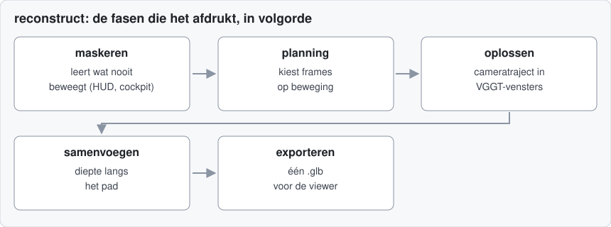

# Offline reconstructie {#offline-reconstruction}

```bash
python -m heat3d_capture reconstruct lap.mp4 -o lap.glb [--solve-budget 260] [--fuse-interval 0.4]
```

Code: [`scan/offline.py`](https://github.com/Holdi601/3DHeat-GameCapture/blob/main/heat3d_capture/scan/offline.py), [`pose/feedforward.py`](https://github.com/Holdi601/3DHeat-GameCapture/blob/main/heat3d_capture/pose/feedforward.py), [`pose/vggt_model.py`](https://github.com/Holdi601/3DHeat-GameCapture/blob/main/heat3d_capture/pose/vggt_model.py), [`pose/feedforward_source.py`](https://github.com/Holdi601/3DHeat-GameCapture/blob/main/heat3d_capture/pose/feedforward_source.py), [`pose/solveprep.py`](https://github.com/Holdi601/3DHeat-GameCapture/blob/main/heat3d_capture/pose/solveprep.py). Opties: [Commandoverzicht](commands.md#reconstruct).

## Waarom een tweede pad {#why-a-second-path}

Incrementele tracking is live en goedkoop en werkt waar er structuur is om je aan vast te houden: een interieur, een straat, een kaart met dekking. Een **racebaan is het slechtste geval**: de weg is een gladde strook met weinig textuur, de horizon beweegt nauwelijks, en zodra een paar posities wegdrijven, trekt niets later ze terug. Een ronde komt eruit als een kromme die wegloopt in plaats van te sluiten.

Het offline pad geeft **vensters van frames** aan een model dat alle camera's ervan tegelijk voorspelt, zodat elk frame elk ander frame direct beperkt in plaats van via een keten. Het heeft de hele opname nodig voordat het kan antwoorden, dus het is niet live, en het is traag: minuten per venster op een desktop-GPU. Alles na de posities - samenvoegen, dekking, kleur, export - is dezelfde code als de live scan: het opgeloste spoor wordt aan de reconstructor als positiebron gegeven, precies waar telemetrie van Forza binnenkomt.

## Vereisten {#requirements}

- **PyTorch** dat bij je GPU past (niet door dit project vastgelegd; installeer het vóór `requirements.txt`, zie [Runtime](runtime.md)).
- **`vggt`** - de VGGT-modelcode (`from vggt.models.vggt import VGGT`), van Meta's GitHub-repository; die staat niet in de pakketindex.
- **`transformers`**, omdat het offline pad de diepte draait via de PyTorch-`DepthEstimator` (Depth Anything V2 Small), niet via het ONNX-bestand.
- In de praktijk een CUDA-GPU; beide modellen vallen terug op de CPU, wat niet praktisch is.

Geen van deze staat in `requirements.txt`, omdat de scanner ze niet nodig heeft. Ze staan in **`requirements-offline.txt`**, met de eigen afhankelijkheden van VGGT (`einops`, `safetensors`, `huggingface_hub`, `Pillow`):

```bash
.venv\Scripts\python -m pip install -r requirements-offline.txt
.venv\Scripts\python -m pip install --no-deps "vggt @ git+https://github.com/facebookresearch/vggt.git"
```

VGGT gaat erin met `--no-deps` omdat zijn pakketmetadata `numpy<2` vastzet, wat pip zou honoreren door de numpy waar scipy hier op draait terug te zetten. `reconstruct` controleert al deze onderdelen direct nadat de licentieregel is afgedrukt (de lijst `OFFLINE` in [`runtime/preflight.py`](https://github.com/Holdi601/3DHeat-GameCapture/blob/main/heat3d_capture/runtime/preflight.py)), toont wat ontbreekt met de groottes, en installeert alleen na een ja - VGGT met `--no-deps`, zoals hierboven. Nee zeggen, of geen terminal om het aan te vragen, geeft afsluitcode 1.

## Het model en zijn licentie {#the-model-and-its-licence}

**VGGT**, `facebook/VGGT-1B`: **CC-BY-NC-4.0, alleen niet-commercieel, en een reconstructie die ermee is gemaakt erft dat.** Het commando drukt dit af voordat het start (`describe_licence`). Er bestaat een apart gelicentieerd `facebook/VGGT-1B-Commercial`, maar dat is een afgeschermde repository die Meta per account toekent, dus het kan niet de standaard zijn. `--model vggt-1b-commercial` lost ermee op (en drukt in plaats daarvan zijn licentieregel af); zonder verleende toegang faalt de download. De *code* van `vggt` valt onder Meta's eigen "VGGT License", een onderzoeksmaterialenovereenkomst met een beleid voor aanvaardbaar gebruik (gelezen uit `LICENSE.txt` van het pakket). Zie [Modellen en licenties](models-and-licences.md).

## De run, stap voor stap {#the-run-stage-by-stage}

De namen van de fasen zijn wat het commando afdrukt.



### maskeren {#masking}

Een `FlowMask` wordt geleerd uit **4 runs van 90 opeenvolgende frames**, gecentreerd op 1/8, 3/8, 5/8 en 7/8 van de video, op 960 x 540 grijs (zie [FlowMask](reconstruction-capture.md#flowmask-what-never-travels)). De melding wordt afgedrukt en in de samenvatting bewaard. Een video korter dan 90 frames krijgt geen masker.

#### Het cameramasker wordt geleerd, niet toegepast {#the-camera-mask-is-learned-not-applied}

Het masker wordt **niet** toegepast op de frames die naar de oplosser gaan. Het cockpit maskeren zag er goed uit volgens featurestatistieken (de meeste gevonden hoeken zitten op pixels die aan de camera vastzitten) - maar dat is een uitspraak over een featuredetector, en de oplosser is een getraind netwerk. Gemeten aan hoe ver het herstelde pad draait tussen opeenvolgende stappen (een auto draait een paar graden; een willekeurige wandeling negentig), gaven ruwe frames de kleinste draai, contrastversterkte frames iets meer, gemaskeerde frames duidelijk meer, en beide samen het meest. Dus krijgt de oplosser ruwe frames. Het masker wordt nog wel gebruikt om de framespreiding hieronder te plannen, en de incrementele tracker gebruikt het in de live scan. (`solveprep.enhance`, dat maskeert en lokaal contrast met CLAHE verhoogt, bestaat maar wordt door dit commando niet gebruikt.)

### plannen: frames gespreid op beweging {#planning-frames-spaced-by-motion}

`plan_by_motion` kiest de frames van de oplosser op **hoeveel het beeld bewoog**, niet op de klok: een vaste interval geeft trage stukken frames die ze niet nodig hebben, en laat snelle stukken verhongeren, waar opeenvolgende frames niet meer genoeg overlappen om aan elkaar gerelateerd te zijn.

- Doelverplaatsing: **5% van een breedte van 960 pixels** (48 px) mediaan ORB-featureverplaatsing tussen opeenvolgend gekozen frames, gemeten op 960 x 540 grijze frames met CLAHE-contrast, features alleen op het masker.
- Begin met een interval van 0,3 s; na elke stap wordt het volgende interval `interval x (0,5 + 0,5 x doel / gemeten)`, begrensd op **0,15-2,0 s**, zodat één ruwe meting de planning niet laat schommelen.
- Als niets matchte, krimpt het interval tot 0,6 van zichzelf (te ver uit elkaar is de fout die wordt vermeden).
- Stopt aan het eind van de video of bij `--solve-budget` frames (standaard 260).

Minder dan 4 geplande frames is een fout.

### oplossen: vensters en aaneenrijgen {#solving-windows-and-stitching}

De geplande frames worden gedecodeerd op 960 px breed en opgelost in **overlappende vensters van 16 frames, met 6 gedeeld** met het volgende (`plan_windows`; het laatste venster wordt teruggetrokken zodat het op het laatste frame eindigt, zodat het einde van een opname even veel buren heeft als het midden). Meer dan **400** frames in één run wordt geweigerd.

Elk venster: frames geschaald zodat de lange zijde **518** is en beide zijden veelvouden van **14** zijn (beeldverhouding behouden - platdrukken zou het gezichtsveld verkeerd weergeven), geschaald naar 0..1, door VGGT gehaald onder bfloat16-autocast (float16 raakt uit het exponentbereik bij verre wereldcoördinaten). De extrinsieke camerapara's worden omgezet naar wereld-van-camera-rotaties en cameramiddelpunten. Puntenkaarten worden standaard niet bewaard.

Elk venster komt terug in **zijn eigen willekeurige frame en zijn eigen willekeurige schaal**, dus worden vensters **aaneengerijgd** in het frame van het eerste door een gelijkvormigheidstransformatie (rotatie, verschuiving, één schaal) die wordt gefit op de camera's die ze delen met wat al is geplaatst:

- **Rotatie uit de oriëntaties van de camera's**, niet uit hun posities: de gedeelde camera's staan langs het pad en zijn bijna collineair op een rechte stuk, waardoor een fit op alleen posities de rotatie niet ziet - elk venster buigt dan en het aaneengerijgde resultaat komt recht uit. De rotatie is het gemiddelde van `doel_R x bron_R^T`, teruggeprojecteerd op een echte rotatie (met een spiegelingsbewaking).
- **Schaal en verschuiving uit de posities**, langs de geroteerde bron.
- Er zijn minstens **4** gedeelde camera's nodig; minder is een fout.
- De overlap is een derde van het venster zodat de schaal goed is bepaald; schaalfouten die venster na venster opstapelen, zijn wat een ronde doet spiraliseren.

Voor elke naad wordt de slechtste afwijking van de gedeelde camera's na de fit vastgelegd, in eenheden van het gemiddelde interval daartussen (`seam_error`).

### samenvoegen {#fusing}

Frames elke `--fuse-interval` seconden (standaard 0,4) worden op 960 px breed gedecodeerd, krijgen diepte van Depth Anything V2 Small (PyTorch), en worden samengevoegd met een pose die **geïnterpoleerd** is uit het opgeloste spoor op hun tijdstempel (lineaire positie, sferische rotatie; `FeedForwardPoses`). Frames buiten de opgeloste tijdsspanne worden overgeslagen in plaats van geëxtrapoleerd. De camera gebruikt een **horizontaal gezichtsveld van 65 graden**. Feed-forward-posities hebben in samenvoegen en dekking een confidentie van 0,85.

### exporteren {#exporting}

Het mesh wordt geschreven zoals bij een live scan ([De .glb-uitvoer](glb-output.md)), genoemd naar de video.

## De samenvatting {#the-summary}

```text
140 cameras solved over 182s
closure error 3.1% of path length
worst seam 0.42 frame spacings
<mask note>
wrote lap.glb
```

| Regel | Betekenis |
|---|---|
| sluitfout | afstand van de eerste tot de laatste camera gedeeld door de lengte van het pad. Voor één ronde de eerlijke maat van drift. Boven 10%: "The lap does not close ... Treat the shape as unreliable." |
| slechtste naad | de grootste afwijking bij het aaneenrijgen. Boven 1,0: "Windows disagreed by up to N frame spacings at a seam, so part of the path is stitched on weak evidence." |
| geen bestand | "Fusion produced no surface, so nothing was written." De afsluitcode is dan 1. |

De meldingen staan in het Engels, zoals het commando ze afdrukt.

## Schaal {#scale}

Het aaneengerijgde pad staat in de willekeurige eenheden van het eerste venster. Diepte wordt verankerd door tussen de geïnterpoleerde posities te trianguleren (zoals bij telemetrie), zodat de geometrie consistent is met het pad - maar **het resultaat is niet in meters**, tenzij het pad dat is. Dit commando legt de globale schaal niet vast; de grondkalibratie wordt niet toegepast wanneer de posities uit een posities-bron komen.

## Stand van dit pad {#state-of-this-path}

Met frames op een vast interval leveren vensters op sommige stukken van een ronde een samenhangend pad op en op andere een gekrabbel; de fouten zitten in de krappe bochten, waar het beeld tussen frames hard zwaait, en dichter bemonsteren van die bochten herstelt ze. Geen beeldstatistiek die is geprobeerd (helderheid, detail, aantal features, inlierratio, verplaatsing) voorspelde vooraf welke stukken zouden falen. Dus kan de spreiding niet volledig vooraf uit de beelden worden gepland: ze moet worden gekozen door op te lossen, het resultaat te meten, en opnieuw dichter op te lossen waar het pad niet een pad is dat een auto had kunnen rijden. Bewegingsgebaseerde planning is gebouwd; **de adaptieve herberekening is niet gebouwd**.
