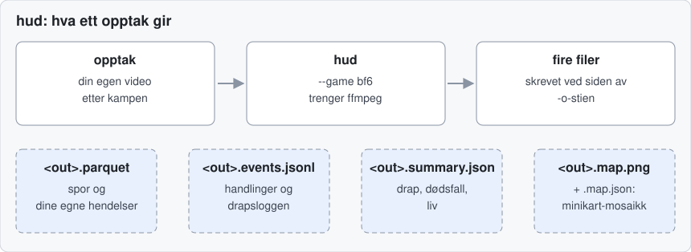

# Å lese HUD fra et opptak {#reading-the-hud-from-a-recording}

`hud` leser et spills HUD på skjermen ut av spillerens **eget opptak**, etter kampen: spillerens
**egne** handlinger fra poengpopupen spillet viser under siktekorset (drap, assist, gjenoppstandelser,
forsyninger, erobringer ...), dødsfallene fra skjermene for nedslått og utplassering, spillerens
**egne** spor fra minikartet, og drapsloggen ved siden av som tidsstemplede hendelser. Det skrives som
en 3DHeat-tabell, med minikartets mosaikk som kartbilde å legge under den.

Kort sagt: det ser gjennom kampvideoen din og skriver ned drapene, dødsfallene og hvor du gikk.

```bash
.venv\Scripts\python -m heat3d_capture hud "<recording>.mp4" --game bf6 --player <name> -o out/match
```

Battlefield 6 er den første spillprofilen.



## Hva det gjør og ikke rører {#what-it-does-and-does-not-touch}

- Det leser en **videofil**: et ShadowPlay- / Instant Replay-klipp, et OBS-opptak, alt ffmpeg kan dekode.
  Det rører aldri spillet, minnet, filene eller nettverket, og det kjøres etter at kampen er over.
  Se [Reglene](rules.md).
- Det utleder **bare spillerens egen posisjon**, fra spillerens eget minikart. Andre spilleres markører
  på minikartet maskeres ut og leses aldri. Drapsloggen beholdes i sin helhet, men bare som det den
  sier på skjermen (hvem, hvem, med hva, når); ingen posisjon knyttes til noen andre enn spilleren.
- OCR kjøres lokalt (RapidOCR med PaddleOCR-modellene via ONNX Runtime). Ingen ramme eller utklipp
  forlater maskinen.
- Et opptak viser andre spilleres navn, og mosaikken er et bilde av nivået. Utdataene er til spillerens
  egen bruk; hold dem lokalt.

## Krav {#requirements}

- **ffmpeg og ffprobe** på `PATH`. Et NVIDIA-kort brukes til dekoding når det finnes (`-hwaccel cuda`);
  ellers dekoder CPU-en, flere ganger langsommere.
- Pakkene i `requirements.txt`, og OCR uten sine egne avhengigheter (den ber om CPU-versjonen av
  `onnxruntime`, som kolliderer med DirectML-versjonen prosjektet bruker):

```bash
.venv\Scripts\python -m pip install -r requirements.txt
.venv\Scripts\python -m pip install --no-deps rapidocr_onnxruntime==1.2.3
```

`rapidocr_onnxruntime` er tekstleseren (OCR) som leser navn og ord av skjermen.
`--no-deps` hindrer at den erstatter prosjektets DirectML-`onnxruntime`.

For å installere ffmpeg på Windows: `winget install Gyan.FFmpeg`, åpne deretter et nytt terminalvindu og
sjekk med `ffmpeg -version`. Ny i kommandolinjen? Les [Før du begynner](before-you-start.md).

- Et **16:9**-opptak i en hvilken som helst oppløsning (1080p, 1440p, 4K). Andre sideforhold avvises,
  fordi profilens bokser ville havnet på feil deler av skjermen.
- Spillets **standard HUD-oppsett**. Et flyttet eller skalert HUD-element leses på feil sted.

## Alternativer {#options}

| Alternativ | Standard | Betydning |
|---|---|---|
| `video` | | Opptaket. |
| `-o`, `--out` | videoens navn, i gjeldende mappe | Utdatasti **uten** filendelse; filene er `<out>.parquet`, `.events.jsonl`, `.summary.json`, `.map.png`, `.map.json`. |
| `--game` | `bf6` | Hvilket HUD som leses. `bf6` (Battlefield 6) er den eneste profilen så langt. |
| `--player` | ingen | Spillerens navn slik drapsloggen viser det. Sammenlignes løst (OCR forveksler `l`/`I`/`1`, `O`/`0`, `rn`/`m`). Uten den gjettes navnet (under). |
| `--fps` | 5 | Minikart-prøver per sekund. Drapsloggen samples med halvparten av det, poengpopupen og dødsskjermene med halvparten av det også (en kvart mens ingen popup vises), kompasset hvert 3. s, og troppslisten hvert 15. s. |
| `--start` | 0 | Sekunder inn i videoen å begynne på. |
| `--seconds` | alt | Hvor mye av videoen som skal leses. |
| `--metres-per-pixel` | ingen | Minikartets skala, hvis kjent: meter per minikart-piksel ved vanlig zoom (minikartet er 296 piksler bredt på en 1080p-skjerm). Uten den er posisjonene i disse pikslene; se [Enheter](#north-and-units). |
| `--cpu` | av | Dekod på CPU, selv om det finnes et NVIDIA-kort. |

Fremdrift skrives ut hvert femte sekund. Til slutt vises spilleren, drapene, dødsfallene, livene og
filene som ble skrevet.

## Utdata {#outputs}

### `<out>.parquet` - spillerens spor og hendelser {#parquet---the-players-track-and-events}

Én rad per prøve der spilleren var i spill og minikartet kunne plasseres, pluss én per hendelse
spilleren hadde. Footeren bærer visningsprogrammets leseinstruksjoner (nøkkelen `heat3d`, `kind: heat3d-hud`),
så visningsprogrammet kan kartlegge hver kolonne uten å spørre.

| Kolonne | Betydning |
|---|---|
| `time` | Sekunder fra starten av videoen. |
| `event` | `position`; `start` (videoen begynte midt i et liv), `spawn` (tilbake i spill etter et dødsfall eller et langt opphold), `death`, `downed` og `revived` (fra dødsskjermene, under), `end` (et liv tok slutt uten at noe sier hvordan); spillerens egne handlinger fra poengpopupen (`kill`, `assist`, `reviving`, `resupply`, `capture` ... – [hendelsestabellen](#event-table)); og drapsloggens linjer om spilleren som `kill_feed`, `death_feed`, `teamkill_feed`, `suicide_feed`, `squadwipe_feed`. |
| `source` | Hvor radens hendelse kom fra: `points` (popupen), `screen` (nedslått- og utplasseringsskjermene), `feed` (drapsloggen); tom på posisjonsrader. |
| `text` | På `points`-rader: merkelappen slik den står på skjermen (`KILL`, `SQUAD DAMAGE ASSIST` ...), eller tittelen (`DOUBLE KILL`, navnet på et bånd), eller for en ukjent merkelapp det som ble lest. |
| `points` | På `points`-rader: hvor mye popupens totalsum vokste i det øyeblikket. Når flere handlinger kom i samme prøve (et drap og kjøretøyet det skjedde i), er det summen deres, oppgitt på hver, og `shared` sier hvor mange som delte den. Tom når totalen ikke ble lest to ganger på hver side av øyeblikket. |
| `subject`, `subject_side` | På `points`-rader: navnet popupen viste sammen med handlingen – offeret ved et drap, lagkameraten som ble gjenoppstått eller forsynt – og fargen (`enemy`, `friendly`, `squad`). |
| `confirmed` | `feed` når drapsloggen hadde en linje for det samme drapet eller dødsfallet (innen 3 s, samme offer). |
| `x`, `y`, `z` | Posisjon på mosaikken: `x` øst, `y` nord, `z` 0 (footeren sier at `z` er opp). Nord er virkelig nord når kompasset tillot det (se `north_up` i sammendraget). |
| `player` | Alltid `me`. Bare spillerens egne rader har posisjoner. |
| `team` | `own`. |
| `session` | `<video name>#NN`, én per liv. Linjevarmeruter krysser aldri en økt. |
| `heading` | Grader med klokken fra nord (fra mosaikkens opp når nord er ukjent): hvor visningen pekte. |
| `dir_x`, `dir_y`, `dir_z` | Det samme som en retningsvektor, for visningsprogrammets synsretning. |
| `zoom` | Hvor langt minikartet var zoomet ut mot vanlig zoom (over 1 i kjøretøy). |
| `killer`, `victim`, `weapon`, `headshot`, `marker` | På drap- og dødsrader som har en drapsloggslinje: loggslinjen (under). En popup-drap uten drapsloggslinje har popupens navn som `victim`; et popup-drap vist som HEADSHOT har `headshot` true. |

Hver hendelsesrad tar spillerens posisjon på hendelsens tid (for et dødsfall eller et nedslag, den siste
posisjonen før det; for en gjenoppstandelse, den første etter). Radene passer direkte til visningsprogrammets
[linjevarme](https://holdi601.github.io/3DHeat/line-heat.html): forslaget dets velger `event`, starter på
`start`, `spawn` og `revived`, slutter på `death`, `downed` og `end`, og `position`-radene ligger langs
ruten. De andre hendelsene er navngitt slik at forslaget ikke tar noen av dem som start eller slutt:
å gjenopplive en annen er `reviving` (ikke `revive`), å holde et punkt er `defense`, en lagkamerat som
spawner på spilleren er `teammate_arrived`, og drapsloggens linjer er `kill_feed` og så videre. `kill`
er ikke en slutt.

Et klipp med to runder på to kart gir to mosaikker som ikke kan knyttes til hverandre. Den største er
`<out>.parquet`; hver av de andre med minst 30 s spor skrives ved siden av den som
`<out>.map2.parquet`, `<out>.map2.map.png`, og så videre.

### `<out>.events.jsonl` - spillerens hendelser og drapsloggen {#eventsjsonl---the-players-events-and-the-kill-feed}

Ett JSON-objekt per linje, i tidsrekkefølge, hver med en `source`:

- `points`: én per handling av spilleren: `time`, `event`, `text`, `points`, `shared`, `subject`,
  `subject_side` (som i tabellen), `popup` (hvilken popup den kom fra, nummerert gjennom hele kjøringen),
  `seen` (hvor mange avlesninger som viste den), `confirmed`, og `x`, `y` der spilleren var.
- `screen`: én per nedslått og per gjenoppstandelse: `event` (`death`, `downed` eller `revived`), `time`
  (når spilleren gikk ned; for `revived`, når skjermene forsvant), `until` (den siste gangen skjermene ble
  sett), `screens` (`down` og/eller `card`), `outcome` (`death`, `revived` eller `unknown` når opptaket
  slutter først), `killer` (fra drapsloggslinjen, når det finnes en), `x`, `y`.
- `feed`: hver linje drapsloggen viste, alles:

| Felt | Betydning |
|---|---|
| `time`, `last` | Første og siste prøve linjen ble lest i (sekunder fra starten av videoen). `time` er når drapet dukket opp, innen én loggprøve (0,4 s ved standardraten). |
| `kind` | Fra spillerens side: `kill`, `death`, `teamkill`, `suicide`, `squadwipe`; for andre spilleres linjer `kill`, `squadwipe`, eller `death` for en linje uten drapsmann. |
| `killer`, `victim` | Navnene, slik de mest hyppige avlesningene gir dem på tvers av alle prøvene som viser linjen (en lengre avlesning vinner når den vanlige er starten på den: et navn delvis skjult). `killer` er tom for en linje som bare viste et ikon og et offer – et dødsfall for verden, eller en linje der drapsmannen allerede var blekna. |
| `killer_side`, `victim_side` | Fra navnets farge: `friendly` (spillerens lag, blått), `enemy` (oransje), `squad` (den blekgrønne spillet bruker for spilleren og troppen), `neutral` (ingen av disse). |
| `weapon` | Våpenikonets klasse innenfor denne kjøringen: `icon01`, `icon02` ... Linjer med ikoner som ligner hverandre deler klasse. Ikonene har ikke navn; det finnes ingen liste å navngi dem fra. |
| `marker` | Det lille ikonet mellom våpenet og offeret: `skull`, `arrow`, `chevrons`, `crosses` eller tom. |
| `headshot` | `marker == "skull"` – en antakelse, se [Begrensninger](#limits). |
| `seen` | Hvor mange loggprøver som viste linjen. |
| `me` | `killer`, `victim` eller null. |
| `matched` | For spillerens egne linjer: om en popup-handling eller en dødsskjerm ble funnet for den. |
| `x`, `y` (, `map`) | For spillerens egne linjer: hvor spilleren var. |

### `<out>.summary.json` {#summaryjson}

Spilleren (og hvordan den ble funnet), hvor spillerens hendelser kom fra (`own_events_from`: popupen og
skjermene, eller drapsloggen alene når ingen av dem ble lest i det hele tatt), drap, dødsfall, K/D,
headshots, assists, gitte gjenoppstandelser (`revives`) og mottatte (`revived`), nedslag, erobringer,
nøytraliseringer, forsyninger, helbredelser, reparasjoner, ødelagte kjøretøy, poengsummen (popupenes totaler
lagt sammen), hver handlingstype med antallet (`actions`), antall popuper, dødsfall bare drapsloggen viste,
drapsloggens egen telling av drap og dødsfall og hvor mange av drapene dens samsvarte med en popup-drap,
lagkameraddrap, selvmord, troppeutslettelser, liv, sekunder i spill, tilbakelagt avstand (i tabellens
enheter), loggslinjer, per kart om det er nord opp og hvor mange kompassavlesninger som stemte, sporets
tellinger (prøver, i spill, plassert, ikke plassert, øyer), antakelsene som ble gjort, og tidsbruken.

### `<out>.map.png` og `<out>.map.json` - kartet under sporet {#mappng-and-mapjson---the-map-under-the-track}

Mosaikken av alle minikartene i kjøringen, gjennomsnittet, med overlegg fjernet, snudd og skalert akkurat
som tabellen. JSON-sidefilen har de to ankrene visningsprogrammets **Kartbilde**-plassering ber om
([Kartbilder](https://holdi601.github.io/3DHeat/map-images.html) i visningsprogrammets dokumentasjon): last
inn PNG-filen med **Kartbilde...**, la **Speilvend nord/sør** være på, og skriv inn anker 1 og anker 2
(`px`, `py`, `worldX`, `worldZ`) fra sidefilen. Bildet ligger da nøyaktig under sporet.

Bare de delene av nivået som spillerens minikart viste, er med på bildet.

## Metode {#method}

### Dekoding {#decoding}

ffmpeg dekoder på GPU-en, senker til samplingsraten mens rammene fortsatt er på kortet, klipper ut
profilens områder (minikart, drapslogg, to kompassstriper, troppsliste, poengpopupen, ordene på
nedslått-skjermen, nederst til høyre), skalerer hver til en fast størrelse og stabler dem i ett lite
bilde per prøve. Bare det bildet går over røret inn i Python. Å dekode hver ramme i H.264-strømmen er
gulvet for kjøretiden.

To arbeidstråder tar prøvene: den ene registrerer minikartene (OpenCV), den andre leser tekst (ONNX Runtime).

### I spill eller ikke {#in-play-or-not}

Minikartets tastehint-firkant (den lyse firkanten med kartnøkkelen i, nederst til venstre på minikartet)
tegnes alltid når minikartet gjør det, og ikke på død-, drapskamera-, utplasserings-, meny- eller
oversiktsskjermer. Dens tilstedeværelse – en lys, fargeløs firkant med en mørk bokstav i midten, tydelig
lysere enn det rundt – søkt noen piksler rundt plassen sin, er i-spill-testen. En enkelt prøve som er
uenig med begge naboene sine, ignoreres.

Et gap i spill er et dødsfall eller en rundeskifte (neste strekning starter med `spawn`) når det varer
minst 6 s, eller et dødsfall (fra skjermene, eller en drapsloggslinje som nevner spilleren som offer)
kom innen 40 s før det; et kortere gap uten dødsfall (det store kartet åpnet seg) fortsetter livet.
Minikartet står oppe mens spilleren er nedslått, så en nedslått spiller er i spill.

### Sporet {#the-track}

Minikartet snur seg med visningen og holder spilleren på et fast punkt (målt: midten, 49,7 % ned).
Hver prøve:

1. **Maskér** det som ikke er nivået: sterkt fargede eller nesten hvite piksler (objektivmarkører, tropp-
   og kjøretøyikoner, pinger, områdegrensen, rutelinjer, tekst), det svake gulgrønne i synskjeglen, en
   skive rundt spillerens markør, kjeglens kile over den, tastehintet og en tynn kant.
2. **Egenskaper**: SIFT-nøkkelpunkter på det kontrastutjevnede gråtonebildet av minikartet, innenfor masken.
3. **Registrer mot mosaikken**, ikke mot forrige prøve: nøkkelpunktene matches mot egenskapene lagret så
   langt, i mosaikkoordinater, nær der spilleren sist var; en likhetstransformasjon (sving, zoom, forskyvning)
   tilpasses med RANSAC. En tilpasning krever nok innlierere, en zoom innenfor en tredjedel av den siste, og
   en forskyvning på under en tredjedel av minikartet per prøve; en tilpasning som søkes hvor som helst på
   mosaikken (etter et dødsfall) krever dobbelt så mange innlierere.
4. **Utvid mosaikken**: egenskaper mosaikken ikke har ennå, legges til (høyst hver få tidels sekund med bevegelse),
   og det maskerte minikartet gjennomsnittes inn i bildet.
5. Spillerens punkt, båret gjennom tilpasningen, er **posisjonen**; minikartets opp, båret gjennom den, er
   **retningen** på mosaikken.

Etterpå fjernes et punkt som hopper mer enn 10 piksler bort fra både de to prøvene før det og de to etter
det (som er enige seg imellom). Et minikart treffer nå og da feil zoom for én prøve. Sammendraget teller
dem (`dropped_as_jumps`).

Å registrere mot mosaikken er det som hindrer feilene i å summere seg opp: å komme tilbake til et sted
treffer egenskapene lagret første gang. En spawn et sted som ikke er sett før, starter en egen **øy**;
hver tiende plasserte prøve prøves mot de andre øyene, og det første gode treffet slår dem sammen (den
mindre flyttes inn i den større, med sitt spor). Øyer som aldri ble slått sammen (et annet kart, eller
bakke som aldri ble delt), skrives hver for seg som over.

<a id="north-and-units"></a>

### Nord og enheter {#north-and-units}

Kompassstripen leses hvert 3. sekund: etikettene finnes ved sin blekk (lys, fargeløs, gruppert over små
mellomrom, streker fjernet), hver leses for seg, og to eller flere etiketter fastsetter både stripens skala
og peilingen under midtmerket – en enkelt etikett fastsetter ingenting. Hver kompassavlesning paires med
mosaikk-retningen for den samme prøven; den sirkulære medianen av forskjellene, over avlesningene innenfor
10 grader av den, er svingen som setter mosaikkens nord opp. Den brukes når minst tre avlesninger og halvparten av alle er enige.

<a id="units"></a>Minikartets bakkeskala er ikke skrevet noe sted på skjermen, så posisjonene er i
**minikart-piksler ved vanlig zoom**: spillets median-zoom skaleres til én tabellenhet per piksel på et
296-piksel minikart (størrelsen på en 1080p-skjerm). Kjøretøyets utzoomning fjernes av registreringen, så en
enhet er den samme til fots og i kjøretøy. `--metres-per-pixel` multipliserer alt til meter når skalaen er
kjent (fra en kjent avstand på kartet, målt én gang).

### Drapsloggen {#the-kill-feed}

Loggen leses 2,5 ganger per sekund, men bare når dens fargede piksler har endret seg merkbart eller 2 s er
gått. Tekstlinjer finnes av OCR-detektorens deteksjon; en linje hvis bilde samsvarer med en som ble lest i
forrige prøve (rader ruller, så den kan ha flyttet seg), tar den teksten i stedet for å bli lest på nytt.
Linjer for små til å være et navn, eller med en skråstrek (en fps-teller i det hjørnet), forkastes.

Linjer grupperes i rader etter høyde; i en rad er det venstre navnet drapsmannen og det høyre offeret. Nabo-
biter i samme farge slås sammen (et navn med mellomrom). En enkelt linje som gikk over ikonet fra ett navn
til et annet, kuttes ved sitt bredeste mellomrom når halvdelene har ulik farge, og hver halvdel leses på nytt.
Et enkelt navn i offerkolonnen med et ikon rett til venstre for seg, er en linje uten drapsmann. To biter i
én farge uten ikon mellom dem er ett navn der drapsmannen har blekna, ikke et drap.

**Sider** kommer fra farge. Navnene tegnes med en viss gjennomsiktighet, så testen gjelder hvor langt
teksten er fra sin egen bakgrunn: fortegnet på rød minus blå i den forskjellen er oransje (fiende) eller
blå (venn) på hvilken som helst bakgrunn; ingen av dem, med grønt over de to andre, er tropp-fargen.

**Ikoner**: mellom navnene utgjør pikslene i drapsmannens farge våpenets silhuett; et lite eget ikon rett før
offeret er markøren, og navnes etter formen (en klatt med øyehull er en dødningehode; en liten trekant en
pil; flere biter kors).

**Hendelser**: en rad som leses på nytt med begge navnene like (likhet 0,7 etter å ha foldet de vanlige OCR-
forvekslingene, en av dem 0,8; en avlesning som er kuttet av, samsvarer med starten av det fulle navnet) er
den samme hendelsen, så lenge hendelsen sist ble lest mindre enn 5 s før og er under 14 s gammel – ingen rad
står oppe lenger enn det, så samme par senere er et nytt drap. En rad uten drapsmann samsvarer på offeret alene.
En hendelses tid er dens første observasjon; navnene, sidene og markøren er flertallet på tvers av observasjonene;
rader lest bare én gang forkastes.

**Spilleren**: `--player`, ellers den uthevede (lyseste) raden i troppslisten når det er minst tre avlesninger og
60 % av dem er enige, ellers navnet loggen tegnet oftest i troppfargen. Ellers sier sammendraget at spilleren
er ukjent, og ingen loggslinje tilskrives dem. (Popupen og dødsskjermene er spillerens egne, uansett navn; de
trenger ikke noe navn.)

### Poengpopupen {#the-points-popup}

Alt spilleren scorer, viser Battlefield 6 i én popup like til venstre for og under siktekorset – på samme sted
til fots, i kjøretøy og gjennom et sikte:

```
            [ RIBBON ] (icon)          en tittel, nå og da: et bånd eller en multi-drap
      (icon)(icon)(icon)  300          ett ikon per handling; popupens løpende totalsum
                Some_Name              hvem den gjaldt, et øyeblikk: oransje en fiende, blå en lagkamerat
    [ KILL x2 ] [ VEHICLE DESTROYED ]  én boks-merkelapp per type handling, med antall
```

Popupen vokser mens spilleren fortsetter å score: et nytt drap gjør `KILL` til `KILL x2`, legger til et
ikon og øker totalen; en ny type handling legger til en merkelapp. Merkelappraden viser de siste få typene
(en eldre glir ut, og teller videre når den kommer tilbake). Omtrent tre sekunder etter siste handling
folder popupen seg til én linje (`[KILL x2] 300`) og forsvinner. Teksten er lys grå, merkelappene i tynne
bokser, totalen i store siffer som starter ved x 760 på en 1920x1080-skjerm, og merkelappene høyrejustert
til x 750.

Den leses 2,5 ganger per sekund: OCR-detektoren finner tekstlinjene, bare linjer på en av popupens rader
leses (sikte-etikettene til tanken i samme område leses ikke), og en linje hvis bilde samsvarer med en som
ble lest forrige prøve, tar den teksten. En linje som går over fra et ikon, et navn eller en brettet merkelapp
inn i totalen (`Name10`, `REVIVE185`), kuttes der totalen begynner (x 755), og begge halvdelene leses på nytt.
Mens ingen popup vises, holdes hver annen prøve tilbake ulest; når den neste viser en popup, leses den holdte
først, så starten på en popup finnes fortsatt til prøven.

**Merkelapper** matches mot [hendelsestabellen](#event-table) etter å ha foldet gjenkjennerens vanlige
glipp (Q lest som O, et siffer mellom bokstaver, I for L, en bokstav tapt ved en kant): en avlesning er en
merkelapp når den er minst 80 % lik en (85 % for merkelapper på fem bokstaver eller færre) og klart nærmere
den enn noen annen. Merkelapper gjenkjenneren slo sammen (`CAPTUREDORDERCOMPLETED`) skilles ved å fjerne kjente
merkelapper fra forsiden. Et antall er `x2`, `X3`, et løst tegn og et siffer, eller et siffer rett etter
merkelappen. En lys grå, store bokstaver-linje i merkelappraden som ikke samsvarer med noe, beholdes som en
handling `points` med sin tekst; en linje som er en del av en kjent merkelapp i samme popup (`DESTROYED` ved siden
av `VEHICLE DESTROYED`) gjør det ikke. Titler over totalen (lyse bokser, mørk tekst) er `multi_kills`
(`DOUBLE KILL` ...) eller `ribbon`. Navnet er den fargede linjen mellom totalen og merkelappene; dens side
kommer fra fargen, som i loggen.

**Popuper og handlinger**: avlesninger med mindre enn 0,9 s med ingenting mellom seg er én popup. En popup som
ser ut til å slutte og så kommer tilbake før den kunne ha foldet seg (innen 3,2 s etter sist vekst), med hver
merkelapp på sitt antall eller mer og en totalsum som ikke er mindre, er den samme popupen som et øyeblikk gikk
tapt (uskarphet, en lys bakgrunn) – ingenting i den telles to ganger. I en popup er en merkelapps endelige
antall det høyeste antallet lest minst to ganger; dens k-te handling tidfestes til den første avlesningen som
viser et antall på k eller mer. Et antall lest bare i én prøve er ikke en handling – unntatt et drap som
drapsloggen bekrefter (en linje for spilleren innen 3 s som ingen andre drap tok): den korte KILL-merkelappen
er den gjenkjenneren oftest leser bare én gang. En tittel telles én gang per popup, når den er lest to ganger.
`points` er hvor mye totalen – som bare teller totaler lest to ganger på rad – vokste fra før handlingens prøve
til etter den.

En ukjent linje teller bare som en merkelapp på raden med de kjente merkelappene i samme avlesning (eller, uten
kjent merkelapp, når det heller ikke finnes et navn), slik at et navn tegnet i en farge sidetesten ikke kan skille,
ikke tas for en.

### Dødsfall og gjenoppstandelser {#deaths-and-revives}

Når spilleren går ned, sier spillet det under midten av skjermen (MAN DOWN, REQUEST REVIVE, SKIP (HOLD),
NEARBY MEDICS; når en gjenoppstandelse er bedt om, REVIVE REQUESTED, CANCEL REQUEST), og et kort nede til høyre
nevner hvem som gjorde det, med DAMAGE LOG eller PLAYER CARD under, og en linje «YOU n - n FOE» over. Drept rett
ut (et fatalt hodeskudd), vises bare kortet. Deretter gjenoppstår enten spilleren av en lagkamerat – skjermene
forsvinner, og spillet fortsetter – eller spilleren blør ut eller gir opp, og utplasseringsskjermen følger, med
DEPLOY nede til høyre.

Disse ordene leses sammen med popupen, i samme OCR-kjøring (popupen, nedslått-skjermens bånd og hjørnet nederst
til høyre lagt oppå hverandre i ett bilde): 2,5 ganger per sekund mens en popup vises, 1,25 ganger ellers. Hjørnet
tas bare med når spilleren er ute av spill eller sist ble sett nede for under 3 s siden; i spill viser det bare ammunisjonstallet.
Observasjoner som er mindre enn 4 s fra hverandre, er én episode (to observasjoner minst). En episode er et **dødsfall**
når utplasseringsskjermen vises innen 12 s etter slutten, eller når spilleren er ute av spill 3 s etter den og blir
der i 6 s eller mer; den er en **gjenoppstandelse** (`downed`, deretter `revived`) når spilleren fortsatt er i spill
3 s etter at skjermene forsvant; `unknown` (skrevet som `downed` alene) når opptaket slutter først. Dødsfallets tid er
når spilleren gikk ned: linjen i drapsloggen som nevner dem som offer, når det finnes en innen 3 s før episoden, ellers
episodens første sighting minus en halv avlesningsintervall. Posisjoner etter et dødsfall utelates fra ruten til
utplasseringsskjermen.

Et dødsfall i drapsloggen som ingen episode forklarer (skjermene ble oversett) er fortsatt et `death`, med `source`
`feed`, og bedømmes som før: hvis spilleren er i spill i over 40 s etter det, ble de gjenoppstått.

<a id="event-table"></a>

### Hendelsestabellen {#event-table}

Hva hver merkelapp, hver tittel og hver skjerm blir til. Flere merkelapper kan være én hendelse; `text` beholder hvilken.

| Hendelse | Fra | Betydning |
|---|---|---|
| `kill` | KILL; HEADSHOT | Spilleren drepte noen (navnet er offeret). Et hodeskuddsdrap viser HEADSHOT der KILL ellers ville stått: `text` sier hvilken, og `headshot` er true. |
| `assist` | ASSIST, KILL ASSIST, DAMAGE ASSIST, SQUAD DAMAGE ASSIST | Skade på noen en lagkamerat drepte. |
| `kill_assist` | ASSIST COUNTS AS KILL | En assist spillet teller som et drap. |
| `suppression`, `suppression_assist` | ENEMY SUPPRESSION; SUPPRESSION ASSIST | Undertrykkende ild mot en fiende; på en som en lagkamerat drepte etterpå. |
| `smoke_assist` | SMOKE ASSIST, SQUAD SMOKE ASSIST | Røyk som dekket en lagkamerat. |
| `spot`, `spot_assist` | SPOT, SPOTTED, ENEMY DESIGNATION; SPOT ASSIST, SPOT BONUS | Å spotte en fiende; et drap på en spilleren spottet. |
| `driver_assist` | DRIVER ASSIST | Et drap av kjøretøyets skytter. |
| `reviving`, `reviving_bonus` | REVIVE, SQUAD REVIVE; CONCEALED REVIVE | Spilleren gjenopplivet en lagkamerat; bonusen for å gjøre det under dekning. |
| `heal` | HEAL, SQUAD HEAL | Spilleren helbredet en lagkamerat. |
| `resupply` | SUPPLY, RESUPPLY, SQUAD SUPPLY | En lagkamerat tok ammunisjon fra spilleren. |
| `repair` | REPAIR, VEHICLE REPAIR, SQUAD REPAIR | Spilleren reparerte et kjøretøy. |
| `capturing`, `capture` | CAPTURING, RECAPTURING; CAPTURED, OBJECTIVE CAPTURED | Et erobringsskritt; målet tatt. |
| `neutralizing`, `neutralize` | NEUTRALIZING; NEUTRALIZED, OBJECTIVE NEUTRALIZED | Det samme for å ta et fiendtlig mål ned til nøytralt. |
| `defense` | DEFENDING, OBJECTIVE DEFENDED | Å holde et mål. |
| `offensive`, `defensive` | OFFENSIVE; DEFENSIVE | Bonusen på en handling nær et mål som angripes; forsvart. |
| `order` | ORDER COMPLETED | En troppordre utført. |
| `vehicle_damage`, `vehicle_disabled`, `vehicle_destroyed`, `vehicle_destroyed_assist` | VEHICLE DAMAGE; VEHICLE DISABLED; VEHICLE DESTROYED; VEHICLE DESTROYED SUPPORT | Skade på et fiendtlig kjøretøy, opp til å ødelegge det, eller å hjelpe til. |
| `equipment_destroyed` | EQUIPMENT DESTROYED | Et fiendtlig utstyr ødelagt. |
| `forced_bail` | FORCED BAIL | En fiende tvunget ut av kjøretøyet. |
| `squad_wipe` | SQUAD WIPE | Den siste i en fiendtlig tropp drept. |
| `savior`, `avenger` | SAVIOR; AVENGER | Et drap på en fiende som skadet en lagkamerat; på en som nettopp hadde drept en. |
| `teammate_arrived` | SPAWNED ON, SPAWN ASSIST, VEHICLE SPAWN, SQUAD VEHICLE SPAWN | En lagkamerat spawnet på spilleren eller i kjøretøyet deres. |
| `transport` | TEAM TRANSPORT | Å frakte lagkamerater i et kjøretøy. |
| `fortify` | DEFENSE DEPLOYED | Et forsvar spilleren bygde. |
| `points` | alt annet i merkelappraden | En handling tabellen ikke kjenner: `text` er det som ble lest. |
| `multi_kills` | DOUBLE KILL, TRIPLE KILL, QUAD KILL, MULTI KILL (tittel) | Drap i rask rekkefølge. |
| `ribbon` | enhver annen tittel | Et bånd, etter navnet (BALLISTIC, TANK BUSTER, ENGINEER EXPERT, SPEARHEAD ...). |
| `downed` | nedslått-skjermen, deretter i spill | Spilleren gikk ned og ble gjenopplivet. |
| `revived` | skjermene forsvinner, spillet fortsetter | Spilleren ble gjenopplivet av en lagkamerat. |
| `death` | nedslått- eller kortskjermen, deretter utplasserings- eller ute-av-spill-skjermen | Spilleren døde. |

Tekstene i tabellen er sett i testopptakene, bortsett fra disse, som er seriens vanlige navn og står i tabellen
for at de skal navngis i stedet for å beholdes som `points`: HEADSHOT KILL, ASSIST, KILL ASSIST, ASSIST COUNTS AS
KILL, SPOT, SPOTTED, SPOT ASSIST, SPOT BONUS, SQUAD REVIVE, HEAL, SQUAD HEAL, RESUPPLY, SQUAD SUPPLY, REPAIR,
VEHICLE REPAIR, SQUAD REPAIR, VEHICLE DISABLED, SQUAD WIPE, AVENGER, OBJECTIVE ...-formene, og titlene TRIPLE KILL,
QUADRUPLE KILL og MULTI KILL. Spillet på et annet språk skriver andre ord: merkelappene kommer ut som `points` med det
som ble lest – ikke forvekslet med en kjent handling – med sine totaler og navn; og siden dødsskjermene kjennes igjen
på sine engelske ord, kommer dødsfall da bare fra drapsloggen, som `death`-rader med `source` `feed`.

## Hva som er verifisert {#what-is-verified}

Sjekket for øyet mot testopptak (spillerens egne, ikke en del av repositoriet), ved å tegne prøver tilfeldig og
sammenligne hver med rammene rundt den:

- **Spillerens egne hendelser.** Hver popup-handling som ble prøvet, var en ekte handling av den typen, funnet
  innen én avlesning (0,4 s) fra tidspunktet sitt; de fleste verdiene og navnene var riktige (navn på noen skrift,
  som kyrillisk, kan komme ut forvrengt). Hver dødsskjerm som ble prøvet, ble funnet.
- **Drapslogg.** Det store flertallet av loggradene ble funnet med begge navnene riktige; små OCR-glipp (en stor I
  lest som en liten l) er tillatt. Navn tegnet i glyfer som spillet selv viser som bokser, kan bli oversett.
  Sider (farger) er feil for noen få prosent av navnene.
- **I spill.** Tastehint-testen var enig med rammen i hvert prøvde øyeblikk.
- **Spor.** Det finnes ingen fasit for hvor spilleren var, så sporet sjekkes mot opptaket selv: to minikart registreres
  **direkte mot hverandre**, og den forskyvningen sammenlignes med forskyvningen mellom de to tabellposisjonene.
  Medianavviket er omtrent 1-3 minikart-piksler (under 1 % av minikartets bredde), mer på et overfylt, utzoomet minikart.
  Kompassavlesninger stemmer med mosaikken innen 10 grader nesten alltid.
- **Kjøretid.** Dekoding i omtrent 5 ganger sanntid er det meste, på et stasjonært GPU; å lese poengpopupen legger til
  omtrent en femtedel til en halv.

Sett med egne øyne: hver mosaikk har sammenhengende veier og bygninger på tvers av livene som bygde den, og ruter fra
ulike liv langs samme vei ligger oppå hverandre. En strekning der minikartets zoom endrer seg kan komme ut for lang –
se [Begrensninger](#limits).

Testene (`tests/test_hud_*.py`) tegner alt de leser: et oppdiktet nivå med veier, bygninger og høydekurver, minikart
av turer gjennom det med de overleggene et ekte har, kompassstriper, drapsloggsrader med oppdiktede navn. De sjekker at
en løkke spores innen to piksler og lukker seg, at en stående spiller blir på plass mens visningen dreier, at zoom-
endringer følges, at en spawn et annet sted blir knyttet tilbake når stiene møtes, at nordsvingen og y-speilingen setter
sporet der det virkelig gikk, at kartbildets ankre får det på linje under sporet, og at loggens tolkning, sider,
markører og fjerning av dubletter virker. For spillerens egne hendelser tegner de popuper med oppdiktede navn og
merkelapper, og sjekker merkelappens tabell og toleransen for gjenkjennerens glipp, merkelapper slått sammen, popupens
rader, totalen kuttet fra et navn, telling mens en popup vokser, at den fortsetter etter et øyeblikk ulest, at en
merkelapp glir ut og tilbake, eller at den slutter; at et antall lest én gang holdes adskilt; dødsfall, gjenoppstandelser
og utfall fra skjermenes ord; og, på en oppdiktet kamp, at handlingene, dødsfallene og gjenoppstandelsene havner i tabellen
der spilleren var, at loggslinjene ved siden av dem står under sine egne navn, og at ruten ender ved dødsfallet og ikke ved gjenoppstandelsen.

<a id="limits"></a>

## Begrensninger {#limits}

- **Enhetene er minikart-piksler**, ikke meter, med mindre `--metres-per-pixel` er oppgitt. Ingenting på spillets skjerm
  sier minikartets bakkeskala.
- **Bare det minikartet viste, blir kartlagt.** Mosaikken dekker bakken innen en halv minikart fra der spilleren gikk; to
  mosaikker som aldri delte bakke (to runder på to kart, eller to liv i langt fra hverandre liggende hjørner av et stort kart)
  forblir separate filer med urelaterte koordinater.
- **Sporet er minikartets, med 5 prøver per sekund**, glattet av ingenting. Et minikart sterkt utzoomet (en helikopter i
  testopptakene zoomet det ut til 2,3 ganger) viser mindre detalj per piksel, og utenfor spilleområdet viser det nesten ingen,
  så registreringen der er grovere. Jetfly, og spilleren som passasjer, var ikke med i testopptakene.
- **Registreringsfeil er lokale og summerer seg ikke opp**, men en mosaikk bygget mens man utforsker ny bakke kan
  ha en liten bøy som først rettes når bakken sees igjen. Der minikartets zoom endrer seg kontinuerlig (et kjøretøy som
  akselererer), kan den tilpassede zoomen drive, og én slik strekning ble sett med avstanden omtrent to ganger den sanne.
  En mosaikk bygget fra et overfylt, utzoomet minikart for infanteri er den minst nøyaktige (feil rundt 3 piksler typisk,
  opptil 18).
- **Ingen optimalisering av posegrafen.** En løkke lukkes ved å matche lagrede egenskaper, ikke ved å spre korreksjonen
  utover løkken.
- **Våpenklasser virker ikke ennå.** Ikonets silhuett er tatt fra et gjennomskinnelig ikon over en bevegelig bakgrunn, og
  den varierer for mye fra prøve til prøve: testopptakene kom ut med 220 til 340 klasser for 550 til 670 linjer, der en
  kamp har noen få dusin våpen. Behandle `weapon` som eksperimentelt. Klasser gjelder uansett per kjøring, og er ikke navn.
- **Betydningen av markørene er ikke helt kjent.** Pilen (`▸`) tegnes foran spillerens eget navn, i linjer om dem; den er
  ikke en type drap. Dødningehodet tas for å bety et hodeskudd; det er en antakelse, ikke noe spillet sier.
  `chevrons` og `crosses` (troppeutslettelser) rapporteres slik de ses.
- **Navn på andre skrifter enn latinsk** (kyrillisk, for en) kommer ut som de nærmeste latinske lignende bokstavene: gjenkjenneren
  leser latinsk og kinesisk. Den samme spilleren leses likt hver gang, så de matcher fortsatt, men teksten er ikke navnet deres.
- **Overlegg i drapsloggens hjørne** (en fps-teller) kan skjule slutten av øverste raders offer. Telletekst gjenkjennes og
  forkastes, og et navn kuttet av matches mot sine fulle avlesninger, men et navn som bare er sett kuttet av blir stående kuttet av.
- **Et dødsfall verken skjermene eller loggen viste**, avslutter fortsatt ruten, som `end`, når spilleren forlater spill i 6 s eller mer.
- **Mottatte gjenoppstandelser** kommer fra nedslått-skjermene. Bare for et dødsfall i loggen som skjermene misset, utledes de
  fortsatt (i spill i over 40 s etter det), og en rask gjenoppstandelse skilles da ikke fra andre.
- **Popup-handlinger tidfestes til en avlesning**: innen 0,4 s fra at merkelappen først vises; en merkelapp som animeres inn kan
  leses ett steg for sent eller for tidlig.
- **Navn på popup-rader** leses som loggens: skrift som ikke er latinsk, kommer ut forvrengt, og nå og da leses en lagkamerats
  navneskilt som svever i verden nær popupen som handlingens navn. Handlinger uten navn (et erobringsskritt, en ordre) har ingen.
- **`points`** mangler der totalen ikke ble lest to ganger på hver side av en handling, og deles mellom handlinger som kom i samme prøve.
  Sammendragets `score` summerer popupenes endelige totaler, så en popup hvis totalsum aldri ble lest to ganger, er ikke med i den.
- **Merkelappraden er et vindu**: med fire eller flere typer i én popup glir den eldste merkelappen av til venstre, forbi kanten av
  området som leses. Den ble talt mens den var i sikte; et antall den får mens den er halvt utenfor skjermen, kan bli oversett.
- **En popup tapt lenger enn den kunne ha vart** (over omtrent 4 s med uleselige prøver mens den fortsatt vokste) tas for to, og en
  merkelapp med et antall over én telles da på nytt. Ikke sett i kontrollene under.
- **Andre språk i brukergrensesnittet**: merkelapper kommer ut som `points` med sin tekst, og dødsfall kommer bare fra loggen
  (dødsskjermene gjenkjennes på sine engelske ord).
- **Hendelser på en kort øy**: et liv der sporet var for kort til å skrives som et kart (under 30 s), beholder hendelsene sine i
  `.events.jsonl` uten `x`, `y`, og ikke i noen tabell.
- **HUD-oppsettet er BF6s standard i 16:9.** En endret HUD-skala, en fargeblind palett eller en annen minikartstørrelse krever en egen profil.
