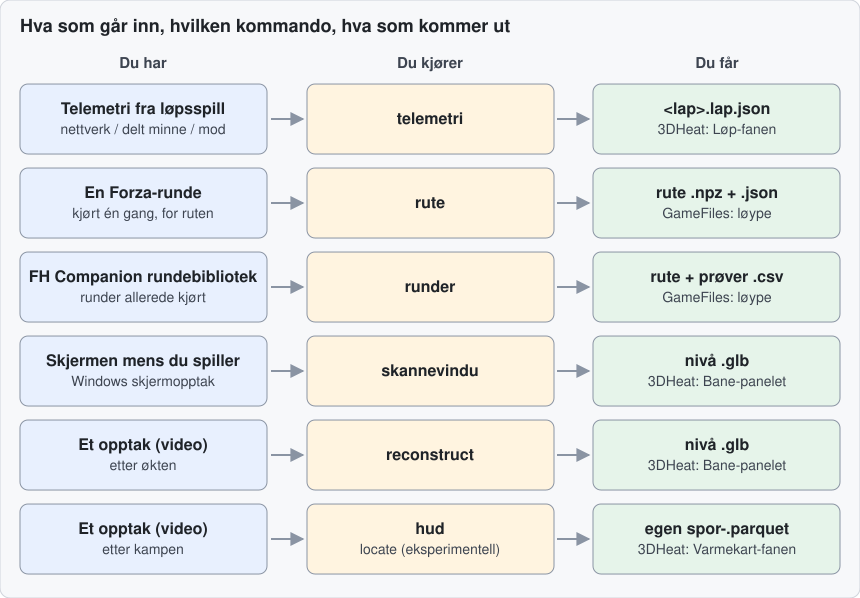

# 3DHeat GameCapture {#dheat-gamecapture}

**Hva er det?** Et verktøy som skriver ned hva et løpsspill forteller det om kjøringen din, én
fil per runde. Det kan også bygge en grov 3D-modell av et nivå fra en video av deg som spiller.

**Hvorfor skulle jeg bruke det?** For å se rundene dine i [3DHeat-visningsprogrammet](https://holdi601.github.io/3DHeat/):
hvor du bremset, hvor du var treg, hvordan to runder skiller seg. Og for å ha nivået under
varmekartet ditt når ingen har en 3D-modell av det.

**Eksempel:** slå på Forzas Data Out, kjør én kommando, kjør to runder. To rundefiler dukker opp i
`laps\`. Slipp dem på visningsprogrammets Løp-fane.


Ny til kommandolinjen? Les [Før du begynner](before-you-start.md) først.

## De tre jobbene {#the-three-jobs}

1. **Rundetelemetri.** Den tar opp alle kanaler et løpsspill publiserer - Forzas Data Out, Assetto Corsa-spillenes
   delte minne, rally-spillenes nettverksstrømmer, en BeamNG-mod, en Trackmania-plugin - og skriver én `heat3d-lap`-fil
   per runde eller etappe, til visningsprogrammets Løp-fane. iRacing trenger ingen opptaker: visningsprogrammet leser sine egne `.ibt`-filer.
2. **Nivåer fra spilling.** Den gjør det skjermen viste mens du gikk eller kjørte gjennom et
   nivå, om til en `.glb`-3D-modell, som visningsprogrammet legger under varmekartet.
3. **Din egen kamp, etterpå.** `hud` leser HUD-en i ditt eget opptak - dine handlinger, dødsfall,
   minikartets spor og drapsloggen. `locate` (eksperimentell: den plasserer så langt få ekte bilder) finner ut
   hvor hvert bilde ble tatt, på et nivås 3D-modell.

Alle tre følger én regel: **ingenting injiseres i et spill, og ingenting kobles inn**. Bilder
kommer fra det offentlige skjermopptaks-API-et, telemetri fra grensesnitt spillene publiserer for det. Se
[Reglene](../rules.md).



Koden er Python (pakken `heat3d_capture`), MIT-lisensiert. Dybde- og posemodellene den kan
kjøre har sine egne lisenser - se [Modeller og lisenser](../models-and-licences.md).

## Hurtigstart {#quick-start}

### Ta opp runder {#record-laps}

Du trenger Python 3.10 eller nyere ([Før du begynner](before-you-start.md)). I PowerShell:

```powershell
git clone https://github.com/Holdi601/3DHeat-GameCapture
cd 3DHeat-GameCapture
python -m venv .venv
.venv\Scripts\python -m pip install -r requirements.txt

# Forza: Settings -> HUD and Gameplay -> Data Out = ON, IP 127.0.0.1, port 5300
.venv\Scripts\python -m heat3d_capture telemetry -o laps
```

**Du bør se** `listening on port 5300. Laps go to laps. Ctrl+C to stop.`, deretter en linje per runde når du
passerer målstreken, som på bildet over. Trykk Ctrl+C for å stoppe. Slipp filene fra `laps\` på
visningsprogrammets Løp-fane. Alle andre spill er ett `--game` unna:

```powershell
.venv\Scripts\python -m heat3d_capture telemetry --game acc -o laps
.venv\Scripts\python -m heat3d_capture telemetry --game dirtrally2 -o laps
```

Se [Telemetriopptakere](../telemetry.md) for hvert spill og alternativ.

### Skann et nivå {#scan-a-level}

Dobbeltklikk **`scan.bat`** i verktøyets mappe. Den finner Python (og tilbyr å installere det med
winget hvis det ikke finnes), lager en privat `.venv`, og åpner skannevinduet. Vinduet sier
hva som mangler, hva hver pakke er til for og hvor stor nedlastingen er, og installerer ingenting uten
et ja. Se [Kjøretid og avhengigheter](../runtime.md) og
[Skannevinduet](../reconstruction-scan-ui.md).

For hånd: `.venv\Scripts\python -m heat3d_capture.ui`.

For å bygge opp et opptak frakoblet, med kamerabanen løst på én gang (krever PyTorch, pakken `vggt`
og en GPU - se [Frakoblet rekonstruksjon](../reconstruction-offline.md)):

```powershell
.venv\Scripts\python -m heat3d_capture reconstruct lap.mp4 -o lap.glb
```

## Dokumentasjonens oversikt {#map-of-the-documentation}

| Side | Hva den dekker |
|---|---|
| [Før du begynner](before-you-start.md) | Python, en terminal, den første kommandoen, vanlige feil |
| [Reglene](../rules.md) | Ingen injeksjon, bare publiserte grensesnitt, og hva det koster |
| [Telemetriopptakere](../telemetry.md) | `telemetry`-kommandoen og en oversikt over hvert spill |
| [Forza](../telemetry-forza.md) | Data Out, oppsettsgjenkjenning, FH Companion-videresendingen og dens `.tele.gz` |
| [Assetto Corsa-spillene](../telemetry-assetto-corsa.md) | AC, ACC, AC EVO, AC Rally fra delt minne |
| [Rally-spill](../telemetry-rally.md) | EA SPORTS WRC, DiRT Rally 2.0 / 1 / DiRT 4, Richard Burns Rally |
| [BeamNG.drive](../telemetry-beamng.md) | `heat3d`-protokollmoden |
| [Trackmania](../telemetry-trackmania.md) | `Heat3dRecorder` Openplanet-plugin |
| [iRacing](../telemetry-iracing.md) | Lese `.ibt`-filer i visningsprogrammet |
| [Deling av runder og etapper](../lap-splitting.md) | `LapSplitter`, `CounterSplitter`, `LineSplitter`, `StageSplitter` |
| [Skli, driv og avledede kanaler](../slip-and-drift.md) | Hvordan sklí skaleres, og hva visningsprogrammet utleder |
| [heat3d-lap-filen](../lap-format.md) | Rundefilformatet, kanaler, enheter, `meta` |
| [Spill](../games.md) | Per spill: hvordan ta opp, hva som sendes, hvilke løyper som kan eksporteres |
| [Kommandoer](../commands.md) | `route`, `telemetry`, `laps`, `reconstruct`, `hud`, `locate`, steg for steg |
| [Kommandoreferanse](../cli-reference.md) | hvert alternativ, generert fra `--help` |
| [Lese HUD-en fra et opptak](../hud-video.md) | `hud`: egne handlinger, dødsfall, minikartets spor og drapslogg fra et opptak |
| [Lokalisere bilder i et nivå](../locate.md) | `locate`: hvor hvert bilde ble tatt, mot nivåets geometri |
| [Nivårekonstruksjon](../reconstruction.md) | Pipelinen fra bilder til en `.glb` |
| [Skannevinduet](../reconstruction-scan-ui.md) | Hver kontroll, hurtigtast og overleggselement |
| [Opptak, masker og bildekvalitet](../reconstruction-capture.md) | Windows Graphics Capture, nøkkelbilder, HUD-masker, kvalitetsråd |
| [Dybde](../reconstruction-depth.md) | Depth Anything V2, ONNX Runtime, bygging av modellen |
| [Kamerapose og skala](../reconstruction-pose.md) | Odometri, relokalisering, telemetriposer, bakkeskala, bundle adjustment |
| [Sammensmelting, dekning og farge](../reconstruction-fusion-and-texture.md) | Okkupasjonsvolumet, dekningsrutenettet, svake punkter, vertex-farge |
| [.glb-utdataene](../glb-output.md) | Filen visningsprogrammet laster |
| [Frakoblet rekonstruksjon](../reconstruction-offline.md) | `reconstruct`, VGGT-vinduer og sammensying |
| [Modeller og lisenser](../models-and-licences.md) | Størrelser for Depth Anything V2, VGGT, pakkene |
| [Kjøretid og avhengigheter](../runtime.md) | Forhåndssjekk, backends, ytelsesnivåer |
| [Begrensninger og verifisering](../limits.md) | Hva som ikke er gjort, og hva som ikke er kontrollert |
| [Oppdateringer](../updates.md) | Utgivelsessjekken og `python -m heat3d_update` |
| [Utvikling](../development.md) | Tester, det virtuelle miljøet, repositoriets oppsett |
| [Vedlikehold av disse dokumentene](../maintaining.md) | Utgivelsessjekklisten for kode og dokumentasjon |

## Del av 3DHeat {#part-of-3dheat}

Filene dette skriver lastes av **3DHeat-visningsprogrammet** -
[kilde](https://github.com/Holdi601/3DHeat), [dokumentasjon](https://holdi601.github.io/3DHeat/).
Rundefiler går til Løp-fanen, `.glb`-nivåer til Bane-panelet, og `hud`- og `locate`-tabellene til
Varmekart-fanen; hvordan visningsprogrammet leser tabeller og kampfiler står i
[Én fil per kamp (.3dheat)](https://holdi601.github.io/3DHeat/container.html) og
[Få data inn](https://holdi601.github.io/3DHeat/getting-data-in.html).

| Verktøy | Hva det gjør | Dokumentasjon |
|---|---|---|
| [3DHeat-visningsprogrammet](https://github.com/Holdi601/3DHeat) | viser varmekart, løp og kamper i 3D, i nettleseren | [dokumentasjon](https://holdi601.github.io/3DHeat/) |
| [GameFiles](https://github.com/Holdi601/3DHeat-GameFiles) | løyper og nivåer ut av filene spill leverer, som 3D-modeller | [dokumentasjon](https://holdi601.github.io/3DHeat-GameFiles/) |
| [GameCapture](https://github.com/Holdi601/3DHeat-GameCapture) | rundetelemetri fra løpsspill; nivåer bygget opp fra spillvideo | [dokumentasjon](https://holdi601.github.io/3DHeat-GameCapture/) |
| [Unreal Exporter](https://github.com/Holdi601/3DHeat-UnrealExporter) | en Unreal Editor-plugin som eksporterer et nivå som en 3D-modell | [dokumentasjon](https://holdi601.github.io/3DHeat-UnrealExporter/) |
| [CS2](https://github.com/Holdi601/3DHeat-CS2) | Counter-Strike 2-demoer til kampfiler; kart til 3D-modeller | [dokumentasjon](https://holdi601.github.io/3DHeat-CS2/) |
| [Watcher](https://github.com/Holdi601/3DHeat-Watcher) | tar opp spillingen din i bakgrunnen fra det spill publiserer | [dokumentasjon](https://holdi601.github.io/3DHeat-Watcher/) |
| [Ext-WarThunder](https://github.com/Holdi601/3DHeat-Ext-WarThunder) | War Thunder-replayer til tabeller og kampdokumenter | [dokumentasjon](https://holdi601.github.io/3DHeat-Ext-WarThunder/) |
| [Ext-WoT](https://github.com/Holdi601/3DHeat-Ext-WoT) | World of Tanks-replayer til tabeller og kampdokumenter | [dokumentasjon](https://holdi601.github.io/3DHeat-Ext-WoT/) |
| [Ext-WoWs](https://github.com/Holdi601/3DHeat-Ext-WoWs) | World of Warships-replayer til tabeller og kampdokumenter | [dokumentasjon](https://holdi601.github.io/3DHeat-Ext-WoWs/) |
| [Ext-Squad](https://github.com/Holdi601/3DHeat-Ext-Squad) | Squad-serverdemoer til tabeller og kampdokumenter | [dokumentasjon](https://holdi601.github.io/3DHeat-Ext-Squad/) |
| [Ext-DCS](https://github.com/Holdi601/3DHeat-Ext-DCS) | DCS World-kart til 3D-modeller | [dokumentasjon](https://holdi601.github.io/3DHeat-Ext-DCS/) |
| [Ext-IL2](https://github.com/Holdi601/3DHeat-Ext-IL2) | IL-2 Sturmovik-kart til 3D-modeller | [dokumentasjon](https://holdi601.github.io/3DHeat-Ext-IL2/) |

En utvikler med spillets prosjekt åpent bør bruke Unreal-eksportøren, som leser den virkelige
geometrien og er eksakt. Der et spills egne arkiver kan leses, henter GameFiles ut den eksakte
løypen. Rekonstruksjon fra spilling er for tilfellet der bare skjermen er tilgjengelig.
