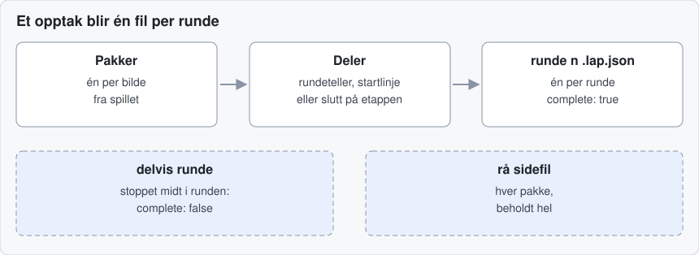

# Hvordan runder og etapper deles {#how-laps-and-stages-are-split}

En opptaker ser én sammenhengende strøm av prøver. Å gjøre den om til runder gjøres av
en av fire splittere, valgt etter hva spillet sier om runder. Alle følger samme idé: bruk
spillets egen telling der det finnes en, og ellers finn runden ut fra posisjonene; skriv
aldri et fragment som er for kort til å sammenlignes.

| Splitter | Kode | Brukes av |
|---|---|---|
| `LapSplitter` | [`fulllap.py`](https://github.com/Holdi601/3DHeat-GameCapture/blob/main/heat3d_capture/telemetry/fulllap.py) | Forza |
| `CounterSplitter` | [`kunos.py`](https://github.com/Holdi601/3DHeat-GameCapture/blob/main/heat3d_capture/telemetry/kunos.py) | Assetto Corsa, ACC |
| `LineSplitter` | [`kunos.py`](https://github.com/Holdi601/3DHeat-GameCapture/blob/main/heat3d_capture/telemetry/kunos.py) | AC EVO, AC Rally, BeamNG |
| `StageSplitter` | [`rally.py`](https://github.com/Holdi601/3DHeat-GameCapture/blob/main/heat3d_capture/telemetry/rally.py) | EA SPORTS WRC, DiRT Rally 2.0, DiRT Rally, DiRT 4, Richard Burns Rally |

Trackmania deler kjøringer inne i sin plugin ([Trackmania](telemetry-trackmania.md)), og iRacing-filer
deles av viewer etter simulatorens rundeteller ([iRacing](telemetry-iracing.md)).

Ved **Ctrl+C** kaller hver opptaker splitterens `flush()`, så en åpen runde eller etappe
skrives hvis den består de samme minimumskravene som nedenfor.

## LapSplitter (Forza) {#lapsplitter-forza}

Parametere: `minimum_metres = 400`, `gap_seconds = 2.0`.

For hver dekodet pakke:

1. Hvis spillets `timestampMs` hoppet fremover med mer enn 2 sekunder siden forrige pakke,
   eller gikk bakover, tømmes den åpne runden først.
2. Hvis `isRaceOn` er 0 (spillet er ikke i et løp), tømmes den åpne runden og pakken
   forkastes.
3. Hvis ingen runde er åpen, åpnes en med pakkens `lapNumber`.
4. Hvis `lapNumber` avviker fra den åpne rundens, **lukkes den åpne runden som fullført**;
   `seconds` er spillets `lastLap` når den er positiv. En runde lukket slik skrives
   uansett lengde. En ny runde åpnes.
5. Pakken legges til.

Opptakeren tømmer også når det ikke har kommet en pakke på 2 sekunder regnet i
virkelig tid (spillet er pauset, eller lukket midt i en runde).

**Tømming** beholder den åpne runden bare hvis den har minst 2 prøver og minst 400 m
`distanceTravelled`; den skrives som ufullstendig (en `run`). Et løp fra A til B teller
aldri en ny runde, så det ender alltid slik.

## CounterSplitter (AC, ACC) {#countersplitter-ac-acc}

Parameter: `minimum_metres = 300`. Får hver prøve med grafikksidens `completedLaps`
og siste rundetid.

- Den første prøven åpner en runde nummerert med gjeldende `completedLaps`.
- Når `completedLaps` endrer seg, lukkes den åpne runden. Den er **fullført**, med
  `seconds = siste rundetid i ms / 1000` (hvis positiv), bare hvis telleren gikk opp med
  nøyaktig 1 - et hopp tilbake til 0 (en omstart av økten) eller med flere lukker den som ufullstendig.
- En lukket runde skrives bare hvis den har prøver og minst 300 m kjørt linje.
- Tømming beholder den åpne runden hvis den har mer enn én prøve og minst 300 m.

## LineSplitter (AC EVO, AC Rally, BeamNG) {#linesplitter-ac-evo-ac-rally-beamng}

Parametere: `radius = 15 m`, `minimum_metres = 300`, `stop_seconds = 8`.

Disse spillene enten har ingen rundeteller på en side opptakeren leser, eller kjører etapper. **Linjen
er der opptaket startet**:

1. Den første prøvens horisontale posisjon (`x`, `z`) blir linjen.
2. Når bilen har kjørt mer enn 5 m, blir retningen fra linjen til bilen rundens retning.
3. **Stopp** avslutter en kjøring: når `speed` holder seg under 1 m/s i 8 sekunder, tømmes den
   åpne runden (slik slutter en rallyetappe: bilen stopper i mål).
4. **Krysning av linjen**: etter mer enn 300 m kjørt samles prøver innenfor 15 m fra linjen.
   Når bilen forlater den radiusen igjen, er den nærmeste innsamlede prøven krysningen. Hvis
   bilen da kjørte i samme retning som rundens retning (prikkproduktet av den lokale retningen
   og rundens retning er positivt), lukkes runden ved den prøven; ellers ignoreres passeringen
   (bilen krysset startlinjen i motsatt retning).
5. En lukket rundes `seconds` er tiden fra første prøve til krysningen. Den er **fullført bare
   hvis første prøve var raskere enn 5 m/s**: en runde som startet fra stillstand er en start,
   ikke en runde å sammenligne. Første runde i en opptak startet fra startrutenettet er derfor
   alltid ufullstendig; opptak startet på en flygende runde gir en fullført første runde ved neste krysning.
6. Neste runde starter med krysningsprøven (den hører til begge rundene).

Runder kortere enn 300 m forkastes. Tømming (et stopp, eller Ctrl+C) beholder den åpne
runden hvis den har minst 2 prøver og 300 m, som ufullstendig. BeamNG tømmer på samme måte
når kjøretøyet tilbakestilles (klokken går tilbake), før en ny splitter startes, slik at kjøringen
før tilbakestillingen beholdes.

Avstander er horisontale (`x`, `z`) for kjørt-avstandstelleren og linjetesten, og full 3D
for 300 m-lengdetesten.

## StageSplitter (rallyspill) {#stagesplitter-rally-games}

Parameter: `minimum_metres = 300`. Får hver prøve med spillets etappeklokke, om spillet sier at
bilen er ferdig, og eventuelt spillets egen tid for den.

1. Hvis klokken er 0 eller lavere, eller har gått tilbake mer enn 0,5 s, **forlates** den åpne
   etappen: den beholdes som delvis etappe hvis den ikke er fullført, har mer enn 10 prøver og
   minst 300 m. En klokke på 0 eller lavere dropper også prøven (bilen står ved start).
2. Hvis ingen etappe er åpen, åpnes en ny (nummerert 1, 2, ... for opptaket).
3. Når en etappe er fullført, ignoreres videre prøver til klokken går tilbake.
4. Hver prøve lagres med `time` satt til etappeklokken.
5. Når spillet sier at det er ferdig, er etappen fullført; `seconds` er spillets tid når den
   er gitt og positiv, ellers klokken. Den skrives hvis den dekket minst 300 m.

Hva "ferdig" betyr per spill:

| Spill | Ferdig når |
|---|---|
| EA SPORTS WRC | etappelengde > 0 og etappedistanse >= lengde - 0,5 m |
| DiRT-spillene | antall fullførte runder steg over etappens startantall, eller (enkeltrunde-arrangement) rundedistanse >= 99,9 % av banelengden |
| Richard Burns Rally | løpsklokke > 0 og avstand til mål <= 0 |

For RBR fastsettes opp-aksen og farten når en etappe skrives (se
[Rallyspill](telemetry-rally.md#richard-burns-rally-rsf--ngp)).

## Tid og avstand i rundefilen {#time-and-distance-in-the-lap-file}

For alle opptakere unntatt Forza er `time` omregnet slik at rundens første prøve er 0, og
`distance` er den kumulative 3D-avstanden mellom etterfølgende posisjoner. Forza bruker spillets
egen rundetimer og avstandsteller, omregnet på samme måte.
