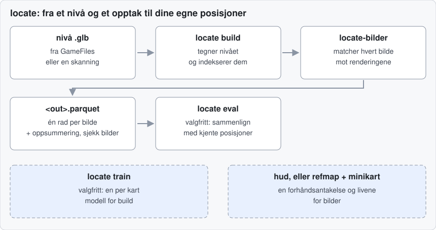

# Lokalisere rammer i et nivå {#locating-frames-in-a-level}

`locate` finner ut hvor hver ramme i et spillopptak ble tatt – kameraets 3D-posisjon og synsretning –
ved å matche bildet mot gjengivelser av nivåets egen geometri. Det er til spill som ikke tar vare på
hvor spilleren var: ingen demo, ingen replay-fil, ingen telemetri. Battlefield 6 er det første.

> **Eksperimentelt.** På virkelige opptak plasserer det så langt bare en liten andel av rammene; se
> [Virkelige opptak: eksperimentelt](#real-frames-experimental).

```bash
# Once per level: render it from every place a player can stand, and index the renders.
.venv\Scripts\python -m heat3d_capture locate build level.glb -o level.db

# Per recording: where was each frame taken?
.venv\Scripts\python -m heat3d_capture locate frames "<recording>.mp4" --db level.db -o out/match
```

Posisjonen kommer **fra bildet**, mot hele nivået, uten forhånd. Minikartsporet fra [HUD-leseren](hud-video.md)
er bare en reserve for rammer bildet ikke kan plassere, og hver rad sier hvilken av de to den kom fra.




## Hva det gjør og ikke rører {#what-it-does-and-does-not-touch}

- Det leser spillerens **eget opptak** og en nivåfil spilleren har eksportert fra sin **egen kopi** av spillet.
  Det rører aldri spillet, minnet, filene mens det kjører, eller nettverket, og det kjøres etter kampen.
  Se [Reglene](rules.md).
- Det plasserer **bare spillerens eget kamera**: rammen er spillerens egen visning.
- Nivået, databasen bygget av det, og alt som gjengis fra det, tilhører spillutgiverens. Hold det lokalt.

## Krav {#requirements}

- Det som står i `requirements.txt`, PyTorch (fra pytorch.org, for GPU-en), og `requirements-locate.txt`:

```bash
.venv\Scripts\python -m pip install -r requirements-locate.txt
```

- Et GPU med OpenGL 3.3 (4.3 er raskere) for gjengivelsene, og helst CUDA for modellene. På en CPU
  fungerer det, men langsomt.
- Modellene hentes ved første bruk (omtrent 450 MB): DINOv2 fra Hugging Face, ALIKED og LightGlue via
  kornia. Alle er lisensiert for kommersiell bruk; se [Lisenser](#licences).
- **Nivået** som en `.glb` (eller `.gltf`) i visningsprogrammets ramme, Y opp, **med sine grunnfargeteksturer**,
  slik 3DHeat-eksportørene skriver den (`ground:` / `structure:`-delene; delnavnene trengs ikke). Én enhet er
  én meter, med mindre filens toppnivå-`extras.unit_metres` sier noe annet. En GameCapture-skanning
  (`reconstruct`, skannevinduet) skrives i **centimeter** og har `extras.unit_metres: 0.01`, så den leses i
  sin virkelige størrelse. Et nivå uten tekstur fungerer mye dårligere; se [Begrensninger](#limits).

## Kommandoer {#commands}

### `locate build <level> -o <db>` {#locate-build---o-}

Gjengir nivået fra hvert sted en spiller kunne stått, og lagrer per gjengivelse dens posisjon og én global deskriptor.

| Alternativ | Standard | Betydning |
|---|---|---|
| `level` | | Nivåets `.glb` / `.gltf`. |
| `-o`, `--out` | | Databasemappen som skal skrives. |
| `--game` | `bf6` | Spillprofilen: øyehøyder, synsfelt, HUD-bokser, fart (under). `generic` for enhver førstepersonsspill. |
| `--eye` | profilens | Øyehøyder over gulvet i meter, stående først. Én databasevisning per høyde. |
| `--fov` / `--vfov` | profilens | Opptakets horisontale synsfelt, eller det vertikale (Battlefields skyveknapp) for et 16:9-opptak. |
| `--spacing` | 2,5 | Meter mellom stedene visningene tas fra. |
| `--yaw-step` | 30 | Grader mellom visningenes retninger. |
| `--pitch` | 0 | Stigninger å gjengi med, grader opp. |
| `--positions` | ingen | En tabell (Parquet eller CSV med `x`, `y`, `z` ved føttene, i nivåets ramme) å ta steder fra i stedet for hvert gulv; for eksempel en tidligere kjørings utdata. |
| `--shadows` | av | Kast solens skygger i gjengivelsene (nivåets egen sol når filen oppgir en i `extras.sun`). |
| `--untextured` | av | Gjengi bare form og lys. |
| `--box X0 Z0 X1 Z1` | hele filen | Bare steder innenfor denne boksen (nivåenheter): spilleområdet. |
| `--places` | `auto` | Hvor visninger tas fra: `nav` – spillere i øyehøyde over nivåets navigasjonsmesh (`nav:`-delene: nøyaktig der spillet lar dem gå), kjøretøykameraer i sin høyde over `ground:`-delene (terreng og veier) innen 50 m fra den; `ground` – begge over `ground:`; `floors` – over hvert oppoverrettet flate (tak og kasser også); `auto` – `nav` når nivået har et navigasjonsmesh, ellers `floors`. |
| `--head` | ingen | En per-kart-hode fra `locate train` for deskriptorene. |

Skriver `<db>/db.json` (det den ble bygget av og med) og `<db>/views.npz` (posisjoner, deskriptorer).

### `locate frames <recording> --db <db>` {#locate-frames----db-}

| Alternativ | Standard | Betydning |
|---|---|---|
| `source` | | En video, et bilde, eller en mappe med bilder (tatt i navnerekkefølge, `--fps` fra hverandre). |
| `--db` | | Databasen `build` skrev. Nivåfilen må fortsatt være der den var (eller `--level`). |
| `-o`, `--out` | `<source>.locate` | Utdatasti uten filendelse. |
| `--fps` | 2 | Rammer lokalisert per sekund video. |
| `--start`, `--seconds` | alt | Delen av videoen som skal leses. |
| `--width` | 1280 | Bredden rammene matches i. |
| `--shortlist` | 8 | Databasevisninger prøvd per ramme nær et forhåndsestimat eller en fiksering. |
| `--search-shortlist` | 16 | Uten forhåndsestimat: databasevisninger prøvd per ramme ([søkt sammen](#with-no-prior-frames-searched-together)). |
| `--no-search` | av | Uten forhåndsestimat: søk hver ramme alene og tro på dens fiksering uten naboene. |
| `--accept-depth` | 0 (av) | Uten forhåndsestimat: tro på en fiksering bare hvis dens matchers langt-avstand er så mange ganger nær-avstanden. |
| `--accept-support` | 2 | Uten forhåndsestimat: naboer langs livet som er enige, som en fiksering trenger for å bli trodd. |
| `--checkpoint` | ingen | Behold kjørings tilstand her, og fortsett fra den hvis den finnes. |
| `--stop-file`, `--stop-process` | ingen | Stopp av seg selv, tilstanden lagret, exit-kode 75, når denne filen finnes eller en prosess kjører hvis navn starter med dette (sjekkes før hver ramme; kan gjentas), slik at en lang kjøring frigjør maskinen for et spill. Samme kommando fortsetter. |
| `--normalise` | ingen | Lett normalisering før matching: `clahe`, `gray`. |
| `--minimap` | ingen | `hud`-kommandoens tabell: **reserven** for rammer bildet ikke kan plassere. |
| `--prior-radius` | ingen | **Valgfri fartsøkning**, av som standard: søk bare databasevisninger så mange meter fra minikartets posisjon (krever `--minimap`). |
| `--minimap-anchor` | ingen | En JSON-fil som binder minikartet til nivået ([minikartet som søkeforhånd](#the-minimap-as-a-search-prior)): minikartet kutter søket fra første ramme; fikseringer funnet slik er `visual+minimap-prior`. |
| `--no-level-search` | av | Med et forhåndsestimat: når ingenting nær det passer, søk ikke hele nivået også (raskere). |
| `--lives` | `--minimap`-tabellen | `hud`-kommandoens tabell hvis dødsfall, utplasseringer og gjenoppstandelser sier når spilleren var i spill: posisjonene hopper bare over et dødsfall ([liv fra opptaket](#lives-from-the-footage)). |
| `--no-sequence` | av | Avgjør hver ramme alene, ikke langs kjøringen (under). |
| `--fit-fov` | av | Etter kjøringen: tilpass synsfeltet til de sterkeste fikseringene, per visning, og rapporter det. |
| `--check-every` | 0 | Også hver N-te ramme, plassert eller ikke, et bilde i `<out>.check`. |
| `--no-checks` | av | Ikke skriv kontrollbildene for de visuelle fikseringene (under). |
| `--no-zoomed` | av | Ikke løs zoomede visninger fra naboenes fikseringer (under). |
| `--no-grow` | av | Ikke søk igjen nær hver fiksering etter rammene rundt den som fortsatt mangler en. |
| `--game`, `--eye`, `--fov`, `--vfov`, `--mask`, `--no-hud-mask`, `--max-speed` | profilens | Som over; `--mask x,y,w,h` legger til en skjermboks (på en 1920x1080-skjerm) som ikke er nivået. |
| `--vehicle-vfov` | profilens | Kjøretøykameraers vertikale synsfelt (Battlefields kjøretøyskyveknapp). |
| `--settings` | nyeste innstillingsfil | `bf6`: spillets innstillingsfil, som synsfeltene leses fra (bare lesing) når ingen `--fov`/`--vfov` er oppgitt; som standard den nyeste `PROFSAVE*_profile` under `Documents/Battlefield 6/settings`. Den inneholder innstillingene slik de er nå, som kanskje ikke er slik et eldre opptak ble laget. |

### `locate refmap <level> <deploy screen> -o <refmap>` {#locate-refmap----o-}

Plasserer spillets eget kart på nivået: referansen minikartet leses mot
([minikartet, lest mot nivået](#the-minimap-read-against-the-level)). `<deploy screen>` er et bilde av
utplasseringsskjermen som viser hele kartet, eller et opptak med `--at <seconds>` på et slikt øyeblikk; kartboksen
i profilen klippes ut av det (`--whole-picture` beholder alt). Skriver `<refmap>.png` (kartet resamplet til nivåets
egen ramme, `--mpp` meter per piksel, standard 0,5), `<refmap>.valid.png` (der det er kartet, ikke en markør eller
etikett) og `<refmap>.json` (rammen og kalibreringen, med hvor langt kartets fliser var fra den). `--topdown <prefix>`
beholder nivået gjengitt ovenfra for neste kjøring (`--topdown-mpp`, standard 0,656 m; `--box` begrenser det).

### `locate minimap <recording> --refmap <refmap> -o <table>.parquet` {#locate-minimap----refmap---o-parquet}

Leser opptakets minikart mot referansekartet, bilde for bilde (`--fps`, standard 2): posisjon, retning og zoom
for hvert minikart som matcher, i nivåets ramme, skrevet som en minikarttabell med et anker ved siden av
(`<table>.anchor.json`) som `locate frames` tar som `--minimap <table>.parquet --minimap-anchor <table>.anchor.json`.
Med `hud`-kommandoens tabell (`--hud`) overføres dens liv; med et anker for den tabellen også (`--hud-anchor`) skjer
det første søket der den plasserer spilleren, og der ingen minikart matcher, fylles HUDs eget spor inn, flyttet
over til de nærmeste referansekart-fikseringene (`--hud-fill`, sekunder, standard 120; 0 slår det av). Tabellens
`source` sier hvilken (`refmap`, `hud`).

### `locate eval <out>.parquet --truth <poses>` {#locate-eval-parquet---truth-}

Sammenligner et resultat med kjente kameraposisjoner: en tabell med `time`, `x`, `y`, `z` (øyet), `yaw`, `pitch` i
nivåets ramme. `--offset` er klokkeforskyvningen (sannhetstid = videotid + forskyvning); uten den søkes den opp.
`--unit-metres` gjør feilene om til meter.

## Spillprofiler {#game-profiles}

| | `bf6` | `generic` |
|---|---|---|
| Øyehøyder | 1,6 m stående, 1,05 m kneløpen (ikke målt i spillet ennå) | 1,65, 1,1 m |
| Synsfelt | 55 grader vertikalt, omtrent 86 horisontalt ved 16:9: **oppgi spillerens eget** med `--vfov` | 90 horisontalt |
| HUD maskert | minikart og troppsliste, drapslogg, kompass, ammunisjon, spillerens våpen, popupene, siktekorset | siktekorset |
| Raskest til fots | 8 m/s | 8 m/s |
| Visninger skilt fra hverandre | til fots, kjøretøy, zoomet (under) | hver ramme til fots |
| Kjøretøykameraer | kjøretøyskyveknappen (fra innstillingsfilen), kjøretøyet maskert, kameraet opptil 8 m over gulvet, 30 m/s | - |

Synsfeltet betyr mest: en ramme løst med feil synsfelt løses med feil brennvidde, og dens posisjon glir langs synsretningen.

## Utdata {#outputs}

### `<out>.parquet` {#parquet}

Én rad per lokalisert ramme, i **nivåets ramme** (Y opp, nivåets enheter), med visningsprogrammets leseinstruksjoner i
footeren (`kind: heat3d-locate`). Footeren oppgir hver kolonne som ikke har en egen rolle, som en ekstra, så visningsprogrammet
beholder dem alle (inspeksjonskortet viser dem).

| Kolonne | Betydning |
|---|---|
| `time` | Sekunder fra starten av videoen. |
| `event` | `start` på den første raden i et liv, `position` på resten. |
| `x`, `y`, `z` | Øyet, glattet innen livet. Tomme der ingen av kildene plasserte rammen. |
| `yaw`, `pitch` | Grader: yaw om opp-aksen (0 langs +X, økende mot -Z, som et spills egen yaw i visningsprogrammets ramme), pitch opp fra horisontalen. `pitch` er tom for minikartrader. |
| `dir_x`, `dir_y`, `dir_z` | Synsretningen. |
| `player`, `team`, `session` | `me`, `own`, og `<video>#NN`, én per liv. |
| `life` | Livet opptaket viste rammen i (fra HUDs dødsfall; 1 = det første). Tom når ute av spill (død, nedslått, utplassert) eller når livene ikke ble lest. `session` er sporets liv, som også kan dele seg ved et hopp. |
| `source` | `visual` (fra bildet), `visual+minimap-prior` (fra bildet, søket kuttet til minikartets forhåndsestimat), `minimap` (reserven), `minimap+nav-floor` (innendørs: minikartet og navigasjonsmeshets gulv) eller `none`. |
| `view` | `foot`, `vehicle`, `zoomed` eller `screen` (under). |
| `cam_x`, `cam_y`, `cam_z` | Kameraet som så rammen. Til fots og gjennom et sikte er det øyet, og `x`, `y`, `z` er de samme; i et kjøretøys tredjepersonsvisning er `x`, `y`, `z` kjøretøyet (forskyvningsmodellen under), og kameraet rir bak og over det. |
| `hfov`, `zoom` | Det horisontale synsfeltet rammen ble løst med, og for en zoomet visning dens zoom mot den normale visningen. |
| `confidence` | 0..1: hvor mye raden kan stoles på (under). |
| `uncertainty` | Radens typiske feil, nivåenheter: for en visuell fiksering fra dens innlierere og naboer, for en minikartrad fra tilpasningen (under). |
| `inliers`, `rmse` | Den visuelle løsningens PnP-innlierere og reprojeksjonsfeil (piksler ved arbeidsbredden). |
| `x_raw` ... `pitch_raw` | Den visuelle løsningen før glatting (også for utliggere som ble stemt ut). |
| `kept` | Den visuelle fikseringen overlevde utligger-avstemningen. |
| `note` | Hvorfor en ramme ikke ble plassert, eller ble stemt ut. |

### `<out>.summary.json` {#summaryjson}

Rammer, visuelle fikseringer, utliggere, liv, rader per kilde, minikarttilpasningen (par, innlierere, rest), tid per ramme.

## Metode {#method}

### Databasen {#the-database}

Steder er punkter på hver oppoverrettet trekant i nivået, jevnt fordelt (en per `--spacing` på et 3D-rutenett, så
etasjene i en bygning får hver sin). Hvert sted sjekkes fra sitt øye med seks små dybdegjengivelser: et kamera inne
i geometri ser mest baksider, et kryperom har noe solid over øyet; begge forkastes. Fra hvert sted gjengis nivået i
hver øyehøyde, for hver `--yaw-step` og hver `--pitch`, og hver gjengivelse beskrives av **DINOv2** (dens patch-tokens
slått sammen med generalisert middelverdi, sammen med klassetokenet).

De lokale egenskapene og 3D-punktene en ramme til slutt løses mot, **lagres ikke**. De lages på nytt ved behov ved å
gjengi de få visningene hentingen valgte, noe som tar millisekunder. Det holder en database på noen hundre megabyte
i stedet for titalls gigabyte, og det er det som gjør forfiningen under mulig. Prisen er at `frames` trenger nivåfilen
og et GPU, ikke bare databasen.

### Én ramme {#one-frame}

1. **Maskér** det som ikke er nivået: profilens HUD-bokser og siktekorset, pluss eventuell `--mask`.
2. **Henting** over **hele nivået**: rammens deskriptor mot hver databasevisning; de mest like noen dusin, tynnet slik
   at de holder forskjellige steder og retninger, er kortlisten.
3. **Matching**: hver kortlistevisning gjengis på nytt i rammens størrelse og synsfelt, med sin dybde. ALIKED-nøkkelpunkter
   i ramme og gjengivelse matches med LightGlue. En matchet gjengivelsespiksel pluss dens dybde er et 3D-punkt i nivået,
   så hver match er en 2D-3D-korrespondanse; nøkkelpunkter på en dybdekant (der dybden kan tilhøre det som er bak dem)
   forkastes.
4. **Pose**: PnP med RANSAC (SQPnP), deretter en robust forfining som holder kameraet vannrett – en førstepersonsvisning
   ruller ikke – og minimerer reprojeksjonsfeilen til innlierne.
5. **Er det mulig?** En pose må være i en spillers øyehøyde over et gulv og utenfor geometri (en dybdegjengivelse rett
   ned). En lignende tekstur et annet sted – et flislagt gulv matchet mot en vegg av samme materiale – kan gi hundrevis av
   innlierere i en pose ingen spiller kunne ha hatt; de legges til side, uansett hvor mange innlierere de har.
6. **Gjengi og sammenlign**: nivået gjengis i den løste posen og matches igjen, noe som erstatter en databasevisning
   som ligger opptil noen meter og titalls grader unna med en som nesten faller sammen med rammen. Gjentas så lenge den
   får flere innlierere (høyst to ganger).
7. **Valg**: de tre sterkeste stedene (mer enn omtrent 3 m fra hverandre) forfines hver før én velges. En lignende
   sjanse kan lede før forfining; det rette stedet vinner langt mer på den.
8. **Dom**: `confidence` kombinerer antall innlierere, det beste andre stedet (`runner_up`) og reprojeksjonsfeilen.
   En fiksering er `ok` med minst 25 innlierere, ingen annet sted innen 80 % av dens innlierere, og en confidence på
   minst 0,85 – terskelen målingene under plasserer på 97,5–99 % riktig.

### Visninger {#views}

En ramme er ikke alltid spillerens øyne. Profilens detektor leser hvilken visning det er fra HUD-et, og rammen løses deretter:

- **Til fots**: infanteriets synsfelt og øyehøyder.
- **Kjøretøy** (Battlefield 6: setets diagram med tastehintene, `C CAMERA` og `E EXIT`, nederst i midten): kjøretøyets
  synsfelt, selve kjøretøyet maskert (nedre midtre del av skjermen i tredjepersonsvisningen), og et kamera tillatt opptil
  8 m over gulvet. Fikseringen er kameraets.
- **Skjerm** (mørke kanter rundt en mørk midte: utplasseringskartet, en meny, oversikten): ikke en visning av nivået;
  hoppes over.
- **Zoomet** (et sikte, en skytterens sikte, et kjøretøys egen førstepersonsvisning: én skjermkant svart, begge mørke,
  rundt et lyst bilde): ikke søkt etter over nivået – et siktes smale utsnitt av nivået ligner ingen av databasens
  vide visninger – men løst etter kjøringen fra den nærmeste fikseringen innen 6 s, under. Av med `--no-zoomed`.

### Zoomede visninger {#zoomed-views}

En smal visning fester posisjonen dårlig: et skritt tilbake med litt mer zoom ser nesten likt ut. Så en zoomet ramme
starter fra der naboen sier at sikteet er – til fots den fikseringens øye, i et kjøretøy 2,5 m over bakken under
kjøretøyets midte (et tårnsikte) – og hvor langt det kan ha beveget seg siden: 2 m, pluss 4 m i sekundet til fots eller
8 i et kjøretøy, høyst 12 m (`reach`).

1. **Retning og zoom, posisjonen holdt.** For hver zoom av 1, 1,2 (et kjøretøys egen visning, smalere enn til fots), 1,5,
   2, 3, 4, 6 og 8, gjengis nivået i setet i retninger innen 30 grader av naboens (og, fra 3x, noen stigninger). Rammens
   nøkkelpunkter matchet mot en gjengivelse, med nivåpunktene under dem, er stråler fra setet; en rotasjon tilpasses dem to
   og to (RANSAC) for brennvidder fra 0,75 til 1,3 ganger den zoomens, et punkt som stemmer innen en vinkel som tillater at
   setet er `reach` unna på sin avstand. Zoomen, retningen og brennvidden de fleste punktene stemmer med, vinner.
2. **Avgjort.** Disse punktene tilpasses så posisjon, retning og brennvidde sammen, etter reprojeksjonsfeilen, med posisjonen
   holdt til setet av en kostnad på to piksler per `reach` flyttet; gjengis en gang til ved svaret og tilpasses på nytt.
   Innlierere og feil telles i piksler, og fikseringen er `ok` etter samme confidence som alle andre.

Zoomen som skrives (`zoom`) er mot kjøringens synsfelt til fots; `hfov` er den løste. I et kjøretøy er posisjonen som skrives
kjøretøyets, 2,5 m under sikteet, slik som for dens tredjepersonsvisning.

### Kjøretøy: kameraet og kjøretøyet {#vehicles-the-camera-and-the-vehicle}

I et kjøretøys tredjepersonsvisning er den løste posen chase-kameraets, som rir bak og over kjøretøyet og svinger rundt det
når spilleren ser seg om. Posisjonen som skrives (`x`, `y`, `z`) er kjøretøyets – bakken under dets midte: kameraets pluss
profilens `vehicle_offset`, så mange meter fremover langs kameraets horisontale synsretning og så mange ned. Kameraet blir
i `cam_x`, `cam_y`, `cam_z`. Konverteringen gjøres før sekvensen og sporet, så et kamera som svinger rundt et stående kjøretøy
ikke tas for bevegelse. Tabellens footer bærer forskyvningen som ble brukt, og om den ble målt (`vehicleOffset`). Til fots og
gjennom et sikte finnes det ingen forskyvning.

Slik ble Battlefield 6-forskyvningen målt: på riktige fikseringer av tredjepersonsrammer av en tank ble tankens midte
markert for øyet på rammen, og nivået gjengitt i fikseringen ga bakken ved den pikselen. Profilen tar medianen: omtrent 10 m
foran kameraet og omtrent 4 m under det. Markeringen er god til en meter eller så, og det er én kjøretøytype: en bil eller
en helikopter rir kameraet sitt annerledes.

<a id="with-no-prior-frames-searched-together"></a>

### Uten forhånd: rammer søkt sammen {#with-no-prior-frames-searched-together}

Én rammes globale deskriptor mot et helt nivå er et svakt signal, og én rammes innlierere forteller ikke et riktig sted
fra et lignende. Så uten forhåndsestimat beskrives rammene i et opptak først og søkes sammen (`search.py`), og en
fiksering trodd bare med rammene rundt den:

- **Kortliste.** Hver visnings likheter måles mot sitt eget gjennomsnitt og spredning over opptaket, slik at en visning
  som ligner alle rammene slutter å vinne overalt. Hver ramme gir cellene i et 24 m rutenett poeng etter rangen av deres
  beste visning; den beste stien gjennom cellene langs hvert liv, innenfor det spilleren kan dekke mellom rammene, gir en
  tro per celle, og den beste visningen i hver celle, mest troende først, er én liste. Vanlig henting er den andre, og de to
  tas om hverandre: å måle visninger mot opptaket straffer et sted spilleren knapt forlater, og det er der vanlig henting
  klarer seg godt.
- **Tro.** En kandidat teller bare hvis dens innlierere dekker minst 12 % av et 8 x 8-rutenett over rammen: en lignende er et
  gjentatt objekt, en stabel av containere, med hundrevis av innlierere på noen få celler i rammen. En fiksering trodd når
  den ligger på den beste stien gjennom de telte kandidatene (under) med minst to naboer innen 6 s som er enige med den. En
  ramme ute av spill søkes ikke i det hele tatt.
- **Vokst.** Bare det som trodd er, vokses fra, og en vokst fiksering må dekke rammen på samme måte.

### Langs kjøringen {#along-the-run}

Hver ramme beholder hver fysisk mulig pose den fant, ett per sted (`candidates`), ikke bare den sterkeste. Kjøringen velger så
én per ramme – eller ingen – slik at de valgte posene danner en sti en spiller kunne ha gått eller kjørt, og så mange innlierere
som mulig ligger på den: en skjult Markov-modell, avkodet på én gang (Viterbi). En lignende som vinner én ramme alene taper mot
stedet naboene er enige med; en svak kandidat stien går gjennom, med minst to enige naboer, blir en fiksering (`note`: chosen
along the sequence); en sikker fiksering alle naboene motsier, slutter å være det. En nabo teller som enig bare innen 6 s: lenger
fra hverandre er avstanden en spiller – enn si et kjøretøy – kunne ha dekket så stor at enighet ikke sier noe. Av med `--no-sequence`.

### Rammetider {#frame-times}

En rads `time` er rammens egen tidsstempel i opptaket, ikke dens telling over den nominelle bildefrekvensen. Opptak driver
fra sin nominelle rate (med noen tidels sekund innen et klipp, på dem som er målt), og alt som leser en ramme tilbake etter
tiden sin – kontrollbildene, den zoomede runden, `locate train --real`, minikartet fra `hud`-kommandoen – søker etter tidsstempel.
Talte rammer ville satt kontrollbildets ramme opptil så langt fra den lokaliserte.

### Synsfeltet, fra rammene {#the-field-of-view-from-the-frames}

`--fit-fov` beholder kjøringens sterkeste fikseringer (per visning) og forfiner hver enkelt sin pose og brennvidde sammen på
innlierne sine; medianen over dem er synsfeltet opptaket ble laget med, rapportert i sammendraget (`hfov_fitted`) for neste kjørings
`--fov`. Nære og fjerne punkter beveger seg ulikt under en endring av brennvidde enn under en endring av posisjon, og det er det som
låser den fast; det krever fikseringer med dybde i seg, ikke en flat vegg.

### En modell per kart {#a-per-map-model}

`locate train` trener et lite hode oppå DINOv2 for ett nivå, på gjengivelser av det, slik at den globale deskriptoren finner de
riktige visningene for ekte rammer, ikke bare for gjengivelser alene:

- **Hodet**: hvert patch-token gjennom en todelt projeksjon, slått sammen med generalisert middelverdi over patchene som viser nivået,
  sammen med den projiserte klasse-tokenet. DINOv2 er frosset. Alt dette er skrevet her (MIT).
- **Par**: et sted på det gangbare underlaget og en retning, gjengitt to ganger fra posisjoner opptil en eller to meter og et dusin grader
  fra hverandre, med synsfelt opptil 10 grader fra hverandre, under ulikt lys (sol, skygger, omgivelseslys), hver gjennom et spillignende
  uttrykk: gradering, dis etter dybde, bloom, vignett, røyk, folk i veien, spillerens eget kjøretøy i kjøretøyvisninger, bevegelsesuskarphet,
  støy, JPEG (`augment.py`). Maskert som en ramme. Steder innen noen meter som vender samme vei, telles ikke som negative.
- **Ekte rammer**: rammer med en pose rørledningen fant selv (pseudoetiketter: fikseringer valgt langs en sekvens) kan bli med som par – rammen og
  en gjengivelse ved dens pose – i en andre runde.
- **Tap**: kontrastiv (InfoNCE) over batchen.

`locate build --head <head.pt>` bygger databasen med det; `frames` bruker det så for rammene.

| `locate train`-alternativ | Standard | Betydning |
|---|---|---|
| `-o`, `--out` | påkrevd | Hodefilen som skal skrives (`.pt`). |
| `--steps` | 600 | Treningssteg. |
| `--real TABLE VIDEO` | ingen | En `locate frames`-tabell og dens opptak: dens sikre fikseringer blir med som ekte par. Kan gjentas. |
| `--real-confidence` | 0,85 | Confidence en fiksering trenger for å bli med som et ekte par. |
| `--spacing`, `--box`, `--places`, og profilalternativene | som `build` | Hvor treningsstedene er, og spillets profil. |

### Kontroll for øyet {#checking-by-eye}

Hver visuelle fiksering får et bilde i `<out>.check` – `<time>s_<view>_visual.jpg`: rammen, og ved siden av den nivået gjengitt
i fikseringens kamera med rammens kanter tegnet over gjengivelsen. Der de stemmer overens, er fikseringen riktig. Skrevet etter at
sekvensen og sporet har bestemt, så bildene er nøyaktig radene tabellen kaller visual. Av med `--no-checks`.

<a id="the-minimap-read-against-the-level"></a>

### Minikartet, lest mot nivået {#the-minimap-read-against-the-level}

Et minikart sydd sammen til én mosaikk (`hud`-kommandoens) er ikke flatt: skalaen dens driver med zoomen hvert minikart ble registrert
ved, et sted sett to ganger kan tegnes to ganger, og hvert klipps mosaikk er sin egen. En likhetstransformasjon tilpasset noen få fikseringer
holder seg da nær dem og er titalls meter feil borte fra dem. Så minikartet plasseres av nivået selv, i to trinn, og ingenting sys sammen:

- **Referansekartet** (`locate refmap`). Utplasseringsskjermen tegner hele kartet nord opp, flatt, i én skala. Nivået gjengitt rett ovenfra
  viser de samme tingene stående opp fra bakken (stridsvogner, bygninger, vegger): på nivået, deres høyde over bakken 15 m rundt; på kartet,
  det som er tegnet lysere enn bakken rundt. Kartet legges på nivået ved normalisert krysskorrelasjon av de to over skala og en liten sving,
  forfinet ved å matche fliser av det én etter én, og til slutt med hele kartet på en gang rundt svaret (noen titalls fliser lar skalaen være
  løs med en prosent, meter ved kartets ender). Resultatet er én likhetstransformasjon, kartpiksel til nivå.
- **Minikartet, ramme for ramme** (`locate minimap`). Hvert samplet minikart – `hud`-leserens utklipp og overleggsmaske – matches (SIFT) mot
  referansekartet rundt der spilleren sist var, eller overalt når ingenting er kjent, og en likhetstransformasjon (sving, zoom, forskyvning)
  tilpasses. Spillerens punkt, båret gjennom den, er posisjonen; minikartets opp (synskjeglen) er retningen, og dens skala er zoomen – målt, ikke antatt.
- **Der det ikke matcher.** Utplasseringskartet tegner ingenting utenfor spilleområdet; et minikart som viser mest av det som ligger utenfor – en
  spiller ved kartets kant – har ingenting å matche. Der står HUD-ets eget spor inn, flyttet med forskyvningen de nærmeste referansekart-fikseringene
  målte (`--hud-fill`); det er like godt som mosaikken er nær disse fikseringene.

<a id="the-minimap-as-a-search-prior"></a>

### Minikartet som søkeforhånd {#the-minimap-as-a-search-prior}

`hud`-kommandoens minikartspor sier, for de fleste rammer i spill, omtrent hvor spilleren er og hvilken vei de ser – i sine egne enheter
(minikart-piksler, nord opp). Knyttet til nivået én gang, kutter det søket til en liten del av det; posen selv kommer fortsatt fra bildet,
etter de samme reglene.

- **Ankeret** (`--minimap-anchor <anchor.json>`): én likhetstransformasjon per kart, minikart til nivå – skala, sving (med speilingen mellom
  nord-opp-piksler og nivåets akser), forskyvning – tilpasset på de sikre visuelle fikseringene (confidence 0,7 og mer) av flere klipp. Hvert
  klipps minikart er en mosaikk `hud`-leseren sydde sammen alene, så hver ligger et annet sted i minikartenheter; to mosaikker av ett kart skiller
  seg bare med en forskyvning, funnet ved å matche nøkkelpunkter mellom dem (forskyvningen flest treff er enige om), og hver mosaikk knyttes til én
  referanse gjennom alle parene som stemmer godt. Ankerfilen har kartets likhet, klippets forskyvning (`clip_shift`), og feilen ankeret viste mot
  fikseringer av klipp som ble utelatt fra tilpasningen (`median`, `p90`, meter).
- **Hvor og hvilken vei.** Minikartets retning er kameraets yaw: på klippene målt stemte den med den løste yaw innen 2–5 grader. Så en ramme
  matches først mot gjengivelser laget der minikartet plasserer kameraet – til fots et øye over bakken der, i et kjøretøy chase-kameraet bak og over
  det (kjøretøyforskyvningen) – og ser langs retningen: punktet og 4 m til hver side, i to stigninger (`seeds`). Bare når ingen av dem gir en fiksering,
  prøves databasens egne visninger innen skiven (30 m pluss ankerets 90-persentil-feil).
- **Korrigert underveis.** Hver sikker fiksering nær forhåndsestimatet sier hvor langt av ankeret er der; medianen av de innen 2 minutter korrigerer
  forhåndsestimatet, og deres spredning (minst 5 m) erstatter ankerets feil i skivens radius – opptil 10 m: fikseringer som er mer uenige sier at
  minikartet er feil med sted, ikke at alt 50 m unna duger. Uten en fiksering innen 2 minutter korrigeres ikke forhåndsestimatet i det hele tatt
  (feilen andre steder i klippet sier ingenting om her).
- **Anker med et rutenett.** Et anker kan også ha `grid`: nivåets x og z på et regulært rutenett over klippets minikartenheter, lest bilineært; innenfor
  det plasserer rutenettet punktet, utenfor det likhetstransformasjonen. En `locate minimap`-tabells anker er identitet (dens tabell er allerede i nivåets ramme).
- **Svake tilpasninger.** Med et forhåndsestimat beholdes en svak tilpasning (25 innlierere eller flere, men ikke sikker nok alene) som ligger innenfor skiven
  – med sin lavere confidence – for sekvensen og sporet å dømme, ikke forkastes: røyk, rusk og ødelagte vegger gir ekte rammer færre treff.
- **Kilder.** `visual` – bildet plasserte den, ingen forhåndsestimat; `visual+minimap-prior` – bildet plasserte den, søket kuttet til forhåndsestimatet;
  `minimap` – bildet gjorde det ikke, minikartet står inn; `minimap+nav-floor` – innendørs, under.
- **Innendørs** leder minikartet. En ramme bildet ikke plasserte, til fots, der et øye ved minikartets posisjon ser nivået tett rundt på alle kanter
  (median avstand under 8 m fire veier) og ingen himmel, er innendørs: den får minikartets x og z og høyden på navigasjonsmeshets gulv der – av flere
  etasjer, den nærmeste den siste fikseringen – med `source = minimap+nav-floor`, så det er tydelig at bildet ikke fant den.

<a id="lives-from-the-footage"></a>

### Liv fra opptaket {#lives-from-the-footage}

En posisjon kan bare hoppe der spilleren døde. Livene gjettes ikke ut fra posisjonene – en enkelt feil fiksering ville åpne et nytt liv – men leses
fra opptaket: `hud`-leserens tabell registrerer dødsfallene som nedslått- og utplasseringsskjermene viste (`death`), nedslagene en lagkamerat
gjenopplivet (`downed`, `revived`), utplasseringene (`spawn`) og der spill startet og stoppet (`start`, `end`); `lives.py` gjør dem om til liv. Et dødsfall
avslutter et liv, den første rammen i spill etter utplasseringsskjermen åpner det neste; en gjenoppstandelse kutter det ikke (spilleren er der de gikk
ned), og rammene mens de er nedslått plasseres ikke; en strekning med menyer eller lasting lengre enn 10 s kutter det også. Rammer ute av spill (død,
utplassert, nedslått) plasseres aldri.

Innen et liv er kontinuitet en hard regel: hvert steg høyst fart ganger tiden mellom, pluss 1,5 m. Farten er rammens: til fots profilens, i et kjøretøy
farten kjøretøyets egen avlesning viste innen 3 s (en tredjedel til, og 2 m/s, for akselerasjon), eller der den ikke viser noe, klassens grense. Underveis
(Viterbi) er et steg over et dødsfall fritt på hvilken som helst avstand, hvert annet steg begrenset; en ramme som ville kreve et hopp, utelates – den svakere
siden av en motsetning taper (færre innlierere, mindre støtte) – og livet deles aldri på den. Der den utelatte siden selv er sterk (confidence 0,9 og mer, to
eller flere fikseringer som er enige med hverandre), gjetter ikke kjøringen: begge sider beholdes og merkes `jump without detected death` (et oversett
dødsfall, eller en ekte teleportering), og listes i sammendraget. Minikartreserven følger de samme livene.

Battlefield 6: stridsvognenes førstepersonsvisning viser farten (`<n> KPH`, til høyre for sikteet; leses med HUD-leserens OCR); tredjepersonsvisningen
gjør ikke det. Avlesningene på testklippene var langsomme, så bakkekjøretøy tillates 15 m/s der ingenting leses. Båter, helikoptre og jetfly får romslige grenser
(20, 90 og 280 m/s) som ikke er målt: ingen klipp viser at noen kjører eller flyr en, og visningsklassifisereren skiller ikke luft fra bakke – en strekning raskere
enn et bakkekjøretøy vises som et hopp, merket, og ikke stolt på.

### Ødeleggelse {#destruction}

Nivåfilene er det intakte nivået; i en kamp skytes vegger, hus og steiner bort, rusk og røyk henger rundt, og det blir verre utover i kampen.

- **Matching stoler på det statiske nivået.** En del som eksportøren merker som ødeleggbar (navnet starter med `destructible:`, eller `extras.destructible` på
  dens node, mesh eller primitiv) tegnes inn i gjengivelsens `destructible`-maske. Matcher hvis nivåpunkt ligger på den forkastes når 40 eller flere matcher på
  statiske deler gjenstår – terreng, veier, de store strukturene bærer løsningen.
- **Trening ser dem borte.** Treningsgjengivelsene (`locate train`) erstatter flekker av de ødeleggbare delene med rusk-fargede støy, og legger til støv lavt over
  bakken, oppå røyken og resten av spillets uttrykk (`augment.py`), så den per-kart-modellen lærer å ikke støtte seg på dem.
- **Manglende geometri er ikke et feil sted**: med et forhåndsestimat beholdes svake tilpasninger innen skiven (over).

Inntil eksportene bærer merkene, er ingenting merket ødeleggbart, og disse gjør ingenting.

### Sporet {#the-track}

- **Utliggere**: en fiksering sammenlignes med fikseringene de 3 s før den og, separat, de 3 s etter; konsistent betyr ikke lenger fra hverandre enn profilens fart tillater,
  pluss 1,5 m. En fiksering som er uenig med de fleste naboene sine på **begge** sider, stemmes ut (beholdes i `_raw`-kolonnene, `kept` false). Å kreve begge sider
  beskytter den første fikseringen etter en gjenoppstandelse.
- **Liv**: med livene fra opptaket (over) følger sporet dem, og innen et liv forkaster det den svakere siden av et steg som bryter farten. Uten dem brytes det der to
  påfølgende beholdte fikseringer er lenger fra hverandre enn farten tillater, der det er et gap på mer enn 8 s, og der minikarttabellen starter et nytt liv.
- **Glatting**: innen et liv smeltes hver fiksering sammen med en rett linje gjennom fikseringene rundt den (en vektet lokal lineær tilpasning, sigma 0,5 s), hver
  vektet etter sin usikkerhet: en sterk fiksering – god til centimeter – blir der den er, en svak trekkes mot sine sterke naboer. En linje heller enn et gjennomsnitt, fordi
  et gjennomsnitt drar en løpende spiller etter seg: gjennomsnitt ble prøvd først og gjorde et 3 mm-spor til et 0,3 m-spor ved 2 rammer i sekundet. Synsvinklene glattes
  ikke; en sving i visningen er ekte, og rask.

### Minikartreserven {#the-minimap-fallback}

Minikarttabellen står i sin egen mosaikks ramme (piksler, x øst, y nord). Den knyttes til nivået av én likhetstransformasjon – sving, skala, forskyvning, og en speiling
hvis det passer bedre – tilpasset robust på rammene der begge har en posisjon. Der bildet ga ingenting, eller fikseringen ble stemt ut, står minikartets posisjon inn med
`source = minimap`, en confidence på høyst 0,5 og en usikkerhet på to ganger tilpasningens rest pluss 1,5 m. Minikartet har ingen høyde: den bæres over fra den nærmeste
visuelle fikseringen. En kjøring med bare minikart (ingen visuelle fikseringer) kan ikke knyttes til nivået, og plasserer ingenting.

`--prior-radius` bruker den samme tilpasningen den andre veien: når åtte visuelle fikseringer har knyttet minikartet til nivået, ser hentingen bare på databasevisninger
innen den radiusen fra minikartets posisjon, og faller tilbake til hele nivået når det ikke finner noe. Det er raskere; men det er bare så riktig som minikartet, og derfor er
det av som standard.

<a id="accuracy"></a>

## Nøyaktighet {#accuracy}

Målt på en **benk** der sannheten er eksakt: et testnivå eksportert med sine teksturer, og rammer gjengitt fra kjente kameraposer *for å se ut som et spill, ikke som databasen* –
nivåets egen sol og skygger, hardere kontrast, en tilfeldig fargegradering, vignett og bloom, spillerstore former og røyk i veien, HUD-et tegnet inn i de maskerte boksene, uskarphet,
støy og JPEG. Hver ramme lokaliseres mot **hele nivået, uten forhånd**. Riktig betyr innen 1 m og 5 grader. Ingenting av benken (nivåer, gjengivelser) er del av dette repositoriet.

| Rammer uten forhånd | Resultat |
|---|---|
| plassert riktig | omtrent 4 av 5 |
| av `ok`-fikseringene (confidence 0,85 og mer), riktige | omtrent 97–99 % |
| feil på de riktige fikseringene | millimeter til en centimeter; noen hundredeler av en grad |
| tid per ramme | omtrent 1 s på et stasjonært GPU |

Confidence er et brukbart mål på tillit: nesten hver fiksering på 0,9 og mer var riktig, mens fikseringer under 0,85 ofte var feil – derav
terskelen 0,85 for `ok`. Der det svikter: ingen matchende visning finnes, for få matcher (en vegg et skritt unna, mest himmel, mest en okkluder),
eller to steder ser like ut.

**Et spor.** En testkamerasti gjengitt som over til en 30 fps-video, med en minikarttabell laget av samme sti (med sin egen snudde, skalerte, speilede
ramme, med støy), kjørt gjennom `locate frames` med 2 rammer i sekundet og scoret med `locate eval`, som også måtte finne klokkeforskyvningen: hver ramme i
spill ble plassert, nesten alle fra bildet; klokkeforskyvningen ble funnet innen hundredeler av et sekund; bilderadene var innen noen centimeter, minikartradene
innen omtrent en meter.

**Hva som gjør en forskjell:**

- **Teksturer** er det matchingen bygger på. Uten dem plasseres bare en liten andel av rammene; et gulv redusert til én flat farge koster omtrent en tredjedel av de sikre fikseringene.
- **Det rette synsfeltet.** 3 grader feil, og feilen på de riktige fikseringene vokser fra millimeter til titalls centimeter, og de fleste fikseringer er ikke lenger `ok`. Oppgi det virkelige synsfeltet.
- **Skygger** i databasegjengivelsene (`--shadows`): en liten gevinst.
- **En lengre kortliste**: en liten gevinst, flere ganger tregere. En kortere: færre fikseringer, høyere presisjon.
- Lysnormalisering (CLAHE) ga ingen gevinst og er ikke standard.

Lignende steder er hovedkilden til sikre feil. En pose nøyaktig én bygningsmodul til siden, langs en vegg av gjentatte moduler, løst på samme måte over flere rammer av
en spiller som står stille. Å forfine de tre sterkeste stedene før valg, og å sette umulige poser til side, fjernet de fleste av de andre.

<a id="real-frames-experimental"></a>

### Virkelige opptak: eksperimentelt {#real-frames-experimental}

På virkelige opptak **fungerer `locate` ikke godt ennå**: det plasserer bare en liten andel av rammene fra bildet, mest kjøretøyrammer (tredjepersonskameraet ser mer av nivået
fra høyere oppe), og nesten ingen rammer til fots (spilleren ser på vegger og bakken fra nært hold). Det som er lært av testopptak:

- **Å finne den rette visningen er det som svikter.** Spillets lys, effekter og grove eksporttekstur flytter en ekte ramme lenger fra gjengivelsene enn benkens
  imitasjon gjorde, så den rette visningen rangeres nær, men utenfor, kortlisten.
- **En modell per kart hjelper** (`locate train`): den rangerer den rette visningen langt høyere, og ekte rammer lagt til som treningspar hjelper mer på rammene rundt dem.
- **Rammer nær hverandre hjelper hverandre**: ved to rammer i sekundet ble omtrent en tredjedel av rammene på en strekning i et kjøretøy plassert; ved én ramme hvert 5. s nesten ingen.
- **Virkelige rammer viser 2–3 piksler reprojeksjonsfeil** mot 1 på gjengivelser; profilen tar 3 som normalt (`pixel_noise`).
- **Synsfeltet** tilpasset fra rammene (`--fit-fov`) kan avvike fra de lagrede innstillingene: innstillingen kan ha endret seg siden opptaket.
- **Svake fikseringer gjort `ok` bare av fjerne naboer** var de gale; naboer teller nå bare innen 6 s, og hver fiksering på confidence 0,7 og mer var riktig.
- **Nivåfilen betyr noe**: ikke-teksturert bakke og løvverk tegnet som svarte kort skader. Gjengiveren respekterer utklipp (`alphaMode: MASK`): en tekselpiksel under materialets
  `alphaCutoff` (0,5 når den ikke er oppgitt) kastes, så bakgrunnen viser gjennom (`render.py`).

Det som trengs videre: mange flere ekte pseudoetiketter fra mange klipp å trene på og kalibrere confidence mot (`locate train --real <table> <video>`), nivåer med
teksturert bakke, og en måte å håndtere zoomede visninger på.

<a id="renders-against-frames"></a>

## Gjengivelser mot rammer {#renders-against-frames}

Gjengivelsene databasen består av, er ikke spillets rammer. På benken ble gapet imitert (lys, skygger, gradering, spillere, røyk, HUD), og det koster omtrent 10 prosentpoeng riktige
fikseringer mot rammer gjengitt slik databasen er (91 % mot 80–89 %); de riktige fikseringene forblir på millimeter. Det som hjalp: nivåets egen sol og skygger i gjengivelsene som
matches mot (liten), en lengre kortliste (liten, treg). Det som ikke hjalp: CLAHE-lysnormalisering.

Det benken ikke kan imitere, er resten av en ekte ramme: innebygd og reflektert lys, omgivelsesokklusjon, tåke, partikler, løvverk som beveger seg, spillets egen etterbehandling.
For å måle det, spill av noe der kameraposene er eksakte – en demo eller et replay fra et spill – og sammenlign med `locate eval`; den finner klokkeforskyvningen mellom opptaket og
posene selv, eller tar den med `--offset`.

<a id="limits"></a>

## Begrensninger {#limits}

- **Virkelige rammer blir knapt plassert ennå.** Med bare DINOv2 plasseres nesten ingen virkelige rammer uten forhånd; med en modell per kart plasseres noen få prosent, riktige
  når man ser på dem (se [Virkelige opptak: eksperimentelt](#real-frames-experimental)). Hvert nøyaktighetstall over er på gjengivelser av nivået, laget for å se ut som spillet
  (dets sol, skygger, gradering, bloom, støy, spillere, HUD), mot gjengivelser av det samme nivået. En ekte ramme avviker på måter en gjengivelse ikke kan imitere: innebygd og
  reflektert lys, omgivelsesokklusjon, tåke, partikler, endrede dekaler, animert løvverk. Hva det koster, er det åpne spørsmålet; se
  [Gjengivelser mot rammer](#renders-against-frames) for hvordan det måles.
- **Nivået må være det som ble spilt**, i samme versjon, med sine teksturer, inkludert gulvets: se [Nøyaktighet](#accuracy).
- **Lignende steder.** Nivåer gjenbruker bygninger, rekvisitter og flislagte materialer. To steder som ser like ut, gir to gode løsninger; den andre rapporteres
  (`runner_up`), fiksering er ikke `ok`, og sporet eller minikartet må avgjøre. En fiksering som er riktig men merket tvetydig, går tapt, den blir ikke feil.
- **Rammer med lite nivå i seg**: en vegg et skritt unna, himmelen, en røykgranat, et siktes svarte omgivelse, en død- eller menyskjerm. De gir ingen fiksering, og sies å gi ingen.
- **Zoom.** Å sikte ned og bruke sikter smalner synsfeltet. Zoomede rammer løses bare fra en nabofiksering (over); en lang strekning gjennom et sikte uten fiksering rundt seg løses ikke.
- **Kjøretøy og tredjepersonskameraer.** Kameraet er da ikke i øyehøyde og ikke der kjøretøyet er; forskyvningen mellom dem (over) ble målt for én kjøretøytype, en stridsvogn.
  Andre kjøretøy rir kameraet sitt annerledes, og deres posisjoner er av med forskjellen – noen meter. Kjøretøyet selv maskeres (profilens `vehicle_hud`).
- **Det nivået ikke holder**: ødeleggelse, kjøretøy, spillere, dører som har flyttet seg. Maskert der det er HUD; ellers må RANSAC se forbi det.
- **Størrelse.** En ramme koster omtrent 0,5–1,5 s på et stasjonært GPU (mer når annet arbeid deler det): gjengivelsene av en kortliste, matchingen, og gjengi-og-sammenlign.
  To rammer i sekundet av en 20 minutters kamp er 2400 rammer, 20 minutter til en time. Databasen bygges én gang per nivå: omtrent 20–30 minutter for et nivå på størrelse med et
  konkurransekart ved 2,5 m avstand; et Battlefield-stort spilleområde trenger `--box` og en grovere avstand, eller flere bokser.
- **Store nivåer.** En nivåfil kan holde kilometer med bakgrunn: `--box` begrenser stedene til spilleområdet. Skygger (`--shadows`) kastes fra ett skyggekart over hele filen, som blir grovt på svært store.

<a id="licences"></a>

## Lisenser {#licences}

| Komponent | Lisens |
|---|---|
| DINOv2 ViT-B/14-vekter (`facebook/dinov2-base`) | Apache-2.0 |
| ALIKED (`aliked-n16`) | BSD-3-Clause |
| LightGlue, ALIKED-varianten | Apache-2.0 |
| kornia, kornia-rs | Apache-2.0 |
| moderngl, glcontext | MIT |
| transformers, huggingface_hub, safetensors | Apache-2.0 |

Alle tillater kommersiell bruk. To vanlige alternativer ble utelatt fordi deres vilkår ville gått videre til hvert resultat: SuperPoints vekter (ikke-kommersielle) og kode for
scene-koordinat-regresjon under ikke-kommersielle lisenser. Se [Modeller og lisenser](models-and-licences.md).

## Kjøre det på Battlefield 6 {#running-it-on-battlefield-6}

Dette trengs, i rekkefølge:

1. **Nivået, med teksturer**, fra spillerens egen installerte kopi, som en `.glb` i meter, Y opp, i rammen HUD-leserens og visningsprogrammets tabeller bruker.
   `extras.unit_metres` (1 for meter; en GameCapture-skanning skriver 0,01, fordi den er i centimeter) og, hvis kjent, `extras.sun` (retningen mot solen) i filens toppnivå-`extras`.
   Et nivå uten teksturer laster og gjengis, men se [Begrensninger](#limits).
2. **Spilleområdet** som en boks (`--box X0 Z0 X1 Z1`, meter): Battlefield-nivåfiler bærer bakgrunnen kilometer rundt det, og en database over alt er mest visninger ingen ser.
3. **Spillerens FOV**: Battlefields skyveknapp er vertikal; oppgi den som `--vfov` (profilens 55 grader er en plassholder). Opptak i 16:9.
4. **Øyehøydene** (`--eye`, stående så kneløpen) – profilens 1,6 og 1,05 m er ikke målt. Mål dem på den første gode kjøringen: `y` for fikseringene til en spiller som står stille på
   flatt underlag, minus gulvets høyde der.
5. **HUD-boksene** ble sjekket på 4K-opptak med standardoppsettet (minikart, troppsliste, drapslogg, kompass og siktkompass, poengsum og objektivflagg, chat, ammunisjon, ledetekster,
   våpenet). Et flyttet eller skalert HUD trenger `--mask`.
6. Bygg, og lokaliser deretter med HUD-leserens tabell som reserve, og se på et utvalg av fikseringene:

```bash
.venv\Scripts\python -m heat3d_capture locate build level.glb -o level.db --game bf6 --box X0 Z0 X1 Z1 --shadows
.venv\Scripts\python -m heat3d_capture hud "<recording>.mp4" --game bf6 -o out/match
.venv\Scripts\python -m heat3d_capture locate frames "<recording>.mp4" --db level.db --game bf6 --vfov <yours> --minimap out/match.parquet -o out/match.locate --check-every 20
```

Hver visuelle fiksering får et kontrollbilde (`<out>.check`; `--check-every 20` legger til hver 20. ramme, plassert eller ikke): rammen ved siden av nivået gjengitt i dens fiksering, med
rammens kanter tegnet over gjengivelsen. Der de stemmer overens, er fikseringen riktig. Det finnes ingen sannhet å sammenligne med i Battlefield, så det bildet, andelen rammer
plassert fra bildet (`summary.json`), og hvor godt minikartets tilpasning stemmer med de visuelle fikseringene (dens `residual`) er kontrollene.
