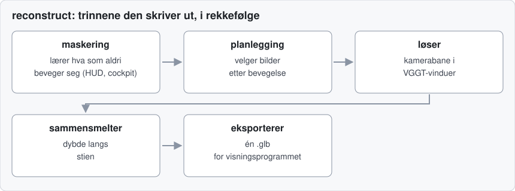

# Offline rekonstruksjon {#offline-reconstruction}

```bash
python -m heat3d_capture reconstruct lap.mp4 -o lap.glb [--solve-budget 260] [--fuse-interval 0.4]
```

Kode: [`scan/offline.py`](https://github.com/Holdi601/3DHeat-GameCapture/blob/main/heat3d_capture/scan/offline.py),
[`pose/feedforward.py`](https://github.com/Holdi601/3DHeat-GameCapture/blob/main/heat3d_capture/pose/feedforward.py),
[`pose/vggt_model.py`](https://github.com/Holdi601/3DHeat-GameCapture/blob/main/heat3d_capture/pose/vggt_model.py),
[`pose/feedforward_source.py`](https://github.com/Holdi601/3DHeat-GameCapture/blob/main/heat3d_capture/pose/feedforward_source.py),
[`pose/solveprep.py`](https://github.com/Holdi601/3DHeat-GameCapture/blob/main/heat3d_capture/pose/solveprep.py).
Valg: [Kommandoreferanse](commands.md#reconstruct).

## Hvorfor en andre bane {#why-a-second-path}

Inkrementell sporing er live og billig og fungerer der det finnes struktur å holde fast i: et interiør, en
gate, et kart med dekning. En **racerbane er dens verste tilfelle**: veien er et glatt bånd med lite tekstur,
horisonten beveger seg knapt, og når noen få posisjoner driver er det ingenting senere som trekker dem tilbake.
En runde kommer ut som en kurve som vandrer i stedet for å lukke seg.

Den offline banen gir **vinduer med bilder** til en modell som predikerer alle deres kameraer sammen, så hvert
bilde begrenser alle de andre direkte i stedet for gjennom en kjede. Den trenger hele opptaket før den kan svare,
så den er ikke live, og den er treg: minutter per vindu på en stasjonær GPU. Alt etter posisjonene - sammensmelting,
dekning, farge, eksport - er den samme koden som for en live skanning: den løste banen gis til rekonstruktøren som
en posisjonskilde, akkurat der Forza-telemetri går inn.

## Krav {#requirements}

- **PyTorch** tilpasset din GPU (ikke festet av dette prosjektet; installer det før `requirements.txt`, se [Kjøretid](runtime.md)).
- **`vggt`** - VGGT-modellkoden (`from vggt.models.vggt import VGGT`), fra Metas GitHub-depot; den ligger ikke i pakkeindeksen.
- **`transformers`**, fordi den offline banen kjører dybde gjennom PyTorch-`DepthEstimator` (Depth Anything V2 Small),
  ikke gjennom ONNX-filen.
- En CUDA-GPU i praksis; begge modellene faller tilbake til CPU, som ikke er praktisk.

Ingen av disse ligger i `requirements.txt`, fordi skanneren ikke trenger dem. De ligger i **`requirements-offline.txt`**,
med VGGTs egne avhengigheter (`einops`, `safetensors`, `huggingface_hub`, `Pillow`):

```bash
.venv\Scripts\python -m pip install -r requirements-offline.txt
.venv\Scripts\python -m pip install --no-deps "vggt @ git+https://github.com/facebookresearch/vggt.git"
```

VGGT installeres med `--no-deps` fordi pakkemetadataene låser `numpy<2`, som pip ville respektert ved å nedgradere
numpy som scipy trenger her. `reconstruct` sjekker alle disse rett etter at den har skrevet ut lisenslinjen (`OFFLINE`-listen i
[`runtime/preflight.py`](https://github.com/Holdi601/3DHeat-GameCapture/blob/main/heat3d_capture/runtime/preflight.py)),
lister det som mangler med størrelser, og installerer bare på et ja - VGGT med `--no-deps`, som over.
Å si nei, eller ingen terminal å spørre i, avslutter med kode 1.

## Modellen og lisensen {#the-model-and-its-licence}

**VGGT**, `facebook/VGGT-1B`: **CC-BY-NC-4.0, bare ikke-kommersiell bruk, og en rekonstruksjon laget med den arver det.**
Kommandoen skriver dette ut før den starter (`describe_licence`). Et separat lisensiert `facebook/VGGT-1B-Commercial` finnes,
men det er et sperret depot som Meta gir per konto, så det kan ikke være standard. `--model vggt-1b-commercial` løser med det
(og skriver ut lisenslinjen for det i stedet); uten innvilget tilgang feiler nedlastingen. VGGT-*koden* er under Metas egen
"VGGT License", en forskningsavtale med en retningslinje for akseptabel bruk (lest fra pakkens `LICENSE.txt`). Se
[Modeller og lisenser](models-and-licences.md).

## Kjøringen, steg for steg {#the-run-stage-by-stage}

Stegnavnene er det kommandoen skriver ut.



### masking {#masking}

En `FlowMask` læres fra **4 kjøringer på 90 sammenhengende bilder**, sentrert ved 1/8, 3/8, 5/8 og 7/8
av videoen, i 960 x 540 gråtoner (se [FlowMask](reconstruction-capture.md#flowmask-what-never-travels)).
Notatet skrives ut og beholdes i oppsummeringen. En video kortere enn 90 bilder får ingen maske.

#### Kameramasken læres, den brukes ikke {#the-camera-mask-is-learned-not-applied}

Masken brukes **ikke** på bildene som gis til løseren. Å maskere cockpiten så riktig ut etter bildestatistikk (de
fleste oppdagede hjørner ligger på kamerafestede piksler) - men det er en påstand om en trekkdetektor, og løseren er et
trent nettverk. Målt ved hvor mye den gjenvunne stien svinger mellom etterfølgende steg (en bil svinger noen få grader;
en tilfeldig gang nitti), ga rå bilder den minste svingen, kontrastløftede bilder litt mer, maskerte bilder klart mer,
og begge deler sammen mest. Så løseren får rå bilder. Masken brukes fortsatt til å planlegge bildeavstanden nedenfor, og
den inkrementelle sporeren bruker den i live-skanningen.
(`solveprep.enhance`, som maskerer og løfter lokal kontrast med CLAHE, finnes, men brukes ikke av denne kommandoen.)

### planlegging: bilder spredt etter bevegelse {#planning-frames-spaced-by-motion}

`plan_by_motion` velger løserens bilder etter **hvor mye bildet har beveget seg**, ikke etter klokken: et fast intervall
gir langsomme partier bilder de ikke trenger, og sulter de raske, der etterfølgende bilder slutter å overlappe nok til å
være relatert.

- Målforskyvning: **5 % av en 960-piksel bredde** (48 px) median ORB-trekkforskyvning mellom valgte etterfølgende bilder, målt på
  960 x 540 gråtonebilder med CLAHE-kontrast, trekk bare på masken.
- Start med et 0,3 s-intervall; etter hvert steg blir neste intervall
  `intervall x (0,5 + 0,5 x mål / målt)`, klemt til **0,15-2,0 s**, slik at én støyende måling ikke kaster planen.
- Når ingenting matchet, krymper intervallet til 0,6 av seg selv (for langt fra hverandre er feilen som unngås).
- Stopper ved slutten av videoen eller ved `--solve-budget`-bilder (standard 260).

Færre enn 4 planlagte bilder er en feil.

### løsing: vinduer og sammensying {#solving-windows-and-stitching}

De planlagte bildene dekodes i 960 px bredde og løses i **overlappende vinduer på 16 bilder, 6 delt** med neste
(`plan_windows`; det siste vinduet trekkes tilbake til å slutte på siste bilde, så slutten av et opptak har like mange naboer
som midten). Mer enn **400** bilder i én kjøring nektes.

Hvert vindu: bilder skaleres slik at lang side er **518** og begge sider er multipler av **14** (sideforholdet beholdes -
å klemme det ville feilaktig endret synsfeltet), skaleres til 0..1, og kjøres gjennom VGGT under bfloat16-autocast
(float16 går tom for eksponent på fjerne verdenskoordinater). Kameraenes ekstrinsiske parametere omregnes til
verden-fra-kamera-rotasjoner og kamerasentre. Punktkart beholdes ikke som standard.

Hvert vindu kommer tilbake i **sin egen vilkårlige ramme og sin egen vilkårlige skala**, så vinduene **sys sammen** inn i
den første rammen med en likhetstransformasjon (rotasjon, forskyvning, én skala) tilpasset kameraene de deler med det
som allerede er plassert:

- **Rotasjon fra kameraenes orientering**, ikke posisjonene: de delte kameraene står langs stien og er nesten kollineære
  på en rett strekning, noe som gjør at en tilpasning bare på posisjon ikke kan se rotasjonen - hvert vindu buer, og det
  sammensydde resultatet blir rett. Rotasjonen er gjennomsnittet av `mål_R x kilde_R^T` projisert tilbake på en ekte rotasjon
  (med en speilingsvakt).
- **Skala og forskyvning fra posisjonene**, langs den roterte kilden.
- Minst **4** delte kameraer kreves; færre er en feil.
- Overlappet er en tredjedel av vinduet, så skalaen er godt bestemt; skalafeil som hoper seg opp vindu for vindu er det som
  gjør at en runde spiraler.

For hver søm registreres den verste uenigheten mellom de delte kameraene etter tilpasningen, i enheter av gjennomsnittlig avstand
mellom dem (`seam_error`).

### sammensmelting {#fusing}

Bilder hver `--fuse-interval` sekund (standard 0,4) dekodes i 960 px bredde, får dybde av Depth Anything V2 Small (PyTorch), og
sammensmeltes med en posisjon **interpolert** fra den løste banen ved deres tidsstempel (lineær posisjon, sfærisk rotasjon;
`FeedForwardPoses`). Bilder utenfor det løste tidsspennet hoppes over i stedet for ekstrapolert. Kameraet bruker et
horisontalt synsfelt på **65 grader**. Fremoverkoblede posisjoner har sikkerhet 0,85 i sammensmelting og dekning.

### eksport {#exporting}

Nettet skrives som for en live skanning ([.glb-utdata](glb-output.md)), og får navn etter videoen.

## Oppsummeringen {#the-summary}

```text
140 cameras solved over 182s
closure error 3.1% of path length
worst seam 0.42 frame spacings
<mask note>
wrote lap.glb
```

| Linje | Betydning |
|---|---|
| closure error | avstand fra første til siste kamera over stiens lengde. For en enkelt runde er det den ærlige målingen av drift. Over 10 %: "Runden lukker seg ikke ... Behandle formen som upålitelig." |
| worst seam | den største sammensyingsuenigheten. Over 1,0: "Vinduene var uenige med opptil N bildeavstander i en søm, så en del av stien er sydd sammen på svak evidens." |
| ingen fil | "Sammensmeltingen ga ingen flate, så ingenting ble skrevet." Avslutningskoden er da 1. |

## Skala {#scale}

Den sammensydde stien er i den første vindusenhetens vilkårlige enheter. Dybden ankres ved å triangulere mellom de
interpolerte posisjonene (som for telemetri), så geometrien er i samsvar med stien - men **resultatet er ikke i meter**
med mindre stien er det. Ingenting i denne kommandoen fastsetter den globale skalaen; bakkekalibreringen brukes ikke når
posisjoner kommer fra en posisjonskilde.

## Status for denne banen {#state-of-this-path}

Med bilder i fast intervall løses vinduer til en sammenhengende sti på noen deler av en runde og et krusedullverk på andre;
feilene ligger i de stramme svingene, der synet svinger hardt mellom bilder, og å prøve de svingene tettere gjenoppretter dem.
Ingen bildestatistikk som ble prøvd (lysstyrke, detaljnivå, antall trekk, innliggerforhold, forskyvning) forutsa på forhånd
hvilke deler som ville feile. Så avstanden kan ikke fullt ut planlegges
ut fra bildene på forhånd: den må velges ved å løse, måle resultatet og løse på nytt tettere der stien ikke er en bil kunne
ha kjørt. Bevegelsesbasert planlegging er bygget; **den adaptive ny-løsningen er ikke**.
