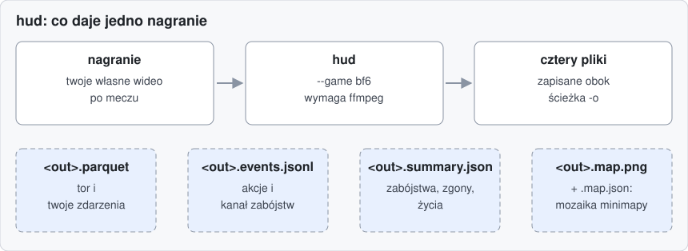

# Odczyt HUD z nagrania {#reading-the-hud-from-a-recording}

`hud` odczytuje z nagrania gry wyświetlany na ekranie HUD, czyli z **własnego** nagrania gracza, po meczu: **własne** akcje gracza z wyskakującego okienka, które gra pokazuje pod celownikiem (zabójstwa, asysty, ożywienia, zaopatrzenia, przejęcia...), zgony z ekranów padnięcia i rozmieszczenia, **własny** ślad z minimapy oraz kanał zabójstw obok nich jako zdarzenia z czasem. Wynik zapisuje jako tabelę 3DHeat, z mozaiką minimapy jako obrazem mapy do położenia pod śladem.

Krótko: obserwuje nagranie twojego meczu i zapisuje twoje zabójstwa, zgony oraz to, dokąd chodziłeś.

```bash
.venv\Scripts\python -m heat3d_capture hud "<recording>.mp4" --game bf6 --player <name> -o out/match
```

Battlefield 6 jest pierwszym profilem gry.



## Czego dotyka, a czego nie {#what-it-does-and-does-not-touch}

- Czyta **plik wideo**: klip ShadowPlay / Instant Replay, nagranie z OBS, cokolwiek, co dekoduje ffmpeg. Nigdy nie dotyka gry, jej pamięci, plików ani sieci, a działa dopiero po zakończeniu meczu. Zob. [Zasady](rules.md).
- Wyprowadza **tylko pozycję gracza**, z jego własnej minimapy. Znaczniki innych graczy na minimapie są maskowane i nigdy nie są odczytywane. Kanał zabójstw jest zachowany w całości, ale tylko jako to, co pokazuje na ekranie (kto, kogo, czym, kiedy); nie przypisuje się żadnej pozycji nikomu poza graczem.
- OCR działa lokalnie (RapidOCR z modelami PaddleOCR przez ONNX Runtime). Żadna klatka ani wycinek nie opuszcza komputera.
- Nagranie pokazuje nazwy innych graczy, a mozaika to obraz poziomu. Wyniki są przeznaczone do użytku gracza; trzymaj je lokalnie.

## Wymagania {#requirements}

- **ffmpeg i ffprobe** w `PATH`. Karta NVIDIA jest używana do dekodowania, gdy jest obecna (`-hwaccel cuda`); w przeciwnym razie dekoduje procesor, kilka razy wolniej.
- Pakiety z `requirements.txt` oraz OCR bez jego własnych zależności (OCR chce procesorowego `onnxruntime`, który koliduje z wersją DirectML używaną przez projekt):

```bash
.venv\Scripts\python -m pip install -r requirements.txt
.venv\Scripts\python -m pip install --no-deps rapidocr_onnxruntime==1.2.3
```

`rapidocr_onnxruntime` to czytnik tekstu (OCR), który odczytuje z ekranu nazwy i słowa. `--no-deps` nie pozwala mu zastąpić `onnxruntime` z DirectML, którego używa projekt.

Aby zainstalować ffmpeg w Windows: `winget install Gyan.FFmpeg`, potem otwórz nowy terminal i sprawdź poleceniem `ffmpeg -version`. Nowy w wierszu poleceń? Przeczytaj [Zanim zaczniesz](before-you-start.md).

- Nagranie **16:9** w dowolnej rozdzielczości (1080p, 1440p, 4K). Inne proporcje są odrzucane, bo obszary profilu trafiałyby w złe miejsca ekranu.
- **Domyślny układ HUD** gry. Przesunięty lub przeskalowany element HUD jest odczytywany w złym miejscu.

## Opcje {#options}

| Opcja | Domyślnie | Znaczenie |
|---|---|---|
| `video` | | Nagranie. |
| `-o`, `--out` | nazwa wideo, w bieżącym folderze | Ścieżka wyjściowa **bez** rozszerzenia; pliki to `<out>.parquet`, `.events.jsonl`, `.summary.json`, `.map.png`, `.map.json`. |
| `--game` | `bf6` | Czyj HUD czytać. `bf6` (Battlefield 6) jest na razie jedynym profilem. |
| `--player` | brak | Nazwa gracza tak, jak pokazuje ją kanał zabójstw. Porównywana luźno (OCR myli `l`/`I`/`1`, `O`/`0`, `rn`/`m`). Bez niej nazwa jest zgadywana (poniżej). |
| `--fps` | 5 | Próbki minimapy na sekundę. Kanał zabójstw jest próbkowany z połową tej częstotliwości, wyskakujące okienko punktów i ekrany zgonu także z połową (a z ćwiartką, gdy żadne okienko nie jest widoczne), kompas co 3 s, lista drużyny co 15 s. |
| `--start` | 0 | Sekunda wideo, od której zaczyna się odczyt. |
| `--seconds` | wszystko | Ile wideo odczytać. |
| `--metres-per-pixel` | brak | Skala minimapy, jeśli jest znana: metry na piksel minimapy przy zwykłym przybliżeniu (minimapa ma 296 pikseli szerokości na ekranie 1080p). Bez niej pozycje są w tych pikselach; zob. [Jednostki](#north-and-units). |
| `--cpu` | wyłączone | Dekoduj na procesorze, nawet gdy jest karta NVIDIA. |

Postęp jest wypisywany co pięć sekund; na końcu - gracz, zabójstwa, zgony, życia i zapisane pliki.

## Wyniki {#outputs}

### `<out>.parquet` - ślad i zdarzenia gracza {#parquet---the-players-track-and-events}

Jeden wiersz na próbkę, w której gracz był w grze i minimapę dało się umieścić, plus jeden na każde jego zdarzenie. Stopka zawiera instrukcje odczytu dla przeglądarki (klucz `heat3d`, `kind: heat3d-hud`), dzięki czemu przeglądarka mapuje każdą kolumnę bez pytania.

| Kolumna | Znaczenie |
|---|---|
| `time` | Sekundy od początku wideo. |
| `event` | `position`; `start` (wideo zaczęło się w połowie życia), `spawn` (z powrotem w grze po zgonie lub długiej przerwie), `death`, `downed` i `revived` (z ekranów padnięcia i rozmieszczenia, poniżej), `end` (życie się skończyło, bez wskazania powodu); własne akcje gracza z wyskakującego okienka punktów (`kill`, `assist`, `reviving`, `resupply`, `capture`... - [tabela zdarzeń](#event-table)); a linie kanału zabójstw dotyczące gracza jako `kill_feed`, `death_feed`, `teamkill_feed`, `suicide_feed`, `squadwipe_feed`. |
| `source` | Skąd pochodzi zdarzenie wiersza: `points` (okienko), `screen` (ekrany padnięcia i rozmieszczenia), `feed` (kanał zabójstw); puste w wierszach pozycji. |
| `text` | W wierszach `points`: znacznik tak, jak został wydrukowany (`KILL`, `SQUAD DAMAGE ASSIST`...), albo tytuł (`DOUBLE KILL`, nazwa wstążki), a dla nieznanego znacznika - to, co odczytano. |
| `points` | W wierszach `points`: o ile wzrósł wynik okienka w tym momencie. Gdy w tej samej próbce przyszło kilka akcji (zabójstwo i pojazd, w którym gracz był), to ich suma, podana przy każdej z nich, a `shared` mówi, ile akcji się dzieli. Puste, gdy suma nie została odczytana dwukrotnie po obu stronach tego momentu. |
| `subject`, `subject_side` | W wierszach `points`: nazwa, którą okienko pokazało przy akcji - ofiara zabójstwa albo ożywiony lub zaopatrzony kolega - oraz jej kolor (`enemy`, `friendly`, `squad`). |
| `confirmed` | `feed`, gdy kanał zabójstw miał linię dla tego samego zabójstwa lub zgonu (w ciągu 3 s, ta sama ofiara). |
| `x`, `y`, `z` | Pozycja na mozaice: `x` na wschód, `y` na północ, `z` 0 (stopka mówi, że `z` jest w górę). Północ jest prawdziwą północą, gdy kompas na to pozwolił (zob. `north_up` w podsumowaniu). |
| `player` | Zawsze `me`. Tylko wiersze gracza mają pozycje. |
| `team` | `own`. |
| `session` | `<nazwa wideo>#NN`, jedna na życie. Trasy trybu Linie nigdy nie przekraczają sesji. |
| `heading` | Stopnie zgodnie z ruchem wskazówek zegara od północy (od góry mozaiki, gdy północ jest nieznana): dokąd był zwrócony widok. |
| `dir_x`, `dir_y`, `dir_z` | To samo jako wektor kierunku, dla kierunku patrzenia w przeglądarce. |
| `zoom` | Jak bardzo minimapa była oddalona w stosunku do swojego zwykłego przybliżenia (powyżej 1 w pojazdach). |
| `killer`, `victim`, `weapon`, `headshot`, `marker` | W wierszach zabójstw i zgonów, które mają linię kanału zabójstw: ta linia (poniżej). Zabójstwo z okienka bez linii kanału zabójstw ma nazwę z okienka jako `victim`; zabójstwo z okienka pokazane jako HEADSHOT ma `headshot` równe true. |

Każdy wiersz zdarzenia przyjmuje pozycję gracza w czasie zdarzenia (przy zgonie lub padnięciu - ostatnią pozycję przed nim; przy ożywieniu - pierwszą po nim). Wiersze pasują bezpośrednio do [trybu Linie](https://holdi601.github.io/3DHeat/line-heat.html) w przeglądarce: jej podpowiedź wybiera `event`, zaczyna od `start`, `spawn` i `revived`, kończy na `death`, `downed` i `end`, a wiersze `position` leżą wzdłuż trasy. Pozostałe zdarzenia są nazwane tak, aby podpowiedź nie wzięła żadnego z nich za początek ani koniec: ożywienie kolegi to `reviving` (nie `revive`), utrzymanie punktu to `defense`, kolega pojawiający się przy graczu to `teammate_arrived`, a linie kanału zabójstw to `kill_feed` i tak dalej; `kill` nie jest końcem.

Klip z dwiema rundami na dwóch mapach daje dwie mozaiki, których nie da się powiązać. Największa to `<out>.parquet`; każda inna z co najmniej 30 s śladu jest zapisywana obok jako `<out>.map2.parquet`, `<out>.map2.map.png` i tak dalej.

### `<out>.events.jsonl` - zdarzenia gracza i kanał zabójstw {#eventsjsonl---the-players-events-and-the-kill-kanał zabójstw} {#eventsjsonl---the-players-events-and-the-kill-feed}

Jeden obiekt JSON na wiersz, w kolejności czasu, każdy z polem `source`:

- `points`: po jednym na każdą akcję gracza: `time`, `event`, `text`, `points`, `shared`, `subject`, `subject_side` (jak w tabeli), `popup` (z którego okienka, numerowane przez cały przebieg), `seen` (ile odczytów to pokazało), `confirmed` oraz `x`, `y` - gdzie był gracz.
- `screen`: po jednym na każde padnięcie i każde ożywienie: `event` (`death`, `downed` lub `revived`), `time` (kiedy gracz padł; dla `revived` - kiedy ekrany zniknęły), `until` (ostatnie zauważenie ekranów), `screens` (`down` i/lub `card`), `outcome` (`death`, `revived` albo `unknown`, gdy nagranie kończy się wcześniej), `killer` (z linii kanału zabójstw, gdy jest), `x`, `y`.
- `feed`: każda linia, którą pokazał kanał zabójstw, u wszystkich graczy:

| Pole | Znaczenie |
|---|---|
| `time`, `last` | Pierwsza i ostatnia próbka, w której odczytano linię (sekundy od początku wideo). `time` to moment, w którym pojawiło się zabójstwo, z dokładnością do jednej próbki kanału zabójstw (0.4 s przy domyślnej częstotliwości). |
| `kind` | Z punktu widzenia gracza: `kill`, `death`, `teamkill`, `suicide`, `squadwipe`; dla linii innych graczy `kill`, `squadwipe` albo `death` dla linii bez zabójcy. |
| `killer`, `victim` | Nazwy, jako najczęstszy odczyt we wszystkich próbkach pokazujących linię (dłuższy odczyt wygrywa, gdy zwykły jest jego początkiem: nazwa częściowo zasłonięta). `killer` jest pusty dla linii, na której widać tylko ikonę i ofiarę - śmierć od świata albo linia, której zabójca już zniknął. |
| `killer_side`, `victim_side` | Z koloru nazwy: `friendly` (drużyna gracza, niebieski), `enemy` (pomarańczowy), `squad` (blady zielony, którego gra używa dla gracza i jego oddziału), `neutral` (żaden z nich). |
| `weapon` | Klasa ikony broni w tym przebiegu: `icon01`, `icon02`... Linie o podobnych ikonach mają wspólną klasę. Ikony nie są nazwane; nie ma listy, z której można by je nazwać. |
| `marker` | Mała ikona między bronią a ofiarą: `skull`, `arrow`, `chevrons`, `crosses` lub puste. |
| `headshot` | `marker == "skull"` - założenie, zob. [Ograniczenia](#limits). |
| `seen` | Ile próbek kanału zabójstw pokazało linię. |
| `me` | `killer`, `victim` albo null. |
| `matched` | Dla linii własnych gracza: czy znaleziono dla niej akcję z okienka lub ekran zgonu. |
| `x`, `y` (, `map`) | Dla linii własnych gracza: gdzie był. |

### `<out>.summary.json` {#summaryjson}

Gracz (i to, jak został znaleziony), skąd pochodzą jego zdarzenia (`own_events_from`: okienko i ekrany albo sam kanał zabójstw, gdy nie odczytano żadnego z nich), zabójstwa, zgony, K/D, trafienia w głowę, asysty, ożywienia wykonane (`revives`) i otrzymane (`revived`), padnięcia, przejęcia, neutralizacje, zaopatrzenia, leczenia, naprawy, zniszczone pojazdy, wynik (suma wyników z okienek), każdy typ akcji z jego liczbą (`actions`), liczba okienek, zgony znane tylko z kanału zabójstw, własna liczba zabójstw i zgonów kanału zabójstw oraz ile jego zabójstw pasowało do akcji z okienka, zabójstwa drużynowe, samobójstwa, wyczyszczenia oddziałów, życia, sekundy w grze, przebyty dystans (w jednostkach tabeli), linie kanału zabójstw, dla każdej mapy to, czy jest północą do góry i ile odczytów kompasu się zgadza, liczniki śladu (próbki, w grze, umieszczone, nieumieszczone, wyspy), przyjęte założenia oraz czasy.

### `<out>.map.png` i `<out>.map.json` - mapa pod śladem {#mappng-and-mapjson---the-map-under-the-track}

Mozaika każdej minimapy z przebiegu, uśredniona, z usuniętymi nakładkami, obrócona i przeskalowana dokładnie jak tabela. Plik JSON obok zawiera dwie kotwice, o które prosi opcja **Obraz mapy…** w przeglądarce ([Mapy jako obrazy](https://holdi601.github.io/3DHeat/map-images.html) w dokumentacji przeglądarki): wczytaj PNG przyciskiem **Obraz mapy…**, zostaw włączone **Odwróć północ/południe** i wpisz kotwicę 1 oraz kotwicę 2 (`px`, `py`, `worldX`, `worldZ`) z pliku. Obraz leży wtedy dokładnie pod śladem.

Na obrazie są tylko te części poziomu, które pokazała minimapa gracza.

## Metoda {#method}

### Dekodowanie {#decoding}

ffmpeg dekoduje na karcie graficznej, schodzi do częstotliwości próbkowania, zanim klatki opuszczą kartę, wycina obszary profilu (minimapę, kanał zabójstw, dwa paski kompasu, listę drużyny, okienko punktów, słowa na ekranie padnięcia, prawy dolny róg), skaluje każdy do stałego rozmiaru i układa w jeden mały obraz na próbkę. Tylko ten obraz przechodzi do Pythona. Dekodowanie każdej klatki strumienia H.264 jest dolną granicą czasu działania.

Dwa wątki robocze biorą próbki: jeden dopasowuje minimapy (OpenCV), drugi czyta tekst (ONNX Runtime).

### Czy gracz jest w grze {#in-play-or-not}

Kwadrat podpowiedzi klawisza na minimapie (jasny kwadrat z kluczem mapy, w lewym dolnym rogu minimapy) jest rysowany zawsze, gdy rysowana jest minimapa, a nie na ekranach zgonu, kamery zabójcy, rozmieszczenia, menu ani tabeli wyników. Jego obecność - jasny, bezbarwny kwadrat z ciemną literą w środku, wyraźnie jaśniejszy od otoczenia - szukana kilka pikseli wokół swojego miejsca, jest testem bycia w grze. Pojedyncza próbka, która nie zgadza się z obydwoma sąsiadami, jest ignorowana.

Przerwa w grze to zgon albo zmiana rundy (następny odcinek zaczyna się od `spawn`), gdy trwa co najmniej 6 s albo gdy zgon (z ekranów lub z linii kanału zabójstw, w której gracz jest ofiarą) przypadł w ciągu 40 s przed nią. Krótsza przerwa bez zgonu (otwarta duża mapa) kontynuuje życie. Minimapa zostaje na ekranie, gdy gracz leży na ziemi, więc powalony gracz jest w grze.

### Ślad {#the-track}

Minimapa obraca się razem z widokiem i trzyma gracza w stałym punkcie (zmierzonym: środek, 49.7% w dół). Każda próbka:

1. **Maska** - wszystko, co nie jest poziomem: mocno nasycone lub prawie białe piksele (znaczniki celów, ikony oddziału i pojazdów, pingi, granica obszaru gry, linie trasy, tekst), bladożółtozielony stożek widoku, koło wokół znacznika gracza, klin stożka nad nim, kwadrat podpowiedzi klawisza oraz cienka obwódka.
2. **Cechy**: punkty SIFT na wyrównanym kontrastowo szarym obrazie minimapy, wewnątrz maski.
3. **Dopasowanie do mozaiki**, nie do poprzedniej próbki: punkty dopasowuje się do cech zapisanych dotąd, we współrzędnych mozaiki, w pobliżu miejsca, w którym gracz był ostatnio; podobieństwo (obrót, zoom, przesunięcie) dopasowuje się metodą RANSAC. Dopasowanie wymaga wystarczająco dużo punktów zgodnych (inliers), zoomu w granicach jednej trzeciej poprzedniego i przesunięcia mniejszego niż jedna trzecia minimapy na próbkę; dopasowanie szukane gdziekolwiek na mozaice (po zgonie) wymaga dwukrotnie więcej punktów zgodnych.
4. **Rozbudowa mozaiki**: cechy, których mozaika jeszcze nie ma, są dodawane (co najwyżej co kilka dziesiątych sekundy ruchu), a zamaskowana minimapa jest uśredniana w obraz.
5. Punkt gracza przeniesiony przez dopasowanie jest jego **pozycją**; góra minimapy przeniesiona przez to samo dopasowanie jest jego **kierunkiem** na mozaice.

Potem punkt, który przeskakuje o więcej niż 10 pikseli od obu dwóch próbek przed nim i obu dwóch po nim (które zgadzają się ze sobą), jest odrzucany: minimapa czasem dopasowuje się przy złym zoomie na jedną próbkę. Podsumowanie je liczy (`dropped_as_jumps`).

Dopasowanie do mozaiki powstrzymuje sumowanie się błędów: powrót w to samo miejsce dopasowuje się do cech zapisanych za pierwszym razem. Odrodzenie w miejscu jeszcze nie widzianym zaczyna osobną **wyspę**; co dziesiątą umieszczoną próbkę porównuje się z pozostałymi wyspami, a pierwsze dobre dopasowanie je łączy (mniejsza wchodzi w większą, razem ze swoim śladem). Wyspy, które nigdy się nie połączyły (inna mapa albo teren nigdy nie wspólny), są zapisywane osobno, jak wyżej.

<a id="north-and-units"></a>
### Północ i jednostki {#north-and-units}

Pasek kompasu jest odczytywany co 3 s: jego etykiety szuka się po tuszu (jasny, bezbarwny, zgrupowany po małych przerwach, kreski pominięte), każda czytana osobno; dwie lub więcej etykiet ustala zarówno skalę paska, jak i namiar pod środkowym znacznikiem - pojedyncza etykieta nic nie ustala. Każdy odczyt kompasu jest sparowany z kierunkiem mozaiki tej samej próbki; kołowa mediana różnic z odczytów w granicy 10 stopni od niej to obrót, który ustawia mozaikę północą do góry. Jest stosowany, gdy zgadza się co najmniej trzech odczytów i połowa wszystkich.

<a id="units"></a>Skala terenu minimapy nie jest nigdzie wypisana na ekranie, więc pozycje są w **pikselach minimapy przy zwykłym przybliżeniu**: mediana zoomu przebiegu jest przeskalowana na jedną jednostkę tabeli na piksel 296-pikselowej minimapy (jej rozmiar na ekranie 1080p). Pomniejszenie w pojeździe jest usuwane przez dopasowanie, więc jednostka jest taka sama pieszo i w pojeździe. `--metres-per-pixel` mnoży wszystko przez metry, gdy skala jest znana (z odległości na mapie zmierzonej raz).

### Kanał zabójstw {#the-kill-kanał zabójstw} {#the-kill-feed}

Kanał zabójstw jest odczytywany z częstotliwością 2.5 próbki na sekundę, ale tylko wtedy, gdy jego kolorowe piksele wyraźnie się zmieniły albo minęły 2 s. Linie tekstu znajduje detektor OCR; linia, której obraz pasuje do odczytu z poprzedniej próbki (wiersze się przewijają, więc mogła się przesunąć), przejmuje ten tekst zamiast być odczytywana ponownie. Linie zbyt małe na nazwę albo z ukośnikiem (licznik fps w tym rogu) są odrzucane.

Linie są grupowane w wiersze według wysokości; w wierszu najbardziej lewa nazwa to zabójca, a najbardziej prawa - ofiara. Sąsiadujące kawałki tego samego koloru łączą się (nazwa ze spacją). Pojedyncza linia, która przebiegła przez ikonę od jednej nazwy do drugiej, jest cięta w najszerszej przerwie, gdy połówki różnią się kolorem, i każda połówka jest czytana ponownie. Pojedyncza nazwa w kolumnie ofiar z ikoną tuż po lewej to linia bez zabójcy. Dwa kawałki w jednym kolorze bez ikony między nimi to jedna nazwa, której zabójca zniknął, a nie zabójstwo.

**Strony** wynikają z koloru. Nazwy są rysowane z pewną przezroczystością, więc test dotyczy tego, jak daleko tekst jest od własnego tła: znak czerwieni minus błękitu w tej różnicy to pomarańczowy (wróg) albo niebieski (przyjaciel) na każdym tle; żaden z nich, przy zielonym powyżej dwóch pozostałych, to kolor oddziału.

**Ikony**: między nazwami piksele w kolorze zabójcy tworzą sylwetkę broni; mała, osobna ikona tuż przed ofiarą to znacznik, nazwany po kształcie (plama z dziurami na oczy to czaszka, mały trójkąt - strzałka, kilka kawałków - krzyże).

**Zdarzenia**: wiersz odczytany ponownie, z obiema nazwami takimi samymi (podobieństwo 0.7 po uwzględnieniu typowych pomyłek OCR, jedna 0.8; odczyt ucięty pasuje do początku pełnej nazwy), to to samo zdarzenie, dopóki zdarzenie było ostatnio odczytane mniej niż 5 s wcześniej i ma mniej niż 14 s. Żaden wiersz nie zostaje na ekranie dłużej, więc ta sama para później to nowe zabójstwo. Wiersz bez zabójcy pasuje tylko po ofierze. Czas zdarzenia to jego pierwsze zauważenie; nazwy, strony i znacznik to większość z kolejnych zauważeń; wiersze odczytane tylko raz są odrzucane.

**Gracz**: `--player`, a w przeciwnym razie podświetlony (najjaśniejszy) wiersz listy drużyny, gdy są co najmniej trzy odczyty i 60% się zgadza, a w przeciwnym razie nazwa, którą kanał zabójstw najczęściej rysował kolorem oddziału. Inaczej podsumowanie mówi, że gracz jest nieznany, i żadna linia kanału zabójstw nie jest mu przypisywana. (Okienko i ekrany zgonu są własne gracza, bez względu na jego nazwę; nie potrzebują nazwy.)

### Okienko punktów {#the-points-popup}

Wszystko, co gracz zdobywa, Battlefield 6 pokazuje w jednym okienku tuż na lewo i pod celownikiem - w tym samym miejscu pieszo, w pojeździe i przez celownik:

```
            [ RIBBON ] (icon)          a title, now and then: a ribbon or a multi-kill
      (icon)(icon)(icon)  300          one icon per action; the popup's running total
                Some_Name              who it was about, for a moment: orange an enemy, blue a teammate
    [ KILL x2 ] [ VEHICLE DESTROYED ]  one boxed tag per kind of action, with a count
```

Okienko rośnie, gdy gracz zdobywa punkty: nowe zabójstwo zamienia `KILL` w `KILL x2`, dodaje ikonę i podnosi sumę; nowy rodzaj akcji dodaje znacznik. Rząd znaczników pokazuje ostatnie kilka rodzajów (starszy wysuwa się i liczy dalej, gdy wróci). Około trzech sekund po ostatniej akcji okienko składa się w jedną linię (`[KILL x2] 300`) i znika. Tekst jest jasnoszary, znaczniki w cienkich ramkach, suma dużymi cyframi zaczynając od x 760 na ekranie 1920x1080, a znaczniki wyrównane do prawej do x 750.

Jest odczytywane 2.5 razy na sekundę: detektor OCR znajduje linie tekstu, czytane są tylko linie w jednym z wierszy okienka (etykiety celownika czołgu w tym samym obszarze są pomijane), a linia, której obraz pasuje do odczytu sprzed jednej próbki, przejmuje ten tekst. Linia przechodząca od ikony, nazwy albo złożonego znacznika do sumy (`Name10`, `REVIVE185`) jest cięta tam, gdzie zaczyna się suma (x 755), i obie połówki są czytane ponownie. Gdy okienko nie jest widoczne, co drugą próbkę pomija się bez odczytu; gdy następna pokaże okienko, wstrzymana zostaje odczytana najpierw, więc początek okienka jest znajdowany co do próbki.

**Znaczniki** dopasowuje się do [tabeli zdarzeń](#event-table) po uwzględnieniu typowych pomyłek rozpoznawania (Q jako O, cyfra między literami, I zamiast L, zgubiona litera na brzegu): odczyt jest znacznikiem, gdy jest podobny w co najmniej 80% do jednego (85% dla znaczników do pięciu liter) i wyraźnie bliższy jemu niż jakiemukolwiek innemu. Znaczniki, które rozpoznawacz sklejył (`CAPTUREDORDERCOMPLETED`), są rozdzielane przez odcinanie znanych znaczników z przodu. Liczba to `x2`, `X3`, przypadkowy znak i cyfra albo cyfra zaraz po znaczniku. Jasnoszara linia wielkimi literami w rzędzie znaczników, która nie pasuje do niczego, jest zachowywana jako akcja `points` z tekstem; linia, która jest częścią znanego znacznika w tym samym okienku (`DESTROYED` obok `VEHICLE DESTROYED`), nie jest. Tytuły nad sumą (jasne ramki, ciemny tekst) to `multi_kills` (`DOUBLE KILL` ...) albo `ribbon`. Nazwa to kolorowa linia między sumą a znacznikami; jej strona wynika z koloru, jak w kanale zabójstw.

**Okienka i akcje**: odczyty z mniej niż 0.9 s przerwy między nimi to jedno okienko. Okienko, które wydaje się skończyć i wraca, zanim mogłoby się złożyć (w ciągu 3.2 s od ostatniego wzrostu), z każdym znacznikiem na swojej liczbie lub wyżej i sumą nie mniejszą, jest tym samym okienkiem, chwilowo zgubionym (rozmycie, jasne tło) - nic w nim nie jest liczone podwójnie. W okienku ostateczna liczba znacznika to najwyższa liczba odczytana co najmniej dwa razy; jego k-ta akcja jest datowana na pierwszy odczyt pokazujący liczbę k lub więcej. Liczba odczytana tylko w jednej próbce nie jest akcją - za wyjątkiem zabójstwa, które potwierdza kanał zabójstw (linia gracza w ciągu 3 s, której nie przypisało inne zabójstwo): krótki znacznik KILL to ten, który rozpoznawacz najczęściej czyta tylko raz. Tytuł liczy się raz na okienko, gdy zostanie odczytany dwa razy. `points` to o ile suma - liczona tylko dla sum odczytanych dwa razy z rzędu - wzrosła od próbki przed akcją do próbki po niej.

Nieznana linia liczy się jako znacznik tylko w wierszu znanych znaczników w tym samym odczycie (albo, gdy nie ma znanego znacznika, wtedy gdy nie ma też nazwy), więc nazwa w kolorze, którego test stron nie rozpozna, nie jest brana za znacznik.

### Zgony i ożywienia {#deaths-and-revives}

Gdy gracz pada, gra mówi to pod środkiem ekranu (MAN DOWN, REQUEST REVIVE, SKIP (HOLD), NEARBY MEDICS; gdy ożywienie zostało zażądane, REVIVE REQUESTED, CANCEL REQUEST), a karta w prawym dolnym rogu podaje, kto to zrobił, z DAMAGE LOG lub PLAYER CARD pod spodem i linią „YOU n - n FOE” nad nią. Zabity od razu (śmiertelny strzał w głowę) - widać tylko kartę. Potem albo kolega ożywia gracza - ekrany znikają i gra toczy się dalej - albo gracz się wykrwawia lub poddaje, a po tym następuje ekran rozmieszczenia z DEPLOY w prawym dolnym rogu.

Te słowa czyta się razem z okienkiem, w tym samym przebiegu OCR (okienko, pasek ekranu padnięcia i prawy dolny róg ułożone jeden nad drugim): 2.5 razy na sekundę, gdy okienko jest widoczne, 1.25 razy w przeciwnym razie. Róg jest uwzględniany tylko wtedy, gdy gracz jest poza grą albo był widziany na ziemi w ciągu ostatnich 3 s; w grze zawiera tylko liczbę amunicji. Zauważenia oddalone od siebie o mniej niż 4 s tworzą jeden epizod (co najmniej dwa zauważenia). Epizod to **zgon**, gdy ekran rozmieszczenia pojawia się w ciągu 12 s od jego końca, albo gdy gracz jest poza grą 3 s po nim i zostaje tam przez 6 s lub dłużej. To **ożywienie** (`downed`, potem `revived`), gdy gracz jest nadal w grze 3 s po zniknięciu ekranów. `unknown` (zapisywane jako samo `downed`), gdy nagranie kończy się wcześniej. Czas zgonu to moment, w którym gracz padł: linia kanału zabójstw, w której jest on ofiarą, jeśli jest w ciągu 3 s przed epizodem, a w przeciwnym razie pierwsze zauważenie epizodu minus pół odstępu odczytów. Pozycje po zgonie są pomijane w trasie aż do ekranu rozmieszczenia.

Zgon z kanału zabójstw, którego żaden epizod nie tłumaczy (ekrany zostały przegapione), to nadal `death`, z `source` `feed`, i jest oceniany jak wyżej: jeśli gracz pozostaje w grze dłużej niż 40 s po nim, został ożywiony.

<a id="event-table"></a>
### Tabela zdarzeń {#event-table}

Czym staje się każdy znacznik, tytuł i ekran. Kilka znaczników może być jednym zdarzeniem; `text` zachowuje, który to był.

| Zdarzenie | Skąd | Znaczenie |
|---|---|---|
| `kill` | KILL; HEADSHOT | Gracz zabił kogoś (nazwa to ofiara). Trafienie w głowę pokazuje HEADSHOT zamiast KILL: `text` mówi, który, a `headshot` jest true. |
| `assist` | ASSIST, KILL ASSIST, DAMAGE ASSIST, SQUAD DAMAGE ASSIST | Obrażenia zadane komuś, kogo zabił kolega. |
| `kill_assist` | ASSIST COUNTS AS KILL | Asysta, którą gra liczy jako zabójstwo. |
| `suppression`, `suppression_assist` | ENEMY SUPPRESSION; SUPPRESSION ASSIST | Ogień zaporowy na wroga; na takiego, którego potem zabił kolega. |
| `smoke_assist` | SMOKE ASSIST, SQUAD SMOKE ASSIST | Dym, który osłonił kolegę. |
| `spot`, `spot_assist` | SPOT, SPOTTED, ENEMY DESIGNATION; SPOT ASSIST, SPOT BONUS | Wykrycie wroga; zabójstwo kogoś, kogo gracz wykrył. |
| `driver_assist` | DRIVER ASSIST | Zabójstwo przez strzelca pojazdu gracza. |
| `reviving`, `reviving_bonus` | REVIVE, SQUAD REVIVE; CONCEALED REVIVE | Gracz ożywił kolegę; premia za zrobienie tego pod osłoną. |
| `heal` | HEAL, SQUAD HEAL | Gracz uleczył kolegę. |
| `resupply` | SUPPLY, RESUPPLY, SQUAD SUPPLY | Kolega wziął amunicję od gracza. |
| `repair` | REPAIR, VEHICLE REPAIR, SQUAD REPAIR | Gracz naprawił pojazd. |
| `capturing`, `capture` | CAPTURING, RECAPTURING; CAPTURED, OBJECTIVE CAPTURED | Takt przejmowania; przejęty cel. |
| `neutralizing`, `neutralize` | NEUTRALIZING; NEUTRALIZED, OBJECTIVE NEUTRALIZED | To samo przy zdejmowaniu wrogiego celu do neutralnego. |
| `defense` | DEFENDING, OBJECTIVE DEFENDED | Utrzymanie celu. |
| `offensive`, `defensive` | OFFENSIVE; DEFENSIVE | Premia za akcję blisko atakowanego celu; obrona. |
| `order` | ORDER COMPLETED | Wykonany rozkaz oddziału. |
| `vehicle_damage`, `vehicle_disabled`, `vehicle_destroyed`, `vehicle_destroyed_assist` | VEHICLE DAMAGE; VEHICLE DISABLED; VEHICLE DESTROYED; VEHICLE DESTROYED SUPPORT | Obrażenia wrogiego pojazdu, aż do zniszczenia go albo pomocy w tym. |
| `equipment_destroyed` | EQUIPMENT DESTROYED | Zniszczony wrogi gadżet. |
| `forced_bail` | FORCED BAIL | Wróg zmuszony do opuszczenia pojazdu. |
| `squad_wipe` | SQUAD WIPE | Ostatni z wrogiego oddziału zabity. |
| `savior`, `avenger` | SAVIOR; AVENGER | Zabójstwo wroga, który raził kolegę; zabójstwo kogoś, kto właśnie zabił kolegę. |
| `teammate_arrived` | SPAWNED ON, SPAWN ASSIST, VEHICLE SPAWN, SQUAD VEHICLE SPAWN | Kolega odrodził się przy graczu albo w jego pojeździe. |
| `transport` | TEAM TRANSPORT | Przewożenie kolegów w pojeździe. |
| `fortify` | DEFENSE DEPLOYED | Umocnienie zbudowane przez gracza. |
| `points` | cokolwiek innego w rzędzie znaczników | Akcja, której tabela nie zna: `text` to to, co odczytano. |
| `multi_kills` | DOUBLE KILL, TRIPLE KILL, QUAD KILL, MULTI KILL (tytuł) | Zabójstwa w szybkim następstwie. |
| `ribbon` | każdy inny tytuł | Wstążka, po nazwie (BALLISTIC, TANK BUSTER, ENGINEER EXPERT, SPEARHEAD...). |
| `downed` | ekran padnięcia, potem gra | Gracz padł i został ożywiony. |
| `revived` | zniknięcie ekranów, gra toczy się dalej | Gracza ożywił kolega. |
| `death` | ekran padnięcia lub karty, potem rozmieszczenie albo poza grą | Gracz zginął. |

Teksty w tabeli zostały zobaczone w nagraniach testowych, poza tymi, które są zwykłymi nazwami z serii gier i znalazły się w tabeli, żeby były nazwane, a nie zachowane jako `points`: HEADSHOT KILL, ASSIST, KILL ASSIST, ASSIST COUNTS AS KILL, SPOT, SPOTTED, SPOT ASSIST, SPOT BONUS, SQUAD REVIVE, HEAL, SQUAD HEAL, RESUPPLY, SQUAD SUPPLY, REPAIR, VEHICLE REPAIR, SQUAD REPAIR, VEHICLE DISABLED, SQUAD WIPE, AVENGER, formy OBJECTIVE ... oraz tytuły TRIPLE KILL, QUADRUPLE KILL i MULTI KILL. Gra w innym języku wypisuje inne słowa: jej znaczniki wychodzą jako `points` z tym, co odczytano - nie są mylone z żadną znaną akcją - wraz z sumami i nazwami; a ponieważ ekrany zgonu rozpoznaje się po angielskich słowach, zgony wtedy pochodzą z samego kanału zabójstw, jako wiersze `death` z `source` `feed`.

## Co jest sprawdzone {#what-is-verified}

Sprawdzone okiem na nagraniach testowych (gracza, nie część repozytorium) przez rysowanie losowych próbek i porównywanie każdej z klatkami wokół niej:

- **Własne zdarzenia gracza.** Każda sprawdzona akcja z okienka była prawdziwą akcją tego rodzaju, znalezioną w ciągu jednego odczytu (0.4 s) od swojego czasu; większość wartości i nazw była poprawna (nazwy w niektórych alfabetach, np. cyrylicy, mogą wyjść zniekształcone). Każdy sprawdzony ekran zgonu został znaleziony.
- **Kanał zabójstw.** Zdecydowana większość wierszy kanału zabójstw została znaleziona z obiema poprawnymi nazwami; drobne pomyłki OCR (wielkie I odczytane jako małe l) są dopuszczalne. Nazwy rysowane glifami, które sama gra pokazuje jako pudełka, mogą zostać pominięte. Strony (kolory) są błędne dla kilku procent nazw.
- **W grze.** Test podpowiedzi klawisza zgadzał się z klatką w każdym sprawdzonym momencie.
- **Ślad.** Nie ma prawdziwych danych o tym, gdzie był gracz, więc ślad sprawdza się z samym nagraniem: dwie minimapy dopasowuje się **bezpośrednio do siebie**, a to przesunięcie porównuje się z przesunięciem między dwiema pozycjami w tabeli. Mediana rozbieżności to około 1-3 piksele minimapy (poniżej 1% szerokości minimapy), więcej na zatłoczonej, oddalonej minimapie. Odczyty kompasu zgadzają się z mozaiką w granicy 10 stopni prawie zawsze.
- **Czas działania.** Dekodowanie idzie około 5 razy szybciej niż w czasie rzeczywistym, to większość czasu; odczyt okienka punktów dokłada od jednej piątej do połowy.

Obejrzane okiem: każda mozaika ma ciągłe drogi i budynki przez wszystkie życia, które ją zbudowały, a trasy różnych żyć wzdłuż tej samej drogi leżą jedna na drugiej. Odcinek, na którym zoom minimapy się zmienia, może wyjść za długi - zob. [Ograniczenia](#limits).

Testy (`tests/test_hud_*.py`) rysują wszystko, co czytają: wymyślony poziom z drogami, budynkami i poziomicami, minimapy spacerów po nim z nakładkami, które ma prawdziwa, paski kompasu, wiersze kanału zabójstw z wymyślonymi nazwami. Sprawdzają, że pętla jest śledzona z dokładnością do dwóch pikseli i się zamyka; że stojący gracz zostaje w miejscu, gdy widok się obraca; że zmiany zoomu są śledzone; że odrodzenie gdzie indziej jest łączone z powrotem, gdy ścieżki się spotkają; że obrót na północ i odwrócenie osi y stawiają ślad tam, gdzie naprawdę poszedł; że kotwice obrazu mapy wyrównują go pod śladem; oraz odczytywanie kanału zabójstw, strony, znaczniki i deduplikację. Dla własnych zdarzeń gracza rysują okienka punktów z wymyślonymi nazwami i znacznikami i sprawdzają tabelę znaczników z jej tolerancją na pomyłki rozpoznawania, znaczniki sklejone razem, wiersze okienka, sumę odciętą od nazwy, liczenie przy rosnącym okienku, przetrwanie chwili bez odczytu, wysuwanie znacznika i powrót albo koniec; że liczba odczytana raz jest trzymana osobno; zgony, ożywienia i wyniki z tekstu ekranów; a na wymyślonym meczu - że akcje, zgony i ożywienia lądują w tabeli tam, gdzie był gracz, linie kanału zabójstw obok nich pod własnymi nazwami, a trasa kończy się przy zgonie, a nie przy ożywieniu.

<a id="limits"></a>
## Ograniczenia {#limits}

- **Jednostki to piksele minimapy**, nie metry, chyba że podano `--metres-per-pixel`. Nic na ekranie gry nie podaje skali terenu minimapy.
- **Mapowane jest tylko to, co pokazała minimapa.** Mozaika obejmuje teren w promieniu połowy minimapy od miejsc, w których był gracz; dwie mozaiki, które nigdy nie miały wspólnego terenu (dwie rundy na dwóch mapach albo dwa życia w odległych rogach dużej mapy), zostają osobnymi plikami z niepowiązanymi współrzędnymi.
- **Ślad to ślad minimapy, 5 próbek na sekundę**, niewygładzony niczym. Minimapa mocno oddalona (w nagraniach testowych helikopter oddalił ją 2.3 razy) pokazuje mniej szczegółów na piksel, a poza obszarem gry prawie żadnych, więc dopasowanie tam jest grubsze. Odrzutowce oraz gracz jako pasażer nie wystąpiły w nagraniach testowych.
- **Błędy dopasowania są lokalne i się nie sumują**, ale mozaika zbudowana podczas eksploracji nowego terenu może mieć małe wygięcie, które zostaje naprawione dopiero wtedy, gdy teren zostanie zobaczony ponownie. Tam, gdzie zoom minimapy zmienia się w sposób ciągły (pojazd przyspiesza), dopasowany zoom może dryfować; jeden taki odcinek widziano z dystansem około dwukrotnie większym od prawdziwego. Mozaika z zatłoczonej, oddalonej minimapy piechoty jest najmniej dokładna (błędy typowo około 3 pikseli, najwyżej 18).
- **Brak optymalizacji grafu pozycji.** Pętla zamyka się przez dopasowanie zapisanych cech, a nie przez rozłożenie korekty na całą pętlę.
- **Klasy broni jeszcze nie działają.** Sylwetka ikony pochodzi z przezroczystej ikony na ruchomym tle i zmienia się zbyt mocno z próbki na próbkę: nagrania testowe dały 220 do 340 klas dla 550 do 670 linii, podczas gdy dopasowanie ma kilkanaście do kilkudziesięciu broni. Traktuj `weapon` jako eksperymentalne. Klasy są i tak przypisywane na przebieg i nie są nazwami.
- **Znaczenia znaczników nie są wszystkie znane.** Strzałka (`▸`) jest rysowana przed własną nazwą gracza w liniach o nim; nie jest rodzajem zabójstwa. Czaszka jest traktowana jako trafienie w głowę; to założenie, a nie coś, co mówi gra. `chevrons` i `crosses` (wyczyszczenia oddziałów) są podawane tak, jak widziano.
- **Nazwy w pismach innych niż łacińskie** (np. cyrylica) wychodzą jako najbliższe łacińskie podobne litery: rozpoznawacz czyta łacinkę i chińskie znaki. Ten sam gracz czyta się zawsze tak samo, więc wciąż się dopasowują, ale tekst nie jest jego nazwą.
- **Nakładki w rogu kanału zabójstw** (licznik fps) mogą zasłonić koniec ofiary w górnym wierszu. Tekst licznika jest rozpoznawany i odrzucany, a nazwa ucięta jest dopasowywana do swoich pełnych odczytów, ale nazwa widziana tylko ucięta zostaje ucięta.
- **Zgon, którego nie pokazały ani ekrany, ani kanał zabójstw**, nadal kończy trasę jako `end`, gdy gracz opuszcza grę na 6 s lub dłużej.
- **Otrzymane ożywienia** pochodzą z ekranów padnięcia. Tylko dla zgonu z kanału zabójstw, którego ekrany nie złapały, są nadal wnioskowane (gracz w grze ponad 40 s po nim), a szybkie ożywienie wtedy nie jest odróżniane.
- **Akcje z okienka są datowane na odczyt**: w ciągu 0.4 s od pierwszego pokazania się znacznika; znacznik, który się animuje, może być odczytany o jedną próbkę za późno lub za wcześnie.
- **Nazwy w wierszach okienka** czyta się tak jak w kanale zabójstw: pisma inne niż łacińskie wychodzą zniekształcone, a od czasu do czasu etykieta nazwy kolegi unosząca się w świecie obok okienka bywa czytana jako nazwa akcji. Akcje bez nazwy (takt przejmowania, rozkaz) nie mają nazwy.
- **`points`** brakuje tam, gdzie suma nie została odczytana dwukrotnie po obu stronach akcji, a także jest dzielony między akcje z tej samej próbki. `score` w podsumowaniu sumuje ostateczne sumy okienek, więc okienko, którego suma nigdy nie została odczytana dwa razy, do niego nie wchodzi.
- **Rząd znaczników to okno**: przy czterech lub więcej rodzajach w jednym okienku najstarszy znacznik wysuwa się w lewo, poza brzeg odczytywanego obszaru. Był liczony, gdy był widoczny; liczba, którą zyskuje, będąc na wpół poza ekranem, może zostać pominięta.
- **Okienko nieczytelne dłużej, niż mogłoby trwać** (ponad około 4 s nieczytelnych próbek, podczas gdy wciąż rosło) jest uznawane za dwa, a znacznik z liczbą powyżej jednego jest wtedy liczony ponownie. Nie zauważono tego w poniższych sprawdzeniach.
- **Inne języki interfejsu**: znaczniki wychodzą jako `points` z własnym tekstem, a zgony pochodzą tylko z kanału zabójstw (ekrany zgonu są rozpoznawane po angielskich słowach).
- **Zdarzenia na krótkiej wyspie**: życie, którego ślad był za krótki, by zapisać go jako mapę (poniżej 30 s), zachowuje swoje zdarzenia w `.events.jsonl` bez `x`, `y`, a nie w żadnej tabeli.
- **Układ HUD to domyślny układ BF6 w 16:9.** Zmieniona skala HUD, paleta dla daltonistów albo inny rozmiar minimapy wymagałyby własnego profilu.
