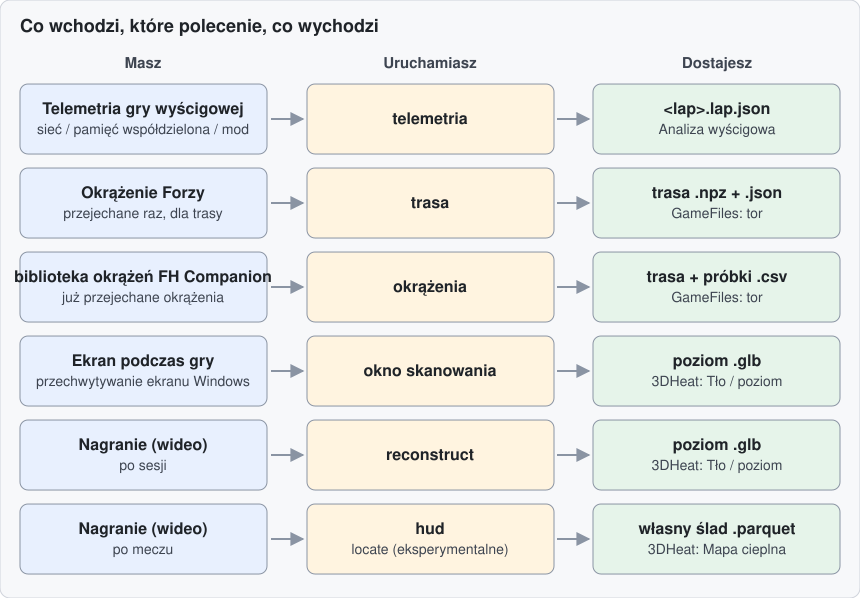

# 3DHeat GameCapture {#dheat-gamecapture}

**Czym jest?** Narzędzie, które zapisuje to, co gra wyścigowa mówi o twojej jeździe, po jednym pliku
na okrążenie. Potrafi też odtworzyć przybliżony model 3D poziomu z nagrania wideo, na którym grasz.

**Po co go używać?** Żeby zobaczyć swoje okrążenia w [przeglądarce 3DHeat](https://holdi601.github.io/3DHeat/):
gdzie hamowałeś, gdzie jechałeś wolno, czym różnią się dwa okrążenia. A także po to, by mieć poziom pod mapą cieplną,
gdy nikt nie ma jego modelu 3D.

**Przykład:** włącz w Forzy Data Out, uruchom jedno polecenie i przejedź dwa okrążenia. W folderze `laps\`
pojawią się dwa pliki okrążeń. Przeciągnij je na zakładkę Analiza wyścigowa przeglądarki.


Nigdy nie używałeś wiersza poleceń? Najpierw przeczytaj [Zanim zaczniesz](before-you-start.md).

## Trzy zadania {#the-three-jobs}

1. **Telemetria okrążeń.** Zapisuje każdy kanał, jaki publikuje gra wyścigowa - Data Out Forzy,
   pamięć współdzielona gier Assetto Corsa, sieciowe strumienie gier rajdowych, mod BeamNG,
   wtyczkę Trackmanii - i zapisuje jeden plik `heat3d-lap` na okrążenie albo odcinek, dla zakładki
   Analiza wyścigowa przeglądarki. iRacing nie potrzebuje nagrywarki: przeglądarka czyta jego własne pliki `.ibt`.
2. **Poziomy z rozgrywki.** Zamienia to, co pokazał ekran, gdy przechodziłeś albo przejeżdżałeś poziom,
   w model 3D `.glb`, który przeglądarka kładzie pod mapą cieplną.
3. **Twój mecz, po nim.** `hud` czyta HUD z twojego nagrania - twoje akcje, zgony, ślad na minimapie
   i kanał zabójstw. `locate` (eksperymentalne: na razie umieszcza mało prawdziwych klatek) ustala, skąd
   pochodzi każda klatka, na modelu 3D poziomu.

Wszystkie trzy działają wg jednej zasady: **nic nie jest wstrzykiwane do gry i nic nie jest podpinane**.
Klatki pochodzą z publicznego interfejsu przechwytywania ekranu, telemetria z interfejsów, które gry
publikują właśnie w tym celu. Zobacz [Zasady](rules.md).



Kod to Python (pakiet `heat3d_capture`), na licencji MIT. Modele głębi i pozy, które potrafi uruchomić,
mają własne licencje - zobacz [Modele i licencje](models-and-licences.md).

## Szybki start {#quick-start}

### Nagrywaj okrążenia {#record-laps}

Potrzebujesz Pythona 3.10 lub nowszego ([Zanim zaczniesz](before-you-start.md)). W PowerShell:

```powershell
git clone https://github.com/Holdi601/3DHeat-GameCapture
cd 3DHeat-GameCapture
python -m venv .venv
.venv\Scripts\python -m pip install -r requirements.txt

# Forza: Ustawienia -> HUD i rozgrywka -> Data Out = ON, IP 127.0.0.1, port 5300
.venv\Scripts\python -m heat3d_capture telemetry -o laps
```

**Powinieneś zobaczyć** `listening on port 5300. Laps go to laps. Ctrl+C to stop.`, a potem linię na każde
okrążenie, gdy przekroczysz linię mety, tak jak na obrazku powyżej. Naciśnij Ctrl+C, by zatrzymać.
Przeciągnij pliki z `laps\` na zakładkę Analiza wyścigowa przeglądarki. Każda inna gra to jedna opcja `--game` dalej:

```powershell
.venv\Scripts\python -m heat3d_capture telemetry --game acc -o laps
.venv\Scripts\python -m heat3d_capture telemetry --game dirtrally2 -o laps
```

Wszystkie gry i opcje: [Nagrywarki telemetrii](telemetry.md).

### Skanuj poziom {#scan-a-level}

Kliknij dwukrotnie **`scan.bat`** w folderze narzędzia. Znajdzie Pythona (a jeśli go nie ma, zaproponuje
instalację przez winget), utworzy prywatny `.venv` i otworzy okno skanowania. Okno mówi, czego brakuje,
do czego służy każdy pakiet i jak duże jest pobieranie, i nic nie instaluje bez zgody.
Zobacz [Środowisko wykonawcze i zależności](runtime.md) oraz [Okno skanowania](reconstruction-scan-ui.md).

Ręcznie: `.venv\Scripts\python -m heat3d_capture.ui`.

Aby odtworzyć nagranie offline, z rozwiązaną ścieżką kamery naraz (potrzebuje PyTorch, pakietu `vggt`
i karty GPU - zobacz [Rekonstrukcja offline](reconstruction-offline.md)):

```powershell
.venv\Scripts\python -m heat3d_capture reconstruct lap.mp4 -o lap.glb
```

## Mapa dokumentacji {#map-of-the-documentation}

| Strona | Czego dotyczy |
|---|---|
| [Zanim zaczniesz](before-you-start.md) | Python, terminal, pierwsze polecenie, typowe błędy |
| [Zasady](rules.md) | Brak wstrzykiwania, tylko opublikowane interfejsy i to, co to kosztuje |
| [Nagrywarki telemetrii](telemetry.md) | Polecenie `telemetry` i przegląd każdej gry |
| [Forza](telemetry-forza.md) | Data Out, wykrywanie układu, przekaźnik FH Companion i jego `.tele.gz` |
| [Gry Assetto Corsa](telemetry-assetto-corsa.md) | AC, ACC, AC EVO, AC Rally z pamięci współdzielonej |
| [Gry rajdowe](telemetry-rally.md) | EA SPORTS WRC, DiRT Rally 2.0 / 1 / DiRT 4, Richard Burns Rally |
| [BeamNG.drive](telemetry-beamng.md) | Mod protokołu `heat3d` |
| [Trackmania](telemetry-trackmania.md) | Wtyczka Openplanet `Heat3dRecorder` |
| [iRacing](telemetry-iracing.md) | Czytanie plików `.ibt` w przeglądarce |
| [Podział na okrążenia i odcinki](lap-splitting.md) | `LapSplitter`, `CounterSplitter`, `LineSplitter`, `StageSplitter` |
| [Poślizg, dryf i kanały pochodne](slip-and-drift.md) | Jak skaluje się poślizg i co wyprowadza przeglądarka |
| [Plik heat3d-lap](lap-format.md) | Format pliku okrążenia, kanały, jednostki, `meta` |
| [Gry](games.md) | Dla każdej gry: jak nagrywać, co jest wysyłane, które tory można eksportować |
| [Polecenia](commands.md) | `route`, `telemetry`, `laps`, `reconstruct`, `hud`, `locate`, krok po kroku |
| [Opis poleceń](../cli-reference.md) | każda opcja, generowana z `--help` |
| [Odczyt HUD z nagrania](hud-video.md) | `hud`: własne akcje, zgony, ślad minimapy i kanał zabójstw z nagrania |
| [Lokalizowanie klatek w poziomie](locate.md) | `locate`: skąd pochodzi każda klatka, względem geometrii poziomu |
| [Rekonstrukcja poziomu](reconstruction.md) | Potok od klatek do `.glb` |
| [Okno skanowania](reconstruction-scan-ui.md) | Każde sterowanie, skrót klawiszowy i element nakładki |
| [Przechwytywanie, maski i jakość klatek](reconstruction-capture.md) | Windows Graphics Capture, klatki kluczowe, maski HUD, porady o jakości |
| [Głębia](reconstruction-depth.md) | Depth Anything V2, ONNX Runtime, budowanie modelu |
| [Poza kamery i skala](reconstruction-pose.md) | Odometria, relokalizacja, pozy z telemetrii, skala gruntu, bundle adjustment |
| [Fuzja, pokrycie i kolor](reconstruction-fusion-and-texture.md) | Wolumen zajętości, siatka pokrycia, słabe miejsca, kolor wierzchołków |
| [Wyjście .glb](glb-output.md) | Plik, który wczytuje przeglądarka |
| [Rekonstrukcja offline](reconstruction-offline.md) | `reconstruct`, okna VGGT i łączenie |
| [Modele i licencje](models-and-licences.md) | Rozmiary Depth Anything V2, VGGT, pakiety |
| [Środowisko wykonawcze i zależności](runtime.md) | Kontrola wstępna, backendy, poziomy wydajności |
| [Ograniczenia i weryfikacja](limits.md) | Czego nie zrobiono i co nie zostało sprawdzone |
| [Aktualizacje](updates.md) | Sprawdzenie wydania i `python -m heat3d_update` |
| [Rozwój](development.md) | Testy, wirtualne środowisko, układ repozytorium |
| [Utrzymanie tych stron](maintaining.md) | Lista kontrolna wydania kodu i dokumentacji |

## Część 3DHeat {#part-of-3dheat}

Pliki, które to narzędzie zapisuje, wczytuje **przeglądarka 3DHeat** -
[źródła](https://github.com/Holdi601/3DHeat), [dokumentacja](https://holdi601.github.io/3DHeat/).
Pliki okrążeń trafiają na zakładkę Analiza wyścigowa, poziomy `.glb` do panelu **Tło / poziom**, tabele `hud` i `locate` na
zakładkę Mapa cieplna; jak przeglądarka czyta tabele i pliki meczów, opisano w
[Jeden plik na mecz (.3dheat)](https://holdi601.github.io/3DHeat/container.html) i
[Wczytywanie danych](https://holdi601.github.io/3DHeat/getting-data-in.html).

| Narzędzie | Co robi | Dokumentacja |
|---|---|---|
| [przeglądarka 3DHeat](https://github.com/Holdi601/3DHeat) | pokazuje mapy cieplne, wyścigi i mecze w 3D, w przeglądarce | [dokumentacja](https://holdi601.github.io/3DHeat/) |
| [GameFiles](https://github.com/Holdi601/3DHeat-GameFiles) | tory i poziomy z plików, które dostarcza gra, jako modele 3D | [dokumentacja](https://holdi601.github.io/3DHeat-GameFiles/) |
| [GameCapture](https://github.com/Holdi601/3DHeat-GameCapture) | telemetria okrążeń z gier wyścigowych; poziomy odtworzone z nagrań rozgrywki | [dokumentacja](https://holdi601.github.io/3DHeat-GameCapture/) |
| [Unreal Exporter](https://github.com/Holdi601/3DHeat-UnrealExporter) | wtyczka do edytora Unreal, która eksportuje poziom jako model 3D | [dokumentacja](https://holdi601.github.io/3DHeat-UnrealExporter/) |
| [CS2](https://github.com/Holdi601/3DHeat-CS2) | dema Counter-Strike 2 jako pliki meczów; mapy jako modele 3D | [dokumentacja](https://holdi601.github.io/3DHeat-CS2/) |
| [Watcher](https://github.com/Holdi601/3DHeat-Watcher) | w tle zapisuje twoją grę z tego, co gry publikują | [dokumentacja](https://holdi601.github.io/3DHeat-Watcher/) |
| [Ext-WarThunder](https://github.com/Holdi601/3DHeat-Ext-WarThunder) | replaye War Thunder jako pliki meczów | [dokumentacja](https://holdi601.github.io/3DHeat-Ext-WarThunder/) |
| [Ext-WoT](https://github.com/Holdi601/3DHeat-Ext-WoT) | replaye World of Tanks jako pliki meczów | [dokumentacja](https://holdi601.github.io/3DHeat-Ext-WoT/) |
| [Ext-WoWs](https://github.com/Holdi601/3DHeat-Ext-WoWs) | replaye World of Warships jako pliki meczów | [dokumentacja](https://holdi601.github.io/3DHeat-Ext-WoWs/) |
| [Ext-Squad](https://github.com/Holdi601/3DHeat-Ext-Squad) | dema serwerów Squad jako pliki meczów | [dokumentacja](https://holdi601.github.io/3DHeat-Ext-Squad/) |
| [Ext-DCS](https://github.com/Holdi601/3DHeat-Ext-DCS) | mapy DCS World jako modele 3D | [dokumentacja](https://holdi601.github.io/3DHeat-Ext-DCS/) |
| [Ext-IL2](https://github.com/Holdi601/3DHeat-Ext-IL2) | mapy IL-2 Sturmovik jako modele 3D | [dokumentacja](https://holdi601.github.io/3DHeat-Ext-IL2/) |

Programista, który ma otwarty projekt gry, powinien użyć eksportera Unreal, który czyta prawdziwą geometrię i jest
dokładny. Tam, gdzie archiwa gry dają się czytać, GameFiles wyciąga dokładny tor. Rekonstrukcja z rozgrywki
jest dla przypadku, w którym dostępny jest tylko ekran.
