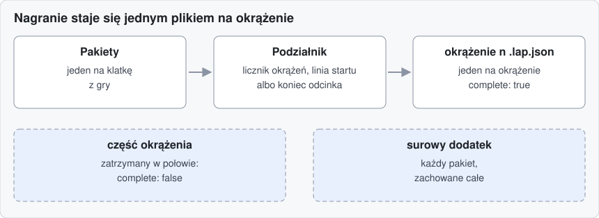

# Jak dzielone są okrążenia i odcinki {#how-laps-and-stages-are-split}

Rejestrator widzi jeden ciągły strumień próbek. Zamienia go na okrążenia jeden z czterech podziałników, wybierany według tego, co gra mówi o okrążeniach. Wszystkie opierają się na tej samej idei: użyj liczby gry, jeśli ją podaje, a w przeciwnym razie znajdź okrążenie z pozycji; nigdy nie zapisuj fragmentu za krótkiego, by go porównać.

| Podziałnik | Kod | Używany przez |
|---|---|---|
| `LapSplitter` | [`fulllap.py`](https://github.com/Holdi601/3DHeat-GameCapture/blob/main/heat3d_capture/telemetry/fulllap.py) | Forza |
| `CounterSplitter` | [`kunos.py`](https://github.com/Holdi601/3DHeat-GameCapture/blob/main/heat3d_capture/telemetry/kunos.py) | Assetto Corsa, ACC |
| `LineSplitter` | [`kunos.py`](https://github.com/Holdi601/3DHeat-GameCapture/blob/main/heat3d_capture/telemetry/kunos.py) | AC EVO, AC Rally, BeamNG |
| `StageSplitter` | [`rally.py`](https://github.com/Holdi601/3DHeat-GameCapture/blob/main/heat3d_capture/telemetry/rally.py) | EA SPORTS WRC, DiRT Rally 2.0, DiRT Rally, DiRT 4, Richard Burns Rally |

Trackmania dzieli przejazdy wewnątrz swojej wtyczki ([Trackmania](telemetry-trackmania.md)), a pliki iRacing dzieli przeglądarka według licznika okrążeń symulatora ([iRacing](telemetry-iracing.md)).

Na **Ctrl+C** każdy rejestrator wywołuje `flush()` swojego podziałnika, więc otwarte okrążenie lub odcinek jest zapisywane, jeśli przechodzi te same minima co poniżej.

## LapSplitter (Forza) {#lapsplitter-forza}

Parametry: `minimum_metres = 400`, `gap_seconds = 2.0`.

Dla każdego zdekodowanego pakietu:

1. Jeśli `timestampMs` gry przeskoczyło do przodu o więcej niż 2 sekundy od ostatniego pakietu albo się cofnęło, otwarte okrążenie jest najpierw zapisywane.
2. Jeśli `isRaceOn` wynosi 0 (gra nie jest w wyścigu), otwarte okrążenie jest zapisywane, a pakiet odrzucany.
3. Jeśli żadne okrążenie nie jest otwarte, otwiera się nowe z `lapNumber` pakietu.
4. Jeśli `lapNumber` różni się od numeru otwartego okrążenia, otwarte okrążenie jest **zamykane jako ukończone**; jego `seconds` to `lastLap` gry, gdy jest dodatnie. Okrążenie zamknięte w ten sposób jest zapisywane, jakiejkolwiek by było długości. Otwiera się nowe.
5. Pakiet zostaje dopisany.

Rejestrator zapisuje też okrążenie, gdy przez 2 sekundy czasu rzeczywistego nie przyszedł żaden pakiet (gra zapauzowana albo zamknięta w połowie okrążenia).

**Zapis** zachowuje otwarte okrążenie tylko wtedy, gdy ma co najmniej 2 próbki i co najmniej 400 m `distanceTravelled`; jest zapisywane jako niedokończone (`run`, przejazd). Wyścig punkt-do-punktu nigdy nie liczy drugiego okrążenia, więc zawsze tak się kończy.

## CounterSplitter (AC, ACC) {#countersplitter-ac-acc}

Parametr: `minimum_metres = 300`. Każda próbka dostaje `completedLaps` ze strony grafiki i czas ostatniego okrążenia.

- Pierwsza próbka otwiera okrążenie o numerze z aktualnego `completedLaps`.
- Gdy `completedLaps` się zmienia, otwarte okrążenie się zamyka. Jest **ukończone**, z `seconds = czas ostatniego okrążenia w ms / 1000` (jeśli dodatni), tylko wtedy, gdy licznik wzrósł dokładnie o 1 - skok z powrotem do 0 (restart sesji) albo wzrost o kilka zamyka je jako niedokończone.
- Zamknięte okrążenie jest zapisywane tylko wtedy, gdy ma próbki i co najmniej 300 m przejechanej drogi.
- Zapis zachowuje otwarte okrążenie, jeśli ma więcej niż jedną próbkę i co najmniej 300 m.

## LineSplitter (AC EVO, AC Rally, BeamNG) {#linesplitter-ac-evo-ac-rally-beamng}

Parametry: `radius = 15 m`, `minimum_metres = 300`, `stop_seconds = 8`.

Te gry albo nie mają licznika okrążeń na stronie, którą czyta rejestrator, albo jadą odcinkami. **Linią jest miejsce, w którym zaczęto nagrywać**:

1. Pozioma pozycja pierwszej próbki (`x`, `z`) staje się linią.
2. Gdy samochód przejedzie więcej niż 5 m, kierunek od linii do samochodu staje się kierunkiem okrążenia.
3. **Zatrzymanie** kończy przejazd: gdy `speed` pozostaje poniżej 1 m/s przez 8 sekund, otwarte okrążenie jest zapisywane (tak kończy się odcinek rajdowy: samochód staje na mecie).
4. **Przecięcie linii**: po ponad 300 m przejazdu zbierane są próbki w promieniu 15 m od linii. Gdy samochód ponownie opuszcza ten promień, najbliższa zebrana próbka jest przecięciem. Jeśli wtedy jechał w tym samym kierunku co kierunek okrążenia (iloczyn skalarny lokalnego kierunku jazdy z kierunkiem jest dodatni), okrążenie zamyka się na tej próbce; w przeciwnym razie przejazd jest ignorowany (samochód przejechał start w drugą stronę).
5. `seconds` zamkniętego okrążenia to czas od jego pierwszej próbki do przecięcia. Jest **ukończone tylko wtedy, gdy jego pierwsza próbka miała prędkość większą niż 5 m/s**: okrążenie zaczęte ze stania to start, a nie okrążenie do porównania. Pierwsze okrążenie nagrania rozpoczętego na polu startowym jest więc zawsze niedokończone; nagranie zaczęte na szybkim okrążeniu daje ukończone pierwsze okrążenie przy następnym przecięciu.
6. Następne okrążenie zaczyna się w próbce przecięcia (należy do obu okrążeń).

Okrążenia krótsze niż 300 m są odrzucane. Zapis (zatrzymanie lub Ctrl+C) zachowuje otwarte okrążenie, jeśli ma co najmniej 2 próbki i 300 m, jako niedokończone. BeamNG zapisuje tak samo, gdy pojazd jest resetowany (jego zegar się cofa), zanim zacznie się nowy podziałnik, więc przejazd sprzed resetu jest zachowany.

Odległości są poziome (`x`, `z`) dla licznika drogi i testu linii, a pełne 3D dla testu długości 300 m.

## StageSplitter (gry rajdowe) {#stagesplitter-rally-games}

Parametr: `minimum_metres = 300`. Każda próbka dostaje zegar odcinka z gry, informację, czy gra mówi, że samochód dojechał, i opcjonalnie czas gry dla odcinka.

1. Jeśli zegar wynosi 0 lub mniej albo cofnął się o więcej niż 0,5 s, otwarty odcinek jest **porzucany**: zachowywany jako częściowy, jeśli nie jest ukończony, ma ponad 10 próbek i co najmniej 300 m. Zegar równy 0 lub mniej także odrzuca próbkę (samochód stoi na starcie).
2. Jeśli żaden odcinek nie jest otwarty, otwiera się nowy (numerowany 1, 2, ... dla nagrania).
3. Gdy odcinek jest ukończony, kolejne próbki są ignorowane, aż zegar się cofnie.
4. Każda próbka jest zapisywana z `time` ustawionym na zegar odcinka.
5. Gdy gra mówi, że skończono, odcinek jest ukończony; jego `seconds` to czas gry, gdy jest podany i dodatni, w przeciwnym razie zegar. Jest zapisywany, jeśli objął co najmniej 300 m.

Co oznacza „skończono” dla każdej gry:

| Gra | Skończono, gdy |
|---|---|
| EA SPORTS WRC | długość odcinka > 0 i dystans na odcinku >= długość - 0,5 m |
| Gry DiRT | liczba ukończonych okrążeń wzrosła powyżej liczby z początku odcinka albo (zdarzenie jednookrążeniowe) dystans okrążenia >= 99,9% długości toru |
| Richard Burns Rally | zegar wyścigu > 0 i dystans do mety <= 0 |

Dla RBR oś pionowa i prędkość są ustalane, gdy odcinek jest zapisywany (zob. [Gry rajdowe](telemetry-rally.md#richard-burns-rally-rsf--ngp)).

## Czas i dystans w pliku okrążenia {#time-and-distance-in-the-lap-file}

Dla każdego rejestratora poza Forzą `time` jest przesunięty tak, by pierwsza próbka okrążenia miała 0, a `distance` to skumulowany dystans 3D między kolejnymi pozycjami. Forza używa własnego zegara okrążenia i licznika dystansu gry, przesuniętych tak samo.
