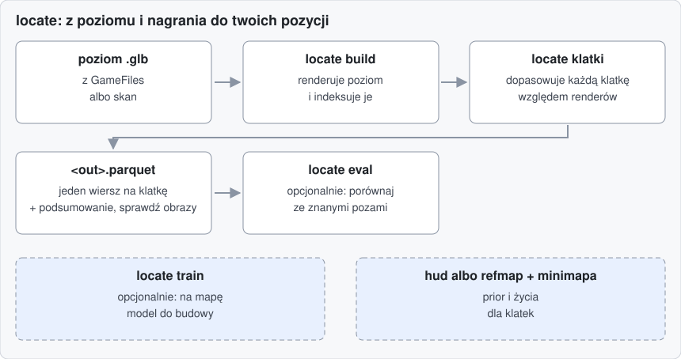

# Lokalizowanie klatek w poziomie {#locating-frames-in-a-level}

`locate` ustala, gdzie została nagrana każda klatka nagrania z rozgrywki: pozycję kamery w 3D i kierunek widoku. Robi to przez dopasowanie obrazu do renderów geometrii poziomu. Służy grom, które nie zapisują, gdzie był gracz: bez dema, bez pliku powtórki, bez telemetrii. Battlefield 6 jest pierwszą.

> **Eksperymentalne.** Na prawdziwych nagraniach umieszcza na razie tylko niewielką część klatek; zob. [Prawdziwe klatki: eksperymentalne](#real-frames-experimental).

```bash
# Once per level: render it from every place a player can stand, and index the renders.
.venv\Scripts\python -m heat3d_capture locate build level.glb -o level.db

# Per recording: where was each frame taken?
.venv\Scripts\python -m heat3d_capture locate frames "<recording>.mp4" --db level.db -o out/match
```

Pozycja pochodzi **z obrazu**, względem całego poziomu, bez żadnego wstępnego założenia. Ślad z minimapy z [czytnika HUD](hud-video.md) jest tylko rezerwą dla klatek, których obraz nie pozwala umieścić, a każdy wiersz mówi, z którego z tych dwóch źródeł pochodzi.




## Czego dotyka, a czego nie {#what-it-does-and-does-not-touch}

- Czyta **własne nagranie** gracza oraz plik poziomu wyeksportowany z **własnej kopii** gry. Nigdy nie dotyka gry, jej pamięci, jej plików podczas działania ani jej sieci, a działa po meczu. Zob. [Zasady](rules.md).
- Umieszcza **tylko kamerę gracza**: klatka to własny widok gracza.
- Poziom, baza zbudowana z niego i wszystko, co z niego wyrenderowano, należą do wydawcy gry. Trzymaj je lokalnie.

## Wymagania {#requirements}

- To, co wymienia `requirements.txt`, PyTorch (z pytorch.org, dla GPU) oraz `requirements-locate.txt`:

```bash
.venv\Scripts\python -m pip install -r requirements-locate.txt
```

- GPU z OpenGL 3.3 (4.3 jest szybsze) do renderów i najlepiej CUDA dla modeli. Na procesorze działa, ale wolno.
- Modele pobierają się przy pierwszym użyciu (około 450 MB): DINOv2 z Hugging Face, ALIKED i LightGlue przez kornię. Wszystkie są licencjonowane do użytku komercyjnego; zob. [Licencje](#licences).
- **Poziom** jako `.glb` (lub `.gltf`) w układzie przeglądarki, Y w górę, **z teksturami koloru bazowego**, tak jak zapisują go eksportery 3DHeat (części `ground:` / `structure:`; nazwy części nie są potrzebne). Jedna jednostka to jeden metr, chyba że w górnym poziomie pliku `extras.unit_metres` mówi inaczej. Skan GameCapture (`reconstruct`, okno skanowania) zapisuje się w **centymetrach** i ma `extras.unit_metres: 0.01`, więc jest czytany w swoim prawdziwym rozmiarze. Poziom bez tekstur działa znacznie gorzej; zob. [Ograniczenia](#limits).

## Polecenia {#commands}

### `locate build <level> -o <db>` {#locate-build---o-}

Renderuje poziom z każdego miejsca, z którego gracz może stać, i zapisuje dla każdego renderu jego pozę oraz jeden globalny deskryptor.

| Opcja | Domyślnie | Znaczenie |
|---|---|---|
| `level` | | Plik `.glb` / `.gltf` poziomu. |
| `-o`, `--out` | | Folder bazy do zapisania. |
| `--game` | `bf6` | Profil gry: wysokości oczu, pole widzenia, obszary HUD, prędkość (niżej). `generic` dla dowolnej gry z widokiem z pierwszej osoby. |
| `--eye` | z profilu | Wysokości oczu nad podłogą w metrach, najpierw stojąc. Jeden widok bazy na każdą wysokość. |
| `--fov` / `--vfov` | z profilu | Poziome pole widzenia nagrania albo pionowe (suwak Battlefield) dla nagrania 16:9. |
| `--spacing` | 2.5 | Metry między miejscami, z których pobierane są widoki. |
| `--yaw-step` | 30 | Stopnie między kierunkami widoków. |
| `--pitch` | 0 | Nachylenia, pod którymi renderować, w stopniach w górę. |
| `--positions` | brak | Tabela (Parquet lub CSV z `x`, `y`, `z` na stopach, w układzie poziomu), z której biorą się miejsca zamiast z każdej podłogi, np. wynik poprzedniego przebiegu. |
| `--shadows` | wyłączone | Rzucaj cienie słońca w renderach (słońce poziomu, gdy plik podaje je w `extras.sun`). |
| `--untextured` | wyłączone | Renderuj tylko kształt i światło. |
| `--box X0 Z0 X1 Z1` | cały plik | Tylko miejsca w tym prostokącie (jednostki poziomu): obszar gry. |
| `--places` | `auto` | Skąd pobierać widoki: `nav` - gracze na wysokości oczu nad siatką nawigacyjną poziomu (części `nav:`: dokładnie tam, gdzie gra pozwala chodzić), kamery pojazdów na ich wysokości nad częściami `ground:` (teren i drogi) w promieniu 50 m; `ground` - jedno i drugie nad `ground:`; `floors` - nad każdą skierowaną w górę powierzchnią (dachy i skrzynie też); `auto` - `nav`, gdy poziom ma siatkę nawigacyjną, w przeciwnym razie `floors`. |
| `--head` | brak | Głowa dla danej mapy z `locate train`, dla deskryptorów. |

Zapisuje `<db>/db.json` (z czego i jak został zbudowany) oraz `<db>/views.npz` (pozy, deskryptory).

### `locate frames <recording> --db <db>` {#locate-frames----db-}

| Opcja | Domyślnie | Znaczenie |
|---|---|---|
| `source` | | Wideo, obraz albo folder obrazów (brane w kolejności nazw, `--fps` od siebie). |
| `--db` | | Baza zapisana przez `build`. Jej plik poziomu musi nadal być na swoim miejscu (lub `--level`). |
| `-o`, `--out` | `<source>.locate` | Ścieżka wyjściowa bez rozszerzenia. |
| `--fps` | 2 | Klatki zlokalizowane na sekundę wideo. |
| `--start`, `--seconds` | całość | Fragment wideo do odczytu. |
| `--width` | 1280 | Szerokość, w jakiej klatki są dopasowywane. |
| `--shortlist` | 8 | Widoki bazy sprawdzane dla klatki w pobliżu założenia lub ustalenia. |
| `--search-shortlist` | 16 | Bez założenia: widoki bazy sprawdzane dla klatki ([szukane razem](#with-no-prior-frames-searched-together)). |
| `--no-search` | wyłączone | Bez założenia: szukaj każdej klatki osobno i wierz jej ustaleniu bez sąsiadów. |
| `--accept-depth` | 0 (wyłączone) | Bez założenia: wierz ustaleniu tylko wtedy, gdy jego dalsza odległość dopasowań jest tyle razy większa od bliższej. |
| `--accept-support` | 2 | Bez założenia: zgadzający się sąsiedzi wzdłuż życia, których ustalenie potrzebuje, by mu wierzyć. |
| `--checkpoint` | brak | Zapisuj tu stan przebiegu i wznawiaj od niego, jeśli istnieje. |
| `--stop-file`, `--stop-process` | brak | Zatrzymaj się sam, zapisując stan, z kodem wyjścia 75, gdy istnieje ten plik albo działa proces, którego nazwa zaczyna się tak (sprawdzane przed każdą klatką; można powtórzyć), aby długi przebieg zwolnił maszynę dla gry. To samo polecenie wznawia pracę. |
| `--normalise` | brak | Lekka normalizacja przed dopasowaniem: `clahe`, `gray`. |
| `--minimap` | brak | Tabela polecenia `hud`: **rezerwa** dla klatek, których obraz nie pozwala umieścić. |
| `--prior-radius` | brak | **Opcjonalne przyspieszenie**, domyślnie wyłączone: szukaj tylko widoków bazy w tej odległości w metrach od pozycji z minimapy (wymaga `--minimap`). |
| `--minimap-anchor` | brak | Plik JSON wiążący minimapę z poziomem ([minimapa jako założenie wyszukiwania](#the-minimap-as-a-search-prior)): minimapa tnie wyszukiwanie od pierwszej klatki; tak znalezione ustalenia są `visual+minimap-prior`. |
| `--no-level-search` | wyłączone | Z założeniem: gdy nic w pobliżu nie pasuje, nie szukaj też po całym poziomie (szybciej). |
| `--lives` | tabela `--minimap` | Tabela polecenia `hud`, której zgony, rozmieszczenia i ożywienia mówią, kiedy gracz był w grze: pozycje skaczą tylko przez zgon ([życia z nagrania](#lives-from-the-footage)). |
| `--no-sequence` | wyłączone | Rozstrzygaj każdą klatkę osobno, a nie wzdłuż przebiegu (niżej). |
| `--fit-fov` | wyłączone | Po przebiegu dopasuj pole widzenia do najmocniejszych ustaleń, na widok, i je podaj. |
| `--check-every` | 0 | Także co N klatek, umieszczonych czy nie, obraz do `<out>.check`. |
| `--no-checks` | wyłączone | Nie zapisuj obrazów kontrolnych ustaleń wizualnych (niżej). |
| `--no-zoomed` | wyłączone | Nie rozwiązuj widoków z przybliżeniem z ustaleń sąsiadów (niżej). |
| `--no-grow` | wyłączone | Nie szukaj ponownie w pobliżu każdego ustalenia klatek wokół, które wciąż nie mają ustalenia. |
| `--game`, `--eye`, `--fov`, `--vfov`, `--mask`, `--no-hud-mask`, `--max-speed` | z profilu | Jak wyżej; `--mask x,y,w,h` dodaje obszar ekranu (na ekranie 1920x1080), który nie jest poziomem. |
| `--vehicle-vfov` | z profilu | Pionowe pole widzenia kamer pojazdów (suwak pojazdów Battlefield). |
| `--settings` | najnowszy plik ustawień | `bf6`: plik ustawień gry, z którego odczytuje się pola widzenia (tylko do odczytu), gdy nie podano `--fov`/`--vfov`; domyślnie najnowszy `PROFSAVE*_profile` w `Documents/Battlefield 6/settings`. Zawiera ustawienia takie, jakie są teraz, co może nie być zgodne z tym, jak nagrano starsze nagranie. |

### `locate refmap <level> <deploy screen> -o <refmap>` {#locate-refmap----o-}

Umieszcza własną mapę gry na poziomie: punkt odniesienia, względem którego czyta się minimapę ([minimapa odczytana względem poziomu](#the-minimap-read-against-the-level)). `<deploy screen>` to obraz ekranu rozmieszczenia, na którym widać całą mapę, albo nagranie z `--at <seconds>` w takim momencie; wycinany jest obszar mapy z profilu (`--whole-picture` zachowuje całość). Zapisuje `<refmap>.png` (mapa przeniesiona na układ poziomu, `--mpp` metrów na piksel, domyślnie 0.5), `<refmap>.valid.png` (gdzie to jest mapa, a nie znacznik lub etykieta) oraz `<refmap>.json` (układ i kalibracja, z informacją, jak dalekie były kafelki mapy od niego). `--topdown <prefix>` zachowuje poziom renderowany z góry dla następnego przebiegu (`--topdown-mpp`, domyślnie 0.656 m; `--box` ogranicza).

### `locate minimap <recording> --refmap <refmap> -o <table>.parquet` {#locate-minimap----refmap---o-parquet}

Odczytuje minimapę nagrania względem mapy odniesienia, klatka po klatce (`--fps`, domyślnie 2): pozycję, kierunek i zoom każdej minimapy, która pasuje, w układzie poziomu, zapisane jako tabela minimapy z kotwicą obok (`<table>.anchor.json`), którą `locate frames` przyjmuje jako `--minimap <table>.parquet --minimap-anchor <table>.anchor.json`. Z tabelą polecenia `hud` (`--hud`) jej życia są przenoszone; z kotwicą także dla tej tabeli (`--hud-anchor`) pierwsze szukanie odbywa się wokół miejsca, w którym HUD umieszcza gracza, a tam, gdzie żadna minimapa nie pasuje, ślad HUD wypełnia luki, przesunięty na najbliższe ustalenia mapy odniesienia (`--hud-fill`, sekundy, domyślnie 120; 0 wyłącza to). `source` tabeli mówi, które (`refmap`, `hud`).

### `locate eval <out>.parquet --truth <poses>` {#locate-eval-parquet---truth-}

Porównuje wynik ze znanymi pozami kamery: tabela z `time`, `x`, `y`, `z` (oko), `yaw`, `pitch` w układzie poziomu. `--offset` to przesunięcie zegara (czas prawdziwy = czas wideo + offset); bez niego przesunięcie jest szukane. `--unit-metres` zamienia błędy na metry.

## Profile gier {#game-profiles}

| | `bf6` | `generic` |
|---|---|---|
| Wysokości oczu | 1.6 m stojąc, 1.05 m kucając (jeszcze nie zmierzone w grze) | 1.65, 1.1 m |
| Pole widzenia | 55 stopni pionowo, około 86 poziomo przy 16:9: **podaj własne** przez `--vfov` | 90 poziomo |
| Maskowany HUD | minimapa i lista drużyny, kanał zabójstw, kompas, amunicja, broń gracza, okienka, celownik | celownik |
| Najszybciej pieszo | 8 m/s | 8 m/s |
| Rozróżniane widoki | pieszo, pojazd, przybliżony (niżej) | każda klatka pieszo |
| Kamery pojazdów | suwak pojazdów (z pliku ustawień), pojazd zamaskowany, kamera do 8 m nad podłogą, 30 m/s | - |

Pole widzenia ma największe znaczenie: klatka rozwiązana złym polem ma złą ogniskową, a jej pozycja ślizga się wzdłuż widoku.

## Wyniki {#outputs}

### `<out>.parquet` {#parquet}

Jeden wiersz na zlokalizowaną klatkę, we **układzie poziomu** (Y w górę, jednostki poziomu), ze stopką instrukcji odczytu dla przeglądarki (`kind: heat3d-locate`). Stopka nazywa każdą kolumnę bez własnej roli jako dodatkową, więc przeglądarka zachowuje wszystkie (jej karta inspekcji je pokazuje).

| Kolumna | Znaczenie |
|---|---|
| `time` | Sekundy od początku wideo. |
| `event` | `start` w pierwszym wierszu życia, `position` w pozostałych. |
| `x`, `y`, `z` | Oko, wygładzone w obrębie życia. Puste tam, gdzie żadne źródło nie umieściło klatki. |
| `yaw`, `pitch` | Stopnie: yaw wokół osi w górę (0 wzdłuż +X, rosnący w stronę -Z, czyli yaw gry w układzie przeglądarki), pitch w górę od poziomu. `pitch` jest pusty dla wierszy minimapy. |
| `dir_x`, `dir_y`, `dir_z` | Kierunek widoku. |
| `player`, `team`, `session` | `me`, `own` i `<video>#NN`, jedno na życie. |
| `life` | Życie, w którym nagranie pokazało klatkę (z zgonów HUD-a; 1 = pierwsze). Puste, gdy poza grą (martwy, powalony, rozmieszczany) albo gdy życia nie odczytano. `session` to życie śladu, które może też rozdzielić się przy skoku. |
| `source` | `visual` (z obrazu), `visual+minimap-prior` (z obrazu, szukanie przycięte do założenia z minimapy), `minimap` (rezerwa), `minimap+nav-floor` (w budynku: minimapa i podłoga siatki nawigacyjnej) lub `none`. |
| `view` | `foot`, `vehicle`, `zoomed` lub `screen` (niżej). |
| `cam_x`, `cam_y`, `cam_z` | Kamera, która widziała klatkę. Pieszo i przez celownik to oko, a `x`, `y`, `z` są takie same; w widoku trzeciej osoby pojazdu `x`, `y`, `z` to pojazd (model przesunięcia niżej), a kamera jedzie za nim i nad nim. |
| `hfov`, `zoom` | Poziome pole widzenia, z jakim rozwiązano klatkę, a dla widoku przybliżonego - jego zoom względem zwykłego widoku. |
| `confidence` | 0..1: jak bardzo ufać wierszowi (niżej). |
| `uncertainty` | Typowy błąd wiersza, w jednostkach poziomu: dla ustalenia wizualnego z jego punktów zgodnych i sąsiadów, dla wiersza minimapy z dopasowania (niżej). |
| `inliers`, `rmse` | Punkty zgodne PnP rozwiązania wizualnego i błąd reprojekcji (piksele przy roboczej szerokości). |
| `x_raw` ... `pitch_raw` | Rozwiązanie wizualne przed wygładzeniem (także dla odrzuconych jako wartości odstające). |
| `kept` | Ustalenie wizualne przetrwało głosowanie wartości odstających. |
| `note` | Dlaczego klatka nie została umieszczona albo odrzucono ją w głosowaniu. |

### `<out>.summary.json` {#summaryjson}

Klatki, ustalenia wizualne, wartości odstające, życia, wiersze na źródło, dopasowanie minimapy (pary, punkty zgodne, reszta), czas na klatkę.

## Metoda {#method}

### Baza {#the-database}

Miejsca to punkty na każdym trójkącie skierowanym w górę, rozłożone równomiernie (jedno na `--spacing` na siatce 3D, więc piętra budynku dostają każde swoje). Z każdego oka sprawdza się je sześcioma małymi renderami głębi: kamera w geometrii widzi głównie tylne ściany, a przestrzeń do czołgania się ma coś pełnego nad okiem; takie miejsca są odrzucane. Z każdego miejsca poziom jest renderowany na każdej wysokości oka, co `--yaw-step` i co `--pitch`, a każdy render jest opisany przez **DINOv2** (jego tokeny łatek uśrednione uogólnioną średnią, połączone z tokenem klasy).

Lokalne cechy i punkty 3D, z którymi w końcu rozwiązuje się klatkę, **nie są zapisywane**: powstają ponownie, gdy są potrzebne, przez renderowanie kilku widoków wybranych przez wyszukiwanie, co zajmuje milisekundy. Dzięki temu baza waży kilkaset megabajtów zamiast dziesiątek gigabajtów, a to umożliwia poniższe dopracowanie. Koszt jest taki, że `frames` potrzebuje pliku poziomu i GPU, a nie tylko bazy.

### Jedna klatka {#one-frame}

1. **Maska** tego, co nie jest poziomem: obszary HUD z profilu i celownik, plus wszystko z `--mask`.
2. **Wyszukiwanie** po **całym poziomie**: globalny deskryptor klatki względem każdego widoku bazy; kilkadziesiąt najbardziej podobnych, przerzedzonych tak, by zajmowały różne miejsca i kierunki, tworzy krótką listę.
3. **Dopasowanie**: każdy widok z krótkiej listy jest renderowany ponownie w rozmiarze i polu widzenia klatki, razem z głębią. Punkty kluczowe ALIKED klatki i renderu są dopasowywane LightGlue. Piksel renderu z jego głębią to punkt 3D poziomu, więc każde dopasowanie to korespondencja 2D-3D; punkty na krawędzi głębi (której głębia może należeć do tego, co za nimi) są odrzucane.
4. **Poza**: PnP z RANSAC (SQPnP), potem odporne dopracowanie, które trzyma kamerę poziomo - widok z pierwszej osoby nie przechyla się - i minimalizuje błąd reprojekcji punktów zgodnych.
5. **Czy to możliwe?** Poza musi być na wysokości oczu gracza nad podłogą i poza geometrią (render głębi prosto w dół). Podobna tekstura w innym miejscu - kafelkowana podłoga dopasowana do ściany z tego samego materiału - może dać setki punktów zgodnych w pozie, której żaden gracz nie mógłby zająć; takie są odkładane na bok, bez względu na liczbę punktów.
6. **Renderuj i porównaj**: poziom jest renderowany w rozwiązanej pozie i dopasowywany ponownie, co zastępuje widok bazy oddalony o kilka metrów i kilkanaście stopni widokiem prawie pokrywającym się z klatką. Powtarzane, dopóki zyskuje punkty zgodne (co najwyżej dwa razy).
7. **Wybór**: trzy najmocniejsze miejsca (oddalone od siebie o więcej niż około 3 m) są każde dopracowywane, zanim wybierze się jedno. Podobne miejsce może prowadzić przed dopracowaniem; właściwe miejsce zyskuje na nim znacznie więcej.
8. **Werdykt**: `confidence` łączy liczbę punktów zgodnych, najlepsze inne miejsce (`runner_up`) i błąd reprojekcji. Ustalenie jest `ok` przy co najmniej 25 punktach zgodnych, braku innego miejsca w obrębie 80% jego punktów i pewności co najmniej 0.85 - progu, który pomiary poniżej stawiają na 97.5-99% trafności.

### Widoki {#views}

Klatka nie zawsze pokazuje oczy gracza. Detektor profilu odczytuje z HUD, który to widok, i klatkę rozwiązuje się odpowiednio:

- **Pieszo**: pole widzenia piechoty i wysokości oczu.
- **Pojazd** (Battlefield 6: podpowiedzi klawiszy siedzenia, `C CAMERA` i `E EXIT`, na dole po środku): pole widzenia pojazdu, sam pojazd zamaskowany (dolna środkowa część ekranu w jego widoku trzeciej osoby) i kamera, której wolno być do 8 m nad podłogą. Ustalenie dotyczy kamery.
- **Ekran** (ciemne krawędzie wokół ciemnego środka: ekran rozmieszczenia, menu, tabela wyników): nie jest widokiem poziomu; pomijany.
- **Przybliżony** (celownik, celownik działonowego, widok pierwszej osoby pojazdu: jedna krawędź ekranu czarna, obie ciemne, wokół jasnego obrazu): nie szukany po całym poziomie - wycinek poziomu w celowniku nie przypomina żadnego szerokiego widoku z bazy - lecz rozwiązywany po zakończeniu przebiegu z najbliższego ustalenia w 6 s, niżej. Wyłączane przez `--no-zoomed`.

### Widoki przybliżone {#zoomed-views}

Wąski widok słabo przypina pozycję: krok w tył z trochę większym zoomem wygląda prawie tak samo. Dlatego klatka przybliżona startuje od miejsca, które wskazuje sąsiad dla celownika - pieszo oko tego ustalenia, w pojeździe 2.5 m nad ziemią pod środkiem pojazdu (celownik wieżyczki) - i od tego, o ile gracz mógł się od niego przesunąć: 2 m, plus 4 m na sekundę pieszo albo 8 w pojeździe, najwyżej 12 m (`reach`).

1. **Kierunek i zoom, pozycja zachowana.** Dla każdego zoomu 1, 1.2 (własny widok pojazdu, węższy niż pieszo), 1.5, 2, 3, 4, 6 i 8 poziom jest renderowany z miejsca siedzenia w kierunkach w granicy 30 stopni od kierunku sąsiada (a od 3x także pod kilkoma nachyleniami). Punkty klatki dopasowane do renderu, z punktami poziomu pod nimi, są promieniami z siedzenia; obrót dopasowuje się do nich parami (RANSAC), dla ogniskowych od 0.75 do 1.3 razy ogniskowej tego zoomu, a punkt zgadza się w kącie, który dopuszcza odchylenie siedzenia o `reach` na swojej odległości. Wygrywa zoom, kierunek i ogniskowa, z którymi zgadza się najwięcej punktów.
2. **Ustalone.** Te punkty następnie łącznie dopasowują pozycję, kierunek i ogniskową przez błąd reprojekcji, z pozycją przytrzymaną przy siedzeniu kosztem dwóch pikseli na każde `reach` przesunięcia; renderowane raz jeszcze w odpowiedzi i dopasowywane ponownie. Punkty zgodne i błąd liczy się w pikselach, a ustalenie jest `ok` z tą samą pewnością co każde inne.

Zapisany zoom (`zoom`) odnosi się do pola widzenia przebiegu pieszo; `hfov` to rozwiązane. W pojeździe zapisana pozycja to pozycja pojazdu, 2.5 m pod celownikiem, jak dla jego widoku trzeciej osoby.

### Pojazdy: kamera i pojazd {#vehicles-the-camera-and-the-vehicle}

W widoku trzeciej osoby pojazdu rozwiązana poza to poza kamery pościgowej, która jedzie za pojazdem i nad nim i obraca się wokół niego, gdy gracz się rozgląda. Zapisywana pozycja (`x`, `y`, `z`) to pozycja pojazdu - ziemia pod jego środkiem: kamera plus `vehicle_offset` profilu, tyle metrów przed kamerą wzdłuż jej poziomego kierunku widoku i tyle w dół. Kamera zostaje w `cam_x`, `cam_y`, `cam_z`. Przeliczenie wykonuje się przed sekwencją i trasą, więc kamera krążąca wokół stojącego pojazdu nie jest brana za ruch. Stopka tabeli niesie użyte przesunięcie i to, czy zostało zmierzone (`vehicleOffset`). Pieszo i przez celownik przesunięcia nie ma.

Jak zmierzono przesunięcie Battlefield 6: na poprawnych ustaleniach z prawdziwych klatek trzeciej osoby czołgu środek czołgu zaznaczono na oko na klatce, a poziom wyrenderowany w ustaleniu dał ziemię w tym pikselu. Profil bierze medianę: około 10 m przed kamerą i około 4 m pod nią. Zaznaczenie jest dokładne do około metra i dotyczy jednego typu pojazdu: samochód czy helikopter inaczej jeżdżą ze swoją kamerą.

<a id="with-no-prior-frames-searched-together"></a>
### Bez założenia: klatki szukane razem {#with-no-prior-frames-searched-together}

Globalny deskryptor jednej klatki wobec całego poziomu to słaby sygnał, a liczba punktów zgodnych jednej klatki nie odróżnia właściwego miejsca od podobnego. Dlatego bez założenia klatki nagrania najpierw są opisywane i szukane razem (`search.py`), a ustalenie jest uznawane tylko z klatkami wokół niego:

- **Krótka lista.** Podobieństwa każdego widoku mierzy się względem jego własnej średniej i rozrzutu w nagraniu, tak że widok przypominający każdą klatkę przestaje wygrywać wszędzie. Każda klatka ocenia komórki siatki 24 m według rangi ich najlepszego widoku; najlepsza ścieżka przez komórki wzdłuż każdego życia, w granicy tego, co gracz zdoła przejść między klatkami, daje przekonanie dla każdej komórki, a najlepszy widok każdej komórki, najpierw ten najbardziej uwierzony, to jedna lista. Zwykłe wyszukiwanie to druga, a obie są brane naprzemiennie: mierzenie widoków względem nagrania karze miejsce, które gracz prawie nie opuszcza, a tam zwykłe wyszukiwanie dobrze działa.
- **Wiara.** Kandydat liczy się tylko wtedy, gdy jego punkty zgodne pokrywają co najmniej 12% siatki 8 x 8 nad klatką: podobny obiekt to powtarzający się przedmiot, stos kontenerów, z setkami punktów zgodnych na kilku komórkach klatki. Ustalenie uznaje się, gdy leży na najlepszej ścieżce przez liczących się kandydatów (niżej) i ma co najmniej dwóch sąsiadów w 6 s, którzy się z nim zgadzają. Klatka poza grą nie jest w ogóle szukana.
- **Rozrastanie.** Rośnie się tylko z tego, w co uwierzono, a rozrastające się ustalenie musi pokrywać klatkę w ten sam sposób.

### Wzdłuż przebiegu {#along-the-run}

Każda klatka zachowuje każdą fizycznie możliwą pozę, jaką znalazła, po jednej na miejsce (`candidates`), a nie tylko najmocniejszą. Przebieg wybiera potem jedną na klatkę - albo żadnej - tak, by wybrane pozy tworzyły ścieżkę, którą gracz mógłby przejść lub przejechać, a jak najwięcej punktów zgodnych leżało na niej: ukryty model Markowa, dekodowany naraz (Viterbi). Podobny obiekt, który wygrywa jedną klatkę sam, przegrywa z miejscem, z którym zgadzają się sąsiedzi; słaby kandydat, przez którego przechodzi ścieżka, z co najmniej dwoma zgadzającymi się sąsiadami, staje się ustaleniem (`note`: wybrane wzdłuż sekwencji); pewne ustalenie, któremu wszyscy sąsiedzi przeczą, przestaje nim być. Sąsiad zgadza się tylko w 6 s: dalej odległość, jaką gracz - a tym bardziej pojazd - mógłby pokonać, jest tak duża, że zgoda nic nie znaczy. Wyłączane przez `--no-sequence`.

### Czasy klatek {#frame-times}

Czas wiersza `time` to własny znacznik czasu klatki w nagraniu, a nie jej liczba przy nominalnej częstotliwości. Nagrania odbiegają od swojej nominalnej częstotliwości (o kilka dziesiątych sekundy w obrębie klipu, w zmierzonych), a wszystko, co odczytuje klatkę po czasie - obrazy kontrolne, przybliżony przebieg, `locate train --real`, minimapa z polecenia `hud` - szuka po znaczniku czasu. Liczone klatki przesunęłyby obraz kontrolny o tyle od klatki, którą zlokalizowano.

### Pole widzenia z klatek {#the-field-of-view-from-the-frames}

`--fit-fov` zachowuje najmocniejsze ustalenia przebiegu (na widok) i dopracowuje dla każdego jego pozę i ogniskową razem, na jego punktach zgodnych; mediana po nich to pole widzenia, z jakim nagrano nagranie, podawane w podsumowaniu (`hfov_fitted`) do `--fov` następnego przebiegu. Punkty bliskie i dalekie przesuwają się inaczej przy zmianie ogniskowej niż przy zmianie pozycji i to właśnie je przypina; potrzebne są ustalenia z głębią, a nie płaska ściana.

### Model dla danej mapy {#a-per-map-model}

`locate train` trenuje mały model na szczycie DINOv2 dla jednego poziomu, na jego renderach, tak by globalny deskryptor znajdował właściwe widoki prawdziwych klatek, a nie samych renderów:

- **Głowa**: każdy token łatki przez dwuwarstwowy rzut, uśredniony uogólnioną średnią po łatkach pokazujących poziom, połączony z zrzutowanym tokenem klasy. DINOv2 pozostaje zamrożony. Wszystko to napisane tutaj (MIT).
- **Pary**: miejsce na chodnym gruncie i kierunek, renderowane dwukrotnie z poz oddalonych o metr lub dwa i kilkanaście stopni, przy polach widzenia różniących się do 10 stopni, pod różnym światłem (słońce, cienie, otoczenie), każdy przez wygląd podobny do gry: gradacja, zamglenie wg głębi, poświata, winieta, dym, ludzie na drodze, własny pojazd gracza w widokach pojazdu, rozmycie ruchu, szum, JPEG (`augment.py`). Zamaskowane jak klatka. Miejsca w obrębie kilku metrów patrzące w ten sam sposób nie liczą się jako negatywy.
- **Prawdziwe klatki**: klatki z pozą, którą potok znalazł sam (pseudo-etykiety: ustalenia wybrane wzdłuż sekwencji), mogą dołączać jako pary - klatka i render w jej pozie - w drugiej rundzie.
- **Strata**: kontrastowa (InfoNCE) w obrębie partii.

`locate build --head <head.pt>` buduje bazę z nią; `frames` używa jej wtedy dla klatek.

| Opcja `locate train` | Domyślnie | Znaczenie |
|---|---|---|
| `-o`, `--out` | wymagane | Plik głowy do zapisania (`.pt`). |
| `--steps` | 600 | Kroki treningu. |
| `--real TABLE VIDEO` | brak | Tabela `locate frames` i jej nagranie: jej pewne ustalenia dołączają jako prawdziwe pary. Można powtórzyć. |
| `--real-confidence` | 0.85 | Pewność, jaką ustalenie musi mieć, by dołączyć jako prawdziwa para. |
| `--spacing`, `--box`, `--places`, i opcje profilu | jak `build` | Gdzie są miejsca treningowe i profil gry. |

### Sprawdzanie na oko {#checking-by-eye}

Każde ustalenie wizualne dostaje obraz w `<out>.check` - `<time>s_<view>_visual.jpg`: klatka, obok niej poziom wyrenderowany z kamery ustalenia, z krawędziami klatki narysowanymi nad renderem. Gdzie się zgadzają, ustalenie jest poprawne. Zapisywane po tym, jak sekwencja i ślad rozstrzygną, więc obrazy są dokładnie tymi wierszami, które tabela nazywa wizualnymi. Wyłączane przez `--no-checks`.

<a id="the-minimap-read-against-the-level"></a>
### Minimapa odczytana względem poziomu {#the-minimap-read-against-the-level}

Minimapa złożona w jedną mozaikę (z polecenia `hud`) nie jest płaska: jej skala dryfuje wraz z zoomem, przy którym każda minimapa została dopasowana, miejsce widziane dwa razy może być narysowane dwa razy, a mozaika każdego klipu jest osobna. Podobieństwo dopasowane do kilku ustaleń trzyma się blisko nich i jest o dziesiątki metrów poza nimi. Dlatego minimapę umieszcza sam poziom, w dwóch krokach, i nic nie jest składane:

- **Mapa odniesienia** (`locate refmap`). Ekran rozmieszczenia rysuje całą mapę z północą u góry, płasko, w jednej skali. Poziom renderowany z góry pokazuje te same rzeczy stojące nad ziemią (czołgi, budynki, mury): na poziomie ich wysokość nad gruntem w promieniu 15 m, na mapie - to, co narysowano jaśniej niż otaczający grunt. Mapę nakłada się na poziom przez znormalizowaną korelację krzyżową obu, po skali i małym obrocie, dopracowaną dopasowaniem jej kafelków jeden po drugim, a na końcu całej mapy naraz wokół tej odpowiedzi (kilkanaście kafelków zostawia skalę luźną o procent, metry na końcach mapy). Wynik to jedno podobieństwo: piksel mapy na poziom.
- **Minimapa, klatka po klatce** (`locate minimap`). Każda próbkowana minimapa - wycinek czytnika HUD i jego maska nakładki - jest dopasowywana (SIFT) do mapy odniesienia w pobliżu miejsca, w którym gracz był ostatnio, albo gdziekolwiek, gdy nie wiadomo; podobieństwo (obrót, zoom, przesunięcie) jest dopasowywane. Punkt gracza przeniesiony przez nie to pozycja, góra minimapy (stożek widoku) to kierunek, a jej skala to zoom - zmierzony, nie zakładany.
- **Gdzie nie pasuje.** Ekran rozmieszczenia nie rysuje niczego poza obszarem gry; minimapa, która pokazuje głównie to, co leży poza nim - gracz na skraju mapy - nie ma czego dopasować. Tam zastępuje ją własny ślad HUD, przesunięty o przesunięcie zmierzone przez najbliższe ustalenia mapy odniesienia (`--hud-fill`); jest tak dobry, jak dobra jest mozaika w pobliżu tych ustaleń.

Na poziomie testowym minimapa odczytana w ten sposób była kilka metrów (mediana) od pewnych ustaleń z obrazu, równie dobrze poza obszarem, z którego dopasowano mapę odniesienia, jak wewnątrz niego.

<a id="the-minimap-as-a-search-prior"></a>
### Minimapa jako założenie wyszukiwania {#the-minimap-as-a-search-prior}

Ślad minimapy z czytnika `hud` mówi dla większości klatek w grze, mniej więcej gdzie jest gracz i w którą stronę patrzy - w swoich jednostkach (pikselach minimapy, północ u góry). Związany z poziomem raz, zawęża wyszukiwanie do jego małej części; sama poza nadal pochodzi z obrazu, na tych samych zasadach.

- **Kotwica** (`--minimap-anchor <anchor.json>`): jedno podobieństwo na mapę, minimapa na poziom - skala, obrót (z lustrzanym odbiciem między pikselami z północą u góry a osiami poziomu) i przesunięcie - dopasowane do pewnych ustaleń wizualnych (pewność 0.7 i więcej) z kilku klipów. Minimapa każdego klipu to mozaika, którą czytnik HUD złożył sam, więc każda leży gdzie indziej w jednostkach minimapy; dwie mozaiki jednej mapy różnią się tylko przesunięciem, znajdowanym przez dopasowanie punktów kluczowych między nimi (przesunięcie, z którym zgadza się najwięcej dopasowań), a każda mozaika jest związana z jednym odniesieniem przez wszystkie pary, które dobrze się zgadzają. Plik kotwicy niesie podobieństwo mapy, przesunięcie klipu (`clip_shift`) i błąd, jaki kotwica pokazała wobec ustaleń klipów pominiętych w dopasowaniu (`median`, `p90`, metry).
- **Gdzie i w którą stronę.** Kierunek minimapy to yaw kamery: na zmierzonych klipach zgadzał się z rozwiązanym yaw w granicy 2-5 stopni. Dlatego klatkę najpierw dopasowuje się do renderów wykonanych tam, gdzie minimapa stawia kamerę - pieszo oko nad ziemią w tym miejscu, w pojeździe kamera pościgowa za nim i nad nim (przesunięcie pojazdu) - patrzących wzdłuż kierunku: punkt i 4 m w obie strony, pod dwoma nachyleniami (`seeds`). Dopiero gdy żadne z nich nie daje ustalenia, próbuje się widoków bazy w obrębie koła (30 m plus 90-percentylowy błąd kotwicy).
- **Korygowane w trakcie przebiegu.** Każde pewne ustalenie w pobliżu założenia mówi, jak daleko kotwica jest od prawdy; mediana tych w ciągu 2 minut koryguje założenie, a ich rozrzut (co najmniej 5 m) zastępuje błąd kotwicy w promieniu koła - najwyżej 10 m: ustalenia rozbieżne bardziej mówią, że minimapa myli się co do miejsca, a nie że cokolwiek 50 m dalej się nada. Bez ustalenia w ciągu 2 minut założenie w ogóle nie jest korygowane (błąd gdzie indziej w klipie nic nie mówi o tym miejscu).
- **Kotwice z siatką.** Kotwica może też nieść `grid`: współrzędne x i z poziomu na regularnej siatce nad jednostkami minimapy klipu, odczytywane dwuliniowo; wewnątrz niej siatka umieszcza punkt, na zewnątrz - podobieństwo. Kotwica tabeli `locate minimap` jest tożsamością (jej tabela jest już w układzie poziomu).
- **Słabe dopasowania.** Przy założeniu dopasowanie, które jest słabe (25 punktów zgodnych lub więcej, ale zbyt mało na własną pewność) i leży w kole, zostaje - z niższą pewnością - do oceny przez sekwencję i ślad, a nie jest odrzucane: dym, gruz i zniszczone ściany zostawiają prawdziwym klatkom mniej dopasowań.
- **Źródła.** `visual` - obraz to umieścił, bez założenia; `visual+minimap-prior` - obraz to umieścił, szukanie przycięte do założenia; `minimap` - obraz nie umieścił, zastępuje minimapa; `minimap+nav-floor` - w budynku, niżej.
- **W budynkach prowadzi minimapa.** Klatka, której obraz nie umieścił, pieszo, tam gdzie oko w pozycji minimapy widzi poziom blisko ze wszystkich stron (mediana odległości poniżej 8 m w czterech kierunkach) i bez nieba, jest w budynku: dostaje x i z minimapy oraz wysokość podłogi siatki nawigacyjnej w tym miejscu - z kilku pięter ta najbliższa ostatniemu ustaleniu - z `source = minimap+nav-floor`, aby było jasne, że obraz tego nie ustalił.

<a id="lives-from-the-footage"></a>
### Życia z nagrania {#lives-from-the-footage}

Pozycja może skakać tylko tam, gdzie gracz zginął. Życia nie są zgadywane z pozycji - pojedyncze złe ustalenie otworzyłoby nowe - lecz odczytywane z nagrania: tabela czytnika HUD zapisuje zgony, które pokazały ekrany padnięcia i rozmieszczenia (`death`), padnięcia, które kolega ożywił (`downed`, `revived`), rozmieszczenia (`spawn`) oraz miejsca, gdzie gra się zaczęła i skończyła (`start`, `end`); `lives.py` zamienia je w życia. Zgon zamyka życie, pierwsza klatka gry po ekranie rozmieszczenia otwiera następne; ożywienie nie tnie życia (gracz jest tam, gdzie padł), a klatki w czasie leżenia nie są umieszczane; przerwa w menu lub ładowaniu dłuższa niż 10 s też je tnie. Klatki poza grą (martwy, rozmieszczany, powalony) nigdy nie są umieszczane.

W obrębie życia ciągłość jest twardą regułą: każdy krok co najwyżej prędkość razy czas między klatkami plus 1.5 m. Prędkość jest prędkością klatki: pieszo - z profilu, w pojeździe - prędkość, którą pokazał wskaźnik pojazdu w ciągu 3 s (plus jedna trzecia i 2 m/s na przyspieszenie) albo, gdy go nie pokazuje, limit jego klasy. W przebiegu (Viterbi) krok przez zgon jest wolny na każdą odległość, każdy inny krok ograniczony; klatka, która wymagałaby skoku, zostaje pominięta - słabsza strona sprzeczności przegrywa (mniej punktów zgodnych, mniej wsparcia) - i życie nigdy się przez nią nie dzieli. Gdy pominięta strona sama jest mocna (pewność 0.9 i więcej, dwa lub więcej ustaleń zgadzających się ze sobą), przebieg niczego nie zgaduje: obie strony się zachowują i są oznaczone `jump without detected death` (brakujący zgon albo prawdziwa teleportacja) oraz wymienione w podsumowaniu. Rezerwa z minimapy trzyma się tych samych żyć.

Battlefield 6: widok pierwszej osoby czołgów pokazuje prędkość (`<n> KPH`, po prawej od celownika; odczytywane OCR-em czytnika HUD); widok trzeciej osoby tego nie robi. Odczyty na klipach testowych były wolne, więc pojazdy lądowe mogą jechać 15 m/s tam, gdzie nic nie odczytano. Łodzie, helikoptery i odrzutowce mają szerokie limity (20, 90 i 280 m/s), które nie są zmierzone: żaden klip nie pokazuje, by którykolwiek był prowadzony, a klasyfikator widoku nie odróżnia powietrza od ziemi - odcinek szybszy niż pojazd lądowy pokazuje się jako skok, oznaczony, a nie zaufany.

### Zniszczenia {#destruction}

Pliki poziomu to nietknięty poziom; w meczu ściany, domy i skały są rozstrzeliwane, gruz i dym wiszą w powietrzu, a z biegiem meczu jest tego coraz więcej.

- **Dopasowanie ufa statycznemu poziomowi.** Część, którą eksport oznacza jako niszczalną (jej nazwa zaczyna się od `destructible:`, albo `extras.destructible` na jej węźle, siatce lub prymitywie), jest rysowana do maski `destructible` renderu. Dopasowania, których punkt poziomu leży na niej, są odrzucane, gdy zostaje 40 lub więcej dopasowań na częściach statycznych - teren, drogi, wielkie konstrukcje niosą rozwiązanie.
- **Trening widzi zniszczenie.** Renderom treningowym (`locate train`) zastępuje się łatki niszczalnych części szumem w kolorze gruzu i dodaje pył nisko nad ziemią, na szczycie dymu i reszty wyglądu gry (`augment.py`), tak by model dla danej mapy nie uczył się polegać na nich.
- **Brakująca geometria nie jest złym miejscem**: przy założeniu słabe dopasowania w jego kole są zachowywane (wyżej).

Dopóki eksporty nie niosą znaczników, nic nie jest oznaczone jako niszczalne i te mechanizmy nic nie robią.

### Ślad {#the-track}

- **Wartości odstające**: ustalenie porównuje się z ustaleniami z 3 s przed nim i osobno z 3 s po nim; zgodne oznacza nie dalej od siebie, niż pozwala prędkość profilu, plus 1.5 m. Ustalenie, które nie zgadza się z większością swoich sąsiadów po **obu** stronach, jest odrzucane w głosowaniu (zachowywane w kolumnach `_raw`, `kept` false). Wymóg obu stron chroni pierwsze ustalenie po odrodzeniu.
- **Życia**: przy życiach z nagrania (wyżej) ślad podąża za nimi, a w obrębie życia odrzuca słabszą stronę kroku, który łamie prędkość. Bez nich łamie się tam, gdzie dwa kolejne zachowane ustalenia są dalej od siebie, niż pozwala prędkość, tam, gdzie jest przerwa dłuższa niż 8 s, i tam, gdzie tabela minimapy zaczyna nowe życie.
- **Wygładzanie**: w obrębie życia każde ustalenie łączy się z prostą przez sąsiednie ustalenia (ważone lokalne dopasowanie liniowe, sigma 0.5 s), każde ważone swoim błędem: mocne ustalenie - dokładne do centymetrów - zostaje tam, gdzie jest, słabe jest przyciągane do silnych sąsiadów. Prosta, a nie średnia, bo średnia ciągnie biegnącego gracza do tyłu: próbowano średniej najpierw i zamieniła ślad 3 mm w ślad 0.3 m przy 2 klatkach na sekundę. Kąty widoku nie są wygładzane; obrót widoku jest prawdziwy i szybki.

### Rezerwa z minimapy {#the-minimap-fallback}

Tabela minimapy jest w własnej mozaice (piksele, x na wschód, y na północ). Wiąże się ją z poziomem jednym podobieństwem - obrót, skala, przesunięcie i lustro, jeśli pasuje lepiej - dopasowanym odpornie na klatkach, gdzie oba mają pozycję. Tam, gdzie obraz nie dał nic albo jego ustalenie zostało odrzucone w głosowaniu, pozycja z minimapy zastępuje go z `source = minimap`, pewnością co najwyżej 0.5 i niepewnością dwukrotności reszty dopasowania plus 1.5 m. Minimapa nie ma wysokości: jest przenoszona z najbliższego ustalenia wizualnego. Przebieg oparty tylko na minimapie (bez ustaleń wizualnych) nie może zostać związany z poziomem i nic nie umieszcza.

`--prior-radius` używa tego samego dopasowania w drugą stronę: gdy osiem ustaleń wizualnych związało minimapę z poziomem, wyszukiwanie patrzy tylko na widoki bazy w tym promieniu od pozycji minimapy i wraca do całego poziomu, gdy tam nic nie znajdzie. Jest szybsze; jest też tylko tak dobre jak minimapa, dlatego jest domyślnie wyłączone.

<a id="accuracy"></a>
## Dokładność {#accuracy}

Mierzone na **stanowisku**, gdzie prawda jest dokładna: poziom testowy wyeksportowany z teksturami i klatki renderowane z znanych póz kamery *tak, by wyglądały jak gra, a nie jak baza* - słońce i cienie poziomu, ostrzejszy kontrast, losowa gradacja barw, winieta i poświata, kształty graczy i dym na drodze, HUD narysowany w zamaskowanych obszarach, rozmycie, szum i JPEG. Każda klatka jest lokalizowana względem **całego poziomu, bez założenia**. Trafne oznacza w granicy 1 m i 5 stopni. Nic ze stanowiska (poziomy, rendery) nie jest częścią tego repozytorium.

| Klatki bez założenia | Wynik |
|---|---|
| umieszczone trafnie | około 4 na 5 |
| z ustaleń `ok` (pewność 0.85 i więcej) trafne | około 97-99% |
| błąd trafnych ustaleń | milimetry do centymetra; kilka setnych stopnia |
| czas na klatkę | około 1 s na komputerowym GPU |

Pewność to użyteczna miara zaufania: prawie każde ustalenie 0.9 i więcej było trafne, podczas gdy ustalenia poniżej 0.85 często były błędne - stąd próg 0.85 dla `ok`. Zawodzi tam, gdzie nie znaleziono pasującego widoku, jest za mało dopasowań (ściana krok dalej, głównie niebo, głównie zasłaniacz) albo dwa miejsca wyglądają tak samo.

**Ślad.** Testowa ścieżka kamery, wyrenderowana jak wyżej w wideo 30 fps, z tabelą minimapy zrobioną z tej samej ścieżki (własna, obrócona, przeskalowana, odbita ramka, z szumem), przepuszczona przez `locate frames` z 2 klatkami na sekundę i oceniona przez `locate eval`, który też musiał znaleźć przesunięcie zegara: każda klatka w grze została umieszczona, prawie wszystkie z obrazu; przesunięcie zegara znaleziono co do setnych sekundy; wiersze obrazu były w granicy kilku centymetrów, wiersze minimapy w granicy około metra.

**Co robi różnicę:**

- **Tekstury** są tym, na czym opiera się dopasowanie. Bez nich umieszcza się tylko niewielką część klatek; podłoga zredukowana do jednego płaskiego koloru kosztuje około jednej trzeciej pewnych ustaleń.
- **Właściwe pole widzenia.** O 3 stopnie za małe - błąd trafnych ustaleń rośnie od milimetrów do dziesiątek centymetrów, a większość ustaleń przestaje być `ok`. Podaj prawdziwe FOV.
- **Cienie** w renderach bazy (`--shadows`): niewielki zysk.
- **Dłuższa krótka lista**: niewielki zysk, kilka razy wolniej. Krótsza: mniej ustaleń, większa precyzja.
- Normalizacja światła (CLAHE) nie dała zysku i nie jest domyślna.

Podobne miejsca to główne źródło pewnych pomyłek: pozy o dokładnie jeden moduł budynku dalej, wzdłuż ściany powtarzających się modułów, rozwiązany tak samo w kilku klatkach, gdy gracz stoi w miejscu. Dopracowanie trzech najmocniejszych miejsc przed wyborem i odkładanie niemożliwych póz usunęło większość pozostałych.

<a id="real-frames-experimental"></a>
### Prawdziwe klatki: eksperymentalne {#real-frames-experimental}

Na prawdziwych nagraniach `locate` **nie działa jeszcze dobrze**: umieszcza z obrazu tylko niewielką część klatek, głównie klatki pojazdów (kamera trzeciej osoby widzi więcej poziomu z góry), a prawie żadnych pieszo (gracz patrzy na ściany i ziemię z bliska). Czego nauczono się na nagraniach testowych:

- **Znalezienie właściwego widoku jest tym, co zawodzi.** Światło gry, efekty i grube tekstury eksportu odsuwają prawdziwą klatkę od renderów dalej niż imitacja ze stanowiska, więc właściwy widok plasuje się blisko, ale poza krótką listą.
- **Model dla danej mapy pomaga** (`locate train`): znacznie wyżej stawia właściwy widok, a prawdziwe klatki dodane jako pary treningowe pomagają jeszcze bardziej na klatkach wokół nich.
- **Klatki blisko siebie pomagają sobie nawzajem**: przy 2 klatkach na sekundę odcinek w pojeździe miał umieszczoną około jedną trzecią klatek; przy jednej klatce co 5 s prawie żadnej.
- **Prawdziwe klatki pokazują 2-3 piksele błędu reprojekcji** wobec 1 na renderach; profil przyjmuje 3 jako normalne (`pixel_noise`).
- **Pole widzenia** dopasowane z klatek (`--fit-fov`) może różnić się od zapisanych ustawień: ustawienie mogło się zmienić od czasu nagrania.
- **Słabe ustalenia uznane za `ok` tylko przez odległych sąsiadów** były błędne; sąsiedzi liczą się teraz tylko w 6 s, a każde ustalenie pewności 0.7 i więcej było trafne.
- **Plik poziomu ma znaczenie**: nieteksturowany grunt i roślinność rysowana jako czarne karty szkodzą. Renderer honoruje wycinanie (`alphaMode: MASK`): tekseli poniżej `alphaCutoff` materiału (0.5, gdy nie podano) są odrzucane, więc widać tło (`render.py`).

Co jest potrzebne dalej: wielu więcej prawdziwych pseudo-etykiet z wielu klipów do treningu i kalibracji pewności (`locate train --real <table> <video>`), poziomy z teksturowanym gruntem oraz sposób obsługi widoków przybliżonych.

<a id="renders-against-frames"></a>
## Rendery a klatki {#renders-against-frames}

Rendery, z których składa się baza, nie są klatkami z gry. Na stanowisku różnicę imitowano (światło, cienie, gradacja, gracze, dym, HUD), co kosztuje około 10 punktów trafnych ustaleń (91% do 80-89%); trafne ustalenia zostają w milimetrach. Pomogło: słońce i cienie poziomu z mapy, dopasowywane do renderów (niewiele), dłuższa krótka lista (niewiele, wolno). Nie pomogła normalizacja światła CLAHE.

Czego stanowisko nie może imitować, to reszta prawdziwej klatki: światło zapieczone i odbite, okluzja otoczenia, mgła, cząstki, roślinność, która się rusza, własna obróbka końcowa gry. Aby to zmierzyć, nagraj odtwarzanie czegoś, czego pozy kamery są dokładne - dema albo powtórki gry - i porównaj `locate eval`; ono samo znajduje przesunięcie zegara między nagraniem a pozami albo przyjmuje je z `--offset`.

<a id="limits"></a>
## Ograniczenia {#limits}

- **Prawdziwe klatki są jeszcze prawie nie umieszczane.** Samym DINOv2 prawie żadna prawdziwa klatka nie jest umieszczona bez założenia; z modelem dla danej mapy kilka procent, trafnie, gdy się na nie spojrzy (zob. [Prawdziwe klatki: eksperymentalne](#real-frames-experimental)). Każda liczba dokładności powyżej pochodzi z renderów poziomu, wykonanych tak, by wyglądały jak gra (jej słońce, cienie, gradacja, poświata, szum, gracze, HUD), porównanych z renderami tego samego poziomu. Prawdziwa klatka różni się w sposób, którego render nie oddaje: światłem zapieczonym i odbitym, okluzją otoczenia, mgłą, cząstkami, zmieniającymi się naklejkami, animowaną roślinnością. Ile to kosztuje, to otwarte pytanie; zob. [Rendery a klatki](#renders-against-frames), jak to zmierzyć.
- **Poziom musi być tym, który był grany**, w tej samej wersji, z teksturami, w tym podłogi: zob. [Co plik poziomu musi zawierać](#accuracy).
- **Podobne miejsca.** Poziomy ponownie wykorzystują budynki, rekwizyty i kafelkowane materiały. Dwa miejsca, które wyglądają tak samo, dają dwa dobre rozwiązania; drugie jest zgłaszane (`runner_up`), ustalenie nie jest `ok`, a ślad lub minimapa musi rozstrzygnąć. Ustalenie, które jest poprawne, ale oznaczone jako niejednoznaczne, jest zgubione, a nie błędne.
- **Klatki z niewielką ilością poziomu**: ściana krok dalej, niebo, granat dymny, czarne otoczenie celownika, ekran zgonu albo menu. Nie dają ustalenia i są o tym informowane.
- **Zoom.** Celowanie przez muszkę i celowniki zawęża pole widzenia. Klatki przybliżone są rozwiązywane tylko z sąsiedniego ustalenia (wyżej); długi odcinek przez celownik bez ustalenia wokół niego nie jest.
- **Pojazdy i kamery trzeciej osoby.** Kamera nie jest wtedy na wysokości oczu i nie jest tam, gdzie pojazd; przesunięcie między nimi (wyżej) zmierzono dla jednego typu pojazdu, czołgu podstawowego. Inne pojazdy inaczej jeżdżą ze swoją kamerą, a ich pozycje są przesunięte o tę różnicę - kilka metrów. Sam pojazd jest maskowany (`vehicle_hud` profilu).
- **Czego poziom nie zawiera**: zniszczenia, pojazdy, gracze, drzwi, które się przesunęły. Zamaskowane, gdy to HUD; w przeciwnym razie RANSAC musi widzieć przez nie.
- **Szybkość.** Klatka kosztuje około 0.5-1.5 s na komputerowym GPU (więcej, gdy inna praca dzieli kartę): rendery krótkiej listy, dopasowanie i renderowanie-i-porównanie. Dwie klatki na sekundę z 20-minutowego meczu to 2400 klatek, 20 minut do godziny. Baza buduje się raz na poziom: około 20-30 minut dla poziomu wielkości mapy wieloosobowej przy rozstawie 2.5 m; obszar gry jak w Battlefieldzie potrzebuje `--box` i grubszego rozstawu albo kilku prostokątów.
- **Duże poziomy.** Plik poziomu może mieć kilometry tła: `--box` ogranicza miejsca do obszaru gry. Cienie (`--shadows`) rzucane są z jednej mapy cieni na cały plik, co na bardzo dużych jest grube.

<a id="licences"></a>
## Licencje {#licences}

| Składnik | Licencja |
|---|---|
| Wagi DINOv2 ViT-B/14 (`facebook/dinov2-base`) | Apache-2.0 |
| ALIKED (`aliked-n16`) | BSD-3-Clause |
| LightGlue, wariant ALIKED | Apache-2.0 |
| kornia, kornia-rs | Apache-2.0 |
| moderngl, glcontext | MIT |
| transformers, huggingface_hub, safetensors | Apache-2.0 |

Wszystkie dopuszczają użytek komercyjny. Dwie częste alternatywy pominięto, bo ich warunki przeszłyby na każdy wynik: wagi SuperPoint (niekomercyjne) i kod regresji współrzędnych sceny na niekomercyjnych licencjach. Zob. [Modele i licencje](models-and-licences.md).

## Uruchamianie na Battlefield 6 {#running-it-on-battlefield-6}

Czego potrzeba, w kolejności:

1. **Poziom z teksturami**, z własnej zainstalowanej kopii gry, jako `.glb` w metrach, Y w górę, w układzie, którego używają tabele czytnika HUD i przeglądarki. `extras.unit_metres` (1 dla metrów; skan GameCapture zapisuje 0.01, bo jest w centymetrach) oraz, jeśli wiadomo, `extras.sun` (kierunek do słońca) w górnym `extras` pliku. Poziom bez tekstur wczytuje się i renderuje, ale zob. [Ograniczenia](#limits).
2. **Obszar gry** jako prostokąt (`--box X0 Z0 X1 Z1`, metry): pliki poziomów Battlefield niosą tło na kilometry wokół niego, a baza całego tego to głównie widoki, których nikt nie widzi.
3. **Pole widzenia gracza**: suwak Battlefield jest pionowy; podaj go jako `--vfov` (55 stopni z profilu to wartość zastępcza). Nagrania w 16:9.
4. **Wysokości oczu** (`--eye`, najpierw stojąc, potem kucając) - 1.6 i 1.05 m z profilu nie są zmierzone. Zmierz je przy pierwszym dobrym przebiegu: `y` ustaleń gracza stojącego w miejscu na płaskim gruncie, minus wysokość podłogi tam.
5. **Obszary HUD** sprawdzono na nagraniach 4K z domyślnym układem (minimapa, lista drużyny, kanał zabójstw, kompas i kompas celownika, pasek wyniku i flagi celów, czat, amunicja, podpowiedzi, broń). Przesunięty lub przeskalowany HUD wymaga `--mask`.
6. Zbuduj, potem lokalizuj z tabelą czytnika HUD jako rezerwą i sprawdź próbkę ustaleń:

```bash
.venv\Scripts\python -m heat3d_capture locate build level.glb -o level.db --game bf6 --box X0 Z0 X1 Z1 --shadows
.venv\Scripts\python -m heat3d_capture hud "<recording>.mp4" --game bf6 -o out/match
.venv\Scripts\python -m heat3d_capture locate frames "<recording>.mp4" --db level.db --game bf6 --vfov <yours> --minimap out/match.parquet -o out/match.locate --check-every 20
```

Każde ustalenie wizualne dostaje obraz kontrolny (`<out>.check`; `--check-every 20` dodaje co 20. klatkę, umieszczoną czy nie): klatka obok poziomu wyrenderowanego w jej ustaleniu, z krawędziami klatki narysowanymi nad renderem. Gdzie się zgadzają, ustalenie jest poprawne. W Battlefieldzie nie ma prawdy, z którą można by porównać, więc tym obrazem, udziałem klatek umieszczonych z obrazu (`summary.json`) i tym, jak dobrze dopasowanie minimapy zgadza się z ustaleniami wizualnymi (jego `residual`), sprawdza się wynik.
