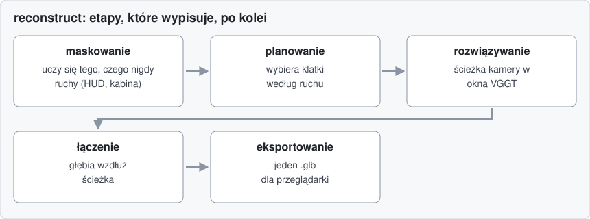

# Rekonstrukcja offline {#offline-reconstruction}

```bash
python -m heat3d_capture reconstruct lap.mp4 -o lap.glb [--solve-budget 260] [--fuse-interval 0.4]
```

Kod: [`scan/offline.py`](https://github.com/Holdi601/3DHeat-GameCapture/blob/main/heat3d_capture/scan/offline.py),
[`pose/feedforward.py`](https://github.com/Holdi601/3DHeat-GameCapture/blob/main/heat3d_capture/pose/feedforward.py),
[`pose/vggt_model.py`](https://github.com/Holdi601/3DHeat-GameCapture/blob/main/heat3d_capture/pose/vggt_model.py),
[`pose/feedforward_source.py`](https://github.com/Holdi601/3DHeat-GameCapture/blob/main/heat3d_capture/pose/feedforward_source.py),
[`pose/solveprep.py`](https://github.com/Holdi601/3DHeat-GameCapture/blob/main/heat3d_capture/pose/solveprep.py).
Opcje: [Dokumentacja poleceń](commands.md#reconstruct).

## Dlaczego druga ścieżka {#why-a-second-path}

Śledzenie przyrostowe jest na żywo i tanie, i działa tam, gdzie jest struktura, której można się chwycić: wnętrze, ulica, mapa z osłonami. **Tor wyścigowy to jego najgorszy przypadek**: droga to gładka wstążka z małą fakturą, horyzont prawie się nie rusza, a gdy kilka póz zdryfuje, nic później ich nie ściąga. Okrążenie wychodzi jako wijąca się krzywa zamiast się zamykać.

Ścieżka offline podaje **okna klatek** modelowi, który przewiduje wszystkie ich kamery naraz, więc każda klatka ogranicza każdą inną bezpośrednio, a nie przez łańcuch. Potrzebuje całego nagrania, zanim odpowie, więc nie działa na żywo i jest wolna: minuty na okno na stacjonarnym GPU. Wszystko po pozach - fuzja, pokrycie, kolor, eksport - to ten sam kod co skan na żywo: rozwiązana trasa jest przekazywana rekonstruktorowi jako źródło pozy, dokładnie tam, gdzie trafia telemetria Forzy.

## Wymagania {#requirements}

- **PyTorch** dopasowany do twojego GPU (projekt go nie przypina; zainstaluj go przed `requirements.txt`, zob. [Środowisko uruchomieniowe](runtime.md)).
- **`vggt`** - kod modelu VGGT (`from vggt.models.vggt import VGGT`) z repozytorium GitHub Meta; nie ma go w indeksie pakietów.
- **`transformers`**, bo ścieżka offline uruchamia głębokość przez PyTorch `DepthEstimator` (Depth Anything V2 Small), a nie przez plik ONNX.
- W praktyce karta graficzna CUDA; oba modele mogą działać na procesorze, ale to niepraktyczne.

Żadne z nich nie jest w `requirements.txt`, bo skaner ich nie potrzebuje. Są w **`requirements-offline.txt`**, z zależnościami samego VGGT (`einops`, `safetensors`, `huggingface_hub`, `Pillow`):

```bash
.venv\Scripts\python -m pip install -r requirements-offline.txt
.venv\Scripts\python -m pip install --no-deps "vggt @ git+https://github.com/facebookresearch/vggt.git"
```

VGGT jest instalowany z `--no-deps`, bo jego metadane przypinają `numpy<2`, a pip by to uszanował, obniżając numpy, którego potrzebuje tu scipy. `reconstruct` sprawdza wszystkie te pakiety zaraz po wypisaniu linii licencji (lista `OFFLINE` w [`runtime/preflight.py`](https://github.com/Holdi601/3DHeat-GameCapture/blob/main/heat3d_capture/runtime/preflight.py)), wymienia brakujące z rozmiarami i instaluje tylko po zgodzie - VGGT z `--no-deps`, jak wyżej. Odmowa albo brak terminala, w którym można by zapytać, kończy działanie kodem 1.

## Model i jego licencja {#the-model-and-its-licence}

**VGGT**, `facebook/VGGT-1B`: **CC-BY-NC-4.0, tylko niekomercyjnie, a rekonstrukcja zrobiona nim to dziedziczy.** Polecenie wypisuje to przed startem (`describe_licence`). Istnieje osobno licencjonowany `facebook/VGGT-1B-Commercial`, ale jest to repozytorium z bramką, przyznawane na konto przez Meta, więc nie może być domyślne. `--model vggt-1b-commercial` rozwiązuje z nim (i wypisuje jego linię licencji); bez przyznanego dostępu pobieranie się nie uda. *Kod* `vggt` jest objęty własną „VGGT License” Meta, umową o materiałach badawczych z polityką dopuszczalnego użycia (odczytaną z `LICENSE.txt` pakietu). Zob. [Modele i licencje](models-and-licences.md).

## Przebieg, etap po etapie {#the-run-stage-by-stage}

Nazwy etapów są takie, jakie wypisuje polecenie.



### masking {#masking}

`FlowMask` jest uczona z **4 serii po 90 kolejnych klatek**, wycentrowanych na 1/8, 3/8, 5/8 i 7/8 wideo, przy 960 x 540 w skali szarości (zob. [FlowMask](reconstruction-capture.md#flowmask-what-never-travels)). Jej uwaga jest wypisywana i zachowywana w podsumowaniu. Wideo krótsze niż 90 klatek nie dostaje maski.

#### Maska kamery jest uczona, nie stosowana {#the-camera-mask-is-learned-not-applied}

Maska **nie** jest stosowana do klatek podawanych solverowi. Maskowanie kokpitu wyglądało dobrze wg statystyk cech (większość wykrytych narożników siedzi na pikselach przymocowanych do kamery) - ale to stwierdzenie o detektorze cech, a solver to wytrenowana sieć. Mierzone tym, jak bardzo odzyskana trasa skręca między kolejnymi krokami (samochód skręca o kilka stopni; błądzenie losowe o dziewięćdziesiąt), surowe klatki dawały najmniejszy skręt, klatki z podbitym kontrastem trochę więcej, klatki maskowane wyraźnie więcej, a obie rzeczy razem najwięcej. Więc solver dostaje surowe klatki. Maska nadal służy do planowania odstępów klatek poniżej, a przyrostowy tracker używa jej w skanie na żywo. (`solveprep.enhance`, który maskuje i podbija lokalny kontrast przez CLAHE, istnieje, ale ta komenda go nie używa.)

### planning: klatki rozstawione ruchem {#planning-frames-spaced-by-motion}

`plan_by_motion` wybiera klatki solvera według tego, **jak bardzo ruszył się obraz**, a nie według zegara: stały odstęp daje wolnym odcinkom klatki, których nie potrzebują, i głodzi szybkie, gdzie kolejne klatki przestają nachodzić na siebie na tyle, by się wiązać.

- Docelowe przemieszczenie: **5% szerokości 960 px** (48 px) mediany przemieszczenia cech ORB między kolejnymi wybranymi klatkami, mierzone na klatkach 960 x 540 w skali szarości z kontrastem CLAHE, cechy tylko na masce.
- Start z odstępem 0,3 s; po każdym kroku następny odstęp staje się `gap x (0.5 + 0.5 x target / measured)`, ograniczony do **0,15-2,0 s**, więc jeden zaszumiony pomiar nie przechyla planu.
- Gdy nic się nie dopasowało, odstęp kurczy się do 0,6 swojej wartości (zbyt daleko od siebie to porażka, której się unika).
- Zatrzymuje się na końcu wideo albo przy `--solve-budget` klatkach (domyślnie 260).

Mniej niż 4 zaplanowane klatki to błąd.

### solving: okna i zszywanie {#solving-windows-and-stitching}

Zaplanowane klatki są dekodowane w szerokości 960 px i rozwiązywane w **nachodzących się oknach po 16 klatek, z 6 wspólnymi** z następnym (`plan_windows`; ostatnie okno jest cofane tak, by kończyło się na ostatniej klatce, więc koniec przechwytywania ma tylu sąsiadów co środek). Ponad **400** klatek w jednym przebiegu jest odrzucane.

Każde okno: klatki przeskalowane tak, by dłuższy bok był **518**, a oba boki wielokrotnościami **14** (proporcje zachowane - rozciąganie zniekształciłoby pole widzenia), przeskalowane do 0..1, przepuszczone przez VGGT w autocastingu bfloat16 (float16 wyczerpuje wykładnik na odległych współrzędnych świata). Zewnętrzne parametry kamer są zamieniane na obroty świat-od-kamery i środki kamer. Mapy punktów domyślnie nie są zachowywane.

Każde okno wraca we **własnej, dowolnej ramce i własnej, dowolnej skali**, więc okna są **zszywane** w ramkę pierwszego przez transformację podobieństwa (obrót, przesunięcie, jedna skala) dopasowaną do kamer, które współdzielą z już umieszczonymi:

- **Obrót z orientacji kamer**, nie z ich pozycji: współdzielone kamery leżą wzdłuż trasy i są prawie współliniowe na prostej, co zostawia dopasowanie tylko po pozycji ślepe na obrót - każde okno się zakrzywia, a wynik zszycia wychodzi prosto. Obrót to średnia `target_R x source_R^T` rzutowana z powrotem na prawdziwy obrót (z zabezpieczeniem przed odbiciem).
- **Skala i przesunięcie z pozycji**, wzdłuż obróconego źródła.
- Wymagane są co najmniej **4** współdzielone kamery; mniej to błąd.
- Nakładka to jedna trzecia okna, by skala była dobrze wyznaczona; błąd skali narastający z okna na okno sprawia, że okrążenie się spiralizuje.

Dla każdego szwu zapisywana jest największa niezgodność współdzielonych kamer po dopasowaniu, w jednostkach średniego odstępu między nimi (`seam_error`).

### fusing {#fusing}

Klatki co `--fuse-interval` sekund (domyślnie 0,4) są dekodowane w szerokości 960 px, dostają głębokość od Depth Anything V2 Small (PyTorch) i są zfuzowane z pozą **interpolowaną** z rozwiązanej trasy w ich znaczniku czasu (liniowo pozycja, sferycznie obrót; `FeedForwardPoses`). Klatki poza rozwiązanym zakresem czasu są pomijane zamiast ekstrapolowane. Kamera używa **65-stopniowego** poziomego pola widzenia. Pozy feed-forward mają pewność 0,85 w fuzji i pokryciu.

### exporting {#exporting}

Siatka jest zapisywana jak dla skanu na żywo ([Wyjście .glb](glb-output.md)), nazwana po wideo.

## Podsumowanie {#the-summary}

```text
140 cameras solved over 182s
closure error 3.1% of path length
worst seam 0.42 frame spacings
<mask note>
wrote lap.glb
```

| Linia | Znaczenie |
|---|---|
| closure error | odległość od pierwszej do ostatniej kamery podzielona przez długość trasy. Dla pojedynczego okrążenia to uczciwa miara dryfu. Powyżej 10%: „The lap does not close ... Treat the shape as unreliable.” |
| worst seam | największa niezgodność zszycia. Powyżej 1,0: „Windows disagreed by up to N frame spacings at a seam, so part of the path is stitched on weak evidence.” |
| no file | „Fusion produced no surface, so nothing was written.” Kod wyjścia wynosi wtedy 1. |

## Skala {#scale}

Zszyta trasa jest w dowolnych jednostkach pierwszego okna. Głębokość jest zakotwiczana przez triangulację między interpolowanymi pozami (jak dla telemetrii), więc geometria jest zgodna z trasą - ale **wynik nie jest w metrach**, chyba że jest nią trasa. Nic w tym poleceniu nie ustala globalnej skali; kalibracja podłoża nie jest stosowana, gdy pozy pochodzą ze źródła pozy.

## Stan tej ścieżki {#state-of-this-path}

Przy klatkach o stałym odstępie okna rozwiązują się w spójną trasę na niektórych odcinkach okrążenia, a w bazgroły na innych. Porażki to ciasne zakręty, gdzie widok gwałtownie się obraca między klatkami, a próbkowanie tych zakrętów gęściej je odzyskuje. Żadna statystyka obrazu (jasność, szczegółowość, liczba cech, udział punktów zgodnych, przemieszczenie) nie przewidziała z góry, które odcinki zawiodą. Więc odstępu nie da się w pełni zaplanować z obrazów z wyprzedzeniem: trzeba go wybrać przez rozwiązanie, zmierzenie wyniku i ponowne rozwiązanie gęściej tam, gdzie trasa nie jest taką, jaką mógłby przejechać samochód. Planowanie ruchem jest zbudowane; **adaptacyjne ponowne rozwiązywanie nie jest**.
