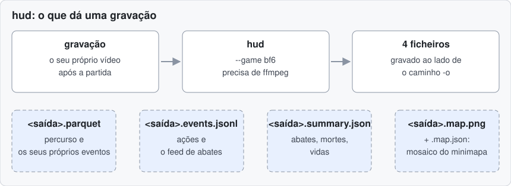

# Ler o HUD de uma gravação {#reading-the-hud-from-a-recording}

`hud` lê o HUD do jogo, o ecrã com as informações, a partir da **gravação do próprio jogador**, depois da
partida: as **próprias** ações do jogador a partir do popup de pontos que o jogo mostra por baixo da mira
(abates, assistências, reanimações, reabastecimentos, capturas...), as suas mortes a partir dos ecrãs de
abatido e de implantação, o **próprio** trajeto a partir do minimapa, e o feed de abates ao lado deles como
eventos com hora - escritos como uma tabela do 3DHeat, com o mosaico do minimapa como imagem de mapa para
pôr por baixo.

Em resumo: veja o vídeo da sua partida e anote os seus abates, as suas mortes e por onde andou.

```bash
.venv\Scripts\python -m heat3d_capture hud "<recording>.mp4" --game bf6 --player <name> -o out/match
```

Battlefield 6 é o primeiro perfil de jogo.



## O que faz e o que não toca {#what-it-does-and-does-not-touch}

- Lê um **ficheiro de vídeo**: um clip do ShadowPlay / Instant Replay, uma gravação do OBS, qualquer coisa
  que o ffmpeg descodifique. Nunca toca no jogo, na sua memória, nos seus ficheiros nem na sua rede, e corre depois que a partida termina. Ver [As regras](rules.md).
- Deriva **apenas a posição do próprio jogador**, a partir do minimapa do próprio jogador. Os marcadores
  dos outros jogadores no minimapa são ocultados e nunca são lidos. O feed de abates é guardado por inteiro,
  mas apenas como o que diz no ecrã (quem, a quem, com quê, quando); nenhuma posição é associada a alguém
  que não seja o jogador.
- O OCR corre localmente (RapidOCR com os modelos do PaddleOCR através do ONNX Runtime). Nenhum quadro
  nem recorte sai da máquina.
- Uma gravação mostra os nomes de outros jogadores, e o mosaico é uma imagem do nível. As saídas são para
  utilização própria do jogador; mantenha-as locais.

## Requisitos {#requirements}

- **ffmpeg e ffprobe** no `PATH`. Uma placa NVIDIA é usada para a decodificação quando existe
  (`-hwaccel cuda`); caso contrário, o CPU decodifica, várias vezes mais devagar.
- Os pacotes em `requirements.txt`, e o OCR sem as suas próprias dependências (pede o `onnxruntime` da CPU,
  que colide com o DirectML que o projeto usa):

```bash
.venv\Scripts\python -m pip install -r requirements.txt
.venv\Scripts\python -m pip install --no-deps rapidocr_onnxruntime==1.2.3
```

`rapidocr_onnxruntime` é o leitor de texto (OCR) que lê os nomes e as palavras do ecrã. `--no-deps` impede-o
de substituir o `onnxruntime` DirectML do projeto.

Para instalar o ffmpeg no Windows: `winget install Gyan.FFmpeg`, depois abra um terminal novo e verifique com
`ffmpeg -version`. Nunca usou a linha de comandos? Leia [Antes de começar](before-you-start.md).

- Uma gravação **16:9**, em qualquer resolução (1080p, 1440p, 4K). Outras proporções são recusadas, porque as
  caixas do perfil cairiam nas partes erradas do ecrã.
- O **layout de HUD padrão** do jogo. Um elemento do HUD movido ou escalado é lido no lugar errado.

## Opções {#options}

| Opção | Padrão | Significado |
|---|---|---|
| `video` | | A gravação. |
| `-o`, `--out` | o nome do vídeo, na pasta atual | Caminho de saída **sem** extensão; os ficheiros são `<out>.parquet`, `.events.jsonl`, `.summary.json`, `.map.png`, `.map.json`. |
| `--game` | `bf6` | Qual HUD ler. `bf6` (Battlefield 6) é, por agora, o único perfil. |
| `--player` | nenhum | O nome do jogador como o feed de abates o mostra. É comparado de forma aproximada (o OCR confunde `l`/`I`/`1`, `O`/`0`, `rn`/`m`). Sem ele, o nome é adivinhado (abaixo). |
| `--fps` | 5 | Amostras do minimapa por segundo. O feed de abates é amostrado a metade disso, o popup de pontos e os ecrãs de morte também a metade (um quarto enquanto nenhum popup está visível), a bússola a cada 3 s, a lista de esquadrão a cada 15 s. |
| `--start` | 0 | Segundos no vídeo em que começar. |
| `--seconds` | tudo | Quanto do vídeo ler. |
| `--metres-per-pixel` | nenhum | A escala do minimapa, se for conhecida: metros por pixel do minimapa no zoom habitual (o minimapa tem 296 pixels de largura num ecrã 1080p). Sem isto, as posições ficam nesses pixels; ver [Norte e unidades](#north-and-units). |
| `--cpu` | desligado | Decodifica na CPU mesmo quando há uma placa NVIDIA. |

No fim de cada cinco segundos é impresso o progresso; no final, o jogador, os abates, as mortes, as vidas e os
ficheiros escritos.

## Saídas {#outputs}

### `<out>.parquet` - o trajeto e os eventos do jogador {#parquet---the-players-track-and-events}

Uma linha por amostra em que o jogador estava em jogo e o minimapa pôde ser posicionado, mais uma por cada
evento seu. O rodapé traz as instruções de leitura do visualizador (chave `heat3d`, `kind: heat3d-hud`), para
que o visualizador mapeie cada coluna sem perguntar.

| Coluna | Significado |
|---|---|
| `time` | Segundos desde o início do vídeo. |
| `event` | `position`; `start` (o vídeo começou a meio de uma vida), `spawn` (de volta ao jogo depois de uma morte ou de uma longa pausa), `death`, `downed` e `revived` (dos ecrãs de morte, abaixo), `end` (uma vida terminou sem que se saiba como); as ações do próprio jogador a partir do popup de pontos (`kill`, `assist`, `reviving`, `resupply`, `capture`... - a [tabela de eventos](#event-table)); e as linhas do feed de abates sobre o jogador como `kill_feed`, `death_feed`, `teamkill_feed`, `suicide_feed`, `squadwipe_feed`. |
| `source` | De onde veio o evento da linha: `points` (o popup), `screen` (os ecrãs de abatido e de implantação), `feed` (o feed de abates); vazio nas linhas de posição. |
| `text` | Nas linhas `points`: o rótulo como impressa (`KILL`, `SQUAD DAMAGE ASSIST`...), ou o título (`DOUBLE KILL`, o nome de uma fita), ou, para um rótulo desconhecida, o que foi lido. |
| `points` | Nas linhas `points`: quanto o total do popup cresceu naquele momento. Quando várias ações chegaram na mesma amostra (um abate e o veículo em que estava), é a sua soma, indicada em cada uma, e `shared` diz quantas a partilharam. Vazio quando o total não foi lido duas vezes, antes e depois do momento. |
| `subject`, `subject_side` | Nas linhas `points`: o nome que o popup mostrou com a ação - a vítima de um abate, o colega reanimado ou reabastecido - e a sua cor (`enemy`, `friendly`, `squad`). |
| `confirmed` | `feed` quando o feed de abates tinha uma linha para o mesmo abate ou morte (em 3 s, a mesma vítima). |
| `x`, `y`, `z` | Posição no mosaico: `x` leste, `y` norte, `z` 0 (o rodapé diz que `z` é para cima). O norte é o norte real quando a bússola o permitiu (ver `north_up` no resumo). |
| `player` | Sempre `me`. Só as linhas do próprio jogador têm posições. |
| `team` | `own`. |
| `session` | `<video name>#NN`, uma por vida. As rotas de calor de linha nunca atravessam uma sessão. |
| `heading` | Graus no sentido horário a partir do norte (a partir do topo do mosaico quando o norte é desconhecido): para onde a vista apontava. |
| `dir_x`, `dir_y`, `dir_z` | O mesmo, como vetor de direção, para a direção de olhar do visualizador. |
| `zoom` | O quanto o minimapa estava afastado em relação ao seu zoom habitual (acima de 1 em veículos). |
| `killer`, `victim`, `weapon`, `headshot`, `marker` | Nas linhas de abate e de morte que têm uma linha de feed: a linha do feed (abaixo). Um abate do popup sem linha de feed tem o nome do popup como `victim`; um abate do popup mostrado como HEADSHOT tem `headshot` como verdadeiro. |

Cada linha de evento leva a posição do jogador no momento do evento (para uma morte ou uma queda, a última
posição antes dela; para uma reanimação, a primeira depois). As linhas encaixam diretamente no
[calor de linha](https://holdi601.github.io/3DHeat/line-heat.html) do visualizador: a sua sugestão escolhe
`event`, começa em `start`, `spawn` e `revived`, termina em `death`, `downed` e `end`, e as linhas `position`
ficam ao longo do percurso. Os outros eventos têm nomes tais que a sugestão não os toma por início nem fim:
reanimar alguém é `reviving` (não `revive`), manter um ponto é `defense`, um colega a nascer junto do jogador
é `teammate_arrived`, as linhas do feed são `kill_feed` e assim por diante; `kill` não é um fim.

Um clip com duas rondas em dois mapas dá dois mosaicos que não se podem relacionar. O maior é
`<out>.parquet`; cada um dos outros com pelo menos 30 s de trajeto é escrito ao lado dele como
`<out>.map2.parquet`, `<out>.map2.map.png`, e assim por diante.

### `<out>.events.jsonl` - os eventos do jogador e o feed de abates {#eventsjsonl---the-players-events-and-the-kill-feed}

Um objeto JSON por linha, em ordem de tempo, cada um com um `source`:

- `points`: um por ação do jogador: `time`, `event`, `text`, `points`, `shared`, `subject`, `subject_side`
  (como na tabela), `popup` (de que popup veio, numerado ao longo da execução), `seen` (quantas leituras o
  mostraram), `confirmed`, e `x`, `y` onde o jogador estava.
- `screen`: um por cada queda e cada reanimação: `event` (`death`, `downed` ou `revived`), `time` (quando o
  jogador caiu; para `revived`, quando os ecrãs saíram), `until` (a última vez que os ecrãs foram vistos),
  `screens` (`down` e/ou `card`), `outcome` (`death`, `revived` ou `unknown` quando a gravação acaba
  primeiro), `killer` (da linha do feed, quando existe), `x`, `y`.
- `feed`: cada linha que o feed mostrou, de todos:

| Campo | Significado |
|---|---|
| `time`, `last` | Primeira e última amostra em que a linha foi lida (segundos desde o início do vídeo). `time` é quando o abate apareceu, com uma margem de uma amostra do feed (0,4 s à taxa padrão). |
| `kind` | Do lado do jogador: `kill`, `death`, `teamkill`, `suicide`, `squadwipe`; para as linhas de outros jogadores, `kill`, `squadwipe`, ou `death` para uma linha sem atacante. |
| `killer`, `victim` | Os nomes, como a leitura mais frequente em todas as amostras que mostram a linha (uma leitura mais longa ganha quando a comum é o seu início: um nome parcialmente escondido). `killer` fica vazio numa linha que mostrou só um ícone e uma vítima - uma morte causada pelo mundo, ou uma linha cujo atacante já tinha desaparecido. |
| `killer_side`, `victim_side` | Pela cor do nome: `friendly` (a equipa do jogador, azul), `enemy` (laranja), `squad` (o verde pálido que o jogo usa para o jogador e o seu esquadrão), `neutral` (nenhum destes). |
| `weapon` | A classe do ícone da arma nesta execução: `icon01`, `icon02`... As linhas cujos ícones se parecem partilham uma classe. Os ícones não têm nome; não há lista de onde os tirar. |
| `marker` | O pequeno ícone entre a arma e a vítima: `skull`, `arrow`, `chevrons`, `crosses` ou vazio. |
| `headshot` | `marker == "skull"` - uma suposição, ver [Limitações](#limits). |
| `seen` | Quantas amostras do feed mostraram a linha. |
| `me` | `killer`, `victim` ou nulo. |
| `matched` | Nas linhas do próprio jogador: se foi encontrada uma ação do popup ou um ecrã de morte para ela. |
| `x`, `y` (, `map`) | Nas linhas do próprio jogador: onde estava. |

### `<out>.summary.json` {#summaryjson}

O jogador (e como foi encontrado), de onde vieram os eventos do jogador (`own_events_from`: o popup e os
ecrãs, ou só o feed de abates quando nenhum dos dois foi lido), abates, mortes, K/D, headshots, assistências,
reanimações dadas (`revives`) e recebidas (`revived`), quedas, capturas, neutralizações, reabastecimentos,
curas, reparações, veículos destruídos, a pontuação (os totais dos popups somados), cada tipo de ação com a
sua contagem (`actions`), o número de popups, as mortes que só o feed mostrou, a contagem própria do feed de
abates e de mortes e quantos dos seus abates coincidiram com um abate de popup, abates de equipa, suicídios,
aniquilações de esquadrão, vidas, segundos em jogo, distância percorrida (nas unidades da tabela), linhas do
feed, por mapa se está orientado a norte e quantas leituras da bússola concordaram, as contagens do trajeto
(amostras, em jogo, posicionadas, não posicionadas, ilhas), as suposições feitas e o tempo.

### `<out>.map.png` e `<out>.map.json` - o mapa por baixo do trajeto {#mappng-and-mapjson---the-map-under-the-track}

O mosaico de todos os minimapas da execução, em média, sem as sobreposições, rodado e escalado exatamente
como a tabela. O ficheiro JSON auxiliar tem as duas âncoras que a colocação **Imagem de mapa** do visualizador
pede ([Imagens de mapa](https://holdi601.github.io/3DHeat/map-images.html) na documentação do visualizador):
carregue o PNG com **Imagem de mapa...**, mantenha **Inverter norte/sul** ativo, e escreva a âncora 1 e a
âncora 2 (`px`, `py`, `worldX`, `worldZ`) a partir do JSON auxiliar. A imagem fica então exatamente por baixo
do trajeto.

Só as partes do nível que o minimapa do jogador mostrou estão na imagem.

## Método {#method}

### Decodificação {#decoding}

O ffmpeg decodifica na GPU, reduz para a taxa de amostragem enquanto os quadros ainda estão na placa,
recorta as regiões do perfil (minimapa, feed de abates, duas tiras da bússola, lista de esquadrão, o popup de
pontos, as palavras do ecrã de abatido, o canto inferior direito), redimensiona cada uma para um tamanho fixo
e empilha-as numa imagem pequena por amostra. Só essa imagem atravessa o pipe para o Python. Decodificar cada
quadro do fluxo H.264 é o mínimo do tempo de execução.

Duas threads de trabalho recebem as amostras: uma regista os minimapas (OpenCV), a outra lê o texto (ONNX
Runtime).

### Em jogo ou não {#in-play-or-not}

O quadrado de dica da tecla do minimapa (o quadrado claro com a legenda do mapa dentro, no canto inferior
esquerdo do minimapa) é desenhado sempre que o minimapa é, e não nos ecrãs de morte, de câmara de morte, de
implantação, de menu ou de tabela de pontuação. A sua presença - um quadrado claro e sem cor, com uma letra
escura no meio, claramente mais claro do que o que o rodeia - procurada a alguns pixels do seu lugar, é o teste
de estar em jogo. Uma amostra isolada que não concorda com os dois vizinhos é ignorada.

Uma pausa em jogo é uma morte ou uma mudança de ronda (o trecho seguinte começa com `spawn`) quando dura pelo
menos 6 s ou quando uma morte (dos ecrãs, ou uma linha do feed que nomeia o jogador como vítima) ocorreu até 40 s
antes dela; uma pausa mais curta sem morte (o mapa grande foi aberto) continua a vida. O minimapa fica visível
enquanto o jogador está abatido, por isso um jogador abatido está em jogo.

### O trajeto {#the-track}

O minimapa gira com a vista e mantém o jogador num ponto fixo (medido: o meio, 49,7% para baixo). Cada amostra:

1. **Máscara** do que não é o nível: pixels fortemente coloridos ou quase brancos (marcadores de objetivo,
   ícones de esquadrão e de veículos, pings, a fronteira da área de jogo, linhas de rota, texto), o amarelo-verde
   ténue do cone de visão, um disco à volta do marcador do jogador, a cunha do cone acima dele, a dica da tecla e
   uma margem fina.
2. **Características**: pontos-chave SIFT na imagem cinzenta do minimapa com contraste equalizado, dentro da máscara.
3. **Registar no mosaico**, não na amostra anterior: os pontos-chave são comparados com as características
   guardadas até agora, em coordenadas do mosaico, perto de onde o jogador estava por último; uma semelhança
   (rotação, zoom, deslocamento) é ajustada com RANSAC. Um ajuste precisa de inliers suficientes, de um zoom a
   menos de um terço do último e de um deslocamento inferior a um terço do minimapa por amostra; um ajuste
   procurado em qualquer ponto do mosaico (depois de uma morte) precisa do dobro dos inliers.
4. **Fazer crescer o mosaico**: as características que o mosaico ainda não tem são acrescentadas (no máximo a
   cada poucas décimas de segundo de movimento), e o minimapa mascarado é calculado em média na imagem.
5. O ponto do jogador levado através do ajuste é a sua **posição**; o topo do minimapa levado através dele é o
   seu **rumo** no mosaico.

Depois, um ponto que salta mais de 10 pixels para longe dos dois pontos anteriores e dos dois seguintes (que
concordam entre si) é descartado: um minimapa, de vez em quando, encaixa com um zoom errado durante uma amostra.
O resumo conta-os (`dropped_as_jumps`).

Registar no mosaico é o que impede os erros de se acumularem: voltar a um lugar encaixa nas características
guardadas da primeira vez. Um nascimento num lugar ainda não visto começa uma **ilha** separada; cada décima
amostra posicionada é tentada contra as outras ilhas, e a primeira boa correspondência as junta (a menor se move para a maior, com o seu trajeto). As ilhas que nunca se juntam (outro mapa, ou terreno nunca partilhado) são
escritas em separado, como acima.

### Norte e unidades {#north-and-units}

A tira da bússola é lida a cada 3 s: os seus rótulos são encontrados pela sua cor (clara, sem cor, agrupada
através de pequenos intervalos, marcas de escala descartadas), cada um é lido à parte, e dois ou mais rótulos
fixam tanto a escala da tira como o rumo sob a marca central - um único rótulo não fixa nada. Cada leitura da
bússola é emparelhada com o rumo do mosaico da mesma amostra; a mediana circular das diferenças, sobre as
leituras a 10 graus dela, é a rotação que põe o norte do mosaico para cima. É aplicada quando pelo menos três
leituras e metade de todas concordam.

<a id="units"></a>A escala de terreno do minimapa não está impressa em lugar nenhum do ecrã, por isso as posições
ficam em **pixels do minimapa no zoom habitual**: o zoom mediano da execução é escalado para uma unidade da
tabela por pixel de um minimapa de 296 pixels (o seu tamanho num ecrã 1080p). A redução de zoom de veículo é
retirada pelo registo, por isso uma unidade é a mesma a pé e num veículo. `--metres-per-pixel` multiplica tudo
para metros quando a escala é conhecida (a partir de uma distância conhecida no mapa, medida uma vez).

### O feed de abates {#the-kill-feed}

O feed é lido a 2,5 amostras por segundo, mas só quando os seus pixels coloridos mudaram de forma notável ou
passaram 2 s. As linhas de texto são encontradas pelo detetor do OCR; uma linha cuja imagem corresponde a uma lida
na amostra anterior (as linhas deslizam, por isso podem ter-se movido) fica com esse texto em vez de ser lida de
novo. Linhas pequenas demais para um nome, ou com uma barra (um contador de fps nesse canto), são descartadas.

As linhas são agrupadas em filas pela altura; numa fila, o nome mais à esquerda é o atacante e o mais à direita
é a vítima. Pedaços vizinhos da mesma cor juntam-se (um nome com um espaço). Uma linha única que atravessou o
ícone de um nome para o outro é cortada no seu intervalo mais largo quando as metades têm cores diferentes, e cada
metade é lida de novo. Um único nome na coluna das vítimas com um ícone logo à sua esquerda é uma linha sem
atacante. Dois pedaços da mesma cor sem ícone entre eles são um nome cujo atacante desapareceu, não um abate.

**Os lados** vêm da cor. Os nomes são desenhados com alguma transparência, por isso o teste é a distância do
texto ao seu próprio fundo: o sinal de vermelho menos azul nessa diferença é laranja (inimigo) ou azul (amigo)
em qualquer fundo; nenhum dos dois, com o verde acima dos outros dois, é a cor do esquadrão.

**Ícones**: entre os nomes, os pixels da cor do atacante fazem a silhueta da arma; um pequeno ícone separado,
logo antes da vítima, é o marcador, identificado pela sua forma (uma mancha com buracos de olhos é uma caveira;
um pequeno triângulo é uma seta; vários pedaços são cruzes).

**Eventos**: uma linha lida de novo com os dois nomes iguais (semelhança 0,7 depois de corrigir as confusões
habituais do OCR, uma delas 0,8; uma leitura cortada corresponde ao início do nome completo) é o mesmo evento,
enquanto o evento foi lido pela última vez há menos de 5 s e tem menos de 14 s - nenhuma linha fica visível
mais tempo, por isso o mesmo par mais tarde é um abate novo. Uma linha sem atacante corresponde só pela vítima.
A hora de um evento é a sua primeira vez vista; os seus nomes, lados e marcador são a maioria entre as vezes
vistas; as linhas lidas uma única vez são descartadas.

**O jogador**: `--player`, senão a linha realçada (a mais brilhante) da lista de esquadrão, quando há pelo menos
três leituras e 60% delas concordam, senão o nome que o feed mais desenhou na cor do esquadrão. Caso contrário,
o resumo diz que o jogador é desconhecido, e nenhuma linha do feed é atribuída a ele. (O popup e os ecrãs de
morte são do próprio jogador, seja qual for o nome; não precisam de nome.)

### O popup de pontos {#the-points-popup}

Tudo o que o jogador pontua, o Battlefield 6 mostra num só popup, logo à esquerda e abaixo da mira - no mesmo
lugar a pé, num veículo e através de uma mira:

```
            [ RIBBON ] (icon)          um título, de vez em quando: uma fita ou um multi-abate
      (icon)(icon)(icon)  300          um ícone por ação; o total corrente do popup
                Some_Name              a quem se refere, durante um momento: laranja um inimigo, azul um colega
    [ KILL x2 ] [ VEHICLE DESTROYED ]  uma etiqueta em caixa por tipo de ação, com uma contagem
```

O popup cresce enquanto o jogador continua a pontuar: um novo abate transforma `KILL` em `KILL x2`, acrescenta
um ícone e aumenta o total; um novo tipo de ação acrescenta um rótulo. A linha de rótulos mostra os últimos
tipos (uma mais antiga desliza para fora, e continua a contar quando volta). Cerca de três segundos depois da
última ação, o popup recolhe-se numa só linha (`[KILL x2] 300`) e desaparece. O texto é cinzento-claro, as
rótulos em caixas finas, o total em algarismos grandes a começar em x 760 de um ecrã 1920x1080, os rótulos
alinhadas à direita em x 750.

É lido 2,5 vezes por segundo: o detetor do OCR encontra as linhas de texto, só as linhas numa das filas do popup
são lidas (os próprios rótulos da mira de tanque, na mesma área, não), e uma linha cuja imagem corresponde a uma
lida na amostra anterior fica com esse texto. Uma linha que atravessou de um ícone, um nome ou um rótulo
dobrada para o total (`Name10`, `REVIVE185`) é cortada onde o total começa (x 755) e as duas metades são lidas de
novo. Enquanto nenhum popup está visível, cada amostra alternada fica sem ser lida; quando a seguinte mostra um popup,
a retida é lida primeiro, para que o início de um popup seja encontrado até a amostra.

**Os rótulos** são comparadas com a [tabela de eventos](#event-table) depois de corrigir os deslizamentos habituais
do reconhecedor (Q lido como O, um algarismo entre letras, I em vez de L, uma letra perdida numa margem): uma
leitura é um rótulo quando é pelo menos 80% semelhante a uma (85% para rótulos de cinco letras ou menos) e
claramente mais próxima dela do que de qualquer outra. Os rótulos que o reconhecedor juntou (`CAPTUREDORDERCOMPLETED`)
são separadas retirando, da frente, rótulos conhecidas. Uma contagem é `x2`, `X3`, um sinal solto e um algarismo,
ou um algarismo logo depois do rótulo. Uma linha cinzento-clara, em maiúsculas, na linha de rótulos que não
corresponde a nada é mantida como uma ação `points` com o seu texto; uma linha que é um pedaço de um rótulo
conhecida no mesmo popup (`DESTROYED` ao lado de `VEHICLE DESTROYED`) não é. Os títulos acima do total (caixas
claras, texto escuro) são `multi_kills` (`DOUBLE KILL` ...) ou `ribbon`. O nome é a linha colorida entre o total e
os rótulos; o seu lado vem da sua cor, como no feed.

**Popups e ações**: leituras com menos de 0,9 s de nada entre elas são um só popup. Um popup que parece terminar e
volta antes de poder ter desaparecido (dentro de 3,2 s do último crescimento), com cada rótulo na sua contagem
ou acima e um total não menor, é o mesmo popup perdido por um momento (desfoque, um fundo claro) - nada nele é
contado duas vezes. Num popup, a contagem final de um rótulo é a contagem mais alta lida pelo menos duas
vezes; a sua k-ésima ação é datada na primeira leitura que mostra uma contagem de k ou mais. Uma contagem lida
numa só amostra não é uma ação - exceto um abate que o feed de abates confirma (uma linha do jogador dentro de
3 s que nenhum outro abate reclamou): o rótulo curto KILL é a que o reconhecedor mais vezes lê só uma vez.
Um título conta uma vez por popup, quando lido duas vezes. `points` é quanto o total - contando só totais lidos
duas vezes seguidas - cresceu desde antes da amostra da ação até depois dela.

Uma linha desconhecida conta como rótulo só na fila dos rótulos conhecidas na mesma leitura (ou, sem rótulo
conhecida, quando também não há nome), para que um nome desenhado numa cor que o teste de lado não consegue
distinguir não seja tomado por uma.

### Mortes e reanimações {#deaths-and-revives}

Quando o jogador cai, o jogo mostra isso logo abaixo do centro do ecrã (MAN DOWN, REQUEST REVIVE, SKIP (HOLD), NEARBY
MEDICS; quando uma reanimação é pedida, REVIVE REQUESTED, CANCEL REQUEST), e um cartão no canto inferior direito
nomeia quem o fez, com DAMAGE LOG ou PLAYER CARD por baixo e uma linha "YOU n - n FOE" por cima. Morto logo (um
tiro na cabeça fatal), só o cartão aparece. Depois, ou um colega reanima o jogador - os ecrãs saem e o jogo
continua - ou o jogador sangra até morrer ou desiste, e em seguida aparece o ecrã de implantação, com DEPLOY no canto
inferior direito.

Estas palavras são lidas em conjunto com o popup, na mesma passagem do OCR (o popup, a faixa do ecrã de abatido e
o canto inferior direito empilhados numa só imagem): 2,5 vezes por segundo enquanto um popup está visível, 1,25
vezes no resto. O canto só é incluído quando o jogador está fora de jogo ou foi visto abatido nos últimos 3 s; em
jogo só tem a contagem de munições.
Avistamentos com menos de 4 s entre si formam um episódio (pelo menos dois avistamentos). Um episódio é uma
**morte** quando o ecrã de implantação aparece até 12 s depois do seu fim, ou quando o jogador está fora de jogo
3 s depois dele e lá fica 6 s ou mais; é uma **reanimação** (`downed`, depois `revived`) quando o jogador ainda está
em jogo 3 s depois dos ecrãs saírem; `unknown` (escrito como `downed` sozinho) quando a gravação acaba primeiro.
A hora da morte é quando o jogador caiu: a linha do feed que o nomeia como vítima, quando existe uma até 3 s antes
do episódio, senão o primeiro avistamento do episódio menos meio intervalo de leitura. As posições depois de uma
morte ficam fora do percurso até ao ecrã de implantação.

Uma morte do feed que nenhum episódio explica (os ecrãs foram perdidos) é mesmo assim uma `death`, com `source`
`feed`, e julgada como antes: se o jogador ficar em jogo mais de 40 s depois, foi reanimado.

### Tabela de eventos {#event-table}

O que cada rótulo, título e ecrã se torna. Várias rótulos podem ser um só evento; `text` guarda qual.

| Evento | De | Significado |
|---|---|---|
| `kill` | KILL; HEADSHOT | O jogador matou alguém (o nome é a vítima). Um abate de tiro na cabeça mostra HEADSHOT onde estaria KILL: `text` diz qual, e `headshot` é verdadeiro. |
| `assist` | ASSIST, KILL ASSIST, DAMAGE ASSIST, SQUAD DAMAGE ASSIST | Dano a alguém que um colega matou. |
| `kill_assist` | ASSIST COUNTS AS KILL | Uma assistência que o jogo conta como abate. |
| `suppression`, `suppression_assist` | ENEMY SUPPRESSION; SUPPRESSION ASSIST | Fogo de supressão sobre um inimigo; sobre um que um colega matou depois. |
| `smoke_assist` | SMOKE ASSIST, SQUAD SMOKE ASSIST | Fumaça que cobriu um colega. |
| `spot`, `spot_assist` | SPOT, SPOTTED, ENEMY DESIGNATION; SPOT ASSIST, SPOT BONUS | Localizar um inimigo; um abate sobre um que o jogador localizou. |
| `driver_assist` | DRIVER ASSIST | Um abate pelo artilheiro do veículo do jogador. |
| `reviving`, `reviving_bonus` | REVIVE, SQUAD REVIVE; CONCEALED REVIVE | O jogador reanimou um colega; o bónus pelo fazer em cobertura. |
| `heal` | HEAL, SQUAD HEAL | O jogador curou um colega. |
| `resupply` | SUPPLY, RESUPPLY, SQUAD SUPPLY | Um colega tirou munições do jogador. |
| `repair` | REPAIR, VEHICLE REPAIR, SQUAD REPAIR | O jogador reparou um veículo. |
| `capturing`, `capture` | CAPTURING, RECAPTURING; CAPTURED, OBJECTIVE CAPTURED | Um tique de captura; o objetivo tomado. |
| `neutralizing`, `neutralize` | NEUTRALIZING; NEUTRALIZED, OBJECTIVE NEUTRALIZED | O mesmo para levar um objetivo inimigo a neutro. |
| `defense` | DEFENDING, OBJECTIVE DEFENDED | Manter um objetivo. |
| `offensive`, `defensive` | OFFENSIVE; DEFENSIVE | O bónus numa ação perto de um objetivo atacado; defendido. |
| `order` | ORDER COMPLETED | Uma ordem de esquadrão cumprida. |
| `vehicle_damage`, `vehicle_disabled`, `vehicle_destroyed`, `vehicle_destroyed_assist` | VEHICLE DAMAGE; VEHICLE DISABLED; VEHICLE DESTROYED; VEHICLE DESTROYED SUPPORT | Dano a um veículo inimigo, até ao destruir, ou ajudar a isso. |
| `equipment_destroyed` | EQUIPMENT DESTROYED | Um dispositivo inimigo destruído. |
| `forced_bail` | FORCED BAIL | Um inimigo obrigado a sair do seu veículo. |
| `squad_wipe` | SQUAD WIPE | O último de um esquadrão inimigo morto. |
| `savior`, `avenger` | SAVIOR; AVENGER | Um abate sobre um inimigo que estava a ferir um colega; quem tinha acabado de matar um. |
| `teammate_arrived` | SPAWNED ON, SPAWN ASSIST, VEHICLE SPAWN, SQUAD VEHICLE SPAWN | Um colega nasceu junto do jogador ou no seu veículo. |
| `transport` | TEAM TRANSPORT | Transportar colegas num veículo. |
| `fortify` | DEFENSE DEPLOYED | Uma defesa que o jogador construiu. |
| `points` | qualquer outra coisa na linha de rótulos | Uma ação que a tabela não conhece: `text` é o que foi lido. |
| `multi_kills` | DOUBLE KILL, TRIPLE KILL, QUAD KILL, MULTI KILL (título) | Abates em sucessão rápida. |
| `ribbon` | qualquer outro título | Uma fita, pelo seu nome (BALLISTIC, TANK BUSTER, ENGINEER EXPERT, SPEARHEAD...). |
| `downed` | ecrã de abatido, depois de jogo | O jogador caiu e foi reanimado. |
| `revived` | os ecrãs saem, o jogo continua | O jogador foi reanimado por um colega. |
| `death` | ecrã de abatido ou de cartão, depois de implantação ou de fora de jogo | O jogador morreu. |

Os textos da tabela foram vistos nas gravações de teste, exceto estes, que são os nomes habituais da série de
jogos e estão na tabela para serem nomeados em vez de ficarem como `points`: HEADSHOT KILL, ASSIST, KILL ASSIST,
ASSIST COUNTS AS KILL, SPOT, SPOTTED, SPOT ASSIST, SPOT BONUS, SQUAD REVIVE, HEAL, SQUAD HEAL, RESUPPLY, SQUAD
SUPPLY, REPAIR, VEHICLE REPAIR, SQUAD REPAIR, VEHICLE DISABLED, SQUAD WIPE, AVENGER, as formas OBJECTIVE ..., e os
títulos TRIPLE KILL, QUADRUPLE KILL e MULTI KILL. O jogo noutra língua imprime outras palavras: as suas rótulos
saem como `points` com o que foi lido - não confundidas com uma ação conhecida - com os seus totais e nomes; e
como os ecrãs de morte são reconhecidas pelas suas palavras em inglês, as mortes vêm então só do feed de abates,
como linhas `death` com `source` `feed`.

## O que está verificado {#what-is-verified}

Verificado a olho contra gravações de teste (do próprio jogador, não fazem parte do repositório), desenhando
amostras ao acaso e comparando cada uma com os quadros à volta dela:

- **Os eventos próprios do jogador.** Cada ação de popup amostrada era uma ação real desse tipo, encontrada a
  menos de uma leitura (0,4 s) da sua hora; a maioria dos valores e nomes estava certa (nomes em alguns alfabetos,
  como o cirílico, podem sair desfigurados). Cada ecrã de morte amostrada foi encontrado.
- **Feed de abates.** A grande maioria das linhas do feed foi encontrada com os dois nomes certos; pequenos deslizamentos
  do OCR (um I maiúsculo lido como l minúsculo) são aceitos. Nomes desenhados em glifos que o próprio jogo mostra
  como caixas podem ser perdidos. Os lados (cores) estão errados em alguns por cento dos nomes.
- **Em jogo.** O teste da dica da tecla concordou com o quadro em todos os momentos amostrados.
- **Trajeto.** Não há verdade de referência sobre onde o jogador esteve, por isso o trajeto é verificado contra a
  própria gravação: dois minimapas são registados **diretamente um contra o outro**, e esse deslocamento é comparado
  com o deslocamento entre as duas posições da tabela. A discordância mediana é de cerca de 1-3 pixels do minimapa
  (menos de 1% da largura do minimapa), mais num minimapa cheio e com zoom afastado.
  As leituras da bússola concordam com o mosaico dentro de 10 graus quase sempre.
- **Tempo de execução.** A decodificação a cerca de 5 vezes o tempo real é a maior parte; ler o popup de pontos
  acrescenta cerca de um quinto a metade.

Observado a olho: cada mosaico tem estradas e edifícios contínuos através das vidas que o construíram, e os
percursos de vidas diferentes ao longo da mesma estrada ficam uns sobre os outros. Um trecho em que o zoom do
minimapa muda pode sair longo demais - ver [Limitações](#limits).

Os testes (`tests/test_hud_*.py`) desenham tudo o que leem: um nível inventado de estradas, edifícios e curvas de
nível, minimapas de caminhadas por ele com as sobreposições que um real tem, tiras de bússola, linhas de feed com
nomes inventados. Verificam que um ciclo é seguido com dois pixels de erro e fecha, que um jogador parado fica
no lugar enquanto a vista roda, que as mudanças de zoom são seguidas, que um nascimento noutro lugar se liga de
novo quando os caminhos se encontram, que a rotação para o norte e o espelhamento do y colocam o trajeto onde ele
realmente foi, que as âncoras da imagem de mapa o alinham por baixo do trajeto, e a leitura, os lados, os
marcadores e a deduplicação do feed. Para os eventos próprios do jogador, desenham popups de pontos com nomes e
rótulos inventados e verificam a tabela de rótulos e a sua tolerância aos deslizamentos do reconhecedor, rótulos
juntas, as filas do popup, o total cortado de um nome, a contagem à medida que o popup cresce, a continuação depois
de um momento sem leitura, um rótulo que desliza para fora e volta, ou que termina; que uma contagem lida uma vez
fica separada; as mortes, reanimações e desfechos a partir das palavras dos ecrãs; e, numa partida inventada, que as
ações, mortes e reanimações caem na tabela onde o jogador estava, as linhas do feed ao lado delas com os seus
próprios nomes, e que o percurso termina na morte e não na reanimação.

## Limitações {#limits}

- **As unidades são pixels do minimapa**, não metros, a não ser que `--metres-per-pixel` seja dado. Nada no ecrã do
  jogo indica a escala de terreno do minimapa.
- **Só é mapeado o que o minimapa mostrou.** O mosaico cobre o terreno a menos de meio minimapa de onde o jogador
  foi; dois mosaicos que nunca partilharam terreno (duas rondas em dois mapas, ou duas vidas em cantos muito
  afastados de um mapa grande) ficam como ficheiros separados com coordenadas não relacionadas.
- **O trajeto é o do minimapa, a 5 amostras por segundo**, suavizado por nada. Um minimapa muito afastado (um
  helicóptero nas gravações de teste afastou-o 2,3 vezes) mostra menos detalhe por pixel, e fora da área de jogo
  mostra quase nenhum, por isso o registo aí é mais grosseiro. Jatos, e o jogador como passageiro, não estavam nas
  gravações de teste.
- **Os erros de registo são locais e não se acumulam**, mas um mosaico construído enquanto se explora terreno novo
  pode ter uma pequena curva que só é corrigida quando o terreno volta a ser visto. Onde o zoom do minimapa muda
  continuamente (um veículo a acelerar), o zoom ajustado pode derivar, e um trecho assim foi visto com a sua distância
  cerca de duas vezes a verdadeira. Um mosaico construído a partir de um minimapa de infantaria cheio e com zoom
  afastado é o menos preciso (erros típicos de cerca de 3 pixels, até 18).
- **Sem otimização de grafo de poses.** Um ciclo fecha-se por comparação de características guardadas, não
  espalhando a correção pelo ciclo.
- **As classes de armas ainda não funcionam.** A silhueta do ícone é tirada de um ícone translúcido sobre um fundo
  em movimento, e varia demais de amostra para amostra: as gravações de teste saíram com 220 a 340 classes para
  550 a 670 linhas, quando uma partida tem algumas dezenas de armas. Trate `weapon` como experimental. As classes são
  por execução de qualquer modo, e não são nomes.
- **Os significados dos marcadores nem todos são conhecidos.** A seta (`▸`) é desenhada antes do próprio nome do
  jogador, em linhas sobre ele; não é um tipo de abate. A caveira é tida como um tiro na cabeça; é uma suposição, não
  algo que o jogo diga. `chevrons` e `crosses` (aniquilações de esquadrão) são reportados como vistos.
- **Nomes em alfabetos que não são latinos** (o cirílico, por exemplo) saem como as letras latinas mais parecidas: o
  reconhecedor lê latim e chinês. O mesmo jogador é lido sempre da mesma forma, por isso continuam a corresponder,
  mas o texto não é o nome dele.
- **Sobreposições no canto do feed de abates** (um contador de fps) podem esconder o fim da vítima da fila de cima.
  O texto do contador é reconhecido e descartado, e um nome cortado é associado às suas leituras completas, mas um
  nome que só foi visto cortado fica cortado.
- **Uma morte que nem os ecrãs nem o feed mostraram** ainda termina o percurso, como `end`, quando o jogador sai de
  jogo durante 6 s ou mais.
- **Reanimações recebidas** vêm dos ecrãs de abatido. Só para uma morte do feed que os ecrãs perderam são ainda
  inferidas (em jogo mais de 40 s depois dela), e uma reanimação rápida fica então por distinguir.
- **As ações do popup têm a hora de uma leitura**: a menos de 0,4 s do rótulo aparecer pela primeira vez; uma
  rótulo que anima a entrada pode ser lida uma amostra mais tarde ou mais cedo.
- **Nomes nas filas do popup** são lidos como os do feed: os alfabetos que não são latinos saem desfigurados, e de
  vez em quando o rótulo de nome de um colega a flutuar no mundo perto do popup é lida como o nome da ação. Ações
  sem nome (um tique de captura, uma ordem) não levam nenhum.
- **`points`** falta onde o total não foi lido duas vezes antes e depois de uma ação, e é partilhado entre ações que
  chegaram na mesma amostra. A `score` do resumo soma os totais finais dos popups, por isso um popup cujo total nunca
  foi lido duas vezes não entra nela.
- **A linha de rótulos é uma janela**: com quatro ou mais tipos num só popup, o rótulo mais antigo desliza para a
  esquerda, para fora da região lida. Foi contada enquanto estava visível; uma contagem que ganhe com meia rótulo
  fora do ecrã pode ficar por contar.
- **Um popup perdido durante mais tempo do que podia durar** (mais de cerca de 4 s de amostras ilegíveis enquanto
  ainda crescia) é tomado por dois, e um rótulo com uma contagem acima de um é então contada outra vez. Não foi
  visto nas verificações abaixo.
- **Outros idiomas da interface**: os rótulos saem como `points` com o seu texto, e as mortes vêm só do feed (os
  ecrãs de morte são reconhecidas pelas suas palavras em inglês).
- **Eventos numa ilha curta**: uma vida cujo trajeto era curto demais para ser escrita como mapa (menos de 30 s)
  mantém os seus eventos em `.events.jsonl` sem `x`, `y`, e fora de qualquer tabela.
- **O layout do HUD é o padrão do BF6 em 16:9.** Uma escala de HUD alterada, uma paleta para daltónicos ou um
  tamanho de minimapa diferente precisariam de um perfil próprio.
