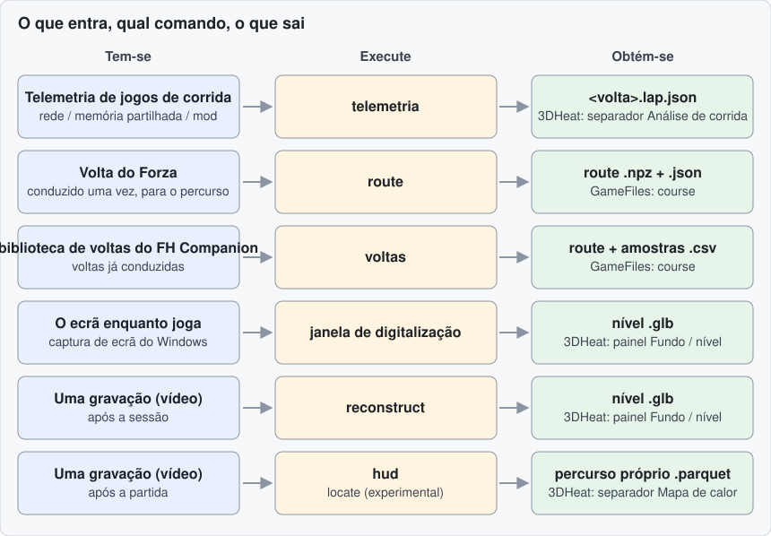

# 3DHeat GameCapture {#dheat-gamecapture}

**O que é?** Uma ferramenta que registra o que um jogo de corrida conta sobre a sua direção, um arquivo
por volta. Ela também pode reconstruir um modelo 3D aproximado de um nível a partir de um vídeo de você jogando.

**Para que eu usaria?** Para ver as suas voltas no [visualizador 3DHeat](https://holdi601.github.io/3DHeat/):
onde você freou, onde estava lento, em que as duas voltas diferem. E para ter o nível sob o seu
mapa de calor quando ninguém tem um modelo 3D dele.

**Exemplo:** ligue o Data Out do Forza, execute um comando e dê duas voltas. Dois arquivos de volta aparecem em
`laps\`. Solte-os na aba Análise de corrida do visualizador.


Nunca usou a linha de comando? Leia primeiro [Antes de começar](before-you-start.md).

## As três tarefas {#the-three-jobs}

1. **Telemetria de volta.** Ela registra cada canal que um jogo de corrida publica - o Data Out do Forza, a
   memória compartilhada dos jogos Assetto Corsa, os feeds de rede dos jogos de rali, um mod do BeamNG, um
   plugin do Trackmania - e grava um arquivo `heat3d-lap` por volta ou trecho, para a aba Análise de corrida do
   visualizador. O iRacing não precisa de gravador: o visualizador lê os próprios arquivos `.ibt`.
2. **Níveis a partir do jogo.** Ela transforma o que a tela mostrou enquanto você andava ou dirigia por um
   nível em um modelo 3D `.glb`, que o visualizador coloca sob o mapa de calor.
3. **A sua própria partida, depois dela.** `hud` lê o HUD da sua própria gravação - as suas ações, mortes,
   trajeto no minimapa e feed de abates. `locate` (experimental: por enquanto posiciona poucos quadros reais)
   descobre de onde cada quadro foi tirado, no modelo 3D de um nível.

As três seguem uma regra: **nada é injetado em um jogo e nada é hookado**. Os quadros vêm da API pública
de captura de tela, a telemetria de interfaces que os jogos publicam para isso. Veja
[As regras](../rules.md).



O código é Python (pacote `heat3d_capture`), licença MIT. Os modelos de profundidade e de pose que ela
pode rodar têm as suas próprias licenças - veja [Modelos e licenças](../models-and-licences.md).

## Início rápido {#quick-start}

### Gravar voltas {#record-laps}

Você precisa de Python 3.10 ou mais recente ([Antes de começar](before-you-start.md)). No PowerShell:

```powershell
git clone https://github.com/Holdi601/3DHeat-GameCapture
cd 3DHeat-GameCapture
python -m venv .venv
.venv\Scripts\python -m pip install -r requirements.txt

# Forza: Configurações -> HUD e Jogabilidade -> Data Out = ON, IP 127.0.0.1, porta 5300
.venv\Scripts\python -m heat3d_capture telemetry -o laps
```

**Você deve ver** `listening on port 5300. Laps go to laps. Ctrl+C to stop.`, depois uma linha por volta
à medida que você cruza a linha de chegada, como na imagem acima. Pressione Ctrl+C para parar. Solte os arquivos de
`laps\` na aba Análise de corrida do visualizador. Cada outro jogo está a um `--game` de distância:

```powershell
.venv\Scripts\python -m heat3d_capture telemetry --game acc -o laps
.venv\Scripts\python -m heat3d_capture telemetry --game dirtrally2 -o laps
```

Veja [Gravadores de telemetria](../telemetry.md) para cada jogo e cada opção.

### Escanear um nível {#scan-a-level}

Dê um duplo clique em **`scan.bat`** na pasta da ferramenta. Ele encontra o Python (e oferece instalá-lo
com o winget se não houver nenhum), cria um `.venv` privado e abre a janela de escaneamento. A janela diz
o que está faltando, para que serve cada pacote e o tamanho do download, e não instala nada sem um sim. Veja
[Execução e dependências](../runtime.md) e [A janela de escaneamento](../reconstruction-scan-ui.md).

Manualmente: `.venv\Scripts\python -m heat3d_capture.ui`.

Para reconstruir uma gravação offline, com o caminho da câmera resolvido de uma vez (precisa de PyTorch, do
pacote `vggt` e de uma GPU - veja [Reconstrução offline](../reconstruction-offline.md)):

```powershell
.venv\Scripts\python -m heat3d_capture reconstruct lap.mp4 -o lap.glb
```

## Mapa da documentação {#map-of-the-documentation}

| Página | O que cobre |
|---|---|
| [Antes de começar](before-you-start.md) | Python, um terminal, o primeiro comando, erros comuns |
| [As regras](../rules.md) | Sem injeção, só interfaces publicadas, e o que isso custa |
| [Gravadores de telemetria](../telemetry.md) | O comando `telemetry` e uma visão geral de cada jogo |
| [Forza](../telemetry-forza.md) | Data Out, detecção de layout, o relay do FH Companion e o seu `.tele.gz` |
| [Jogos Assetto Corsa](../telemetry-assetto-corsa.md) | AC, ACC, AC EVO, AC Rally pela memória compartilhada |
| [Jogos de rali](../telemetry-rally.md) | EA SPORTS WRC, DiRT Rally 2.0 / 1 / DiRT 4, Richard Burns Rally |
| [BeamNG.drive](../telemetry-beamng.md) | O mod de protocolo `heat3d` |
| [Trackmania](../telemetry-trackmania.md) | O plugin Openplanet `Heat3dRecorder` |
| [iRacing](../telemetry-iracing.md) | Lendo arquivos `.ibt` no visualizador |
| [Divisão de voltas e trechos](../lap-splitting.md) | `LapSplitter`, `CounterSplitter`, `LineSplitter`, `StageSplitter` |
| [Deslizamento, derrapagem e canais derivados](../slip-and-drift.md) | Como o deslizamento é escalado, e o que o visualizador deriva |
| [O arquivo heat3d-lap](../lap-format.md) | O formato do arquivo de volta, canais, unidades, `meta` |
| [Jogos](../games.md) | Por jogo: como gravar, o que é enviado, quais percursos podem ser exportados |
| [Comandos](../commands.md) | `route`, `telemetry`, `laps`, `reconstruct`, `hud`, `locate`, passo a passo |
| [Referência de comandos](../cli-reference.md) | cada opção, gerada a partir do `--help` |
| [Ler o HUD de uma gravação](../hud-video.md) | `hud`: ações próprias, mortes, trajeto no minimapa e feed de abates de uma gravação |
| [Localizar quadros em um nível](../locate.md) | `locate`: de onde cada quadro foi tirado, contra a geometria do nível |
| [Reconstrução de nível](../reconstruction.md) | O pipeline dos quadros até um `.glb` |
| [A janela de escaneamento](../reconstruction-scan-ui.md) | Cada controle, atalho e elemento de sobreposição |
| [Captura, máscaras e qualidade do quadro](../reconstruction-capture.md) | Windows Graphics Capture, quadros-chave, máscaras de HUD, conselhos de qualidade |
| [Profundidade](../reconstruction-depth.md) | Depth Anything V2, ONNX Runtime, montagem do modelo |
| [Pose da câmera e escala](../reconstruction-pose.md) | Odometria, relocalização, poses da telemetria, escala do solo, ajuste de feixe |
| [Fusão, cobertura e cor](../reconstruction-fusion-and-texture.md) | O volume de ocupação, a grade de cobertura, pontos fracos, cor do vértice |
| [A saída .glb](../glb-output.md) | O arquivo que o visualizador carrega |
| [Reconstrução offline](../reconstruction-offline.md) | `reconstruct`, janelas VGGT e costura |
| [Modelos e licenças](../models-and-licences.md) | Tamanhos do Depth Anything V2, VGGT, os pacotes |
| [Execução e dependências](../runtime.md) | Verificação prévia, backends, níveis de desempenho |
| [Limites e verificação](../limits.md) | O que não é feito, e o que não foi verificado |
| [Atualizações](../updates.md) | A verificação de versão e o `python -m heat3d_update` |
| [Desenvolvimento](../development.md) | Testes, o ambiente virtual, estrutura do repositório |
| [Manutenção destas páginas](../maintaining.md) | A lista de verificação de lançamento de código e documentação |

## Parte do 3DHeat {#part-of-3dheat}

Os arquivos que esta ferramenta grava são carregados pelo **visualizador 3DHeat** -
[código](https://github.com/Holdi601/3DHeat), [documentação](https://holdi601.github.io/3DHeat/).
Os arquivos de volta vão para a aba Análise de corrida, os níveis `.glb` para o painel Fundo / nível, e as tabelas de `hud` e
`locate` para a aba Mapa de calor; como o visualizador lê tabelas e arquivos de partida está em
[Um arquivo por partida (.3dheat)](https://holdi601.github.io/3DHeat/container.html) e
[Obter dados](https://holdi601.github.io/3DHeat/getting-data-in.html).

| Ferramenta | O que faz | Documentação |
|---|---|---|
| [Visualizador 3DHeat](https://github.com/Holdi601/3DHeat) | mostra mapas de calor, corridas e partidas em 3D, no navegador | [docs](https://holdi601.github.io/3DHeat/) |
| [GameFiles](https://github.com/Holdi601/3DHeat-GameFiles) | percursos e níveis a partir dos arquivos que os jogos trazem, como modelos 3D | [docs](https://holdi601.github.io/3DHeat-GameFiles/) |
| [GameCapture](https://github.com/Holdi601/3DHeat-GameCapture) | telemetria de voltas de jogos de corrida; níveis reconstruídos a partir de vídeo de jogo | [docs](https://holdi601.github.io/3DHeat-GameCapture/) |
| [Unreal Exporter](https://github.com/Holdi601/3DHeat-UnrealExporter) | um plugin do Unreal Editor que exporta um nível como modelo 3D | [docs](https://holdi601.github.io/3DHeat-UnrealExporter/) |
| [CS2](https://github.com/Holdi601/3DHeat-CS2) | demos do Counter-Strike 2 em arquivos de partida; mapas em modelos 3D | [docs](https://holdi601.github.io/3DHeat-CS2/) |
| [Watcher](https://github.com/Holdi601/3DHeat-Watcher) | registra o seu jogo em segundo plano, a partir do que os jogos publicam | [docs](https://holdi601.github.io/3DHeat-Watcher/) |
| [Ext-WarThunder](https://github.com/Holdi601/3DHeat-Ext-WarThunder) | repetições do War Thunder em arquivos de partida | [docs](https://holdi601.github.io/3DHeat-Ext-WarThunder/) |
| [Ext-WoT](https://github.com/Holdi601/3DHeat-Ext-WoT) | repetições do World of Tanks em arquivos de partida | [docs](https://holdi601.github.io/3DHeat-Ext-WoT/) |
| [Ext-WoWs](https://github.com/Holdi601/3DHeat-Ext-WoWs) | repetições do World of Warships em arquivos de partida | [docs](https://holdi601.github.io/3DHeat-Ext-WoWs/) |
| [Ext-Squad](https://github.com/Holdi601/3DHeat-Ext-Squad) | demos de servidores do Squad em arquivos de partida | [docs](https://holdi601.github.io/3DHeat-Ext-Squad/) |
| [Ext-DCS](https://github.com/Holdi601/3DHeat-Ext-DCS) | mapas do DCS World em modelos 3D | [docs](https://holdi601.github.io/3DHeat-Ext-DCS/) |
| [Ext-IL2](https://github.com/Holdi601/3DHeat-Ext-IL2) | mapas do IL-2 Sturmovik em modelos 3D | [docs](https://holdi601.github.io/3DHeat-Ext-IL2/) |

Um desenvolvedor com o projeto do jogo aberto deve usar o exportador Unreal, que lê a geometria real
e é exato. Onde os arquivos do próprio jogo podem ser lidos, o GameFiles extrai o percurso exato.
A reconstrução a partir do jogo é para o caso em que só a tela está disponível.
