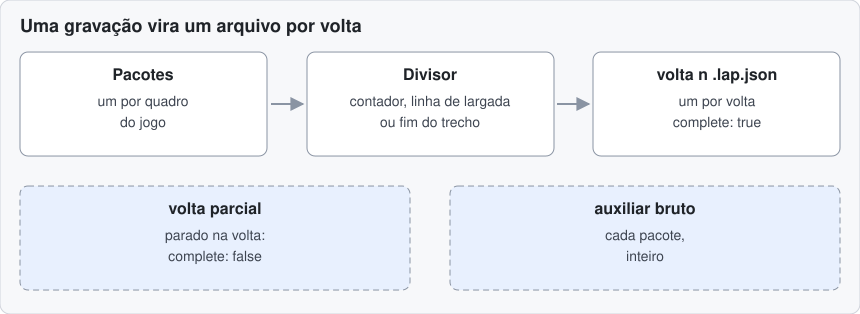

# Como as voltas e etapas são divididas {#how-laps-and-stages-are-split}

Um gravador vê um fluxo contínuo de amostras. Transformá-lo em voltas é feito por um de quatro divisores, escolhido pelo que o jogo informa sobre as voltas. Todos seguem a mesma ideia: use a contagem do próprio jogo quando ela existe e, senão, encontre a volta a partir das posições; nunca escreva um trecho curto demais para ser comparado.

| Divisor | Código | Usado por |
|---|---|---|
| `LapSplitter` | [`fulllap.py`](https://github.com/Holdi601/3DHeat-GameCapture/blob/main/heat3d_capture/telemetry/fulllap.py) | Forza |
| `CounterSplitter` | [`kunos.py`](https://github.com/Holdi601/3DHeat-GameCapture/blob/main/heat3d_capture/telemetry/kunos.py) | Assetto Corsa, ACC |
| `LineSplitter` | [`kunos.py`](https://github.com/Holdi601/3DHeat-GameCapture/blob/main/heat3d_capture/telemetry/kunos.py) | AC EVO, AC Rally, BeamNG |
| `StageSplitter` | [`rally.py`](https://github.com/Holdi601/3DHeat-GameCapture/blob/main/heat3d_capture/telemetry/rally.py) | EA SPORTS WRC, DiRT Rally 2.0, DiRT Rally, DiRT 4, Richard Burns Rally |

O Trackmania divide as corridas dentro do seu plugin ([Trackmania](telemetry-trackmania.md)), e os ficheiros do iRacing são divididos pelo visualizador a partir do contador de voltas do simulador ([iRacing](telemetry-iracing.md)).

Com **Ctrl+C**, todo gravador chama o `flush()` do seu divisor, então uma volta ou etapa aberta é escrita se passar pelos mesmos mínimos descritos abaixo.

## LapSplitter (Forza) {#lapsplitter-forza}

Parâmetros: `minimum_metres = 400`, `gap_seconds = 2.0`.

Para cada pacote decodificado:

1. Se o `timestampMs` do jogo saltou para a frente mais de 2 segundos desde o último pacote, ou voltou para trás, a volta aberta é descarregada antes.
2. Se `isRaceOn` é 0 (o jogo não está em corrida), a volta aberta é descarregada e o pacote é descartado.
3. Se nenhuma volta está aberta, abre uma com o `lapNumber` do pacote.
4. Se `lapNumber` difere do da volta aberta, a volta aberta é **fechada como completa**; o seu `seconds` é o `lastLap` do jogo quando ele é positivo. Uma volta fechada assim é escrita, qualquer que seja o seu comprimento. Abre uma nova volta.
5. O pacote é acrescentado.

O gravador também descarrega quando nenhum pacote chega por 2 segundos de tempo real (o jogo pausou, ou foi fechado no meio da volta).

**Descarregar** mantém a volta aberta só se ela tem pelo menos 2 amostras e pelo menos 400 m de `distanceTravelled`; ela é escrita como incompleta (uma `run`). Uma corrida ponto a ponto nunca conta uma segunda volta, então sempre termina assim.

## CounterSplitter (AC, ACC) {#countersplitter-ac-acc}

Parâmetro: `minimum_metres = 300`. Recebe cada amostra com `completedLaps` e o tempo da última volta da página de gráficos.

- A primeira amostra abre uma volta numerada com o `completedLaps` atual.
- Quando `completedLaps` muda, a volta aberta fecha. Ela é **completa**, com `seconds = tempo da última volta em ms / 1000` (se positivo), somente se o contador subiu exatamente 1 - um retorno para 0 (um reinício da sessão) ou um salto de vários fecha a volta como incompleta.
- Uma volta fechada só é escrita se tiver amostras e pelo menos 300 m de trajeto percorrido.
- Descarregar mantém a volta aberta se ela tiver mais de uma amostra e pelo menos 300 m.

## LineSplitter (AC EVO, AC Rally, BeamNG) {#linesplitter-ac-evo-ac-rally-beamng}

Parâmetros: `radius = 15 m`, `minimum_metres = 300`, `stop_seconds = 8`.

Estes jogos ou não têm um contador de voltas numa página que o gravador lê, ou correm etapas. A **linha é o ponto onde a gravação começou**:

1. A posição horizontal (`x`, `z`) da primeira amostra vira a linha.
2. Depois que o carro percorre mais de 5 m, a direção da linha até ao carro vira a direção da volta.
3. **Parar** encerra uma corrida: quando `speed` fica abaixo de 1 m/s por 8 segundos, a volta aberta é descarregada (é assim que uma etapa de rali termina: o carro para na chegada).
4. **Cruzar a linha**: depois de mais de 300 m percorridos, as amostras a até 15 m da linha são coletadas. Quando o carro sai desse raio de novo, a amostra coletada mais próxima é o cruzamento. Se o carro ia no mesmo sentido da direção da volta ali (produto escalar do rumo local com a direção é positivo), a volta fecha nessa amostra; senão a passagem é ignorada (o carro cruzou a largada no sentido contrário).
5. O `seconds` de uma volta fechada é o tempo desde a sua primeira amostra até ao cruzamento. Ela é **completa somente se a sua primeira amostra foi mais rápida que 5 m/s**: uma volta que começou parada é uma largada, não uma volta para comparar. A primeira volta de uma gravação iniciada no grid é, portanto, sempre incompleta; uma gravação iniciada em volta lançada dá uma primeira volta completa no cruzamento seguinte.
6. A volta seguinte começa na amostra do cruzamento (ela pertence às duas voltas).

Voltas com menos de 300 m são descartadas. Descarregar (uma parada, ou Ctrl+C) mantém a volta aberta se ela tiver pelo menos 2 amostras e 300 m, como incompleta. O BeamNG descarrega da mesma forma quando o veículo é reiniciado (o relógio dele volta atrás), antes de iniciar um novo divisor, para que a corrida feita antes do reinício seja mantida.

As distâncias são horizontais (`x`, `z`) para o contador de percurso e para o teste da linha, e 3D completas para o teste de 300 m de comprimento.

## StageSplitter (jogos de rali) {#stagesplitter-rally-games}

Parâmetro: `minimum_metres = 300`. Recebe cada amostra com o relógio de etapa do jogo, se o jogo diz que o carro terminou, e, opcionalmente, o tempo do próprio jogo para ela.

1. Se o relógio é 0 ou menos, ou voltou mais de 0,5 s, a etapa aberta é **abandonada**: mantida como etapa parcial se não estiver completa, tiver mais de 10 amostras e pelo menos 300 m. Um relógio de 0 ou menos também descarta a amostra (o carro está na largada).
2. Se nenhuma etapa está aberta, abre-se uma nova (numerada 1, 2, ... para a gravação).
3. Quando uma etapa está completa, as amostras seguintes são ignoradas até ao relógio voltar atrás.
4. Cada amostra é guardada com `time` igual ao relógio de etapa.
5. Quando o jogo diz que terminou, a etapa está completa; o seu `seconds` é o tempo do jogo, quando informado e positivo, senão o relógio. Ela é escrita se cobriu pelo menos 300 m.

O que "terminou" significa em cada jogo:

| Jogo | Termina quando |
|---|---|
| EA SPORTS WRC | comprimento da etapa > 0 e distância da etapa >= comprimento - 0,5 m |
| Jogos DiRT | voltas completadas subiram acima da contagem inicial da etapa, ou (evento de uma volta só) distância da volta >= 99,9% do comprimento da pista |
| Richard Burns Rally | relógio de corrida > 0 e distância até ao fim <= 0 |

No RBR, o eixo vertical e a velocidade são fixados quando uma etapa é escrita (veja [Jogos de rali](telemetry-rally.md#richard-burns-rally-rsf--ngp)).

## Tempo e distância no ficheiro de volta {#time-and-distance-in-the-lap-file}

Para todos os gravadores, exceto o do Forza, `time` é recalculado para que a primeira amostra da volta seja 0, e `distance` é a distância 3D acumulada entre posições consecutivas. O Forza usa o cronómetro de volta e o contador de distância do próprio jogo, recalculados da mesma forma.
